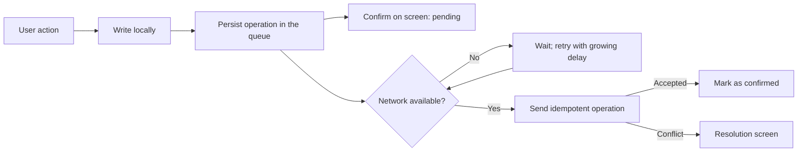

A mobile app loses the network in the subway, in the lift, in the field or on a plane. If its design assumes a
connection is always there, each of those moments becomes an error, a lost change or a screen that does not respond.
The thesis of this article is that the right model is to **write locally first and synchronise afterwards**: the app
confirms what the user does immediately, stores the intention in a persistent queue and sends it to the server when it
can. The hard part is not saving locally. It is deciding what happens when two copies of the same data diverge.

This approach has an explicit formulation in "Local-first software: You own your data, in spite of the cloud" (Kleppmann,
Wiggins, van Hardenberg and McGranaghan, Onward! 2019), which argues that the device should be the primary copy of the user's
data and that the cloud should serve to synchronise it across devices. Not every app needs to go that far, but nearly every
app benefits from assuming the network will fail.

<Callout tone="info" title="Offline-first does not mean no server">
  The server is still needed to share data, back it up and resolve conflicts between devices. What
  changes is that the app does not block while it waits for the server, and that local state is the
  first thing the user sees.
</Callout>

## What offline-first really means

An offline-first design has three properties. The first is that reads are served from local storage, so the screen appears without
waiting for the network. The second is that writes are confirmed locally and recorded in a queue that survives closes and restarts.
The third is that synchronisation is a background process, with retries and visible status, that never blocks interaction.

A design that only caches reads is not offline-first. If a user action fails when there is no network, the user has lost something,
even though the screen loaded. The acid test is this: close the app in the middle of an operation without network, reopen it, and
check that the user's intention is still there.

There is a cost to accept from the start. Every piece of data written locally can diverge from the server. For each entity, the design
must answer three questions: which changes can be made without a network, which changes need server validation, and how the copies are
reconciled when they meet again.

## The operation queue as a contract

The unit of synchronisation is not the final state of the data but the **operation**: create an order, mark a task as done, change a field.
The queue stores each one with a unique identifier, its local timestamp, the entity it affects and the content of the change. Sending
operations instead of states has two advantages: the server can replay the history and detect conflicts precisely, and the user can see
which changes are still pending.

The queue must follow three rules. It is persisted to local storage before the action is confirmed on screen, so an abrupt close does not
lose it. It is drained in order within each entity, because a later edit cannot arrive before the creation it depends on. And each operation
is idempotent: if the server receives it twice because the network dropped before the confirmation, the result must be the same. That last
property connects with the design of [idempotency in sagas and the outbox](/docs/sagas-outbox-idempotencia), where the same problem appears
between services.

Sending needs a retry policy with growing delays and random variation, so that thousands of devices regaining connectivity at once do not
hit the server at the same instant. The mechanism is the one described in [retries with jitter](/docs/reintentos-con-jitter).

## Conflicts: when there is a real conflict

A conflict appears when two devices modify the same data without knowing about each other's change. Not all conflicts are the same, and treating
them all with one strategy is a frequent source of data loss. Three cases are worth distinguishing.

- **Changes to different fields of the same entity**: these can usually be merged without the user's help. One device changes the phone number
  and another changes the address; the correct result has both changes.
- **Changes to the same field**: here a rule must be chosen. The simplest is last writer wins, using its timestamp. It is correct when losing the
  previous value does not matter, and dangerous when the user has written a long text that is silently overwritten.
- **Changes that break a business rule**: two bookings for the same seat, or a stock level that goes negative on sync. Automatic merging is not
  enough; the server must reject the operation, and the app must explain the rejection and offer a way out.

The golden rule is not to lose the user's text. If an automatic resolution would discard a change the user wrote, the app must keep it and show
it. A conflict resolved silently that erases work is worse than one that asks for a decision.

## Structures that merge without coordination

For data edited in parallel, such as collaborative text or ordered lists, there are data structures designed to converge without central
coordination. Conflict-free replicated data types (CRDTs) were formalised in the work of Shapiro, Preguiça, Baquero and Zawirski (SSS 2011,
published by Springer as LNCS 6976). It shows that certain designs converge to the same copy regardless of the order in which operations arrive.

Before CRDTs, collaborative applications used operational transformation (OT). Ellis and Gibbs described it in "Concurrency Control in Groupware
Systems" (SIGMOD 1989): each operation is transformed against concurrent ones so that the result is the same on every copy. OT is powerful but hard
to reason about and to implement well; CRDTs pay in metadata size what they gain in simplicity.

For most business apps a full CRDT is excessive. A good starting point is to model each field as a last-writer-wins register, to use counters that only
add for quantities, and to reserve convergent structures for the few pieces of data that several users really edit at the same time.

## Interface: the user must know what happened

An offline-first app has to show its synchronisation state. The user must be able to tell a value confirmed by the server, a value saved only on the device
and a rejected value that needs attention. Without that distinction the app seems to lie: the user believes the change is in the cloud when it is still in
the queue.

The interface should confirm the action immediately with a discreet pending indicator, and switch to confirmed when the server responds. Rejections deserve a
resolution screen, not a generic error that forces the user to repeat the work. And the app should have a view of pending operations, so that the user, or
support, can see what is still to be sent.

## App versions and the local schema

Offline-first apps face a risk that connected apps do not: local storage lives on the device for months, and the new
version of the app must be able to read it. A pending operation created by version 3.2 may reach the server when the user
already runs 3.4, or it may have been created by a version the server no longer accepts. Testing in the development
build avoids neither situation.

Two practices reduce the risk. The first is to version the local schema with explicit migrations, as with a server
database: each structural change has a number, is applied once and is recorded. The second is to version the format of
the queued operations too. The server should accept at least the last two formats, and the app should tag each operation
with the format it was created in. An old operation can then be translated instead of rejected.

A retirement policy is also needed. When a format stops being accepted, the app must warn the user before discarding their
pending operations, and support must be able to export them. Discarding in silence is the same as losing data. The
[expand and contract](/docs/migraciones-bd-sin-downtime) pattern used for server databases applies here almost unchanged:
first the new format is accepted, then it is emitted, and only at the end is the old one removed.

Not everything needs to be offline-first. A holiday request form that is submitted once a day, or a bank balance check,
may require a connection without the user losing anything useful. The decision depends on three questions: how often people
use the app without a network, how much a lost change costs and how much a badly resolved conflict costs. If the answer to
the first is "almost never" and to the others is "little", the cost of maintaining a queue, retries and conflict resolution
outweighs the benefit. Being offline-first is an investment to be justified with usage data, not a quality the app should
have by default.

## Tools

- **Transactional local storage** on the device, with atomic writes between the entity and its operation in the queue.
- **An operation identifier** generated on the client, unique and stable, for idempotency.
- **A retry mechanism** with growing delays, random variation and an attempt limit before asking for intervention.
- **An idempotent endpoint** on the server that accepts operations, applies each one once and returns the exact result even when they arrive repeated.
- **Queue telemetry**: how many operations are pending, how long they have waited and how many are rejected, per app version.

Libraries implement parts of this pattern, but it is worth understanding the model before adopting one. A synchronisation library that nobody understands
produces failures that nobody knows how to diagnose.

## Common mistakes

- **Confirming the action on screen before persisting it in the queue.** An abrupt close erases the intention, and the user believes the change is saved.
- **Synchronising states instead of operations.** The history is lost, and conflicts are detected late or not at all.
- **Resolving every conflict with "last writer wins".** The user's text is silently lost.
- **Not making operations idempotent.** A retry after a network drop duplicates orders or payments.
- **Retrying with no delay or variation.** When the network returns, every device hits the server at once.
- **Hiding synchronisation status.** The user cannot tell what is confirmed and what is not, and stops trusting the app.
- **Testing only on a stable network.** Most failures appear with intermittent drops, network changes and closes during an operation.

## Checklist

- [ ] Reads are served from local storage, and the screen does not wait for the network.
- [ ] Each action is persisted in a local queue before it is confirmed on screen.
- [ ] Operations have a stable identifier and the server applies each one only once.
- [ ] The queue drains in order within each entity, with growing and randomised retry delays.
- [ ] Each entity has a written conflict rule, different for each kind of change.
- [ ] The user's text changes are never discarded silently: they are kept or shown for a decision.
- [ ] The interface distinguishes confirmed, pending and rejected, with a resolution screen.
- [ ] There are tests with network drops, closes during an operation and restarts with a full queue.

## Sources

Checked in October 2026. The Kleppmann et al. article was confirmed through its metadata (Onward! 2019, DOI 10.1145/3359591.3359737);
the full text was not consulted. The Shapiro et al. paper was confirmed through its LNCS 6976 record, pp. 386–400. The Ellis and Gibbs
article was confirmed through its SIGMOD 1989 record. The conflict and queue examples are illustrative and do not describe a specific product.

- Kleppmann, Wiggins, van Hardenberg and McGranaghan, "Local-first software: You own your data, in spite of the cloud", Onward! 2019.
- Shapiro, Preguiça, Baquero and Zawirski, "Conflict-free Replicated Data Types", SSS 2011, LNCS 6976, pp. 386–400.
- Ellis and Gibbs, "Concurrency Control in Groupware Systems", SIGMOD 1989, pp. 399–407.
