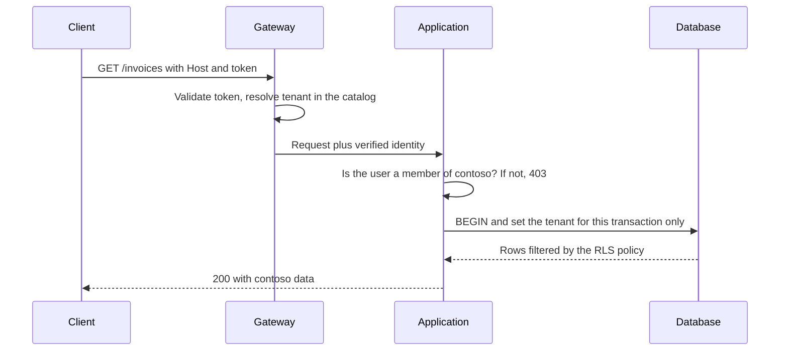
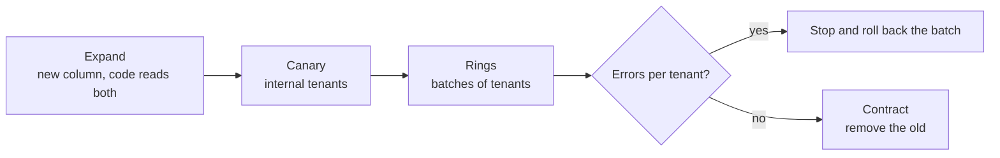

# Multi-tenancy: many customers, one system

Your product started with one customer and one database. The second customer arrived and you copied the deployment; by the tenth, every release took an afternoon of scripts, and someone asked whether it would be simpler to put everyone in the same database. It is simpler, right up to the day a query without a filter shows one customer another customer's invoices. That is the multi-tenancy dilemma: sharing lowers cost and operational effort, but every shared piece is a place where data can cross over.

**Multi-tenancy means serving several customers (tenants) from one system, deciding piece by piece what is shared and what is isolated, so that no tenant can see or degrade another tenant's work.**

This article walks through the decisions that matter: what a tenant is, the three data isolation models, how to identify the tenant and propagate its context, Row-Level Security as defense in depth, noisy neighbors, per-tenant configuration, migrations, data residency and usage metering. A full section covers cross-tenant data leaks, because they are the most serious failure in this topic. The code only shows shapes and names.

<Callout tone="info" title="Cut-off date and sources">
  Researched in October 2026. The design guidance comes mainly from the Azure Architecture Center,
  the AWS SaaS Lens and the OWASP Multi-Tenant Security Cheat Sheet; Row-Level Security behavior
  comes from the PostgreSQL 18 documentation. Where a statement is my own inference, the text says
  so.
</Callout>

## What a tenant is and why it matters

A **tenant** is the unit you isolate data, configuration and consumption for. The Azure guidance suggests starting with who your customer is: in B2B it is usually an organization with many users; in B2C it might be a person, a family or a club. The definition is not trivial. One customer may want two tenants (production and testing) or one per country, and one user may belong to several tenants at once.

Keep three concepts apart:

| Concept    | What it is                                         | Example                                             |
| ---------- | -------------------------------------------------- | --------------------------------------------------- |
| Tenant     | Logical boundary for data, configuration and bills | The company Contoso                                 |
| User       | Identity acting inside one or more tenants         | Ana, who works for Contoso and audits Fabrikam      |
| Deployment | Set of infrastructure that serves tenants          | A cluster with its database in the Frankfurt region |

Azure calls those deployments _stamps_ and recommends a **mapping layer**: a table that records which deployment holds each tenant. With it, you can move a tenant between deployments without changing its identity. This article calls it the **tenant catalog**.

Why does it matter so much? Because the tenancy decision is not only technical. It sets your cost per customer, what you can promise in a contract, how you deploy and how much damage a failure does. Sharing more lowers cost and the number of moving parts; isolating more shrinks the blast radius and makes compliance easier.

## Data isolation models

Isolation is not binary. Azure describes it as a spectrum from sharing nothing to sharing everything, and the AWS SaaS Lens names the ends: **silo** (dedicated resources per tenant) and **pool** (shared resources), with **bridge** for the common mix where some parts of the system are siloed and others pooled. You can pick a different model per tier or per service.

In the data tier, where mistakes hurt the most, there are three main options:

- **Shared database with `tenant_id`.** Every table carries a tenant column and every query filters on it. This is the classic pool.
- **Schema per tenant.** One database, one schema (namespace) per tenant with the same tables. The application picks the schema per connection or transaction, for example with `search_path` in PostgreSQL.
- **Database per tenant.** Each tenant gets its own database; the application can still be shared. This is a silo in the data tier.

| Criterion                 | Shared database + `tenant_id`               | Schema per tenant                       | Database per tenant                                 |
| ------------------------- | ------------------------------------------- | --------------------------------------- | --------------------------------------------------- |
| Isolation                 | Logical: relies on the filter and RLS       | Logical, with a separate namespace      | Physical or close to it: own credentials, resources |
| Cost per tenant           | Lowest; highest density                     | Low, but the object count grows         | Highest, softened by elastic pools                  |
| Operations                | One database to back up, watch and scale    | One database with thousands of objects  | A fleet: everything must be automated               |
| Migrations                | Once, but on large tables                   | One per schema; they need orchestration | One per database; versions coexist                  |
| Noisy neighbor            | Exposed: CPU, memory and indexes are shared | Exposed: the server is shared           | Contained, unless databases share a server          |
| Restoring a single tenant | Hard: restore elsewhere and extract rows    | Easier: dump or restore one schema      | Straightforward                                     |
| Per-tenant customization  | Very limited                                | Possible, but invites drift             | Possible: encryption keys, region, windows          |

A few nuances the table cannot show:

- The Azure storage guidance advises against **separate tables per tenant** inside one database when you have many tenants, because querying, managing and migrating becomes unmanageable. Schema per tenant is a close variant; my own inference is that it shares much of that problem once tenants number in the thousands.
- Database per tenant is not "share nothing": the application, the queue or the cache can still be common. Azure calls this a horizontally partitioned deployment.
- Between pure pool and pure silo sits **sharding**: several shared databases, each holding a group of tenants, plus a map of which shard holds which tenant.

Choosing among them is a matter of explicit criteria and reversibility. To compare them with weighted criteria, see [trade-offs and decision making](/docs/trade-offs-y-decisiones).

## Identifying the tenant and propagating its context

Every request must resolve to a tenant before it touches data. Azure lists several ways to do it, each with its limits:

| Source                  | What it looks like                 | Watch out for                                             |
| ----------------------- | ---------------------------------- | --------------------------------------------------------- |
| Subdomain or domain     | `contoso.app.example` in `Host`    | Proxy headers (`X-Forwarded-Host`) that someone can spoof |
| Path or query parameter | `/contoso/...`, `?tenant=contoso`  | It is a value the client fully controls                   |
| Custom header           | `Tenant-Id: contoso`               | Browsers and some proxies do not send it or strip it      |
| Token claim             | A tenant claim in the JWT          | Users in several tenants: which one is active?            |
| API key or certificate  | A key issued for a specific tenant | Rotation and revocation; keys carry no claims             |

The rule that changes everything: **what arrives in the request is a selector, not an authorization**. The OWASP cheat sheet puts it this way: treat client-supplied tenant identifiers as selectors only, and bind the tenant context to a server-verified identity and a current membership. Azure frames it under the "assume breach" principle: even if the domain points to a tenant, the application still checks that the identity may act in it.



### Context travels; it is not recomputed

Once resolved, the tenant becomes an immutable **request context** that follows the operation down to the last adapter: repositories, cache, queues, logs and metrics. In [hexagonal architecture](/docs/arquitectura-hexagonal) terms, the driving adapter builds it from the verified identity and the driven adapters apply it; the core receives it as plain data instead of reading it from a global variable.

```typescript
// core/tenancy/tenant-context.ts: shape only
export type TenantId = string & { readonly __brand: 'TenantId' };

export type TenantContext = Readonly<{
  tenantId: TenantId;
  userId: string;
  deployment: string; // from the catalog, not from the request
}>;

// Every driven port that touches tenant data requires it
export type InvoiceRepository = {
  list(ctx: TenantContext, filter: InvoiceFilter): Promise<Invoice[]>;
};
```

The branded type (`TenantId`) stops you from passing an arbitrary string where a verified tenant is expected. Making the context an explicit parameter costs you some longer signatures, but it makes any operation that does not receive it visible in code review.

Background jobs are the usual weak spot: a queue message must carry the tenant, and the consumer must authorize it again. OWASP stresses that a shared queue is not an isolation boundary by itself.

## Cross-tenant data leaks: the most serious failure

In a pool model, a single oversight exposes every customer at once. It is not a theoretical risk: OWASP lists cross-tenant data leakage, tenant impersonation and identifier tampering (IDOR) among the core risks of a multi-tenant system.

<Callout tone="warning" title="One forgotten filter is enough">
  A `WHERE tenant_id = ?` missing from a single query, report or admin endpoint can return data for
  every tenant. Design so that forgetting the filter fails closed (no rows or an error), not open.
</Callout>

Where data usually escapes:

| Leak path                    | How it happens                                                               | Defense                                                                    |
| ---------------------------- | ---------------------------------------------------------------------------- | -------------------------------------------------------------------------- |
| Unfiltered query             | A report, a search or a new endpoint omits `tenant_id`                       | RLS as a second barrier; repositories that require the context             |
| IDOR                         | `GET /invoices/123` returns the invoice even if it belongs to another tenant | Check that the resource belongs to the tenant, not only that the id exists |
| Shared cache                 | The key `invoice:123` does not include the tenant                            | Tenant in every key whose value depends on it; authorize before reading    |
| Connection pool              | A session `SET` stays on the connection the next request uses                | Set context per transaction (`SET LOCAL`) and test with reused connections |
| Jobs and queues              | The consumer runs without context, or with another message's                 | Tenant in the message and a fresh authorization in the consumer            |
| Files and blobs              | Guessable paths or signed URLs issued without an owner check                 | Prefix or container per tenant and per-object authorization                |
| Search and analytics indexes | The index or warehouse does not filter by tenant                             | The tenant is part of each document and each query                         |
| Internal tools               | Admin panels use a role that bypasses the policies                           | A separate role, audited and justified access                              |

Three principles cover almost every defense:

- **Fail closed.** If the context is missing or invalid, the operation does not run; it never falls back to an unscoped query. This is an explicit OWASP recommendation.
- **Two independent barriers.** The filter in the application and the policy in the database. If one fails, the other contains the damage.
- **Tests that try to cross.** An authorization matrix that, as a user of tenant A, requests tenant B's resources and expects a rejection. Azure recommends testing explicitly that one tenant's data does not leak to another, whatever model you choose.

Those tests make good [fitness functions](/docs/fitness-functions): for example, a test that walks the schema and fails if a table with `tenant_id` lacks enabled RLS and at least one policy, which OWASP also recommends.

## Row-Level Security as defense in depth

In PostgreSQL, Row-Level Security (RLS) lets the database filter rows according to a policy, regardless of what the query says. What you need to know, according to the PostgreSQL 18 documentation:

- You enable it per table with `ALTER TABLE ... ENABLE ROW LEVEL SECURITY`. With RLS enabled and no policy at all, a **default deny** applies: no rows are visible or can be modified.
- `USING` decides which existing rows are visible or modifiable; `WITH CHECK` decides which rows may be written. If you omit `WITH CHECK`, the `USING` expression is used.
- **Superusers** and roles with the `BYPASSRLS` attribute always bypass policies. The **table owner** normally does too, unless you turn on `FORCE ROW LEVEL SECURITY`.
- Referential integrity checks (unique, primary and foreign keys) bypass RLS.

The typical shape in a pool combines a custom setting with the transaction:

```sql
-- shape of the policy, not a complete script
ALTER TABLE invoices ENABLE ROW LEVEL SECURITY;
ALTER TABLE invoices FORCE ROW LEVEL SECURITY;

CREATE POLICY tenant_isolation ON invoices
  USING (tenant_id = current_setting('app.tenant_id', true)::uuid);

-- in every application transaction
BEGIN;
SET LOCAL app.tenant_id = '…';
-- … the use case's queries
COMMIT;
```

Why each piece is there:

- **`app.tenant_id`** is a custom option: PostgreSQL accepts any two-part name separated by a dot.
- **`current_setting(..., true)`** does not raise an error when the option does not exist: depending on the connection's state it returns NULL or an empty string. With NULL, the comparison lets no row through; with an empty string, the cast to `uuid` fails. Either way the query fails closed, but it does not always return an empty set: for uniform behavior, use `nullif(current_setting('app.tenant_id', true), '')::uuid`.
- **`SET LOCAL`** lasts until the end of the transaction, whether it commits or not. When the connection goes back to the pool, the next user does not inherit the previous tenant. Outside a transaction, `SET LOCAL` only emits a warning and has no effect, so the application must always open one. `set_config(name, value, true)` is the equivalent when you need bind parameters.
- **The application role** must not own the tables, be a superuser or have `BYPASSRLS`. OWASP suggests asserting this in deployed environments.

If you run PgBouncer in transaction pooling mode, its documentation says session `SET` and `RESET` are not compatible with that mode; it does not mention `SET LOCAL`, so verify your setup with a connection reuse test before relying on it.

RLS has real costs. The Azure guidance warns that propagating the tenant identity into the database with every query is complex to design, test and maintain, and that many multi-tenant solutions skip RLS for that reason. Policies are evaluated on every query, so `tenant_id` should be part of the indexes those queries use. Treat RLS as a **second barrier**, not as a replacement for filtering and authorization in the application.

## The noisy neighbor

The noisy neighbor problem appears when one tenant's activity degrades the service for others. Azure describes it as an antipattern you cannot fully avoid when a resource is shared, and one that can also occur when many small tenants hit their peaks at the same time. The guidance treats it as a resource governance problem and suggests, among other measures:

- **Monitor per tenant**, not only globally, with the tenant as a dimension of every metric.
- **Quotas and rate limits** through the Throttling and Rate Limiting patterns. In HTTP, status 429 from RFC 6585 signals too many requests in a given time and may carry `Retry-After`.
- **Limit expensive operations**: a maximum number of returned rows or query time, or turn them into asynchronous jobs that run off-peak.
- **Rebalance tenants** across deployments or shards, mixing complementary usage patterns.
- **Reserved capacity** that tenants can buy, plus priorities (QoS) so critical work goes first.

OWASP adds an important nuance: limits at the HTTP boundary do not by themselves protect shared internal resources such as workers, connections or queues. Put per-tenant concurrency limits on consumers too. Techniques for containing overload and failures between components are covered in [resilience in distributed systems](/docs/resiliencia-sistemas-distribuidos).

When a tenant is consistently noisy, the structural fix is usually to move it to a silo, and for that you need the tenant catalog from day one.

## Per-tenant configuration and feature flags

Customers ask for differences: different limits per plan, a module switched on, a custom integration. The temptation is a branch or a column for each one. The Azure guidance advises against it: forking code or infrastructure per tenant gets in the way of scaling, testing and deploying, and schema changes for a single tenant become unmanageable once there are many customizations. It suggests **feature flags and per-tenant configuration** instead.

```yaml
# shape of a tenant catalog record
tenant: contoso
plan: enterprise
deployment: eu-west-2 # where its data lives
isolation: silo # pool | silo
limits: { requests_per_minute: 6000, storage_gb: 500 }
features: [advanced-reports, sso]
schema_version: 42
```

The catalog holds what differs per tenant and keeps the code the same for everyone. Two rules: configuration is validated against a schema when it is loaded, and flags have a removal date so they do not pile up.

## Schema migrations with many tenants

With one shared database, a migration runs once, but on tables holding everyone's data. With a schema or database per tenant, the same migration runs hundreds or thousands of times, and different versions will coexist for a while. The Azure guidance offers four rules of thumb:

- **Nothing manual.** Automate migrations in a pipeline and record the schema version of each tenant or database.
- **Backward compatibility.** The application must work with at least the previous schema version, because tenants are upgraded at different times.
- **Destructive changes in several steps.** This fits the parallel change pattern (expand, migrate, contract) that Danilo Sato described in 2014: add the new thing first, then move clients over, and only then remove the old one.
- **Rollout in rings.** Internal or canary tenants first, then early adopters, then everyone else.



One practical consequence: the report of which version each tenant runs is part of the system, not a spreadsheet. Azure suggests that support should be able to answer what changed for a given tenant and what the previous version was.

## Data residency

Some customers require, by contract or regulation, that their data stays in a specific region. The Azure guidance lists this among the reasons to isolate tenants or group them with others that share the same policies, alongside customer-managed encryption keys and individual backup policies.

In practice, residency is solved with **regional deployments** and the tenant catalog as the source of truth: a tenant is assigned to a deployment in its region at sign-up, and routing sends its traffic there. Also review what leaves the database: backups, logs, telemetry, queues and third-party providers. What each regulation demands is a legal question to answer with your legal team; this article does not settle it.

## Metering usage for billing

Even if you do not charge by consumption, you need to know what each tenant costs to serve. Azure points out that most services do not break usage down by your definition of a tenant, and it proposes several approaches:

| Metric          | What it measures                                              | When it fits                                   |
| --------------- | ------------------------------------------------------------- | ---------------------------------------------- |
| Indicative      | A proxy for consumption, such as data stored                  | Similar usage across tenants and few resources |
| Per transaction | The operation that represents cost, such as documents created | There is a core function that is easy to count |
| Per request     | Number of API calls, or their processing time                 | API-centric products                           |
| Estimated       | A percentage of the deployment's total cost                   | Thousands of tenants, each consuming little    |

Two warnings from the guidance: telemetry tools may sample data, so they are not a billing record; store measurements in a store designed for accuracy. And counting requests assumes they all cost the same, which is rarely true.

## When to use it and when not to

| Situation                                                           | Reasonable decision                                             |
| ------------------------------------------------------------------- | --------------------------------------------------------------- |
| Many small customers with similar needs                             | Pool with `tenant_id`, application filtering and RLS            |
| A few large customers with demanding contracts                      | Silo per tenant, with automated deployment                      |
| A mix of both                                                       | Bridge: pool by default, silo as a plan option                  |
| Customers who require their own keys, region or maintenance windows | Silo, or groups of tenants that share the same policy           |
| A single customer or an internal product                            | Do not design for multi-tenancy yet; keep `tenant_id` as a seam |

Multi-tenancy is orthogonal to how you split the code: a [modular monolith](/docs/monolito-vs-microservicios) can be fully multi-tenant, and moving to microservices does not isolate tenants by itself.

## Common mistakes

- **Trusting the tenant the client sends.** A header or subdomain without a membership check invites impersonation.
- **Context in a session variable.** A `SET` without `LOCAL` on a pooled connection carries the tenant into the next request.
- **The application connects as the table owner.** RLS does not apply to the owner without `FORCE`, nor to superusers or `BYPASSRLS` roles.
- **Cache keys without the tenant.** The cache serves one tenant what it computed for another.
- **A branch per customer.** Every customization in code multiplies tests and deployments; use configuration and flags.
- **Manual migrations.** With many databases, someone ends up with a schema nobody can reproduce.
- **No tenant catalog.** Without it you cannot move a noisy tenant to a silo or to another region.
- **Billing from sampled telemetry.** An invoice cannot depend on sampling.

## Worked decision example

An accounting SaaS for small firms has 400 small customers and three large ones. One of the large customers requires, by contract, a dedicated database in the EU; the other two just need more capacity. The team has eight people and no platform group.

| Criterion               | All pool                     | All silo                        | Bridge                                        |
| ----------------------- | ---------------------------- | ------------------------------- | --------------------------------------------- |
| EU customer's contract  | Not met                      | Met                             | Met with one silo for that customer           |
| Cost for 400 small ones | Low                          | High: 403 databases             | Low                                           |
| Operational load        | Low                          | Unmanageable without automation | Medium: one shared and one dedicated database |
| Leak risk               | Depends on filtering and RLS | Low between tenants             | Depends on RLS in the pool                    |
| Noisy neighbor          | The two large ones disturb   | No                              | Quotas in the pool; move them if needed       |

**Decision:** bridge. One shared database with `tenant_id`, filtering in the repositories and forced RLS for the 402 pooled tenants; a dedicated EU database for the customer that requires it; the same code and the same migration pipeline for both. The tenant catalog records deployment, schema version and limits; the two large pooled customers get their own quotas and a per-tenant documents-created metric to keep an eye on their cost.

**Consequences:** there are two databases to migrate in rings, a CI test matrix that tries to cross tenants, and a database role without `BYPASSRLS` for the application. If the large customers keep growing, moving them to a silo is a catalog change plus a data migration, not a redesign. The decision is recorded in an [ADR](/docs/adr) along with the rollback criterion.

## Checklist

- [ ] It is written down what a tenant is in your product and how it relates to users and deployments.
- [ ] A tenant catalog records where each tenant lives, its isolation model and its schema version.
- [ ] The tenant is resolved from a verified identity; what the client sends only selects.
- [ ] Tenant context reaches repositories, cache, queues, logs and metrics explicitly.
- [ ] If the context is missing, the operation fails closed.
- [ ] In the pool, RLS is forced on every table with `tenant_id` and the application uses a role without `BYPASSRLS`.
- [ ] CI runs tests that try to read and write another tenant's data, including with reused connections.
- [ ] There are per-tenant quotas and limits, and usage is measured in a store fit for billing.

## Sources

Accessed in October 2026.

- [Tenancy models for a multitenant solution (Azure Architecture Center)](https://learn.microsoft.com/en-us/azure/architecture/guide/multitenant/considerations/tenancy-models)
- [Map requests to tenants in a multitenant solution (Azure Architecture Center)](https://learn.microsoft.com/en-us/azure/architecture/guide/multitenant/considerations/map-requests)
- [Architectural approaches for storage and data in multitenant solutions (Azure Architecture Center)](https://learn.microsoft.com/en-us/azure/architecture/guide/multitenant/approaches/storage-data)
- [Noisy Neighbor antipattern (Azure Architecture Center)](https://learn.microsoft.com/en-us/azure/architecture/antipatterns/noisy-neighbor/noisy-neighbor)
- [Considerations for updating a multitenant solution (Azure Architecture Center)](https://learn.microsoft.com/en-us/azure/architecture/guide/multitenant/considerations/updates)
- [Measure consumption (Azure Architecture Center)](https://learn.microsoft.com/en-us/azure/architecture/guide/multitenant/considerations/measure-consumption)
- [Silo, pool, and bridge models (AWS SaaS Lens)](https://docs.aws.amazon.com/wellarchitected/latest/saas-lens/silo-pool-and-bridge-models.html)
- [Multi-Tenant Security Cheat Sheet (OWASP)](https://cheatsheetseries.owasp.org/cheatsheets/Multi_Tenant_Security_Cheat_Sheet.html)
- PostgreSQL 18: [Row Security Policies](https://www.postgresql.org/docs/current/ddl-rowsecurity.html), [SET](https://www.postgresql.org/docs/current/sql-set.html), [configuration functions](https://www.postgresql.org/docs/current/functions-admin.html) and [customized options](https://www.postgresql.org/docs/current/runtime-config-custom.html)
- [PgBouncer features by pooling mode](https://www.pgbouncer.org/features.html)
- [RFC 6585: Additional HTTP Status Codes (April 2012)](https://www.rfc-editor.org/rfc/rfc6585)
- [Parallel Change (Danilo Sato, 13 May 2014)](https://martinfowler.com/bliki/ParallelChange.html)
