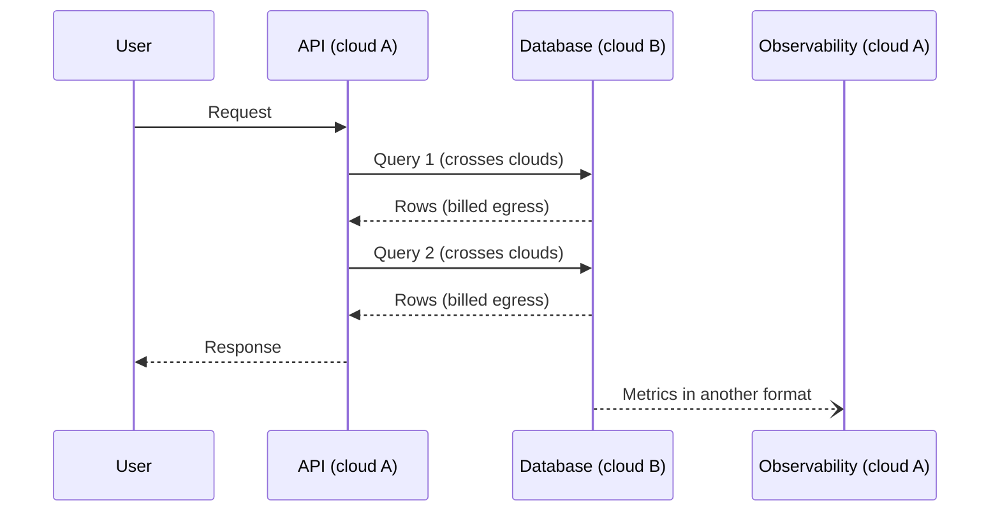
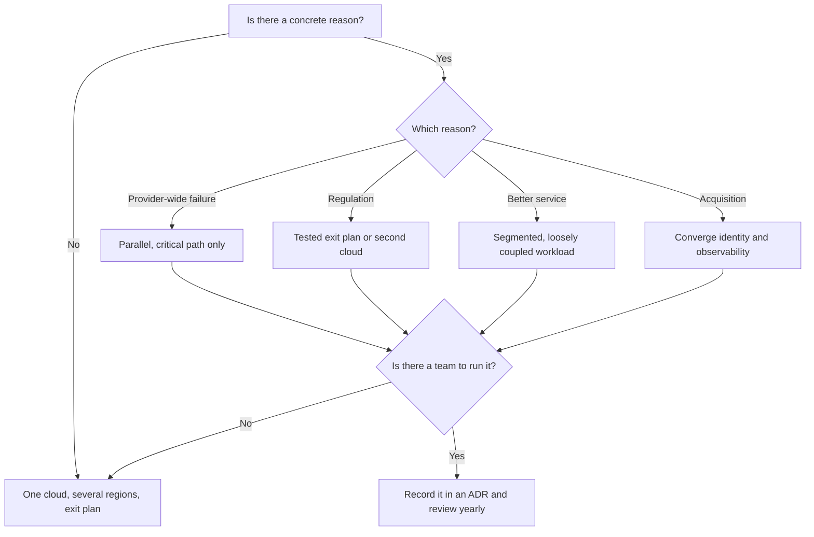

# Multicloud: when it makes sense

The leadership team asks you not to "depend on a single provider." Someone proposes the obvious answer: split the systems across two clouds. Eighteen months later there are two platform teams, two consoles, two bills, two ways of granting permissions, and one service that calls its database over a cross-cloud link nobody wants to touch. If the main provider raised prices tomorrow, nothing would move, because every system is still anchored to its own cloud's managed services. The goal was to reduce one risk; the result added another. Multicloud is neither good nor bad: **it means deliberately using two or more public cloud providers, and it only pays off when what it buys (resilience, compliance, a better service) is worth more than the cost of running several platforms at once**.

This article defines the term and separates it from what it is not, walks through the reasons that tend to hold up and the ones that tend to fail, names the costs that never make it into the original proposal, describes the patterns that reduce those costs, and ends with a decision framework and a worked example with assumed numbers.

<Callout tone="info" title="Cut-off date and sources">
  Checked in October 2026. Gregor Hohpe's classifications, Google Cloud's incident report and the
  texts of DORA and the EU Data Act were read at their sources (or in reproductions of the official
  text, for the regulations). There are no provider prices here: the numbers in the example are
  assumptions and say so.
</Callout>

## What it is and what it is not

The word gets used for three different things, and mixing them up leads to bad decisions.

| Situation                                                  | What it is                     | Problem it solves                                   |
| ---------------------------------------------------------- | ------------------------------ | --------------------------------------------------- |
| One provider, many services (compute, queues, databases)   | A single cloud, used well      | None of the ones in this article: it's the baseline |
| One application split between your data center and a cloud | Hybrid cloud                   | Data or systems that can't or shouldn't move yet    |
| Workloads on two or more public cloud providers            | Multicloud                     | Provider risk, compliance, a better service         |
| Both at the same time                                      | Hybrid and multicloud combined | Both problems, with both costs                      |

NIST's classic definition (SP 800-145) lists hybrid cloud among its four deployment models: two or more distinct infrastructures that remain separate entities but are bound together by technology that lets data and applications move between them. Multicloud is not on that list. Hohpe offers a useful distinction: hybrid is a reality most enterprises have to manage, while multicloud is an architectural option you choose. Hybrid has its own lesson in [hybrid cloud in detail](/docs/nube-hibrida-en-detalle); this one is about the second.

### Five ways to be multicloud

Gregor Hohpe distinguishes five options in his article on multicloud architecture (updated July 2019). They help you know what you're talking about before arguing whether it's worth it.

| Option    | What it means                                                 | What it buys                          | What it costs                                |
| --------- | ------------------------------------------------------------- | ------------------------------------- | -------------------------------------------- |
| Arbitrary | Workloads land in one cloud or another without clear criteria | Nothing deliberate                    | Every multicloud cost, with no benefit       |
| Segmented | Each type of workload goes to the cloud that serves it best   | The best service for each case        | Two platforms to run, few cross dependencies |
| Choice    | Each project picks a provider within a common framework       | Room to maneuver, at least at first   | Central governance and a catalog to maintain |
| Parallel  | The same application runs on several clouds                   | Availability beyond a single provider | Duplicated capacity, data and operations     |
| Portable  | Workloads move between clouds when needed                     | Freedom of movement                   | Heavy automation and abstraction             |

Hohpe stresses that an option further down the list isn't better for being there: the right one depends on what you need, and the choice should be a conscious one. Arbitrary is the one nobody picks and almost everyone has.

## Reasons that tend to hold up

### Resilience against correlated failures

Spreading an application across zones and regions of one provider protects you from many failures, but not from those with a provider-wide cause: a global control plane, a shared identity system, or configuration data that replicates everywhere. On June 12, 2025, Google Cloud had an incident of exactly that kind. According to its report, a policy change with blank fields was written to Spanner tables that replicate globally within seconds; the component that checks every API call (Service Control) crashed in every region, because of a code path that lacked error handling and wasn't protected by a feature flag. Multiple regions didn't help: they all read the same data.

That's the legitimate case for the parallel option: **covering the failure a single provider can't isolate by design**. It comes with two conditions worth writing down before you commit. First, the critical path has to be able to run on the other provider without depending on the first (if authentication still lives in the cloud that's down, there's no failover). Second, the cost of keeping that capacity has to be lower than the expected loss from those incidents. Recovery strategies and RTO and RPO within a single provider are covered in [regions, zones and recovery](/docs/regiones-zonas-y-recuperacion).

### Regulatory requirements

In the EU financial sector, the DORA regulation (Regulation (EU) 2022/2554, applicable since January 17, 2025) asks for specific things about ICT service providers. Article 28 requires exit strategies for services that support critical or important functions: documented plans, tested and reviewed periodically, with alternative solutions and transition plans identified, so you can exit without disrupting the business. Article 29 requires assessing concentration risk before signing: if the provider is hard to substitute, or contracts with the same provider pile up, you have to weigh alternatives, such as using different providers.

<Callout tone="warning" title="DORA does not mandate multicloud">
  The regulation asks for tested exit strategies and an assessment of concentration risk. A second
  active cloud is one way to comply, not the only one: a rehearsed exit plan, with infrastructure
  described as code and exportable data, may be enough. Your risk analysis and your supervisor
  decide that, not a quick reading of the text.
</Callout>

Other data residency or sovereignty requirements may force you onto a specific provider in a country where your main one has no region. That's segmented multicloud by obligation, and it's usually narrow: one workload, one country.

### The best service for a workload

Sometimes one provider has a clearly better service for a case (analytics, a machine learning model, a particular database) and the difference justifies the cost. It works when the workload is **loosely coupled** to everything else: it receives data in batches or as events and returns results, without synchronous round trips. If the chosen service has to read the operational database on every request, the cost of the cross-cloud network eats the advantage.

### Mergers and acquisitions

You buy a company that lives on another provider. That's multicloud from day one, without anyone deciding it. The right question isn't "do we migrate everything?" but what the two worlds will share: identity, billing, observability, security. Often the sensible move is to converge that common layer and leave workloads where they are until there's a business reason to move them.

## Reasons that tend to fail

### "This will give us leverage on price"

Negotiating leverage exists only if the provider believes you can leave. If every system uses its cloud's managed services, the threat isn't credible, and splitting spend usually lowers the committed volume with each provider, which is exactly what gets you discounts. The argument can work at a contract renewal with a real, rehearsed alternative; it rarely works as a general strategy.

### Portability nobody uses

Designing everything to be movable "just in case" carries a certain daily cost for an uncertain benefit. Hohpe sums it up in his 2019 article on martinfowler.com: avoiding one kind of lock-in usually costs you another, and abstraction layers add moving parts, a learning curve and the risk of systemic errors. His own example: tools like Terraform or Pulumi reduce your dependence on a cloud and create a new one on the tool. The typical outcome is the **lowest common denominator**: you give up the managed services that justified moving to the cloud and keep only what exists the same way everywhere. How to measure and bound provider dependence is covered in [locked in to one vendor](/docs/casado-a-un-proveedor).

## The hidden costs

The original proposal usually compares compute prices. The costs that decide the outcome are elsewhere.

| Cost                     | Where it comes from                                                            | How you notice it                                                 |
| ------------------------ | ------------------------------------------------------------------------------ | ----------------------------------------------------------------- |
| Two skill sets           | Each provider has its own network, permission and managed-service model        | On-call engineers who can only fix incidents in one of the clouds |
| Two control planes       | Different APIs, quotas, IAM models and consoles                                | The same security control is implemented and audited twice        |
| Duplicated tooling       | Security, inventory, cost, backup and deployment tools per provider            | Multiplied licenses and integrations; gaps between tools          |
| Data crossing clouds     | Outbound data transfer (egress) is billed by volume                            | A network line item that grows with traffic and nobody budgeted   |
| Cross-cloud networking   | Private links, non-overlapping IP addressing, DNS and encryption across clouds | Added latency on every call and a new point of failure            |
| Fragmented observability | Each cloud brings its own monitoring, logs and trace format                    | A request that crosses clouds can't be followed end to end        |

On data transfer there's a regulatory nuance in the EU. The Data Act (Regulation (EU) 2023/2854) phases out the charges for switching providers, and its Article 34 handles **in-parallel use** of several providers separately: there the provider may charge for data egress, but not more than the costs it incurs. In other words, the law makes leaving cheaper, but it doesn't make living in two clouds at once free.

On networking, providers offer dedicated links between clouds: for example, Google Cloud's Cross-Cloud Interconnect connects to AWS, Azure, Oracle Cloud Infrastructure and Alibaba Cloud. They reduce latency and keep traffic off the internet, but they're one more resource to contract, size and monitor. How these networks are designed is in [cloud networking, identity and security](/docs/redes-identidad-seguridad-nube).

The most treacherous cost is a request that crosses the boundary several times:



Every arrow that crosses clouds adds latency, a charge for the data that leaves, and a chance of partial failure. If the design needs many of them, the problem isn't the network: a coupled system was split in two.

## Patterns that reduce the cost

### A common platform layer

Describing infrastructure as code (Terraform, OpenTofu, Pulumi or Crossplane, for example) and packaging applications as containers on managed Kubernetes (EKS, AKS or GKE) gives you one workflow across providers. What it doesn't give you is sameness: network, identity and database modules remain specific to each cloud. The common layer pays off when you genuinely run the parallel or portable option, or when several teams deploy to several clouds; it doesn't pay off if the second cloud hosts a single segmented workload, because you'd be building a platform for one tenant.

### Federated identity

A single identity provider (IdP) for people, with access to each cloud through federation, saves you from keeping three user directories. The same principle applies to workloads: for example, Google Cloud's workload identity federation lets a machine on AWS or Azure exchange its native credential for a short-lived token, with no stored service account keys. It's the pattern with the best cost-benefit ratio: it's worth it even with two clouds and one workload. The details are in the lesson on [cloud networking, identity and security](/docs/redes-identidad-seguridad-nube).

### An internal service catalog

A catalog says which kind of workload goes to which cloud, with which templates and under which owner. It turns arbitrary multicloud into segmented or choice. An entry like this is enough:

```yaml
# catalog/batch-analytics.yaml (shape, not implementation)
kind: batch-analytics
provider: cloud-b # rationale recorded in an ADR
template: templates/batch-cloud-b # IaC reviewed by the platform team
input-data: exported-events # never the live operational database
owner: data-team
review: yearly
```

| Pattern               | Pays off when                                                | Doesn't pay off when                            |
| --------------------- | ------------------------------------------------------------ | ----------------------------------------------- |
| Common platform layer | Parallel or portable option; several teams on several clouds | A single segmented workload on the second cloud |
| Federated identity    | Whenever there's more than one cloud                         | Hardly ever fails to pay off                    |
| Internal catalog      | Several kinds of workload and several providers in use       | One cloud and a handful of teams                |
| Shared observability  | Requests that cross clouds, or shared on-call                | Workloads fully isolated per cloud              |

For shared observability, OpenTelemetry (OTel) gives you an open format for traces, metrics and logs that you can send to the same destination from any provider.

## Multicloud and lock-in: not the only way out

Multicloud answers one question (what happens if this provider stops serving me?) with the most expensive answer: paying for the alternative now. There are cheaper ways out worth ruling out first: isolate provider dependencies behind ports ([hexagonal architecture](/docs/arquitectura-hexagonal)), store data in formats you can export, keep infrastructure as code, and rehearse an exit plan from time to time. Those measures lower the cost of switching without paying for two platforms every month. The lesson [locked in to one vendor](/docs/casado-a-un-proveedor) covers how to measure that dependence; here it's enough to remember that multicloud is one of several answers, not the default one.

## A decision framework

Three questions, in this order. If the first has no concrete answer, the other two don't matter.

1. **How many clouds, and why?** Name the reason (a correlated failure you won't accept, a regulatory obligation, a specific service, an acquisition) and the Hohpe option that addresses it.
2. **With which workload?** Pick the smallest workload that satisfies the reason. It's rarely "everything."
3. **With which team?** Every active cloud needs people who run it and fix it at three in the morning. If they don't exist, neither does the plan.



Comparing the options relies on the general method in [trade-offs and decisions](/docs/trade-offs-y-decisiones), and the decision goes into an [ADR](/docs/adr) with the reason, the chosen option and the condition that would change it.

## When to use it and when not to

| Use it when                                                                  | Don't use it when                                              |
| ---------------------------------------------------------------------------- | -------------------------------------------------------------- |
| A provider-wide outage on the critical path costs more than the second cloud | The reason is "not depending on anyone," with no expected loss |
| A regulator or a contract demands a working, tested alternative              | A rehearsed exit plan satisfies the requirement                |
| A loosely coupled workload gains a lot from another provider's service       | That workload reads the operational database synchronously     |
| You inherit another cloud through an acquisition                             | Everything has to move "to unify" with no business benefit     |
| You have a platform team experienced with both providers                     | One small team is already stretched with a single cloud        |

## Worked example

A payments company in the EU, subject to DORA, runs on one provider across two regions. Its payment authorization service is a critical function. All numbers are **assumptions**, in thousands of euros per year, only to show the reasoning.

**The risk to cover.** Assume an incident that takes down the whole provider once every ten years (annual probability 0.1), lasting 8 hours, with a loss of 150 per hour in unprocessed authorizations. Expected loss: 0.1 × 8 × 150 = **120 per year**.

| Line item                                              | Option 1: one cloud, exit ready | Option 2: parallel for authorization only | Option 3: everything portable on two clouds |
| ------------------------------------------------------ | ------------------------------: | ----------------------------------------: | ------------------------------------------: |
| Extra regions on the main cloud                        |                             180 |                                       180 |                                           — |
| Yearly exit drill and documentation                    |                              40 |                                        40 |                                           — |
| Quarterly test deployment on the other cloud           |                              20 |                                         — |                                           — |
| Maintaining templates and adapters for the other cloud |                              40 |                                         — |                                           — |
| Standby or duplicated capacity on the other cloud      |                               — |                                        90 |                                         600 |
| Cross-cloud data transfer                              |                               — |                                        35 |                                         150 |
| Dedicated cross-cloud link                             |                               — |                                        25 |                                          50 |
| Additional platform engineers                          |                               — |                                       200 |                                         600 |
| Duplicated tooling                                     |                               — |                                        30 |                                         100 |
| **Total**                                              |                         **280** |                                   **600** |                                    **1500** |

Option 2 costs 380 more than the regions-and-drill baseline (220) to avoid an expected loss of 120. It only pays for itself if the loss per hour exceeds 475, because 0.1 × 8 × 475 = 380. Option 3 covers the same risk as option 2 and costs more than twice as much.

The decision was option 1: the tested exit plan answers DORA, and the quarterly deployment on the other provider proves the exit is real, even though restoring the service there would take days rather than minutes. That recovery time was accepted in writing in the ADR, along with the review trigger: if the loss per hour of authorization exceeds 475, or if the supervisor asks for a hot alternative, the company moves to option 2. None of the three options protects against its own configuration mistakes, which the next section covers.

## Common mistakes

- **Multicloud by default.** Choosing two clouds before naming the reason turns the architecture into the arbitrary option: every cost, no deliberate benefit.
- **Splitting a coupled system across clouds.** A service in one cloud and its database in another pay latency and transfer on every call, and add partial failures. Split along low-[coupling](/docs/acoplamiento-cohesion) boundaries, not along provider lines.
- **Believing two providers protect you from your own mistakes.** If the same pipeline deploys the same bad configuration to both clouds, or you replicate corrupt data to both, both go down. It's your own version of the Google incident: the bad data reached everywhere. Protect yourself with staged rollouts and validation, as explained in [resilience in distributed systems](/docs/resiliencia-sistemas-distribuidos).
- **Dropping to the lowest common denominator.** Giving up managed services to stay portable cancels much of the reason to be in the cloud.
- **Counting only compute.** People, data transfer and duplicated tooling usually weigh more than the price difference on machines.
- **Never testing failover.** A second cloud that has never taken real traffic is a hypothesis, not a plan.
- **Forgetting shared identity and observability.** Without them, every incident that crosses clouds starts with half an hour of finding out who can access what.

## Checklist

- [ ] The reason for multicloud is written down, is one of the legitimate ones, and names its option (segmented, choice, parallel, portable).
- [ ] The expected loss to avoid was estimated and compared with the total cost, including people and data transfer.
- [ ] The chosen workload is the smallest one that satisfies the reason and is loosely coupled to the rest.
- [ ] There's a shared identity provider and federation for both people and workloads.
- [ ] Traces, metrics and logs reach the same destination in a common format.
- [ ] Failover or the exit plan is tested on a fixed schedule.
- [ ] Configuration rollouts are staged across clouds, not simultaneous.
- [ ] The decision, its review trigger and the accepted recovery time are recorded in an ADR.

## Next lesson

With the provider map clear, the next question is how much of the operation you hand over to them: [serverless and managed compute](/docs/serverless-y-computacion-gestionada).

## Sources

Checked in October 2026. The texts of DORA and the Data Act were read in reproductions of the Official Journal of the EU; the EUR-Lex version is authoritative.

- [Multi Cloud Architecture: Decisions and Options (Gregor Hohpe, The Architect Elevator, updated July 21, 2019)](https://architectelevator.com/cloud/hybrid-multi-cloud/)
- [Don't get locked up into avoiding lock-in (Gregor Hohpe, martinfowler.com, September 9, 2019)](https://martinfowler.com/articles/oss-lockin.html)
- [NIST SP 800-145, The NIST Definition of Cloud Computing (Mell and Grance, September 2011)](https://csrc.nist.gov/pubs/sp/800/145/final) and the [Hybrid cloud entry in the NIST glossary](https://csrc.nist.gov/glossary/term/Hybrid_cloud)
- [Google Cloud incident report for June 12, 2025](https://status.cloud.google.com/incidents/ow5i3PPK96RduMcb1SsW)
- [Regulation (EU) 2022/2554, DORA](https://eur-lex.europa.eu/eli/reg/2022/2554/oj), articles [28](https://www.springlex.eu/en/packages/dora/dora-regulation/article-28/) and [29](https://www.springlex.eu/en/packages/dora/dora-regulation/article-29/)
- [Regulation (EU) 2023/2854, Data Act](https://eur-lex.europa.eu/eli/reg/2023/2854/oj), [Article 34](https://www.springlex.eu/en/packages/data-act/data-act-regulation/article-34/)
- [Cross-Cloud Interconnect overview (Google Cloud)](https://docs.cloud.google.com/network-connectivity/docs/interconnect/concepts/cci-overview)
- [Workload Identity Federation (Google Cloud)](https://cloud.google.com/iam/docs/workload-identity-federation) and [its setup with AWS or Azure](https://docs.cloud.google.com/iam/docs/access-resources-aws)
- [OpenTelemetry](https://opentelemetry.io/docs/what-is-opentelemetry/)
