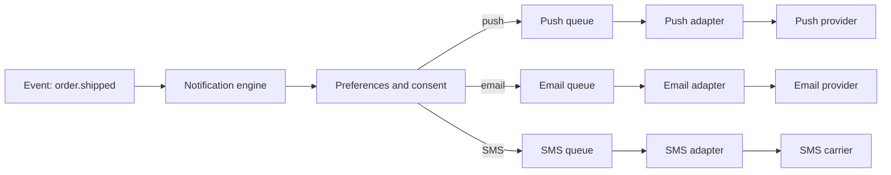

A notification looks like a one-line call: "tell the user their order has shipped". Behind it sit three channels with different rules, external providers that fail on their own schedule, preferences that change halfway through a send, and a question that most teams never ask when designing it: what happens if the message arrives twice, or never arrives at all. This article treats the notification as a delivery system, not as a function called from business code.

The thesis is simple: **a business event does not send a message; it produces an intent to notify**, and that intent goes through a dedicated service that chooses the channel, respects the user, queues per provider and records every attempt. With that separation, a failing SMS provider slows down only the SMS messages, while email and push keep going.

## Why calling the provider from business code is not enough

The naive approach is for the orders service to call the email API, the push API and the SMS API directly once an operation finishes. It works in the first week and then fails in three predictable ways.

The first is coupling: the orders service now knows three providers, their rate limits, their error formats and their contracts. Switching email providers means deploying orders. The second is **silent loss**: if the call fails after the business transaction has already committed, nobody retries, and the user never learns that the order shipped. The third is **duplication**: if the service retries the whole operation to recover from an error, the message goes out again.

The alternative moves sending outside the business transaction. The `order.shipped` event is stored in the same database as the order (using an outbox pattern, as explained in [sagas, outbox and idempotency](/docs/sagas-outbox-idempotencia)), and a consumer turns it into notifications. Sending never blocks or undoes the main operation, and the producer does not need to know which channels exist.

<Callout tone="info" title="Intent, not command">
  The orders service says "order 4812 has shipped". It does not say "send an email to
  ana@example.com". That difference is what lets you change channels, languages and templates
  without touching the domain.
</Callout>

## One service, one queue per channel

The basic architecture has four parts: an event consumer, a decision layer (preferences, template, language, time window), one queue per channel, and one adapter per provider. The queue per channel is the decision that matters most, because it isolates failures and different rhythms.

The three channels do not share a profile. Push is cheap and nearly instant, but the device may be switched off and the token may have expired. Email tolerates a delay of minutes, and the reputation of the sending domain must be protected. SMS is expensive, subject to regulatory and carrier limits, and does not forgive template mistakes. If all three shared one queue, a saturated SMS channel would delay password-reset emails, which are exactly the messages that must arrive fast.

With separate queues, each channel gets its own consumer, its own concurrency limit and its own alert threshold. A failing provider only grows its own queue, and the others carry on. The figure for this article shows exactly that: the SMS branch can stop without the other two noticing.

The cost is operational: more queues to watch and more configuration. For a small system with one channel, one queue is enough. The split is justified when the second channel arrives with a different failure profile, not before.

## Preferences: the user decides, not the team

Before sending, the engine checks what the person wants to receive. This is not an interface detail. If preferences are wrong, the system sends messages the user never asked for, which in the European Union can have legal consequences as well as damaging trust.

It helps to model preferences in two layers that combine. The first is **consent by message type**: transactional messages (a purchase confirmation, an access code) are sent whenever the channel exists, while marketing messages (news, promotions) need an explicit choice. The second is **preference by channel**: a person may accept push but not SMS, or email only once a week.

The tricky part is telling transactional from marketing. A "your order arrived" message is transactional even if it includes a recommendation at the bottom; if the recommendation is the reason the message is sent, it is marketing and needs consent. A practical rule is that the type is decided by the intent of the message, not by its template.

<Callout tone="warning" title="Consent is not inherited">
  A user who agreed to receive emails about their account has not agreed to SMS, nor to their
  contact details being used for third-party campaigns. Store consent with its date, channel and
  purpose, and check it on every marketing send, not only at sign-up.
</Callout>

Preferences also need a time window. A push notification at three in the morning in the user's time zone can be a product error even if it is legal. The engine must convert the send time to the recipient's time zone and delay non-urgent messages to a reasonable window, while letting urgent ones (a verification code) go out immediately.

## At-least-once delivery and deduplication

No channel offers exactly-once delivery. Queues deliver at least once, providers retry when a response is lost, and the engine itself may reprocess a message if it crashes before confirming. The realistic guarantee is therefore **at least once**, and the design task is to make duplicates harmless or to remove them.

Deduplication relies on an idempotency key that identifies the intent to notify, not the attempt to send. A common choice combines the event identifier, the recipient, the channel and the message type. Before calling the provider, the adapter checks whether that key already has a confirmed send within a time window; if it does, it does not send again.

There is a limit to declare in the design: the check and the send are not atomic. If the adapter sends the message and crashes before recording the confirmation, a retry will send it again. That is why the idempotency of the providers matters. Some accept an idempotency key in the request; when they do not, the duplicate is the price of the delivery guarantee, and you must accept it for messages where loss is worse.

The practical decision differs by channel. For a verification code, a duplicate is a minor nuisance and a loss is a serious failure, so repetition is accepted. For a billing notice, a duplicate can cause confusion and unnecessary support contacts, so deduplication deserves more rigour. Writing this down in the design stops each team from deciding it on its own.

## Retries, expiry and fallback channels

An unlimited retry turns a dead provider into a queue that grows forever. A retry without backoff turns a transient error into a storm of requests. So each channel defines three things: how many times it retries, how long it waits between attempts (with random variation, as in [retries with jitter](/docs/reintentos-con-jitter)) and when a message expires.

Expiry is the part most often forgotten. An email that says "your code expires in five minutes" and arrives forty minutes later is worse than no email: it creates support tickets and distrust. Every message should carry a validity deadline, and the adapter should drop it, rather than send it, once that deadline has passed. Dropping is also recorded, so the team knows how many messages were lost to expiry.

Errors are not all equal. A transient error (rate limit, timeout, 503) justifies a retry. A permanent error (invalid address, deleted device token) does not: retrying only burns quota. For push, an expired token must be removed from the device registry so it is not tried again. For email, an address that bounces permanently must be flagged and stop receiving marketing messages.

The retry policy should also be visible to the people who depend on the notification. A password reset that retries for twenty minutes, with no message to the user, produces the same frustration as one that never arrives. Documenting how long each channel keeps trying, and what the user sees while it does, lets product and support answer the same questions in the same way.

The fallback channel is a product decision, not a technical one. If an access code does not arrive by push within thirty seconds, should it go by SMS? That chain is useful, but it multiplies cost and the risk of duplicates. Limit it to critical messages and make explicit how long each channel waits before the next one takes over.

### Templates, language and email authentication

Templates are another source of silent failures. A message with an empty variable ("Hello ,") or in the wrong language is sent without any technical error, and the user perceives it as a bug. So templates are versioned, validated before publication and rendered from the event data, not from extra queries that can fail halfway through a send.

The user's language should be resolved inside the engine, with an explicit fallback chain: preferred language, account language, default language. Mixing languages within one message is more common than it seems, especially when the subject and the body come from different systems. A simple rule is that a template is one unit: it is translated completely or not published in that language.

For email, domain authentication is a technical requirement, not an option. SPF, DKIM and DMARC are mechanisms defined in RFCs: DKIM signs the message with a key of the sending domain (RFC 6376), SPF declares which servers may send on behalf of the domain (RFC 7208), and DMARC tells the receiver what to do when authentication fails and requires alignment with the visible domain (RFC 7489). Without them, transactional emails land in spam even when the application works perfectly.

### Observability of deliveries

A notification has a lifecycle worth being able to follow: created, decided (send or not, and why), queued, sent, delivered, opened or bounced. Each transition should carry a shared identifier, so that support can answer "did the message arrive?" without checking four systems.

The metrics that matter are about process and outcome. Process: depth of each queue, age of the oldest message, retry rate and drops due to expiry. Outcome: delivery rate per channel and provider, time from the event to delivery, and complaints or bounces. An SMS queue age rising to ten minutes is an alert; a rise in complaints about marketing email is another alert, and it may point to a consent problem.

Delivery metrics have limits. Many providers confirm acceptance, not delivery to the device, and email open rates are distorted by privacy protections in mail clients. Decide which metric you optimise, and do not confuse "accepted by the provider" with "received by the person".

## Tools

No particular platform is needed to design this well, but you do need to decide where each responsibility lives. An event bus or a managed queue delivers events to the consumer; a database with a unique key implements deduplication; a per-channel sending service encapsulates the provider. Choose tools according to volume and team: in a small system, a sends table with a uniqueness constraint and a process that scans it may be enough, and it is easier to operate than a chain of services.

Testing deserves the same care as the design. Each adapter can be tested against a simulated provider that returns the errors the real one returns: a rate limit, a timeout after the message was accepted, a permanent rejection. Those three cases exercise the retry, deduplication and expiry logic, and they are the ones that fail in production. A test suite that only checks the happy path proves that the code can send a message, not that it behaves correctly when the provider misbehaves. A useful practice is to keep a small set of recorded provider responses, one for each error class, and replay them in every change to the engine.

<Callout tone="tip" title="Start with the sends table">
  Before choosing a queue provider, write down the table where each intent to notify is recorded,
  its state and its deduplication key. If that table is clear, changing the queue infrastructure
  later is a deployment problem, not a data problem.
</Callout>

## Common mistakes

Sending from the business transaction is the most common error. It looks convenient, and it turns every provider failure into a failure of the main operation, or into a lost notification with no trace.

Treating every message the same, with the same retry, the same priority and the same fallback channel, mixes an access code with a marketing campaign. Each message type has its own urgency, tolerance for duplicates and consent rules.

Not deleting device tokens or not flagging invalid addresses makes the system spend quota and time on destinations that will never receive anything, and delivery metrics get worse without explanation.

Assuming the provider guarantees exactly-once delivery leads to fragile designs. The real guarantee is at least once, and deduplication is the system's responsibility.

## Checklist

- Each notification originates from a business event and goes through a dedicated service, not through a direct call to a provider.
- There is one queue and one consumer per channel, with concurrency limits and alerts on depth and age.
- The message type (transactional or marketing) is defined by its intent, and marketing messages have consent recorded with date and channel.
- A deduplication key identifies the intent, and the duplicate risk per provider is documented.
- Retries have a limit, backoff with random variation and an expiry per message.
- Permanent errors (invalid token, bouncing address) are flagged and no longer retried.
- The per-provider adapter translates errors into its own vocabulary and can be replaced in tests.
- Templates are validated before publication, and language resolution has an explicit fallback chain.
- The email domain has SPF, DKIM and DMARC configured.
- Every send can be traced end to end with a shared identifier.

## Sources

- Firebase, [Migrate from legacy FCM APIs to HTTP v1](https://firebase.google.com/docs/cloud-messaging/migrate-v1): deprecation date (20 June 2023) and shutdown start (22 July 2024), according to the official documentation we consulted.
- RFC 8030, [Generic Event Delivery Using HTTP Push](https://www.rfc-editor.org/rfc/rfc8030): the base Web Push protocol.
- RFC 8292, [Voluntary Application Server Identification (VAPID) for Web Push](https://www.rfc-editor.org/rfc/rfc8292): published in November 2017.
- RFC 5321, [Simple Mail Transfer Protocol](https://www.rfc-editor.org/rfc/rfc5321): SMTP.
- RFC 6376, [DomainKeys Identified Mail (DKIM) Signatures](https://www.rfc-editor.org/rfc/rfc6376).
- RFC 7208, [Sender Policy Framework (SPF)](https://www.rfc-editor.org/rfc/rfc7208).
- RFC 7489, [Domain-based Message Authentication, Reporting, and Conformance (DMARC)](https://www.rfc-editor.org/rfc/rfc7489).

Consulted in October 2026. The consent obligation for electronic marketing communications in the European Union (ePrivacy Directive) is described in general terms and was not checked against its text for this article. The publication dates of the Web Push RFC and the email RFCs are cited by number rather than by year.
