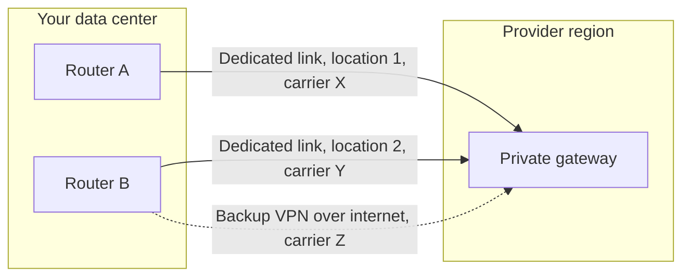
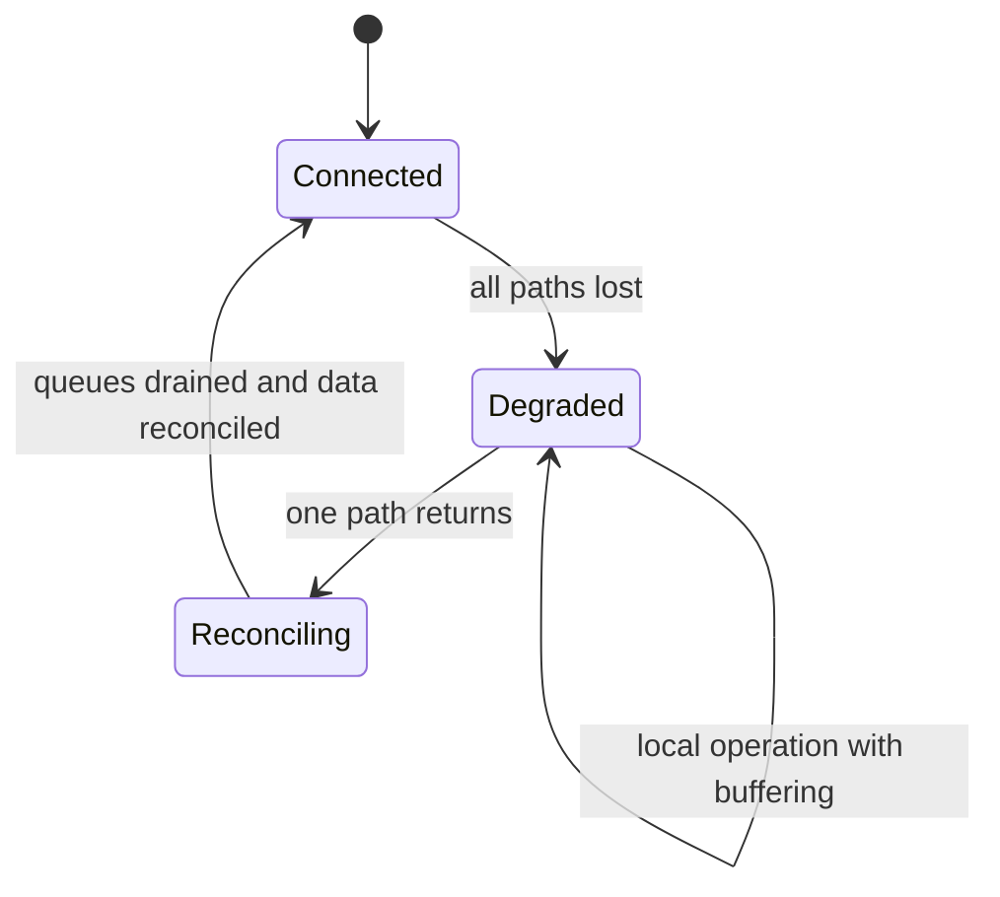

# Hybrid cloud in detail

The plant has run its production system in its own data center for years. The data team builds analytics in the cloud, the identity team moves sign-in to a managed provider, and the platform team starts deploying on-premises with the provider's tools too. Everything works until the day an excavator cuts the carrier's fiber. The machines are still there and the servers still answer, but nobody can sign in to the plant application, deployments hang, and the dashboards show a four-hour gap. Nobody decided that the plant should depend on the cloud: it happened one step at a time. **A hybrid cloud is a system split between an environment you run and one or more cloud environments, where data, identity, network, and operations cross the boundary between them, and designing one means deciding what crosses that boundary and what happens when it can no longer cross.**

This lesson walks through the usual patterns (extending the data center, bursting to the cloud, splitting services, processing at the edge), connectivity and how it fails, latency and data gravity, federated identity, shared deployment and observability, governing two platforms, and above all the failure modes. How the deployment models compare (public, private, community, hybrid) is covered in [cloud deployment models](/docs/modelos-de-despliegue-nube); here that is assumed, and the focus is design detail.

<Callout tone="info" title="Cutoff date and scope">
  Checked in October 2026. Product names and provider figures come from their official documentation
  at that date and are cited as examples of a category, not as recommendations. Products change
  names and limits: check the linked page before designing around them.
</Callout>

## What hybrid is and what it is not

The reference definition is NIST's (SP 800-145, Peter Mell and Timothy Grance, September 2011): an infrastructure composed of two or more distinct cloud infrastructures (private, community, or public) that remain unique entities but are bound together by standardized or proprietary technology that enables data and application portability. The text itself gives cloud bursting for load balancing between clouds as an example.

Two ideas in that definition matter for design. First, the environments **remain distinct**. Connecting them does not make them one; each has its own operators, change cycles, and failure modes. Second, what binds them is **specific technology** (network, identity, deployment formats), and that technology is the part that fails most and gets designed least.

A useful working definition: you have a hybrid system when at least one of these four planes crosses the boundary on the critical path of a business operation.

| Plane      | What crosses the boundary                               | Question you must be able to answer                           |
| ---------- | ------------------------------------------------------- | ------------------------------------------------------------- |
| Data       | Replicas, queues, files, queries between both sides     | Where is the authoritative copy and how much lag is OK?       |
| Identity   | Sign-in, tokens, groups, service accounts               | Can anyone authenticate on-premises without the cloud?        |
| Network    | Routes, DNS, name resolution, traffic inspection        | Which path does a packet take, and which does the reply take? |
| Operations | Deployment, patching, metrics, alerts, fleet management | Can you deploy, patch, and see status without the link?       |

What is not hybrid, even when people call it that: a cloud application that reads a file exported from the on-premises system once a day. That is integration, not a split system: if the file does not arrive, nothing breaks on the critical path. The distinction matters because the design cost of a real hybrid (redundant network, identity without a single point of failure, double operations) only pays off when the coupling is real.

## Hybrid cloud patterns

### Extending the data center to the cloud

The cloud is treated as one more data center: the same private networks, the same planned addressing, the same management tools. Many migrations start here because workloads can move without changing how they connect. The risk is that the extension turns into a flat network with invisible dependencies between sides: an application moved to the cloud that still queries an on-premises database on every request pays the link latency on every call.

### Cloud bursting

Base load is served on-premises and peaks overflow to the cloud. It sounds cheap, and the conditions are strict: the application must run on both sides from the same image, the data the peak needs must be available in the cloud (or traffic back to the origin becomes the bottleneck), and load distribution must switch on without manual steps. In practice it works better for stateless or batch workloads, with input data copied ahead of the peak, than for transactions that write to an on-premises database.

### Splitting services across both sides

Each service lives where it fits best and they talk through explicit interfaces: the plant system on-premises for latency or regulation, analytics and the customer portal in the cloud for elasticity. This is the healthiest pattern when the boundary matches a domain boundary, because calls between sides are few and asynchronous. It is the most fragile when the boundary cuts a synchronous flow in half: every user request crosses the link several times and inherits its latency and availability. How to cut services is covered in [monolith vs microservices](/docs/monolito-vs-microservicios); what hybrid cloud adds is that the cut runs through a network link with its own owner, cost, and failures.

### Edge computing

Part of the processing happens close to where data is produced: the plant, the store, the hospital, the cell tower. The edge makes sense when at least one of these holds: the response needs a latency that a round trip to a region cannot meet, the raw volume is too large to ship whole, or operations must continue offline. The price is running many small sites, often without technical staff, with hardware someone has to replace.

| Pattern             | What crosses the link on the critical path | Fits when                                       | Main risk                                       |
| ------------------- | ------------------------------------------ | ----------------------------------------------- | ----------------------------------------------- |
| Extend the DC       | Almost everything: one continuous network  | Phased migration with dependencies not yet cut  | Flat network and synchronous calls across sides |
| Burst peaks         | Peak traffic and its data                  | Stateless or batch loads with predictable peaks | Data on the wrong side right during the peak    |
| Split services      | Events and integrations between domains    | The network boundary matches a domain boundary  | A synchronous flow split by the link            |
| Process at the edge | Aggregates and commands, not raw data      | Local latency, high raw volume, or autonomy     | Operating and patching many small sites         |

## Connectivity: VPN or dedicated link

There are two broad families. A **site-to-site VPN** encrypts traffic (usually with IPsec) and sends it over the internet: you can set it up in hours, and it depends on internet quality at both ends. A **dedicated link** is a private connection between your network and the provider's, at a point of presence or through a carrier: AWS calls it Direct Connect, Azure ExpressRoute, and Google Cloud Interconnect. Microsoft states that ExpressRoute connections do not go over the public internet, and presents them as more reliable, with more consistent latency and higher security than typical internet connections.

| Criterion      | Site-to-site VPN                                 | Dedicated link                                             |
| -------------- | ------------------------------------------------ | ---------------------------------------------------------- |
| Time to set up | Hours or days                                    | Weeks: carrier contract, physical cross-connect, BGP setup |
| Latency        | Variable: depends on the internet                | More predictable                                           |
| Encryption     | Built into the tunnel                            | Not by default; you add it (MACsec or a VPN over the link) |
| Bandwidth      | Limited per tunnel; scales with more tunnels     | Higher and steadier                                        |
| Typical role   | Bootstrapping, small sites, backup for dedicated | Main production traffic                                    |

A security nuance that often gets missed: private does not mean encrypted. Google Cloud's documentation says Cloud Interconnect does not encrypt traffic by default and offers MACsec or HA VPN over the link to do it. AWS explains that MACsec on Direct Connect encrypts the layer 2 hop between your router and theirs, point to point, and is not end-to-end encryption. If your data requires encryption in transit, decide which layer provides it; do not assume it because the link is private.

### Typical link failures

- **MTU and fragmentation.** The tunnel adds headers and shrinks the usable packet size. According to AWS's guide for its site-to-site VPN, as of October 2026 it supports an MTU of 1446 bytes and an MSS of 1406 bytes, and less depending on the encryption algorithm. The classic symptom: connections establish, small queries work, and large transfers hang, often because the ICMP messages that report the size get filtered along the path or the application does not handle them. The guide recommends setting MTU and MSS for the algorithm in use and fragmenting before encryption.
- **Asymmetric routes.** With more than one path (internet plus a dedicated link, or two links), a packet can leave on one and return on the other. Microsoft documents the effect: a stateful firewall that did not see the start of a flow drops the reply. You fix it by advertising each prefix over the right link or with source NAT, and you detect it with traceroute from both sides.
- **Single path.** Two circuits that leave through the same conduit, land at the same point of presence, or end on the same router are not redundant: they share the failure. Ask about the physical route, not just the number of circuits.
- **Carrier dependency.** Buying two links from the same carrier, or a backup VPN over an internet connection from the same carrier as the dedicated link, leaves a single commercial and technical point of failure.

### Designing redundancy

AWS publishes three resiliency models for Direct Connect. Maximum resiliency uses separate connections terminating on separate devices in more than one location; high resiliency uses one connection at each of two locations; and single-site redundancy uses two connections on different devices at one location, which AWS reserves for non-critical workloads. Microsoft recommends the equivalent for ExpressRoute: each circuit already has two connections to two provider routers, and for maximum resiliency it suggests two circuits at two different peering locations. AWS also describes a VPN as a lower-cost backup, with the caveat that its per-tunnel bandwidth may not cover the main link, so it does not recommend it as a backup for links faster than 1 Gbps unless you spread traffic across several tunnels (as of October 2026).



The diagram sums up three rules: separate devices on your side, separate locations on the provider's side, and separate carriers in between. Use dynamic routing (BGP) so failover is automatic, and test cutting each path on a schedule, not only on the day it fails. How to design the rest of the system to tolerate network failures (timeouts, retries, circuit breakers) is in [resilience in distributed systems](/docs/resiliencia-sistemas-distribuidos).

## Latency and data gravity

Dave McCrory proposed the term **data gravity** in 2010: like a mass, data attracts the applications and services that use it, and the more it grows, the harder it is to move and the more services end up around it. In a hybrid system this becomes a practical rule: compute that queries a dataset often and with low latency should live on the same side as that data. What crosses the link should be small and summarized.

| If the operation…                                 | Process it                     | Because                                                |
| ------------------------------------------------- | ------------------------------ | ------------------------------------------------------ |
| Has a response deadline shorter than the link RTT | Next to whoever needs it       | The round trip alone uses up the budget                |
| Reads a lot of data and returns little            | Where the data lives           | You move the result, not the dataset                   |
| Must continue offline                             | On-premises or at the edge     | It cannot depend on a path that can fail               |
| Needs elasticity and tolerates minutes of delay   | In the cloud, with copied data | It scales on demand without querying the origin        |
| Combines data from both sides on every request    | Rethink it                     | It inherits the latency and availability of both sides |

Measure before deciding. Mean RTT tells you little: what breaks a synchronous flow is the tail (p99) and the variation at peak hours. Orders of magnitude for network and disk, and how latencies add up in series, are in [performance numbers and laws](/docs/numeros-y-leyes-de-rendimiento).

## Federated identity across two worlds

The goal is one identity per person and per service, recognized on both sides. The standards are well known: SAML 2.0 and OpenID Connect (its Core 1.0 specification dates from February 2014) for single sign-on, and SCIM (RFC 7644, September 2015) to provision and deprovision users and groups automatically across domains. The architecture decision is not which protocol to use but **where the source of truth lives and what happens when it cannot be reached**.

| Source of truth                           | Advantage                                    | What fails when the link is cut                                     |
| ----------------------------------------- | -------------------------------------------- | ------------------------------------------------------------------- |
| On-premises directory, federated to cloud | On-premises keeps working without the cloud  | Users cannot reach cloud applications                               |
| Cloud identity provider                   | Central management, MFA, and modern policies | On-premises apps that validate against it stop authenticating       |
| Both, synchronized                        | Each side can authenticate on its own        | Joins, leaves, and changes must be reconciled when the link returns |

If you choose the cloud as the source of truth, critical on-premises applications need a plan for the outage: validate tokens with already-downloaded keys until they expire, a local directory replica, or local break-glass accounts that are stored and audited. What must not happen is discovering during the first outage that the plant operator cannot sign in. Identity design and least-privilege principles are in [security by design](/docs/seguridad-por-diseno).

### The control plane as a hidden dependency

Every cloud service has two parts: the **data plane**, which does the work (runs the machine, serves the disk), and the **control plane**, which creates, changes, and monitors it. In a hybrid setup, products that bring the cloud into your data center usually keep the control plane in the provider's region. AWS documents this clearly for Outposts racks: if the link to the region is lost, instances and volumes already running keep working and can be reached from the local network, but launching, starting, stopping, and terminating instances is unavailable until connectivity returns; metrics and logs are cached locally for up to 7 days and pushed when the link is back, and a longer disconnection can lose them (as of October 2026).

<Callout tone="warning" title="Still running is not the same as still operable">
  During an outage, what was already running can keep serving, but you cannot scale, replace a
  failed machine, or deploy a fix if that operation goes through the region. Review every
  on-premises component and write down which operations depend on the remote control plane:
  identity, DNS, secret distribution, and image pulls are the ones that surprise people most.
</Callout>

## Consistent deployment

Two environments with two ways to deploy end up drifting apart. The tool to prevent it is the same as in a single environment, applied with more discipline: **infrastructure as code** with modules that express intent (a network, a cluster, a database) and adapters per environment, and **containers** as the unit of deployment, so the same signed image runs on both sides. The repository layout makes visible what is shared and what belongs to each side:

```text
infra/
  modules/            # intent: network, cluster, database, observability
    network/          # // … shared inputs, no provider details
    cluster/
  envs/
    onprem/           # adapter for your hypervisor or hardware
    cloud/            # adapter for the provider
  policies/           # shared rules: tags, encryption, allowed regions
```

What must be identical on both sides: the image, the application configuration (injected, not baked in), the policies, and the promotion process between environments. What can differ: how the hardware or machine underneath is provisioned. If on-premises deployment depends on pulling images from a cloud registry, keep a local registry mirror: otherwise a link outage also cuts off emergency deployments. The continuous delivery practice behind all this is covered in [DevOps culture](/docs/devops-cultura).

Providers offer products to manage external resources from their own console. Microsoft describes Azure Arc as a way to project servers, Kubernetes clusters, and databases that are not in Azure onto its resource manager, so you govern them with the same tools. Google Distributed Cloud has a software-only option that runs enterprise Kubernetes on your own servers or VMware infrastructure. They help unify inventory and policy, and they are also another case of a remote control plane: decide which operations you accept depending on it.

## Observability that spans both sides

The goal is a single view of a request that crosses the boundary, not two tools with two truths. Three decisions make it possible:

- **One format and one correlation scheme.** Metrics, logs, and traces with the same labels (service, environment, side, version) and a trace ID that travels on every call that crosses the link.
- **One destination, with a local buffer.** Send everything to a single system, but keep locally whatever could not leave during an outage and forward it later. Otherwise the outage leaves a gap in exactly the interval you most need to analyze.
- **The link as an observed component.** Latency, loss, BGP state, and per-path usage are first-class metrics with their own alerts. A backup that took over a month ago without anyone noticing is a single link under another name.

Avoid running a full stack on each side unless regulation requires it: duplicating tools doubles the cost and, worse, produces two different conclusions about the same incident.

## Governance, patching, and lifecycle

A hybrid system is two platforms on different schedules. The cloud provider changes its side continuously and retires versions on its own calendar; your side changes when you plan it. The practical consequences:

- **Patching with an owner on each side.** The operating system, hypervisor, firmware, and on-premises cluster are yours. For cloud products installed in your facility, the split depends on the product: read each one's shared responsibility model.
- **Compatible versions.** If both sides run the same orchestrator, set a supported version window and treat the gap as debt with a due date.
- **Shared policies.** Tagging, encryption, allowed regions, and retention are written once and applied on both sides. Checking them automatically is a [fitness function](/docs/fitness-functions).
- **Hardware lifecycle.** The on-premises side has equipment refreshes, support contracts, and capacity bought in advance. When local capacity runs out, bursting stops being an option and becomes an obligation.

## Products by category

The table names examples to place each category, not to compare them. All were checked in each provider's official documentation as of October 2026.

| Category                           | AWS              | Azure                                       | Google Cloud                             |
| ---------------------------------- | ---------------- | ------------------------------------------- | ---------------------------------------- |
| Dedicated private link             | Direct Connect   | ExpressRoute                                | Cloud Interconnect                       |
| Managed site-to-site VPN           | Site-to-Site VPN | VPN Gateway                                 | HA VPN                                   |
| Provider platform in your facility | Outposts (rack)  | Azure Local (on validated partner hardware) | Google Distributed Cloud (connected)     |
| Management of external resources   | —                | Azure Arc                                   | Google Distributed Cloud (software only) |
| Fully disconnected operation       | —                | Azure Local (disconnected operations)       | Google Distributed Cloud (air-gapped)    |

The table is not exhaustive: a dash means no equivalent product was confirmed in the documentation consulted, not that the provider lacks one. Azure Local, formerly Azure Stack HCI, differs from Outposts in that you buy the hardware from Microsoft-validated partners, with Azure Arc acting as the control plane. Choosing a product from this table carries an exit cost; that analysis is the topic of the next lesson.

## Failure modes: when the link goes down

The question that defines a good hybrid design is concrete: **with the link down for hours, what keeps working, what degrades, and what stops?** Write it down per business flow before it happens.



| Flow                                    | Connected                      | Degraded (no link)                     | On reconciliation              |
| --------------------------------------- | ------------------------------ | -------------------------------------- | ------------------------------ |
| Critical local operation (plant, store) | Normal                         | Normal, with local identity and data   | Nothing to do                  |
| Sending data to the cloud               | Continuous                     | Accumulates in a bounded local buffer  | Ordered, idempotent resend     |
| Local sign-in                           | Against the federated provider | Cached keys or local directory         | Apply pending joins and leaves |
| Deployments and changes                 | Normal                         | Frozen, except local emergency changes | Resume the change queue        |
| Features that live only in the cloud    | Normal                         | Unavailable, with a clear message      | Recover without intervention   |

Three rules come out of this table. First, the local buffer is finite, so define how many hours of outage it covers and what you do when it fills up. Second, resends must be idempotent, because after an outage there are always messages you are not sure arrived (the pattern is in [sagas, outbox, and idempotency](/docs/sagas-outbox-idempotencia)). Third, if both sides accept writes to the same data during the outage, reconciliation is a consistency problem that [CAP and PACELC](/docs/cap-pacelc) explain; decide the rule per operation before the outage.

## When to use it and when not to

| Situation                                                                      | Reasonable decision                                                         |
| ------------------------------------------------------------------------------ | --------------------------------------------------------------------------- |
| Control latency shorter than the RTT to the nearest region                     | Hybrid or edge: that compute stays on-premises                              |
| Regulation or sovereignty requires keeping certain data in one place           | Hybrid with an explicit, audited data boundary                              |
| Phased migration of a large system                                             | Temporary hybrid, with an exit date and measured cross-side dependencies    |
| Recent data center investment with capacity for years                          | Hybrid for new, elastic work; do not move stable systems for the sake of it |
| You only want to save on peaks and the app does not run the same on both sides | Make the application portable first; otherwise bursting will not work       |
| Small team that cannot operate two platforms                                   | Pick one side as primary and reduce the other to the essentials             |

Record the choice and its assumptions (measured RTT, hours of autonomy, what data crosses) in an [ADR](/docs/adr): when they change, you will know what to revisit.

## Common mistakes

- **Managing two environments as if they were one.** A flat network, a single mental inventory, and the assumption that what works on one side works on the other. They are two platforms with their own failures and schedules.
- **Not measuring latency.** Moving an application to the cloud without measuring how many calls it makes to the on-premises database per request, or the link's p99 at peak hours.
- **Duplicated identity.** Accounts created by hand on each side, with no automatic provisioning: deprovisioning does not propagate and orphaned accounts with permissions appear.
- **Paper redundancy.** Two circuits through the same conduit, the same carrier, or the same router. They count as two in the contract and as one in the failure.
- **The backup that was never tested.** The backup VPN has a different MTU, less bandwidth, or routes nobody advertised, and you find out during the outage.
- **Ignoring the control plane.** Assuming that "it's on-premises" means "it works without the cloud," when scaling, deploying, or authenticating goes through the region.
- **Observability with gaps.** Metrics lost during the outage, in exactly the interval the post-incident analysis needs.

## Worked example: a plant with analytics in the cloud

Take a plant with a manufacturing execution system (MES) on-premises, sensors on the lines, and a data team that wants analytics and models in the cloud. All figures are assumptions for the example.

**Requirements.** The quality control loop must respond in under 50 ms. The plant cannot stop for more than 15 minutes because of an IT failure. Sensors produce 200 GB of raw data per day; analytics needs per-minute aggregates.

**Measurement.** RTT to the nearest region is 18 ms median and 70 ms p99 at peak hours. The current link is a VPN over the internet.

**Decisions.**

1. The control loop stays on-premises: the RTT p99 (70 ms) already exceeds the 50 ms deadline before any processing.
2. The edge aggregates per minute and sends about 2 GB per day instead of 200 GB: one hundredth of the raw volume crosses the link. Raw data is kept locally for 30 days in case it needs reprocessing.
3. The local buffer covers 72 hours of aggregates (about 6 GB), with idempotent resend when the link returns.
4. Identity is federated from the cloud provider, but the MES validates tokens with cached keys and there are two audited local break-glass accounts. An outage does not stop the shift.
5. Connectivity: a dedicated link as primary and a VPN through a different carrier as backup; cutting the primary is tested every quarter.
6. Images are mirrored to a local registry; emergency deployment at the plant does not depend on the cloud.

**Expected outcome of an outage.** The plant produces normally, analytics shows delayed data and catches up when the link returns, and non-urgent deployments wait. That is the behavior the ADR writes down and a scheduled outage test verifies.

## Checklist

- [ ] Every business flow has a written answer for a cut link: it continues, degrades, or stops.
- [ ] Connectivity has paths with separate devices, locations, and carriers, and cutting each one is tested on a schedule.
- [ ] MTU and MSS are tuned for the tunnel, and routes were reviewed to avoid asymmetry with stateful firewalls.
- [ ] Cross-side latency is measured at p99 and at peak hours, not only as a median.
- [ ] There is a single identity source of truth, automatic provisioning across sides, and a local authentication plan for outages.
- [ ] On-premises operations that depend on the remote control plane are inventoried (scaling, deploying, secrets, DNS, images).
- [ ] Deployment, policies, and observability are shared by both sides, with a local buffer for telemetry.
- [ ] The decision and its assumptions are in an ADR with a review date.

## Next lesson

Every managed service you use in a hybrid setup ties you a little more to its provider: the next lesson explains how to measure that coupling and when to accept it, in [locked in to one vendor](/docs/casado-a-un-proveedor).

## Sources

Checked in October 2026.

- [The NIST Definition of Cloud Computing, SP 800-145 (Peter Mell and Timothy Grance, NIST, September 2011)](https://nvlpubs.nist.gov/nistpubs/Legacy/SP/nistspecialpublication800-145.pdf): hybrid cloud definition and the cloud bursting example
- [Tunnel options for your AWS Site-to-Site VPN connection (AWS)](https://docs.aws.amazon.com/vpn/latest/s2svpn/VPNTunnels.html): two tunnels per connection for redundancy
- [Best practices for an AWS Site-to-Site VPN customer gateway device (AWS)](https://docs.aws.amazon.com/vpn/latest/s2svpn/cgw-best-practice.html): MTU, MSS, and fragmentation
- [AWS Direct Connect Resiliency Recommendations (AWS)](https://aws.amazon.com/directconnect/resiliency-recommendation/): resiliency models and VPN as backup
- [MAC Security in Direct Connect (AWS)](https://docs.aws.amazon.com/directconnect/latest/UserGuide/MACsec.html): scope of layer 2 encryption
- [AWS Outposts racks FAQs (AWS)](https://aws.amazon.com/outposts/rack/faqs/) and [Connectivity through service link (AWS)](https://docs.aws.amazon.com/outposts/latest/userguide/service-links.html): behavior when disconnected from the region
- [Azure ExpressRoute overview (Microsoft Learn)](https://learn.microsoft.com/en-us/azure/expressroute/expressroute-introduction): private connection, redundancy, and maximum resiliency
- [Azure ExpressRoute: asymmetric routing (Microsoft Learn)](https://learn.microsoft.com/en-us/azure/expressroute/expressroute-asymmetric-routing): causes, stateful devices, and fixes
- [Azure Arc overview (Microsoft Learn)](https://learn.microsoft.com/en-us/azure/azure-arc/overview): managing resources outside Azure
- [What is Azure Local? (Microsoft Learn)](https://learn.microsoft.com/en-us/azure/azure-local/overview), [Renaming Azure Stack HCI to Azure Local (Microsoft Learn)](https://learn.microsoft.com/en-us/azure/azure-local/rename-to-azure-local), and [Disconnected operations for Azure Local (Microsoft Learn)](https://learn.microsoft.com/en-us/azure/azure-local/manage/disconnected-operations-overview): partner hardware, the rename, and disconnected operation
- [Cloud Interconnect overview (Google Cloud)](https://docs.cloud.google.com/network-connectivity/docs/interconnect/concepts/overview): link types and no encryption by default
- [Google Distributed Cloud (Google Cloud)](https://docs.cloud.google.com/distributed-cloud/docs): air-gapped, connected, and software-only options
- [Data Gravity formula (InfoQ, June 29, 2012)](https://www.infoq.com/news/2012/06/datagravity-formula): origin of the term in 2010 and its later formulation
- [OpenID Connect Core 1.0 (OpenID Foundation, February 2014)](https://openid.net/specs/openid-connect-core-1_0.html)
- [RFC 7644, System for Cross-domain Identity Management: Protocol (September 2015)](https://www.rfc-editor.org/rfc/rfc7644.html)
