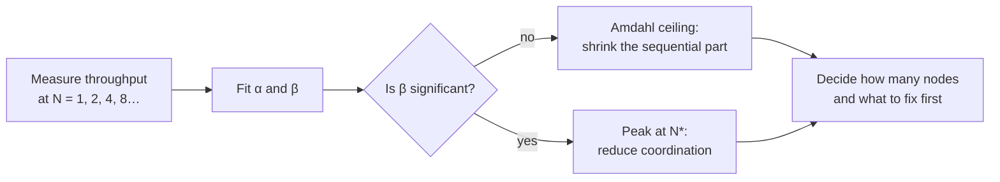
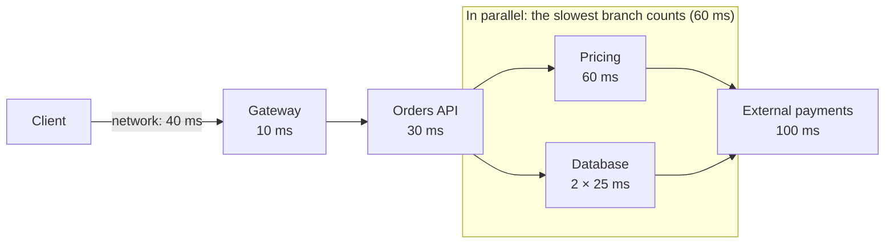

# Numbers and performance laws

The orders service runs at 85% CPU during peak hour, and someone says there is "still 15% of headroom". A week later a campaign raises traffic by 10%, and latency does not grow by 10%: it multiplies. The team adds instances and gets half the expected improvement, because every instance contends for a lock on the same row. None of this was unpredictable. Three or four very old laws anticipate it on the back of a napkin: **performance laws are relationships between throughput, time, concurrency and utilization that hold in almost any stable system, and they let you estimate before you build and explain after you measure**.

This article collects those relationships (Little, Amdahl, the Universal Scalability Law and basic queueing theory), the latency numbers worth keeping in your head, and how to use them in a latency budget or a concurrency calculation. It does not repeat the capacity estimation method applied to concrete cases, which lives in [scalability and classic design cases](/docs/escalabilidad-casos-clasicos), nor how to set SLIs and SLOs, which lives in [quality attributes](/docs/atributos-de-calidad).

<Callout tone="info" title="Assumptions and sources">
  Figures marked as an **assumption** are illustrative: they are there to practise the arithmetic,
  not to describe a real system. Dates and formulas come from the sources listed at the end. I could
  not open the full text of "The Tail at Scale" (the server returned 403): the figure quoted from it
  comes from third-party summaries and can be recomputed with the formula shown.
</Callout>

## Why estimate before you build

An order-of-magnitude calculation takes minutes and rules out whole designs. If you need 50 concurrent database connections, a pool of 10 is not a configuration detail: it is a bottleneck that will show up on the first day of real load. If 30% of the work is sequential, no number of instances will give you more than 3.3 times the throughput. Those answers do not need a prototype; they need the right law.

| The question you are asking                              | The relationship that answers it |
| -------------------------------------------------------- | -------------------------------- |
| How many requests will be in flight at this traffic?     | Little's law                     |
| How much do I gain by parallelizing or adding CPUs?      | Amdahl's law                     |
| Why did adding nodes stop helping, or make things worse? | Universal Scalability Law        |
| Why does latency explode as you approach the limit?      | Queueing theory (M/M/1)          |
| What does a network hop cost compared with memory?       | Reference latency tables         |

## Little's law: concurrency, throughput and time

The law says that the average number of items inside a system (**L**) equals the average arrival rate (**λ**) times the average time each item spends inside (**W**): `L = λW`. Before 1961 it was a known result, proven only for special cases; Philip M. Morse had posed it as a challenge. John D. C. Little published the general proof in "A Proof for the Queuing Formula: L = λW", in _Operations Research_, vol. 9, no. 3, 1961, pp. 383–387.

What makes it valuable is how few conditions it needs:

- **Long-run averages of a stable system.** Whatever goes in must eventually come out: if arrivals exceed capacity, the queue grows without bound and there is no average to apply.
- **It does not depend on distributions.** It does not matter how arrivals or service times are distributed, or in what order work is served.
- **It works for any boundary.** You can apply it to the whole cluster, one instance, the connection pool or just the waiting line, as long as L, λ and W are measured on the same boundary.

What it does not promise: over short windows or during a transient (a spike that has just started, a deployment) the equality need not hold for the data in that interval.

### Three immediate uses

| Use                       | What you solve for | Example (assumption)                                       |
| ------------------------- | ------------------ | ---------------------------------------------------------- |
| Size a pool               | L, from λW         | 6,000 queries/s × 4 ms = 24 busy connections on average    |
| Find a throughput ceiling | λ, from L/W        | 50 connections / 10 ms per query = 5,000 queries/s at most |
| Expose a hidden wait      | W, from L/λ        | 300 pending messages / 100 messages/s = 3 s average wait   |

Applied to the server alone, the law gives another useful relationship: the average number of jobs in service is λ times the service time **S**, and for a single server that number is its **utilization**, `ρ = λS`. If each request holds the CPU for 8 ms and 100 arrive per second at one core, that core is at 80%.

## Amdahl's law: the ceiling set by the sequential fraction

Gene Amdahl presented his argument at the AFIPS Spring Joint Computer Conference in 1967, in "Validity of the single processor approach to achieving large scale computing capabilities" (AFIPS Conference Proceedings, vol. 30, pp. 483–485). According to the editors of its 2007 reprint, the paper contains no equations. The reasoning was verbal: he estimated that data management housekeeping accounted for 40% of executed instructions, that this work looked sequential, and that it therefore capped throughput at five to seven times, however much the rest was parallelized.

The algebraic form now called Amdahl's law was written later. If **p** is the fraction of the work that can be parallelized and **N** the number of processors, the speedup is `S(N) = 1 / ((1 − p) + p / N)`. As N grows without limit, the second term vanishes and the speedup tends to `1 / (1 − p)`: the ceiling is set by the sequential part, not by the hardware.

| Parallel fraction p | With 8 processors | With 64 processors | Limit (N infinite) |
| ------------------- | ----------------- | ------------------ | ------------------ |
| 0.50                | 1.78×             | 1.97×              | 2×                 |
| 0.90                | 4.71×             | 8.77×              | 10×                |
| 0.95                | 5.93×             | 15.42×             | 20×                |
| 0.99                | 7.48×             | 39.26×             | 100×               |

The table shows the uncomfortable part: with 5% sequential work, going from 8 to 64 processors multiplies cost by eight and performance by less than three.

The same formula applies to optimizing code, not only to parallelizing it. If the database query is 20% of a request's time, making it infinitely fast speeds up the request by at most 1.25 times. Before you optimize, measure which fraction dominates.

<Callout tone="tip" title="Amdahl and Gustafson">
  John Gustafson published "Reevaluating Amdahl's Law" in _Communications of the ACM_ (vol. 31, no.
  5, May 1988). His objection: Amdahl fixes the problem size, but with more processors people
  usually solve larger problems in the same time, and then the sequential part weighs less. The two
  laws answer different questions: "how much faster can I do this?" versus "how much more work can I
  do in the same time?".
</Callout>

## Universal Scalability Law: when more is worse

Amdahl explains why gains flatten out, but not why they sometimes reverse. Neil Gunther added a second cost. His Universal Scalability Law (USL) writes the relative capacity with N nodes, threads or concurrent users as `C(N) = N / (1 + α(N − 1) + βN(N − 1))`.

- **α (contention)**: time spent waiting for a shared resource, such as a lock or a queue. It is Amdahl's sequential part: with β = 0, the USL reduces to Amdahl.
- **β (coherency)**: the cost of keeping data consistent across participants (invalidating caches, syncing replicas, coordinating). It grows with the square of N, because each participant has to agree with the others.

With β above zero the curve peaks at `N* = √((1 − α) / β)` and then declines: adding nodes lowers total throughput. The law's precursor is a 1993 paper by Gunther at the Computer Measurement Group conference; he develops it in chapters 4 to 6 of _Guerrilla Capacity Planning_ (Springer, 2007).

| N (assumption α = 0.05, β = 0.001) | Relative capacity C(N) | Reading                          |
| ---------------------------------- | ---------------------- | -------------------------------- |
| 8                                  | 5.69                   | Still scaling, with losses       |
| 32                                 | 9.03                   | Near the peak (N\* ≈ 31)         |
| 64                                 | 7.82                   | Twice the nodes, less throughput |
| 128                                | 5.42                   | Worse than with 8 nodes          |

The practical side of the USL is that a few measurements are enough to fit it: you measure throughput at several concurrency levels, fit α and β by regression (the R package `usl` does this) and get a model that extrapolates where the ceiling is. Three points make for a fragile fit; the more levels you measure, the better.

## Queues: utilization and latency

None of the previous laws explains the opening surprise: why a service is fine at 85% and unusable at 95%. Queueing theory does. The simplest model, the **M/M/1** queue (Poisson arrivals, exponential service times, one server), gives a mean response time of `R = S / (1 − ρ)` and a mean number of jobs in the system of `ρ / (1 − ρ)`. The second follows from the first through Little's law.

The denominator is what matters. As utilization approaches 1, response time does not grow linearly: it diverges. That is the **knee** of the curve in the figure. There is no exact point where it starts; what you can see is that each step towards 100% costs more than the last.

| Utilization ρ | Jobs in the system | Mean R (assumption S = 10 ms) | p99 in M/M/1 |
| ------------- | ------------------ | ----------------------------- | ------------ |
| 50%           | 1                  | 20 ms                         | ≈ 92 ms      |
| 70%           | 2.3                | 33 ms                         | ≈ 153 ms     |
| 80%           | 4                  | 50 ms                         | ≈ 230 ms     |
| 90%           | 9                  | 100 ms                        | ≈ 461 ms     |
| 95%           | 19                 | 200 ms                        | ≈ 921 ms     |
| 99%           | 99                 | 1,000 ms                      | ≈ 4.6 s      |

The last column follows from the fact that, in M/M/1, response time is exponentially distributed with parameter μ − λ; its 99th percentile is ln(100) ≈ 4.6 times the mean. Going from 80% to 90% doubles the mean, and going from 90% to 95% doubles it again. That is why a service at 90% has long queues: with one server, there are on average nine jobs inside.

### Variability makes the knee worse

M/M/1 is a model, not your system. In 1961 John Kingman published an approximation for queues with general distributions (G/G/1) that shows the missing factor: the waiting time in the queue is roughly `(ρ / (1 − ρ)) × ((ca² + cs²) / 2) × S`, where ca and cs are the coefficients of variation of arrivals and service. In M/M/1 that factor is 1. With bursty traffic or very uneven service times it is larger, and the same utilization produces more waiting. The practical consequence: if your load is irregular, leave more utilization headroom than the table suggests.

## Reference latency numbers

Jeff Dean included a slide titled "Numbers Everyone Should Know" in his LADIS 2009 keynote, "Designs, Lessons and Advice from Building Large Distributed Systems". Peter Norvig publishes a similar table, without a date of its own, in his essay "Teach Yourself Programming in Ten Years". The table below reproduces the values from Dean's slide.

| Operation (2009 slide)                     | Value      | Order of magnitude |
| ------------------------------------------ | ---------- | ------------------ |
| L1 cache reference                         | 0.5 ns     | Nanoseconds        |
| Branch mispredict                          | 5 ns       | Nanoseconds        |
| L2 cache reference                         | 7 ns       | Nanoseconds        |
| Mutex lock/unlock                          | 25 ns      | Tens of ns         |
| Main memory reference                      | 100 ns     | Hundreds of ns     |
| Compress 1 KB with Zippy                   | 3,000 ns   | Microseconds       |
| Send 2 KB over a 1 Gbps network            | 20,000 ns  | Tens of µs         |
| Read 1 MB sequentially from memory         | 250,000 ns | Hundreds of µs     |
| Round trip within the same datacenter      | 500,000 ns | Half a millisecond |
| Disk seek                                  | 10 ms      | Milliseconds       |
| Read 1 MB sequentially from disk           | 20 ms      | Tens of ms         |
| Packet California, Netherlands, California | 150 ms     | Hundreds of ms     |

<Callout tone="warning" title="These are 2009 orders of magnitude">
  Hardware has changed since then: the disks in the table are spinning disks (an SSD has no
  mechanical seek), networks are faster and processors have more cache levels. Do not use these
  values for sizing. Use them for the ratios: memory versus network inside the datacenter,
  datacenter versus another continent. For your own case, measure on your own hardware.
</Callout>

The ratios that remain useful: a network round trip inside the datacenter costs as much as thousands of memory accesses; an intercontinental trip, hundreds of local round trips. Bare round trips are cheap (ten at 0.5 ms add up to 5 ms); what costs is calls to services, which do work at every hop. Ten sequential calls of 20–30 ms each already use 200–300 ms: the whole budget of the next example before doing any useful work of your own.

## Using the numbers

### Latency budget

An end-to-end target is split across the hops of a request, so each team knows how much it can spend. The split is written down before you build and compared with measurements afterwards.

| Segment (assumption, p99 target of 300 ms) | Budget     | Path     | Note                                                   |
| ------------------------------------------ | ---------- | -------- | ------------------------------------------------------ |
| Client network                             | 40 ms      | Serial   | Outside your control; measure it                       |
| Gateway and authentication                 | 10 ms      | Serial   | In-memory token validation                             |
| API logic                                  | 30 ms      | Serial   |                                                        |
| Pricing                                    | 60 ms      | Parallel | Slowest branch of the parallel block: the one counted  |
| Two database queries (25 + 25 ms)          | 50 ms      | Parallel | In parallel with pricing; not counted since 50 < 60 ms |
| Payment provider                           | 100 ms     | Serial   | Runs after the parallel block; needs its own timeout   |
| Headroom                                   | 60 ms      | Serial   | For whatever is not in the drawing                     |
| **Total of the serial path**               | **300 ms** |          | 40 + 10 + 30 + 60 + 100 + 60; the database row is out  |

The two database queries are sequential with each other (25 + 25 = 50 ms), but their branch runs at the same time as pricing, so the parallel block costs 60 ms, not 110 ms. The critical path adds up to 240 ms and the headroom completes the 300 ms.

One caveat: percentiles do not add up. The sum of each segment's p99 is not the request's p99; it helps you split the budget, but the target is checked by measuring end to end. How to pick timeouts from those percentiles is covered in [resilience in distributed systems](/docs/resiliencia-sistemas-distribuidos).

### Working out concurrency

Little's law turns expected traffic into resources. Assumption: 1,500 requests per second at peak, 120 ms mean time per request, and two database queries that each hold a connection for 10 ms on average.

| Quantity (assumption)            | Calculation                 | Result                       |
| -------------------------------- | --------------------------- | ---------------------------- |
| Requests in flight at peak       | 1,500/s × 0.12 s            | ≈ 180 across the cluster     |
| Per instance, with 10 instances  | 180 / 10                    | ≈ 18 busy workers or threads |
| Busy database connections        | 1,500/s × 2 queries × 10 ms | ≈ 30 on average              |
| Pool at a 70% target utilization | 30 / 0.7                    | ≈ 43 connections in total    |

The last step applies the queueing table: a pool sized for the average hits 100% as soon as a burst arrives.

### Percentiles versus averages

[Quality attributes](/docs/atributos-de-calidad) explains why targets are expressed as percentiles. What matters here is a consequence that grows with the architecture: **fan-out**. If a request queries N servers in parallel and each one is slow once in a hundred times, the probability that at least one is slow is `1 − 0.99^N`. With 10 servers it is almost 10%; with 100, 63%. This is the example Jeffrey Dean and Luiz André Barroso use in "The Tail at Scale" (_Communications of the ACM_, vol. 56, 2013), assuming independent slowdowns. Google's SRE book puts it this way: the 99th percentile of one backend can become the median of your frontend.

## What each law answers

| Relationship | Question                                   | Form                       | Key assumption                       | Stops working when                                     |
| ------------ | ------------------------------------------ | -------------------------- | ------------------------------------ | ------------------------------------------------------ |
| Little       | How many in flight, how long the wait      | L = λW                     | Stable system, long-run averages     | The system is overloaded or you look at a short window |
| Amdahl       | How much parallelizing or optimizing gains | 1 / ((1 − p) + p/N)        | Fixed problem size                   | The problem grows with the resources (Gustafson)       |
| USL          | Where adding nodes peaks                   | N / (1 + α(N−1) + βN(N−1)) | α and β stable in the measured range | You extrapolate far beyond what you measured           |
| M/M/1        | How latency grows with load                | S / (1 − ρ)                | Exponential arrivals and service     | Load is highly variable (use Kingman)                  |
| Dean's table | What each operation costs                  | Orders of magnitude        | 2009 hardware                        | You treat it as an exact current value                 |

## When to use them and when not to

**When to use them:**

- When choosing between designs before writing code: how many remote calls per request, what runs in parallel, where there is a shared resource.
- When sizing pools, queues, consumers and instances from expected traffic.
- When reading a load test: if throughput flattens or drops, the USL tells you whether it is contention or coherency.
- When setting alert and autoscaling thresholds below the knee, not at 90%.

**When not to:**

- As a substitute for measuring. Models give you shape and order of magnitude; the parameters come from your system.
- To squeeze out the last 5% of performance: that is the profiler's job.
- When the system is overloaded: Little and M/M/1 assume stability, and under overload what you need is load shedding, not a model.

## Common mistakes

- **Averages for latency.** An 80 ms mean can coexist with a two-second p99. Targets and alerts belong in percentiles.
- **Optimizing the part that does not dominate.** Making something twice as fast when it is 10% of the time gives you a 5% improvement. Measure the fraction first.
- **Scaling without measuring the sequential fraction.** If there is a global lock or a hot row, adding instances buys little and, once coherency costs kick in, can take throughput away.
- **Planning for 90% utilization.** In a simple queue that means ten times the service time on average. Pick the target utilization with the p99 in mind, not the mean.
- **Treating the latency table as data.** These are 2009 ratios, not your hardware's specification.
- **Adding up percentiles.** A chain's p99 is not the sum of its segments' p99s.
- **Applying Little across mixed boundaries.** If L is the number of pool connections, W must be the time a connection is held, not the whole request time.

## Worked example: more instances or less coordination?

**Context (assumption).** A quoting service runs on 8 instances and handles a peak of 240 requests per second. Its p99 has gone from 150 ms to 900 ms in three months. The business plan expects 300 requests per second at next year's peak. The initial proposal is to double the instances.

**Measurement.** A load test measures maximum throughput with 1, 2, 4 and 8 instances: 50, 95, 170 and 273 requests per second. In relative capacity that is 1, 1.9, 3.4 and 5.5. Fitting the USL gives α ≈ 0.05 and β ≈ 0.002 (with four points, the fit is a first approximation).

**Reading it with the laws.**

1. **Current utilization:** 240 / 273 ≈ 0.88. The queueing table explains the p99: the service is past the knee.
2. **Ceiling with this design:** the peak is at N\* = √(0.95 / 0.002) ≈ 22 instances, with C ≈ 7.4, or about 370 requests per second. With 16 instances, C ≈ 7.2.
3. **What is needed:** 300 requests per second at a 70% target utilization requires 300 / 0.7 ≈ 430 of capacity. Not even 22 instances get there.
4. **Where β comes from:** each quote takes a distributed lock on the rates table to read a consistent version. That is coordination across every instance.

**Decision.** Doubling instances is not enough and, past N\*, makes things worse. The distributed lock is replaced by versioned, immutable rates that each instance reads without coordinating. If the new test brings β down to about 0.0005, the peak moves to N\* ≈ 44 and with 20 instances C ≈ 9.3, about 467 requests per second: enough for 430 with room to spare. The decision and the utilization threshold that triggers the next scale-out are recorded in an [ADR](/docs/adr), and the threshold is watched with a [fitness function](/docs/fitness-functions). For weighing the alternatives, see [trade-offs and decisions](/docs/trade-offs-y-decisiones).

## Checklist

- [ ] You know the expected peak throughput and the service time of every shared resource.
- [ ] Pools, queues and consumers are sized with Little's law and a utilization margin.
- [ ] Each resource's target utilization sits below the knee and is justified by the p99.
- [ ] You know the service's sequential fraction (or α and β) before proposing more instances.
- [ ] There is a latency budget per segment, and end-to-end latency is measured.
- [ ] Latency targets and alerts use percentiles, not averages.
- [ ] The reference numbers you use are measured on your hardware, or marked as orders of magnitude.

## Sources

Consulted in October 2026. The full text of "The Tail at Scale" could not be opened (HTTP 403); its 63% figure comes from third-party summaries and matches the calculation `1 − 0.99^100`. Gunther's 1993 paper was not consulted directly.

- [A Proof for the Queuing Formula: L = λW (John D. C. Little, _Operations Research_ 9(3), 1961)](https://doi.org/10.1287/opre.9.3.383) and [Little's law on Wikipedia](https://en.wikipedia.org/wiki/Little%27s_law)
- [Validity of the single processor approach… (Gene Amdahl, AFIPS 1967), 2007 reprint](https://www3.cs.stonybrook.edu/~rezaul/Spring-2019/CSE613/reading/Amdahl-1967.pdf)
- [Reevaluating Amdahl's Law (John L. Gustafson, _Communications of the ACM_ 31(5), 1988)](https://doi.org/10.1145/42411.42415)
- [Neil J. Gunther on Wikipedia](https://en.wikipedia.org/wiki/Neil_J._Gunther) and the [R usl package vignette](https://cran.r-project.org/web/packages/usl/vignettes/usl.pdf), which cites _Guerrilla Capacity Planning_ (Springer, 2007)
- [Raj Jain's notes on M/M/1 queues](https://classes.engineering.wustl.edu/~jain/cse567-11/ftp/k_31asq.pdf)
- [Kingman's formula on Wikipedia](https://en.wikipedia.org/wiki/Kingman%27s_formula)
- [Designs, Lessons and Advice from Building Large Distributed Systems (Jeff Dean, LADIS 2009)](https://research.cs.cornell.edu/ladis2009/talks/dean-keynote-ladis2009.pdf)
- [Teach Yourself Programming in Ten Years (Peter Norvig)](https://norvig.com/21-days.html)
- [The Tail at Scale (Jeffrey Dean and Luiz André Barroso, 2013)](https://research.google/pubs/pub40801/) and [Adrian Colyer's summary](https://blog.acolyer.org/2015/01/15/the-tail-at-scale/)
- [Monitoring Distributed Systems, Google's SRE book](https://sre.google/sre-book/monitoring-distributed-systems/)
