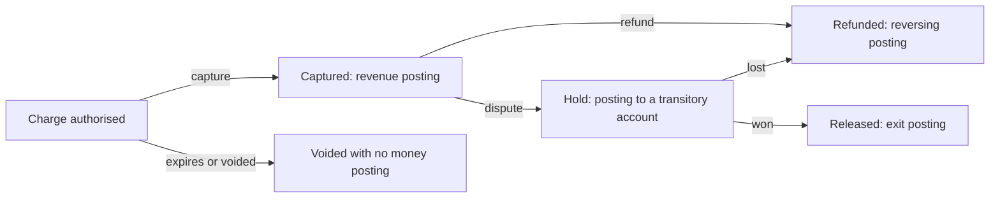

A payments system has two truths that must agree. The first is what the customer believes they paid; the second is what the payment provider has actually captured, held or refunded. Between them sits a third record, our own, which says how much is owed to each customer, how much the provider owes us and how much is ours. If that record is written as a simple `balance` field updated with every operation, the history is lost and, with it, the ability to prove what happened.

This article defends one concrete claim: **money is recorded in a double-entry ledger with immutable postings, and corrections are new postings that offset the earlier ones**. The technique is five centuries old and is not an accounting whim. It is what makes it possible to rebuild any balance, audit any movement and reconcile with a provider without arguing about every cent by hand.

## Why a balance is not enough

The usual approach in applications is an accounts table with a `balance` column. Each charge adds, each refund subtracts, and the system looks correct. The problem appears as soon as someone asks a question the column cannot answer: why is this balance 340 and not 355? When did it change? Which operation changed it, and who authorised it?

A balance column stores only the result. When something goes wrong, whether a code bug, a concurrency issue or an integration problem, the only way to correct it is to edit the number, and editing it erases the evidence that there was an error. Two processes writing the same balance at the same time can lose an update without anyone noticing. And if the provider sends a duplicate event, the balance adds it twice and leaves no trace.

A ledger reverses the relationship. The balance stops being stored data and becomes a calculation over movements that never change. Any balance can be recomputed at any time, and any difference is explained by pointing to the movement that caused it.

## Double entry on one page

Double entry says that every movement affects at least two accounts, with a **debit** in one and a **credit** in another, and that the debits and credits of each posting are equal. It sounds like bureaucracy, but it has a large practical effect: money does not appear or disappear. If an error breaks the balance, the system detects it in the same transaction, not months later at period close.

A charge of 100 euros with a 3 euro provider fee is recorded, for example, like this:

| Account                      | Debit | Credit |
| ---------------------------- | ----: | -----: |
| Cash at the provider (asset) | 97.00 |        |
| Payment fees (expense)       |  3.00 |        |
| Sales revenue (income)       |       | 100.00 |

The debits (100.00) equal the credits (100.00). If the fee calculation failed and left 3 euros unrecorded, the posting would not balance and should not be savable. That is the property we want: **an unbalanced posting is a programming error, not data**.

For a payments system it helps to separate three ideas that are often mixed up. The **charge** is the customer's intent to pay. The **capture** is the moment the provider holds the amount. The **posting** is the accounting record of an economic fact. A charge can be authorised but not captured, captured and later refunded, or disputed. Each state produces different postings, and the ledger must reflect facts, not intentions.

## Immutable postings and corrections by reversal

The most important rule of a ledger is that **a published posting is never modified or deleted**. If a posting is wrong, you publish a reversing posting that offsets it exactly, and then the correct one. The history stays complete: the error, its correction and the reason.

A full refund of an earlier sale is not a subtraction from the original revenue. It is a new posting that moves the money the other way, and it references the movement it offsets. If the refund is partial, the posting records the amount returned; if the provider also kept the fee, the fee is not refunded, and that is written down too.

<Callout tone="warning" title="Immutable does not mean uncorrectable">
  Immutability protects the history, it does not prevent fixes. What is not allowed is erasing the
  evidence. An error is corrected with a posting that says "this was wrong and this replaces it",
  with author, date and reason.
</Callout>

The discipline has a cost. Balance queries must sum movements instead of reading a number, which needs suitable indexes and, at large volumes, precomputed balances kept as a cache that is rebuilt from the ledger. That cache is derived and can be discarded without losing information; the ledger cannot.

## A minimal model: accounts, postings and lines

The data model has three entities. **Accounts** represent where money comes from and where it goes: assets (cash at the provider), liabilities (what we owe a merchant), income and expenses. A **posting** groups the movements of one economic event, with an accounting date, a description and a reference to the originating event. **Lines** are the individual debits and credits, each with its account, amount and currency.

The constraints are what protect the system. The sum of lines in each posting must be zero in each currency. A posting needs at least two lines. Amounts are stored as integers in the smallest currency unit (cents), never as floating-point numbers. And the lines of a published posting cannot change, which is enforced with database permissions or with an insert-only model.

One less obvious decision is how many accounts to create. It is tempting to create one account per customer, but that mixes the chart of accounts with customer data and makes reporting harder. A common alternative is to keep global accounts for the company's money and per-entity accounts (a merchant, a customer) carrying an owner identifier. The company-wide balance is then the sum of accounts of a type, and a merchant's balance is that sum filtered by its owner.

Fees deserve their own accounts for the same reason. A provider fee is an expense for the company, but it can also be passed on to the merchant in a contract, and the same charge may later be partially refunded with the fee kept or returned depending on the rules. If fees are posted to a generic expense account, reporting cannot separate them, and reconciliation cannot tell whether a difference comes from a rate change or from a bug. Separate accounts per fee type, per provider and per currency make the statement and the ledger comparable line by line, which is what reconciliation needs.

## Idempotency of the charge

A charge can arrive twice: the customer presses the button twice, the network cuts the response, the provider resends an event. Without protection, the system charges twice or records two revenues. The defence has two layers that must agree.

The first is the idempotency key in the request to the provider. Many payment APIs accept a header or field that identifies the operation, so that repeating the request with the same key returns the original result instead of creating another charge. The key must be generated once per payment intent, not on every retry, and stored alongside the intent before calling the provider.

The second is a constraint in the ledger itself. Each economic fact received from the provider carries an external identifier, and the ledger enforces that this identifier is unique per type of fact. If a second event arrives with the same identifier, the system recognises it and does not publish a new posting. This constraint keeps protecting even if the provider-side layer fails, because it is the last line of defence in the database.

Idempotency does not replace handling intermediate states. A charge whose result is unknown (a timeout) is neither paid nor declined: it is pending confirmation. The system must be able to ask the provider about the status of that intent, instead of retrying blindly.

<Callout tone="info" title="Two keys, two purposes">
  The provider's idempotency key prevents duplicate charges at the call. The external identifier in
  the ledger prevents duplicate postings when events are processed. Relying on only one of them
  leaves a gap.
</Callout>

## Reconciliation with the provider

The ledger describes what the system believes has happened. Reconciliation compares that description with what the provider reports, usually in a daily statement of movements and settlements, and flags every difference. It is the control that detects what no application code can see: fees different from those expected, settlements arriving late, refunds initiated by the provider with no event in our system.

Useful reconciliation has three levels. The first matches movements by identifier: every charge in the ledger should have its counterpart in the statement, and the reverse. The second compares amounts and fees, because a movement can exist on both sides with a different amount. The third compares balances by period: what the provider owes us in settlement against what the ledger says it owes.

Differences are not fixed by editing the ledger. They are recorded as open reconciliation items, with an owner and a deadline, and resolved with explained adjustment postings. A team that corrects by hand without leaving a trace ends up with a ledger that balances by coincidence and a reconciliation nobody understands.

### Period close and transitory accounts

Period close is the moment a period stops accepting new postings and is frozen for reporting. An insert-only ledger makes this natural: the period is marked closed, and any later posting that belongs to it is rejected or moved, explicitly, into the open period. What must not happen is a posting appearing in a closed month because a provider event arrived late; the accounting date should be decided by the economic date of the fact, not by the date it was received.

Many payment flows need **transitory accounts**: money in transit between customer, provider and merchant. A captured charge that has not yet settled sits in a settlement-pending account; a dispute moves the amount to a hold account; a received settlement clears it. Transitory accounts should trend to zero at the end of each cycle. If one accumulates a balance persistently, the system has a reconciliation problem worth investigating before it reaches the annual close.

A concrete example. A merchant sells for 200 euros, the provider keeps 6 euros in fees and settles 194 euros five days later. The ledger first records the revenue against the account of merchant funds pending settlement, then the fee as an expense, and when the settlement arrives it clears the pending account against cash at the provider. If the settlement arrives for 193.50 euros, the 0.50 euro difference is not absorbed silently: it is posted as an adjustment with its own account and reason, and it enters the open reconciliation list.

### Currency, rounding and dates

Three details cause expensive errors when ignored. The first is currency: a posting may mix currencies if there is a conversion, and in that case each currency must balance on its own, or the exchange rate must be recorded as a posting of its own. Adding euros and dollars into one total without converting is an error that a well-designed ledger should not allow.

The second is rounding. 19 % VAT on 0.05 euros does not give a whole number of cents, and every rounding must be explicit and have a rounding-difference account. Letting rounding disappear in application code produces postings that do not balance by one cent, and those cents accumulate in reconciliations.

The third is dates. A payment can be authorised today, captured tomorrow and settled five days later. Each of those dates has a different accounting meaning: the accrual date, the collection date and the value date. Mixing them makes month-end closes disagree with bank statements. At minimum, store the date of the economic event and the accounting date separately.

## Tools

For most teams there is no sense in building a complete accounting engine. A reasonable option is a relational database with transactions to publish postings atomically, an insert-only table for lines and a materialised view for balances. If the business needs a formal accounting system, a dedicated accounting or treasury platform can hold the ledger, but the payments system remains responsible for never publishing incorrect postings.

The payment provider supplies the statement, the idempotency keys and the webhooks. Those webhooks can arrive out of order and be repeated, so the processing logic must tolerate both, as explained in [sagas, outbox and idempotency](/docs/sagas-outbox-idempotencia).

<Callout tone="tip" title="Start with the balance check">
  Before choosing technology, write the rule every posting must satisfy and test it with dirty data:
  duplicate charges, out-of-order events, amounts with cents. If the rule holds, the rest of the
  design is mechanical.
</Callout>

## Common mistakes

The first mistake is storing a balance as the source of truth. It is convenient for displaying data and dangerous for explaining it. If the balance can be edited, there is no ledger, only a counter.

The second is allowing postings that do not balance, leaving validation to the application with no constraint in the database. One bug in one endpoint is enough to break the global balance.

The third is correcting postings by editing their lines. It breaks the history and makes auditing impossible, and it happens because writing a reversing posting looks like more work at first.

The fourth is treating a retry as a new charge. Without an idempotency key and a uniqueness constraint in the ledger, every timeout becomes a possible real duplicate.

The fifth is reconciling late. A month-old unexplained difference costs more than a one-day-old one, because the causes have been lost.

## Checklist

- The ledger is insert-only: published postings are never edited or deleted.
- Every posting balances in each currency, and the database or the write flow prevents publishing an unbalanced posting.
- Amounts are stored as integers in the smallest currency unit.
- Each charge has an idempotency key generated once per intent and stored before calling the provider.
- Each fact received from the provider has a unique external identifier that the ledger enforces.
- Intermediate states (pending confirmation) are modelled, and the system can query the provider.
- Balances are derived from the ledger and can be rebuilt from scratch.
- Reconciliation matches movements by identifier, amounts and period balances, and records open differences.
- Currency, rounding and accounting dates are defined, with their own accounts where needed.
- Corrections record the author, date, reason and a reference to the posting they replace.

## Sources

- Luca Pacioli, _Summa de arithmetica, geometria, proportioni et proportionalità_ (Venice, 1494), which describes the double-entry method, as summarised in the [Wikipedia entry on the work](https://en.wikipedia.org/wiki/Summa_de_arithmetica). The method predates the book; Pacioli presents it as current practice.
- Stripe API documentation, [Idempotent requests](https://docs.stripe.com/api/idempotent_requests), as an example of idempotency keys in payments. Key expiry details were not checked and are not cited here.

Consulted in October 2026. The figures in the example posting are illustrative. The double-entry principle and the behaviour of captures, holds and reconciliations are described in general, without attributing them to a specific provider.
