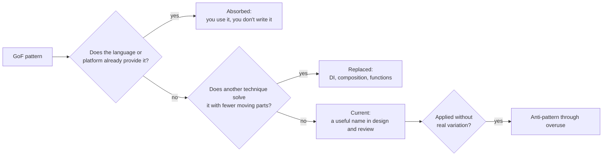
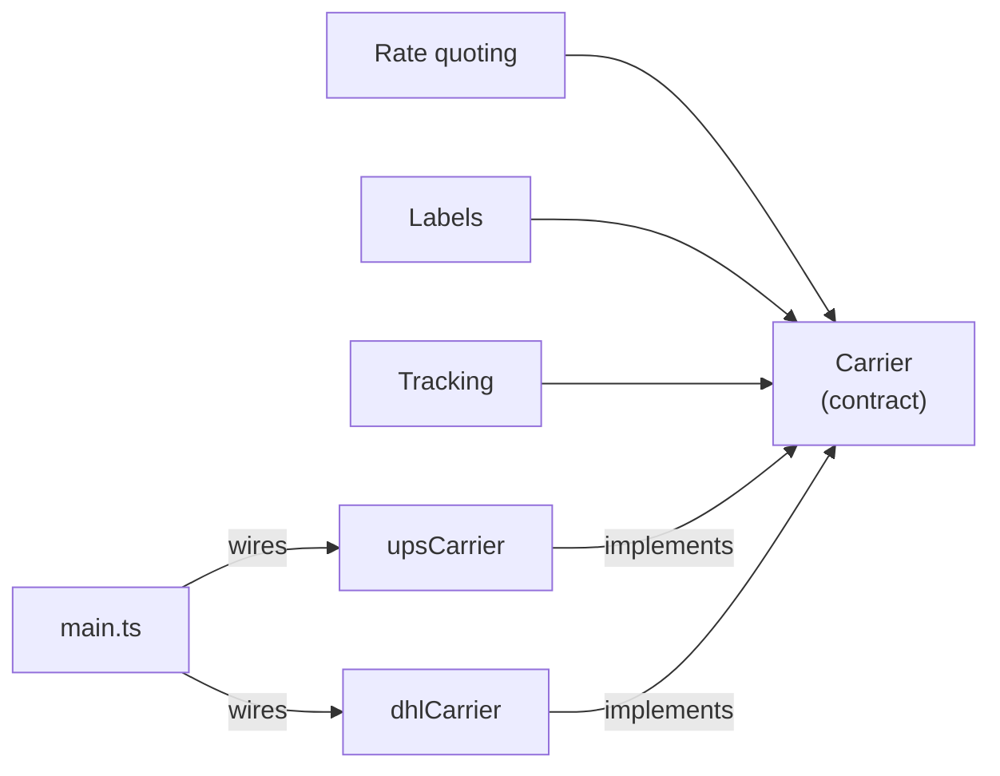

# GoF design patterns, a modern take

You open a pull request and find `PaymentProcessorStrategyFactoryProvider`: four files, two interfaces and an abstract class to choose between card and bank transfer. The module next door has the opposite problem: the same `switch` on the carrier type is copied into rate quoting, label printing and tracking, and every new carrier means editing all three. Both teams know design patterns. One applies them by reflex; the other can't see where one is missing.

This article works from one definition: **a design pattern is a named solution to a design problem that recurs in a specific context, and its value lies in the problem it names and the consequences it spells out, not in the classes it draws**.

Read with that definition, the 1994 catalog looks different. Some patterns are still everyday vocabulary. Others disappeared into the language: you no longer write them, you just use them. Others were displaced by a different technique, mostly dependency injection. And one, Singleton, is now considered a liability in most contexts. You'll see each case, why it happened, and how to decide when a pattern is worth what it costs.

<Callout tone="info" title="Cutoff date and scope">
  Sources checked in October 2026. I did not have access to the full text of the GoF book: what is
  said about its contents comes from the publisher's page, Wikipedia and academic course notes that
  summarize it, and is flagged as such. The status classification is an editorial judgment, not an
  official list.
</Callout>

## Where they come from: the GoF book

_Design Patterns: Elements of Reusable Object-Oriented Software_ was written by Erich Gamma, Richard Helm, Ralph Johnson and John Vlissides, known as the Gang of Four (GoF). Addison-Wesley published it in October 1994, with a 1995 copyright, and its examples are in C++ and Smalltalk. That detail matters: many patterns work around limitations those languages had at the time.

The catalog holds 23 patterns in three categories:

| Category   | What it addresses                                | Patterns                                                                                                                        |
| ---------- | ------------------------------------------------ | ------------------------------------------------------------------------------------------------------------------------------- |
| Creational | Creating objects without coupling to their class | Abstract Factory, Builder, Factory Method, Prototype, Singleton                                                                 |
| Structural | Composing objects and classes into larger pieces | Adapter, Bridge, Composite, Decorator, Facade, Flyweight, Proxy                                                                 |
| Behavioral | Distributing responsibilities and communication  | Chain of Responsibility, Command, Interpreter, Iterator, Mediator, Memento, Observer, State, Strategy, Template Method, Visitor |

That is 5 creational, 7 structural and 11 behavioral. According to academic summaries of the first chapter, every pattern has four elements: **name, problem, solution and consequences**. The fourth is the one people forget, and it is the one that tells you when not to use the pattern.

The introduction also states two principles that have aged better than any individual pattern: program to an interface, not an implementation, and favor object composition over class inheritance. Almost everything said about patterns today follows from those two principles, which also sit behind the D and the O in [SOLID](/docs/solid).

## What changed in thirty years

Two documents mark the shift.

The first is Peter Norvig's talk _Design Patterns in Dynamic Languages_, presented on May 5, 1996. Its key slide says that 16 of the 23 patterns are invisible or simpler in Lisp or Dylan, and attributes that to specific language features:

| Language feature      | Patterns it simplifies, per Norvig                                                 |
| --------------------- | ---------------------------------------------------------------------------------- |
| First-class types     | Abstract Factory, Flyweight, Factory Method, State, Proxy, Chain of Responsibility |
| First-class functions | Command, Strategy, Template Method, Visitor                                        |
| Macros                | Interpreter, Iterator                                                              |
| Method combination    | Mediator, Observer                                                                 |
| Multimethods          | Builder                                                                            |
| Modules               | Facade                                                                             |

Norvig distinguishes three levels: a pattern is **invisible** when it is so much part of the language that you don't notice it, **informal** when you refer to it by name but implement it from scratch each time, and **formal** when the language lets you write it once and reuse it. Three decades later, much of what he saw in Lisp is available in Java, C#, Python, TypeScript, Kotlin or Go.

The second is the interview _Design Patterns 15 Years Later_, published by InformIT on October 22, 2009. In it, Gamma says he is in favor of dropping Singleton because "its use is almost always a design smell." The authors sketch a reorganization into new categories (Core, Creational, Peripheral and Other), propose generalizing Factory Method into Factory, and adding, among others, Null Object and **Dependency Injection**. They present this as draft notes, not a second edition.



## A classification for today's practice

The table classifies the patterns you are most likely to meet in real code. "Current" does not mean "always use it": it means the name still describes a decision that you make, not the language.

| Pattern          | Status today                           | Why                                                                                                                                                          |
| ---------------- | -------------------------------------- | ------------------------------------------------------------------------------------------------------------------------------------------------------------ |
| Strategy         | Absorbed in its minimal form           | A single-method strategy is a function you pass as an argument. It stays relevant as an object when it groups several operations or holds its own state      |
| Observer         | Current, usually provided              | Event emitters, signals and reactive streams ship it. What is left for you: delivery order, error handling and unsubscribing                                 |
| Decorator        | Current                                | It is the shape of middleware and of caching, retry or metrics wrappers. In its lightweight form it is a higher-order function                               |
| Adapter          | Current                                | It is the adapter in [hexagonal architecture](/docs/arquitectura-hexagonal) and the building block of an anti-corruption layer                               |
| Facade           | Current, absorbed by modules           | A module with a small public API is a facade. Norvig already credited modules for it                                                                         |
| Factory Method   | Replaced in most cases                 | Dependency injection and plain construction functions pick the implementation without a hierarchy of creators. It survives as a framework hook               |
| Abstract Factory | Replaced by dependency injection       | Choosing a coherent family of implementations is the composition root's job. Still relevant only if the family changes at runtime                            |
| Command          | Absorbed if it only executes           | If you only need to run something later, a closure is enough. It is current when the command is data: queued, serialized, audited or undone                  |
| Iterator         | Absorbed by the language               | For-each loops, generators and iteration protocols make it invisible. You implement it only when exposing a custom collection                                |
| Singleton        | Anti-pattern when overused             | It conflates "one instance" with "global access". The first is fine; the second hides dependencies and breaks tests                                          |
| Template Method  | Replaced by composition                | It fixes the algorithm in a base class and forces inheritance. Passing the variable steps as functions or collaborators gives the same without the hierarchy |
| State            | Current, in a different shape          | For lifecycles with rules, a discriminated union of states plus a transition table often reads better than one class per state                               |
| Proxy            | Absorbed by platforms and frameworks   | ORM lazy loading, generated RPC clients, JavaScript's `Proxy`. You rarely design one by hand, but you must recognize it while debugging                      |
| Builder          | Current for step-by-step construction  | Named parameters or object literals are enough to create data. It remains useful when construction validates in stages                                       |
| Visitor          | Replaced where pattern matching exists | In languages with sum types and pattern matching, walking a closed hierarchy needs no double dispatch                                                        |

## How the language absorbed patterns

A pattern gets absorbed when the language turns its structure into syntax or into the standard library. What remains is the problem, not the ceremony.

### Iterators and generators

The GoF Iterator separates traversal from the collection through an object with operations to advance and read the current element. Today every mainstream language has an iteration protocol that the for-each loop consumes directly, and generators let you write a lazy traversal as a function that yields values. The design decision that survives is when to expose your own iterable instead of returning an array: when the collection is large, is consumed lazily, or is paged from an external service.

### First-class functions instead of strategies and commands

If a strategy or a command has a single method, the interface and its classes are the long-hand version of a function type. Compare the two signatures:

```typescript
// Classic version: one interface and one class per variant
interface DiscountStrategy {
  apply(cart: Cart): Money;
}
declare class BlackFridayDiscount implements DiscountStrategy {
  // …
}

// Current version: the type is a function and the variants are values
type ApplyDiscount = (cart: Cart) => Money;
declare const blackFriday: ApplyDiscount;
declare function checkout(cart: Cart, discount: ApplyDiscount): Receipt;
```

The idea behind the pattern is still there: the algorithm varies without touching its caller. What disappears are the classes. The object earns its place again when a variant needs several related operations (compute, describe, validate) or its own state: then a type with several methods communicates better than three loose functions.

Command follows the same path. A closure that captures its arguments is already a command you can run later. What a closure doesn't give you is a representation as data: if you need to store the command in a queue, retry it in another process, log it for auditing or undo it, it becomes a named object with fields again, like a use-case command in [hexagonal architecture](/docs/arquitectura-hexagonal).

### Dependency injection instead of factories and singletons

Martin Fowler published the article that settled the term _Dependency Injection_ on January 23, 2004; he chose the name because "Inversion of Control" was too generic. The idea is that an object receives its collaborators from outside instead of creating or looking them up.

That puts two creational patterns out of work. Abstract Factory existed so client code would not know which family of concrete classes to use; that decision now lives in a single place, the composition root, which wires each dependency to its implementation. Singleton existed to guarantee one instance and provide access to it; now the composition root creates the single instance once and hands it to whoever needs it. The guarantee stays; the global access goes away.

You don't need a container for this. Passing dependencies through constructors or arguments and wiring them in `main` is dependency injection. A container pays off when the graph is large, not before.

## Singleton: from pattern to anti-pattern

Singleton makes two promises at once: only one instance will exist, and anyone can reach it from anywhere. The first promise is rarely the problem. The second one is.

| Consequence       | What happens in practice                                                                                                                   |
| ----------------- | ------------------------------------------------------------------------------------------------------------------------------------------ |
| Global state      | Any module can read and modify it. A bug introduced in one place surfaces in another with no apparent connection                           |
| Hidden dependency | A function's signature doesn't reveal that it uses the configuration or the connection: you find out reading its body or when a test fails |
| Coupled tests     | State survives between tests; execution order changes results and running in parallel becomes risky                                        |
| Hard substitution | Using a test double means patching a static accessor instead of passing a different implementation                                         |
| Concurrency       | Lazy initialization needs care to avoid creating the instance twice                                                                        |

That is why Gamma called it a design smell in 2009, and why the practical rule today is to split the two promises.

**Where it is still legitimate.** Having a single instance of something is normal: a connection pool, an HTTP client with its configuration, an in-process cache. The right move is to create it once in the composition root and inject it; DI containers call this a "singleton" lifetime, and it has none of the problems in the table because nobody reaches it through global access. A module that exports immutable values, such as constants or configuration read at startup and frozen, is also fine: there is no state to mutate. What you want to avoid is a mutable object any layer can grab with a static call.

## The vocabulary that came after the GoF

Several patterns you name every day are not in the 1994 book. There's no need to go deep here, but it helps to know where they come from and where this site covers them.

| Pattern               | Origin                                                                                                          | Related                                                                                                       |
| --------------------- | --------------------------------------------------------------------------------------------------------------- | ------------------------------------------------------------------------------------------------------------- |
| Repository            | Catalog of _Patterns of Enterprise Application Architecture_ (Fowler, 2002); entry by Edward Hieatt and Rob Mee | [Domain-Driven Design](/docs/domain-driven-design) and [hexagonal architecture](/docs/arquitectura-hexagonal) |
| Unit of Work          | Same catalog: tracks the objects affected by a business transaction and coordinates writing out the changes     | [Layered, clean and onion architecture](/docs/arquitectura-en-capas-clean-onion)                              |
| Dependency Injection  | Fowler's article from January 2004                                                                              | [SOLID](/docs/solid), dependency inversion principle                                                          |
| Event-driven patterns | Fowler (2017) separates event notification, event-carried state transfer, event sourcing and CQRS               | [Monolith or microservices](/docs/monolito-vs-microservicios)                                                 |

Notice that the hexagonal adapter is a GoF Adapter with a specific role, and that Repository plays a similar part: a collection-like interface that mediates with the data-mapping layer. Newer patterns rarely invent structures: they name a role within an architecture.

## The danger of pattern-driven design

Naming a pattern does not make a design good. A design is good if the change you expect is cheap; a pattern helps only if it targets that change. When you pick the pattern before you understand the variation, you get indirection without purpose.

The case from the opening, reduced to signatures:

```typescript
// Before: three patterns for two payment methods that never change together
abstract class AbstractPaymentProcessor {
  // …
}
interface PaymentProcessorFactory {
  create(kind: string): AbstractPaymentProcessor;
}
declare class PaymentProcessorRegistry {
  static getInstance(): PaymentProcessorRegistry;
}

// After: a function type and a map closed over the payment method
type ChargePayment = (charge: Charge) => Promise<Receipt>;
declare const chargeBy: Readonly<Record<PaymentMethod, ChargePayment>>;
```

The after version is just as extensible (a new payment method is a new entry), the compiler checks that the map covers every `PaymentMethod` value, and there is no global access. What was lost is pattern names, not design.

In _Refactoring to Patterns_ (Addison-Wesley, 2004), Joshua Kerievsky argued that reaching a pattern by refactoring an existing design beats applying it up front, and that you need to know how to refactor **to**, **towards** and **away from** a pattern. The third direction is the one teams forget: removing a pattern that no longer buys anything is a legitimate improvement.

## Worked example: from a repeated switch to a named strategy

A shop ships through three carriers. The code has a `switch` on the carrier in three places: rate quoting, label generation and the tracking URL. A fourth carrier arrives and the change touches three files; the reviewer misses the tracking case and the bug reaches production.

**Diagnosis.** The `switch` itself is not the smell: a `switch` in one place is perfectly readable. The smell is the **same `switch` in several places**, because it means knowledge about each carrier is scattered. It is the textbook case Fowler catalogs as _Replace Conditional with Polymorphism_.

**Decision.** Each carrier has three related operations that change together. That points toward a type with several methods (a strategy as an object) rather than three independent maps of functions, which would scatter the knowledge again.

```typescript
// shipping/carrier.ts: the contract every carrier fulfills
export type Carrier = {
  quote(parcel: Parcel, destination: Address): Money;
  createLabel(shipment: Shipment): Promise<Label>;
  trackingUrl(trackingId: string): URL;
};

// shipping/carriers/*.ts: one implementation per carrier
declare const upsCarrier: Carrier;

// main.ts: the composition root chooses; nobody else knows the list
declare const carriers: Readonly<Record<CarrierId, Carrier>>;
```



**Outcome.** Adding a carrier means one new file and one map entry; if an operation is missing, the compiler flags it. Each implementation is tested on its own, and a shared suite verifies that all of them honor the contract. No factory, no base class, no singleton: the pattern is Strategy and the technique that wires it is dependency injection.

**Where to stop.** If one carrier later needs an extra step the others don't have, the temptation is to add an optional method to the contract. Don't: it signals that the step belongs to a different abstraction or to that carrier alone. The contract should describe what **every** carrier does.

## When a pattern is worth its cost

Every pattern adds types, files and one more hop when reading the code. You pay that on every read, so it only pays off if it buys a variation that exists or is very likely.

| When to use it                                                            | When not to                                                                  |
| ------------------------------------------------------------------------- | ---------------------------------------------------------------------------- |
| There are already two or more real variants, or a second one is committed | "Just in case" with no concrete scenario                                     |
| The same conditional decision repeats in several places                   | The conditional appears once and reads fine                                  |
| You need a seam to test without infrastructure                            | The piece is pure and already testable on its own                            |
| The team recognizes the name and uses it in reviews                       | Only the person who applied it understands the name                          |
| The language lacks the mechanism and the pattern fills the gap            | The language already has it: functions, iterators, modules, named parameters |

### Signs a pattern is missing

- **The same `switch` or `if` chain on a type in several places.** Polymorphism is missing: a Strategy or a map of implementations.
- **Boolean parameters that change behavior.** They usually hide two strategies inside one function. See [clean code](/docs/clean-code).
- **The same wrapper copied around many calls** (logging, retries, metrics). A Decorator or middleware is missing.
- **One object polling another in a loop to see if it changed.** Observer or an event is missing.
- **A lifecycle driven by `if` checks on a status string spread across the code.** An explicit State is missing: a union of states and a transition table.
- **Your business code imports a vendor SDK.** An Adapter at the boundary is missing; you'll pay for that [coupling](/docs/acoplamiento-cohesion) when you switch vendors.

### Signs a pattern is overused

- **Interfaces with exactly one implementation** and no need for a test double.
- **Factories that only call the constructor** without deciding anything.
- **Names stacking pattern suffixes** (`...StrategyFactoryProvider`): every suffix is a hop the reader has to resolve.
- **Abstract base classes with a single subclass**, created for Template Method before a second case existed.
- **Following one request means opening five files** and none of them holds business logic.

When in doubt, start simple and let the second real case ask for the pattern. That decision, and the moment to reverse it, are good candidates for an [ADR](/docs/adr), because it is [technical debt](/docs/deuda-tecnica-evolucion) someone will inherit.

## Common mistakes

- **Learning the diagram, not the consequences.** The fourth element of each pattern tells you when not to use it; without it, the pattern is just a template.
- **Translating 1994 C++ into a 2026 language.** Classes for what your language expresses as a function, a module or an iterator.
- **Using Singleton to avoid passing a dependency.** The problem you dodge is exactly the one the design should answer: who depends on what.
- **Inheriting to reuse.** Template Method and deep hierarchies tie you to the base class; composition gives the same with less coupling.
- **Confusing the pattern with its name.** Calling an object that exposes raw SQL queries a `Repository` isolates nothing.
- **Patterns as a review requirement.** Asking "apply a pattern here" instead of asking which change should be cheap.
- **Never removing a pattern.** When the variation goes away, the indirection stays and you pay for it on every read.

## Checklist

- [ ] Every pattern in the code answers a real variation or a test seam you can point to.
- [ ] Single-method strategies and commands are functions, unless they must travel as data.
- [ ] No mutable object is reachable through global access; single instances are created in the composition root.
- [ ] Choosing implementations happens in one place, not in factories scattered around.
- [ ] No `switch` on a type is repeated in more than one place.
- [ ] Names describe the role in the domain, not the list of patterns applied.
- [ ] Decisions to introduce or remove a significant pattern are recorded.

## Sources

Checked in October 2026. I did not have access to the full text of the GoF book; the content of its first chapter is cited from academic course notes.

- [Design Patterns: Elements of Reusable Object-Oriented Software, publisher's page (InformIT)](https://www.informit.com/store/design-patterns-elements-of-reusable-object-oriented-software-9780201633610)
- [Design Patterns on Wikipedia](https://en.wikipedia.org/wiki/Design_Patterns): publication date, categories and reception
- [Introduction to patterns, San Diego State University course notes](https://eli.sdsu.edu/courses/spring98/cs635/notes/patternIntro/patternIntro.html): the four elements of a pattern, from search results only
- [Design Patterns in Dynamic Languages (Peter Norvig, 1996)](https://norvig.com/design-patterns/) and its [PDF slides](https://norvig.com/design-patterns/design-patterns.pdf)
- [Design Patterns 15 Years Later: An Interview with Erich Gamma, Richard Helm, and Ralph Johnson (InformIT, 2009)](https://www.informit.com/articles/article.aspx?p=1404056)
- [Inversion of Control Containers and the Dependency Injection pattern (Martin Fowler, 2004)](https://martinfowler.com/articles/injection.html)
- [Repository](https://martinfowler.com/eaaCatalog/repository.html) and [Unit of Work](https://martinfowler.com/eaaCatalog/unitOfWork.html) in the _Patterns of Enterprise Application Architecture_ catalog
- [What do you mean by "Event-Driven"? (Martin Fowler, 2017)](https://martinfowler.com/articles/201701-event-driven.html)
- [Replace Conditional with Polymorphism, refactoring catalog](https://refactoring.com/catalog/replaceConditionalWithPolymorphism.html)
- [Refactoring to Patterns (Joshua Kerievsky, Industrial Logic)](https://www.industriallogic.com/xp/refactoring/) and its [O'Reilly listing](https://www.oreilly.com/library/view/refactoring-to-patterns/0321213351/)
- [Singleton on Refactoring.Guru](https://refactoring.guru/design-patterns/singleton): drawbacks of the pattern
