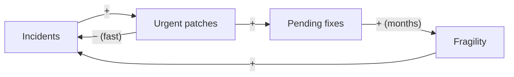
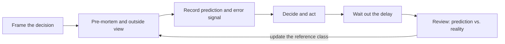

# Systems thinking and biases in decisions

A team closes every incident with an urgent patch. Each patch works: the alert goes quiet and the service comes back. Six months later there are more incidents than ever, the backlog is full of "permanent fix pending" tickets, and the retrospective concludes that the team needs more discipline. Nobody made a single bad decision; the structure of the work produced the result. And when the team decides how to get out, it estimates the rewrite at four months because that is what the plan says, not what similar projects actually took.

**Systems thinking explains a system's behavior through its structure (stocks, feedback loops and delays) rather than through isolated events; cognitive biases are systematic errors of judgment that make you misread that structure and decide worse.**

This article focuses on the first half: how to recognize reinforcing and balancing loops, why delays mislead you, and when a fix makes the problem it targets worse. It then covers the biases that matter most when the system responds late, and the techniques that counter them. General decision criteria and reversibility live in [trade-offs and decision-making](/docs/trade-offs-y-decisiones), which already covers anchoring, sunk cost and status quo in detail; using AI as decision support is in [AI for business decisions](/docs/ia-para-decidir-negocio); and the split between what the problem demands and what the solution adds is in [essential and accidental complexity](/docs/complejidad-esencial-y-accidental).

<Callout tone="info" title="Cutoff date and sources">
  Sources checked in October 2026. Donella Meadows's definitions come from her essay on leverage
  points, published on her official site, and from summaries of _Thinking in Systems_ (secondary
  source). Gary Klein's Harvard Business Review article is cited from its public abstract. The
  Buehler, Griffin and Ross figures come from the original paper.
</Callout>

## From events to structure

When something goes wrong, the natural reaction is to look for the event that caused it: Friday's deploy, the vendor change, the person who did not review the PR. Systems thinking asks a different question: **what structure keeps producing this pattern?** If the same kind of incident comes back every few weeks, today's event is just the latest sample.

Donella Meadows wrote _Thinking in Systems: A Primer_ as a draft in 1993; after her death in 2001, her colleagues at the Sustainability Institute restructured it, Diana Wright edited it, and Chelsea Green published it in 2008. The book works with three pieces:

- **Stocks**: quantities that build up or drain over time. What you see at any moment is a snapshot of them.
- **Flows**: what enters and leaves each stock per unit of time.
- **Feedback loops**: causal chains in which the state of a stock ends up affecting its own flows.

In software, stocks are not always obvious, because many of them never show up on a dashboard:

| Stock                   | Inflow                                    | Outflow                                   |
| ----------------------- | ----------------------------------------- | ----------------------------------------- |
| Pending permanent fixes | Every urgent patch left "for later"       | Planned work to close them                |
| Knowledge of the system | Onboarding, documentation, pairing        | Turnover, forgetting, code nobody touches |
| Customer trust          | Reliable releases, fast responses         | Visible incidents, broken promises        |
| Accidental complexity   | Shortcuts, new dependencies, added layers | Simplification and code removal           |
| Active customers        | Sign-ups                                  | Churn                                     |

Stocks explain why systems have inertia: even if you cut the inflow today, what has accumulated is still there and takes time to drain.

## Feedback loops

Meadows distinguishes two kinds of loop. Mark them in any causal diagram with a letter: **R** for reinforcing and **B** for balancing.

### Reinforcing loops

A reinforcing loop amplifies change: the more it runs, the stronger it gets. In her essay on leverage points, Meadows describes these loops as the source of growth, explosion, erosion and collapse, and warns that a reinforcing loop left unchecked will eventually destroy itself. They can be virtuous or vicious; the structure is the same, only the sign of the outcome changes.

Examples you will recognize:

- **Retry storms.** A dependency degrades, clients retry, load rises, the dependency gets worse and there are more retries. The mechanisms that break this loop are in [resilience in distributed systems](/docs/resiliencia-sistemas-distribuidos).
- **Patches that breed patches.** Every incident is closed with a patch; every patch leaves a pending fix; the accumulated backlog makes the system more fragile and produces more incidents. This is the loop in the article's figure.
- **Network effects (virtuous).** More users create more content, which attracts more users. The same loop runs in reverse when users leave.

### Balancing loops

A balancing loop seeks a goal: it corrects the gap between the current state and a target. Summaries of the book describe it as stability-seeking, holding a stock at a value or within a range. The classic example is a thermostat. In architecture, **autoscaling** is a balancing loop: if CPU usage exceeds the target, instances are added; if it drops, they are removed.

Meadows stresses that a balancing loop must be strong enough for the impact it corrects, and that removing correction mechanisms that are rarely used narrows the range of conditions in which the system can survive. In software, that is what happens when someone removes a rate limit "because it never fires."

### Delays

There is usually a delay between an action and its effect. Meadows frames delays relative to the rate at which the system changes: delays that are too short cause overreaction, and delays that are too long cause damped, sustained or exploding oscillations. She also notes that delays are often hard to change, and that it is frequently easier to slow down the rate of change so the delay does less harm.

Three typical delays in technical and business decisions:

| Delay                       | Typical length (rough) | What happens if you ignore it                            |
| --------------------------- | ---------------------- | -------------------------------------------------------- |
| New instances starting up   | Seconds to minutes     | Autoscaling adds too much, then removes too much         |
| New people joining the team | Months                 | Adding people to a late project makes it later at first  |
| Decay from accumulated debt | Quarters               | Incidents get blamed on bad luck rather than on the debt |

The second row is Brooks's law, stated in _The Mythical Man-Month_ (1975): adding people to a late software project makes it later. It is an onboarding delay combined with a coordination cost.

The delay is what makes a reinforcing loop dangerous: until the effect arrives, the decision looks right, so it gets repeated.

## When the fix makes the problem worse

The most treacherous combination pairs a fast balancing loop with a slow reinforcing loop. Peter Senge cataloged it as the _fixes that fail_ archetype in _The Fifth Discipline_ (1990), next to a close relative, _shifting the burden_: a symptomatic fix relieves the problem, the pressure to find the underlying solution goes away, and the side effects make things worse. Meadows describes an equivalent trap, _shifting the burden to the intervenor_, in which an intervention relieves symptoms without touching the cause and the system ends up depending on it.



The left loop (incidents, patches) is balancing and acts within hours, which is why the patch seems to work. The right loop is reinforcing and acts over months, which is why nobody connects it to the patch. Some common cases:

| Quick fix                           | Immediate relief        | Delayed effect                                                 |
| ----------------------------------- | ----------------------- | -------------------------------------------------------------- |
| Urgent patch with no underlying fix | The incident is closed  | More fragility and more incidents                              |
| Cache in front of a slow query      | Latency drops           | Nobody fixes the query; invalidation adds complexity           |
| Discount to close the quarter       | The sales number is hit | Customers learn to wait for the discount                       |
| On-call hero who fixes everything   | Fast recovery           | Knowledge concentrates and the rest of the team does not learn |
| More people on the late project     | A sense of progress     | More coordination and lower productivity for months            |

### Where to intervene

In her essay "Leverage Points: Places to Intervene in a System", Meadows ranks twelve places to intervene from least to most effective, and presents the list as tentative. The least effective are parameters and numbers; the most effective are the rules, the goals and the paradigm the system arises from. Several translate directly into technical decisions:

| Leverage point (Meadows)       | Example in software or business                                 |
| ------------------------------ | --------------------------------------------------------------- |
| Constants and parameters       | Raise the instance count or the timeout                         |
| Length of delays               | Detect earlier: alert on trends rather than thresholds          |
| Gain around reinforcing loops  | Retry budgets; capacity reserved for closing pending fixes      |
| Structure of information flows | The team that deploys sees the cost and the incidents it causes |
| Rules of the system            | No patch is closed without its underlying fix scheduled         |
| Goals of the system            | Track recovery time as well as delivery speed                   |

Look at the first row: it is the most common intervention and the least effective. Reducing the gain of a reinforcing loop usually pays off more than strengthening the balancing loop that compensates for it.

In the article's figure, the marked point between HOTFIX and BACKLOG is an intervention of this kind, and the "20%" label is an illustrative size, an assumption rather than a recommendation: for example, reserving 20% of capacity for closing pending fixes. The dashed curve shows that its effect on incidents only appears after the delay Δt.

## Biases that distort how you read the system

Delays create a vacuum: for weeks or months there is no data to confirm or refute the decision. Biases fill that vacuum. Anchoring, sunk cost and status quo bias are covered in [trade-offs and decision-making](/docs/trade-offs-y-decisiones#biases-that-distort-decisions); the table summarizes the ones that matter most when the system responds late.

| Bias             | What it does                                            | How it shows up in a decision                        | Main counterweight                           |
| ---------------- | ------------------------------------------------------- | ---------------------------------------------------- | -------------------------------------------- |
| Confirmation     | You seek and read evidence in favor of what you believe | Only the metrics that improved get looked at         | Write down first what would change your mind |
| Planning fallacy | You underestimate your own timelines and costs          | The plan assumes everything goes as designed         | Outside view                                 |
| Availability     | Recent or vivid events seem more likely                 | The last incident sets the quarter's priorities      | Frequency data, not anecdotes                |
| Success stories  | You learn only from the cases that went well            | "It worked for that company, so it will work for us" | Look for the cases that failed               |

### Confirmation

Raymond Nickerson, in his 1998 review in _Review of General Psychology_, defines confirmation bias as seeking or interpreting evidence in ways that are partial to existing beliefs, expectations or a hypothesis in hand. With long delays it does particular damage: if you have decided the vendor is the problem, every new incident seems to confirm it, even when the cause is the patch loop.

### Planning fallacy

Kahneman and Tversky proposed the term in a paper on intuitive prediction published in 1979. The most cited evidence comes from Buehler, Griffin and Ross (1994). Their first study contacted 37 final-year students; the timing analysis covers 33, because 4 had not submitted their thesis when record-keeping ended. Their best estimate averaged 33.9 days to finish; they took 55.5. Fewer than a third (29.7%) finished within the time they had given as most likely, and even their pessimistic estimate (48.6 days) fell short. In the same work, participants focused on their plans for the future and barely on their past experience.

### Availability

Tversky and Kahneman described the availability heuristic in 1973: judging how frequent or likely something is by how easily examples come to mind. Availability correlates with actual frequency, but it is also driven by other factors, which is why it produces systematic biases. A serious incident last week weighs more than twenty small ones spread across the year.

### Success stories

Two effects combine here. The first is **survivorship bias**: the cases that failed do not write blog posts or give talks, so the sample you learn from is filtered. The second is **outcome bias**: Baron and Hershey (1988) showed that people rate the reasoning and competence of a decision maker higher when the outcome was good, even when the information available at decision time was the same. Together they lead you to copy decisions for their results rather than their quality.

<Callout tone="warning" title="Knowing about biases is not enough">
  In Fischhoff's 1975 experiment on hindsight bias, participants were largely unaware of how knowing
  the outcome changed their judgment. Knowing a bias exists does not switch it off: you need
  procedures that work even when you do not notice it.
</Callout>

## Counterweight techniques

None of the four techniques below requires special talent; they work because they change the procedure, not your willpower.

### Pre-mortem

Gary Klein proposed it in "Performing a Project Premortem" (_Harvard Business Review_, September 2007). The team assumes the project has already failed and generates plausible reasons for the failure. Klein's rationale is that many people do not voice their reservations during planning, and the exercise makes it safe for those who know the plan's weaknesses to speak up. Kahneman later featured it in _Thinking, Fast and Slow_ (2011).

How to run it:

1. With the plan almost final and before you commit, gather the people who know the decision.
2. Ask: "It is a year from now and this failed. Why?"
3. Everyone writes their reasons silently for a few minutes.
4. Read them out in rounds, one per person, until they run out.
5. Pick the two or three most plausible and change the plan or add a signal that detects them early.

### Outside view

The inside view builds the estimate from your project's own plan; the outside view builds it from what similar projects actually took (the **reference class**). It is the remedy Kahneman and Tversky proposed for the planning fallacy, and Lovallo and Kahneman developed it for business decisions in "Delusions of Success" (_Harvard Business Review_, July 2003). The procedure:

1. Pick a reference class: projects similar in scope and team, ideally your own.
2. Look at the distribution of results (for example, the ratio of actual to estimated duration).
3. Make your inside estimate as usual.
4. Adjust it toward the distribution, more so the less predictable this kind of project is.

### Recording the prediction before deciding

Fischhoff showed in 1975 that once people know an outcome, they judge it more likely than they did before and overestimate what they would have known without it. If you do not write the prediction down first, the later review will compare the result with a memory that has already been rewritten. A short record is enough, next to the [ADR](/docs/adr) if there is one:

```yaml
# decisions/2026-10-notification-engine.yaml (rough shape)
decision: buy-vendor
alternatives: [build, buy-vendor, do-nothing]
prediction:
  integration_months: 2.5
  confidence: 0.7
  error_signal: 'integration not finished by month 4'
what_would_change_my_mind: 'vendor does not support batch sending'
review: 2027-04-12
# …
```

### Post-decision review

On the agreed date, compare what you predicted with what happened and keep two questions apart: **was the decision good given the information available?** and **was the outcome good?** In _Thinking in Bets_ (2018), Annie Duke calls judging a decision by its outcome _resulting_. The review looks for gaps between prediction and reality and their causes, not for culprits.



## Which technique for which problem

| Technique            | Mainly counters                     | Rough cost               | Most useful when                          |
| -------------------- | ----------------------------------- | ------------------------ | ----------------------------------------- |
| Causal loop diagram  | Reading events instead of structure | One whiteboard session   | A problem keeps coming back after "fixes" |
| Pre-mortem           | Optimism, group silence             | 30–60 minutes            | Plans committed to a date or a budget     |
| Outside view         | Planning fallacy, anchoring         | Gathering project data   | Estimating time and cost                  |
| Recorded prediction  | Hindsight bias, confirmation        | Ten minutes              | Decisions whose effect takes months       |
| Post-decision review | Outcome bias, success stories       | One meeting per decision | Decisions that will recur in another form |

## When to use it and when not to

**Use it when:**

- The same problem comes back after every fix: look for the loop before looking for another fix.
- The decision has an effect months away and is expensive to reverse.
- A time or cost estimate drives the choice.
- The team agrees very strongly very early: that is when a pre-mortem finds the most.

**Skip it when:**

- The decision is cheap to reverse and its effect shows within days: decide, measure and correct.
- There is no data on similar projects and no way to get it: the outside view becomes an invented number; say so and use wide margins.
- The problem is a one-off event with no pattern: a loop diagram built on a single incident is speculation.

## Common mistakes

- **Believing that knowing about biases is enough to avoid them.** A talk on biases does not change outcomes; a mandatory step in the process does.
- **Running the pre-mortem as a formality.** If nobody changes anything in the plan afterwards, it was theater. Agree beforehand that at least one risk will get an action or a signal.
- **Turning every decision into a long analysis.** Scale the effort to reversibility, as [trade-offs and decision-making](/docs/trade-offs-y-decisiones) explains. Most decisions need a written prediction and nothing more.
- **Drawing loops without delays.** Without the delay, the diagram cannot explain why the fix seemed to work.
- **Intervening only on parameters.** More instances or more people without touching the loop's gain buy time, not a way out.
- **Reviewing only failures.** Decisions that went well by luck teach as much as the ones that went badly.
- **Tailoring the reference class.** If you drop the projects that overran "because they were different", you are back to the inside view.

## Worked example: build or buy a notification engine

A three-person team must decide whether to build its own notification engine or integrate a vendor. The analysis horizon is three years (36 months). All figures are illustrative assumptions, in USD.

**Shared assumptions:** one person-month costs 10,000; maintaining an in-house engine takes 0.2 of a full-time person (2,000 a month) from the moment it is finished; the vendor license costs 5,000 a month for all 36 months.

### With the inside view

The plan says building takes 4 months, and integrating the vendor takes 2 months for 2 people.

| Option | Development              | Operation                 | 3-year total |
| ------ | ------------------------ | ------------------------- | ------------ |
| Build  | 4 × 3 × 10,000 = 120,000 | (36 − 4) × 2,000 = 64,000 | 184,000      |
| Buy    | 2 × 2 × 10,000 = 40,000  | 36 × 5,000 = 180,000      | 220,000      |

Building looks 36,000 cheaper. Confirmation bias does the rest: the team finds three posts from companies that built their own engine and were happy with it (success stories), and none from the ones that gave up.

### With the outside view

The pre-mortem flags the timeline as the main risk, so the team looks up its reference class. Its last six internal builds overran with these ratios of actual to estimated duration: 1.2, 1.5, 1.7, 1.8, 2.0 and 2.6. The median is (1.7 + 1.8) / 2 = 1.75. Its last three third-party integrations: 1.0, 1.25 and 1.6, with a median of 1.25.

| Option | Adjusted duration     | Development               | Operation                 | 3-year total |
| ------ | --------------------- | ------------------------- | ------------------------- | ------------ |
| Build  | 4 × 1.75 = 7 months   | 7 × 3 × 10,000 = 210,000  | (36 − 7) × 2,000 = 58,000 | 268,000      |
| Buy    | 2 × 1.25 = 2.5 months | 2.5 × 2 × 10,000 = 50,000 | 36 × 5,000 = 180,000      | 230,000      |

Now buying is 38,000 cheaper. The bias did not change a detail: it changed which option wins.

### Where the break-even point is

With an overrun ratio _r_, building costs 120,000 × r + (36 − 4r) × 2,000 = 112,000 × r + 72,000. Set that equal to the 230,000 for buying and you get r ≈ 1.41. Building only wins if the project overruns by less than 41%, and only one of the six previous projects (1.2) managed that.

### Decision, prediction and review

The team chooses to buy and records the prediction: integration in 2.5 months with 70% confidence; error signal, integration not finished by month 4; what would change their mind, the vendor not supporting batch sending. The review is set for six months later. The chosen option also adds no new inflow to the team's stock of pending work, which already feeds the patch loop described above: that effect does not show up in the cost table, but it counts.

## Checklist

- [ ] For a recurring problem, there is a diagram with its loops marked R or B.
- [ ] Each loop in the diagram shows where the delays are and their rough length.
- [ ] Every quick fix has its possible delayed effect written down.
- [ ] The chosen intervention acts on rules, information or a loop's gain, not just on parameters.
- [ ] Time and cost estimates were checked against a reference class.
- [ ] There was a pre-mortem, and at least one risk has an action or signal assigned.
- [ ] The prediction, confidence and error signal were written down before deciding.
- [ ] There is a review date, and the review separates decision quality from outcome quality.

## Sources

Checked in October 2026. Secondary source for the books by Meadows, Senge, Kahneman and Duke: their ideas are cited through the sources listed.

- [Leverage Points: Places to Intervene in a System (Donella Meadows, The Donella Meadows Project)](https://donellameadows.org/archives/leverage-points-places-to-intervene-in-a-system/): leverage points, delays and loops
- [Thinking in Systems: A Primer (Wikipedia)](https://en.wikipedia.org/wiki/Thinking_In_Systems:_A_Primer): publication history, secondary source
- [Fixes that fail (Wikipedia)](https://en.wikipedia.org/wiki/Fixes_that_fail) and [System archetype (Wikipedia)](https://en.wikipedia.org/wiki/System_archetype): Senge's archetypes, secondary source
- [Performing a Project Premortem (Gary Klein, Harvard Business Review, September 2007)](https://hbr.org/2007/09/performing-a-project-premortem)
- [Exploring the "planning fallacy" (Buehler, Griffin and Ross, 1994)](https://bear.warrington.ufl.edu/brenner/mar7588/Papers/buehler-et-al-1994.pdf)
- [Planning fallacy (Wikipedia)](https://en.wikipedia.org/wiki/Planning_fallacy): origin of the term, secondary source
- [Confirmation Bias: A Ubiquitous Phenomenon in Many Guises (Nickerson, 1998)](https://pages.ucsd.edu/~cmckenzie/nickersonConfirmationBias.pdf)
- [Availability heuristic (Wikipedia)](https://en.wikipedia.org/wiki/Availability_heuristic): reference to Tversky and Kahneman (1973)
- [Outcome bias in decision evaluation (Baron and Hershey, 1988)](https://bear.warrington.ufl.edu/brenner/mar7588/Papers/baron-hershey-jpsp1988.pdf)
- [Hindsight ≠ foresight (Fischhoff, 1975), summary on PSNet](https://psnet.ahrq.gov/issue/hindsight-foresight-effect-outcome-knowledge-judgment-under-uncertainty)
- [Delusions of Success: Bent Flyvbjerg's comment on Lovallo and Kahneman (arXiv)](https://arxiv.org/abs/1305.0741): reference to the July 2003 article
