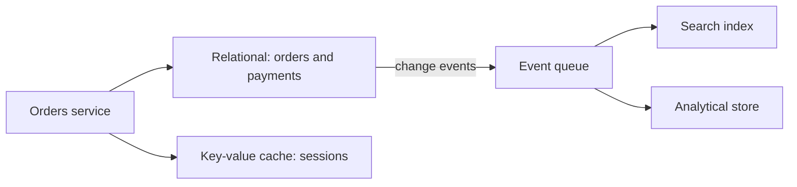

The question "PostgreSQL or MongoDB?" almost always arrives too early. It is asked before anyone knows what will be read, how often, with what latency and under which guarantees, and the answer ends up decided by team familiarity or by a fashionable reading. The usual outcome is a database that does not fit the real queries and has to be forced into shape for years with indexes, caches and workarounds.

The thesis of this article is that **the store is chosen from the access patterns, not the other way round**. An access pattern is a question the system asks repeatedly (find orders by customer in date order, count events per hour, find products by text) together with its frequency and its tolerance for latency. Once those questions are written down, most storage decisions stop being opinions and become checkable.

## Start with the list of queries

The preliminary exercise is a table with every operation the system needs. For each one, note what it reads, what it writes, how often (per second, per hour, per day), how long it may take and whether it must see data written a moment ago. Such a table usually has between ten and thirty rows in a mid-sized system, and that is enough to rule out most options.

A simple example. A booking service needs three operations: create a booking that cannot overlap another in the same room, list a user's bookings sorted by date, and compute the weekly occupancy of each room. The first requires a uniqueness rule that guarantees no overlaps. The second is a lookup by user key with ordering. The third is an aggregation that can tolerate some delay. Three rows already show three different load profiles, and no single database is ideal for all of them.

The table also reveals what not to optimise. If the system writes a hundred times a day and reads once a month, a high-throughput write store is not worth it. If 90 % of reads go by one key, a simple index solves the problem without changing technology.

## Which dimensions matter

Four dimensions change the choice decisively, and it helps to note them for each operation.

The first is the **shape of the query**. If the questions cross entities, with arbitrary filters and joins, a relational model gives flexibility. If access is always by a known key, a key-value store is simpler and faster. If the query is relevance-ranked text search, a search index appears as a component of its own, as explained in [in-app search](/docs/busqueda-en-aplicacion).

The second is the **write pattern**. An append-only event flow, such as sensor readings or clicks, looks little like an update to a row under locks. Stores designed for time series or bulk writes have a real advantage there, while a relational database may need partitioning sooner than expected.

The third is the **consistency required**. A balance or a limited seat count needs strong guarantees; a recommendations list can be eventually consistent. This point connects with the CAP theorem and the PACELC model, which describe what is given up when the network fails or when latency is pursued: it is covered in detail in [CAP and PACELC](/docs/cap-pacelc). The ability to run multi-row transactions with ACID properties is covered in [data, ACID and isolation](/docs/datos-acid-y-aislamiento).

The fourth is **volume and growth**. A data set that fits in memory on one node has options that a multi-terabyte one does not. Sizing with real numbers (expected rows in three years, average row size, growth rate) prevents choosing a scale architecture for a problem that does not exist.

## Store families and what they are for

There is no need to memorise products. It is enough to know the families and their trade-offs, because each family handles some queries well and others badly.

| Family              | Strong at                                             | Weak at                                          | Typical example                     |
| ------------------- | ----------------------------------------------------- | ------------------------------------------------ | ----------------------------------- |
| Relational          | Transactions, joins, constraints, ad hoc queries      | Horizontal write scaling without partitioning    | Orders, accounts, inventory         |
| Document            | Objects with variable shape, reading whole aggregates | Queries across documents, integrity between them | Catalogues, profiles, configuration |
| Key-value           | Access by key with very low latency                   | Queries by attributes other than the key         | Sessions, cache, counters           |
| Columnar analytical | Aggregations over many rows and few columns           | Small frequent writes, row updates               | Reports, historical metrics         |
| Text search         | Relevance, partial matches, facets                    | Transactional source of truth                    | Site search, log search             |
| Graph               | Traversals of relationships with variable depth       | Massive aggregations over the whole set          | Fraud detection, contact networks   |
| Time series         | Continuous writes of timestamped samples              | Relationships between entities                   | Telemetry, sensors, market data     |

The table is an orientation, not a verdict. Many modern databases cover several families: a relational database with document types, or one with integrated text indexes. The useful question is not which product has the most features, but which trade-offs the team accepts when operating it at real scale.

## Polyglot persistence: when it pays off

Polyglot persistence means using more than one kind of store in the same system, each for what it does best. It is a good idea when workloads have clearly different profiles, and a bad idea when it is adopted by reflex.

The diagram shows the usual pattern: the relational database is the transactional source of truth, and the other stores are **derived**, fed by events. This separation is the key. If every store is the source of truth for some data, the system has two truths that sooner or later disagree. If all of them derive from one source, any store can be rebuilt from it.

Polyglot persistence pays off when a specific workload does not fit the main store and the cost of keeping it separate is lower than the cost of forcing it. A text search that the relational database handles with `LIKE` and that stops answering within half a second is a good candidate. A visit counter that writes thousands of times per second is another.

It does not pay off when a team has one use case and moves it into a second store "just in case". Each store adds copies of data, synchronisation pipelines, monitoring, backups, restore drills and someone who knows how to operate it. That cost appears in the bill, in on-call rotations and in the speed of change.

<Callout tone="warning" title="Derived is not the same as source">
  An index or a cache can be lost and rebuilt. A database that someone treats as the source of truth
  cannot be rebuilt without loss. Before adding a store, ask which of the two will be the truth when
  they disagree.
</Callout>

## What it costs to operate each store

Choosing a store means choosing how it will be operated for years. Five costs are worth estimating before deciding, because they tend to be left out of performance comparisons.

The first is **backups and restores**. Making copies is simple; proving that a restore works within the target time is another matter. Each store has its own procedure, recovery time and failure modes.

The second is **schema migrations**. A relational database requires planned migrations, with their locking risks. A document store looks free of schema, but the code still depends on a shape that changes, and that also needs migrating, even if it happens in the application. Patterns for changing schemas without interrupting service are explained in [database migrations without downtime](/docs/migraciones-bd-sin-downtime).

The third is **scaling**. Scaling reads with replicas is usually straightforward; scaling writes requires partitioning, and the partitioning choice shapes the data model from the start. A poor partition key sends all writes to one node, and changing it later means rewriting data.

The fourth is **team knowledge**. A store nobody knows how to tune has a real cost even if its licence is free. Diagnosing a slow query, reading an execution plan and understanding consistency guarantees are skills that accumulate, and they are lost with turnover.

The fifth is **portability**. Some managed services offer convenience in exchange for binding the system to their APIs and limits. That is not bad in itself, but it should be a conscious decision, with the exit cost written down.

A rough estimate makes these costs concrete. Suppose a store holds 500 million rows in three years, with an average row of 300 bytes plus indexes that double the footprint. That is around 300 GB of data to back up, restore and migrate. A nightly full backup takes a window the team must schedule, and a restore test on a copy of that size takes hours, not minutes. If the schema changes monthly, each migration must be planned against that volume. The same workload in a store that scales writes horizontally may need less planning per migration but more care with partition keys. None of these numbers decides the choice on its own, but writing them down turns a vague worry into a concrete budget.

## Model for access, not for theory

Each store rewards a different model, and forcing one store's model onto another is the source of many problems. In a relational database, normalisation protects integrity, and flexible queries are paid for with joins. In a document store, denormalising so that one read returns everything is the norm, and the price is duplicated data that must be kept in sync. In key-value, the key is everything: if the query cannot be expressed as a key or a prefix, the store is the wrong one.

The practice that works is to write the model from the queries in the initial table. If "orders of a customer in date order" is frequent, the sort key and the index are designed for it. If "today's orders by status" is frequent, a decision is needed about whether a composite index or a derived view solves it. Each decision is tied to a concrete query, and when the query changes, the decision is reviewed.

A common mistake is designing the database before the API. That produces models that mirror internal structure rather than the real questions. Starting from the operations the user performs forces the model to answer them.

### A case: bookings that must not overlap

Back to the booking service. The most delicate operation is creating a booking in a room without overlaps. A store that offers only eventual consistency allows two users to book the same slot at once if the checks run against different replicas. The natural solution in a relational database is a constraint that prevents overlap inside the same transaction, or an exclusion constraint over time ranges if the engine supports it. In a key-value store, the alternative is a key composed of room and time slot, with a conditional write that fails if the key already exists.

Each solution protects the invariant at a different cost. The relational constraint is easy to reason about and costs write latency in the busiest room. The composite key is very fast, but it forces the time to be discretised (for example, into half-hour blocks) and requires deciding what happens to bookings that cross blocks. Neither option is right in the abstract: it depends on whether slots are fixed, how many simultaneous bookings the room gets, and how costly an overbooking is compared with a rejection.

Weekly occupancy, by contrast, can live in an analytical store or in a derived view refreshed with some delay. Here a delay of a few minutes has no consequences for anyone, and making it synchronous would make writes more expensive for no benefit. This case shows why one database rarely answers everything for a whole service: each operation has a different invariant, and the store must protect the invariant that matters in that operation.

## Tools

The concrete choice depends on the team, the provider and the volume, and there is no universal answer. For most business applications, a relational database with good index support, transactions and replicas covers the source of truth and much of the querying. A key-value store for cache and sessions, a search index for text and an analytical store for reports are added when measurement justifies them, not before.

Before comparing products, measure. A load test with the queries from the initial table, against data at realistic volume, says more than any published comparison. Check the real limits of the chosen service too: maximum row size, number of connections, rate limits and behaviour when a node fails.

<Callout tone="tip" title="Measure with your queries">
  Load the database with data at the volume expected in two years and run the ten most frequent
  queries. If one of them misses the latency target, you already know which model or index is
  missing, without changing technology.
</Callout>

## Common mistakes

Choosing by fashion or familiarity without checking the list of operations is the most common error. The result is a store that works in the demo and degrades under real use.

Using a bulk-write store for data read through complex joins forces relationships to be rebuilt in the application, with fragile and slow code.

Adding a second store without defining which one is the source of truth produces data that disagrees with no one knowing which value is correct.

Designing the partition key without looking at the write pattern leads to hot spots, with one node saturated while the rest sit idle.

Underestimating operations (backups, restores, migrations, on-call) means the choice is made for performance and paid for with incidents.

## Checklist

- A list of operations exists with reads, writes, frequency, tolerated latency and consistency need.
- Expected volume two or three years out is estimated with numbers, not intuition.
- Each new store has a measured justification, not a hypothetical one.
- Each piece of data has a clear source of truth, and derived stores can be rebuilt from it.
- The partition key was chosen by looking at the write pattern and validated with a load test.
- The restore procedure has been tested and its time measured.
- Schema migrations have a plan that avoids long locks.
- The team has people who know how to operate the store, or a plan to acquire that knowledge.
- The exit cost of the provider is written down if a managed service is used.

## Sources

- Martin Kleppmann, _Designing Data-Intensive Applications_ (O'Reilly, 2017), on the trade-offs between data models, replication and partitioning.
- Edgar F. Codd, "A Relational Model of Data for Large Shared Data Banks" (1970), for the relational model. It is cited for its general content; it was not checked against the original text for this article.

Consulted in October 2026. Store families are described by their typical trade-offs, not by specific products, whose capabilities change often; check each product's current documentation before deciding.
