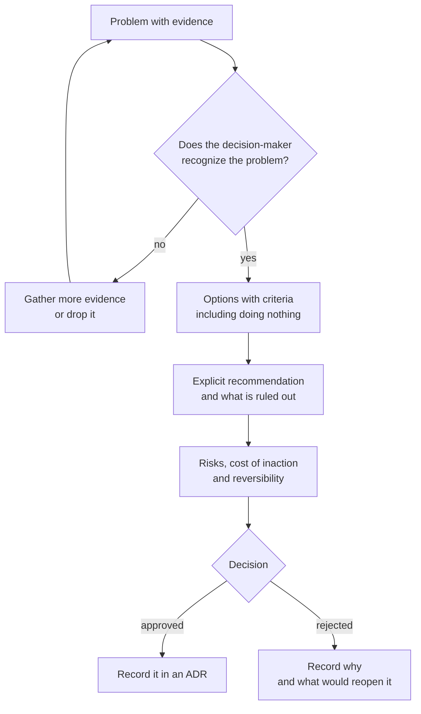

# Presenting ideas and proposals that get approved

You spent two weeks preparing the migration of a critical process. You get thirty minutes with leadership. You spend twenty of them walking through the new architecture, and then someone asks: "And what happens if we do nothing?" You don't have the number at hand, the conversation drifts, and the decision slips to next quarter. The idea was good; the proposal wasn't.

**A proposal gets approved when the person deciding understands, within the first minute, the problem, the option you recommend and the cost of doing nothing.** Everything else (the architecture, the detailed figures, the diagrams) supports those three things and sits below them.

This article collects writing structures with a known origin, shows how to state the problem before the solution, how to present options with criteria and an explicit recommendation, and how to adapt the message to each audience. It ends with a short proposal built on explicit assumptions. How to reason through the trade-off itself is covered in [Trade-offs and decision-making](/docs/trade-offs-y-decisiones); how to record the decision once it's made, in [ADR](/docs/adr).

<Callout tone="info" title="Cut-off date and source coverage">
  Sources checked in October 2026. Secondary source for the Minto pyramid: library catalogs and
  third-party summaries of the book. Secondary source for the Shape Up pitch ingredients:
  third-party summaries that cite the "Write the Pitch" chapter. Primary source for Amazon's
  practice: Jeff Bezos's 2017 letter to shareholders. For any company's internal practices, only
  what that company has published is reported.
</Callout>

## What the decision-maker needs

Whoever approves a proposal rarely shares your context. They arrive from another meeting, with other problems on their mind, and need to answer a handful of questions before committing money, people or time. If the document doesn't answer them early, they ask out loud, and the meeting turns into an interrogation instead of a decision.

| The decision-maker asks                | Where the proposal should answer it                      |
| -------------------------------------- | -------------------------------------------------------- |
| What exactly are you asking for?       | First sentence: decision, budget and date                |
| Why now?                               | The problem, with evidence and its trend                 |
| What happens if we do nothing?         | The cost of inaction, quantified even if only as a range |
| What other options are there?          | A table with at least three, including doing nothing     |
| Why this one and not another?          | Explicit criteria and the recommendation                 |
| What can go wrong and how will I know? | Risks, warning signals and a point to back out           |
| Can I undo it if I'm wrong?            | Reversibility and the cost of rolling back               |

Notice that none of these questions is about technology. Technology shows up as the answer to "why this option?", and usually in an appendix.

## Four structures with a known origin

You don't need to invent a format. There are structures that have been tested for decades, and each puts the emphasis in a different place.

### The Minto pyramid

Barbara Minto, a former McKinsey consultant, described in _The Pyramid Principle: Logic in Writing and Thinking_ a way to order the ideas in a document: the conclusion at the top and, below it, the arguments that support it, grouped in levels. Library catalogs list a 1987 edition from Minto International; later editions came from other publishers, and edition numbering is not consistent across catalogs.

The structure has three parts, as reviews of the book summarize it:

- **The main idea on top.** The document opens with the answer or recommendation, not with the path that led to it.
- **A short introduction that sets up the answer.** Usually summarized as SCQ or SCQA: situation (what the reader already knows and accepts), complication (what changed), question (the one that follows from the complication) and answer (the main idea).
- **Groupings without overlaps or gaps.** Each level summarizes the one below, and arguments at the same level should neither repeat each other nor leave out something relevant. Reviews associate this with the acronym MECE (mutually exclusive, collectively exhaustive).

The figure for this article draws that shape: the idea at the apex, three arguments below it, the evidence for each argument and, at the base, the data. A reader can stop at any level and still take away something complete.

### The one-page memo

It has no single author: it's a practice found in many organizations. Its value lies in the constraint. One page leaves no room for unnecessary context, forces you to choose which argument goes first and makes the ask obvious. A common structure:

1. The ask in one sentence (what, how much, by when).
2. The problem and its evidence.
3. The options considered, with the recommended one marked.
4. The cost of doing nothing.
5. Risks and how they'll be detected.
6. What is out of scope.

It works well for mid-sized decisions with a clear decision-maker. It falls short when the decision requires comparing a lot of data or when the audience needs to understand a domain they don't know.

### The Shape Up pitch

_Shape Up_ is Ryan Singer's book on how Basecamp (now 37signals) worked, published free online in 2019. Its "Write the Pitch" chapter defines five ingredients for presenting a project:

- **Problem**: the raw idea or use case that motivates the work. The book insists on always presenting the problem together with the solution.
- **Appetite**: how much time you're willing to spend. It's not an estimate: it's a budget that is part of the problem definition.
- **Solution**: the core elements, at a level of detail people can grasp quickly (sketches, not specs).
- **Rabbit holes**: risky details worth calling out before work starts.
- **No-gos**: what is deliberately left out so the project fits the appetite.

The most useful part of the pitch for any proposal is the last two ingredients. Saying what won't be done and where the risk lies changes the conversation: the decision-maker stops picturing the ideal version and evaluates the one that will actually be built.

### The long written narrative

In his 2017 letter to shareholders, published in April 2018, Jeff Bezos explained that Amazon doesn't use slide presentations in meetings: people write narratively structured six-page memos, which are read silently at the start of each meeting in a kind of "study hall". The same letter says the quality of those memos varies widely, and that the great ones are written and rewritten, shared with colleagues who are asked to improve them, and set aside for a couple of days before being edited again.

The transferable lesson is not the page count but two ideas: prose forces you to connect your arguments (a slide accepts loose bullets; a paragraph doesn't), and reading silently at the start guarantees that everyone is discussing the same document.

<Callout tone="warning" title="What circulates without a primary source">
  Many details about this practice circulate, attributed to internal emails, templates or formatting
  rules. Only what the public letter says is included here. Copying the ritual (six pages, silent
  reading) without the hard part, rewriting until the argument holds up, produces longer documents,
  not better decisions.
</Callout>

### Which one to choose

| Structure      | Length        | Opens with               | Good for                                        | Risk when misused                               |
| -------------- | ------------- | ------------------------ | ----------------------------------------------- | ----------------------------------------------- |
| Minto pyramid  | Any           | The conclusion           | Ordering any document or presentation           | A weak conclusion is exposed early              |
| One-page memo  | One page      | The ask                  | Mid-sized decisions with a clear decision-maker | Dropping the cost of inaction for lack of space |
| Shape Up pitch | A few pages   | The problem and appetite | Time-boxed product projects                     | Treating appetite as an estimate                |
| Long narrative | Several pages | Context and thesis       | Big decisions that need shared reasoning        | Long text nobody rewrote                        |

They aren't mutually exclusive. A one-page memo can follow the pyramid, and a pitch can open with a Minto-style sentence.

## The problem before the solution

The most common way to lose a proposal is to open with the solution. If the first sentence is "We propose migrating to a managed queue", the reader evaluates the queue, not the problem, and any objection to the technology sinks the whole proposal.

A good problem statement meets four conditions:

1. **It says who is hurting.** Customers, a team, a business process. Not "the system".
2. **It brings evidence.** Incidents, hours, tickets, money, cycle time. Even if only as a range.
3. **It explains why now.** A trend, a change in context, an approaching deadline.
4. **It doesn't mention the solution.** Someone must be able to agree with the problem without yet having an opinion about the technology.

| Weak statement                            | Useful statement                                                           |
| ----------------------------------------- | -------------------------------------------------------------------------- |
| The billing process is legacy and fragile | Nightly billing failed twice a month over the last six months              |
| We need to modernize the platform         | Each failure delays invoices by a day and ties up two people for six hours |
| The team wants to use queues              | Volume keeps growing and the nightly window is close to its limit          |

If the problem doesn't convince, there's no point going further. Better to find out with one page than with a project.

## Options with criteria and an explicit recommendation

Presenting a single option turns the meeting into a yes or no, and a "no" leaves the problem unsolved. Presenting several without recommending any shifts the analysis onto the decision-maker. The middle ground is a table with at least three options and a clear recommendation.

- **Always include doing nothing.** It has a cost, and putting it in the table next to the others is the most honest way to show it.
- **Declare the criteria before scoring.** Cost, time, risk, reversibility, customer impact. How to pick and weigh them is in [Trade-offs and decision-making](/docs/trade-offs-y-decisiones); in the proposal it's enough to name and apply them.
- **Recommend in the active voice.** "We recommend B because…", not "B could be an interesting option".
- **Say what you're ruling out and why.** One line per discarded option. It stops the discussion from reopening what was already analyzed.
- **Separate what you know from what you assume.** Every estimated figure is labeled as an assumption and, where possible, given as a range.

When many initiatives compete for the same budget, the problem is no longer presenting one proposal but prioritizing among several: that's covered in [Prioritization frameworks](/docs/marcos-de-priorizacion).

## Risks, cost of inaction and reversibility

These three sections are the ones most often left out and the ones that trigger the most questions.

**Cost of inaction.** It's a projection of the problem over time: incident hours, delayed revenue, lost customers, fines, opportunities you can't pursue. Express it in the unit the decision-maker uses (money, days, customers) and over a horizon (a quarter, a year).

**Risks.** For each relevant risk: what can happen, how you'd notice early (the signal) and what you'd do then. A risk with no signal and no response is just a worry.

**Reversibility.** State whether the decision can be undone and at what cost. A reversible option that's cheap to try usually deserves less analysis than one that commits you for years; the distinction between one-way and two-way doors is developed in [Trade-offs and decision-making](/docs/trade-offs-y-decisiones).

**The ask.** Close with what you need: the specific decision, the budget, the people, the date you need an answer by, and what happens if it comes later.

The full path of a proposal, from the problem to the decision record, looks like this:



A rejected proposal is still useful if it's written down why it was rejected and what would have to change to revisit it.

## Adapt the message to each audience

The pyramid stays the same; what changes is the evidence you put on the second level and the unit you speak in.

| Audience    | First question                    | Unit they understand       | What goes on top                     | What goes to the appendix      |
| ----------- | --------------------------------- | -------------------------- | ------------------------------------ | ------------------------------ |
| Leadership  | What does it cost, what do I get? | Money, time, business risk | The ask, cost of inaction, return    | Architecture, technical detail |
| Product     | What changes for the customer?    | Features, time, scope      | Customer impact, what's excluded     | Infrastructure figures         |
| Engineering | How, and with what risk?          | Latency, errors, effort    | Technical options, risks, operations | Detailed financial return      |

Three practical tips:

- **One proposal, several covers.** Keep a single underlying document and write a different summary for each audience. If each version tells a different story, someone will notice.
- **Translate technical attributes.** "p99 of 2 s" means nothing to leadership; "one in a hundred orders takes more than two seconds to confirm" does. [Quality attributes](/docs/atributos-de-calidad) are the bridge between both languages.
- **Diagrams serve the argument.** A context diagram helps product see which systems are touched; a deployment diagram only matters to engineering. How to choose the level of detail is in [C4 model](/docs/c4-model), and how to keep diagrams versioned, in [Diagrams as code](/docs/diagramas-como-codigo).

## When to use it and when not to

**Write a formal proposal when:**

- The decision commits budget, people or timelines you don't control.
- It's hard to reverse or affects other teams.
- There are several reasonable options and people with different preferences.
- The decision-maker wasn't part of the analysis and needs to understand it without you.

**You don't need one when:**

- The decision is small, reversible and within your autonomy: make it, and record it if it leaves a trace.
- The problem isn't clear yet. An exploratory conversation is worth more than a premature document.
- The decision has already been made some other way. Writing a proposal to legitimize it costs time and credibility.

## Common mistakes

- **Leading with the technology.** The proposal gets debated as a technical preference and the problem fades into the background.
- **Presenting a single option.** The decision-maker can't compare, and a rejection leaves the problem untouched.
- **Not saying what you're ruling out.** Discarded options come back to the table at every meeting.
- **Hiding the cost.** When it surfaces later, the proposal's credibility, and yours, goes down with it.
- **Leaving out the cost of doing nothing.** Without it, doing nothing looks free and always wins.
- **Adjectives instead of numbers.** "Much more stable" can't be compared; "from 2 failures a month to 1" can.
- **Not asking for anything specific.** A proposal with no ask ends in "interesting, let's look into it".
- **Slides that need their author.** If the document can't be understood without your voice, it won't survive being forwarded.

## Worked example: stabilizing nightly billing

A company runs a nightly batch process that generates invoices. These are the assumptions, all explicit and open to review:

- The process fails 2 times a month (average over the last six months).
- Each failure ties up 2 people for 6 hours: 12 hours per failure, 24 hours a month.
- Loaded cost of an engineering hour: USD 60 (an internal assumption, not market data).
- Cost of doing nothing: 24 h × USD 60 = USD 1,440 a month, USD 17,280 a year. Not counting delayed collections.

Options considered:

- **A. Retries, idempotency and alerts in the current process.** One person for one week: 40 h × USD 60 = USD 2,400. Assumption: down to 1 failure a month (12 h, USD 720 a month).
- **B. Move to workers on a managed queue.** Two people for three weeks: 240 h × USD 60 = USD 14,400, plus USD 150 a month in infrastructure (assumption). Assumption: down to one failure every four months (3 h a month, USD 180), so USD 330 a month in total.
- **C. Rewrite the billing service.** Roughly three months of a team. Ruled out: the problem is the batch's reliability, not the billing model.

| Option           | Upfront cost | Monthly cost | Year 1 | 2-year total | 3-year total |
| ---------------- | ------------ | ------------ | ------ | ------------ | ------------ |
| Do nothing       | 0            | 1,440        | 17,280 | 34,560       | 51,840       |
| A. Retries       | 2,400        | 720          | 11,040 | 19,680       | 28,320       |
| B. Managed queue | 14,400       | 330          | 18,360 | 22,320       | 26,280       |

A pays for itself in just over three months (2,400 / 720 saved per month). B only overtakes A from around month 31 (12,000 upfront difference / 390 monthly difference), and that result hinges on the shakiest assumption: that the queue brings failures down to one every four months.

Written as a pyramid, the proposal fits on one page:

```text
Ask: approve 1 week of 1 person (USD 2,400) for A, decision by the 15th.
Problem: nightly billing fails twice a month; it costs ~USD 17,000 a year.
Recommendation: A now; revisit B in 6 months.
  Because: A pays back in ~3 months and is reversible.
  Because: B only wins after ~31 months and its savings are the weakest assumption.
  Because: C doesn't address the cause (batch reliability).
Risk: A doesn't reduce failures. Signal: more than 1 failure a month for 2 months.
  Response: bring B forward.
Out of scope: real-time invoicing, changing payment provider.
```

Look at what the example does: the ask comes first, the cost of inaction is quantified, the recommendation is not the most ambitious option, every discarded option has a reason, and the risk has a measurable signal and a response. Once approved, the decision goes into an [ADR](/docs/adr) with the same assumptions, so it can be revisited when they change.

## Checklist

- [ ] The first sentence says what you're asking for, what it costs and by when.
- [ ] The problem has evidence and makes sense without mentioning the solution.
- [ ] There are at least three options, including doing nothing.
- [ ] The criteria are stated and the recommendation is explicit.
- [ ] The cost of inaction is quantified, even if only as a range.
- [ ] Every risk has an early signal and a response.
- [ ] What's out of scope is written down.
- [ ] Assumptions are labeled and can be reviewed one by one.

## Sources

Checked in October 2026.

- [Shape Up, "Write the Pitch" chapter (Ryan Singer, Basecamp, 2019)](https://basecamp.com/shapeup/1.5-chapter-06): the five ingredients of a pitch. Secondary source: the third-party summaries of this chapter listed below
- [Book Review: Shape Up (Beeminder)](https://doc.beeminder.com/shapeup): third-party summary of chapter 6 and its five ingredients
- [Announcing Shape Up (Signal v. Noise, 2019)](https://signalvnoise.com/svn3/announcing-shape-up-a-deep-dive-into-how-we-work/): the book's launch and free access
- [Jeff Bezos's 2017 letter to shareholders, Exhibit 99.1 at the SEC](https://www.sec.gov/Archives/edgar/data/1018724/000119312518121161/d456916dex991.htm): "Six-Page Narratives" section
- [The Pyramid Principle on Goodreads](https://www.goodreads.com/book/show/33206): bibliographic data and author bio (secondary source)
- [Lessons from Barbara Minto (Antoine Buteau)](https://www.antoinebuteau.com/lessons-from-barbara-minto/): third-party summary of the pyramid, SCQA and MECE
