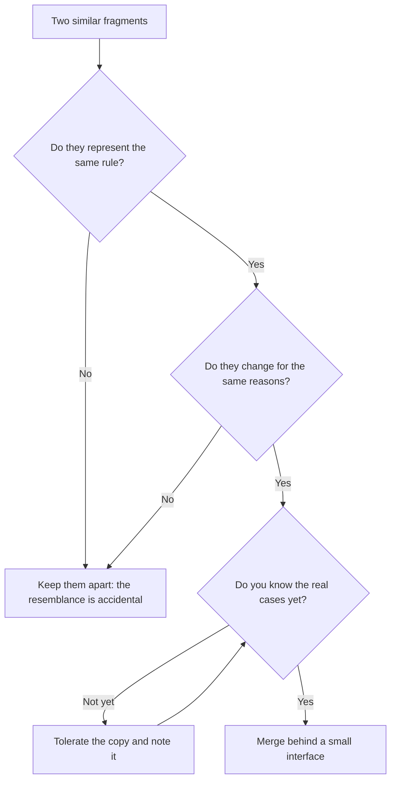

# Basic design principles

In a code review someone writes "this isn't DRY" and asks you to merge two functions. Someone else replies "YAGNI" and refuses to add a parameter. A third person cites the Law of Demeter to reject a chain of calls, and the thread ends when somebody gets tired. The five principles in this article come up every day, but mostly as slogans for winning an argument, not as criteria for making a decision.

**Basic design principles are heuristics for everyday decisions about what to keep together, what to separate and what not to build yet: each one protects something specific, and each one has a cost when you apply it in the wrong place.**

This article walks through DRY, KISS, YAGNI, the Law of Demeter and information hiding with the same outline: where each comes from (with sources you can check), what it protects, when it helps, when it hurts, and a before-and-after example made only of names and signatures. It doesn't repeat what other articles already cover: the five [SOLID](/docs/solid) principles have their own page, as do the kinds of [coupling and cohesion](/docs/acoplamiento-cohesion), and the rules on names, functions and comments live in [clean code](/docs/clean-code).

<Callout tone="info" title="What was verified and what wasn't">
  Dates and wording come from primary sources where possible: Dave Thomas's Artima interview (2003),
  Ron Jeffries's article (1998), Martin Fowler's YAGNI entry (2015), the Demeter project page at
  Northeastern and the reference for Parnas's paper (1972). I did not read _The Pragmatic
  Programmer_ itself: its statement of DRY comes from matching quotations across several sources.
  The origin of KISS is documented only in secondary sources.
</Callout>

## What each principle protects

Before going into detail, it helps to see all five side by side. The column that matters most is the last one: a principle applied without that warning sign in mind tends to cause the opposite of what it was meant to prevent.

| Principle          | Verifiable origin                                  | What it protects                                | Sign that it is doing harm                                    |
| ------------------ | -------------------------------------------------- | ----------------------------------------------- | ------------------------------------------------------------- |
| DRY                | Hunt and Thomas, _The Pragmatic Programmer_, 1999  | A rule changes in exactly one place             | The shared abstraction keeps gaining flags and special cases  |
| KISS               | US Navy, 1960 (according to secondary sources)     | The system stays understandable and repairable  | "Simple" is used to justify ignoring a real case              |
| YAGNI              | Extreme Programming; Jeffries writes it up in 1998 | Today's effort and complexity                   | It is invoked to avoid defining boundaries or changeable code |
| Law of Demeter     | Holland, Northeastern, fall 1987                   | A structural change doesn't ripple down a chain | Classes full of methods that only forward calls               |
| Information hiding | Parnas, _Communications of the ACM_, 1972          | A volatile decision can change in private       | Opaque interfaces that force callers to work around them      |

All five share one idea: the cost of software lies in changing it. Each principle is a different bet on what will change and where you want it to hurt when it does.

## DRY: one representation for each piece of knowledge

### Origin of DRY

Andy Hunt and Dave Thomas stated it in _The Pragmatic Programmer_ (Addison-Wesley, 1999). The wording that several sources quote consistently says that every piece of knowledge must have a single, unambiguous, authoritative representation within a system. The key word is **knowledge**, not code.

Thomas clarified this in an interview with Bill Venners published on Artima on 10 March 2003: most people take DRY to mean "don't duplicate code", and that was not the intention. In his account, the principle also covers database schemas, test plans, the build system and documentation. If the retry limit lives in the code, in a YAML file and on the wiki, you have three representations of one piece of knowledge even though no two lines are identical.

### When DRY helps

- **Authoritative business rules.** The VAT rate, the refund policy, the format of a tax ID. When they change, they must change everywhere at once.
- **Contracts between parts.** A schema that generates types, validators and documentation stops three copies from drifting apart.
- **Operational knowledge.** A single source for an environment's configuration, from which the others are derived.

### When DRY hurts

DRY applied to similar-looking text, rather than to shared knowledge, produces **accidental coupling**. Two functions can be identical today and still represent different rules: a wholesale customer's discount and an employee discount may be computed the same way this quarter, but different people decide them and they will change for different reasons. If you merge them, every future change to one forces a new parameter or condition so the other doesn't break.

Sandi Metz summed it up in "The Wrong Abstraction" (20 January 2016): duplication is far cheaper than the wrong abstraction. Her advice once you have such an abstraction is to reintroduce duplication by inlining the abstracted code into every caller, then strip out what each caller doesn't use. It's the same idea as the "reason to change" behind single responsibility in [SOLID](/docs/solid): things that change for different reasons shouldn't share a home.

<Callout tone="warning" title="Premature DRY">
  If merging two fragments means adding a boolean parameter, they probably don't represent the same
  knowledge. Before extracting, ask who would request a change to each one.
</Callout>

### DRY before and after

The classic case is a tax rule repeated in three modules, written three different ways. Notice that no two lines match: the duplication is in the knowledge, not in the text.

```typescript
// Before: one rule, three representations
// checkout/total.ts   applyVat(amount: Money): Money          // 21 %
// invoice/lines.ts    withTax(line: InvoiceLine): Money       // × 0.21
// refund/refund.ts    refundGross(net: Money): Money          // × 1.21

// After: one authoritative source; everyone else asks it
// pricing/tax.ts      tax(amount: Money, region: Region): Money
```

## KISS: the simplest solution that solves the real problem

### Origin of KISS

According to Wikipedia, the principle was noted by the US Navy in 1960, and the acronym is attributed, without primary confirmation, to Kelly Johnson, lead engineer at Lockheed's Skunk Works. The often-repeated story has Johnson handing his engineers a handful of tools and asking for a jet that an average mechanic could repair in the field with them. The reading that same source offers is useful for software: simplicity is measured against **who will have to understand and repair the system, and with what**.

### What KISS means in software

KISS doesn't ask for short or naive code. It asks that the complexity of the design not exceed the complexity of the problem. A solution is simple when it has few moving parts, few ways to fail and an obvious reading path for whoever maintains it, who often isn't the person who wrote it.

### When KISS hurts

- **Simple for the author, not for the operator.** A script that works on your machine is simple; a service with no observability that fails at 3 a.m. is not.
- **Ignoring essential complexity.** If the domain has time zones, currencies and rounding, the "simple" solution that ignores them moves the problem into production.
- **Mistaking familiar for simple.** The tool the team already knows may be the right choice, but because it's familiar, not because it's simple: say so in the decision.

### KISS before and after

With KISS, the difference rarely shows in a signature; it shows in how many parts you have to understand to follow one case. A table makes the point better than code:

| Need: notify the customer when an order is confirmed | Complex design                                 | Simple design                                   |
| ---------------------------------------------------- | ---------------------------------------------- | ----------------------------------------------- |
| Parts                                                | Generic event bus, plugin registry, templates  | One `OrderNotifier` port with one adapter       |
| To follow the case you read                          | Configuration, registry and dynamic dispatch   | One call: `notifier.orderConfirmed(order)`      |
| What happens if SMS is needed tomorrow               | Already covered (although nobody asked for it) | A second adapter or a new port, when it arrives |

## YAGNI: don't build today what you only foresee

### Origin of YAGNI

YAGNI comes from Extreme Programming (XP). In his entry of 26 May 2015, Martin Fowler explains that the phrase came out of a conversation between Kent Beck and Chet Hendrickson on the C3 project: Hendrickson brought a list of capabilities the system was going to need, and Beck answered each one with "you aren't going to need it". Ron Jeffries, an XP co-founder, put it in writing on 4 April 1998 in "You're NOT gonna need it!": always implement things when you actually need them, never when you just foresee that you need them.

### The costs it avoids

Fowler breaks the cost of building a presumptive capability into four parts. They work as a list of questions before you add something "just in case":

| Cost           | What you pay                                                                             |
| -------------- | ---------------------------------------------------------------------------------------- |
| Cost of build  | Analysing, coding and testing something that may turn out to be unnecessary              |
| Cost of delay  | The value you didn't ship because the effort went into the presumptive feature           |
| Cost of carry  | The added complexity slows every other change while it exists, and removing it costs too |
| Cost of repair | If the capability was built wrong, fixing it or living with its defects                  |

### YAGNI is not an excuse to skip boundaries

The same Fowler entry draws the line that people forget most often: YAGNI applies to **capabilities** built to support a presumptive feature, not to effort that makes the software **easier to modify**. Splitting out a module, naming a port well or writing tests are not speculative features: they are what lets you add tomorrow what you decide not to build today.

Wikipedia also notes that, in the original definition of XP, YAGNI depends on supporting practices: continuous refactoring, automated unit tests and continuous integration. Without them, deferring decisions isn't prudence, it's [technical debt](/docs/deuda-tecnica-evolucion) piling up.

<Callout tone="tip" title="The useful question">
  Don't ask "will we ever need it?". Ask "if we need it in six months, how much will it cost to add
  with today's design?". If the answer is "not much", YAGNI. If it's "we'd have to rewrite", the
  problem isn't the feature, it's a missing boundary.
</Callout>

### YAGNI before and after

```typescript
// Before: capabilities "just in case"
export type ReportExporter = {
  export(report: Report, format: 'pdf' | 'xlsx' | 'csv' | 'xml'): Promise<Blob>;
  schedule(report: Report, cron: string): Promise<void>;
  // … templates, plugins, multiple languages
};

// After: what the current story asks for, behind a boundary that can grow
export type ReportExporter = {
  export(report: Report): Promise<Blob>; // CSV only, for now
};
```

The "after" type isn't poorer: it's a boundary. When PDF arrives, you change the implementation or add a second exporter without touching the callers.

## Law of Demeter: only talk to your immediate friends

### Origin of the Law of Demeter

According to the Demeter project page at Northeastern University, Ian Holland identified the rule in the fall of 1987. It was published at OOPSLA '88 in "Object-Oriented Programming: An Objective Sense of Style", by Karl Lieberherr, Ian Holland and Arthur Riel, and developed in "Assuring Good Style for Object-Oriented Programs" (IEEE Software, September 1989). The general formulation on that page says each unit should have only limited knowledge about other units, only those "closely" related to it; the motto is _only talk to your immediate friends_.

### When it helps and when it hurts

The rule: a method talks to its own object, its parameters and what it creates, not to the objects those hand back. Apply it where the chain crosses **structure that may change**, not as "one dot per line", which only produces empty wrappers. The formal version, its exceptions and how it relates to the kinds of coupling are in [coupling and cohesion](/docs/acoplamiento-cohesion).

### Demeter before and after

```typescript
// Before: the controller knows the structure of three objects
// shipment.carrier().rateTable().priceFor(shipment.weight())

// After: it asks its immediate friend; the path stays inside Shipment
// shipment.shippingCost(): Money
```

## Information hiding: hide what is likely to change

### Origin of information hiding

David Parnas set it out in "On the Criteria To Be Used in Decomposing Systems into Modules" (_Communications of the ACM_, vol. 15, no. 12, pp. 1053–1058, 1972). His proposal: don't decompose by processing steps, but by **design decisions that are difficult or likely to change**, and have each module hide one of them from the rest. The KWIC example and its analysis are in [coupling and cohesion](/docs/acoplamiento-cohesion); I won't repeat them here.

Of the five, it is the oldest of those born inside software, and it can be read as the one that gives the others their meaning: DRY gives each piece of knowledge a single home, Demeter keeps structure from leaking, and KISS keeps the visible interface small.

### How to use it day to day

The practice is a short list before you create a module: what decision here might change? The storage format, the external provider, the algorithm, the caching policy. Each answer is a candidate to hide behind an interface that doesn't mention it. If the interface exposes the decision (a table, an HTTP client, a file format), every caller pays for the change.

### When hiding hurts

Hiding has a cost too. An interface that hides something callers genuinely need (a size limit, a transient error, a latency cost) forces them to work around it or guess. Hide the **decisions**, not the **facts** the caller needs to use the module well.

### Information hiding before and after

```typescript
// pricing/index.ts: the only public surface
export declare function tax(amount: Money, region: Region): Money;

// pricing/rates.ts: the hidden decision (local table, external service or cache)
// not exported from the barrel; nothing outside pricing/ imports it
```

## When principles collide

These principles don't form a coherent system: they pull in different directions and the decision is yours. The table shows the clashes that come up most in code reviews; the general method for resolving tensions like these is in [trade-offs and decision-making](/docs/trade-offs-y-decisiones).

| Tension                     | How it shows up                                                         | Decision criterion                                                               |
| --------------------------- | ----------------------------------------------------------------------- | -------------------------------------------------------------------------------- |
| DRY vs YAGNI                | Extracting a shared abstraction before the real cases are known         | Merge when you know it's the same knowledge, not when you suspect it             |
| DRY vs information hiding   | Sharing a model between modules to avoid repetition exposes its insides | Duplicate data structures across boundaries; never duplicate rules               |
| Demeter vs KISS             | Lots of wrapper methods that only forward                               | Apply Demeter where structure can change; skip it for stable data                |
| YAGNI vs information hiding | Skipping a boundary because "there's no second implementation yet"      | A boundary is modifiability, not a feature; YAGNI doesn't apply                  |
| KISS vs DRY                 | An obvious copy versus an abstraction you have to study                 | If understanding the abstraction costs more than keeping the copy, keep the copy |

For the most frequent clash, DRY against YAGNI when you spot two similar fragments, this flow sums up the criterion:



## When to apply them and when not to

| Principle          | Apply it when                                                      | Relax it when                                                     |
| ------------------ | ------------------------------------------------------------------ | ----------------------------------------------------------------- |
| DRY                | An authoritative rule appears in more than one place or format     | The resemblance is textual and different people decide each copy  |
| KISS               | Alternatives add parts without solving a known case                | "Simple" ignores essential complexity in the domain               |
| YAGNI              | Someone proposes a capability for a future nobody has asked for    | The proposal is a boundary, a test or a modifiability improvement |
| Law of Demeter     | The call chain crosses structure that may be reorganised           | It's immutable data, a fluent API or an object without behaviour  |
| Information hiding | There is a volatile decision: provider, format, algorithm, storage | The caller needs that fact to use the module correctly            |

## Common mistakes

- **Using the principle as the final argument.** "Not DRY" or "YAGNI" aren't reasons; the reason is what is protected and what it costs. Always ask for the second sentence.
- **DRY by visual resemblance.** Merging code that matches by coincidence couples two rules that change for different reasons.
- **YAGNI against design.** Rejecting a module, a port or a test because "we don't need it yet" confuses features with modifiability.
- **YAGNI without a safety net.** Deferring decisions without tests or frequent refactoring turns each deferral into debt.
- **Demeter as a dot-counting rule.** Counting dots per line produces empty wrappers and hides nothing.
- **Hiding facts along with decisions.** An interface that hides limits or errors forces callers to work around it.
- **KISS as an excuse.** Calling a solution "simple" when it ignores a real case just moves the cost onto someone else.
- **Abstractions with flags.** A boolean parameter on a shared function is the cheapest sign that the abstraction is the wrong one.

## Worked example: the tax that lived in three places

A team maintains a store with three modules: `checkout`, `invoice` and `refund`. Each computes tax its own way, and a rate change reached refunds late: for two days the store refunded more than it had charged.

**1. Is it the same knowledge?** Yes. All three functions represent the same tax rule, decided by the same department, with the same reason to change (the law). DRY applies here without debate.

**2. Where does it live?** In a `pricing` module with one public function, `tax(amount, region)`. That's the authoritative representation.

**3. What is hidden?** The table of rates per region. Today it's a file; tomorrow it may be a service owned by the tax department. That's the volatile decision Parnas asks you to hide: `rates` isn't exported.

**4. What isn't built?** Someone proposes supporting multiple currencies and per-customer exemptions right away. Nobody has asked for that: YAGNI. But the signature takes a `Region`, not a percentage, so if a region changes its rate or a new region opens, only the private table changes and no caller is touched. That isn't a speculative feature; it's a boundary. Per-customer exemptions would change the signature, because they need customer data that `tax` doesn't receive; that parameter gets added when someone asks for them.

**5. What about the call chain?** `checkout` read `rates` directly to show the tax in the cart. That dependency gets cut: the cart calls `tax(subtotal, region)` like the other modules, and `pricing` exposes nothing new. The path to the table stays inside the module.

**6. Is it simple?** One public function, one private file and three callers. No tax rules engine needed: KISS. The decision, including what was ruled out, goes into an [ADR](/docs/adr).

## Checklist

- [ ] Every authoritative business rule has a single representation, and you know where it is.
- [ ] Before merging two fragments, you checked that they change for the same reasons.
- [ ] No shared abstraction needs flags to tell its callers apart.
- [ ] Whatever you skip under YAGNI can be added without a rewrite: there's a boundary where it will be needed.
- [ ] Tests and frequent refactoring make it safe to defer decisions.
- [ ] Call chains don't cross internal structure that may be reorganised.
- [ ] Each module hides at least one volatile decision and exposes the facts its callers need.
- [ ] When you cite a principle in a review, you also say what it protects and what it costs.

## Sources

Accessed October 2026. _The Pragmatic Programmer_ was not read directly; the statement of DRY comes from the Artima interview and consistent quotations. The origin of KISS rests on Wikipedia and the sources it cites, not on primary documents. The Lieberherr and Holland papers were identified by their references; their text was not read.

- [Orthogonality and the DRY Principle (Dave Thomas with Bill Venners, Artima, 10 March 2003)](https://www.artima.com/articles/orthogonality-and-the-dry-principle)
- [The Wrong Abstraction (Sandi Metz, 20 January 2016)](https://sandimetz.com/blog/2016/1/20/the-wrong-abstraction)
- [KISS principle on Wikipedia](https://en.wikipedia.org/wiki/KISS_principle)
- [You're NOT gonna need it! (Ron Jeffries, 4 April 1998)](https://ronjeffries.com/xprog/articles/practices/pracnotneed/)
- [Yagni (Martin Fowler, 26 May 2015)](https://martinfowler.com/bliki/Yagni.html)
- [You aren't gonna need it on Wikipedia](https://en.wikipedia.org/wiki/You_aren%27t_gonna_need_it)
- [Law of Demeter: general formulation (Demeter project, Northeastern University)](https://www2.ccs.neu.edu/research/demeter/demeter-method/LawOfDemeter/general-formulation.html)
- [Object-Oriented Programming: An Objective Sense of Style (Lieberherr, Holland and Riel, OOPSLA '88)](https://www.academia.edu/63220194/Object_oriented_programming_an_objective_sense_of_style)
- [Information hiding on Wikipedia, with the full Parnas (1972) reference](https://en.wikipedia.org/wiki/Information_hiding)
