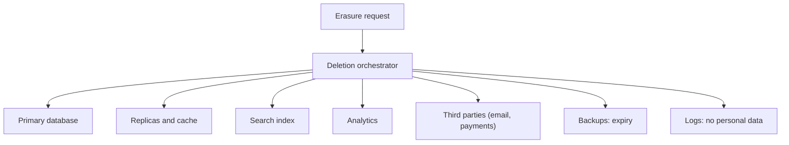

Privacy usually reaches a project as a legal document that someone signs at the end. When that happens, the system already stores more data than it needs, keeps it indefinitely, copies it to places nobody inventoried and cannot delete it. Fixing that later costs far more than designing it well from the start, because the data is already in backups, analytics, logs and a vendor's history.

The thesis of this article is that **privacy is an architecture requirement with measurable consequences for the data model, the flows and the deletion processes**. Article 25 of the General Data Protection Regulation (GDPR) calls this data protection by design and by default. What follows are the concrete decisions that make it possible.

## Minimise and justify every field

The principle of data minimisation, set out in Article 5 of the GDPR, says that personal data must be adequate, relevant and limited to what is necessary for the purpose. In practice it forces a question for every field: what do we need it for, and what would happen if we did not have it?

An example makes the difference clear. A shop needs a shipping address to deliver an order, so it stores it. But the customer's date of birth, requested at sign-up "just in case", has no defined purpose. If no promotion uses it and no obligation requires it, the field is a risk with no benefit: it enlarges the surface of a breach and the scope of an access request, and it adds nothing to the business.

The purpose should be written next to the field. A simple table with the columns _data_, _purpose_, _legal basis_, _retention period_ and _recipients_ is already a large step beyond most systems. That table is also the starting point for the record of processing activities required by Article 30.

<Callout tone="info" title="A field without a purpose should not exist">
  Before adding a field to a form, write its purpose and its retention period. If you cannot write
  them, do not ask for it. This rule prevents most of the problems that come later.
</Callout>

The GDPR also treats some data with more care. Article 9 sets stricter conditions for special categories, such as health data, ethnic origin or religious beliefs. A system that mixes them with ordinary data makes the whole set inherit that burden. Separating them into their own stores or schemas, with more restricted access and access logging, shrinks the perimeter that must be protected and audited.

Article 25 adds a second requirement: protection by default. The system's initial configuration must be the most respectful, without the person having to find and switch off options. A new account should not share its profile with third parties or appear in public search; a form should not pre-tick marketing communications; an optional cookie should not load before the person accepts it. These defaults are written into the design and tested, because a change to the interface can easily invert them without anyone deciding to.

## Retention with concrete periods

Keeping data "as long as it is useful" is not a retention policy. A useful policy sets a period for each category of data and says what happens when it expires: deletion, anonymisation, or archiving with restricted access. The periods come from the purpose and from legal obligations. An invoice, for example, may have a retention period set by the tax rules of each country; a browsing session has no reason to last months.

Retention is implemented, not only documented. Every record needs an expiry date, or a way to compute one, and a periodic process must apply it. A period that exists only in a document is a promise the system does not keep.

It is worth distinguishing three states of data before deletion. **Active** data is used by the service. **Restricted** data is kept only for a specific obligation (a claim, a tax inspection) and has limited access. **Anonymised** data no longer identifies anyone and can be used for statistics, provided the anonymisation is real and not a simple renaming: a postcode combined with a date of birth and a sex can identify a person.

Pseudonymisation is not anonymisation, and the difference matters. Pseudonymised data replaces a direct identifier (a name, an email address) with a code, but whoever holds the mapping table can re-identify the person. That is why the GDPR still treats it as personal data. Anonymised data cannot be re-identified by reasonable means. The difference has architectural consequences: if the key to the mapping table lives next to the data, the system is pseudonymised; if the key is destroyed, it is closer to anonymised. Recording which of the two applies, and where the key lives, avoids arguments later.

## Deletion that reaches every copy

This is where most systems fail. A user asks for deletion and the team deletes the row in the main table. The data remains in replicas, in the cache, in the search index, in the analytics table, in logs, in backups and in third-party systems the data was sent to. The request looks fulfilled and is not.

Article 17 of the GDPR recognises the right to erasure, and the controller must erase without undue delay when a ground applies. The architecture must be able to answer such a request in every place where copies exist, which requires an inventory of copies and a mechanism to propagate the deletion.

The orchestrator is the piece many systems lack. It receives the request, records it, distributes the work to each system and stores the result from each. That way the team can show that the deletion happened and when, and it can retry whatever failed.

Backups are the hard case. Deleting a record from an immutable backup is not practical. The usual solution is to accept that the data stays in the backup until the backup expires under its own policy, and to document that. What cannot happen is restoring such a backup and bringing back data the user asked to delete: the restore process must reapply pending deletions before the system returns to service.

<Callout tone="warning" title="Copies are not a detail">
  A deletion that does not reach backups, analytics and third parties does not fulfil the request.
  Inventory your copies before promising a deadline, because the slowest system sets the deadline.
</Callout>

### A complete case: an erasure request

Consider a person who asks to delete their account at an online shop. The system must first verify that the requester is really the account holder, because a false deletion is also a breach. It then records the request with its date of receipt: the one-month period in Article 12(3) starts from that date.

Next, the orchestrator consults the inventory of copies and distributes the work. The account and its contact details are deleted from the primary database. Orders are not deleted outright, because tax rules require invoices to be kept for a set period; instead, name and address are replaced with values that no longer identify the person, and the invoice is marked as restricted. Sessions and tokens are revoked. The search index removes its entries. Analytics receives the identifier so that it can be excluded from future aggregations, and third parties (the email provider, the payment provider, the carrier) receive the deletion instruction that their contract allows.

Backups follow their expiry policy, and a restore will reapply the deletion if one is ever used. At the end, the orchestrator keeps a record with each system, the execution date and the result. If one of them failed, the job stays pending and is retried; it is not closed.

This case shows something important: deletion is not a single operation but a process with states. A system that does not know the state of a request cannot prove compliance, even when its code works.

## Rights of the data subject and deadlines

The GDPR sets deadlines for responding to people. Article 12(3) says the controller must provide information on the measures taken in response to a request without undue delay and, in any event, within one month of receiving it. That period can be extended by two further months for complex or numerous requests, provided the extension is communicated within the first month and the reasons are given. The architecture must make it possible to meet that deadline, which means being able to locate a person's data in every system, not only the main one.

The same principles apply to access and rectification. A system that cannot list a user's data in less than several weeks will struggle to answer an access request on time.

Portability is the right teams forget most often. Article 20 lets a person receive the data they provided in a structured, commonly used and machine-readable format, and transmit it to another controller where processing is based on consent or contract and carried out by automated means. Designing the export means deciding which data was "provided by the person" (their name, their orders) and which was inferred (a risk score, a marketing segment), because the scope of the right depends on that boundary. An export generated from the same model the application uses is usually more useful than a dump of internal tables, and it should be tested like any other feature.

Breaches have their own clock. Article 33 requires notifying the supervisory authority without undue delay and, where feasible, within 72 hours of becoming aware of the breach, unless the breach is unlikely to result in a risk to people's rights and freedoms. To meet that deadline, the system must record what data each part holds, what accesses exist and how to detect an anomalous access. Without that, the team cannot tell which people a breach affects, and the notification arrives incomplete or late.

## Observability without personal data

Logs, traces and metrics are the most common place where personal data leaks without anyone deciding it. An error record that includes the request body contains the user's email, name or address, and that data is copied to the monitoring tool, its storage and its backups.

The practical rule is to record technical identifiers, not content. An internal user identifier is enough to debug, and if the log falls into a breach it does not directly reveal who the person is. Free-text fields should pass through a masking filter before leaving the service, and traces should exclude authentication headers and form bodies.

Log retention is part of the policy too. A log containing personal data should have a short, justified retention period, separate from that of business data. Keeping it for a year for debugging convenience is a decision nobody made explicitly.

Access control to the data is part of privacy too, and it is often where the design quietly fails. Support staff who can search every customer record can see personal data they have no reason to see, and a single shared administrator account makes it impossible to know who looked at what. Restricting access by role, requiring a recorded reason for opening a sensitive record and logging every read of special-category data turn a general promise of confidentiality into something that can be checked. The aim is not to make the data unusable for the people who need it, but to make every access deliberate and traceable. Reviewing those access logs on a schedule, rather than only after an incident, is what turns them from a record into a control.

## Tools

No special tool is needed to start: a data inventory table, a retention policy written in the repository and a deletion process with a record are enough for a small system. Data classification and consent management tools help as volume and the number of systems grow, but they do not replace the inventory. A scanner that finds personal data in a database does not know what it is for or how long it should be kept.

In the design of data security, technical protection (encryption in transit and at rest, access control) is necessary but not sufficient. How it is decided who can access what is covered in [authorisation: RBAC, ABAC and ReBAC](/docs/autorizacion-rbac-abac-rebac). The management of the keys that encrypt the data is explained in [secrets and keys](/docs/gestion-secretos-claves).

<Callout tone="tip" title="Start with the inventory">
  Draw a table with every system that holds personal data, what it holds and when it is deleted. The
  table takes an afternoon to write and reveals most of the system's privacy problems.
</Callout>

## Common mistakes

Asking for data "just in case" is the most common and most expensive mistake. Every field without a purpose increases the risk, the scope of requests and the cost of compliance.

Treating deletion as removing a row from the main database leaves data in replicas, analytics, logs and third parties. The request looks fulfilled and is not.

Anonymising with a simple change of identifier, without considering that other columns can identify someone, produces data that is still personal.

Logging request bodies sends personal data to tools that were never meant to hold it.

Writing a retention policy without implementing it makes the document and the system say different things, and that is the first thing an inspection finds.

## Checklist

- Each personal field has its purpose, legal basis, retention period and recipients written down.
- An inventory of systems and copies that hold personal data exists.
- The retention policy sets periods by category, and a process applies it on a schedule.
- Deletion is orchestrated: it is distributed to each system, the result is recorded and it can be retried.
- Backups have a documented expiry, and a restore reapplies pending deletions.
- The team can locate a person's data across all systems within the one-month deadline.
- A procedure exists to notify breaches within 72 hours, with information on which data and which people are affected.
- Logs and traces do not contain request bodies or credentials, and they have their own retention period.
- Anonymised data has been assessed to confirm that no one can be identified by combining fields.

## Sources

- Regulation (EU) 2016/679 (GDPR), Articles 5, 9, 12, 17, 25, 30 and 33, in its consolidated text. Articles 12(3) and 33 were checked against an online copy of the text; the rest is cited from their general content.
- Decisions by supervisory authorities, as published by the European Data Protection Board, as examples of how the Article 12(3) deadline is applied. No specific decision is cited in this article.

Consulted in October 2026. This article describes architecture decisions and does not replace legal advice: each organisation must validate its legal bases, periods and obligations with its compliance officer or adviser.
