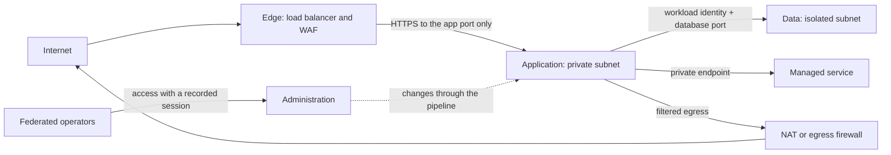
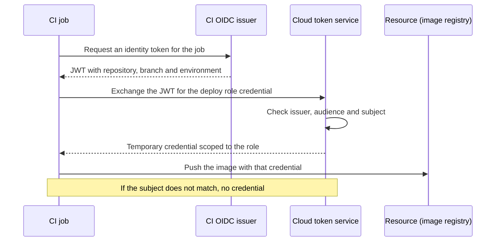

# Cloud networking, identity and security

The team moved to the cloud in three months. To save time, it copied the data center: one big virtual network, nearly everything in subnets with a direct route to the internet, firewall rules open "only" to the office IP, and an admin account shared by six people. The deployment pipeline keeps a long-lived access key in an environment variable. One day that key shows up in the log of a CI job someone made public to debug a failure. Nobody knows exactly which permissions it has (all of them) or how long it has been out there, and the audit logs only cover management operations, not data reads.

No component failed: the design did. In the cloud, **a workload's security is built from three layers that reinforce each other: the network decides what can reach what, identity decides who can do what to each resource, and logging leaves evidence of what happened; none of the three is enough on its own.**

This lesson walks through the three layers with criteria that outlive product changes: virtual networks and segmentation, private endpoints, human and workload identities, policy as code, secrets and keys, and what to log. AWS, Azure and Google Cloud names appear as examples of equivalent services, not as recommendations.

<Callout tone="info" title="Scope and cutoff date">
  Checked in October 2026. How responsibilities split between you and the provider is covered in
  [cloud services for architects](/docs/servicios-nube-para-arquitectos); threat modeling, the
  classic principles and zero trust in [security by design](/docs/seguridad-por-diseno); isolation
  between the customers of a SaaS in [multi-tenancy](/docs/multi-tenancy). None of that is repeated
  here.
</Callout>

## Three layers, one design

The article's figure sums up the idea: a virtual network with two adjacent subnets, one for the application and one for the data, a single way in through the load balancer, a single way out through NAT, and an identity gate at the boundary between the two subnets that the service's call has to pass. The network shrinks what is reachable; identity decides whether a reachable request is authorized. The accent sits on workload identity because it is the piece most often missing: the service that calls the database or the object store needs an identity of its own, with short-lived credentials, just like a person.

| Layer    | Question it answers                               | Typical controls                                              | Most common failure                             |
| -------- | ------------------------------------------------- | ------------------------------------------------------------- | ----------------------------------------------- |
| Network  | What can open a connection to what?               | Subnets, route tables, security groups, private endpoints     | A flat network where everything reaches all     |
| Identity | Who (person or workload) can do what?             | Federation, roles, temporary credentials, permission policies | Shared accounts and wildcard permissions        |
| Logging  | What happened, who did it and when did we see it? | Control plane audit, data access, network flows, alerts       | Logs nobody reviews, or that the attacker wipes |

## The virtual network

A virtual network (VPC in AWS and Google Cloud, VNet in Azure) is a private address space that you define and the provider implements in software. Two differences in scope shape the design: in AWS each subnet lives entirely within one availability zone, while in Google Cloud the VPC network is a global resource and its subnets are regional. Before you draw anything, check where each piece lives in your provider.

### Public, private and isolated subnets

What makes a subnet public or private is not a checkbox but **its route table**. The AWS documentation puts it this way: a public subnet has a direct route to an internet gateway; a private one does not and needs a NAT device to get out; an isolated one has no routes to destinations outside its network.

| Subnet type | Outbound route                 | Who can open connections from outside | What usually lives there                   |
| ----------- | ------------------------------ | ------------------------------------- | ------------------------------------------ |
| Public      | Direct to the internet gateway | The internet, if rules allow it       | Load balancers, NAT, entry points          |
| Private     | Through NAT (outbound only)    | Nobody from the internet              | Application services, workers              |
| Isolated    | None outside the network       | Only resources in the same network    | Databases, sensitive data, batch workloads |

The working rule: **public is the exception and needs a reason**. An application service does not need a public IP if traffic comes in through a load balancer and goes out through NAT or private endpoints.

### Routes and gateways

Every way out of the network is a door with its own risk:

- **Internet gateway**: inbound and outbound for anything with a public IP.
- **NAT**: outbound only; replies come back, but nobody outside can start a connection. Centralizing it lets you filter and log egress traffic.
- **VPN or dedicated interconnect**: links to your data center; it extends the trust boundary to the office network, so treat it as one more zone, not as "internal".
- **Network peering**: the Azure documentation describes it as non-transitive; if A talks to B and B to C, A does not reach C through B. That is a security advantage, and also why topologies grow around a central node.

### Segmentation by trust zones

Segmenting means deciding which zones exist and which flows are allowed between them, with deny by default. A common scheme has four zones: edge (what receives internet traffic), application, data and administration. The **hub-spoke** topology, which the Azure Cloud Adoption Framework recommends, takes the idea across several networks: a hub with shared services (data center connectivity, firewall, internet egress) and spoke networks that isolate each workload or environment.



### Controlled entry points

Each zone should have few, well-known entry points: a load balancer or API gateway for user traffic, a pipeline for changes, and administrative access that does not expose machines to the internet. Azure Bastion, for example, gives RDP and SSH access to virtual machines without publishing their IPs. The test is the same with any provider: if you have to open port 22 to the internet to operate, a controlled entry point is missing.

## Private endpoints: managed services without going to the internet

Managed services (object storage, queues, databases, secret stores) expose a public endpoint by default. The **private endpoint** pattern places in your subnet a network interface with a private IP that stands for that service, and DNS resolves the service name to that IP. Your workload talks to the service without an internet route or NAT.

| Provider     | Name of the pattern                     | Nuance worth knowing                                                                  |
| ------------ | --------------------------------------- | ------------------------------------------------------------------------------------- |
| AWS          | PrivateLink (interface endpoints)       | S3 and DynamoDB also have gateway endpoints, which use routes rather than PrivateLink |
| Azure        | Private Endpoint, on Azure Private Link | Does not restrict public access to the resource by itself: you close that separately  |
| Google Cloud | Private Service Connect                 | Lets you consume managed services with internal IPs from your VPC network             |

Three design consequences:

- **DNS is part of the control.** If the service name still resolves to the public IP, the private endpoint exists but nobody uses it. Azure says so explicitly: DNS settings must resolve to the private endpoint's private IP.
- **Closing the public door is a separate step.** A private endpoint adds a path; it does not remove the public one. The resource or service policy must deny access that does not arrive through the endpoint.
- **The benefit is not only "not crossing the internet".** The [AWS documentation on gateway endpoints](https://docs.aws.amazon.com/vpc/latest/privatelink/gateway-endpoints.html) states that traffic to S3 or DynamoDB that goes through the internet gateway does not leave the AWS network. What you gain is removing the egress route from data subnets and choosing which specific services each network can reach.

## Identity as the new perimeter

In December 2014, Rory Ward and Betsy Beyer described BeyondCorp in _;login:_, Google's approach that drops the requirement for a privileged intranet: access depends on user credentials and device state, not on the network you connect from. The cloud pushes the idea further, because the control plane (creating, deleting or reading resources) is reachable through an API from anywhere with a valid credential. There, the network does not protect you: identity does.

### Human and workload identities

| Type                       | Examples                                       | Good authentication                                           | Anti-pattern                                |
| -------------------------- | ---------------------------------------------- | ------------------------------------------------------------- | ------------------------------------------- |
| Workforce human            | Developers, operators, auditors                | Central identity provider, MFA, temporary sessions            | Local user with a password and a static key |
| Workload inside the cloud  | Container service, function, virtual machine   | Role or managed identity attached to the compute              | Access key copied into configuration        |
| Workload outside the cloud | CI pipeline, on-premises server, another cloud | Federation: issuer token exchanged for a temporary credential | Long-lived secret stored in the CI system   |

### Short-lived credentials

The guidance from the three providers points the same way. AWS's IAM best practices ask that people access through federation with temporary credentials and that workloads use roles with temporary credentials, which the platform delivers to the compute without distributing keys. Azure presents managed identities as a way to obtain Microsoft Entra tokens without managing credentials; the credentials are not even accessible to you. Google Cloud describes service account keys as powerful credentials that can be a risk if not managed correctly, and offers workload identity federation so you do not depend on them.

A temporary credential is only as safe as the path used to obtain it. In November 2019 AWS released version 2 of its instance metadata service (IMDSv2), which requires a session token requested with PUT, refuses to issue it to requests carrying an `X-Forwarded-For` header, and limits the packet TTL so the token cannot leave the machine. Its stated goal: defend against misconfigured web application firewalls and reverse proxies and SSRF vulnerabilities that could forward requests to the metadata service and obtain the role's credentials.

<Callout tone="warning" title="A case with a regulatory penalty">
  In August 2020 the US OCC assessed an $80 million civil money penalty against Capital One for
  failing to establish effective risk assessment processes before migrating significant operations
  to the public cloud. Public analyses of the 2019 incident describe a misconfigured web application
  firewall and a role with more permissions than it needed; the exact mechanism varies by source, so
  read it as an illustration of the pattern, not as a forensic report.
</Callout>

### Federation

Federating means accepting the identity another system issues instead of creating an account of your own. For people, the corporate identity provider issues the session. For external workloads the most common case is the pipeline: GitHub Actions, for example, issues an OIDC token per job; the cloud provider checks that the subject and other claims match the role's conditions and returns a short-lived access token valid only for that job. You no longer copy cloud credentials into CI as long-lived secrets.



The trust condition is what you design and review. Its shape, without any provider's syntax:

```yaml
# Trust between the deploy role and the CI OIDC issuer (shape, not real syntax)
role: deploy-production
trust:
  issuer: https://token.actions.githubusercontent.com
  audience: sts # the expected value depends on the provider
  subject: repo:acme/billing:environment:production # never a wildcard over the whole org
permissions: [push-image, update-service] # // …
maxSession: short # set by the provider's policy
```

### Least privilege and how to audit it

Least privilege means defining which actions can be taken on which resources under which conditions. Nobody gets it right the first time; AWS acknowledges this and suggests starting broader and reducing as the workload matures. What matters is that the reduction happens, and that takes data:

- **Last accessed.** AWS IAM provides last accessed information to spot users, roles and permissions nobody uses.
- **Generation from activity.** IAM Access Analyzer can generate a policy from the actions recorded in CloudTrail; you then test it before deploying it.
- **External access.** The same analyzer flags resources with public or cross-account access.
- **Periodic review.** Every role has an owner and a review date; what is unused gets removed.

The other providers have equivalent tools under other names; look for your platform's before building your own.

## Policy as code and permission reviews

Each identity's permissions live in policies, and policies are configuration: they are versioned, reviewed in a pull request and deployed through a pipeline like the rest of the infrastructure. On top of them it pays to add organization **guardrails**, which cap what any identity can do even if it holds a broader policy:

| Provider     | Organization guardrail          | Documented behavior                                                           |
| ------------ | ------------------------------- | ----------------------------------------------------------------------------- |
| AWS          | Service control policies (SCPs) | Set maximum permissions, grant none, and do not affect the management account |
| Azure        | Azure Policy                    | Can deny, audit or modify; Microsoft recommends starting in audit mode        |
| Google Cloud | Organization Policy Service     | Policies are inherited by folders and projects, which can override them       |

Outside the provider, Open Policy Agent (OPA), a CNCF graduated project since January 2021, is a general-purpose policy engine you can use to evaluate infrastructure plans before applying them. One way to lay out the repository:

```text
platform-policies/
  guardrails/            # organization guardrails: regions, services, encryption
  roles/
    billing-api.yaml     # one file per workload identity, with an owner
    deploy-production.yaml
  checks/
    no-wildcards.rego    # deny actions or resources with wildcards // …
    no-public-buckets.rego
  CODEOWNERS             # security reviews any change under guardrails/
```

The value is in the flow: the pull request shows the **permission diff**, an automated check rejects wildcards and public access, and someone other than the author approves. It is a [fitness function](/docs/fitness-functions) applied to identity.

## Secrets and keys

The best way to manage a secret is not to have one: with workload identity, the service authenticates to the database or the store without a password. When a secret cannot be avoided (a third-party API key, a legacy password), it lives in a **secret store** (AWS Secrets Manager, Azure Key Vault, Google Secret Manager), is read at runtime with the workload's identity and is rotated automatically. The general rotation and leak detection criteria are in [security by design](/docs/seguridad-por-diseno); here the focus is what is specific to the cloud.

### Environment variables

The OWASP secrets management cheat sheet advises against environment variables unless no other option exists, because they are generally accessible to all processes and can end up in logs or system dumps. If you use them, have the value arrive at startup from the store, not from the pipeline, and never print the full configuration.

### Encryption at rest and in transit

Key management services (AWS KMS, Azure Key Vault and Managed HSM, Cloud KMS) are built on **envelope encryption**: data is encrypted with a data key, and that key is encrypted with another that never leaves the service. You can store the encrypted data key next to the data and rotate the top key without re-encrypting everything. In transit, the rule is TLS inside the network too: a private network is not an encrypted channel, and IAM policies can require that requests arrive over TLS.

### Separation of duties

The Cloud KMS documentation frames it as making sure no single principal holds every permission needed for a malicious action. Applied to keys, whoever manages the lifecycle (create, rotate, disable) is not who encrypts and decrypts.

| Role              | Can                                           | Should not be able to   |
| ----------------- | --------------------------------------------- | ----------------------- |
| Key administrator | Create, rotate, schedule deletion, view usage | Decrypt production data |
| Workload identity | Encrypt and decrypt with its own key          | Change the key policy   |
| Platform operator | Deploy the workload and its configuration     | Read secret values      |
| Auditor           | Read key and secret usage logs                | Change anything         |

## Logging, detection and response

A log that does not exist when you need it cannot be rebuilt. Decide what to log before the first incident, and pay attention to what ships turned off.

| What to log                      | Examples by provider                                 | Default worth knowing                                                            |
| -------------------------------- | ---------------------------------------------------- | -------------------------------------------------------------------------------- |
| Control plane (who changed what) | CloudTrail, Azure Activity Log, Cloud Audit Logs     | In Google Cloud, Admin Activity logs are always written and cannot be disabled   |
| Access to sensitive data         | CloudTrail data events, Cloud Audit Logs Data Access | CloudTrail data events and Data Access logs (except BigQuery) are off by default |
| Network flows                    | VPC Flow Logs, Azure virtual network flow logs       | You have to turn them on and decide where they are stored                        |
| Sign-ins and identity            | Identity provider logs, Microsoft Entra sign-in logs | Include workload identities, not only people                                     |
| Key and secret usage             | Key manager and secret store logs                    | Every decryption is a question you will be able to answer later                  |

**Where:** in a separate logging account or project that workloads can write to but cannot delete from, with retention that matches your obligations. If the attacker can turn logging off with the same credential they stole, the log is useless.

**Detection:** a few high-signal alerts beat a dashboard full of noise. Start with use of the root account or its equivalent, logging being disabled, changes to guardrails and trust policies, creation of long-lived keys, and data access from identities that never did it before.

**Response:** write down how to revoke active sessions, disable a credential and isolate a workload without destroying evidence. Rehearse it the way you rehearse disaster recovery.

## When to go further and when not to

The question is not whether to apply these layers but how much rigor each stage deserves. It is a [trade-off](/docs/trade-offs-y-decisiones) between friction and risk.

| Situation                                         | Reasonable rigor                                                                            |
| ------------------------------------------------- | ------------------------------------------------------------------------------------------- |
| Prototype with no real data, small team           | Federation and MFA from day one; simple network; no long-lived keys                         |
| Product with customer data                        | Private subnets, private endpoints for data, one identity per service, data access auditing |
| Regulated data or several teams in the same cloud | Hub-spoke, organization guardrails, separation of duties for keys, separate logging account |
| Workload that only serves static public content   | Minimal network; invest in the identity of whoever publishes and in the change log          |
| Team without capacity to run its own firewalls    | Prefer managed services and private endpoints over network appliances nobody maintains      |

## Common mistakes

- **Shared accounts.** If six people use the same user, the log says "admin did it" and nobody answers for it. Everyone signs in with their own federated identity.
- **Wildcard permissions.** A `*` action on a `*` resource turns any workload flaw into an account-wide flaw. Policy checks should reject them.
- **IP allowlists as the only defense.** The office IP changes, is shared with the guest VPN and says nothing about who is behind it. It is one more layer, never the authentication.
- **Unmanaged secrets in environment variables.** They end up in logs, dumps and debugging screenshots. Read from the store at startup or, better, remove the secret with workload identity.
- **Trusting a flat network.** "It's inside the VPC" is not an authorization. Segment by zone and require identity between internal services too.
- **Private endpoint with the public door open.** The private path exists, but the public one still accepts traffic. Close public access in the resource policy.
- **Logs turned off to save money.** Disabling data access logs trims the bill and leaves the first question of any incident unanswered: what was read?

## Worked example: the billing API

Assume a billing API with three services (API, PDF generator and payment worker), a relational database, an object store for the PDFs and an external CI pipeline. These are assumptions to illustrate the decision, not a real case.

**Network.** The load balancer lives in two public subnets; the three services in private subnets; the database in isolated subnets. The object store and the secret store are reached through private endpoints, and their policies deny any access that does not come through them. Only the payment worker needs the internet (to reach the payment gateway), so it is the only one with a route to NAT, and the egress firewall only allows the gateway's domain.

**Identity.** Each service has its own workload identity: 3 identities. The pipeline uses OIDC federation with two roles, one to push images and another to deploy to production, the latter bound to the protected environment: 2 roles. People sign in through the corporate provider in two groups, operators and read-only: 2 groups. In total, 7 identities or groups with an owner, and no long-lived keys.

**Data and keys.** The PDF generator can write to its prefix in the store and nothing else; the API can only read from it. The key that encrypts the database and the store is administered by the platform team; workload identities can only use it.

**Logging.** Control plane and object store data access go to a separate logging account. Initial alerts: changes to the trust of the pipeline roles, reads from the store by any identity other than the API, and any creation of access keys.

If the product is a multi-customer SaaS, isolation between customers (by schema, by database or by account) is decided separately, with the criteria in [multi-tenancy](/docs/multi-tenancy). Record the decisions in an [ADR](/docs/adr): a year from now someone will ask why the payment worker is the only service with egress.

## Checklist

- [ ] No person has a local user with a static access key; everyone signs in through federation, with MFA.
- [ ] Every workload has its own identity and gets temporary credentials from the platform or through federation.
- [ ] Data subnets have no route to the internet, and managed services are reached through private endpoints with public access closed.
- [ ] Permission policies live in the repository, without wildcards, with an owner and a pull request review.
- [ ] Organization guardrails cap regions, services and the ability to disable logging.
- [ ] Unavoidable secrets live in a store, are read at runtime and rotate on their own.
- [ ] Whoever administers the keys cannot decrypt production data.
- [ ] Control plane and sensitive data access logs go to a separate account, with high-signal alerts and a rehearsed revocation procedure.

## Next lesson

With network, identity and logging in place, the next decision is where and how many times the workload is deployed: continue with [regions, zones and recovery](/docs/regiones-zonas-y-recuperacion).

## Sources

Checked in October 2026.

- [Subnets for your VPC (Amazon VPC documentation)](https://docs.aws.amazon.com/vpc/latest/userguide/configure-subnets.html): subnet types defined by their routes
- [What is AWS PrivateLink?](https://docs.aws.amazon.com/vpc/latest/privatelink/what-is-privatelink.html) and [Gateway endpoints](https://docs.aws.amazon.com/vpc/latest/privatelink/gateway-endpoints.html) (AWS documentation)
- [What is a private endpoint? (Microsoft Learn)](https://learn.microsoft.com/en-us/azure/private-link/private-endpoint-overview): DNS and public access
- [Private Service Connect](https://docs.cloud.google.com/vpc/docs/private-service-connect) and [VPC networks](https://docs.cloud.google.com/vpc/docs/vpc) (Google Cloud documentation)
- [Hub-spoke network topology in Azure (Azure Architecture Center)](https://learn.microsoft.com/en-us/azure/architecture/networking/architecture/hub-spoke)
- [BeyondCorp: A New Approach to Enterprise Security (Rory Ward and Betsy Beyer, ;login:, December 2014)](https://www.usenix.org/publications/login/dec14/ward)
- [Security best practices in IAM (AWS documentation)](https://docs.aws.amazon.com/IAM/latest/UserGuide/best-practices.html)
- [Managed identities for Azure resources (Microsoft Learn)](https://learn.microsoft.com/en-us/entra/identity/managed-identities-azure-resources/overview)
- [Workload Identity Federation (Google Cloud documentation)](https://docs.cloud.google.com/iam/docs/workload-identity-federation)
- [OpenID Connect in GitHub Actions (GitHub documentation)](https://docs.github.com/en/actions/concepts/security/openid-connect)
- [Add defense in depth against open firewalls, reverse proxies, and SSRF vulnerabilities with enhancements to the EC2 Instance Metadata Service (Colm MacCárthaigh, AWS Security Blog, November 19, 2019)](https://aws.amazon.com/blogs/security/defense-in-depth-open-firewalls-reverse-proxies-ssrf-vulnerabilities-ec2-instance-metadata-service/)
- [OCC Assesses $80 Million Civil Money Penalty Against Capital One (news release 2020-101, August 6, 2020)](https://www.occ.gov/news-issuances/news-releases/2020/nr-occ-2020-101.html)
- [Service control policies (AWS Organizations documentation)](https://docs.aws.amazon.com/organizations/latest/userguide/orgs_manage_policies_scps.html), [Azure Policy overview (Microsoft Learn)](https://learn.microsoft.com/en-us/azure/governance/policy/overview) and [Organization Policy Service (Google Cloud)](https://docs.cloud.google.com/resource-manager/docs/organization-policy/overview)
- [Open Policy Agent at the CNCF](https://www.cncf.io/projects/open-policy-agent-opa/)
- [Secrets Management Cheat Sheet (OWASP)](https://cheatsheetseries.owasp.org/cheatsheets/Secrets_Management_Cheat_Sheet.html)
- [AWS KMS cryptography essentials](https://docs.aws.amazon.com/kms/latest/developerguide/kms-cryptography.html): envelope encryption
- [Separation of duties (Cloud KMS documentation)](https://docs.cloud.google.com/kms/docs/separation-of-duties)
- [Cloud Audit Logs overview (Google Cloud)](https://docs.cloud.google.com/logging/docs/audit), [Logging data events (AWS CloudTrail)](https://docs.aws.amazon.com/awscloudtrail/latest/userguide/logging-data-events-with-cloudtrail.html) and [Virtual network flow logs (Microsoft Learn)](https://learn.microsoft.com/en-us/azure/network-watcher/vnet-flow-logs-overview)
