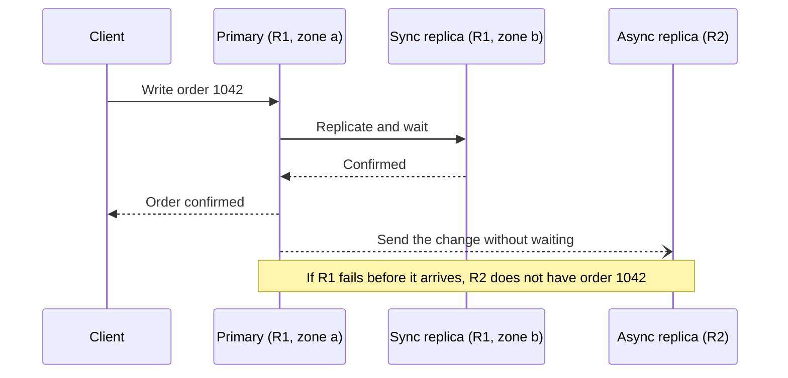
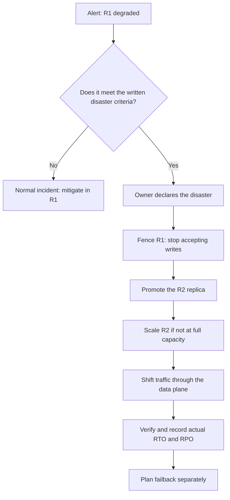

# Regions, zones and disaster recovery

Your system runs in three availability zones, the load balancer spreads traffic across them and the database has a synchronous replica in another zone. Then one day the whole region goes down, or a bad configuration change reaches every zone at once. Someone in the incident channel asks how long it takes to bring the service up in another region and how much data will be lost. Nobody knows: the plan exists in a document but has never been run, the cross-region replica has a lag nobody measures, and the DNS change depends on a console that lives in the failed region. This article is about those two questions. The core idea: **disaster recovery is the designed and tested ability to restore service in another failure domain within a time (RTO) and with a data loss (RPO) that the business has accepted in writing**.

You will see what a zone covers and what a region covers, how the type of replication relates to consistency, what RTO and RPO mean according to the providers, the four classic strategies ordered by cost and time, how traffic is switched, what happens to data during the switch, and why a plan without drills is just a hypothesis. Providers appear as examples to name equivalent pieces, not as recommendations.

<Callout tone="info" title="Cut-off date and sources">
  Checked in October 2026 against the official documentation of AWS, Microsoft Azure and Google
  Cloud. The distance and latency figures between zones are the ones Azure publishes as of that
  date; service names change, so use them for orientation, not as a current inventory. No prices or
  SLAs are quoted.
</Callout>

## The problem it solves

High availability and disaster recovery are often confused, and the mistake is expensive. The first keeps the service running through frequent, small failures (a machine, a rack, a zone) without human intervention. The second restores service after a large, rare failure, usually through an explicit decision, a bounded data loss and a period of downtime. The symptoms of not separating the two are easy to recognise:

| Symptom during an incident                                        | Decision nobody made                                                                 |
| ----------------------------------------------------------------- | ------------------------------------------------------------------------------------ |
| "We run in three zones" and the whole service still goes down     | What zones do not cover: a bad configuration or deployment replicated to all of them |
| Nobody knows how many minutes of orders were lost                 | An RPO that is measured and monitored, not just stated                               |
| Failover takes hours because the infrastructure has to be created | A strategy that matches the RTO the business needs                                   |
| Switching traffic needs a console or API that is not responding   | What the recovery path depends on                                                    |
| The replica faithfully copied the accidental deletion of a table  | That replication does not replace backups                                            |
| The plan worked a year ago, but the secondary region has drifted  | Regular drills and configuration drift control                                       |

## Failure domains: zone and region

A **failure domain** is the set of resources that can fail from the same cause. Designing for recovery means spreading the system across domains whose causes of failure are independent, and knowing which causes remain uncovered.

### What a zone is

The three large providers define a zone in similar terms. AWS describes Availability Zones as multiple, isolated locations within each Region, and explains that spreading instances across them protects an application from the failure of a single location. Azure is more specific: a zone is a logical grouping of one or more physically separate datacenters within a region, with independent power, cooling and networking, so that if one zone has an outage the others keep working. Google Cloud defines it as a deployment area within a region and says it designs zones to minimise the risk of correlated failures.

[Azure publishes](https://learn.microsoft.com/en-us/azure/reliability/availability-zones-overview) two figures that help you reason (as of October 2026): its zones are typically several kilometres apart and usually within 100 km of each other, and its target round-trip latency between zones is under approximately 2 ms. The same page draws the architectural consequence: that low latency is what makes **synchronous replication** across zones possible.

### What a region is

A region is a separate geographic area that groups several zones. AWS says each Region is designed to be isolated from the others and that it does not replicate resources across Regions automatically: that decision is yours. Google Cloud summarises the difference: spreading resources across zones reduces the risk of an infrastructure outage; spreading them across regions gives an even higher degree of failure independence. Azure puts it bluntly: zones **do not protect** against a full-region outage.

### What each level covers

| Cause of failure                                   | Several zones     | Several regions                       | Versioned or point-in-time backups    |
| -------------------------------------------------- | ----------------- | ------------------------------------- | ------------------------------------- |
| A machine, rack or datacenter fails                | Yes               | Yes                                   | Not its job                           |
| Power or network outage affecting one zone         | Yes               | Yes                                   | Not its job                           |
| Disaster or outage affecting the whole region      | No                | Yes                                   | Only if the copy is in another region |
| Bad deployment or configuration applied everywhere | No                | Only if you roll out region by region | Helps you roll back                   |
| Accidental deletion, corruption, ransomware        | No: it replicates | No: it replicates                     | Yes, the only defence                 |
| Compromised credentials in the account             | No                | Depends on account isolation          | Yes, if stored in another account     |

The table can be read in two ways. First: for many systems, several zones in one region are enough. AWS says so in its recovery guide: zones within a region are built with enough distance between them that the most common disasters should affect only one, so a multi-zone architecture already covers much of the risk. Second: replication, at any level, also copies mistakes. Against corruption or deletion, only point-in-time backups help, stored out of reach of whoever caused the damage.

## Synchronous and asynchronous replication

The type of replication decides how much data you can lose and how long each write takes. Azure's Well-Architected Framework defines them like this: **synchronous** replication writes changes to several locations at once and avoids data loss at the cost of higher latency; **asynchronous** replication writes to the primary first and copies afterwards, with lower latency and accepting some loss.

It is the same dilemma PACELC describes in [CAP, PACELC and consistency](/docs/cap-pacelc): even without a partition, coordinating replicas costs latency. Between zones, a few milliseconds apart, synchronous replication is usually affordable. Between regions hundreds or thousands of kilometres apart, waiting for the remote replica on every write stretches every transaction, which is why cross-region replication is usually asynchronous. Azure lists this as a pattern: synchronous across zones for high-priority data, asynchronous across regions.

The consequence is what the article's figure shows: in the primary region (R1) the database has a synchronous copy in another zone; towards the secondary (R2) the copy travels with a delay. Writes confirmed in R1 that had not yet reached R2 when R1 fails are the data gap.



Two caveats. First, "no data loss" with synchronous replication refers to confirmed writes when one copy fails, not to corruption: a mistaken `DELETE` replicates just as fast. Second, an asynchronous replica is not "a little behind" in some abstract way: it has a lag measurable in seconds or in transaction log position, and that lag is your real RPO at any given moment. How isolation and transaction choices affect what gets replicated is covered in [data, ACID and isolation](/docs/datos-acid-y-aislamiento).

## RTO and RPO

The two numbers you negotiate recovery with are defined in the providers' guides. AWS's disaster recovery whitepaper says:

- **RTO** (Recovery Time Objective): the maximum acceptable delay between the interruption of service and restoration of service.
- **RPO** (Recovery Point Objective): the maximum acceptable amount of time since the last data recovery point; it determines what data loss is acceptable between that point and the interruption.

Azure defines them equivalently: RPO is the maximum acceptable data loss measured in time, and RTO the maximum acceptable time to restore operations. Both guides stress that the organisation sets them from business impact, not the technical team from what is convenient. AWS adds a common-sense rule: if the recovery strategy costs more than the loss it prevents, it should not be put in place unless there is another driver, such as a regulatory requirement.

In the figure, the RPO is the highlighted stretch between the last write that reached R2 and the failure of R1; the RTO is the stretch between the failure and the moment R2 serves again.

| Business question                     | Objective | Mostly determined by                                         |
| ------------------------------------- | --------- | ------------------------------------------------------------ |
| How many minutes of data can we lose? | RPO       | Backup frequency or replication lag                          |
| How long can we be without service?   | RTO       | What is already deployed at the target and how traffic moves |

### Measure, don't declare

A five-minute RPO written in a document means nothing if the replica falls twenty minutes behind every night during the bulk load. Treat both objectives as [quality attribute](/docs/atributos-de-calidad) requirements and watch them as metrics: replication lag with an alert above the RPO, the age of the last valid backup, and the actual RTO measured in every drill. AWS also recommends restoring backups periodically, because restoring is a control plane operation and it helps to have working data stores created from recent backups before you need them.

## Four recovery strategies

AWS groups strategies into four, from the cheapest and simplest to the most complex: backup and restore, pilot light, warm standby and multi-site active/active. Azure uses similar names for the active-passive variants (cold standby and warm standby). The table sums up the difference in relative terms; actual figures depend on your data and services.

| Strategy           | What exists in the recovery region                             | Relative RTO   | Relative RPO                  | Relative running cost |
| ------------------ | -------------------------------------------------------------- | -------------- | ----------------------------- | --------------------- |
| Backup and restore | Data backups, images and infrastructure as code                | Highest        | The interval between backups  | Lowest                |
| Pilot light        | Live replicated data; the application defined but switched off | High or medium | Replication lag               | Low                   |
| Warm standby       | A complete, working copy at reduced capacity                   | Medium or low  | Replication lag               | Medium                |
| Active/active      | The full system serving traffic in several regions             | Near zero      | Near zero for region failures | Highest               |

### Backup and restore

Periodic or continuous backups of the data, plus everything needed to recreate the environment: code, configuration, images and infrastructure as code. AWS stresses that without infrastructure as code, restoring in another region gets complicated and stretches recovery time. It is the right strategy when the disaster you fear is data loss or corruption, or when the business tolerates hours of downtime. Note that backups in the recovery region must be **restored** during failover, and that is part of the RTO.

### Pilot light

Data is replicated continuously to the secondary region and the core infrastructure exists, but application servers are defined and switched off (or not even deployed) until failover. That is what the figure draws: the database in R2 receives changes and the application is greyed out. AWS reminds you that continuous replication does not protect against corruption, so you still need point-in-time backups.

### Warm standby

A scaled-down but **fully functional** copy of production runs in the other region. AWS draws the line with pilot light clearly: pilot light cannot process requests without an action taken first; warm standby can handle traffic immediately, at reduced capacity, and only needs to scale up. That scaling depends on the control plane (auto scaling), and AWS presents it as a trade-off: if you provision full capacity in advance, the configuration is statically stable and is called hot standby.

### Active/active

Several regions serve traffic at once. AWS notes that in this case there is no failover as such: traffic stops going to the failed region and the others must absorb the load. The difficulty moves to the data: if every region writes, you need a rule for concurrent writes. The AWS guide distinguishes three options: write to a single region (write global), write to the nearest one and reconcile (write local; it cites DynamoDB global tables, which resolve conflicts with "last writer wins"), or assign each key to a region (write partitioned). This is [CAP and PACELC](/docs/cap-pacelc) territory at region scale.

<Callout tone="warning" title="Replication is not backup">
  Every strategy, active/active included, needs point-in-time backups. AWS says so explicitly: for
  corruption or deletion, recovery time will be greater than zero and the recovery point will be
  somewhere before the moment the problem was discovered.
</Callout>

## Switching traffic

A ready secondary region is useless if clients keep calling the primary. There are three families of mechanisms, and they behave differently:

| Mechanism                       | How it diverts traffic                                          | What to watch                                                   |
| ------------------------------- | --------------------------------------------------------------- | --------------------------------------------------------------- |
| DNS with health checks          | Changes the name's answer to point at the healthy endpoint      | Whether resolver and client caches honour the TTL               |
| Global load balancer or anycast | One stable IP; the provider routes to the healthy endpoint      | That the switch happens on the data plane, not by reconfiguring |
| CDN origin failover             | If a request to the primary origin fails, retries the secondary | It is per request: the primary keeps receiving attempts         |

DNS is the most widespread mechanism and the most misunderstood. A record's TTL, as RFC 1035 defines it, is the interval during which the record may be cached before the source should be consulted again. So a change does not reach every client at once: it depends on the TTL, on intermediate resolvers and on clients that hold the answer longer than they should. Azure lists it among the processes outside your control whose delay you should validate in drills. AWS notes that a global accelerator with an anycast IP avoids the caching issues of DNS. There is no universal propagation figure: measure it in your own setup.

### Control plane and data plane

The most useful distinction in the AWS guide is this one: the **data plane** delivers the service in real time and the **control plane** configures the environment (create, modify, delete). Data planes usually have higher availability design goals, so the recommendation is to use only data plane operations for failover. AWS gives concrete examples: changing the weights of a DNS record or the traffic dial of a global accelerator is a control plane operation; flipping a preconfigured health check that acts as an on/off switch is a data plane one.

This ties in with **static stability**: a system that keeps working without needing to make changes when a dependency fails. The way to get it is to have what failover needs provisioned in advance, instead of creating it during the disaster.

### Automatic or manual

AWS warns that automatic failover based on health checks should be used with caution: RTO and RPO are never zero, so failing over on a false alarm makes you pay those losses for nothing. That is why the **decision** is often human while the **steps** are automated, so that starting failover is like pressing a button. Azure adds that failback is a separate process with its own plan.



## State and data during failover

Changing region is not only about traffic. Each kind of state has its own fate:

- **Writes in the gap.** Those R1 confirmed and that never reached R2 do not exist in the new primary. If R1 comes back, they may reappear; decide in advance whether they are discarded, reapplied or reviewed by hand, and who decides.
- **Two primaries at once.** If R1 was not dead but isolated, it may keep accepting writes while R2 is already primary. The "fence R1" step in the diagram exists for that: cut writes on the old side before promoting the new one. Without it, failover creates divergence you will have to reconcile.
- **Messages and events.** A consumer that processed a message in R1 but did not commit its position will see it again in R2. Consumers must be idempotent; the patterns are in [sagas, outbox and idempotency](/docs/sagas-outbox-idempotencia), and the behaviour of queues and caches in [caching, queues and streaming](/docs/caching-colas-streaming).
- **Client retries.** During the outage, clients retry. An idempotency key that travels with the request and is stored alongside the replicated data prevents double charges or orders when the retry lands in the other region.
- **Caches, sessions and sequences.** Caches in R2 start cold and the database takes the full load at once. Sessions held only in R1's memory are lost. Sequential ID generators may repeat values if their state was not replicated.

<Callout tone="tip" title="Design the gap, don't discover it">
  Write down, for each data store, what happens to writes in the gap and how they are reconciled. If
  the answer is "we cannot lose any", that operation needs synchronous replication or confirmation
  in the secondary region, and you have to accept the latency that comes with it.
</Callout>

## Recovery testing

The most quotable line in the AWS guide is an observation from experience: the only error recovery that works is the path you test frequently. That is why they recommend a small number of recovery paths, exercised regularly, and list never exercising failover in production as an anti-pattern. Azure is on the same line: a recovery plan only means something once validated under realistic conditions, and it suggests combining tabletop exercises, dry runs outside production and production drills, with the warning to test outside production first so you do not cause the disaster you are rehearsing.

Google has done this for years under its own name. Kripa Krishnan described the DiRT programme (Disaster Recovery Testing) in _Weathering the Unexpected_ (ACM Queue, 2012): an annual, multi-day, company-wide exercise that deliberately breaks real systems and also keeps key people out of it, to check that the organisation does not depend on them. The article acknowledges that these exercises are not cheap.

A useful drill has a measurable goal and a written outcome:

- A hypothesis: "R2 serves payments traffic in under 45 minutes with less than 5 minutes of data lost".
- A runbook that is followed as written, and corrected with whatever failed.
- Measurement of the actual RTO and RPO, compared with the objectives.
- A drift review: images, service quotas and configuration in the secondary region kept current. AWS explicitly mentions quotas, which can stop you scaling to production capacity.

[Chaos engineering](/docs/resiliencia-sistemas-distribuidos) is a close relative: small, continuous experiments, while recovery drills are less frequent and wider in scope. You can turn parts of the plan into automated checks, as [fitness functions](/docs/fitness-functions): replication lag below the RPO, a successful test restore within the last thirty days.

## When to use it and when not

AWS is explicit about something that is often forgotten: for less critical workloads it can be valid to have no disaster recovery at all, and the same goes for some very low-probability scenarios, as long as it is an informed decision.

| Situation                                                      | Reasonable decision                                                            |
| -------------------------------------------------------------- | ------------------------------------------------------------------------------ |
| Internal tool; the business tolerates a day without it         | Several zones and backups in another region; documented and tested restore     |
| Customer-facing service; hours of downtime mean serious losses | Pilot light or warm standby; asynchronous replication with monitored lag       |
| Regulatory continuity or data residency requirement            | Whatever the rule requires; if data cannot leave the region, zones and backups |
| Payments or bookings with users on several continents          | Active/active with an explicit write strategy per operation                    |
| Nobody can say which RTO and RPO the business needs            | Impact analysis before technology; record it in an [ADR](/docs/adr)            |

## Common mistakes

- **Untested disaster recovery.** A plan that has never been run describes intentions, not capabilities. The first drill usually finds expired credentials, low quotas and stale images.
- **An RPO nobody has measured.** The objective says five minutes; the real replica lag has no metric and no alert.
- **Manual failover without a runbook.** At three in the morning, with the expert on holiday, every improvised step stretches the RTO and adds risk.
- **Hidden single-region dependencies.** The recovery path uses a control plane, an identity provider or a DNS zone that lives in the failed region. AWS documents that several of its global services have their control plane in a single Region; Azure recommends keeping recovery documentation, scripts and credentials somewhere that stays reachable during a regional outage. How to design networking and identity so they are not that single point is covered in [cloud networking, identity and security](/docs/redes-identidad-seguridad-nube).
- **Confusing a replica with a backup.** The replica copies the deletion; only a point-in-time backup undoes it.
- **Creating resources during the disaster.** If failover needs to provision load balancers, buckets or roles, it depends on control planes at the worst possible moment.
- **Forgetting the way back.** Failback is done in a rush and without a plan, and it causes a second incident.
- **Believing several regions cover everything.** Spreading across regions of one provider does not cover a failure that hits the whole provider; if that is your risk, the analysis is different: [multicloud, when it makes sense](/docs/multinube-cuando-tiene-sentido).

## Worked example: a medical appointments platform

Assumptions for this example (not data from any provider): an appointment booking platform for clinics, with a transactional API, a relational database and an analytics store. The impact analysis with the business yields these objectives:

| Component                 | Agreed RPO | Agreed RTO | Reason                                                     |
| ------------------------- | ---------- | ---------- | ---------------------------------------------------------- |
| API and bookings database | 5 minutes  | 1 hour     | A lost appointment can be recovered by calling the patient |
| Analytics store           | 24 hours   | 3 days     | Reports can be regenerated from the bookings               |

Options for the API, with times measured in a rehearsal (also assumed):

- **Backup and restore.** Hourly backups and a measured restore of 2 hours, plus 40 minutes of deployment with infrastructure as code: an RPO of up to 60 minutes and an RTO of about 160 minutes. It misses both objectives.
- **Pilot light.** Asynchronous replica with a measured lag of 30 seconds at the 99th percentile and peaks of 2 minutes during the nightly load: it meets the RPO. Starting and scaling the application takes 35 minutes, promoting the replica 5 and the DNS change, with a 60-second TTL and slow caches, another 10: 50 minutes in total. It meets the RTO with 10 minutes to spare.
- **Warm standby.** The same RPO and an RTO close to 15 minutes, in exchange for keeping a working copy running all year.

The decision: pilot light for the API, with an alert if replication lag exceeds 3 minutes (leaving 2 minutes of margin before the RPO) and a quarterly drill that measures the 50 minutes for real; if a drill goes over 50, the team moves to warm standby. For the analytics store, daily backups in another region and a tested restore are enough. Writes in the gap are reconciled against the booking log the API keeps with its idempotency key.

```yaml
# recovery-objectives.yaml: indicative shape, one entry per component
appointments-api:
  rpo: 5m
  rto: 1h
  strategy: pilot-light
  replicationLagAlert: 3m
  drill: quarterly
  runbook: runbooks/appointments-failover.md
analytics-store:
  rpo: 24h
  rto: 3d
  strategy: backup-restore
  # …
```

## Checklist

- [ ] Every component has an RTO and an RPO agreed with the business and recorded.
- [ ] You know which causes of failure your deployment covers (zone, region, corruption, account) and which it does not.
- [ ] Replication lag and the age of the last valid backup are metrics with alerts.
- [ ] Point-in-time backups exist in another region, out of reach of production credentials.
- [ ] Failover uses only data plane operations and resources provisioned in advance.
- [ ] There is a runbook with disaster criteria, owners, automated steps and a failback plan.
- [ ] Writes in the gap have a reconciliation rule and consumers are idempotent.
- [ ] A regular drill measures the actual RTO and RPO and corrects drift in the secondary region.

## Next lesson

Each recovery strategy has a different running cost; the next lesson treats cost as one more design attribute: [FinOps: cost as an architecture attribute](/docs/finops-costo-como-atributo).

## Sources

Checked in October 2026.

- [Disaster Recovery of Workloads on AWS: Recovery in the Cloud (AWS Whitepaper)](https://docs.aws.amazon.com/whitepapers/latest/disaster-recovery-workloads-on-aws/disaster-recovery-workloads-on-aws.html): sections [Business Continuity Plan](https://docs.aws.amazon.com/whitepapers/latest/disaster-recovery-workloads-on-aws/business-continuity-plan-bcp.html) (RTO and RPO definitions), [Disaster recovery options in the cloud](https://docs.aws.amazon.com/whitepapers/latest/disaster-recovery-workloads-on-aws/disaster-recovery-options-in-the-cloud.html) and [Testing disaster recovery](https://docs.aws.amazon.com/whitepapers/latest/disaster-recovery-workloads-on-aws/testing-disaster-recovery.html)
- [AWS Fault Isolation Boundaries (AWS Whitepaper)](https://docs.aws.amazon.com/whitepapers/latest/aws-fault-isolation-boundaries/static-stability.html): static stability and [global services](https://docs.aws.amazon.com/whitepapers/latest/aws-fault-isolation-boundaries/global-services.html) sections
- [REL13-BP03 Test disaster recovery implementation (AWS Well-Architected, Reliability Pillar)](https://docs.aws.amazon.com/wellarchitected/latest/reliability-pillar/rel_planning_for_recovery_dr_tested.html)
- [Regions and Zones (Amazon EC2 documentation)](https://docs.aws.amazon.com/AWSEC2/latest/UserGuide/using-regions-availability-zones.html)
- [What are Azure Availability Zones? (Microsoft Learn)](https://learn.microsoft.com/en-us/azure/reliability/availability-zones-overview)
- [Architecture strategies for disaster recovery (Azure Well-Architected Framework)](https://learn.microsoft.com/en-us/azure/well-architected/reliability/disaster-recovery)
- [Regions and zones (Google Compute Engine documentation)](https://docs.cloud.google.com/compute/docs/regions-zones)
- [RFC 1035, Domain Names: Implementation and Specification (November 1987)](https://www.rfc-editor.org/rfc/rfc1035): TTL definition, section 3.2.1
- [Weathering the Unexpected (Kripa Krishnan, ACM Queue, 2012)](https://queue.acm.org/detail.cfm?id=2371516). Source consulted through summaries; the full text could not be opened.
