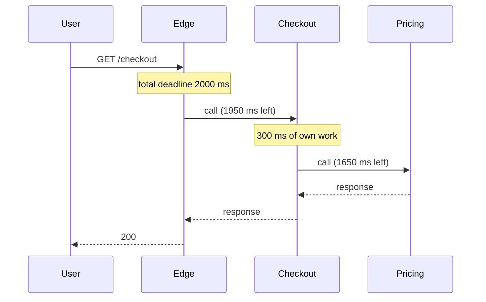
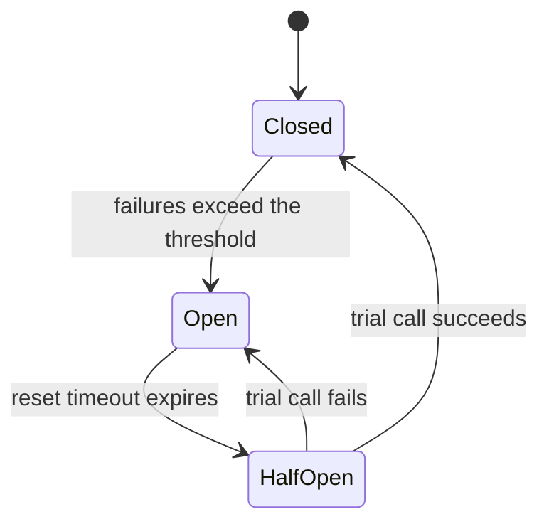

# Resilience in distributed systems

One Friday, the recommendations service starts taking thirty seconds instead of eighty milliseconds. It is not down: it answers, just late. The checkout page calls it to show "you may also like", its threads sit waiting, the connection pool runs dry and, a few minutes later, nobody can pay. To make it worse, every layer retries whatever fails and multiplies the load on a service that was already struggling. A secondary detail took down the main feature.

**Resilience is a system's ability to keep delivering what matters most, possibly degraded, when a part fails or slows down, and to recover without heroics.** It is not about avoiding failure but about containing it: deciding how long you wait, how many times you insist, when you stop calling, what you isolate and what you give up.

This article walks through those mechanisms in the order they are usually applied (timeouts and deadlines, retries, circuit breakers, bulkheads, load shedding and degradation), how to test them with chaos engineering, and how to measure them. It leaves two neighbouring topics out: consistency theory lives in [CAP, PACELC and consistency](/docs/cap-pacelc), and transaction compensation in [sagas, outbox and idempotency](/docs/sagas-outbox-idempotencia).

<Callout tone="info" title="Cut-off date and sources">
  Library versions are as of October 2026 (GitHub and NuGet). Amazon Builders' Library articles now
  redirect to builder.aws.com. I did not read the book _Release It!_ directly: what is said about it
  comes from Martin Fowler's article and from reviews, and is flagged as such.
</Callout>

## Partial failure is the normal state

Inside one process, a function call either returns or throws. In a distributed system there is a third outcome: you do not know what happened. The request may have been lost, executed without the response arriving, or still be running. And the system is rarely all down or all healthy; something is almost always degraded.

The **fallacies of distributed computing** sum up the assumptions that make you forget this. According to Arnon Rotem-Gal-Oz's paper and the Wikipedia entry, L Peter Deutsch, then at Sun Microsystems, collected seven of them in 1994, building on work by other Sun colleagues, and James Gosling added the eighth around 1997. Each one has a design consequence:

| Fallacy                    | What breaks if you believe it                            | Where it is handled                                            |
| -------------------------- | -------------------------------------------------------- | -------------------------------------------------------------- |
| The network is reliable    | Lost responses, half-executed operations                 | Timeouts and idempotent retries (this article)                 |
| Latency is zero            | Call chains whose latency tails add up                   | Propagated deadlines (this article)                            |
| Bandwidth is infinite      | Large payloads that saturate links and queues            | [Caching, queues and streaming](/docs/caching-colas-streaming) |
| The network is secure      | Implicit trust between services                          | Out of scope for this article                                  |
| Topology doesn't change    | Instances that come and go in the middle of a request    | Retrying against another replica, service discovery            |
| There is one administrator | Someone else's config change hits you without warning    | Defensive timeouts and explicit contracts                      |
| Transport cost is zero     | Serializing and moving data costs CPU, latency and money | Retry budgets, fewer calls per request                         |
| The network is homogeneous | Clients, protocols and versions that behave differently  | [API design](/docs/diseno-de-apis)                             |

### Slow is worse than down

A dead dependency fails fast: the connection is refused and the caller moves on. A slow dependency holds threads, connections and memory while you wait. The cascading failures chapter of Google's SRE book describes this as bimodal latency: a small fraction of requests hanging until a long deadline can tie up most threads and starve everything else. That is why nearly every mechanism in this article aims at the same thing: **turn slowness into a fast, bounded failure**.

## Timeouts: every remote call gets one

The timeout is the first line of defence and the most often forgotten. Marc Brooker, in his Builders' Library article on timeouts, retries and backoff, recommends setting one on every remote call, even between processes on the same machine, and separating the **connection timeout** from the **request timeout**. Do not assume your client ships with a sensible one: the gRPC documentation, for example, warns that by default it sets no deadline at all.

To pick the value, the same article suggests starting from an acceptable false-timeout rate (say 0.1%) and using the matching percentile of the dependency's latency (p99.9 in that case). It adds two caveats:

- **Too low is also bad.** False timeouts trigger retries, and retries add load exactly when the dependency is worst off.
- **Check what the timer covers.** If it includes DNS resolution or the TLS handshake of a new connection, the timeout can fire after every deployment even though the dependency is healthy. His example is a 20 ms timeout that failed after deployments; the fix was to open connections at startup, before taking traffic.

### Deadlines that travel with the request

A per-hop timeout is not enough. If the edge gives the user 2 s and every intermediate service sets 2 s on its own call, work keeps running downstream long after the user got an error. The alternative is a **deadline**: set once, at the top, with each hop passing on only the time that remains.



The SRE book recommends exactly that: set the deadline high in the stack, subtract the time spent at each hop, and check the remaining time before each stage so you do not do work the client has already abandoned. It adds **cancellation propagation**: if the request can no longer succeed, cancel the related work across the whole chain instead of letting it run out its deadline. gRPC sends the remaining time as a duration rather than an absolute timestamp, which avoids depending on synchronized clocks; its documentation notes that automatic propagation varies by language.

The shape of the contract is enough to guide the design: the deadline and the cancellation signal travel with the call.

```typescript
// Indicative shape: the call context carries the deadline and cancellation
type CallContext = {
  readonly deadline: number; // cut-off instant in ms, from the process clock
  readonly signal: AbortSignal; // fires if the caller gives up
};

export declare function remainingMs(ctx: CallContext): number;
export declare function getQuote(ctx: CallContext, sku: string): Promise<Quote>;
```

## Retries: useful, selfish and dangerous in chains

Retrying fixes transient failures: a dropped packet, a restarting replica, a brief spike. Brooker calls retries **selfish**: the client spends more of the server's time to improve its own odds. With rare failures it is a good deal; under overload, it makes things worse. Three conditions before you retry:

1. **The error is probably transient.** A client error (invalid data, missing permission) will not go away by insisting. A `429` or a `503` can be retried, honouring `Retry-After` if present.
2. **The operation is safe to repeat.** An API with side effects can only be retried if it is idempotent. How to get there (idempotency keys, consumer-side deduplication) is covered in [sagas, outbox and idempotency](/docs/sagas-outbox-idempotencia).
3. **There is deadline left.** A retry that cannot finish before the deadline only adds load.

### Exponential backoff with jitter

Retrying immediately piles load on at the worst moment. **Exponential backoff** spaces attempts out (say 50 ms, 100 ms, 200 ms…) up to a cap. But if a thousand clients fail together and all wait exactly the same, they come back together. **Jitter** adds randomness to the wait to break that synchronization.

Brooker compared variants in an AWS Architecture Blog post from March 2015. _Equal jitter_ (keep half the wait and randomize the other half) did worst among the randomized options; _full jitter_ (wait a random value between zero and the exponential cap) and _decorrelated jitter_ came out close, with no clear winner. His conclusion is that jittered backoff should be the standard approach for remote clients.

| Wait strategy           | With many clients failing at once           | Use it when                          |
| ----------------------- | ------------------------------------------- | ------------------------------------ |
| No wait                 | Synchronized spikes that prolong the outage | Never against a shared service       |
| Fixed wait              | Clients keep arriving in waves              | Local tests or a single client       |
| Exponential, no jitter  | Waves spread out but stay aligned           | Rarely: it lacks the randomness      |
| Exponential with a cap  | Same, plus a bound on the longest wait      | As a base, always with jitter on top |
| Exponential with jitter | Attempts spread over time                   | Default choice for remote clients    |

### Retry storms

The real danger shows up when several layers retry. If each of five layers makes up to three attempts, the database at the bottom can see 3⁵ = 243 times the original load: that is Brooker's example. The SRE book shows the same effect with different numbers. Both sources agree on the remedy: **retry at a single point in the stack**. Brooker suggests a single layer for cheap operations; the SRE book, the layer immediately above the one rejecting the request.

### Retry budgets

Capping attempts per request is not enough: under high concurrency, three attempts per request is still triple the load. A **retry budget** caps retries in proportion to traffic:

- **Per request.** The SRE book proposes up to three attempts; after that, the error goes back to the caller.
- **Per client.** The same book describes retrying only while retries stay below 10% of that client's requests. With a healthy dependency, almost every retry fits; with a dead one, the budget runs out and the client stops amplifying.
- **Local token bucket.** Brooker describes a bucket of tokens: retry while tokens remain and, once they are gone, at a fixed rate. According to the article, the AWS SDKs have included this since 2016. Envoy's documentation also recommends retry budgets over a static limit on active retries.

The whole policy fits in a per-dependency configuration; this is its shape, not recommended values:

```yaml
# Indicative shape of a per-dependency policy
pricing:
  connectTimeout: 100ms
  requestTimeout: 300ms # observed p99.9 plus headroom
  retry:
    maxAttempts: 3 # includes the first attempt
    backoff: { base: 50ms, max: 1s, jitter: full }
    retryOn: [connect-failure, '503', '429']
    budgetRatio: 0.1 # retries / requests in the window
```

## Circuit breaker: stop calling what does not answer

Retries insist; a **circuit breaker** does the opposite. When a dependency fails persistently, it stops calling it for a while and returns an error immediately. Martin Fowler described it on his bliki on 6 March 2014 and credits Michael Nygard and his book _Release It!_ (Pragmatic Bookshelf, first edition 2007, second edition 2018) with popularizing it.



What Fowler's article leaves to you as design decisions:

- **The threshold.** His example counts consecutive failures, but he suggests finer options such as a failure rate (for example 50%) or different thresholds for timeouts and for connection errors. Not every error should trip the circuit: a client validation error says nothing about the dependency's health.
- **What to do when it is open.** Fail, or find a workaround: queue the operation for later, or show slightly stale data if it is good enough.
- **Operating it.** Log every state change, expose the state to monitoring, and let operations trip or reset it by hand.

One breaker per dependency, or per instance when the failure affects a single replica, keeps one sick component from cutting traffic to the healthy ones.

<Callout tone="warning" title="Breakers have costs too">
  Brooker points out that circuit breakers introduce modal behaviour (the system acts differently
  depending on the state) that is hard to test and can slow recovery, and he prefers the token
  bucket budget. They are not mutually exclusive, but know which problem each one solves: the budget
  caps amplification; the breaker also spares the caller from waiting.
</Callout>

## Bulkheads: keep one leak from sinking the ship

The name comes from a ship's bulkheads: watertight compartments so that one breach does not flood the whole hull. It is another of the stability patterns attributed to _Release It!_. In software it means **splitting scarce resources so that a slow dependency can only exhaust its own share**: a connection or thread pool per dependency, a semaphore capping concurrent calls to each one, or quotas per client or per tenant (see [multi-tenancy](/docs/multi-tenancy)).

In the opening example, a bulkhead of twenty concurrent calls to recommendations would have left those twenty stuck and the rest of the pool free for payments. Some tools use other names for the same idea: what Envoy calls _circuit breaking_ is really a set of per-cluster limits on connections, pending requests, in-flight requests and active retries, closer to a bulkhead than to Fowler's breaker.

## Backpressure and load shedding

The mechanisms so far protect the caller. The next two protect the server when more work arrives than it can handle.

**Backpressure** means the consumer sets the pace for the producer. The Reactive Streams specification (1.0, April 2015) was defined as a standard for asynchronous streams with non-blocking back pressure, and Java 9 adopted its interfaces as `java.util.concurrent.Flow`: the subscriber requests a number of items and the producer sends no more. How this applies to queues and logs (prefetch, maximum length, lag) is in [caching, queues and streaming](/docs/caching-colas-streaming).

**Load shedding** is deliberately rejecting part of the traffic as you approach saturation, so you can keep serving the rest well. The SRE book suggests basing it on CPU, memory or queue length, and mentions two queueing techniques: serving in LIFO order or using CoDel, because requests that have waited a long time are probably no longer wanted. It also describes rejecting lower-criticality requests first. The Builders' Library has a full article on the subject ("Using load shedding to avoid overload").

Rejecting well is design too: answer `503` or `429` (RFC 6585, April 2012) with `Retry-After` so the client knows how long to wait, and do it early and cheaply, before spending work on the request. Per-client rate limiting, which shares techniques with shedding, is covered in [scalability and classic cases](/docs/escalabilidad-casos-clasicos).

## Graceful degradation and defaults

Between working fully and failing there is a middle ground: **do less work per request**. The SRE book gives examples such as searching a cached subset of the data or using a cheaper ranking algorithm. In product terms it usually looks like this: hide the recommendations, show a generic catalogue, serve the last known value with its age visible, or accept an order and confirm stock later.

Two warnings from the sources:

- **Degraded mode is rarely used, so it breaks without anyone noticing.** The SRE book asks you to exercise it regularly, monitor how many servers enter it, and be able to switch it off quickly if it is complex.
- **A fallback can be worse than the failure.** The Builders' Library article "Avoiding fallback in distributed systems", by Jacob Gabrielson, explains that Amazon almost never uses them: they are hard to test, can fail themselves, and hide latent bugs for years. It prefers making the primary path more reliable, letting the caller handle the error, pushing data ahead of time, or turning the fallback into a failover that is exercised all the time.

The practical rule: a default is acceptable when being wrong is cheap and visible (generic recommendations), and dangerous when the value decides money or permissions (a "default" price or permission). In that second case, fail explicitly.

## What each mechanism protects

| Mechanism               | Protects                         | Where it lives            | Risk if misused                                                  |
| ----------------------- | -------------------------------- | ------------------------- | ---------------------------------------------------------------- |
| Timeout                 | The caller's threads and sockets | Client, on every call     | Too short: false timeouts and retries; too long: held resources  |
| Propagated deadline     | The whole chain                  | The entire request path   | Without cancellation, useless work keeps running downstream      |
| Retry with jitter       | The request against brief faults | Client, in a single layer | Amplification, and duplicates if the operation is not idempotent |
| Retry budget            | The struggling dependency        | Client, per process       | Badly sized, it skips retries that would have helped             |
| Circuit breaker         | Caller and dependency            | Client, per dependency    | Modal behaviour and flapping thresholds                          |
| Bulkhead                | Every other feature              | Client or server          | Compartments too small reject legitimate traffic                 |
| Load shedding           | The saturated server             | Server or load balancer   | Without priorities, it drops critical work too                   |
| Degradation or fallback | The user experience              | Client or server          | A rarely tested path that fails exactly when needed              |

## Chaos engineering: test it on purpose

None of these mechanisms is proven until something really fails. **Chaos engineering** brings that moment forward. It started at Netflix: the team introduced Chaos Monkey in December 2010, in a post on lessons from moving to AWS, as a service that randomly terminates instances to force teams to build services that survive it; it was open-sourced in July 2012. The _Principles of Chaos Engineering_ site defines it as the discipline of experimenting on a system to build confidence in its capability to withstand turbulent conditions in production; the "Chaos Engineering" paper (Basiri et al., IEEE Software, 2016) uses almost the same definition, applied to distributed systems.

The site lists five principles: build a hypothesis around **steady state**, meaning a measurable output of the system (throughput, error rates, latency percentiles) rather than its internal attributes; vary real-world events (a server dying, malformed responses, a traffic spike); run experiments in production; automate them to run continuously; and minimize the blast radius. In practice, start small and keep a stop button handy.

Before reaching production, the SRE book suggests load testing each component until it breaks, with both gradual ramps and sudden spikes, checking whether the system returns to normal on its own, and blackholing non-critical dependencies to confirm they cannot drag down critical ones. That last experiment would have caught the recommendations problem before Friday.

## How to measure it

Resilience is measured with the vocabulary of [quality attributes](/docs/atributos-de-calidad): SLIs, SLOs and error budgets, using percentiles rather than averages. That article explains how to set them; what matters here is which signals tell you whether the mechanisms work:

| Signal                                 | What it reveals                                              |
| -------------------------------------- | ------------------------------------------------------------ |
| p99 and p99.9 latency per dependency   | Whether timeouts are well chosen and where the tail grows    |
| Error rate by type (timeout, 5xx, 429) | What is failing and whether errors are transient             |
| Retries per request                    | Whether you are nearing the budget or amplifying             |
| Breaker state changes and time open    | Unstable dependencies and flapping thresholds                |
| Pool occupancy and queue length        | Saturation before it turns into latency                      |
| Requests shed by criticality           | Whether shedding protects what matters                       |
| Main feature's SLO during a failure    | Whether degradation keeps its promise: the metric that rules |

Some of this can be checked in CI as a [fitness function](/docs/fitness-functions): for example, a rule that fails if an HTTP client is built without an explicit timeout.

## Libraries: where not to reinvent

Status as of October 2026, from their repositories and package registries:

| Tool                | What it offers                                                                                  | Status                                                                                     |
| ------------------- | ----------------------------------------------------------------------------------------------- | ------------------------------------------------------------------------------------------ |
| Resilience4j (JVM)  | CircuitBreaker, Retry, Bulkhead (semaphore or pool), RateLimiter, TimeLimiter and Cache modules | Active; v2.4.0 released March 2026. The README announces a version 3 that requires Java 21 |
| Polly (.NET)        | Resilience pipelines with retry, circuit breaker, timeout, rate limiter, fallback and hedging   | Active; 8.8.0 released September 2026                                                      |
| Hystrix (JVM)       | Netflix's circuit breaker and bulkheads                                                         | Maintenance mode: no active development; Netflix recommends Resilience4j for new projects  |
| Envoy (proxy, mesh) | Per-cluster limits, retries and retry budgets outside application code                          | Its documentation recommends retry budgets over static limits                              |

If you run a service mesh and a library, decide which of the two layers owns retries: if both retry, you are back to amplification.

## When to use it and when not to

- **Yes, always:** timeouts on every remote call and bounded, jittered retries on idempotent operations. They are cheap, and their absence shows up again and again in the cascading failures that the SRE book describes.
- **Yes, when there are several dependencies of different criticality:** bulkheads and degradation, so the secondary cannot take down the primary.
- **Yes, for shared or spiky services:** load shedding and retry budgets.
- **With care:** circuit breakers, if you can test and observe their states; fallbacks, only if they are exercised often.
- **No:** retrying side-effecting operations without idempotency, or copying a full stack of patterns into a monolith that talks to a single database. If distribution itself is in question, start with [monolith or microservices](/docs/monolito-vs-microservicios).

## Common mistakes

- **Calls without a timeout.** Many clients default to waiting too long, or forever.
- **The same timeout on every hop.** Without a propagated deadline, inner layers work for a user who has already left.
- **Retries at every layer.** Amplification is multiplicative; retry at a single point.
- **Backoff without jitter.** Clients synchronize and arrive in waves.
- **Retrying permanent errors.** A `400` or a `403` does not change by insisting.
- **A breaker nobody can see.** If no one notices when it opens, the symptom shows up as "weird errors" somewhere else.
- **An untested fallback.** The alternate path fails precisely when you need it.
- **Measuring averages.** The mean hides the tail where timeouts live.

## Worked example: the checkout page

The opening scenario, with illustrative numbers. The checkout page calls four dependencies and the edge grants a total deadline of 1.5 s:

| Dependency      | Criticality | Observed p99.9 | Timeout | Retry                             | Isolation and degradation                         |
| --------------- | ----------- | -------------- | ------- | --------------------------------- | ------------------------------------------------- |
| Pricing         | Critical    | 180 ms         | 250 ms  | 1 jittered retry, idempotent      | Own pool; no default value: fail explicitly       |
| Inventory       | Critical    | 120 ms         | 200 ms  | 1 jittered retry                  | Own pool; if down, accept and confirm stock later |
| Fraud           | Critical    | 400 ms         | 500 ms  | None: the deadline cannot fit two | Breaker; if open, send to manual review           |
| Recommendations | Optional    | 250 ms         | 150 ms  | None                              | 20-call bulkhead and breaker; if open, hide them  |

The reasoning, step by step:

1. **Start from the user's deadline.** Pricing and inventory run in parallel; fraud runs afterwards with whatever is left. If the budget cannot fit a retry, there is no retry.
2. **Recommendations timeout below its p99.9.** This is the deliberate exception: you accept that they sometimes do not show in exchange for never waiting on something optional.
3. **A single retry point.** The checkout service retries; its internal HTTP clients and the mesh do not.
4. **Degradation decided by the business.** Accepting an order without confirmed stock or sending a payment to manual review are product decisions, not infrastructure ones: record them in an [ADR](/docs/adr) with their trade-off (see [trade-offs and decisions](/docs/trade-offs-y-decisiones)).
5. **Verify it.** An experiment that slows down the recommendations dependency in a test environment must leave the completed-payments SLO intact.

## Checklist

- [ ] Every remote call has a connection and a request timeout, chosen from observed percentiles.
- [ ] The deadline is set at the edge, travels with the request, and cancellation propagates.
- [ ] Only transient errors are retried, on idempotent operations, in a single layer.
- [ ] Retries use capped exponential backoff, jitter and a per-client budget.
- [ ] Each dependency has bounded resources (bulkhead) and, where it applies, an observable breaker.
- [ ] The server rejects early, with `Retry-After`, when saturated, starting with the least critical work.
- [ ] Every degraded mode is a business decision and is exercised regularly.
- [ ] Failure experiments check the main feature's SLO.

## Sources

Consulted in October 2026. The book _Release It!_ was not read directly: what is said about it comes from Fowler's article, Wikipedia and reviews.

- [Timeouts, retries, and backoff with jitter (Marc Brooker, Amazon Builders' Library)](https://aws.amazon.com/builders-library/timeouts-retries-and-backoff-with-jitter/)
- [Exponential Backoff And Jitter (Marc Brooker, AWS Architecture Blog, 4 March 2015)](https://aws.amazon.com/blogs/architecture/exponential-backoff-and-jitter/)
- [Using load shedding to avoid overload (Amazon Builders' Library)](https://aws.amazon.com/builders-library/using-load-shedding-to-avoid-overload/)
- [Avoiding fallback in distributed systems (Amazon Builders' Library)](https://aws.amazon.com/builders-library/avoiding-fallback-in-distributed-systems/)
- [CircuitBreaker (Martin Fowler, 6 March 2014)](https://martinfowler.com/bliki/CircuitBreaker.html)
- [Release It!, second edition (Michael Nygard, Pragmatic Bookshelf, 2018)](https://pragprog.com/titles/mnee2/release-it-second-edition/)
- Google SRE Book: [Handling Overload](https://sre.google/sre-book/handling-overload/) and [Addressing Cascading Failures](https://sre.google/sre-book/addressing-cascading-failures/)
- [Fallacies of distributed computing on Wikipedia](https://en.wikipedia.org/wiki/Fallacies_of_distributed_computing) and [Fallacies of Distributed Computing Explained (Arnon Rotem-Gal-Oz)](https://lasr.cs.ucla.edu/classes/188_winter15/readings/fallacies.pdf)
- [Deadlines in the gRPC documentation](https://grpc.io/docs/guides/deadlines/)
- [Circuit breaking in the Envoy documentation](https://www.envoyproxy.io/docs/envoy/latest/intro/arch_overview/upstream/circuit_breaking)
- [RFC 6585, Additional HTTP Status Codes (April 2012)](https://www.rfc-editor.org/rfc/rfc6585) and [RFC 9110, HTTP Semantics](https://www.rfc-editor.org/rfc/rfc9110) (`503` and `Retry-After`)
- [Reactive Streams](https://www.reactive-streams.org/)
- [Chaos Engineering (Basiri et al., IEEE Software, 2016)](https://arxiv.org/abs/1702.05843) and [Principles of Chaos Engineering](https://principlesofchaos.org/)
- [Chaos Monkey released as open source (InfoQ, July 2012)](https://www.infoq.com/news/2012/07/chaos-monkey)
- [Resilience4j](https://github.com/resilience4j/resilience4j), [Polly](https://www.pollydocs.org/) and [Hystrix](https://github.com/Netflix/Hystrix)
