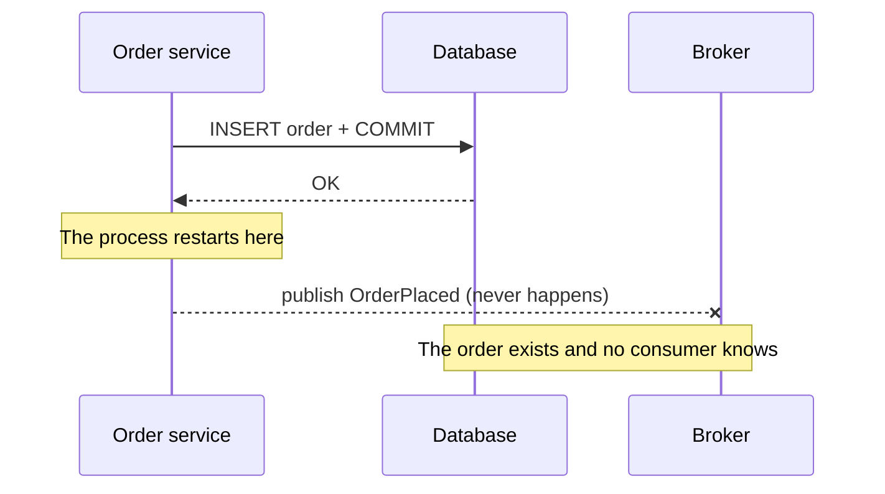
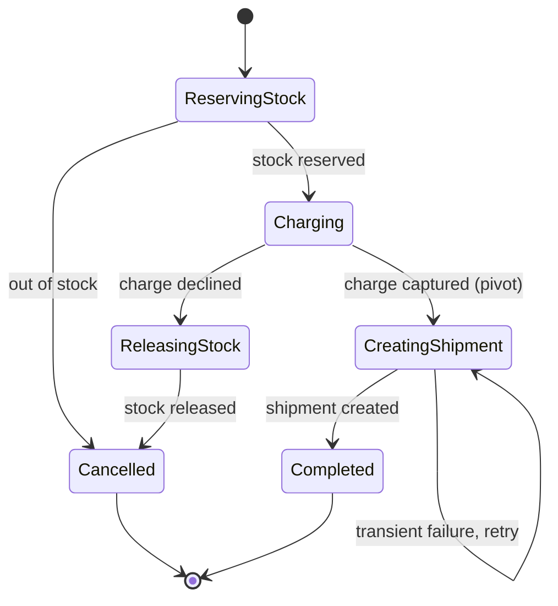
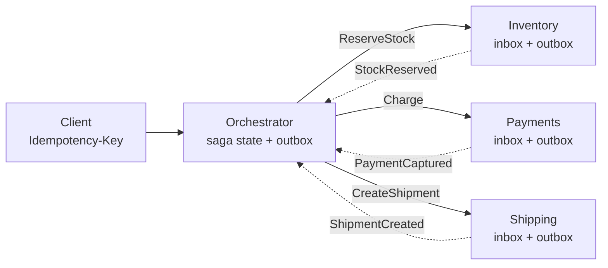

# Sagas, outbox and idempotency

The order service saves the order and, right after, publishes `OrderPlaced` to the broker. Every test passes. One day the process restarts between those two lines: the order exists, but inventory and billing never hear about it. Another day the broker times out even though it did receive the message, the code retries, and the customer gets two confirmation emails. Neither failure shows up locally, and both show up in production.

The underlying problem is that **when a business operation touches more than one system without a shared transaction, you have to design explicitly what happens if it stops halfway and what happens if it runs twice**. Sagas, the transactional outbox and idempotency are the three usual pieces of that design, and they depend on each other.

This article explains why the dual write fails, why a distributed transaction is rarely the way out, how to build a saga with its compensations, how to publish messages reliably through an outbox table, how to deduplicate on the consumer side and how to design operations that can be repeated safely. Events as a design model are covered in [event-driven, CQRS and event sourcing](/docs/event-driven-cqrs-event-sourcing); consistency theory in [CAP theorem, PACELC and consistency](/docs/cap-pacelc); brokers and their delivery semantics in [caching, queues and streaming](/docs/caching-colas-streaming).

<Callout tone="info" title="Cut-off date and what I did not verify">
  Sources checked in October 2026. For the original sagas paper I read the abstract and reviews, not
  the full text. The isolation countermeasures come from Microsoft and from Chris Richardson's
  talks, not from the academic work they build on. I confirmed the status of the IETF draft on the
  `Idempotency-Key` header in the IETF registry: version 07 is the last one and the draft has
  expired.
</Callout>

## The dual-write problem

A **dual write** is updating two independent systems (a database and a broker, two databases, a database and an external API) from the same code, one after the other. Whatever order you choose, there is a failure window:

| Order of operations                  | If it fails between the two            | Outcome                                              |
| ------------------------------------ | -------------------------------------- | ---------------------------------------------------- |
| Commit to the database, then publish | The process dies or the broker is down | State changed, nobody finds out                      |
| Publish, then commit to the database | The transaction rolls back             | Ghost event: announces something that did not happen |
| Publish inside the open transaction  | The commit fails after publishing      | Same as above, with more latency                     |
| Retry the publish after a timeout    | The broker had received the message    | Duplicate message                                    |



The two symptoms are different and need different fixes: **loss** (or the ghost event) is an atomicity problem across two systems, and the **duplicate** is an idempotency problem. The outbox solves the first and turns the second into something unavoidable but manageable.

## Why 2PC is not enough

The classic answer to "two systems, one decision" is two-phase commit (2PC): a coordinator asks every participant to prepare and, if all vote yes, tells them to commit. It works, but its costs make it impractical in many environments:

- **It blocks.** A participant that has voted "prepared" cannot decide on its own: if the coordinator goes down, it waits, and while it waits it keeps its locks. Teradata's documentation, for example, warns that in-doubt sessions can block other applications and may end up needing manual resolution.
- **It couples availability.** The operation only progresses if the coordinator and all participants are up at the same time; combined availability is lower than that of each piece.
- **Everyone must support it.** Each participant has to implement the protocol (XA, for instance). Not every broker or managed service does; check your specific combination before relying on it.
- **It crosses ownership boundaries.** With a database per service, a distributed transaction couples teams again through the locks they share.

Pat Helland made the case in 2007 in _Life beyond Distributed Transactions_ (CIDR): he observed that developers of highly scalable applications generally do not count on distributed transactions, and proposed designing around entities and messages between them. It is not a ban: the later version of the paper in ACM Queue acknowledges systems such as Spanner that offer strong transactions at large scale, and Richardson himself suggests keeping 2PC for the cases with the highest business risk. The useful question is not "2PC or not", but whether you can afford its blocking and coupling for that specific operation. For the theory, see [CAP theorem, PACELC and consistency](/docs/cap-pacelc).

## Sagas: local transactions with compensation

Hector Garcia-Molina and Kenneth Salem published _Sagas_ in the SIGMOD 1987 proceedings (also as a Princeton technical report, January 1987). Their problem was not microservices but long-lived transactions that hold database resources and delay short transactions. Their proposal: write that long transaction as **a sequence of short transactions that can be interleaved with others**, with the guarantee that either all of them complete or **compensating transactions** amend the partial execution.

**A saga is a sequence of local transactions in which each step commits immediately and, if a later step fails, earlier steps are compensated by steps that semantically undo them.** According to reviews of the paper, it describes two ways to recover: backward (compensate what was done) and forward (retry until complete). The terms "orchestration" and "choreography" do not come from that paper: they belong to the microservices literature (microservices.io, the Azure architecture guide).

### Step types: compensable, pivot and retryable

The Azure guide classifies saga steps into three types, and ordering them well is half the design:

| Step type   | What it is                                                       | Order example                               |
| ----------- | ---------------------------------------------------------------- | ------------------------------------------- |
| Compensable | Can be undone by another transaction with the opposite effect    | Reserve stock (compensated by releasing it) |
| Pivot       | Point of no return: once it commits, the saga must finish        | Charge the customer                         |
| Retryable   | Comes after the pivot; idempotent and repeated until it succeeds | Create the shipment, send the email         |

The practical rule: compensable steps first, then a single pivot, and at the end only steps you can retry indefinitely. If a step can be neither compensated nor retried, that is your pivot, and everything that must come before it has to be undoable.

### Orchestration versus choreography

In **choreography** there is no controller: each service commits its local transaction and publishes an event that triggers the next step in another service. In **orchestration**, an orchestrator stores the saga state and tells each participant which local transaction to run, compensations included.

| Criterion            | Choreography                                  | Orchestration                                        |
| -------------------- | --------------------------------------------- | ---------------------------------------------------- |
| Where the flow lives | Spread across the subscribers of each event   | In one component, readable end to end                |
| Coupling             | Each service knows the others' events         | Participants only know the orchestrator              |
| Typical risk         | Cyclic dependencies and a flow hard to follow | A central component that can fail or grow fat        |
| Integration testing  | You need every service running                | Test the orchestrator against simulated participants |
| Best fit             | Few steps, few services, stable flow          | Many steps, compensations or frequent change         |

The risks in each column are listed in the Azure guide. In practice, the orchestrator is a persisted state machine; drawing it before writing code reveals the missing compensations:



### Compensating is not undoing

A compensation does not necessarily restore the previous state: according to reviews of the 1987 paper, it undoes the step's effect from a semantic, business point of view and leaves an acceptable approximation of the earlier state. A sent email cannot be unsent: you send another that corrects it. A captured charge is not deleted: it is refunded, and the customer's statement shows both movements. That is why every compensation is a business decision, not a technical detail.

Three properties worth demanding from every compensation:

- **Idempotent.** The orchestrator may issue it twice; running it twice must not refund twice.
- **Retryable.** If it fails, it is retried. Azure warns that a compensation may not succeed and leave the system inconsistent; plan an exit to manual review with an alert.
- **Commutative with the original step where possible.** If the compensation arrives before the step (out-of-order messages), it should be recorded and cancel the step when it arrives.

### No isolation: anomalies and countermeasures

A saga gives up the I in ACID: each step commits immediately and other sagas see intermediate states. Microservices.io names this as its main drawback, and the Azure guide lists the typical anomalies:

| Anomaly            | What happens                                                                |
| ------------------ | --------------------------------------------------------------------------- |
| Lost update        | One saga overwrites another's change without having read it                 |
| Dirty read         | One saga reads another's change that may still be compensated               |
| Nonrepeatable read | Two steps of the same saga read different values because another saga wrote |

Countermeasures are designed in the domain, not in the infrastructure:

| Countermeasure      | Idea                                                                                           |
| ------------------- | ---------------------------------------------------------------------------------------------- |
| Semantic lock       | A visible state (`PENDING`, `RESERVING`) marks that a saga is in progress on that record       |
| Commutative updates | Operations that give the same result in any order, such as debits and credits                  |
| Pessimistic view    | Reorder the saga so that risky writes land in retryable steps                                  |
| Reread value        | Check the data has not changed before writing; if it has, abort or restart                     |
| Version file        | Record the operations on a record so they can be applied in the right order                    |
| By value            | Pick the mechanism by business risk: sagas for cheap cases, something stronger for costly ones |

The semantic lock is the most common and has a product consequence: the UI has to be able to show "pending". If the business does not accept that state, maybe the operation should not be a saga.

## Transactional outbox

**The transactional outbox stores the message you want to publish in a table of the same database, inside the same transaction as the business change, and lets another process publish it afterwards.** The dual write disappears: there is a single atomic write, and the message is published if and only if the transaction committed.

The component that reads the table and publishes is called the _message relay_. Richardson describes two ways to implement it: polling the table (_polling publisher_) or reading the database transaction log (_transaction log tailing_), which is what a CDC tool such as Debezium does. The table shape is small; this is the default one Debezium's outbox router expects:

```sql
-- outbox: one row per message, written in the change's transaction
CREATE TABLE outbox (
  id            uuid         PRIMARY KEY,  -- message id: used for deduplication
  aggregatetype varchar(255) NOT NULL,     -- decides the destination (topic)
  aggregateid   varchar(255) NOT NULL,     -- message key: per-aggregate ordering
  type          varchar(255) NOT NULL,     -- OrderPlaced, OrderCancelled…
  payload       jsonb                      -- event body
  -- optional extra columns: created_at, trace_id…
);
```

The relay may crash after publishing and before recording that it did; on restart, it publishes again. Microservices.io says it plainly: the relay might publish a message more than once, so the consumer must be idempotent. **The outbox trades "sometimes lost" for "sometimes repeated"**, and the latter is solved on the consumer side.

### Polling relay

A process queries unpublished rows every few seconds, publishes them in order and marks them. It is the option with the fewest moving parts: you only need the database you already have. Its costs: latency equal to the polling interval, constant load on the database even when there are no messages, a table that grows and must be purged, and coordination if you run several relays (either accept that two instances may publish the same row, or make sure each row is claimed by only one). Watch the age of the oldest pending row: if it grows, the relay is stuck.

### CDC relay

A CDC connector reads the database transaction log and turns each insert into the outbox table into a message. With Debezium, the _Outbox Event Router_ (a Kafka Connect transformation) uses `aggregatetype` to pick the topic (by default `outbox.event.<value>`), `aggregateid` as the message key and `payload` as the body; it also filters out `DELETE` operations on the table. Gunnar Morling's post on the Debezium blog (February 19, 2019) deletes each row right after inserting it: since the connector reads the log and not the table, it captures the insert and the table stays empty.

| Criterion            | Polling relay                               | CDC relay (Debezium)                                             |
| -------------------- | ------------------------------------------- | ---------------------------------------------------------------- |
| New pieces           | One process of your own                     | Kafka Connect, the connector and its configuration               |
| Latency              | The polling interval                        | However long the connector takes to read the log                 |
| Load on the database | Periodic queries even when nothing is there | Log reading; usually requires enabling replication or the binlog |
| Table cleanup        | Scheduled purge of published rows           | The row can be deleted in the same transaction                   |
| Delivery             | At least once                               | At least once (the Debezium post says so)                        |
| Best fit             | Low volume, small team, no Kafka            | You already run Kafka and Kafka Connect, or volume is high       |

An alternative to the outbox is to have no state apart from the event log: with _event sourcing_, the event is the change, and publishing means reading that log. Microservices.io lists it as an option for the same problem; it is covered in [event-driven, CQRS and event sourcing](/docs/event-driven-cqrs-event-sourcing).

## Inbox: deduplicating on the consumer side

If the producer publishes at least once and the broker redelivers at least once, the consumer will get duplicates. Microservices.io's _idempotent consumer_ pattern solves it by recording the ids of messages already processed; many teams call that table the **inbox**, by symmetry with the outbox.

The key is the transaction. In the microservices.io version, a `PROCESSED_MESSAGES` table has the primary key `(subscriberId, messageId)`: the handler inserts the message id and applies the business change **in the same local transaction**. If the id already exists, the insert fails and the message is discarded; if processing fails, the rollback also removes the id and the message can be retried.

Three decisions the pattern leaves open:

- **Where to store the id.** In a separate table or in the entity the message creates or updates (microservices.io allows both). If the message creates a record, its id can be the natural key and the separate table is unnecessary.
- **How long to keep it.** Long enough to cover the broker's maximum redelivery window and any manual reprocessing. The Debezium post leaves cleaning that table as a to-do; you should not.
- **What to do with effects outside the database.** If the handler calls an external API, the inbox does not cover that call: you need the API to accept an idempotency key (next section) or an outbox on the consumer side too.

For each broker's delivery semantics (at least once, at most once, the broker's own transactions) see [caching, queues and streaming](/docs/caching-colas-streaming).

## Idempotency

**An operation is idempotent if running it several times has the same effect as running it once.** That is what turns a retry, the only reasonable answer to a timeout, into something safe.

### Idempotent by nature

RFC 9110 (June 2022, HTTP Semantics) defines GET, HEAD, OPTIONS and TRACE as safe, and PUT, DELETE and the safe methods as idempotent. Idempotency refers to the intended effect on the server, not to identical responses: a second DELETE may return 404 and still be idempotent. The RFC also states that a client should not automatically retry a non-idempotent method unless it has some means to know it is safe, and that a proxy must not do so.

That semantics is a promise made by the method, not a magic property: if your PUT increments a counter, you break the contract. The cheapest way to get idempotency is to design the operation as **setting a state** instead of **applying a delta**:

| Operation                                | Idempotent?    | Why                                                     |
| ---------------------------------------- | -------------- | ------------------------------------------------------- |
| `PUT /orders/42/status` = `CANCELLED`    | Yes            | Sets a state; repeating it changes nothing              |
| `DELETE /carts/7/items/3`                | Yes            | After the first call, the resource is gone              |
| `POST /accounts/9/credits` with €10      | No             | Every repetition adds another €10                       |
| `POST /payments` with an idempotency key | Yes, by design | The server recognizes the key and does not charge again |
| Update if `version = 7`                  | Yes            | The second time, the condition no longer holds          |

### Idempotency keys in APIs

When the operation is inherently a creation (a payment, an order), idempotency has to be built: the client generates a unique key, sends it with every attempt, and the server returns the stored result instead of executing again. The contract from the client's side, with Stripe's documentation as reference, is summarized in [CAP theorem, PACELC and consistency](/docs/cap-pacelc); what matters here are the server-side decisions.

```typescript
// Idempotency record: lives in the same database as the effect it protects
type IdempotencyRecord = {
  readonly scope: string; // account or customer: keys are not shared
  readonly key: string; // client-generated (Stripe suggests UUID v4, up to 255 characters)
  readonly requestHash: string; // fingerprint of the parameters
  readonly status: 'in_progress' | 'completed';
  readonly response?: StoredResponse; // status code and body to replay
  readonly expiresAt: Date; // Stripe may prune them once they are 24 h old
};
```

- **Store the record in the same transaction as the effect.** If the charge commits but the record does not, the retry charges again.
- **Compare the parameters.** Stripe returns an error if the same key arrives with different parameters: it is almost always a client bug and worth surfacing.
- **Decide what happens with concurrent requests.** Stripe does not save a result when the request conflicts with another one running with the same key, and that request can be retried; an explicit `in_progress` state lets you answer consistently.
- **Decide which errors are replayed.** In its v1 API, Stripe saves the response once the endpoint has started executing, `500` errors included; validation failures are not saved and can be retried.
- **Do not use sensitive data as keys.** Stripe explicitly advises against it (emails, personal identifiers).

There is an IETF draft, _The Idempotency-Key HTTP Header Field_, that proposes standardizing the header to make POST and PATCH fault-tolerant. Its last version is 07, from October 2025; the draft has expired and, at the time of checking, no successor had been published. Use it as design guidance, not as a standard.

### End-to-end idempotency

The pieces only work together if the identifier travels: the client's idempotency key protects the API; the outbox row `id` travels with the message and protects the consumer; the consumer, in turn, uses a derived key when it calls external systems. What is usually called "exactly once" is, in most designs, **at-least-once delivery plus an idempotent effect**. For retry strategy (how many, with what delay, when to stop) see [resilience in distributed systems](/docs/resiliencia-sistemas-distribuidos).

## Message ordering and its cost

Richardson lists as an outbox benefit that messages go out in the order the application wrote them. With CDC, Debezium uses `aggregateid` as the message key, and Morling's post explains that this sends all events of the same aggregate to the same partition, where they are consumed in the order they were produced. Ordering is guaranteed **per aggregate**, not globally. Asking for more order costs more:

| Ordering level      | What it guarantees                         | Cost                                                               |
| ------------------- | ------------------------------------------ | ------------------------------------------------------------------ |
| None                | Nothing; every message is independent      | Maximum parallelism; handlers must tolerate any order              |
| Per key (aggregate) | Events for one order arrive in their order | Parallelism is bounded by the number of active keys and partitions |
| Global              | Every event in a single order              | One sequential stream: a stuck message holds up all the others     |

Before demanding global order, ask whether the consumer can defend itself. Two techniques make that possible: include the **aggregate version** in each event and discard anything older than what was already applied, and design handlers as **commutative updates** where the domain allows it. The price of strict ordering shows up at the worst moment: a message that cannot be processed (a _poison message_) blocks its queue until someone moves it aside. How ordering is spread across partitions and consumer groups is covered in [caching, queues and streaming](/docs/caching-colas-streaming).

## What each piece solves

| Piece               | Solves                               | Guarantee you get                  | What you pay                                     |
| ------------------- | ------------------------------------ | ---------------------------------- | ------------------------------------------------ |
| 2PC                 | Atomicity across several resources   | All commit or none does            | In-doubt locks, coupled availability, XA support |
| Choreographed saga  | A business operation across services | Completes or is compensated        | Spread-out flow, no isolation                    |
| Orchestrated saga   | The same, with an explicit flow      | Saga state visible and persisted   | One more component, no isolation                 |
| Outbox with polling | Dual write to database and broker    | Published if and only if committed | Polling latency, table load and purging          |
| Outbox with CDC     | The same, reading the database log   | The same, with lower latency       | Running the connector and its infrastructure     |
| Inbox               | Duplicates on the consumer side      | Each message takes effect once     | One more table and its retention                 |
| Idempotency key     | Client retries against an API        | A retry does not repeat the effect | Storing responses and handling concurrency       |

## When to use them and when not to

Use these pieces when:

- A business operation spans data owned by different services and you cannot, or do not want to, put it in one database.
- You publish events other teams depend on and losing one costs money or trust.
- Your clients retry (they all do, whether you know it or not) and the operation has external effects.

Avoid them, or use them with great care, when:

- The data lives in the same database: a local transaction is simpler and stronger than any saga.
- The steps are so tightly coupled that the saga would need real isolation to be correct. The service boundary may be in the wrong place: revisit it with [monolith or microservices](/docs/monolito-vs-microservicios) and [DDD](/docs/domain-driven-design).
- The business does not accept visible intermediate states or compensations (no "pending", no refunds).
- Losing an occasional message is acceptable (approximate metrics, notices with no contractual value): a direct send with retries may be enough.

## Common mistakes

- **Publishing from code right after the commit and calling it an outbox.** Without the row in the same transaction, it is still a dual write.
- **Assuming the outbox delivers exactly once.** It delivers at least once; without an inbox, the consumer duplicates effects.
- **Compensations nobody tested.** The compensation path runs rarely and fails when you need it most. Test it like the happy path.
- **A pivot followed by non-retryable steps.** If a step after the charge can fail for good, there is no clean way to finish the saga.
- **Idempotency keys without parameter comparison.** A key reused by mistake returns another operation's response and nobody notices.
- **Storing the idempotency record outside the effect's transaction.** The dual write comes back, now on the server side.
- **Demanding global order by default.** It caps throughput at a single stream and turns one bad message into a full stop.
- **Ignoring the lack of isolation.** Two sagas on the same stock without a semantic lock end up selling what is not there.

## Worked example: a store checkout

A hypothetical case. The store has three services, each with its own database: inventory, payments and shipping. Today checkout calls all three over HTTP in sequence; when payment fails, stock stays reserved until someone fixes it by hand, and when the customer double-clicks, they are sometimes charged twice.

**Decision 1: orchestrated saga, not choreographed.** The flow has compensations and the business wants to add a fraud check step soon. An orchestrator in the order service makes each checkout's state visible and keeps inventory from having to know about payment events.

**Decision 2: step order.** Reserve stock (compensable: release it), charge (pivot) and create the shipment (retryable). Charging before reserving would force a refund when there is no stock, a compensation the customer sees and that costs money; reserving first keeps the compensation in-house. Reserved stock uses a **semantic lock** (`RESERVED` with an expiry) so another saga cannot sell it.

**Decision 3: reliable messaging.** Each service writes its events to its own outbox table. Since the team does not run Kafka, the relay polls; if volume grows, the table allows a move to CDC without touching business code. Each consumer has its own inbox.

**Decision 4: idempotency at the edge.** The client generates one key per checkout attempt and resends it on every retry; the orchestrator stores it with the saga state and derives from it the key it sends to the payment provider.



**Accepted consequences:** the order goes through intermediate states the UI shows ("processing payment"); three new metrics appear (age of the oldest outbox row, sagas stuck per state, failed compensations awaiting manual review); and the orchestrator becomes a critical piece that needs its own deployment and alerts. The decision and its review conditions go into an [ADR](/docs/adr); to compare alternatives with weighted criteria, see [trade-offs and decisions](/docs/trade-offs-y-decisiones).

## Checklist

- [ ] No operation writes to the database and publishes to the broker separately: messages leave from an outbox table.
- [ ] Every consumer deduplicates by message id in the same transaction as its business change.
- [ ] Every saga has its steps classified as compensable, one pivot and retryable, in that order.
- [ ] Every compensation is idempotent, tested and has an exit to manual review with an alert.
- [ ] Intermediate states have a semantic lock and the UI knows how to show them.
- [ ] Creation operations exposed to retries accept an idempotency key stored in the effect's transaction.
- [ ] Required ordering is per aggregate unless there is a written reason to ask for more.
- [ ] There are metrics for outbox age, stuck sagas and failed compensations.

## Sources

Checked in October 2026.

- [Sagas (Hector Garcia-Molina and Kenneth Salem, technical report TR-070-87, Princeton, January 1987)](https://www.cs.princeton.edu/research/techreps/598), published in the SIGMOD 1987 proceedings ([DOI 10.1145/38713.38742](https://doi.org/10.1145/38713.38742)); abstract read, not the full text. Third-party review: [Paper summary: Sagas (Temporal)](https://dev.to/temporalio/paper-summary-sagas-4bb6)
- [Pattern: Saga (Chris Richardson, microservices.io)](https://microservices.io/patterns/data/saga.html)
- [Pattern: Transactional outbox (Chris Richardson, microservices.io)](https://microservices.io/patterns/data/transactional-outbox.html)
- [Pattern: Idempotent Consumer (Chris Richardson, microservices.io)](https://microservices.io/patterns/communication-style/idempotent-consumer.html)
- [Data consistency in microservices using sagas (Chris Richardson, QCon SF 2017, slides)](https://archive.qconsf.com/system/files/presentation-slides/dataconsistencyinmicroserviceusingsagasqconsf2017-1711151847291.pdf)
- [Saga design pattern (Azure Architecture Center, Microsoft)](https://learn.microsoft.com/en-us/azure/architecture/patterns/saga)
- [Outbox Event Router (Debezium documentation)](https://debezium.io/documentation/reference/stable/transformations/outbox-event-router.html)
- [Reliable Microservices Data Exchange With the Outbox Pattern (Gunnar Morling, Debezium blog, February 19, 2019)](https://debezium.io/blog/2019/02/19/reliable-microservices-data-exchange-with-the-outbox-pattern/)
- [Idempotent requests (Stripe API documentation)](https://docs.stripe.com/api/idempotent_requests)
- [RFC 9110, HTTP Semantics, §9.2 (IETF, June 2022)](https://www.rfc-editor.org/rfc/rfc9110.html#name-idempotent-methods)
- [The Idempotency-Key HTTP Header Field (IETF draft, version 07)](https://datatracker.ietf.org/doc/draft-ietf-httpapi-idempotency-key-header/)
- [Life beyond Distributed Transactions (Pat Helland, CIDR 2007)](https://ics.uci.edu/~cs223/papers/cidr07p15) and its [ACM Queue version](https://queue.acm.org/detail.cfm?id=3025012)
- [Externally Coordinated Commit (Teradata documentation)](https://docs.teradata.com/r/Teradata-Director-Program-Reference/October-2021/Introduction/Externally-Coordinated-Commit): an example of the cost of in-doubt sessions
