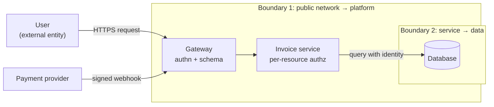
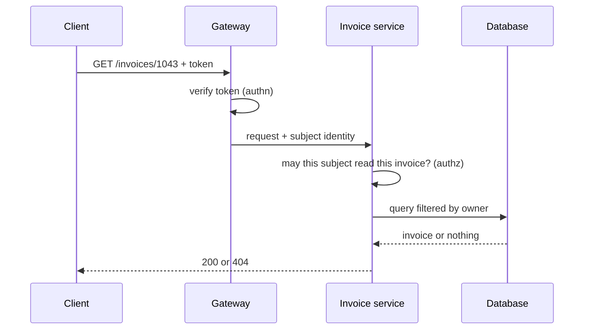

# Security by design: threats, boundaries and trust

A week before launch, the pentest report arrives. The critical finding is nothing exotic: change the id in `/invoices/1042` to `1043` and any signed-in user can read another customer's invoice. The UI never showed that link, so nobody had thought about it. The fix is not a one-line patch. The invoice service never learns who the user is, only that the gateway accepted a token, and the database query knows nothing about owners. You have to redesign how identity travels through the system, with the launch date bearing down.

**Security by design means treating security as a property of the architecture, decided along with the rest of the design, rather than as a review at the end.** The decisions that matter most (where the trust boundaries are, how identity propagates, who decides permissions, where secrets come from) are structural, and changing them late costs as much as changing any other structural decision.

This article covers principles with a verifiable origin, a practical way to model threats in an hour, and the design decisions that come up again and again: boundaries, authentication and authorization, secrets, the supply chain and zero trust.

<Callout tone="info" title="Cut-off date">
  Sources checked in October 2026. I did not open the original STRIDE paper (Kohnfelder and Garg,
  1999): its date, title and authorship come from Adam Shostack's blog and Wikipedia. For the OWASP
  Top 10, only the 2025 edition, the current one, is cited.
</Callout>

## Why it is a property of the architecture

Security is a [quality attribute](/docs/atributos-de-calidad), just like availability or performance: you trade it off against other attributes and you design for it rather than bolting it on. Microsoft presents its threat modeling tool as part of its Security Development Lifecycle (SDL) with an economic argument: find issues early, while they are still relatively easy and cheap to fix.

Two recent signals point the same way. The 2025 edition of the OWASP Top 10 keeps a category of its own for insecure design (A06, A04 in 2021), separate from implementation bugs. And in April 2023, CISA and agencies from several other countries published _Shifting the Balance of Cybersecurity Risk_ (expanded in October 2023), which asks vendors to take ownership of their customers' security outcomes instead of pushing that burden onto them.

| —                    | Security as a final review             | Security by design                                    |
| -------------------- | -------------------------------------- | ----------------------------------------------------- |
| When it happens      | Before launch, in a pentest or audit   | When the system is drawn and on every relevant change |
| Who does it          | A security team outside the product    | The team that designs it, with specialist support     |
| What it produces     | A list of findings                     | Boundaries, controls and recorded decisions           |
| Cost of a finding    | High: it usually touches the structure | Low: the change is still a drawing                    |
| What it catches best | Known implementation bugs              | Design flaws: misplaced trust, permissions            |

The two are not mutually exclusive. A pentest is still useful, but it checks a design; it does not replace one.

## Principles with a verifiable origin

### Saltzer and Schroeder, 1975

_The Protection of Information in Computer Systems_, by Jerome Saltzer and Michael Schroeder, was published in _Proceedings of the IEEE_ (vol. 63, no. 9, September 1975); an earlier version appeared in _Communications of the ACM_ in July 1974. Its list of eight design principles is still the reference that most later texts reuse.

| Principle                   | The idea in one line                                     | What it means for an architect today                              |
| --------------------------- | -------------------------------------------------------- | ----------------------------------------------------------------- |
| Economy of mechanism        | Small, simple designs that can be reviewed by inspection | One well-tested authorization point, not twenty variants          |
| Fail-safe defaults          | Decide by permission, not by exclusion                   | Deny unless a rule allows; allowlists, not blocklists             |
| Complete mediation          | Check authority on every access to every object          | Authorize every request against the resource, not just at sign-in |
| Open design                 | Security does not depend on the design being secret      | Standard algorithms; the keys are what stays secret               |
| Separation of privilege     | Require more than one condition to grant access          | Two-person approval for critical deploys or permission changes    |
| Least privilege             | Every program and user gets the minimum it needs         | Per-service credentials with a narrow scope                       |
| Least common mechanism      | Minimize mechanisms shared by everyone                   | Avoid one shared database account for every service               |
| Psychological acceptability | Make the secure way the easy way to use correctly        | If the secure path is awkward, people route around it             |

Two of them are worth quoting verbatim. Least privilege: "Every program and every user of the system should operate using the least set of privileges necessary to complete the job." And fail-safe defaults: "Base access decisions on permission rather than exclusion." The second is the root of almost everything we now call _deny by default_.

### Defense in depth

The NIST glossary collects several definitions; the most practical one, taken from the ISA/IEC 62443 family, describes it as applying multiple countermeasures in layers, so that what one misses another catches. For an architect it turns into a question: if this control fails, what stops the damage? A layered example for an API: schema validation at the boundary, authorization in the service that owns the resource and, in a multi-tenant system, policies in the database itself, which are covered in [multi-tenancy](/docs/multi-tenancy).

Layers only add up when they are independent. Three checks that read the same field from the same header are, in practice, one check.

### Fail closed

This is the operational consequence of fail-safe defaults: when a security control cannot decide (the authorization service does not answer, the policy does not load, the certificate cannot be checked), the answer is to deny. Failing open turns an outage into a breach.

There is a cost: failing closed lowers availability, and not every component justifies it. A rate limiter may fail open on purpose if its outage exposes no data; an access control on customer data should not. What matters is that it is an explicit decision recorded in an [ADR](/docs/adr), not a side effect of a default `catch`. How to live with outages without weakening security is covered in [resilience](/docs/resiliencia-sistemas-distribuidos).

## Threat modeling with STRIDE

STRIDE was born at Microsoft: Loren Kohnfelder and Praerit Garg proposed it in _The Threats to our Products_, a paper dated April 1, 1999, in an internal company publication that did not become public for more than a decade, according to Adam Shostack. Shostack stresses that it was meant to help people find problems rather than to classify them, so use it as a mnemonic where each letter is a question you ask of the design.

| Letter | Threat                 | Property it protects | Question for the design                                 | Typical answer                               |
| ------ | ---------------------- | -------------------- | ------------------------------------------------------- | -------------------------------------------- |
| S      | Spoofing               | Authenticity         | Can someone pose as a user or a service?                | Strong authentication, mTLS between services |
| T      | Tampering              | Integrity            | Can someone alter data in transit or at rest?           | TLS, signatures, write control               |
| R      | Repudiation            | Non-repudiation      | Could someone deny an action without it being provable? | Tamper-evident audit log                     |
| I      | Information disclosure | Confidentiality      | Who can read what they should not?                      | Per-resource authorization, encryption       |
| D      | Denial of service      | Availability         | Can someone exhaust a shared resource?                  | Rate limits, quotas, isolation               |
| E      | Elevation of privilege | Authorization        | Can someone do more than they are entitled to?          | Least privilege, central authorization       |

### The four questions

STRIDE answers only one of the threat modeling questions. Shostack sums them up as four, which the _Threat Modeling Manifesto_ (2020) adopts: What are we working on? What can go wrong? What are we going to do about it? Did we do a good enough job? The manifesto favors early and frequent analysis, and continuous refinement, over a single delivery. Shostack also warns that the diagram is sometimes mistaken for the whole model, when it only answers the first question.

### A one-hour session

What follows is an agenda proposed by this guide, not a standard method. It works with three to six people who know the system and a whiteboard.

| Minutes | Step                             | Outcome                                                       |
| ------- | -------------------------------- | ------------------------------------------------------------- |
| 0–10    | Draw the data flow diagram       | External entities, processes, stores and flows for the change |
| 10–15   | Mark the trust boundaries        | Lines where control over the data or the code changes hands   |
| 15–40   | Walk STRIDE over every crossing  | A list of concrete threats, one per line                      |
| 40–55   | Decide what to do about each one | Mitigate, remove the feature, transfer or accept              |
| 55–60   | Assign owners and record         | Backlog items, and the relevant decisions in an ADR           |

The trick is in step three: you do not apply STRIDE to "the system" but to each flow that crosses a boundary. That narrows the conversation and avoids the generic threat list nobody reads.



Two crossings, two conversations: what can arrive through the user's request and through the webhook, and what the service can ask of the database.

## Trust boundaries: where untrusted data enters

A trust boundary is the line where control over the data or the code changes hands. Everything that crosses it inward is untrusted until it has been validated. The public network is the obvious case; the others are easier to forget:

- **Third-party webhooks and callbacks**, even when they come "from a known provider": verify the signature.
- **Queue messages** published by other teams or systems.
- **Uploaded files** and their metadata (name, declared type, size).
- **Data read from a shared database** that another system writes.
- **Language model output**, which may carry injected instructions; see [LLM agent architecture](/docs/arquitectura-agentes-llm).
- **Configuration and environment variables** that someone outside the team can change.

The design rule is to validate once, at the boundary, and turn what you validated into a domain type the rest of the code can use without second-guessing. How to define those contracts and validate them in the API is covered in [API design](/docs/diseno-de-apis). Validation at the boundary does not replace authorization: a perfectly well-formed request can still ask for a resource that is not yours.

## Authentication and authorization, kept apart

**Authentication** answers who you are; **authorization** answers what you may do with this particular resource. Merging them is what caused the opening example: the gateway authenticated, and the system assumed that was enough. Broken access control holds first place (A01) in the 2025 edition of the OWASP Top 10.



Three design decisions follow:

- **Authentication can be centralized** in the gateway or an identity provider; authorization lives close to the resource, because it needs to know who owns it.
- **Identity travels explicitly**, as a verifiable subject, all the way to the service that decides. A service that only receives "this request was already authorized" cannot apply complete mediation.
- **The decision has a single shape**, even when several services apply it. Pinning down the signature is enough:

```typescript
// authz/authorize.ts: one gate for access decisions
export type Decision = { allowed: true } | { allowed: false; reason: string };

export declare function authorize(
  subject: Subject, // who, already authenticated
  action: 'read' | 'update' | 'delete',
  resource: ResourceRef, // what, including its owner
): Promise<Decision>;
```

Hiding a button in the UI is user experience, not access control.

## Secrets out of the code

A secret in the repository lives forever in its history. The OWASP Secrets Management Cheat Sheet recommends centralizing their storage, provisioning, auditing and rotation; rotating them regularly and automatically, so a stolen credential only works for a short time; preferring short-lived credentials requested at startup; and detecting leaks with tools both on the developer's machine (pre-commit hooks) and in the pipeline.

| Kind of secret         | Where it lives                          | Sensible rotation                                            |
| ---------------------- | --------------------------------------- | ------------------------------------------------------------ |
| Database credentials   | Secrets manager, dynamic where possible | Per session or short lease; otherwise periodic and automatic |
| Third-party API keys   | Secrets manager, per environment        | Periodic, and always on suspected leak                       |
| Token signing keys     | Key manager (KMS or HSM)                | With overlap: the new key signs, the old one still verifies  |
| Cloud service identity | Workload identity, no key at all        | Handled by the platform                                      |

One architectural decision saves a lot of trouble: have services read their secrets from the manager at runtime instead of receiving them through the CI pipeline, which then becomes a less valuable target. When something leaks, the order is revoke, rotate, then clean up code and logs.

## The supply chain

Most of the code you deploy was not written by your team. The 2025 edition of the OWASP Top 10 devotes category A03 to software supply chain failures. Three pieces complement each other:

- **Inventory (SBOM).** A software bill of materials lists which components and versions an artifact contains. There are two standardized formats: SPDX, published as ISO/IEC 5962:2021, and OWASP's CycloneDX, standardized by Ecma as ECMA-424 (the second edition, from December 2025, matches CycloneDX 1.7).
- **Signatures.** Sigstore lets you sign artifacts without managing long-lived keys: Cosign signs with an ephemeral key, Fulcio issues a short-lived certificate bound to an OIDC identity, and Rekor records the signature in an append-only transparency log.
- **Provenance.** SLSA (_Supply-chain Levels for Software Artifacts_, version 1.2 on its site) is a framework of standards and controls to prevent tampering and improve the integrity of what you build; provenance is the evidence of how and where an artifact was built.

| Piece      | Answers                            | Does not answer                       |
| ---------- | ---------------------------------- | ------------------------------------- |
| SBOM       | What is inside?                    | Is any of those components malicious? |
| Signature  | Who signed it, and was it altered? | Is the signer trustworthy?            |
| Provenance | How and where was it built?        | Was the source code correct?          |

The last column is the usual trap: a valid signature only tells you which identity signed. If the verification policy does not restrict which identities and repositories are accepted, it accepts anything signed by anyone.

## Zero trust

NIST SP 800-207, _Zero Trust Architecture_ (August 2020; Rose, Borchert, Mitchell and Connelly), starts from one premise: no implicit trust is granted to an asset or user account based solely on its physical or network location. Authentication and authorization, of both subject and device, happen before each session with a resource is established. The document organizes this into seven tenets and several deployment models.

For an architect the consequence is concrete: the internal network is no longer a sufficient trust boundary. Services authenticate each other (mTLS or service tokens), every request is authorized against the resource, and access is granted per session. Zero trust is not a product you buy; it relies on Saltzer and Schroeder's complete mediation, carried over to the network.

## The OWASP Top 10 as a map

The current edition is 2025, presented at OWASP Global AppSec in November 2025. Use it as a map of common risks to steer your modeling, not as an exhaustive checklist:

| Code | Risk (2025 edition)                    | Main design lever                                 |
| ---- | -------------------------------------- | ------------------------------------------------- |
| A01  | Broken Access Control                  | Per-resource authorization, on the server         |
| A02  | Security Misconfiguration              | Secure, declarative defaults                      |
| A03  | Software Supply Chain Failures         | SBOM, signatures, provenance, fewer dependencies  |
| A04  | Cryptographic Failures                 | Standard libraries, keys in a manager             |
| A05  | Injection                              | Validation at the boundary, parameterized queries |
| A06  | Insecure Design                        | Threat modeling on every relevant change          |
| A07  | Authentication Failures                | Central identity provider, MFA                    |
| A08  | Software or Data Integrity Failures    | Verify signatures and integrity of what comes in  |
| A09  | Security Logging and Alerting Failures | Audit access decisions and alert on them          |
| A10  | Mishandling of Exceptional Conditions  | Fail closed, explicitly                           |

## When to go deep and when not to

The question is not whether to apply security by design but how much rigor each change deserves.

| Situation                                                  | Reasonable rigor                                       |
| ---------------------------------------------------------- | ------------------------------------------------------ |
| A new system, or personal, payment or health data          | A full modeling session and a review with specialists  |
| A change that adds a trust boundary (webhook, integration) | A one-hour session focused on the new crossing         |
| An internal change with no new data and no new boundaries  | Revisit the existing model and confirm it still holds  |
| A throwaway prototype with no real data                    | The minimum: no secrets in code and no production data |

A warning about that last row: prototypes that work tend to reach production. If that happens, the modeling happens before the first real user, not after.

## Common mistakes

- **Security as a last-minute checklist.** A pentest just before launch finds design flaws when they are already expensive to fix.
- **Trusting the internal network.** "It is only called from inside" is not a control; with one compromised service, everything internal can be exposed.
- **Authorization only in the UI.** Hiding a button does not stop anyone from calling the API directly.
- **Authenticating and assuming authorization.** A valid token says who the subject is, not which resources they are entitled to.
- **Validating everywhere except the boundary.** Scattered checks contradict each other; the boundary is where data stops being foreign.
- **Failing open by accident.** A generic `catch` that lets the request through when the permissions service does not answer.
- **Shared, eternal secrets.** One credential used by every service that nobody dares to rotate.
- **Signatures without a policy.** Checking that something is signed without restricting who signed it.

## Worked example: the invoice portal

Back to the opening case. The team spends an hour modeling the portal before redesigning it.

1. **Diagram.** User, gateway, invoice service, database, and a payment provider webhook that marks invoices as paid.
2. **Boundaries.** Public network to gateway; payment provider to gateway; service to database.
3. **STRIDE on each crossing.** The user's request shows information disclosure (reading other people's invoices) and elevation of privilege (a customer voiding invoices). The webhook shows spoofing: anyone who knows the URL could mark an invoice as paid. The database shows a single account with write access to everything.
4. **Decisions.** The gateway propagates the subject's identity; the service applies `authorize` to every invoice and the query filters by owner; the webhook verifies the provider's signature and fails closed if it cannot; each service uses its own least-privilege credentials. They explicitly accept not adding field-level encryption in this version.
5. **Record.** An ADR captures the decision to authorize in the service rather than the gateway, with its alternatives. An integration test, turned into a [fitness function](/docs/fitness-functions), tries to read someone else's invoice on every build and must get a 404.

The redesign took days, not hours. It would have cost one conversation if the diagram had been drawn at the start. Isolation between customers from different organizations, if the portal were multi-tenant, is another layer covered in [multi-tenancy](/docs/multi-tenancy); day-to-day operation (patching, alerting, incident response) belongs to [DevOps culture](/docs/devops-cultura).

## Checklist

- [ ] There is an up-to-date data flow diagram with the trust boundaries marked.
- [ ] Every flow that crosses a boundary has its STRIDE review and recorded decisions.
- [ ] All data entering through a boundary is validated there and turned into a domain type.
- [ ] Authorization is decided on the server, per resource, on every access.
- [ ] Security controls fail closed, and the exceptions are recorded in an ADR.
- [ ] There are no secrets in the code; they rotate automatically and each service has its own.
- [ ] Every published artifact has an SBOM and a signature, and verification restricts identities.
- [ ] No service trusts another just because they share a network.

## Sources

Checked in October 2026.

- [The Protection of Information in Computer Systems (Saltzer and Schroeder, 1975)](https://www.cs.virginia.edu/~evans/cs551/saltzer/): copy of the text, with the eight principles
- [The Protection of Information in Computer Systems on Wikipedia](https://en.wikipedia.org/wiki/The_Protection_of_Information_in_Computer_Systems): publication details
- [20 Years of STRIDE (Adam Shostack)](https://shostack.org/blog/20-years-of-stride-looking-back-looking-forward/) and [STRIDE on Wikipedia](https://en.wikipedia.org/wiki/STRIDE_model): origin of STRIDE
- [Threat Modeling Tool: threats (Microsoft Learn)](https://learn.microsoft.com/en-us/azure/security/develop/threat-modeling-tool-threats)
- [Threat modeling (Adam Shostack)](https://shostack.org/resources/threat-modeling) and [Threat Modeling Manifesto](https://www.threatmodelingmanifesto.org/)
- [Defense-in-depth in the NIST glossary](https://csrc.nist.gov/glossary/term/defense_in_depth)
- [NIST SP 800-207, Zero Trust Architecture (August 2020)](https://csrc.nist.gov/pubs/sp/800/207/final)
- [OWASP Top 10:2025](https://top10.owasp.org/2025/)
- [OWASP Secrets Management Cheat Sheet](https://cheatsheetseries.owasp.org/cheatsheets/Secrets_Management_Cheat_Sheet.html)
- [Secure by Design (CISA)](https://www.cisa.gov/resources-tools/resources/secure-by-design-and-default)
- [ISO/IEC 5962:2021 (SPDX)](https://www.iso.org/standard/81870.html), [ECMA-424 (CycloneDX)](https://ecma-international.org/publications-and-standards/standards/ecma-424/) and [OWASP CycloneDX](https://owasp.org/www-project-cyclonedx/)
- [Sigstore overview](https://docs.sigstore.dev/about/overview/) and [SLSA](https://slsa.dev/)
