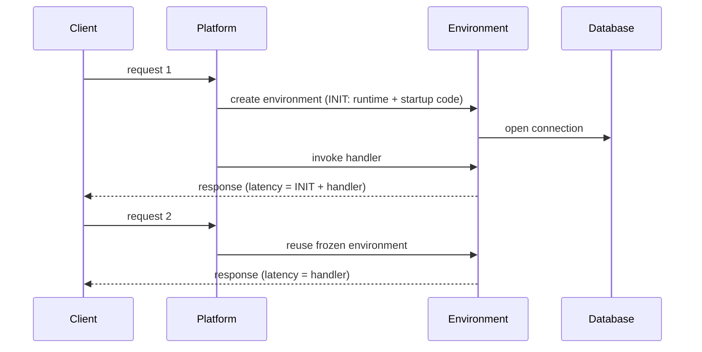
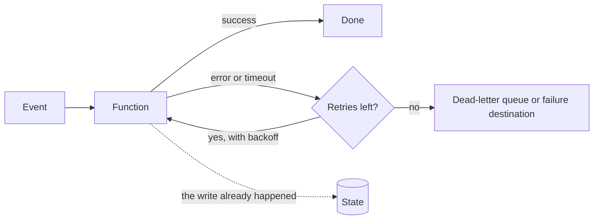

# Serverless and managed compute

A team moves its API to functions. The first bill is lower and nobody misses patching servers. A month later the oddities show up: the first request of the morning takes noticeably longer than the rest, a traffic spike opens hundreds of connections to the relational database and knocks it over, and a payment runs twice because the platform retried an event that had already been processed. None of these is a provider bug. They are consequences of an execution model the team accepted without reading the fine print. **Serverless is a model in which the provider runs the servers, scales capacity with demand (often down to zero) and bills by use, in exchange for your code accepting a lifecycle you don't control.**

This lesson walks the spectrum from virtual machines to fully managed services, then explains how a function runs (events, concurrency, scale to zero, limits), what a cold start is and when it matters, where state lives, why idempotency is not optional, how to observe a serverless system and when paying per invocation stops paying off. It closes with the most common mistakes and a worked example with explicit assumptions.

<Callout tone="info" title="Cut-off date and figures">
  Checked in October 2026. Figures for AWS Lambda, Azure Functions and Cloud Run come from their
  official documentation as of that date and are linked in the sources; they change often, so check
  them before you design around them. Where there is no official source, the text describes the kind
  of limit without a number. Prices in the worked example are hypothetical.
</Callout>

## The spectrum of control versus abstraction

"Serverless" does not mean "functions". Mike Roberts, in his 2018 article on Martin Fowler's site, describes it as the combination of third-party services that replace the backend (_Backend as a Service_) and your own code run in managed, ephemeral containers (_Functions as a Service_). The 2019 Berkeley report (Jonas et al.) sums it up as FaaS plus BaaS and requires the service to scale automatically with no explicit provisioning; it sets it apart from serverful computing by three traits: decoupled compute and storage, code that runs without you managing resource allocation, and paying for what you use rather than for what you allocate. For an architect, the useful view is a **spectrum**: the higher you go, the less you operate and the less you control.

| Level                  | What you run                                 | What the provider runs                    | Unit of scale              | Usual billing unit                   | Examples (AWS · Azure · Google Cloud)                                                                 |
| ---------------------- | -------------------------------------------- | ----------------------------------------- | -------------------------- | ------------------------------------ | ----------------------------------------------------------------------------------------------------- |
| Virtual machines       | Operating system, runtime, scaling, patching | Hardware and hypervisor                   | Instance                   | Time running                         | EC2 · Virtual Machines · Compute Engine                                                               |
| Managed containers     | Image, scaling configuration                 | Nodes, control plane, sometimes scaling   | Container replica          | Replica time or vCPU and memory time | ECS on Fargate · Container Apps · Cloud Run                                                           |
| Functions (FaaS)       | Handler code and its configuration           | Runtime, scaling, execution environment   | Environment per invocation | Invocations and duration × memory    | Lambda · Azure Functions · Cloud Run functions                                                        |
| Serverless data        | Data model, keys, indexes                    | Capacity, replicas, storage               | Requests or capacity units | Requests and storage                 | DynamoDB · Cosmos DB (serverless) · Firestore                                                         |
| Serverless integration | Rules, event schemas, workflows              | Delivery, queues, retries, workflow state | Messages or transitions    | Messages, events or steps            | SQS, EventBridge, Step Functions · Service Bus, Event Grid, Logic Apps · Pub/Sub, Eventarc, Workflows |

Two caveats. First, the boundaries blur: Cloud Run runs containers and scales to zero, and since August 2024 Google calls what used to be Cloud Functions "Cloud Run functions"; Azure lets you host functions on Container Apps. Second, the catalogue of services by category already lives in [cloud services for architects](/docs/servicios-nube-para-arquitectos); this lesson is about the **execution model** they share.

The decision is not "serverless or not" but **which level for each workload**. One system can run its main API on containers, file processing on functions, data on a managed database and coordination on a workflow orchestrator.

## How a function runs

### Event-driven invocation

A function does not listen on a port: the platform invokes it when something happens. The AWS documentation distinguishes two styles: **push**, where a service invokes the function directly (an HTTP request through a gateway, a new object in storage), and **pull**, where the platform reads from a queue or stream and hands batches to the function. On top of that sits the difference between **synchronous** invocation (the caller waits for the response) and **asynchronous** invocation (the platform queues the event and answers immediately). The invocation type decides who retries, who sees the error and whether a cold start hits a user or a queue.

### Concurrency and scaling

Concurrency is the number of invocations in flight at the same time. AWS gives a practical formula: **concurrency = requests per second × average duration in seconds**. At 100 requests per second lasting 0.5 s each, you need about 50 simultaneous invocations. The formula explains something counterintuitive: if a dependency slows down and duration doubles, concurrency doubles even though traffic hasn't changed.

How work is shared varies. In Lambda's standard mode, each execution environment handles one invocation at a time; the next simultaneous one gets a new environment. In Cloud Run, one instance can serve several requests in parallel up to a configurable maximum, and Azure Functions' Flex Consumption plan scales on a configurable per-instance concurrency. The difference matters for database connections and for shared memory use.

Concurrency is **not unlimited**. As of October 2026, AWS gives each account a default quota of 1,000 concurrent executions per Region, shared by every function, and it also caps how fast a single function can create new environments. Once the quota is exhausted, invocations are rejected (_throttling_, a `429` from the API). **Reserved concurrency** serves two opposite purposes: it guarantees capacity to a critical function and, at the same time, caps it so it cannot overwhelm whatever sits behind it.

### Scale to zero

When there is no traffic, the platform retires environments and you stop paying for compute. That is the big economic win for intermittent workloads and the root of the cold start: if no environment is alive, the next request has to wait for one to be created. Almost every provider offers a lever to keep a floor (provisioned concurrency, always-ready instances, minimum instances), and that lever is almost always **billed even when there is no traffic**.

### Time, memory and size limits

Every function platform imposes several kinds of limits, and you should know them before you design:

- **Maximum duration per invocation.** As of October 2026, Lambda allows up to 15 minutes in its standard mode. Work that can grow beyond that needs to be split or moved to another level of the spectrum.
- **Memory, and CPU with it.** Lambda allocates CPU in proportion to configured memory, so adding memory can shorten duration and does not always cost more.
- **Payload size**, which differs between synchronous and asynchronous invocations.
- **Deployment package size and temporary storage** in the environment.
- **Path limits, not function limits.** In Azure Functions, an HTTP-triggered function has a maximum time to respond imposed by the load balancer, regardless of the function's own timeout. The effective limit is the smallest one along the chain.

## The cold start

This lesson's figure shows the path. When an invocation arrives and no environment is free, the platform downloads the code, starts the runtime and runs your initialization code (the `INIT` phase); only then does it call the handler. If the next request finds that environment free, it reuses it and goes straight to the handler: a **warm** start.



### Causes

You get a cold start whenever the platform needs a new environment: the first invocation after a deployment, scaling back up from zero after a quiet period, every step of a spike (each additional simultaneous invocation needs its own environment) and re-creation after a failure. AWS also documents that it recycles environments every few hours even for functions with continuous traffic. What stretches the `INIT` phase is usually on your side: the size of the package and its dependencies, work done at module load and the time to open connections.

### When it matters

According to the AWS documentation, cold starts typically affect under 1% of production invocations and last from under 100 ms to over a second. That share is small in the average and visible in the **tail of the distribution**: it shows up at p99, which is exactly where many latency objectives are measured (see [performance numbers and laws](/docs/numeros-y-leyes-de-rendimiento)). It matters on synchronous paths with a user waiting, in chains of functions (each link can add its own start) and under sharp spikes. It matters little in asynchronous processing, where a few hundred extra milliseconds go unnoticed. And since August 1, 2025, AWS bills the `INIT` phase in every configuration, so a slow start also costs money.

### Mitigations

| Mitigation                              | What it does                                                       | Cost or limit                                                   |
| --------------------------------------- | ------------------------------------------------------------------ | --------------------------------------------------------------- |
| Slim down initialization                | Fewer dependencies, import only what you use, lazy loading         | Engineering work; shortens the start instead of removing it     |
| Pre-warmed capacity                     | Provisioned concurrency, always-ready instances, minimum instances | Billed while idle; only covers up to the configured floor       |
| Snapshots of an initialized environment | Restore memory and disk instead of initializing (e.g. SnapStart)   | Only some runtimes; restored state must be safe to clone        |
| Move the critical path to containers    | Minimum replicas always on, each serving many requests             | You pay for capacity again and own the scaling decisions        |
| Periodic pings to keep it warm          | A timer invokes the function so it isn't retired                   | Keeps few environments alive; does not cover concurrency spikes |

<Callout tone="warning" title="Pinging is not capacity">
  A timer that invokes the function every few minutes keeps alive, at most, one environment per
  simultaneous ping. When a spike arrives, the additional environments still start cold. If tail
  latency is a requirement, use the provider's provisioned capacity or a level of the spectrum with
  minimum replicas, and measure p99 under realistic traffic.
</Callout>

## State: the function doesn't remember

AWS puts it plainly: assume the environment exists for a single invocation and commit any permanent change to a durable store before exiting. The environment **may** be reused, which lets you cache clients and connections outside the handler, but there is no guarantee of when or which one: two consecutive invocations from the same user can land on different environments, and an environment can disappear at any time.

So where does state live?

- **Business data:** in a database or object store, with its own consistency guarantees (see [ACID data and isolation](/docs/datos-acid-y-aislamiento)).
- **Derived data and sessions:** in an external cache, not in global variables.
- **Pending work:** in a queue or stream, which absorbs the pace difference between producer and consumer ([caching, queues and streaming](/docs/caching-colas-streaming)).
- **Progress of a long process:** in a workflow orchestrator (Step Functions, Durable Functions, Workflows), which records which step each execution is on and retries for you.
- **Anything local (globals, temporary disk):** only as a cache you can lose without consequences.

One scaling side effect surprises people often: every environment opens its own connections. A hundred simultaneous invocations are a hundred clients to the relational database, which usually has a connection ceiling far below the platform's concurrency ceiling. The usual ways out are a managed connection proxy, a database with a per-request API, or capping the function's concurrency to the connection budget.

## Idempotency and retries

In a serverless system, retries come from many layers: the client, the gateway, the platform and the event source. The AWS documentation is explicit about asynchronous invocations: if the function fails, the platform retries it twice more by default, and even if it succeeds, the function can receive the same event more than once because the internal queue is eventually consistent. If an invocation is throttled for lack of concurrency, the event goes back to the queue and is retried for hours. The takeaway: **treat every event as "at least once"**.



The dotted arrow is the dangerous case: the function wrote to the database and then timed out. To the platform it was a failure; to the business, the operation already happened. When it is retried, the write has to be recognized as a repeat. The techniques (idempotency keys, processed-ID tables, inbox, outbox) are covered in [sagas, outbox and idempotency](/docs/sagas-outbox-idempotencia); here, three rules specific to this model are enough:

- **Derive the idempotency key from the event**, not the environment: an identifier the source keeps stable across retries.
- **Align timeouts.** If the function's timeout is longer than its caller's, the caller retries while the first invocation is still running.
- **Configure a destination for exhausted events** (dead-letter queue or failure destination) and watch it: an event that always fails (a _poison message_) must neither block the flow nor vanish silently.

## Observability without servers

There is no server to log into and no process to inspect: each invocation leaves its own logs and, as AWS notes, reconstructing what happened to a specific event requires every step to log the same transaction identifier. Three minimum practices:

- **Distributed traces** across gateway, functions, queues and databases (X-Ray, Application Insights or Cloud Trace, or OpenTelemetry, whose FaaS conventions include a `faas.coldstart` attribute to tell cold invocations apart).
- **Platform metrics** alongside business metrics: errors, duration, throttles, concurrency in use, `INIT` duration and the age of the oldest message in each queue.
- **Structured logs with a budget.** Log volume grows with invocations and is billed by what you ingest and retain. In May 2025 AWS introduced tiered pricing for Lambda logs, a sign that this is a meaningful cost line. Use log levels, sample repetitive output and set retention to match actual use.

## Per-invocation cost versus reserved capacity

A function's price usually combines a per-invocation charge and a charge for duration times memory, plus the gateway, logs, data transfer and the services around it. A container replica or a virtual machine is paid for by the time it runs, whether you use it or not. That gives the general rule:

- With **intermittent or highly variable traffic**, paying per use wins because you don't pay for idle time.
- With **high, steady traffic**, reserved capacity usually wins: its fixed cost is spread over many requests, and one replica can serve several at once.
- What skews the math most is **time spent waiting**. A function waiting on another function or a slow API is billed while it waits; a server busy on I/O serves other requests in the meantime.

The crossover point depends on your prices, average duration and utilization, and it moves when they change. That is why it is worth recalculating like any other fitness function; the method is in [FinOps: cost as an attribute](/docs/finops-costo-como-atributo).

## Coupling to triggers and to the provider

Serverless lock-in rarely sits in business code. It sits in **the shape of events**: AWS documents that the JSON a function receives varies by the service that generates it and by event type, and the same holds for other providers. If the handler reads the storage or gateway event structure directly, every function is wedded to that service. Add the handler signature, the trigger configuration, the permissions and the managed services the function calls.

The defense is the usual one applied to this case, as in [hexagonal architecture](/docs/arquitectura-hexagonal): the handler is an **adapter** that translates the provider's event into a command of your own and calls the core, which doesn't know which service invoked it.

```text
orders/
  core/                 # business rules, no provider SDK
    confirm-order.ts    # confirmOrder(command): Result  // …
  ports/
    order-store.ts      # interface owned by the core
  adapters/
    http-handler.ts     # gateway event → ConfirmOrder
    queue-handler.ts    # queue message → ConfirmOrder
    dynamo-order-store.ts
```

For events that cross team or system boundaries, a common format helps. CloudEvents, an event metadata specification that the CNCF graduated on January 25, 2024, is adopted by Azure Event Grid and Google Cloud Eventarc, among others. It doesn't remove the dependency on triggers, but it makes the event envelope portable. How much portability to buy, and at what price, is discussed in [locked in to one vendor](/docs/casado-a-un-proveedor).

## When to use it and when not to

| Good fit                                                   | Poor fit                                                                   |
| ---------------------------------------------------------- | -------------------------------------------------------------------------- |
| Intermittent or spiky traffic, or long idle periods        | High, sustained traffic with steady utilization                            |
| Reacting to events: uploaded files, messages, data changes | Long processes that can't be split into steps                              |
| Glue between managed services and small scheduled tasks    | Strict tail latency with no budget for pre-warmed capacity                 |
| Small teams that don't want to operate infrastructure      | Persistent connections, in-memory state or long-lived session protocols    |
| Prototypes and workloads whose volume you don't know yet   | Dependencies that can't tolerate the concurrency the platform can generate |

Many real workloads fall in between. A reasonable path is to start on functions and move the path that becomes steady and hot to containers, with the decision recorded in an [ADR](/docs/adr) that states which metric triggers the move.

## Common mistakes

- **One function per endpoint with no domain boundaries.** Dozens of tiny functions that share tables and call each other are a distributed monolith. AWS also warns against the opposite, a single function serving every route. The criterion is the boundary, not the size: group by business capability, as [domain-driven design](/docs/domain-driven-design) suggests.
- **Synchronous dependency chains.** A function that invokes another and waits pays for both durations, stacks cold starts, needs the same concurrency at every link and is only as available as the slowest one. AWS lists it as an anti-pattern; the ways out are a queue in between or a workflow orchestrator.
- **Assuming unlimited concurrency.** The quota is shared across the account and Region, and the database behind it usually tolerates far less. Cap each function according to what its weakest dependency can take.
- **State in memory.** Counters, sessions or caches that "work in testing" because there is only ever one environment there.
- **Recursive loops.** A function that writes to the same storage that triggers it can invoke itself endlessly and scale until the quota runs out.
- **Misaligned timeouts.** The gateway gives up before the function, the client retries and the operation runs twice.
- **Ignoring the cost of logs.** Logging the full event on every invocation can cost more than the compute.

## Worked example: thumbnails and checkout

An online store has to decide where to run two workloads. Every number is an **assumption** chosen to illustrate the method, and prices are hypothetical units, not any provider's rates.

**Price assumptions.** Function: 1 unit per 1,000 GB-s, plus 0.02 units per 1,000 invocations. Managed container: 2 units per replica per hour, running 24 hours a day; each replica serves several requests at once.

**Workload A: image thumbnails.** Generated asynchronously when an image is uploaded. 20,000 images a day, 2 s per image, 1 GB of memory. Uploads arrive in bursts: a catalogue import uploads 3,000 images in 5 minutes.

- Burst concurrency: 3,000 / 300 s = 10 per second; 10 × 2 s = **20** simultaneous invocations.
- Daily compute: 20,000 × 2 s × 1 GB = 40,000 GB-s, which is 40 units; invocations: 20 × 0.02 = 0.4 units. **Total: 40.4 units a day.**
- With containers, you would size for the burst: 4 replicas × 24 h × 2 = **192 units a day**, idle most of the time.
- Cold starts don't matter: nobody waits for a thumbnail inline. The operation is naturally idempotent if the output key is the image's ID and version: repeating it overwrites the same file.

**Workload B: checkout API.** Synchronous, a steady 30 requests per second for 14 hours a day, 120 ms on average, 0.5 GB, and a p99 objective of 300 ms. It talks to a relational database.

- Concurrency: 30 × 0.12 s = **3.6** simultaneous invocations.
- Daily invocations: 30 × 14 × 3,600 = 1,512,000. Compute: 1,512,000 × 0.12 s × 0.5 GB = 90,720 GB-s, which is 90.72 units; invocations: 1,512 × 0.02 = 30.24 units. **Total: 120.96 units a day.**
- With containers: 2 replicas for redundancy × 24 h × 2 = **96 units a day**, with plenty of headroom for 3.6 simultaneous requests.
- On top of that, a 300 ms p99 leaves little room for cold starts, and the database prefers a stable number of connections.

**Decision.** Thumbnails go to functions, with reserved concurrency of 20 as a ceiling so storage isn't swamped, a failure destination for exhausted events and alerts on that queue. Checkout goes to managed containers with 2 minimum replicas. The decision is recorded in an ADR together with the condition that would reopen it: if checkout traffic becomes highly irregular, or if thumbnails stop arriving in bursts and become a steady stream, recalculate. Note that the conclusion depends on the ratios (utilization, duration, burstiness) more than on exact prices: redo the math with your provider's real rates.

## Checklist

- [ ] Each workload has its level of the spectrum chosen for an explicit reason, not out of habit.
- [ ] You know which invocations are synchronous, which are asynchronous and who retries in each case.
- [ ] Each function's maximum concurrency is capped by what its weakest dependency can handle.
- [ ] Cold starts are measured at p99 on synchronous paths, and the chosen mitigation has a known cost.
- [ ] No function relies on in-memory or local-disk state to be correct.
- [ ] Every event is processed idempotently and exhausted events go to a monitored destination.
- [ ] End-to-end traces share a common identifier, and log volume has a budget.
- [ ] Handlers translate the provider's event into your own types before reaching the core.

## Next lesson

With compute chosen, you still need to decide how things connect and who may talk to whom: continue with [cloud networking, identity and security](/docs/redes-identidad-seguridad-nube).

## Sources

Checked in October 2026. Provider figures are those in their official documentation as of that date.

- [Serverless Architectures (Mike Roberts, martinfowler.com, May 22, 2018)](https://martinfowler.com/articles/serverless.html)
- [Cloud Programming Simplified: A Berkeley View on Serverless Computing (Jonas et al., arXiv 1902.03383, February 2019)](https://arxiv.org/abs/1902.03383)
- AWS Lambda: [execution environment lifecycle and cold starts](https://docs.aws.amazon.com/lambda/latest/dg/lambda-runtime-environment.html), [concurrency](https://docs.aws.amazon.com/lambda/latest/dg/lambda-concurrency.html), [quotas](https://docs.aws.amazon.com/lambda/latest/dg/gettingstarted-limits.html), [error handling and retries for asynchronous invocation](https://docs.aws.amazon.com/lambda/latest/dg/invocation-async-error-handling.html), [design principles](https://docs.aws.amazon.com/lambda/latest/dg/concepts-application-design.html) and [event-driven architectures and anti-patterns](https://docs.aws.amazon.com/lambda/latest/dg/concepts-event-driven-architectures.html)
- [AWS Lambda standardizes billing for INIT Phase (AWS Compute Blog, April 29, 2025)](https://aws.amazon.com/blogs/compute/aws-lambda-standardizes-billing-for-init-phase/)
- [Amazon CloudWatch launches tiered pricing and additional destinations for AWS Lambda logs (AWS, May 2025)](https://aws.amazon.com/about-aws/whats-new/2025/05/amazon-cloudwatch-tiered-pricing-additional-destinations-aws-lambda-logs)
- [Azure Functions scale and hosting](https://learn.microsoft.com/en-us/azure/azure-functions/functions-scale)
- Cloud Run: [minimum instances](https://docs.cloud.google.com/run/docs/configuring/min-instances) and [per-instance concurrency](https://docs.cloud.google.com/run/docs/about-concurrency)
- [Cloud Functions is now Cloud Run functions (Google Cloud, August 2024)](https://cloud.google.com/blog/products/serverless/google-cloud-functions-is-now-cloud-run-functions)
- [Semantic conventions for FaaS spans (OpenTelemetry)](https://opentelemetry.io/docs/specs/semconv/faas/faas-spans/)
- [CNCF announces the graduation of CloudEvents (January 25, 2024)](https://www.cncf.io/announcements/2024/01/25/cloud-native-computing-foundation-announces-the-graduation-of-cloudevents/)
