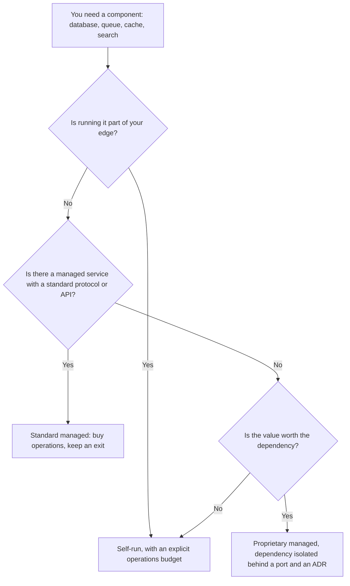
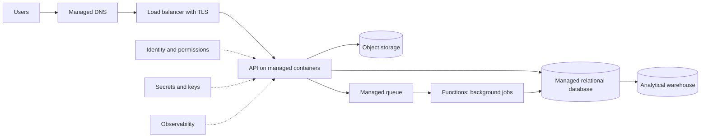

# Cloud services for architects

The team finished its cloud migration six months ago. Same twelve virtual machines, same hand-installed PostgreSQL, same backup script running at night. The bill arrives every month and on-call hasn't changed: when the database disk fills up, someone wakes up at three. At another company the opposite happened: they adopted a managed database and, the day the provider applied an update during its maintenance window, they found out nobody knew what the service does while it switches primaries. Both cases are missing the same thing: an understanding of what they bought. **A cloud service is a contract of responsibilities: each service model fixes which layers you operate and which the provider operates, and choosing a service means deciding where you draw that boundary.**

This is the first lesson in the cloud series. It covers the service models and where they come from, how responsibility is split in each one, the service categories an architect should recognize at any provider, what you buy and what you pay for with a managed service, and how to choose using criteria that outlive catalog changes. AWS, Azure and Google Cloud names appear only as equivalents, not as recommendations.

<Callout tone="info" title="Cutoff date and scope">
  Sources checked in October 2026. Service names change often: the equivalents come from the
  comparison table Google Cloud publishes, and you should confirm them in each provider's
  documentation before deciding. This article gives no prices, quotas or SLAs.
</Callout>

## The problem: buying infrastructure without knowing what you run

Most cloud surprises share one shape: someone assumed a responsibility belonged to the provider and it was theirs, or the other way around.

| Symptom                                                            | Responsibility nobody assigned                                          |
| ------------------------------------------------------------------ | ----------------------------------------------------------------------- |
| A storage bucket ends up exposed to the internet                   | The service's access configuration, which is yours in every model       |
| Virtual machines go months without operating system patches        | The guest operating system, which the customer runs in IaaS             |
| The managed database restarts during business hours                | The maintenance window, which the provider executes and you configure   |
| Data is deleted by mistake and can't be recovered                  | Retention and restore testing, which the service doesn't decide for you |
| The application doesn't scale even though the service "is elastic" | The application's design, which the provider can't change               |

## Service models: what the definition says

### NIST SP 800-145: three models and five characteristics

The most cited reference is NIST Special Publication 800-145, _The NIST Definition of Cloud Computing_, by Peter Mell and Timothy Grance, published in September 2011. It defines cloud computing through five essential characteristics (on-demand self-service, broad network access, resource pooling, rapid elasticity and measured service), three service models and four deployment models. Deployment models are the subject of the [next lesson](/docs/modelos-de-despliegue-nube).

What makes the NIST definition useful is that it describes each model by what the consumer **does not manage or control**:

- **IaaS.** The consumer provisions processing, storage and networks and can run arbitrary software, including operating systems. They don't manage the underlying infrastructure, but they control the operating systems, storage and deployed applications, and possibly some networking components such as host firewalls.
- **PaaS.** The consumer deploys their own or acquired applications, built with languages, libraries and tools the provider supports. They don't control the network, servers, operating systems or storage; they control the application and possibly the configuration of the hosting environment.
- **SaaS.** The consumer uses the provider's applications. They don't control even individual application capabilities, except possibly limited user-specific configuration.

### CaaS and FaaS: industry terms

CaaS and FaaS are not among NIST's three models. They are common names for two intermediate points that now have dedicated services at every major provider:

- **CaaS (containers as a service).** You hand over a container image; the provider runs the orchestrator or, in serverless variants, the nodes as well. The image, with its base system and dependencies, is yours.
- **FaaS (functions as a service).** The CNCF serverless whitepaper (v1.0, 2018) describes it as the core capability of a platform that runs user-provided functions on demand. You hand over a function; the provider decides when and where it runs and how many copies execute.

<Callout tone="warning" title="CaaS doesn't mean the same thing everywhere">
  ISO/IEC 17788:2014 (the same text as ITU-T Y.3500) defined CaaS as _communications as a service_,
  the category whose capability is real-time interaction and collaboration, and CompaaS as _compute
  as a service_, the provision of processing resources to deploy and run software. That standard was
  replaced by two documents that split its content: ISO/IEC 22123-1:2023 (vocabulary) and ISO/IEC
  22123-2:2023 (concepts). The public table of contents of 22123-2 keeps CaaS (communications) and
  CompaaS; its full text was not reviewed here. If you write CaaS in a contract or an architecture
  document, define the term the first time it appears.
</Callout>

## Who runs what: the responsibility stack

All three major providers publish their own version of the **shared responsibility model**. AWS frames it as security _of_ the cloud (the provider: hardware, physical network, facilities and the virtualization layer) versus security _in_ the cloud (the customer: whatever they build on top). It adds that the customer's share depends on the service chosen: with an EC2 instance you manage the guest operating system, installed software and the security group firewall; with more abstracted services such as S3 or DynamoDB, AWS operates the infrastructure layer and you handle data, encryption and permissions.

Microsoft summarizes it in a matrix where three rows belong to the customer in every model, SaaS included: data, configuration and identities. Google Cloud says something similar: customers remain responsible for their access policies and their data whatever the model. The table below is a synthesis of those three sources, with two extra columns for CaaS and FaaS; treat it as a guide and check the exact split for each service in its documentation.

| Layer                                   | IaaS     | CaaS                   | PaaS     | FaaS                           | SaaS     |
| --------------------------------------- | -------- | ---------------------- | -------- | ------------------------------ | -------- |
| Data, identities and permissions        | You      | You                    | You      | You                            | You      |
| Service configuration                   | You      | You                    | You      | You                            | You      |
| Application code                        | You      | You                    | You      | You                            | Provider |
| Runtime and dependencies                | You      | You (inside the image) | Provider | Provider (versions you choose) | Provider |
| Guest operating system and patches      | You      | Depends on the variant | Provider | Provider                       | Provider |
| Virtualization, hardware and facilities | Provider | Provider               | Provider | Provider                       | Provider |

The article's figure draws that stack with five short rows: IAM (data, identities, permissions and configuration), APP (code), RUNTIME, VM (guest operating system) and HW (everything physical). Each column is a service model; the **ember line** is the responsibility boundary. Above it, you operate; below it, the provider does. In IaaS the line sits just above the hardware; in SaaS it leaves you only the data and access layer. PaaS and FaaS share the same boundary in this stack: what separates them is not the layers but the unit you deploy (an application or a function) and who decides how many instances run. The axis at the bottom sums up the trade: toward the left you keep control; toward the right you depend more on the provider's SLA.

Two nuances the table doesn't show well:

- **"Provider" doesn't mean "no work for you".** AWS classifies patching and configuration management as shared controls: the provider patches its infrastructure and you patch yours. In PaaS you still pick runtime versions and maintenance windows.
- **The boundary moves within a single model.** Managed Kubernetes with nodes you administer sits closer to IaaS than a serverless container service does. That is why the table says "depends" and the figure draws the CaaS VM cell dashed: the line passes above it only in the variant where the provider runs the nodes.

## Service categories you should recognize

Catalogs list hundreds of products, but an architect works with a small set of categories that repeats across providers. For each one, the design question matters more than the product.

### Compute

Three ways to run code, from more control to less: **virtual machines** (you pick the operating system and size and run everything you install), **managed containers** (you hand over images; the provider runs the orchestrator and sometimes the nodes) and **functions** (you hand over code that reacts to events). The key question is who decides how many copies run and what happens when there is no traffic. Functions and serverless compute get their own lesson: [serverless and managed compute](/docs/serverless-y-computacion-gestionada).

### Object and block storage

**Object storage** keeps whole files behind an HTTP API, with metadata and access policies per container or object; you read and write them whole, not byte by byte. **Block storage** is a virtual disk attached to a machine and formatted by its operating system. The design question is who accesses the data: if many processes share it or it is served to the internet, objects; if a single process needs a file system, blocks.

### Managed databases

The provider runs the engine: installation, patches, backups, replicas and failover, with the options you configure. Some are relational and speak a standard protocol (PostgreSQL, MySQL, SQL Server); others are provider-specific document or key-value stores with their own API. The design question has two parts: which consistency guarantees you need (covered in [ACID and isolation levels](/docs/datos-acid-y-aislamiento)) and what leaving would cost if you ever change providers.

### Messaging and streaming

Managed queues, pub/sub and event logs. The provider runs the brokers and their scaling; you decide the delivery model, ordering, retention and what a consumer does with a duplicate. The differences between a queue, pub/sub and a log are in [caching, queues and streaming](/docs/caching-colas-streaming).

### Identity, networking, load balancing and DNS

**Identity** (users, roles, service accounts and policies) is the most important security boundary in the cloud, because almost everything is controlled through an API. The **virtual network** defines what talks to what; the **load balancer** spreads traffic and often terminates TLS; managed **DNS** resolves names and can route by health or region. Their design in detail is the subject of [cloud networking, identity and security](/docs/redes-identidad-seguridad-nube).

### Observability, secrets and keys

Managed **observability** collects metrics, logs and traces from your services and from the provider's. **Secrets management** stores credentials with rotation and auditing; **key management** guards the keys that encrypt your data. Keeping secrets out of code is a principle of [security by design](/docs/seguridad-por-diseno); the managed service only makes it easier.

### Managed data and AI

Analytical warehouses, data processing, and machine learning or generative model platforms run by the provider. They are the services with the most differentiating value and, at the same time, the most proprietary APIs: the data model, the queries and the pipelines tend to end up written against that product.

### Equivalents across providers

| Category               | AWS                              | Azure                                             | Google Cloud                    |
| ---------------------- | -------------------------------- | ------------------------------------------------- | ------------------------------- |
| Virtual machines       | EC2                              | Azure Virtual Machines                            | Compute Engine                  |
| Managed Kubernetes     | EKS                              | AKS                                               | GKE                             |
| Serverless containers  | Fargate, ECS Express Mode        | Azure Container Apps                              | Cloud Run                       |
| Functions              | Lambda                           | Azure Functions                                   | Cloud Run functions             |
| Objects                | S3                               | Azure Blob Storage                                | Cloud Storage                   |
| Blocks                 | EBS                              | Azure Disk Storage                                | Hyperdisk                       |
| Managed relational     | RDS, Aurora                      | Azure SQL Database, Azure Database for PostgreSQL | Cloud SQL                       |
| Document or key-value  | DynamoDB, DocumentDB             | Azure Cosmos DB                                   | Firestore, Bigtable             |
| Queues and pub/sub     | SQS, SNS                         | Azure Queue Storage, Service Bus                  | Cloud Tasks, Pub/Sub            |
| Streaming              | Kinesis Data Streams             | Azure Event Hubs                                  | Pub/Sub, Dataflow               |
| DNS and load balancing | Route 53, Elastic Load Balancing | Azure DNS, Azure Load Balancer                    | Cloud DNS, Cloud Load Balancing |
| Secrets and keys       | Secrets Manager, KMS             | Azure Key Vault                                   | Secret Manager, Cloud KMS       |
| Observability          | CloudWatch                       | Azure Monitor                                     | Cloud Monitoring, Cloud Logging |
| Analytical warehouse   | Redshift                         | Azure Synapse Analytics                           | BigQuery                        |
| AI platform            | SageMaker                        | Azure AI platform                                 | Vertex AI                       |

The table follows Google Cloud's comparison as checked in October 2026, with one change in the serverless containers row: as of October 2026, AWS App Runner no longer accepts new customers, and AWS recommends ECS Express Mode, which deploys the image as an ECS service on Fargate ([AWS notice](https://docs.aws.amazon.com/apprunner/latest/dg/apprunner-availability-change.html)). Two services sharing a row doesn't make them interchangeable: limits, consistency model, billing and APIs all differ.

## Managed versus self-run

For almost any component you can either run it yourself on machines or containers, or buy the managed service. It is a [trade-off](/docs/trade-offs-y-decisiones) with two clear columns:

| What you buy with a managed service                                    | What you pay for it                                                                     |
| ---------------------------------------------------------------------- | --------------------------------------------------------------------------------------- |
| Routine operation: installation, patches, backups, node replacement    | Control: versions, extensions, parameters and windows the provider limits               |
| Scaling or, at least, the mechanics of scaling                         | Portability: proprietary APIs, formats and semantics your code ends up assuming         |
| High availability configured rather than built                         | Cost: the managed resource usually costs more per unit than the equivalent raw resource |
| Integration with the provider's identity, networking and observability | Visibility: you can't see or touch what happens underneath, only metrics and docs       |
| Team time to spend on the product                                      | Roadmap dependency: version retirements and changes you don't decide                    |

Cost deserves a caveat: comparing only unit prices is misleading, because self-running has a people cost (on-call, patching, restore drills) that never shows up on the provider's bill. Treating cost as a design attribute is the topic of the [FinOps](/docs/finops-costo-como-atributo) lesson.



Isolating the dependency behind an interface you own is the idea behind [ports and adapters](/docs/arquitectura-hexagonal): your domain talks to "a queue", not to a specific product. How far that portability is worth taking is covered in the lesson on [provider dependency](/docs/casado-a-un-proveedor).

## How to choose a service

The criteria below apply to any category and any provider. None decides alone; together they keep you from choosing off the product page.

| Criterion       | Question to answer                                                              | Warning sign                                                  |
| --------------- | ------------------------------------------------------------------------------- | ------------------------------------------------------------- |
| Maturity        | Is it generally available, with a published SLA and use cases similar to yours? | It only exists in preview or in one region                    |
| Cost to operate | How many hours a month does it take from your team, on top of the bill?         | Nobody knows who handles its alerts                           |
| Dependency      | How much of your code and data would end up written against its API?            | The data model only makes sense inside that product           |
| Latency         | Where does it run relative to your users and the services it talks to?          | Every request crosses regions or networks to reach it         |
| Compliance      | Where does the data live, who can access it, and which certifications apply?    | The service isn't available in the region regulation requires |
| Team            | Does someone on the team know how to run it, debug it and explain how it fails? | The only reference is a tutorial                              |

Two habits keep the choice from getting lost. First, **read the documented limits and quotas** before designing, because they set message sizes, connections or request rates your architecture must respect. Second, record each adoption in a short card, in the spirit of an [ADR](/docs/adr):

```yaml
# docs/services/relational-db.yaml: one card per adopted service
service: managed-relational-database
model: PaaS
we-run: [schema, queries, permissions, retention, restore drill]
provider-runs: [operating system, engine patches, hardware, failover]
dependency: standard protocol; proprietary extensions: none
exit: logical dump or replication to another target
owner: payments-team
review: # …
```

## A reference map

A typical web application uses services from almost every category. The diagram is an example, not a template: each box is one of the decisions this article covers.



| Map component                    | Category                | What you still run                                   |
| -------------------------------- | ----------------------- | ---------------------------------------------------- |
| DNS and load balancer            | Network and edge        | Records, certificates, routing rules                 |
| API                              | Managed containers      | Image, dependencies, minimum replicas, health probes |
| Relational database              | Managed database        | Schema, indexes, retention, restore drill            |
| Objects                          | Storage                 | Access policies, lifecycle, chosen encryption        |
| Queue and functions              | Messaging and functions | Idempotency, retries, dead-letter queue              |
| Identity, secrets, observability | Platform                | Roles, rotation, alerts and dashboards               |
| Analytical warehouse             | Managed data            | Data model, permissions, query cost                  |

The right-hand column is the one that matters: no row is empty. A map without that column is a catalog, not an architecture.

## When it fits and when it doesn't

| Situation                                                                 | Reasonable decision                                                            |
| ------------------------------------------------------------------------- | ------------------------------------------------------------------------------ |
| Small team, no specialists in running databases or brokers                | Managed services with standard protocols for everything that isn't the product |
| The component is your competitive edge, or you need control nobody offers | Self-run on IaaS or CaaS, with an explicit operations and on-call budget       |
| Strict residency or certification requirements                            | Filter by region and compliance first; compare features afterward              |
| Very spiky load, or long periods with no traffic                          | Models that scale to zero, if cold-start latency is acceptable                 |
| Large, steady load and a team that already runs the component             | Compare total cost, people included, before assuming managed is cheaper        |

## Common mistakes

- **Copying the on-premises architecture into the cloud and expecting a different result.** AWS calls this strategy _rehost_, also known as _lift and shift_: moving applications without changing them. It is legitimate as a first step, and AWS's own guidance for large migrations recommends rehosting or replatforming first and modernizing afterward. The mistake is stopping there and expecting elasticity or fewer pages: with the same machines you still run the same layers.
- **Treating every managed service as a black box.** The provider running failover doesn't excuse you from knowing what happens during it: how long the interruption lasts, which connections drop and how your application reconnects. Read how the service fails and test it like any other dependency ([resilience in distributed systems](/docs/resiliencia-sistemas-distribuidos)).
- **Choosing from the catalog.** Adopting a service because it exists, because it's new, or because it shows up in a reference diagram, without running it through the criteria table above. The result is an architecture with more products than problems.
- **Assuming the provider protects your data.** Data, configuration and permissions are yours in every model. A service with automatic backups doesn't know which retention you need and doesn't test your restores.
- **Using "CaaS" or "serverless" without defining them.** Every team and every standard means something different; write down which layers you run instead of the acronym.
- **Ignoring limits and quotas until production.** A message-size or connection limit found late forces a redesign that an early read would have avoided.

## Worked example: a B2B SaaS with four developers

Assumption: a B2B invoicing product with four developers, nobody dedicated to operations, customers in a single country with a data residency requirement, and a load peak at month end. The team decides component by component using the criteria table.

| Component      | Options considered                                                 | Decision and reason                                                                           |
| -------------- | ------------------------------------------------------------------ | --------------------------------------------------------------------------------------------- |
| Region         | Any versus the country's own                                       | The country's: compliance filters before any other criterion                                  |
| API            | Virtual machines, managed Kubernetes, serverless containers        | Serverless containers: nobody runs nodes and the month-end peak scales on its own             |
| Database       | PostgreSQL on a VM, managed PostgreSQL, proprietary document store | Managed PostgreSQL: standard protocol, an exit through a logical dump, and no DBA on the team |
| PDF generation | Inside the API, functions triggered by a queue                     | Functions behind a queue: irregular work that must not slow the API; jobs are idempotent      |
| Files          | Block disk, object storage                                         | Objects: several processes read them and they are served through signed links                 |
| Invoice search | Self-run search engine, PostgreSQL indexes                         | PostgreSQL indexes: the volume doesn't justify another component; revisited in a year         |

The result has five managed services and no machine to patch. What the team still runs is written in each card: database schema and restores, the API image, job idempotency, permissions and alerts. The decision not to add a search engine counts as much as the others and is recorded with a review date.

## Checklist

- [ ] Every adopted service has its model written down (IaaS, CaaS, PaaS, FaaS or SaaS) along with the layers the team still runs.
- [ ] Data, configuration and permissions have an owner on the team, SaaS services included.
- [ ] Critical managed services have their behavior during maintenance and failover documented and tested.
- [ ] Backup retention and restore testing are defined by the team, not inherited by default.
- [ ] Every dependency on a provider-specific API is isolated behind an interface and justified in an ADR.
- [ ] The documented limits and quotas of each service were reviewed before design.
- [ ] Comparisons between managed and self-run include people cost, not just the bill.
- [ ] No service was adopted without going through maturity, dependency, latency, compliance and team criteria.

## Next lesson

With the split of responsibilities clear, the next question is where that infrastructure lives: public, private, community or hybrid, in [cloud deployment models](/docs/modelos-de-despliegue-nube).

## Sources

Checked in October 2026.

- [The NIST Definition of Cloud Computing, SP 800-145 (Peter Mell and Timothy Grance, NIST, September 2011)](https://csrc.nist.gov/pubs/sp/800/145/final), [DOI 10.6028/NIST.SP.800-145](https://doi.org/10.6028/NIST.SP.800-145)
- [ISO/IEC 17788:2014, Cloud computing, Overview and vocabulary](https://webstore.iec.ch/publication/10567): IEC store entry, which lists it as replaced by ISO/IEC 22123-1:2023 and ISO/IEC 22123-2:2023; the CaaS (3.2.18) and CompaaS (3.2.20) definitions come from the [ITU compilation of terms](https://itu.int/en/publications/Documents/tsb/2020-Cloud-computing-From-paradigm-to-operation/files/basic-html/page16.html)
- [ISO/IEC 22123-2:2023, Cloud computing, Part 2: Concepts](https://webstore.iec.ch/publication/88947): table of contents and foreword from the public preview, listing NaaS, CaaS (communications), CompaaS and DSaaS, and the replacement of ISO/IEC 17788:2014 together with ISO/IEC 22123-1:2023
- [AWS App Runner availability change (AWS)](https://docs.aws.amazon.com/apprunner/latest/dg/apprunner-availability-change.html)
- [CNCF Serverless Whitepaper v1.0 (CNCF Serverless Working Group, 2018)](https://github.com/cncf/wg-serverless/tree/master/whitepapers/serverless-overview)
- [Shared Responsibility Model (AWS)](https://aws.amazon.com/compliance/shared-responsibility-model/)
- [Shared responsibility in the cloud (Microsoft Learn)](https://learn.microsoft.com/en-us/azure/security/fundamentals/shared-responsibility)
- [Shared responsibilities and shared fate on Google Cloud (Google Cloud Architecture Framework)](https://docs.cloud.google.com/architecture/framework/security/shared-responsibility-shared-fate)
- [Compare AWS and Azure services to Google Cloud (Google Cloud)](https://docs.cloud.google.com/docs/get-started/aws-azure-gcp-service-comparison)
- [About the migration strategies, the 7 Rs (AWS Prescriptive Guidance)](https://docs.aws.amazon.com/prescriptive-guidance/latest/large-migration-guide/migration-strategies.html)
