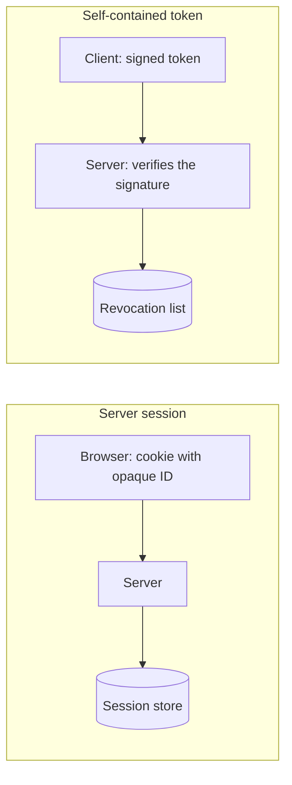
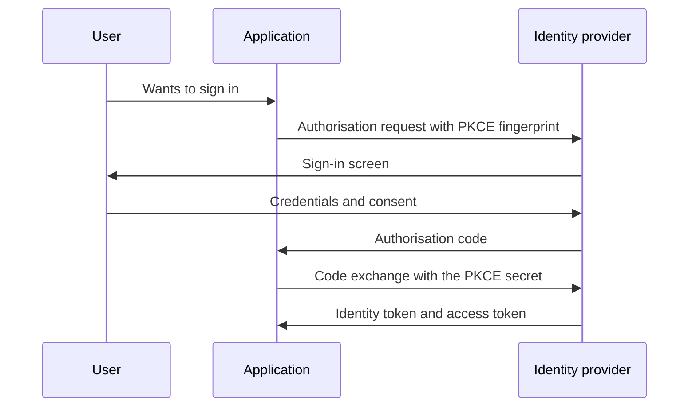

When a user signs in, the system has to remember who they are on the next request. That memory can live on the server, on the client or with an identity provider, and each location changes how it expires, how it is revoked and how much it costs to scale. Many discussions about authentication get stuck because they mix three different things: the **session** (the state that someone has signed in), the **token** (the credential that proves that state) and **SSO** (the way that state is shared across applications).

The thesis of this article is that **the choice is not tokens versus sessions as a matter of fashion, but where the state lives and what you need to be able to do with it**: close it immediately, scale it without a central store, or delegate it to a provider. From that question, the remaining decisions (expiry, storage, flows) follow fairly clearly.

## Server session: the state stays at home

In a server-side session, the browser receives an opaque identifier, usually in a cookie, and the server keeps the associated data (user, roles, start time, last activity) in a store of its own: memory, a database or a distributed cache. Each request looks up that identifier and gets the state back.

The main advantage is **immediate revocation**. If an administrator ends a user's session, deleting the entry from the store is enough, and the next request fails. If an account is compromised, all of that person's sessions can be closed in one operation. No sensitive data leaves the server, and the client cannot forge its identity because it contains nothing to forge.

The cost is **shared state**. With several instances of the service, all of them must consult the same session store, which adds a dependency, latency and a point of failure. That is solved with a distributed cache or with session affinity, but both have trade-offs: affinity complicates load balancing and the cache adds a component to operate.

The duration of a session is also a product decision with security consequences. A session that never expires is convenient, but it leaves access open on every device where someone has ever signed in. The usual approach combines two timers: an absolute one that forces sign-in again after a fixed number of days, and an inactivity one that closes the session after a period without activity. A "remember me" option should extend only the absolute timer, and it should never skip re-authentication for sensitive operations such as changing the password or the recovery email.

There is also a point about the size of the state. A server session can hold far more than a token, but it should keep only what the server needs to decide: the user identifier, a session version, the dates and, where relevant, the authentication level reached (password alone, or password plus a second factor). Storing the full profile duplicates data and forces the session to be invalidated every time the profile changes.

## Self-contained token: the state travels with the client

A self-contained token, such as a JWT, carries claims about the user (their identifier, their roles, the expiry date) and a signature that lets the server check that it was not altered. The server does not need to consult anything to validate it: verifying the signature with the public or shared key is enough. That removes shared state and makes scaling easier, because any instance can validate any token.

The trade-off is **revocation**. A valid token remains valid until it expires, because the server does not know it exists beyond its signature. If a token leaks, the only immediate defence is to wait for it to expire or to keep a revocation list, which reintroduces the state the token was meant to avoid. This is the central trade-off: **the token saves lookups at the cost of being hard to withdraw**.

Another frequent limitation: tokens tend to grow. If detailed permissions, group memberships and preferences are placed in the token, its size increases with every request and approaches the limits of HTTP headers. A token should carry what is needed to authorise, not the whole user profile.

The diagram summarises the difference. A session consults a store on every request, which allows it to be closed instantly. A token is verified without consulting anything, and it consults a list only when it must be revoked, which brings some state back into the system.

<Callout tone="info" title="No option is free">
  A server session costs one lookup per request and gives immediate revocation. A self-contained
  token costs no lookups and gives delayed revocation. Choose according to what matters more to you:
  scaling or control.
</Callout>

## Expiry, rotation and revocation

Modern practice separates two lifetimes. The **access token** lasts a short time, often minutes, and travels with every request. The **refresh token** lasts longer and is used only to obtain new access tokens. If the access token leaks, the window for abuse is short. If the refresh token leaks, the window is longer, which is why it is protected with more care.

**Rotation** of refresh tokens adds an important defence: each time a refresh token is used, a new one is issued and the previous one is invalidated. If someone reuses a token that has already been rotated, that signals a stolen copy is in circulation, and the server must revoke the whole token family for that session. This practice is recommended in the OAuth 2.0 security best current practice document (RFC 9700).

Revocation combines these pieces. For a server session it is enough to delete it. For access tokens, a revocation list indexed by token identifier is kept, consulted only for sensitive operations or at short intervals. For the refresh token, the entire family is revoked. A useful pattern is a **session version** on the user's account: each token includes the version it was issued with, and changing the version (after a password change, for example) invalidates every earlier token without keeping a long list.

<Callout tone="warning" title="Short expiry does not replace revocation">
  A five-minute access token remains valid for five minutes after sign-out. If the operation is
  sensitive (changing a payment method, deleting data), check the current state, not only the
  signature.
</Callout>

### A case: a stolen refresh token

Imagine an attacker obtains a user's refresh token from a shared computer. If the system does not rotate tokens, the attacker can use it for weeks, renewing access without anyone noticing. With rotation, the attacker gets a new token the first time; but when the legitimate user later renews their session with the token they already had, the server detects that a rotated token has been presented again. That reuse is the signal that two copies are in circulation, and the server revokes the whole family: both copies stop working and the user must sign in again.

The cost is real: the legitimate user also loses the session and has to sign in again. But the alternative is accepting that the attacker keeps access indefinitely. For a banking application the trade-off is obvious; for a reading app it may not be. The decision should be made explicitly, with the threat model in front of you.

Another practical point: the server should record each use of a refresh token with its origin (address, user agent, time). That record is not a basis for blocking automatically, because addresses change, but it helps investigate an incident and detect anomalous patterns, such as simultaneous refreshes from different countries.

## SSO on top of OAuth 2.0 and OpenID Connect

Single sign-on lets the user authenticate once with an identity provider and access several applications without typing their password again. Today the practical standard is built on OAuth 2.0 for authorisation and OpenID Connect for identity. OAuth 2.0 is defined in RFC 6749; OpenID Connect Core 1.0 adds an identity layer with a standard, signed identity token, and was published in 2014.

The recommended flow for web and mobile applications is the authorisation code flow with PKCE. The application generates a random secret for each sign-in, sends its fingerprint to the provider and, when the code comes back, exchanges it while proving that it knows the original secret. PKCE was defined in RFC 7636, in September 2015, to protect public clients against interception of the authorisation code.

A detail that is often overlooked: the identity token is not the same as the access token. The first says who the user is and is consumed inside the application; the second allows calls to other APIs. Mixing them is a frequent error that makes an API accept a token it should never have accepted, instead of validating the audience the token was issued for.

SSO also requires deciding which applications trust which provider, and how sign-out is handled. A single sign-out that propagates to the applications is different from closing only the current application, and the difference must be clear in the design.

Single sign-out is harder than it looks. The identity provider can end its own session, but each application keeps its own session and tokens until it is told to end them. Front-channel notifications (the browser is redirected through each application) are simple but fail when a browser blocks third-party frames or when the user closes the tab too early. Back-channel notifications (the provider calls each application's endpoint directly) are more reliable, because they do not depend on the browser, but they require each application to expose an endpoint and to verify the message. Choosing one is a decision about reliability and about what the user should expect when they press "sign out" in one application and expect every other to close too.

## Where to keep tokens in the browser

Where the browser stores the session or the token determines what a malicious script can read. There are three common options, and none is perfect.

A cookie with the `HttpOnly` and `Secure` attributes cannot be read from JavaScript and travels only over HTTPS. Its `SameSite` attribute limits sending on requests from other sites, and it is the main defence against cross-site request forgery. It is the default choice for web application sessions on a single domain.

Keeping the token in the application's memory avoids persistent storage, but it is lost on page reload, which forces renewal with the refresh token. If the refresh token sits in a protected cookie, the result is reasonable.

Keeping the token in `localStorage` or `sessionStorage` is the most convenient and the most exposed option: any script running on the page, including one injected through a compromised dependency, can read it. It is not an option for long-lived tokens.

Current OAuth 2.0 security recommendations discourage several insecure patterns that spread in single-page applications, and RFC 9700 covers them. Read it alongside the application's threat model before choosing.

### Sessions in mobile applications

A mobile application has no browser cookies in the usual sense, and secure storage is provided by the operating system: the keychain on iOS and the keystore on Android. The general rule is the same as on the web, with one nuance: the refresh token must live in the system's secure storage, never in a preferences file or in plain text, and the access token can be kept in memory while the application is active.

Mobile applications also have a client identity problem. An application installed on a device cannot store a secret reliably, because anyone with the device can extract it. That is why public clients with PKCE are used instead of client secrets. And when the user signs out on the device, the application must revoke the refresh token on the server, not only delete it locally; otherwise the token stays valid even though it is no longer on the phone.

## Tools

Most teams should not implement their own identity server. A managed identity provider or an open-source server implements the standard, handles key rotation and offers SSO with corporate applications. The real decision is what to delegate and what to control: which user data travels in the token, who defines the roles and how access is revoked when someone leaves the company.

For client libraries, prefer those that implement the recommended flows and validate the token's issuer, audience and expiry, rather than decoding the token by hand. Decoding is not validating: the signature and the claims must always be checked.

How decisions about what each identity may do are made is covered in [authorisation: RBAC, ABAC and ReBAC](/docs/autorizacion-rbac-abac-rebac), and the threat model that follows from all this in [threat modelling with STRIDE](/docs/modelado-de-amenazas-stride).

<Callout tone="tip" title="Answer these before choosing">
  Do you need to close sessions instantly? How many instances validate tokens? Who manages the keys?
  With those three answers, most of the session architecture is decided.
</Callout>

## Common mistakes

Trusting that a token expires on its own and not implementing revocation leaves a window open every time an account is compromised or its permissions change.

Putting too much information in the token makes it large, exposes data on every request and creates dependencies that prevent changing roles without issuing new tokens.

Keeping long-lived tokens in `localStorage` turns any script failure into a session theft.

Using the identity token to call APIs, or accepting tokens without checking their audience, breaks the isolation between services.

Implementing the sign-in flow without PKCE for public clients leaves the authorisation code exposed to interception.

## Checklist

- It is decided whether the state lives on the server or in the token, and the reason and its cost are written down.
- Access tokens are short-lived, and refresh tokens rotate with reuse detection.
- A revocation mechanism exists for sessions and tokens, and it was tested by closing an active session.
- Sensitive operations check the current state in addition to the signature.
- The authorisation code flow with PKCE is used for public and web clients.
- The identity token and the access token are separate, and each API validates the audience it is responsible for.
- Session cookies have `HttpOnly`, `Secure` and an explicit `SameSite` value.
- Tokens are not kept in storage readable by scripts when their lifetime is long.
- What signing out means is documented: in the application, at the provider, or across all applications in the SSO.

## Sources

- RFC 6749, [The OAuth 2.0 Authorization Framework](https://www.rfc-editor.org/rfc/rfc6749): the authorisation framework.
- RFC 7636, [Proof Key for Code Exchange by OAuth Public Clients](https://www.rfc-editor.org/rfc/rfc7636), published in September 2015.
- RFC 9700, [Best Current Practice for OAuth 2.0 Security](https://www.rfc-editor.org/rfc/rfc9700), published in January 2025 as BCP 240.
- OpenID Foundation, [OpenID Connect Core 1.0](https://openid.net/specs/openid-connect-core-1_0-final.html), dated 25 February 2014.

Consulted in October 2026. The recommendation on the `SameSite` cookie attribute is described as general practice; its specification is still a draft and no RFC number is cited. Details of a particular identity provider's implementation should be checked against its current documentation.
