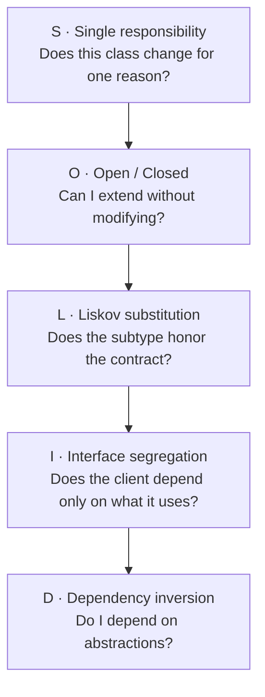
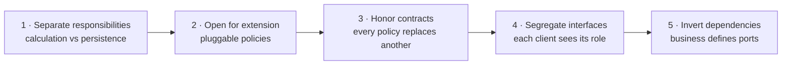

# SOLID principles

SOLID is an acronym for five object-oriented design principles that reduce coupling and
increase cohesion. The original idea comes from Robert C. Martin and was collected in the
early 2000s: each letter names an independent principle, but the five work together as a
system that keeps code easy to read, easy to test and cheap to change.

If you come from [getting started](/docs/getting-started), think of SOLID as the vocabulary
that lets you discuss design precisely. If you already write
[clean code](/docs/clean-code), think of SOLID as the next step: it is no longer only about
one readable function, but about how classes and modules collaborate over months and years.

This article explains each principle with the same orderly structure: what it says, which
problem it solves, what violation looks like, what good application looks like, and which
mistakes are common when trying it.

## What problem SOLID solves

Every sufficiently used system drifts toward the same decay: rigidity, fragility,
immobility and viscosity.

- **Rigidity:** a small change forces you to touch many files.
- **Fragility:** a change in one module breaks another that looked unrelated.
- **Immobility:** you cannot reuse a piece because it ships glued to ten others.
- **Viscosity:** doing the hack is easier than doing the right thing, so the design degrades
  every week.

SOLID attacks those four diseases from different angles. No single principle saves a
project on its own, but together they push toward small modules, explicit contracts and
dependencies pointing in one direction.

<Callout tone="info" title="SOLID is not dogma">
  Do not apply all five principles with the same intensity everywhere. In exploratory code or a
  two-day prototype, simplicity wins. In the business core that will live for years, SOLID pays off
  every week. Architecture is about choosing where to be strict.
</Callout>

## Big picture of the five principles

Each letter covers a different scale of design:



- **S** looks inside one class: a single reason to change.
- **O** looks at how the system grows: new variants without rewriting stable code.
- **L** looks at inheritance and polymorphism: extending without breaking expectations.
- **I** looks at contracts: small and cohesive interfaces.
- **D** looks at the direction of dependencies: business rules lead, details follow.

If you can only keep one sentence per principle, keep these: one reason to change, extend
without modifying, substitute without surprising, small interfaces, depend on abstractions.

## Single responsibility principle

Every module should have a single reason to change. A class with two responsibilities has
two different motives to be modified, two kinds of tests, two different readers and twice
the chance of conflict in every pull request.

Responsibility is not measured by method count, but by axes of change. Ask yourself: who
requests this change and why? If the answer is sometimes business and sometimes
infrastructure, two responsibilities are mixed.

### Symptoms you are violating single responsibility

- An `OrderService` class that calculates totals, saves to the database, sends emails and
  generates PDFs.
- Methods that only share class state by accident, not through real cohesion.
- Tests that must set up a database, network and filesystem to check a three-line business
  rule.
- Every report format change breaks the price calculation tests.

### Example: before and after

```ts title="coupled-order.ts"
// ❌ All mixed: business rules + persistence + notifications.
export class OrderService {
  async saveOrder(order: Order): Promise<void> {
    const total = order.lines.reduce((sum, line) => sum + line.price * line.qty, 0);
    const vat = total * 0.21;
    await db.query('INSERT INTO orders ...', [total + vat]);
    await mailer.send(order.customerEmail, `Your total is ${total + vat}`);
  }
}
```

```ts title="cohesive-order.ts"
// ✅ Each collaborator has one reason to change.
export class OrderTotal {
  static calculate(order: Order): number {
    const net = order.lines.reduce((sum, line) => sum + line.price * line.qty, 0);
    return net * (1 + VAT_RATE);
  }
}

export class OrderRepository {
  save(total: number): Promise<void> {
    return db.query('INSERT INTO orders ...', [total]);
  }
}

export class OrderNotifier {
  notify(email: string, total: number): Promise<void> {
    return mailer.send(email, `Your total is ${total}`);
  }
}
```

The first design forces you to touch `OrderService` when VAT changes, when the SQL table
changes or when the email text changes. The second lets you change each axis separately
and test the calculation without network or database mocks.

### How to apply it without overdesign

Do not create one class per method from day one. Start with an honest class and extract a
collaborator when you see one of these triggers: the file is bigger than you can read at a
glance, imports mix different domains, or a change forces you to understand two worlds at
once. Extracting late with a real motive beats fragmenting early out of fear.

<Callout tone="tip" title="Practical rule">
  If you cannot describe what the class does in one sentence without using the word “and”, it
  probably has more than one responsibility.
</Callout>

## Open/closed principle

Entities should be open for extension and closed for modification. When a new variant
arrives, you should be able to add it by creating new code, not by editing stable code that
already works and is already tested.

The typical enemy is the conditional chain that grows with every requirement: `if` for
card, `else if` for transfer, `else if` for wallet. Each new variant touches the same
function and puts every previous one at risk.

### Symptoms you are violating open and closed

- A giant `switch` that gains a new case every sprint.
- Fear of touching a central function because “everything goes through there”.
- Duplicating a whole function to avoid breaking the original.
- Git history shows the same file changing for completely different reasons.

### Example: strategy instead of conditionals

```ts title="closed-discounts.ts"
// ❌ Every new campaign forces you to modify this function.
export function discountFor(type: string, total: number): number {
  if (type === 'black-friday') return total * 0.8;
  if (type === 'member') return total * 0.9;
  return total;
}
```

```ts title="open-discounts.ts"
// ✅ Adding a campaign means adding a class, not editing existing ones.
export type DiscountPolicy = {
  appliesTo: (code: string) => boolean;
  apply: (total: number) => number;
};

export const discountPolicies: DiscountPolicy[] = [
  { appliesTo: (code) => code === 'black-friday', apply: (total) => total * 0.8 },
  { appliesTo: (code) => code === 'member', apply: (total) => total * 0.9 },
];

export function discountFor(code: string, total: number): number {
  const policy = discountPolicies.find((item) => item.appliesTo(code));
  return policy ? policy.apply(total) : total;
}
```

Composition and polymorphism replace the growing conditional. The extension point becomes
explicit: the policy list. Tests for each campaign live next to their policy and do not
break each other.

### When not to force the abstraction

If there are only two variants and no third one is expected, a clear conditional is better
than a premature hierarchy. Apply open and closed when you see the third case coming or
when change comes from different actors: for example, marketing adds campaigns while the
payments team owns the base calculation.

## Liskov substitution principle

A subtype must be able to replace its base type without breaking the contract: same or
weaker preconditions, same or stronger postconditions, no lateral surprises.

In plain language: if your code expects a `Bird` that flies, do not pass a `Penguin` that
throws when flying. The bug is not the penguin, but a wrong hierarchy.

### Symptoms you are violating Liskov substitution

- Methods that throw `throw new Error('Not supported')` in some subclasses.
- Subclasses that demand more than the base: more required parameters, strict ordering,
  hidden prior state.
- Tests that pass with the base class but fail with the subclass on the same scenario.
- Comments like “do not use this subclass here because it breaks that”.

### Example: a square is not a mutable rectangle

```ts title="broken-liskov.ts"
// ❌ Square breaks Rectangle expectations: width and height are no longer independent.
export class Rectangle {
  constructor(
    public width: number,
    public height: number,
  ) {}
  setWidth(value: number): void {
    this.width = value;
  }
  area(): number {
    return this.width * this.height;
  }
}

export class Square extends Rectangle {
  override setWidth(value: number): void {
    this.width = value;
    this.height = value;
  }
}
```

```ts title="honored-liskov.ts"
// ✅ Small immutable contracts: nobody promises what it cannot keep.
export type Shape = {
  area: () => number;
};

export function rectangle(width: number, height: number): Shape {
  return { area: () => width * height };
}

export function square(side: number): Shape {
  return { area: () => side * side };
}
```

The second version removes the problematic inheritance and replaces it with a minimal
contract both shapes can honor. When inheritance forces you to lie, prefer composition or
narrower contracts.

<Callout tone="warning" title="Fragile inheritance">
  Inheritance shares much more than methods: it shares expectations. If a subclass needs to disable
  inherited behavior, the hierarchy is inverted or unnecessary.
</Callout>

## Interface segregation principle

Several specific interfaces are better than one general-purpose interface. A client should
not depend on methods it does not use, because each unnecessary method is a reason to
recompile, retest and get confused.

This principle shines in large teams: a fat interface forces every client to follow the pace
of its fastest-changing member.

### Symptoms you are violating interface segregation

- Implementations with empty methods or “not implemented” throws.
- Changing a method for client A breaks client B deployment even though B never used it.
- Interfaces with role prefixes: `printForAdmin`, `printForGuest`, `scanForAdmin`.
- Huge mocks in tests that only exercise one method out of ten.

### Example: role interfaces

```ts title="fat-interface.ts"
// ❌ The simple reader pays the cost of printing, scanning and faxing.
export type AllInOnePrinter = {
  print: (doc: string) => void;
  scan: (doc: string) => void;
  fax: (doc: string) => void;
};
```

```ts title="segregated-interfaces.ts"
// ✅ Each client depends only on what it really uses.
export type Printer = {
  print: (doc: string) => void;
};

export type Scanner = {
  scan: (doc: string) => void;
};

export class SimplePrinter implements Printer {
  print(doc: string): void {
    console.log(`Printing ${doc}`);
  }
}

export class OfficeMachine implements Printer & Scanner {
  print(doc: string): void {
    console.log(`Printing ${doc}`);
  }
  scan(doc: string): void {
    console.log(`Scanning ${doc}`);
  }
}
```

Segregating does not mean pulverizing: two or three cohesive methods per interface is
usually the sweet spot. If an interface fits on one line and its name describes a role, you
are on track.

## Dependency inversion principle

High-level modules should not depend on low-level ones; both should depend on
abstractions. Business logic defines what it needs and infrastructure adapts, never the
other way around.

Without this principle, your domain ends up importing SQL, HTTP or framework details. With
it, you can test business rules without a database and switch providers without rewriting
rules.

### Symptoms you are violating dependency inversion

- `import { PostgresClient } from './infra'` inside a domain entity.
- You cannot test a use case without starting containers.
- Switching mail libraries forces you to edit business services.
- The domain folder knows table names, URLs and API keys.

### Example: the domain defines the port

```ts title="direct-dependency.ts"
// ❌ The use case knows the concrete detail.
import { PostgresOrders } from './postgres-orders';

export class Checkout {
  async run(order: Order): Promise<void> {
    await new PostgresOrders().save(order);
  }
}
```

```ts title="inverted-dependency.ts"
// ✅ The use case depends on an abstraction that infrastructure implements.
export type OrderStore = {
  save: (order: Order) => Promise<void>;
};

export class Checkout {
  constructor(private readonly store: OrderStore) {}

  run(order: Order): Promise<void> {
    return this.store.save(order);
  }
}
```

This twist is the gateway to [hexagonal architecture](/docs/c4-model#components): the core
exposes ports and adapters implement them. In the [component](/docs/c4-model#components)
diagrams you will see exactly those arrows pointing inward, toward the business.

<Callout tone="tip" title="Injection without magic">
  You do not need a DI container from day one. Passing dependencies through the constructor and
  composing in a single entry point is already dependency inversion.
</Callout>

## How the five principles combine

No principle lives alone. A typical refactoring flow applies all five in sequence:



Picture a full checkout: `OrderTotal` calculates with single responsibility, discount
campaigns are added by extension without touching the calculation, each campaign replaces
any other because it honors the same contract, the web shop only sees the checkout
interface while the warehouse only sees the preparation one, and the whole use case depends
on ports that Postgres implements in production and memory implements in tests.

When that fit happens, [names explain](/docs/clean-code) by themselves,
[functions stay small](/docs/clean-code) naturally, and the system accepts weekly changes
without fear.

## Common mistakes when applying SOLID

- **Premature overengineering:** creating ten interfaces for a CRUD with a single client.
  Start concrete and abstract at the second or third real case.
- **Confusing layers with principles:** moving code between folders does not reduce coupling
  if dependencies still point at details. Import direction is what matters.
- **Testing implementation instead of contract:** if tests know concrete classes instead of
  ports, every legitimate refactoring breaks legitimate tests.
- **Applying Liskov only to classes:** it also holds for APIs, events and schemas. If
  endpoint version 2 demands more and promises less than version 1, it breaks Liskov even
  without inheritance.
- **Database-mirror interfaces:** segregating is useless when each interface mirrors a
  table. Design from client needs, not from the schema.

## Checklist for your next pull request

Review this list before asking for review, and link it in your PR template if it helps:

- Each new class is described in one sentence without using “and”.
- No stable function was modified to add a variant: new code was added.
- Every subclass or implementation passes the tests written against the base contract.
- No client imports methods it does not use; test mocks stay small.
- The domain does not import infrastructure; dependencies enter via constructor.
- Business changes are tested without a database or network.

If two or more points fail, the PR is not bad: it simply reveals where the design asks for
an extraction or an abstraction. SOLID works best as a review conversation guide, not as an
exam before committing.

## Going deeper

- Consolidate the basics with [clean code](/docs/clean-code) ideas and the
  [getting started](/docs/getting-started) habits.
- Go visual with the [C4 model](/docs/c4-model#components): context, containers and
  components are the map where your ports and adapters live.
- Practice today: pick one class in your project that mixes two change axes, extract a
  collaborator, define its minimal interface and invert the dependency. Repeat tomorrow with
  another one.

<Callout tone="info" title="Suggested reading">
  Principles make full sense when you watch them in a real system for months. Come back to this
  article after your next big refactoring: each reread reveals a nuance that hurry hid the first
  time.
</Callout>
