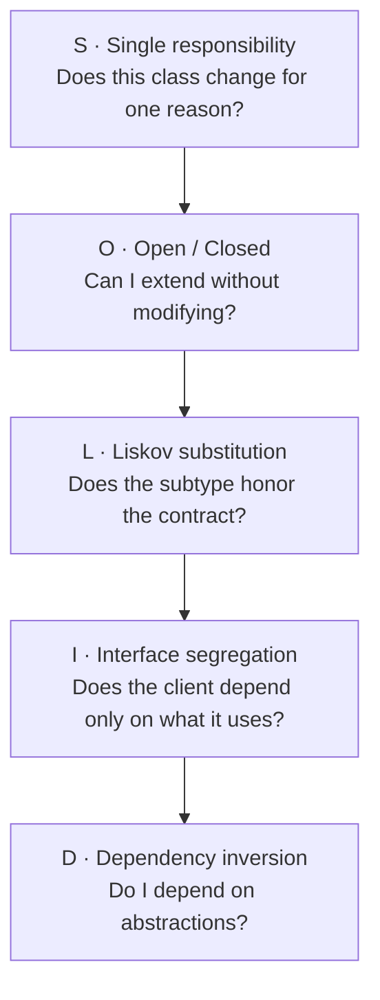
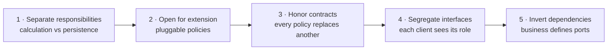

# SOLID principles

SOLID is an acronym for five object-oriented design principles that reduce coupling and
increase cohesion. The original idea comes from Robert C. Martin and was collected in the
early 2000s: each letter names an independent principle, but the five work together as a
system that keeps code easy to read, easy to test and cheap to change.

Think of SOLID as design grammar. It does not tell you which application to build. It tells
you how to write code sentences that others can understand and modify without breaking
anything.

If you come from [getting started](/docs/getting-started), think of SOLID as the vocabulary
that lets you discuss design precisely. If you already write
[clean code](/docs/clean-code), think of SOLID as the next step: it is no longer only about
one readable function, but about how classes and modules collaborate over months and years.

This article explains each principle with the same orderly structure: what it says, which
problem it solves, what violation looks like, what good application looks like, an everyday
analogy, concrete steps to apply it, and common mistakes when trying it.

The goal is not to memorize definitions. The goal is that tomorrow, facing a muddy class,
you know which question to ask and which small move improves the design.

## How to read this article

This article is long on purpose. Do not read it in one rush if you are in a hurry.

If you have ten minutes, read the introduction, the big picture and the principle that
hurts most today. Each principle works on its own.

If you have one hour, read one full principle with its examples and do the guided exercise
at the end. One real refactoring teaches more than five readings.

If you are a tech lead, use the pull request checklist as a conversation script in reviews.
SOLID works better discussed as a team than imposed as a rule.

Every principle section follows the same skeleton so you can jump without getting lost:
exact definition, violation symptoms, before-and-after example with code, everyday analogy,
application steps and typical mistake. Once you know the skeleton, you will find any idea
in seconds.

One note on language: all examples are in Go. Where the text says “class”, read “type or
struct”; where it says “constructor”, read “struct fields”; where it says “inheritance”,
think “embedding and type substitution”.

## What problem SOLID solves

Every sufficiently used system drifts toward the same decay. Language and framework do not
matter. Prolonged use, changing requirements and delivery pressure push code into the same
swamp.

SOLID exists to slow that decay with small repeated decisions. It does not promise
perfection. It promises that changing the system stays cheap after year two.

### The four diseases of design

Robert C. Martin described four symptoms of sick design. Learn them by heart, because they
are the diagnosis that justifies every principle.

- **Rigidity:** a small change forces you to touch many files. You want to move one field
  and end up editing twelve classes, three tests and two scripts.
- **Fragility:** a change in one module breaks another that looked unrelated. You fix the
  VAT calculation and email delivery falls over.
- **Immobility:** you cannot reuse a piece because it ships glued to ten others. The
  discount calculation would be useful in another service, but it drags database and HTTP.
- **Viscosity:** doing the hack is easier than doing the right thing. Good design takes
  five steps and the shortcut takes one, so the system degrades every week.

When you hear “touching this is scary”, there is almost always rigidity. When you hear “I
do not know why that broke”, there is fragility. When you hear “better copy and paste”,
there is immobility. When you hear “we will fix it later”, there is viscosity.

### Coupling and cohesion in two sentences

Coupling measures how much one module depends on others. Cohesion measures how much the
pieces inside one module belong together.

We want low coupling and high cohesion. Without jargon: each piece should know little
about the others, and whatever lives together should have a reason to live together.

Each SOLID principle is a concrete tactic to move those two needles. Single responsibility
raises cohesion. Dependency inversion lowers coupling. The rest do both from different
angles.

### History of the acronym in 30 seconds

The five principles were born separately in the nineties in writings by Martin, Barbara
Liskov and others. Michael Feathers coined the SOLID acronym around 2000 to teach them
together.

Letter order does not signal priority. S is usually taught first because it is the most
intuitive. D is usually taught last because it assumes you understand contracts and
abstractions.

You do not need the history to apply them. But it helps to remember they are not a
framework fad: they survived decades of languages because they describe how people think
when they change чужой code written by others.

<Callout tone="info" title="SOLID is not dogma">
  Do not apply all five principles with the same intensity everywhere. In exploratory code or a
  two-day prototype, simplicity wins. In the business core that will live for years, SOLID pays off
  every week. Architecture is about choosing where to be strict.
</Callout>

## Big picture of the five principles

Each letter covers a different scale of design. Read them as five questions asked at
different moments of daily work.



The table below summarizes each principle in one line and previews its full section.

| Letter | Principle             | Guiding question                     | Section                       |
| ------ | --------------------- | ------------------------------------ | ----------------------------- |
| S      | Single responsibility | Does it change for one reason?       | One reason to change          |
| O      | Open and closed       | Do I extend without modifying?       | New variants without risk     |
| L      | Substitution          | Does the subtype honor the contract? | Substitute without surprising |
| I      | Interface segregation | Do I depend only on what I use?      | Small contracts               |
| D      | Dependency inversion  | Do I depend on abstractions?         | Business leads                |

- **S** looks inside one class: a single reason to change. It is the most local principle
  and the one you apply most day to day.
- **O** looks at how the system grows: new variants without rewriting stable code. It is
  the principle of fearless growth.
- **L** looks at type substitution: extending without breaking expectations. It
  is the principle of trust in abstractions.
- **I** looks at contracts: small and cohesive interfaces. It is the principle of respect
  between clients.
- **D** looks at the direction of dependencies: business rules lead, details follow. It is
  the architectural principle par excellence.

If you can only keep one sentence per principle, keep these: one reason to change, extend
without modifying, substitute without surprising, small interfaces, depend on abstractions.

Memorize the five questions from the diagram. In your next code review, ask them out loud
one by one. That alone applies eighty percent of SOLID.

## Single responsibility principle

Every module should have a single reason to change. A class with two responsibilities has
two different motives to be modified, two kinds of tests, two different readers and twice
the chance of conflict in every pull request.

This is the highest-return principle. If you apply only one, apply this one. Most muddy
code you will see in your career is, at bottom, a mix of responsibilities.

Responsibility is not measured by method count, but by axes of change. Ask yourself: who
requests this change and why? If the answer is sometimes business and sometimes
infrastructure, two responsibilities are mixed.

Another way to see it: a responsibility is an actor who can request changes. The billing
team, the infrastructure team and the design team are different actors. If one class serves
two actors, it has two responsibilities.

### What exactly single responsibility says

Short definition: a module should have one, and only one, reason to change.

Working definition: if you can describe two plausible future changes from different motives
and both touch the same class, that class already violates the principle.

Note it talks about reasons to change, not actions performed. A class can do three
technical steps and still have one responsibility, if all three always change together for
the same reason. And a class with a single public method can have two responsibilities if
that method mixes two axes.

### Symptoms you are violating single responsibility

- A `Service` type that calculates totals, saves to the database, sends emails and
  generates PDFs. Four actors, four change rhythms, one type.
- Methods that only share class state by accident, not through real cohesion. Split the
  class in half and neither method misses the other half.
- Tests that must set up a database, network and filesystem to check a three-line business
  rule. The test tells you there is more than one thing inside.
- Every report format change breaks the price calculation tests. Coupled tests reveal
  coupled responsibilities.
- Imports mixing worlds: SQL next to HTML templates next to tax rules in one file. Each
  import hints at a change axis.
- The class grows every sprint for different reasons: VAT today, PDF logo tomorrow, mail
  provider next week.

### Example: before and after

Typical case: an order service that calculates, persists and notifies in one method. It
works the first month. By month six, every email change risks billing.

```go title="coupled-order.go"
// Poor: calculation, persistence and notifications in one method.
package orders

type Service struct {
  DB   *Database
  Mail *Mailer
}

func (s *Service) Save(o Order) error {
  total := 0.0
  for _, l := range o.Lines {
    total += l.Price * float64(l.Qty)
  }
  total += total * 0.21
  if err := s.DB.InsertOrder(total); err != nil {
    return err
  }
  return s.Mail.Send(o.CustomerEmail, total)
}
```

The problem is not length. The problem is that three different motives bring you to one
file: a tax change, a schema change and a copy change.

```go title="cohesive-order.go"
// Better: each collaborator has one reason to change.
package orders

const VATRate = 0.21

func CalculateTotal(o Order) float64 {
  net := 0.0
  for _, l := range o.Lines {
    net += l.Price * float64(l.Qty)
  }
  return net * (1 + VATRate)
}

type Repository struct {
  DB *Database
}

func (r *Repository) Save(total float64) error {
  return r.DB.InsertOrder(total)
}

type Notifier struct {
  Mail *Mailer
}

func (n *Notifier) Notify(to string, total float64) error {
  return n.Mail.Send(to, total)
}
```

The first design forces you to touch `Service` when VAT changes, when the SQL table
changes or when the email text changes. The second lets you change each axis separately
and test the calculation without network or database mocks.

Notice the effect on tests. Before, you needed database and email to test a
multiplication. After, the calculation is tested with input and output numbers. Fast pure
tests are the immediate reward of separating responsibilities.

### Second example: the report that did everything

A second very common case: a `Report` type that queries the database, formats HTML and
writes the file. Three axes again.

```go title="mixed-report.go"
// Poor: query, formatting and writing in one type.
package report

type Report struct {
  DB    *Database
  Disk  *Storage
}

func (r *Report) BuildAndSave(userID string) error {
  rows, err := r.DB.QueryRows(userID)
  if err != nil {
    return err
  }
  html := "<ul>"
  for _, row := range rows {
    html += "<li>" + row.Name + "</li>"
  }
  html += "</ul>"
  return r.Disk.SaveHTML(userID, html)
}
```

```go title="split-report.go"
// Better: three collaborators, three change rhythms.
package report

import "os"

type Data struct {
  DB *Database
}

func (d *Data) Rows(userID string) ([]Row, error) {
  return d.DB.QueryRows(userID)
}

type View struct{}

func (View) Render(rows []Row) string {
  html := "<ul>"
  for _, row := range rows {
    html += "<li>" + row.Name + "</li>"
  }
  return html + "</ul>"
}

type Storage struct{}

func (Storage) SaveHTML(userID, html string) error {
  return os.WriteFile("/reports/"+userID+".html", []byte(html), 0o644)
}
```

Now the designer can change the template without touching SQL. The DBA can optimize the
query without touching HTML. Everyone deploys at their own pace.

### Everyday analogy of single responsibility

Think of a restaurant. The cook cooks, the waiter serves and the accountant bills. If one
person does all three, the restaurant works with ten customers and collapses with a
hundred.

Code is the same. With little traffic, the multi-purpose class holds. As the system grows,
each role must change at its own pace and the one-person orchestra becomes the bottleneck.

Separating responsibilities means hiring specialists: each does one thing well and the
whole scales.

### How to apply it without overdesign

Do not create one class per method from day one. Start with an honest class and extract a
collaborator when you see one of these clear triggers.

1. The file is bigger than you can read at a glance. If you need to scroll to understand
   what it does, more than one idea lives inside.
2. Imports mix different domains. SQL next to templates next to tax rules is guaranteed
   mixing.
3. One change forces you to understand two worlds at once. If changing VAT requires
   understanding email delivery, something does not belong in that class.
4. Tests need infrastructure to check pure logic. The hard test is the most honest
   thermometer.

Extracting late with a real motive beats fragmenting early out of fear. Premature
fragmentation creates dozens of trivial pieces that are hard to discover. Timely
extraction creates few collaborators with clear names.

Minimum procedure: pick the most painful axis, move that code to a domain-named type,
leave the original delegating, and move its tests. One axis per refactoring. Never rewrite
the whole class at once.

<Callout tone="tip" title="Practical rule">
  If you cannot describe what the class does in one sentence without using the word “and”, it
  probably has more than one responsibility. “Calculates totals and sends emails” is two
  responsibilities. “Calculates the order total” is one.
</Callout>

### Typical mistake when chasing single responsibility

The most common mistake is confusing responsibility with method. Splitting a 300-line class
into three 100-line classes with no criterion does not help: now you have three coupled
classes instead of one.

The question is not how many lines each piece has, but whether each piece changes for a
different reason. Two classes that always change together for the same reason should be
one. One class that changes for two reasons should be two.

Another mistake: extracting by technical layers instead of change axes. Creating
`OrderHelper`, `OrderManager` and `OrderUtils` does not separate responsibilities: it just
spreads the same mess over three vague names. Names must state the business what, not the
technical how.

## Open/closed principle

Entities should be open for extension and closed for modification. When a new variant
arrives, you should be able to add it by creating new code, not by editing stable code that
already works and is already tested.

This principle protects what already works. Every time you edit a stable function to add a
case, you bet its whole test history that you broke nothing. Extending without modifying
removes that bet.

The typical enemy is the conditional chain that grows with every requirement: `if` for
card, `else if` for transfer, `else if` for wallet. Each new variant touches the same
function and puts every previous one at risk.

### What exactly the open and closed principle says

Short definition: open for extension, closed for modification.

Working definition: adding case N+1 should cost creating one new file and registering the
variant, never rewriting the logic of the previous N cases.

Closed does not mean frozen forever. It means stable behavior is not edited for every
variant: it is extended through composition, polymorphism, registration or configuration.

### Symptoms you are violating open and closed

- A giant `switch` that gains a new case every sprint. Each new case edits the same
  critical file.
- Fear of touching a central function because “everything goes through there”. Fear is the
  most reliable symptom: it means extending equals risking.
- Duplicating a whole function to avoid breaking the original. Duplication confesses that
  modifying feels scary.
- Git history shows the same file changing for completely different reasons. A campaign
  today, a payment method tomorrow, a tax the day after.
- Every new variant requires rereading all previous ones to avoid breaking them. The cost
  of adding grows with case count instead of staying flat.

### Example: strategy instead of conditionals

Classic case: campaign discounts. It starts with two `if`s. A year later there are twelve
and the function is untouchable.

```go title="closed-discounts.go"
// Poor: every new campaign forces you to modify this function.
package discounts

func ForCode(code string, total float64) float64 {
  if code == "black-friday" {
    return total * 0.8
  }
  if code == "member" {
    return total * 0.9
  }
  return total
}
```

The hidden cost: each new campaign reopens the tests of all previous ones. A copy error in
campaign twelve can break campaign one.

```go title="open-discounts.go"
// Better: adding a campaign means registering a new policy.
package discounts

type Policy interface {
  AppliesTo(code string) bool
  Apply(total float64) float64
}

type Discount struct {
  Code string
  Rate float64
}

func (d Discount) AppliesTo(code string) bool {
  return code == d.Code
}

func (d Discount) Apply(total float64) float64 {
  return total * d.Rate
}

var Policies = []Policy{
  Discount{Code: "black-friday", Rate: 0.8},
  Discount{Code: "member", Rate: 0.9},
}

func ForCode(code string, total float64) float64 {
  for _, p := range Policies {
    if p.AppliesTo(code) {
      return p.Apply(total)
    }
  }
  return total
}
```

Composition and polymorphism replace the growing conditional. The extension point becomes
explicit: the policy list. Tests for each campaign live next to their policy and do not
break each other.

Adding campaign thirteen is now an additive change: one new policy plus its test. No stable
file is touched. Code review is five lines instead of fifty.

### Second example: payment method registry

The same pattern works for payments. Instead of a `switch` per provider, register
strategies.

```go title="registered-payments.go"
// Better: each new provider registers itself; the core is never edited.
package payments

import "errors"

type Method interface {
  ID() string
  Charge(amount float64) error
}

type Registry struct {
  methods map[string]Method
}

func NewRegistry() *Registry {
  return &Registry{methods: make(map[string]Method)}
}

func (r *Registry) Register(m Method) {
  r.methods[m.ID()] = m
}

func (r *Registry) Charge(id string, amount float64) error {
  m, ok := r.methods[id]
  if !ok {
    return errors.New("unknown payment method: " + id)
  }
  return m.Charge(amount)
}
```

The core stays closed: `charge` never changes. The system stays open: any team adds a
provider by registering a strategy. That is the essence of the principle.

### Everyday analogy of the open and closed principle

Think of a power strip. The house wiring stays closed: you do not reopen it every time you
buy a device. The strip stays open: you plug the new thing without touching the existing
ones.

Bad design strips wires for every new device. Good design leaves a clear extension point
where the new plugs in.

Your code needs power strips: policy lists, strategy registries, middlewares, plugins.
Places where adding does not mean breaking.

### When not to force the abstraction

If there are only two variants and no third one is expected, a clear conditional is better
than a premature hierarchy. Abstraction costs: more files, more indirection, more concepts.

Apply open and closed when you see one of these signals. First: the third case peeks out
and the conditional already annoys. Second: change comes from different actors, for example
marketing adds campaigns while payments owns the base calculation. Third: fear of touching
grows with every review.

Golden rule: abstract at the second repeated real case, never at the first imagined one.
Two cases are coincidence. Three cases are a pattern asking for extension.

### Typical mistake when opening for extension

The classic mistake is opening too early with a six-class hierarchy for two cases. The cure
is worse than the disease: understanding the flow now requires jumping between files.

Start with the honest conditional. When it hurts, extract the minimal strategy: a list, a
registry or a small interface. Grow the abstraction at the pace of pain, not at the pace of
imagination.

The other mistake is opening the wrong point. Making configurable what never changes while
leaving rigid what changes monthly. Watch real change history before deciding what stays
open.

## Liskov substitution principle

A subtype must be able to replace its base type without breaking the contract: same or
weaker preconditions, same or stronger postconditions, no lateral surprises.

This is the principle of trust. When you see a base type in a signature, you must be able
to reason about the code without knowing every concrete subclass. If each subclass demands
knowing its tricks, polymorphism is useless.

In plain language: if your code expects a `Bird` that flies, do not pass a `Penguin` that
throws when flying. The bug is not the penguin, but a wrong hierarchy.

### What exactly substitution says

Short definition: wherever the base is expected, any subtype must do without breaking
anything.

Working definition with three rules. First: the subtype cannot demand more than the base.
If the base accepts any integer, the subclass cannot demand only positives. Second: the
subtype must guarantee at least what the base guarantees. If the base promises never to
return null, the subclass cannot return it either. Third: the subtype cannot add surprising
side effects the base never announced.

These rules hold for classes, but also for APIs, events and schemas. If endpoint version 2
demands more and promises less than version 1, it breaks substitution even without
inheritance.

### Symptoms you are violating Liskov substitution

- Methods that throw `throw new Error('Not supported')` in some subclasses. The base
  promises something the child does not keep.
- Subclasses that demand more than the base: more required parameters, strict ordering,
  hidden prior state. Each extra demand is a strengthened precondition.
- Tests that pass with the base class but fail with the subclass on the same scenario. The
  contract test is the cheapest detector.
- Comments like “do not use this subclass here because it breaks that”. If a warning is
  needed, the contract is already broken.
- `instanceof` checks scattered through client code to treat each subclass differently.
  The client should not need to know who is who.

### Example: a square is not a mutable rectangle

The canonical example: a `Square` reusing a mutable `Rectangle` through embedding. It looks natural
in geometry, but it breaks the contract when the rectangle promises independent width and
height.

```go title="broken-liskov.go"
// Poor: the square reuses the rectangle but breaks its contract.
package shapes

type Rectangle struct {
  Width, Height float64
}

func (r *Rectangle) SetWidth(v float64) { r.Width = v }
func (r *Rectangle) Area() float64      { return r.Width * r.Height }

type Square struct {
  Rectangle
}

func (s *Square) SetWidth(v float64) {
  s.Width = v
  s.Height = v
}
```

The failure is subtle: code using `Rectangle` and changing only the width expects height to
stay. With `Square`, height silently moves and the area surprises.

```go title="honored-liskov.go"
// Better: small contracts that everyone can keep.
package shapes

type Shape interface {
  Area() float64
}

type rectangle struct {
  width, height float64
}

func (r rectangle) Area() float64 { return r.width * r.height }

func NewRectangle(width, height float64) Shape {
  return rectangle{width: width, height: height}
}

type square struct {
  side float64
}

func (s square) Area() float64 { return s.side * s.side }

func NewSquare(side float64) Shape {
  return square{side: side}
}
```

The second version removes the problematic reuse and replaces it with a minimal
contract both shapes can honor. When reuse forces you to lie, prefer composition or
narrower contracts.

General moral: reuse through embedding models substitutable behavior, not visual similarity. If the
type must disable or twist reused behavior, the hierarchy is unnecessary.

### Second example: compatible API versions

The same principle governs your endpoints. Version 2 must substitute version 1 for old
clients, or you must version explicitly.

Breaking substitution: demanding a new required field version 1 never asked for, returning
null where an object used to be, or changing the meaning of a status code.

Honoring it: adding optional fields, accepting everything the previous version accepted,
and keeping documented guarantees. Think through every API change with the three
precondition and postcondition rules.

### Everyday analogy of substitution

Think of USB-C chargers. Any USB-C charger must work in any USB-C port for the basics:
charging. If one charger fries certain phones, it is not a true substitute even with the
same shape.

The base type is the promising standard. The subtype is each manufacturer. Substitution
holds when you can mix brands without surprises.

Your interfaces are standards. Each implementation is a manufacturer. Design the standard
for what everyone can meet, not for what the best one can boast.

### How to fix a broken hierarchy step by step

1. Write the test against the base contract, not the concrete class. Use only what the
   base promises.
2. Run that test with every subclass. The failing one reveals the exact break.
3. Decide: either narrow the base to what everyone meets, or break the hierarchy and use
   composition. There is no honest third way.
4. If you narrow the base, move specifics to separate interfaces used only by those who
   need them. That connects to interface segregation.
5. Rerun the contract test with all variants. Green everywhere means substitution
   restored.

<FragileInheritanceNote />

### Typical mistake when modeling hierarchies

The typical mistake is embedding for data resemblance instead of behavior substitutability.
`Square` and `Rectangle` share fields but not mutable behavior. Resemblance deceives.

Control question before embedding: can I use the derived type in every base scenario without
reading its code? If the answer needs a “depends”, do not embed for reuse. Compose with
interfaces or define a smaller contract.

## Interface segregation principle

Several specific interfaces are better than one general-purpose interface. A client should
not depend on methods it does not use, because each unnecessary method is a reason to
recompile, retest and get confused.

This principle shines in large teams: a fat interface forces every client to follow the pace
of its fastest-changing member. Segregating means splitting rhythms.

It also shines in tests: a small interface is mocked in two lines. A fat one demands a huge
mock to test a single call.

### What exactly interface segregation says

Short definition: no client should depend on methods it does not use.

Working definition: if an implementation leaves empty methods or your mocks have ten
methods to test one, the interface is too fat. Split it by client roles.

Segregating does not mean atomizing to one method per interface always. It means grouping
by usage cohesion: what is used together lives together. Two or three cohesive methods are
usually the sweet spot.

### Symptoms you are violating interface segregation

- Implementations with empty methods or “not implemented” throws. Emptiness confesses the
  contract is surplus for that client.
- Changing a method for client A breaks client B deployment even though B never used it.
  Coupling travels through methods nobody asked for.
- Interfaces with role prefixes: `PrintForAdmin`, `PrintForGuest`, `ScanForAdmin`. Prefixes
  betray several contracts glued together.
- Huge mocks in tests that only exercise one method out of ten. The test pays the fat
  interface toll.
- Synchronized deployments between teams sharing no functionality. If the printing team
  must deploy when scanning changes, something joins what should be separate.

### Example: role interfaces

Classic case: an all-in-one machine that prints, scans and faxes. The simple reader only
wants to print, but the fat interface forces it to know everything.

```go title="fat-interface.go"
// Poor: the simple reader pays for methods it never uses.
package printing

type AllInOne interface {
  Print(doc string)
  Scan(doc string)
  Fax(doc string)
}
```

Every method added to this interface affects all clients, whether they use it or not. The
fax change retests printing.

```go title="segregated-interfaces.go"
// Better: each client depends only on what it really uses.
package printing

import "fmt"

type Printer interface {
  Print(doc string)
}

type Scanner interface {
  Scan(doc string)
}

type SimplePrinter struct{}

func (SimplePrinter) Print(doc string) {
  fmt.Println("Printing", doc)
}

type OfficeMachine struct{}

func (OfficeMachine) Print(doc string) {
  fmt.Println("Printing", doc)
}

func (OfficeMachine) Scan(doc string) {
  fmt.Println("Scanning", doc)
}
```

Segregating does not mean pulverizing: two or three cohesive methods per interface is
usually the sweet spot. If an interface fits on one line and its name describes a role, you
are on track.

The full machine implements both roles: `Printer` and `Scanner`. Each client requests only its
role. The scanner change no longer touches whoever only prints.

### Second example: role-split service API

The same pattern works for services. Instead of a twenty-method `UserService`, segregate
by real usage.

```go title="segregated-service.go"
// Better: each use case requests only its contract.
package users

type Reader interface {
  FindByID(id string) (User, error)
}

type Writer interface {
  Save(u User) error
}

type ProfilePage struct {
  Users Reader
}

type Registration struct {
  Users Writer
}
```

The profile page cannot write even if it wants to: it never sees the method. Registration
cannot over-read. Less surface, fewer mistakes, less coupling.

### Everyday analogy of small interfaces

Think of a remote control. The hotel remote has five big buttons: power, volume and
channels. The technician remote has eighty tiny buttons.

Give the guest the small one. Give the technician the full one. Do not hand the guest the
eighty-button remote “just in case”: you will only get calls at reception.

Your clients are guests and technicians. Design the remote for whoever uses it.

### How to segregate without overshooting

1. List who uses the fat interface and which methods each one touches. Real data rules,
   not intuition.
2. Group methods always used together. Each group is a candidate interface with a role
   name.
3. Make the full class implement several small interfaces. No code is duplicated: only the
   way of looking at the class changes.
4. Change each client to request its minimal role. Structs become honest: they state
   what they truly need.
5. If a group has one method and one client, ask whether the abstraction is surplus.
   Segregating does not force single-use interfaces.

<Callout tone="tip" title="Role name, not class name">
  `Printer` and `UserReader` describe roles. `IPrinterManager` or `UserService` describe vagueness.
  If the name needs “Manager”, “Helper” or “Utils”, you have not seen the role yet.
</Callout>

### Typical mistake when segregating interfaces

Overshooting: creating one interface per method and ending with thirty single-use
contracts. Navigation becomes impossible and every change edits five files.

The antidote is grouping by real usage cohesion. Measure: are these two methods always
mocked together? Then they belong to one interface. Do they never meet in one test? Then
they go separate.

## Dependency inversion principle

High-level modules should not depend on low-level ones; both should depend on
abstractions. Business logic defines what it needs and infrastructure adapts, never the
other way around.

This is the most architectural principle. The previous four improve classes. This one
decides the shape of the whole system: where dependency arrows point.

Without this principle, your domain ends up importing SQL, HTTP or framework details. With
it, you can test business rules without a database and switch providers without rewriting
rules.

### What exactly dependency inversion says

Short definition: depend on abstractions, not on concretions.

Working definition with two rules. First: business code does not import infrastructure
code. No SQL clients, no mail SDKs, no framework details. Second: infrastructure implements
interfaces defined by the business. The port lives in the domain; the adapter lives
outside.

The name “inversion” comes from flipping the usual direction: instead of the business
calling the detail, the detail plugs into the business.

### Symptoms you are violating dependency inversion

- `import "myapp/infra/postgres"` inside the domain package. The import already
  tells the story: the business knows the detail.
- You cannot test a use case without starting containers. If pure logic demands Docker,
  the arrow points the wrong way.
- Switching mail libraries forces you to edit business services. The provider rules over
  your rules.
- The domain folder knows table names, URLs and API keys. Details leak where they should
  not.
- Every infrastructure change reopens business tests. Tests reveal arrow direction.

### Example: the domain defines the port

Direct case: a checkout saving orders. The first version instantiates the concrete detail
inside the use case.

```go title="direct-dependency.go"
// Poor: the use case knows the concrete detail.
package checkout

import "myapp/infra/postgres"

type Checkout struct{}

func (Checkout) Run(o Order) error {
  store := postgres.NewOrderStore()
  return store.Save(o)
}
```

The cost: testing `Checkout` demands Postgres. Switching engines touches the use case. The
business obeys the detail.

```go title="inverted-dependency.go"
// Better: the use case depends on an abstraction.
package checkout

type OrderStore interface {
  Save(o Order) error
}

type Checkout struct {
  Store OrderStore
}

func (c Checkout) Run(o Order) error {
  return c.Store.Save(o)
}
```

Now the test uses a three-line in-memory store. Production plugs Postgres without touching
the use case. The arrow points inward, toward the business.

This twist is the gateway to [hexagonal architecture](/docs/c4-model#level-3-components): the core
exposes ports and adapters implement them. In the [component](/docs/c4-model#level-3-components)
diagrams you will see exactly those arrows pointing inward, toward the business.

### Second example: swappable notifications

The same twist works for email, SMS or push. The business defines “I want to notify”;
outside, the channel is decided.

```go title="notification-ports.go"
// Better: the business asks for the what; infrastructure picks the how.
package shipping

type Notifier interface {
  Notify(to, message string) error
}

type Shipment struct {
  Notices Notifier
}

func (s Shipment) Dispatch(o Order) error {
  // ... shipping rules ...
  return s.Notices.Notify(o.CustomerEmail, "Your order is on its way")
}
```

Tomorrow you switch mail providers by editing one adapter, not shipping. The day after you
add SMS by implementing the same port. The use case never notices.

### Everyday analogy of inverted dependency

Think of plugs and appliances. The appliance is not welded to the power plant: it plugs
into a standard. The company can swap turbines without entering your home.

Your use case is the appliance. The database is the plant. The port is the standard plug.
Whoever defines the standard rules compatibility.

Without a standard, every appliance demands its own plant. With a standard, parts evolve
separately.

<Callout tone="tip" title="Injection without magic">
  You do not need a DI container from day one. Receiving dependencies as fields and wiring in `main`
  is already dependency inversion. Magic can wait; arrow direction cannot.
</Callout>

### How to invert an existing dependency step by step

1. Spot the forbidden import: domain importing infrastructure. Mark it.
2. Extract the minimal interface the use case needs, with a business name. Two cohesive
   methods are enough to start.
3. Make the use case receive that interface as a field of its struct. No instantiating
   details inside.
4. Implement the interface in the infrastructure layer with the real detail.
5. Wire both at the app entry point. Only that place knows both sides.
6. Write the use case test with an in-memory double. If the test is simple, the inversion
   worked.

### Typical mistake when inverting dependencies

Creating detail-mirror abstractions: a `PostgresStore` interface replicating SQL row by
row. You changed the name, but the dependency still points at the detail.

The interface must be born from business language: `Save`, `Notify`, `Charge`. If the name
mentions the technology, the abstraction is fake. Design from what the use case needs to
say, not from what the library can do.

## How the five principles combine

No principle lives alone. A typical refactoring flow applies all five in sequence. First
separate, then open, then secure contracts, segregate clients and invert dependencies.



Picture a full checkout: `CalculateSubtotal` calculates with single responsibility, discount
campaigns are added by extension without touching the calculation, each campaign replaces
any other because it honors the same contract, the web shop only sees the checkout
interface while the warehouse only sees the preparation one, and the whole use case depends
on ports that Postgres implements in production and memory implements in tests.

The end result, with all five principles active, reads almost like business prose.

```go title="hexagonal-checkout.go"
// Better: all five principles in one composition.
package checkout

func CalculateSubtotal(o Order) float64 {
  net := 0.0
  for _, l := range o.Lines {
    net += l.Price * float64(l.Qty)
  }
  return net
}

type DiscountPolicy interface {
  AppliesTo(code string) bool
  Apply(total float64) float64
}

type OrderStore interface {
  Save(o Order, total float64) error
}

type Checkout struct {
  Policies []DiscountPolicy
  Store    OrderStore
}

func (c Checkout) Run(o Order, code string) (float64, error) {
  total := CalculateSubtotal(o)
  for _, p := range c.Policies {
    if p.AppliesTo(code) {
      total = p.Apply(total)
      break
    }
  }
  if err := c.Store.Save(o, total); err != nil {
    return 0, err
  }
  return total, nil
}
```

Each dependency enters as an explicit field. Each variant plugs in. Each contract is
replaceable. Each client sees its role. Each type has one reason to change.

When that fit happens, [names explain](/docs/clean-code) by themselves,
[functions stay small](/docs/clean-code) naturally, and the system accepts weekly changes
without fear.

## SOLID in modern Go without struct dogma

SOLID was born talking about classes, but its ideas live on in Go with structs,
interfaces, functions and packages.

Single responsibility is achieved with pure functions and small packages, not only big
types. A package mixing network calls and calculation has two responsibilities even with
no huge type.

Open and closed is achieved with registries, maps and interfaces, not only hierarchies.
A policy table is extension without modification.

Substitution is practiced with interfaces: any type with the promised methods works. Go
makes it easy because implementation is implicit, but it also demands discipline not to
promise too much.

Segregation is practiced with small interfaces that types compose. Implementing several
roles beats building hierarchies.

Inversion is practiced by passing dependencies as fields or parameters and wiring in
`main`. No container needed: a struct receiving its ports already inverts dependencies.

Moral: do not argue whether “this is OOP or functional”. Ask whether each piece changes
for one reason, whether extending demands modifying, whether substitutes comply, whether
contracts are surplus, and whether arrows point at the business. Those five questions are
SOLID in any paradigm.

## SOLID and tests: each principle saves one pain

Tests mirror design. SOLID design tests cheaply. Coupled design turns every test into an
infrastructure project.

- Single responsibility gives you fast pure tests. Calculation is tested with numbers, no
  containers. The suite runs in seconds and executes on every change.
- Open and closed gives you additive tests. Each new variant brings its test without
  reopening previous ones. The suite grows without becoming fragile.
- Substitution gives you reusable contract tests. One scenario walks all implementations.
  The failing one stands flagged.
- Segregation gives you tiny mocks. Two lines instead of twenty. The test states what it
  proves without noise.
- Inversion gives you infrastructure-free tests. Memory in tests, Postgres in production.
  Logic is verified without Docker.

If your tests hurt, do not blame them. Ask which principle would relieve that pain and
apply that one and only that one. Design improves when the test stops hurting.

<Callout tone="tip" title="The test as compass">
  A hard-to-write test is a hard-to-use design. Every time a test demands setting up the world, stop
  and ask which dependency you should invert or which responsibility you should separate. The test
  is designing your code.
</Callout>

## Common mistakes when applying SOLID

- **Premature overengineering:** creating ten interfaces for a CRUD with a single client.
  Start concrete and abstract at the second or third real case. Premature abstraction is
  debt with interest.
- **Confusing layers with principles:** moving code between folders does not reduce coupling
  if dependencies still point at details. Import direction is what matters, not the folder
  name.
- **Testing implementation instead of contract:** if tests know concrete classes instead of
  ports, every legitimate refactoring breaks legitimate tests. Test the what, not the how.
- **Applying substitution only to classes:** it also holds for APIs, events and schemas. If
  endpoint version 2 demands more and promises less than version 1, it breaks the contract
  even without inheritance.
- **Database-mirror interfaces:** segregating is useless when each interface mirrors a
  table. Design from client needs, not from the schema. The client rules.
- **Opening what never changes:** making configurable the VAT of ten years ago while leaving
  rigid what changes monthly. Watch real history before picking the extension point.
- **Resemblance without contract:** reusing because two things share fields, even when they
  are not substitutable. Visual resemblance is not a behavior contract.
- **Vague names hiding mixing:** `Manager`, `Helper` and `Utils` often hide several
  responsibilities undeclared. The honest name reveals the mix and suggests the cut.
- **Wanting to apply everything at once:** rewriting the whole module in one giant PR nobody
  can review. One principle per PR, one axis per extraction. Small and continuous wins.
- **Forgetting people:** imposing SOLID as an exam instead of discussing it in review. The
  principle convinces when it relieves one concrete team pain, not when it is recited.

## Checklist for your next pull request

Review this list before asking for review, and link it in your PR template if it helps. It
is not an exam: it is a conversation script.

<Checklist>

- Each new class is described in one sentence without using “and”. If you need the “and”,
  two pieces wait to be born.
- No stable function was modified to add a variant: new code was added. Look for the
  additive diff.
- Every subclass or implementation passes the tests written against the base contract. One
  scenario, all variants.
- No client imports methods it does not use; test mocks stay small. Big mock means fat
  interface.
- The domain does not import infrastructure; dependencies enter as fields. Review
  domain imports.
- Business changes are tested without a database or network. If the test needs Docker, the
  arrow points the wrong way.
- Each new interface has a role name and fits in a few lines. Clear role, short contract.
- The PR touches one change axis. If it mixes business and infrastructure, split it in two.

</Checklist>

If two or more points fail, the PR is not bad: it simply reveals where the design asks for
an extraction or an abstraction. SOLID works best as a review conversation guide, not as an
exam before committing.

Note in review which point you applied and why. That comment teaches more than the code:
it records reasoning for whoever reads history a year from now.

## Guided 15-minute exercises

Pick one. Set a timer. The goal is not perfect finish, but moving your hands once per
principle.

<ExerciseCard title="Exercise 1: separate one responsibility" meta="15 minutes">

Open a project type mixing calculation and persistence. Extract the pure calculation to a
domain-named function. Move its tests to infrastructure-free tests. Check the suite runs
faster.

</ExerciseCard>

<ExerciseCard title="Exercise 2: open for extension" meta="15 minutes">

Find a `switch` growing monthly. Turn each branch into an entry of a strategy list with its
test. Add a fictional variant just to prove the core is untouched. Delete it afterwards if
you like.

</ExerciseCard>

<ExerciseCard title="Exercise 3: invert one dependency" meta="15 minutes">

Find an infrastructure import inside the domain. Extract the minimal interface, receive it
as a field, and write the test with an in-memory double. Celebrate the first container-free
business test.

</ExerciseCard>

Repeat one exercise weekly for a month. Four small moves transform more than one heroic
rewrite.

## Frequently asked questions

<Faq>

<FaqItem question="Do I have to apply all five principles always?">

No. Apply the one relieving current pain. Slow tests mean separate and invert. Scary new
cases mean open for extension. Context rules.

</FaqItem>

<FaqItem question="Does SOLID slow delivery?">

At first, slightly. Afterwards, it speeds every later delivery. Like tidying the workshop:
you lose one afternoon and win every morning.

</FaqItem>

<FaqItem question="Does it hold for functional code?">

Yes. Swap “class” for “module” and “inheritance” for “contract”, and everything still
holds. The guiding questions do not depend on paradigm.

</FaqItem>

<FaqItem question="How do I convince my team?">

Do not impose: show. Pick the most painful file, apply one principle in a small PR, and
measure before and after in test time and fear of change. Example drags more than sermon.

</FaqItem>

<FaqItem question="Where do I start in legacy code?">

With single responsibility and dependency inversion. They cheapest cut test costs. With
cheap tests, the rest of refactoring becomes possible.

</FaqItem>

<FaqItem question="When do I stop abstracting?">

When adding the next case costs the same as adding the previous one. Flat cost means
healthy design. Rising cost means one abstraction missing or one surplus.

</FaqItem>

</Faq>

## Going deeper

- Consolidate the basics with [clean code](/docs/clean-code) ideas and the
  [getting started](/docs/getting-started) habits. Daily readability sustains monthly design.
- Go visual with the [C4 model](/docs/c4-model#level-3-components): context, containers and
  components are the map where your ports and adapters live. Draw dependencies before
  discussing them.
- Practice today: pick one class in your project that mixes two change axes, extract a
  collaborator, define its minimal interface and invert the dependency. Repeat tomorrow with
  another one. Consistency beats intensity.
- Reread this article after your next big refactoring. Each reread reveals a nuance that
  hurry hid the first time. Principles are understood in layers, like the system they
  describe.

<Callout tone="info" title="Suggested reading">
  Principles make full sense when you watch them in a real system for months. Come back to this
  article after your next big refactoring: each reread reveals a nuance that hurry hid the first
  time. Tag each principle with one example of your own and share it with your team.
</Callout>
