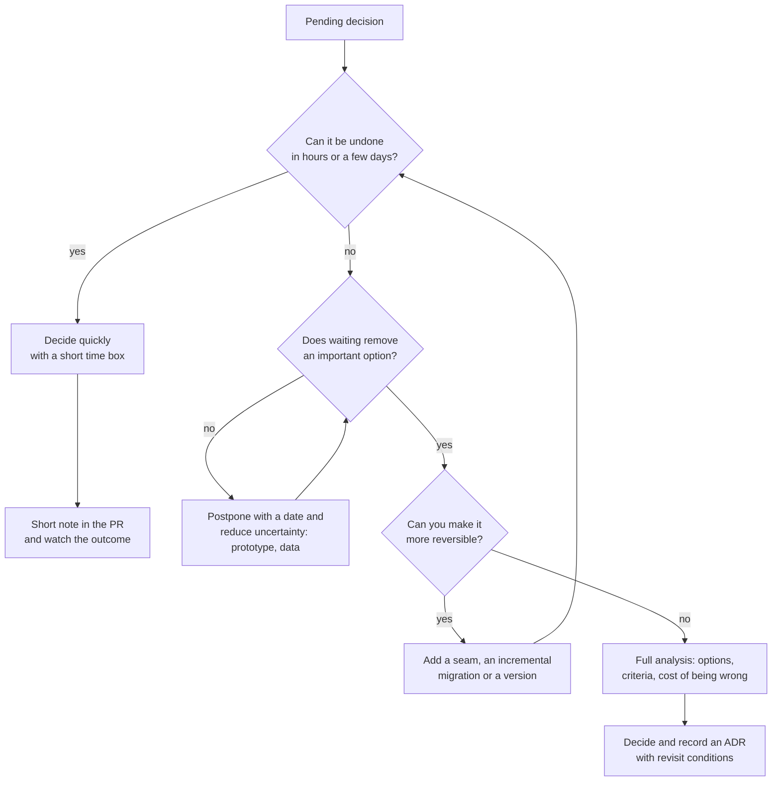
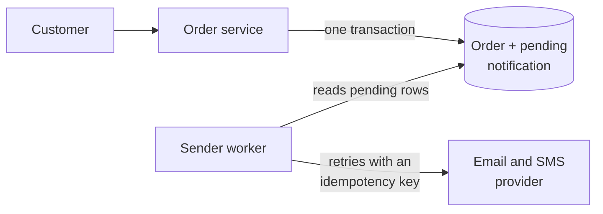

# Trade-offs and decision-making in architecture

You have probably sat through this meeting: an hour spent choosing between a queue and an HTTP
call, and it ends with whoever argued loudest, or with "let's do it the way we did at my last
company". Three months later nobody remembers why that option won, and the debate starts over.
The missing piece is not a better template for writing the decision down. **The decision was never
reasoned through**: there were no real alternatives, no criteria and no sense of what being wrong
would cost.

**A trade-off is what you give up in exchange for what you choose: every architecture decision
buys some system properties by paying with others, and deciding well means making that exchange
explicit and spending effort in proportion to the cost of getting it wrong.**

This article is about reaching the decision; the [ADR](/docs/adr) article covers how to record it,
so its template is not repeated here.

<Callout tone="info" title="Cut-off date">
  Quotes and dates were checked in October 2026 against the sources listed at the end. Where only a
  secondary source was available, the text says so and the idea is paraphrased.
</Callout>

## There are no best practices, only trade-offs

In _Fundamentals of Software Architecture_ (O'Reilly, 2020), Mark Richards and Neal Ford state what
they call the first law of software architecture: everything in software architecture is a
trade-off. A corollary follows: if you think you have found something that is not a trade-off, you
most likely have not identified the trade-off yet. Their second law completes the picture: why is
more important than how. Richards restated both on the InfoQ podcast in September 2021 while
discussing their next book.

That book, _Software Architecture: The Hard Parts_ (Ford, Richards, Sadalage and Dehghani,
O'Reilly, 2021), pushes the idea further. Its description says there are no easy decisions in
architecture, only hard parts: problems with no best practices that force you to choose between
compromises.

This does not mean anything goes. It means a practice is good **for a context**, and the useful
question is never "what is best?" but "what do I gain, what do I lose, and is it worth it here?".
"Microservices scale better" is an incomplete sentence until you say what you pay for it: network
hops, eventual consistency, operational load, distributed debugging. The
[monolith vs microservices](/docs/monolito-vs-microservicios) article works through that one in
detail.

| Advice without the trade-off | The same advice with its price                                          |
| ---------------------------- | ----------------------------------------------------------------------- |
| "Always cache"               | Lower latency and load, paid for with data that may be stale            |
| "Normalize the database"     | Integrity and a single source of truth, paid for with more joins        |
| "Don't repeat yourself"      | One place to change, paid for by coupling everyone who shares the piece |
| "Split into services"        | Independent deployment, paid for with network, consistency and ops      |
| "Build it ourselves"         | Full control, paid for by maintaining it forever                        |

## From vague preferences to explicit criteria

Most architecture debates stall because each person is optimizing for a different criterion
without saying so. The person arguing for the queue is thinking about resilience; the one arguing
for the direct call is thinking about operational simplicity. Both are right and neither knows it.
Your first job is to **put the criteria on the table** before the options.

A useful criterion is observable. "It should scale" is not; "handle three times the current order
peak without degrading checkout p95" is. It is the same technique as the scenarios in
[quality attributes](/docs/atributos-de-calidad): stimulus, environment and a measurable response.

| Vague preference            | Explicit criterion                                                              | How you check it                     |
| --------------------------- | ------------------------------------------------------------------------------- | ------------------------------------ |
| "It should scale"           | Handles 3x the current peak without degrading p95 on the critical path          | Load test before production          |
| "It should be maintainable" | A typical rule change touches one module and is testable without infrastructure | Review of recent real changes        |
| "It should be secure"       | Personal data never leaves the region required by regulation                    | Deployment rule and audit            |
| "It should ship fast"       | In production before the date committed to the business                         | Plan with milestones and a date      |
| "Don't lock us in"          | Switching providers takes weeks, not months                                     | Exit rehearsal or an identified seam |

### Constraints are not criteria

Before weighting anything, separate two things that usually get mixed up:

- **Constraints** are pass or fail. A regulation that pins data to a region, a hard budget cap, a
  date that will not move, a team that cannot operate a given technology and has no time to learn
  it. An option that violates a constraint is not scored; it is discarded.
- **Criteria** are properties you want more or less of: latency, cost, flexibility, delivery time.
  These are weighted and compared.

### Weight the criteria against your context

The same criteria carry different weight depending on who is deciding. There are no correct
weights in the abstract, only weights consistent with the business, the team and the moment.

| Criterion              | Product still searching for fit  | Regulated platform (payments, health) | Mature product with several teams |
| ---------------------- | -------------------------------- | ------------------------------------- | --------------------------------- |
| Time to production     | Very high                        | Medium                                | Medium                            |
| Operational cost       | High: the team is small          | Medium                                | Medium                            |
| Traceability and audit | Low                              | A constraint, not a criterion         | Medium                            |
| Team autonomy          | Low: there is only one team      | Medium                                | Very high                         |
| Long-term flexibility  | Low: the product may still pivot | High                                  | High                              |

Look at the traceability row: in a regulated context it stops being something you weigh and
becomes a constraint. That change of category is itself a decision worth making explicit.

## Reversibility: one-way and two-way doors

The most useful metaphor for calibrating effort comes from Amazon's 2015 letter to shareholders,
published in 2016. Jeff Bezos separates two kinds of decisions:

- **Type 1, "one-way doors"**: consequential and irreversible or nearly irreversible. If you walk
  through and dislike what is on the other side, you cannot get back. These, he writes, must be
  made methodically, carefully, slowly, with deliberation and consultation.
- **Type 2, "two-way doors"**: changeable and reversible. If you get one wrong, you do not live
  with the consequences for long; you reopen the door and go back. These should be made quickly
  by individuals or small groups with good judgment.

The part people forget is the warning that follows. As organizations grow, the letter says, they
tend to apply the heavyweight Type 1 process to most decisions, including many Type 2 ones, and
the result is slowness, unthoughtful risk aversion, too little experimentation and less
invention. A footnote covers the opposite case: companies that habitually use the lightweight
process for Type 1 decisions go extinct before they get large.

In architecture, reversibility is rarely binary. It is a cost: how much time, money and risk it
takes to undo the decision six months from now.

| Usually reversible (two-way)                  | Usually hard to reverse (one-way)                        |
| --------------------------------------------- | -------------------------------------------------------- |
| An internal library behind your own interface | A data format or API contract consumed by third parties  |
| Retry and timeout configuration               | A data model shared by several services                  |
| Build or lint tooling                         | The main language of a large system                      |
| A module's folder structure                   | Splitting a database into several, or merging them       |
| A provider reached through your own port      | A provider whose SDK is spread across the whole codebase |

### Making a decision more reversible

Often the best move is not to analyze a one-way door harder, but to **turn it into a two-way
door**:

- **Introduce a seam.** A port of your own in front of the provider, as in
  [hexagonal architecture](/docs/arquitectura-hexagonal), turns "choose a provider" into "choose
  the first adapter".
- **Migrate incrementally.** Running old and new side by side, with traffic shifting gradually,
  keeps the way back open until the end.
- **Change schemas in two steps.** Expand first (add without removing), contract once nothing uses
  the old shape. Between the two steps, rolling back is cheap.
- **Version contracts and use switches.** A new version does not break existing consumers, and a
  configuration flag separates deploying from enabling.

Each of these has its own cost. Paying it makes sense when both the cost of being wrong and the
uncertainty are high.

## The last responsible moment

In _Lean Software Development: An Agile Toolkit_ (Addison-Wesley, 2003), Mary and Tom Poppendieck
describe **delaying commitment until the last responsible moment**: the point at which failing to
decide eliminates an important alternative. That definition comes from Jeff Atwood's post quoting
the book; I could not consult the original text.

The idea gets misread in two directions:

- **It is not procrastination.** Waiting only pays off if you **learn** something meanwhile: usage
  data, a prototype, a load test, an answer from a vendor. Waiting without reducing uncertainty is
  just lost time.
- **It is not "as late as possible".** It is as late as is still responsible. If postponing the
  database choice means writing the persistence layer twice, you already missed the moment.

A practical habit: whenever you postpone, write down **what information you expect to get, how you
will get it, and the date on which you will decide even without it**. Without a date, postponing
becomes not deciding, and not deciding is also a decision, one the codebase makes for you by
accretion.

## A map for calibrating effort

Reversibility and the last responsible moment combine into a simple flow. Its purpose is to avoid
both failures Bezos describes: heavyweight analysis of trivial choices and casual handling of
irreversible ones.

## Biases that distort decisions

Explicit criteria exist largely to protect you from your own judgment. These are the biases that
show up most often in technical decisions, each with an example and a countermeasure.

### Resume-driven development

Choosing a technology because you want it on your resume, not because the problem calls for it.
**Example:** a three-person team running a modest-traffic monolith proposes a container
orchestrator with a service mesh. Nobody has operated one, and there is no deployment problem that
justifies it. **Countermeasure:** ask what concrete problem it solves today and who will operate it
when it fails at 3 a.m. If the answer is "nobody yet", it is an investment in learning and should
be presented as one.

### Sunk cost

Continuing to invest because of what has already been spent, not because of what it will return.
Arkes and Blumer described this effect in 1985 as a greater tendency to continue an endeavor once
money, effort or time has gone into it. **Example:** an in-house framework with eighteen months of
work behind it now eats half the team's capacity in maintenance, but "we've put too much into it to
stop now". **Countermeasure:** evaluate only future costs and benefits. The question is: if we were
starting today, knowing what we know, would we choose it?

### Anchoring on the first option

Tversky and Kahneman described anchoring in 1974: estimates are adjusted from an initial value and
stay biased toward it. **Example:** the first proposal in the meeting is "let's use events for
everything", and every other idea gets discussed as a variation of it instead of as an
alternative. **Countermeasure:** have everyone write down their options before the discussion
starts, and make sure the list always includes doing nothing and the boring option.

### The shiny new tool

Overvaluing something because it is new. **Example:** adopting a database released a few months
ago after reading an enthusiastic blog post, with nobody on the team familiar with how it fails.
**Countermeasure:** in his 2015 essay _Choose Boring Technology_, Dan McKinley suggests imagining
that every company gets a few "innovation tokens", a limited capacity for doing something new,
weird or hard. Prefer well-understood technology with known failure modes, and spend tokens only
where they set you apart.

### Status quo bias

The mirror image of the previous one: preferring what exists because it exists. Samuelson and
Zeckhauser documented it in 1988: in real decisions, people stick with the current option more
often than the analysis would justify. **Example:** a three-hour manual deployment survives because
"it has always worked", and nobody counts the hours or incidents it costs. **Countermeasure:** treat
the status quo as just another option in the table, with its costs written down. If doing nothing
comes out free in your analysis, the analysis is incomplete.

## A reusable method

No method replaces judgment, but an explicit one exposes the leaps in reasoning. This one applies
to any decision the map above classified as expensive or hard to reverse.

1. **Frame the problem.** Write two or three sentences on what hurts today and why it matters now.
   If you cannot, there is no decision to make yet.
2. **List the constraints.** Regulation, budget, dates, team skills. They are filters, not
   criteria.
3. **Name at least two real options.** Always include doing nothing and the boring option. An
   option nobody would seriously defend is a straw man, not an alternative.
4. **Define criteria and weights before scoring.** If you define them afterwards, you are
   rationalizing a preference.
5. **Evaluate every option against every criterion.** With scores or with prose, but with the same
   rigor for all of them. Write down what each one buys and what it costs.
6. **Make reversibility and the cost of being wrong explicit.** For the favorite option: what
   signal would tell you it was a mistake, when would you see it, and what would going back cost?
7. **Decide and record it.** The [ADR](/docs/adr) holds the context, options and consequences. Add
   **revisit conditions**: the facts that, if they happen, reopen the decision. When a condition is
   measurable, turn it into a [fitness function](/docs/fitness-functions).

A word on scores: they are a conversation tool, not an oracle. If moving one weight by one point
changes the winner, the decision is fragile, and what needs discussing is the weights, not the
numbers.

## Common trade-off pairs

Many decisions reduce to one of these tensions. Recognizing which one you face saves half the
debate, because it makes clear what is being bought and what it is paid with.

| Tension                                 | What leaning toward the first buys you      | What it costs                                           | Question that usually settles it                     |
| --------------------------------------- | ------------------------------------------- | ------------------------------------------------------- | ---------------------------------------------------- |
| Consistency vs availability             | Reads that are always current               | Rejecting operations during a network partition         | Which is worse for the user: an error or stale data? |
| Latency vs cost                         | Fast responses: replicas, caches, headroom  | Infrastructure spend and cache invalidation complexity  | What is a millisecond worth on this specific flow?   |
| Coupling vs duplication                 | A single place to change the logic          | Everyone sharing the piece must coordinate every change | Do both copies change for the same reasons?          |
| Delivery speed vs long-term flexibility | Reaching the market and learning sooner     | Debt that will constrain future changes                 | Will this code live long enough for it to matter?    |
| Build vs buy                            | Control and an exact fit to your domain     | Maintenance forever and opportunity cost                | Does this piece differentiate you from competitors?  |
| Synchronous vs asynchronous             | Simplicity and an immediate answer          | Availability tied to the service you call               | Does the user need the result to continue?           |
| Standardization vs team autonomy        | Fewer technologies to run, shared knowledge | Teams stuck with tools that do not fit their problem    | What does operating one more technology cost?        |

The first row is the territory of [CAP and PACELC](/docs/cap-pacelc), which pins down when that
tension really exists and which one appears even without partitions. The third is developed in
[coupling and cohesion](/docs/acoplamiento-cohesion), the fourth in
[technical debt and evolution](/docs/deuda-tecnica-evolucion).

## Worked example: synchronous or asynchronous notifications

A hypothetical but typical case, from context to decision.

### Context

An online store confirms an order and, in the same request, calls the email and SMS provider over
HTTP to notify the customer. When the provider is slow, checkout is slow; when it fails, the order
is saved but the customer sees an error and sometimes pays twice. The team has five people,
already runs PostgreSQL and has no message broker in production. Peak season starts in two months.

**Constraints:** no new hires; customer data cannot leave its current region.

### Options

- **A. Keep the synchronous call** with a short timeout and retries. This is the option that leaves
  the architecture unchanged.
- **B. Transactional outbox**: the order and a "pending notification" row are written in the same
  PostgreSQL transaction; a separate worker reads that table and calls the provider.
- **C. Introduce a managed message broker** and publish an order-confirmed event.

### Criteria and evaluation

Weights from 1 to 3 agreed before scoring; scores from 1 (poor) to 3 (good).

| Criterion                               | Weight | A. Sync | B. Outbox | C. Broker |
| --------------------------------------- | ------ | ------- | --------- | --------- |
| Checkout independent of the provider    | 3      | 1       | 3         | 3         |
| Guarantee that the notification is sent | 2      | 1       | 3         | 3         |
| New operational cost                    | 2      | 3       | 2         | 1         |
| Time to production                      | 2      | 3       | 2         | 1         |
| Reversibility                           | 1      | 3       | 3         | 2         |
| **Weighted total**                      |        | **20**  | **26**    | **21**    |

Option A does not solve the problem: a short timeout limits the slowness, but checkout still fails
whenever the provider fails. C solves the same problem as B but adds a new component the team would
have to learn to operate right before peak season. Raising the weight of operational cost to 3
leaves B still ahead, so the decision is not fragile.

### Decision and consequences

**Decision:** adopt the transactional outbox (B).

Consequences accepted knowingly:

- **Notifications are no longer immediate.** They arrive seconds after the order is confirmed. The
  business accepts this because the customer already sees the confirmation on screen.
- **Delivery becomes at-least-once.** If the worker dies after sending and before marking the row,
  the notification may go out twice. An idempotency key per notification mitigates it.
- **There is a new metric to watch:** the age of the oldest pending row. If it grows, something is
  stuck.
- **The door stays open.** The pending table can feed a broker later without touching checkout, so
  option C remains available.

**Revisit conditions:** reopen the decision if more than two consumers need the same event, if
volume makes the pending table compete with order writes, or if the age of the oldest pending row
stays above the agreed threshold. All of this goes into the ADR.

## When deep analysis pays off and when it does not

The method above has a price: hours from several people. Applying it to everything is exactly the
failure the Bezos letter describes.

| Analyze in depth when                                                  | Decide fast and move on when                           |
| ---------------------------------------------------------------------- | ------------------------------------------------------ |
| Reversing takes months or involves migrating data                      | Reversing takes hours or a couple of days              |
| The decision fixes a contract consumed by other teams or third parties | The impact stays inside one module and one team        |
| It commits money long term: licenses, contracts, headcount             | The cost is small and can be abandoned without penalty |
| It touches a critical quality attribute: security, data, compliance    | It concerns style preferences or local tooling         |
| Capable people genuinely disagree                                      | There is an obvious option and nobody disputes it      |

For decisions on the right, the right process is light: someone with good judgment decides, leaves
a note in the PR and sets a date to look at the outcome. Write an ADR to choose a date library and
the team will stop reading the ADRs that matter.

## Common mistakes

- **Only one real option.** If the alternatives were straw men, there was no decision, only a
  justification.
- **Criteria defined after choosing.** The most common way to rationalize a preference.
- **Treating everything as irreversible.** It paralyzes the team and burns the attention that the
  truly irreversible decisions need.
- **Treating the irreversible as reversible.** A public data format or a shared data model looks
  small on the day it is chosen.
- **Postponing without a date.** The last responsible moment quietly becomes the last moment.
- **Deciding without the people who will pay for it.** Operations, security or the team consuming
  the API see costs you do not.
- **No revisit conditions.** Without them, nobody knows when the decision stopped being valid.

## Checklist

- [ ] The problem is framed in a few sentences and it is clear why it must be decided now.
- [ ] Constraints are separated from criteria and filter options out before scoring.
- [ ] There are at least two real options, one of them doing nothing or the boring choice.
- [ ] Criteria are observable and their weights were agreed before evaluating.
- [ ] For every option, what it buys and what it costs is written down.
- [ ] You know what reversing the decision would cost and which signal would show it was wrong.
- [ ] Analysis effort matches reversibility, not perceived importance.
- [ ] The decision lives in an ADR with concrete revisit conditions.

## Sources

Checked in October 2026. The Richards and Ford book and the Poppendieck book were not consulted
directly; their ideas are cited through the secondary sources noted below.

- [Amazon 2015 letter to shareholders (Jeff Bezos), Exhibit 99.1 on SEC EDGAR](https://www.sec.gov/Archives/edgar/data/1018724/000119312516530910/d168744dex991.htm): Type 1 and Type 2 decisions
- [InfoQ podcast with Mark Richards and Neal Ford on The Hard Parts (September 8, 2021)](https://www.infoq.com/podcasts/software-architecture-hard-parts/): the two laws, in Richards' words
- [Laws of Software Architecture (DevIQ)](https://deviq.com/laws/laws-software-architecture/): wording of the laws and the corollary, secondary source
- [Software Architecture: The Hard Parts in the TUM library catalog](https://search.ub.tum.de/vufind/Record/ZDB-30-ORH-068277334): authors, year and book description
- [The Last Responsible Moment (Jeff Atwood, Coding Horror)](https://blog.codinghorror.com/the-last-responsible-moment/): quotes the Poppendieck book
- [Choose Boring Technology (Dan McKinley, March 30, 2015)](https://mcfunley.com/choose-boring-technology) and [boringtechnology.club](https://boringtechnology.club/)
- [Judgment under Uncertainty: Heuristics and Biases (Tversky and Kahneman, Science, 1974)](https://pubmed.ncbi.nlm.nih.gov/17835457/)
- [The Psychology of Sunk Cost (Arkes and Blumer, 1985)](https://cognition.aau.at/bg/BA/Arkes%20%26%20Blumer%201985.pdf)
- [Status Quo Bias in Decision Making (Samuelson and Zeckhauser, 1988)](https://scholar.harvard.edu/files/rzeckhauser/files/status_quo_bias_in_decision_making.pdf)
