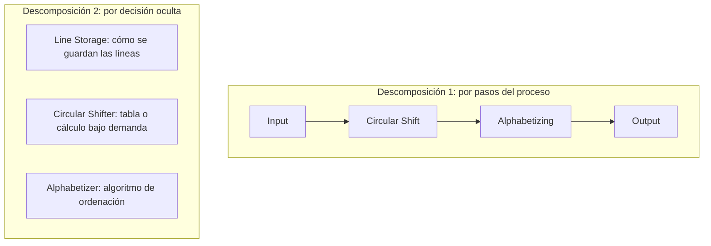
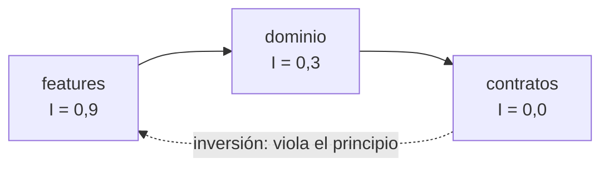

# Acoplamiento y cohesión: la base del diseño

Casi todo consejo de diseño se reduce a dos preguntas: **¿qué cosas deben estar juntas?** y **¿cuánto debe saber una parte de las demás?** La primera es la cohesión; la segunda, el acoplamiento. Larry Constantine los formuló a finales de los años sesenta y se difundieron con el artículo «Structured design» de Stevens, Myers y Constantine (IBM Systems Journal, 1974) y el libro _Structured Design_ de Yourdon y Constantine (1979).

[SOLID](/docs/solid) y el [código limpio](/docs/clean-code) los dan por supuestos: el principio de responsabilidad única es, en el fondo, una exigencia de cohesión, y los principios de abierto/cerrado, de segregación de interfaces y de inversión de dependencias son maneras de gestionar el acoplamiento. Este artículo vuelve a la base: define cada nivel con precisión, muestra la forma del problema antes y después, introduce las métricas y el vocabulario (inestabilidad, connascence) que permiten medirlos, y termina con las herramientas para vigilarlos en CI.

<Callout tone="info" title="Fecha de corte">
  Las versiones de herramientas son de octubre de 2026 y salen de los registros oficiales (npm,
  GitHub). Los conceptos son estables desde hace décadas; los números de versión no.
</Callout>

## Cohesión: qué debe ir junto

La **cohesión** mide cuánto tienen en común las partes de un módulo. Esta es la escala clásica, de peor a mejor, tal como la resume Wikipedia a partir de Constantine, Yourdon y McConnell:

| Nivel                      | Las partes están juntas porque…                               | Ejemplo típico                                          |
| -------------------------- | ------------------------------------------------------------- | ------------------------------------------------------- |
| **Coincidental** (la peor) | No hay relación; solo comparten archivo                       | Un módulo `utils` con de todo                           |
| **Lógica**                 | Pertenecen a la misma categoría, aunque hacen cosas distintas | Una clase con todas las operaciones de entrada y salida |
| **Temporal**               | Se ejecutan en el mismo momento                               | Los pasos de limpieza tras una excepción                |
| **Procedimental**          | Siempre se ejecutan en un orden fijo                          | Un script que hace A, luego B, luego C                  |
| **De comunicación**        | Operan sobre los mismos datos                                 | Funciones que leen y escriben un registro               |
| **Secuencial**             | La salida de una alimenta la siguiente                        | Una cadena de transformaciones                          |
| **Funcional** (la mejor)   | Todas contribuyen a una única tarea bien definida             | Un módulo `Money` con suma y formato                    |

Según los estudios que cita esa misma fuente, los dos primeros niveles son inferiores, el de comunicación y el secuencial son muy buenos y el funcional es superior. Es una escala heurística, no un teorema: sirve para **detectar olores**, no para puntuar módulos.

El caso más frecuente es el cajón de sastre. Un `utils.ts` con `formatPrice`, `slugify` y `daysBetween` tiene cohesión coincidental: no cambian por la misma razón ni las usa el mismo código. La decisión de rediseño es **agrupar por razón de cambio**, no por tipo de función: lo que cambia junto vive junto, y el nombre de la carpeta es el concepto, no «helpers».

```text
Antes: un cajón de sastre         Después: un módulo por concepto
src/utils.ts                      src/money/   (Money, formatMoney, addMoney)
                                  src/slug/    (slugify)
                                  src/dates/   (daysBetween)
```

Un módulo `money` con su tipo y las operaciones sobre él tiene cohesión funcional: todo gira alrededor de una sola idea, y si cambia el redondeo o la moneda, el cambio queda en un solo sitio. El coste es real: más carpetas y más puntos de entrada que mantener. Compensa cuando el concepto tiene reglas propias; no hace falta separar una función de tres líneas que nadie más usa.

Una prueba práctica: si para describir el módulo necesitas la palabra «y» («formatea precios **y** genera slugs **y** calcula fechas»), probablemente no es cohesivo.

## Acoplamiento: cuánto sabe una parte de otra

El **acoplamiento** mide cuánto depende un módulo de los detalles de otro. Wikipedia lo ordena de más a menos fuerte:

| Tipo                       | Qué significa                                                               |
| -------------------------- | --------------------------------------------------------------------------- |
| **De contenido** (el peor) | Un módulo usa el código interno de otro; viola la ocultación de información |
| **Común**                  | Varios módulos acceden a los mismos datos globales                          |
| **Externo**                | Comparten un formato de datos, protocolo o interfaz impuesto desde fuera    |
| **De control**             | Uno dirige el flujo del otro pasándole instrucciones (un flag de qué hacer) |
| **De estampado** (_stamp_) | Comparten una estructura compuesta pero cada uno usa solo una parte         |
| **De datos** (el mejor)    | Comparten solo datos elementales, normalmente por parámetros                |

No se trata de llegar a cero: sin acoplamiento no hay sistema. El objetivo es que sea **el mínimo necesario y del tipo más débil posible**. Dos conversiones aparecen constantemente.

**De control a datos.** Un parámetro que decide qué rama ejecutar obliga al llamador a conocer el interior de la función. La alternativa es entregar un colaborador (una estrategia) en lugar del flag: la función deja de bifurcar y el llamador decide _quién_ envía, no _cómo_ se bifurca por dentro. Se paga con un tipo más (`Notifier`) y con un punto donde alguien elige la implementación; vale la pena cuando hay o habrá más de dos variantes, no para un `if` único y estable.

**De estampado a datos.** Recibir el objeto entero cuando solo se usa una parte acopla la función a toda su estructura y complica las pruebas, porque hay que construir un pedido completo para probar una etiqueta. La regla de nombres: la firma debe pedir exactamente lo que usa.

```typescript
type User = { readonly email: string; readonly phone: string };
type Address = { readonly street: string; readonly city: string };
type Order = { readonly id: string; readonly address: Address };

// Control → datos: en vez de un flag, se entrega el colaborador
declare function notifyBefore(user: User, kind: 'email' | 'sms', message: string): Promise<void>;
type Notifier = { send(user: User, message: string): Promise<void> };
declare function welcome(user: User, notifier: Notifier): Promise<void>;

// Estampado → datos: pide la dirección, no el pedido entero
declare function labelBefore(order: Order): string;
declare function label(address: Address): string;
```

El acoplamiento **común** (estado global mutable) y el de **contenido** (acceder a campos privados o internos) se corrigen del mismo modo: pasar lo necesario como argumento y exponer una interfaz en lugar de la implementación.

## Ocultación de información: el origen de todo

David Parnas lo planteó en 1972 en «On the Criteria To Be Used in Decomposing Systems into Modules» (Communications of the ACM, 15(12), pp. 1053–1058). Su ejemplo es un índice KWIC (_Key Word In Context_), que compara dos descomposiciones del mismo sistema. La primera sigue el diagrama de flujo: entrada, desplazamiento circular, ordenación, salida y control. La segunda se organiza por **decisiones de diseño que podrían cambiar**: el almacén de líneas, el desplazador circular y el alfabetizador (más entrada, salida y control en ambas).



Dos frases del artículo condensan el principio (traducción propia):

- «Cada módulo de la segunda descomposición se caracteriza por su conocimiento de una decisión de diseño que oculta a todos los demás. Su interfaz se eligió para revelar lo mínimo posible sobre su funcionamiento interno.»
- «Proponemos empezar por una lista de decisiones de diseño difíciles o que probablemente cambien. Cada módulo se diseña entonces para ocultar una de ellas a los demás.»

El corolario es incómodo: casi siempre es incorrecto **descomponer por pasos del proceso**, porque las decisiones que cambian atraviesan el tiempo de ejecución. Observa que la ocultación de información es, en buena medida, lo que produce a la vez cohesión y bajo acoplamiento: un módulo cohesivo suele ser el que encapsula una decisión, y uno poco acoplado es aquel cuyo interior nadie necesita conocer.

## Módulos profundos y superficiales

John Ousterhout retoma la idea en _A Philosophy of Software Design_ (2.ª edición, julio de 2021). En sus notas de clase de Stanford define la **interfaz** de un módulo como «todo lo que debe conocerse de ese módulo desde otros módulos». Incluye lo formal (firmas, variables públicas) y lo informal (efectos laterales, algoritmos que afectan al comportamiento). Allí habla de clases «gruesas» (_thick_): «mucha funcionalidad, pero una interfaz simple»; las «delgadas» (_thin_) tienen poca funcionalidad y «no ocultan mucha información». El libro llama a esa misma idea módulos **profundos** y **superficiales**. El objetivo, según las notas, es maximizar la funcionalidad dividida entre la complejidad de la interfaz. Su ejemplo es la E/S de Unix: todos los dispositivos comparten la misma estructura de acceso (`open`, `read`, `write`, `seek`, `close`) y las operaciones específicas pasan por una sola llamada adicional.

Ejemplo: una caché con expiración, `TtlCache`. La versión profunda expone **una sola operación**, `getOrLoad(key, load)`. Detrás oculta tres decisiones: cómo se guardan las entradas, cómo expiran y que las cargas concurrentes de la misma clave comparten un único resultado (y que un fallo no se cachea). La versión superficial expondría su estructura interna y dejaría esas decisiones a cada llamador:

|                                        | Módulo profundo                   | Módulo superficial                                      |
| -------------------------------------- | --------------------------------- | ------------------------------------------------------- |
| Interfaz                               | Un método: `getOrLoad(key, load)` | La estructura pública: `entries`, `ttl`, `expiresAt`    |
| Quién decide expiración y concurrencia | El módulo                         | Cada llamador repite «leer, comprobar, cargar, guardar» |
| Cambiar a una política LRU             | No toca a ningún llamador         | Toca a todos los que conocen la forma de la entrada     |

Ousterhout critica la fragmentación excesiva en muchas clases y métodos diminutos, a la que llama _classitis_ según las reseñas del libro; esa postura contrasta con consejos de tamaño pequeño que a veces se asocian a [clean code](/docs/clean-code). La reconciliación práctica es medir por **ocultación**, no por líneas: una clase pequeña que no oculta nada es un coste; una función larga con una interfaz mínima puede ser un buen módulo.

## La Ley de Deméter

La Ley de Deméter se propuso en el otoño de 1987 en Northeastern University, a cargo de Ian Holland, dentro del proyecto Demeter. Su lema, según la página del proyecto en Northeastern, es «habla solo con tus amigos». La formulación formal que recoge Wikipedia dice que un método `m` de un objeto `a` solo debería invocar métodos de: `a` mismo, los parámetros de `m`, los objetos creados dentro de `m`, los atributos de `a` y las variables globales accesibles por `a`.

El síntoma habitual son las cadenas que atraviesan la estructura de otros objetos. Quien escribe `order.customer.address.city` queda acoplado a que un pedido tenga cliente, que el cliente tenga dirección y que esta tenga ciudad. La alternativa es preguntar a tu amigo inmediato: `order.shippingCity()`. El pedido es el único que conoce el camino; si mañana la ciudad sale de otro sitio, solo cambia `Order`.

El coste está documentado: cumplir la ley al pie de la letra puede exigir muchos métodos envoltorio que solo reenvían llamadas. Como criterio práctico (no parte de la ley): aplícala donde la estructura interna **pueda cambiar**; no hace falta en datos puros y estables ni en APIs fluidas, que no revelan estructura interna.

## Inestabilidad y dependencias estables

A nivel de paquetes o módulos hay una métrica sencilla que se atribuye a Robert C. Martin. Para un paquete, el **acoplamiento aferente** (Ca) cuenta las clases de fuera que dependen de él, y el **acoplamiento eferente** (Ce) cuenta las clases de dentro que dependen de algo de fuera. La **inestabilidad** es `I = Ce / (Ca + Ce)`. El resultado va de 0 (máxima estabilidad: otros dependen de él y él no depende de nadie) a 1 (inestable: depende de otros y nadie depende de él). Un paquete con Ca = 3 y Ce = 1 tiene I = 0,25; uno con Ca = 0 y Ce = 4 tiene I = 1. «Estable» significa **difícil de cambiar sin romper a otros**, no «bueno».

Esa métrica sostiene el principio de **dependencias estables**: «las dependencias entre paquetes deben ir en la dirección de la estabilidad; un paquete debe depender solo de paquetes más estables» (en la formulación que recoge DevIQ). Lo que cambia con frecuencia debe apuntar hacia lo que cambia poco, nunca al revés.



La flecha punteada es el error que detecta la métrica: un módulo estable (`contratos`) que depende de uno inestable (`features`). Una advertencia de las fuentes: cada herramienta cuenta a una granularidad distinta (clases, tipos o módulos), así que compara siempre con la misma herramienta y no extrapoles umbrales (el «Ce mayor de 20» que circula es una regla de un autor, no parte de la métrica).

## Acoplamiento a nivel de arquitectura

Lo mismo ocurre entre servicios. Wikipedia recoge las ocho dimensiones de acoplamiento de Gregor Hohpe (2004): tecnología, ubicación, topología, formato de datos, semántico, conversación, orden y temporal. Cuatro formas habituales, con ejemplos propios:

| Forma                    | Qué acopla                                      | Cómo se debilita                                         |
| ------------------------ | ----------------------------------------------- | -------------------------------------------------------- |
| **Síncrono**             | Disponibilidad y latencia: si B cae, A falla    | Comunicación asíncrona, colas, reintentos con límite     |
| **De despliegue**        | Dos servicios que deben publicarse juntos       | Contratos compatibles hacia atrás, versionado            |
| **Temporal**             | Una acción solo funciona si otra ocurrió antes  | Operaciones idempotentes, estado explícito               |
| **De datos compartidos** | Dos servicios leen y escriben las mismas tablas | Cada servicio es dueño de sus datos y los expone por API |

La más cara es la última: una base de datos compartida es acoplamiento **común** disfrazado, porque cualquier cambio de esquema afecta a todos. Estas fronteras son las que decide el [modelo C4](/docs/c4-model) al nombrar contenedores y las que el diseño por dominios ([DDD](/docs/domain-driven-design)) intenta trazar donde los conceptos cambian de significado; la [arquitectura hexagonal](/docs/arquitectura-hexagonal) las protege con puertos.

## Connascence: un vocabulario para medir

Meilir Page-Jones propuso **connascence** como una taxonomía de tipos de acoplamiento y una métrica de calidad: según Wikipedia, cuantifica el grado y el tipo de dependencia entre componentes. Según connascence.io, hay formas **estáticas** (detectables sin ejecutar): nombre, tipo, significado, posición y algoritmo; y **dinámicas**: ejecución, temporización, valor e identidad. Cada instancia se evalúa en tres ejes:

- **Fuerza:** cuánto cuesta refactorizarla. Las formas más fuertes son más difíciles de descubrir y de cambiar.
- **Grado:** a cuántas entidades afecta. Acoplarse a muchas es peor que a pocas.
- **Localidad:** a qué distancia están los elementos. Cerca es mejor que lejos.

La utilidad es práctica: permite decidir **cuándo aceptar** un acoplamiento y cuándo refactorizar. Una connascence fuerte entre dos líneas contiguas es tolerable; la misma entre dos servicios es una deuda. La transformación típica es convertir una forma fuerte en una débil, por ejemplo de posición y significado a nombre y tipo:

```typescript
// Antes: connascence de posición y de significado (¿qué es cada booleano?)
declare function createUserBefore(
  name: string,
  email: string,
  isAdmin: boolean,
  sendWelcome: boolean,
): void;

// Después: connascence de nombre y de tipo
type NewUser = { name: string; email: string; isAdmin: boolean; sendWelcome: boolean };
declare function createUser(input: NewUser): void;
```

Lo mismo ocurre con la connascence de significado: un literal mágico como `'draft'` repartido por el código se convierte en un tipo con valores nombrados (`'draft'`, `'published'`, `'archived'`), y el compilador marca todo sitio que no lo respete.

La connascence de nombre no se busca eliminar: renombrar es barato porque el compilador y el editor lo comprueban por ti.

## Cómo detectarlo y vigilarlo

Tres señales objetivas, de menor a mayor esfuerzo:

1. **Ciclos de dependencias.** Si A importa a B y B importa a A, ninguno se puede entender, probar ni publicar por separado.
2. **Dirección de las dependencias.** La métrica de inestabilidad y las reglas de capas comprueban que lo volátil apunta hacia lo estable.
3. **Acoplamiento lógico o por cambios.** Mina el historial de git: dos archivos están acoplados si se modifican en el mismo commit o por la misma persona en un intervalo corto. La documentación de CodeScene aclara que este acoplamiento «no es bueno ni malo en sí mismo»: depende de qué archivos son y por qué evolucionan juntos.

Con dependency-cruiser, las dos primeras se expresan como reglas dentro de la sección `forbidden` de su configuración (se genera con `npx dependency-cruiser --init`):

```text
forbidden: [
  { name: 'no-circular', severity: 'error', from: {}, to: { circular: true } },
  { name: 'stable-dependencies', severity: 'warn', from: {}, to: { moreUnstable: true } },
  { name: 'atoms-only-atoms', severity: 'error',
    from: { path: '^src/components/atoms' },
    to: { path: '^src/components/(molecules|organisms|templates)' } },
]
```

La segunda regla usa `moreUnstable`, que según su documentación coincide con «cualquier dependencia con mayor inestabilidad que el módulo que depende de ella». La métrica original es de paquete, así que empieza con severidad `warn` y contrástala con las métricas por carpeta. La tercera expresa una regla de capas: los átomos solo pueden depender de átomos. Se valida con `npx dependency-cruiser src`, que sale con un código igual al número de violaciones de severidad `error`, y las métricas por carpeta se obtienen con `--output-type metrics`.

Esto es una [fitness function](/docs/fitness-functions): la regla vive donde se ejecuta. Este mismo repositorio lo logra con `import-x/no-restricted-paths` en ESLint, que prohíbe, por ejemplo, que un átomo importe una molécula. Cuando una decisión de acoplamiento importa (por ejemplo, «el dominio no depende de la infraestructura»), regístrala en un [ADR](/docs/adr) y automatiza la comprobación.

## Herramientas

| Herramienta            | Qué hace                                                                                                    | Madurez (oct. 2026)                                                               | Úsala cuando…                                             | No la uses cuando…                                    |
| ---------------------- | ----------------------------------------------------------------------------------------------------------- | --------------------------------------------------------------------------------- | --------------------------------------------------------- | ----------------------------------------------------- |
| **dependency-cruiser** | Valida dependencias de JS y TS con reglas propias; ciclos, `moreUnstable`, grafos (dot, mermaid) y métricas | 18.6.0 (11 oct. 2026), licencia MIT                                               | Quieres imponer capas y detectar ciclos en CI             | Tu proyecto no es JavaScript ni TypeScript            |
| **madge**              | Grafo de dependencias, ciclos (`--circular`) y módulos huérfanos (`--orphans`)                              | 8.0.0 (5 ago. 2024), licencia MIT; el mantenedor la desarrolla en su tiempo libre | Quieres una vista rápida o un chequeo de ciclos sencillo  | Necesitas reglas de capas o métricas de inestabilidad |
| **Knip**               | Encuentra archivos, dependencias y exports sin usar                                                         | 6.41.0 (9 oct. 2026), licencia ISC                                                | Quieres reducir la superficie pública real de cada módulo | Esperas que mida acoplamiento o cohesión: no lo hace  |
| **ArchUnit**           | Reglas de arquitectura como pruebas unitarias en Java: capas, _slices_, ciclos                              | 1.5.1 según su repositorio, licencia Apache 2.0                                   | Tu código es Java y quieres reglas ejecutables            | Tu código no es Java                                  |
| **CodeScene**          | Acoplamiento por cambios a partir del historial de git, incluso entre repositorios                          | Documentación vigente en codescene.io; consulta sus planes                        | Sospechas acoplamiento oculto que el código no muestra    | Tu historial es corto o los commits son enormes       |

## Errores frecuentes

- **Perseguir acoplamiento cero.** Sin dependencias no hay sistema. Busca el mínimo y el tipo más débil.
- **Confundir cohesión con tamaño.** Un módulo pequeño puede ser incoherente y uno grande, cohesivo. Mide por razones de cambio.
- **Un `utils` que crece sin límite.** Es el síntoma clásico de cohesión coincidental.
- **Abstraer antes de tiempo.** Una interfaz nueva que solo tiene una implementación y que no oculta ninguna decisión añade acoplamiento a la abstracción sin ningún beneficio.
- **Descomponer por pasos del proceso.** Parnas ya lo advirtió en 1972: las decisiones que cambian atraviesan el tiempo de ejecución.
- **Compartir tablas entre servicios.** Es acoplamiento común, y el más caro de deshacer.
- **Dejar la regla solo en un documento.** Un acuerdo sin comprobación automática se erosiona con el tiempo.
- **Aplicar Deméter a ciegas.** Genera envoltorios vacíos. Úsala donde la estructura interna sea volátil.

## Checklist

- [ ] Cada módulo se describe en una frase sin «y».
- [ ] Puedes decir qué decisión de diseño oculta cada módulo.
- [ ] No hay ciclos de dependencias entre módulos ni paquetes (comprobado en CI).
- [ ] Las dependencias apuntan hacia lo más estable (inestabilidad revisada al menos en los módulos centrales).
- [ ] Las funciones piden solo los datos que usan, no objetos completos.
- [ ] Ningún parámetro booleano decide el flujo interno de una función pública.
- [ ] Las llamadas con muchos argumentos posicionales usan un objeto con nombres.
- [ ] Los servicios no comparten tablas; cada uno es dueño de sus datos.
- [ ] Las reglas de capas están automatizadas y las decisiones difíciles, registradas en ADR.

## Fuentes

Consultadas en octubre de 2026. El texto de Parnas se leyó del PDF original; el de Ousterhout, de sus notas de clase de Stanford; la métrica de Martin, de resúmenes secundarios (no se accedió a su publicación original).

- [Parnas (1972): On the Criteria To Be Used in Decomposing Systems into Modules](https://wstomv.win.tue.nl/edu/2ip30/references/criteria_for_modularization.pdf)
- [Information hiding (Wikipedia), con la referencia completa de Parnas](https://en.wikipedia.org/wiki/Information_hiding)
- [Cohesion (Wikipedia)](<https://en.wikipedia.org/wiki/Cohesion_(computer_science)>)
- [Coupling (Wikipedia)](<https://en.wikipedia.org/wiki/Coupling_(computer_programming)>)
- [Ousterhout: notas de clase de Stanford sobre diseño modular](https://web.stanford.edu/~ouster/cgi-bin/cs190-spring16/lecture.php?topic=modularDesign)
- [Ousterhout: A Philosophy of Software Design](https://web.stanford.edu/~ouster/cgi-bin/book.php)
- [Ley de Deméter (Northeastern University)](https://www.ccs.neu.edu/home/lieber/LoD.html) y [Law of Demeter (Wikipedia)](https://en.wikipedia.org/wiki/Law_of_Demeter)
- [Stable Dependencies Principle (DevIQ)](https://deviq.com/principles/stable-dependencies/)
- [Métricas orientadas a objetos de Robert Martin (resumen)](https://kariera.future-processing.pl/blog/object-oriented-metrics-by-robert-martin/)
- [Connascence](https://connascence.io/) y [Connascence (Wikipedia)](https://en.wikipedia.org/wiki/Connascence)
- [dependency-cruiser](https://github.com/sverweij/dependency-cruiser), su [referencia de reglas](https://github.com/sverweij/dependency-cruiser/blob/main/doc/rules-reference.md) y su [referencia de la CLI](https://github.com/sverweij/dependency-cruiser/blob/main/doc/cli.md)
- [madge](https://github.com/pahen/madge), [Knip](https://knip.dev/) y [ArchUnit](https://www.archunit.org/)
- [CodeScene: Change Coupling](https://codescene.io/docs/guides/technical/change-coupling.html)
