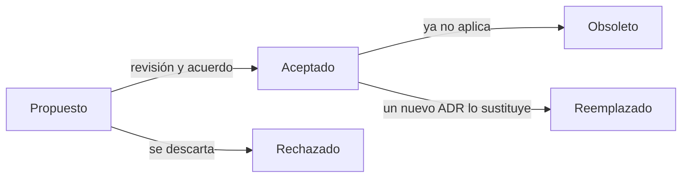

# ADR: documenta decisiones de arquitectura

Un sistema es la suma de sus decisiones, pero casi nunca queda escrito **por qué** se tomaron. El
código muestra qué se eligió; no muestra qué alternativas se descartaron, qué restricciones
pesaban ni qué costes se aceptaron a sabiendas. Un **ADR** (_Architecture Decision Record_) es el
documento corto que guarda ese porqué junto al código.

Este artículo explica qué problema resuelve un ADR, cuándo escribirlo y cuándo no, las tres
plantillas más usadas, un ejemplo completo, el ciclo de vida de un registro, dónde guardarlo y
cómo encaja con agentes de IA. Al final hay errores frecuentes y una checklist.

<Callout tone="info" title="Fecha de corte">
  Los datos son de octubre de 2026. MADR 4.0.0 es de septiembre de 2024. La entrada «Lightweight
  Architecture Decision Records» del Technology Radar de Thoughtworks estaba en el anillo _Adopt_ en
  su última actualización (mayo de 2018) y ya no figura en el radar actual. Contrasta con las
  fuentes al final antes de fijar un proceso.
</Callout>

## Qué es un ADR y qué problema resuelve

El sitio adr.github.io define una **decisión de arquitectura** como una elección de diseño
justificada que responde a un requisito funcional o no funcional arquitectónicamente
significativo. Un **ADR** captura una sola decisión y su fundamento, y el conjunto de ADR de un
proyecto forma el **registro de decisiones** (_decision log_).

Michael Nygard popularizó el formato en su artículo de noviembre de 2011. Su diagnóstico sigue
vigente: los documentos de arquitectura grandes nunca se mantienen al día, y lo que se pierde no
es el diseño sino el razonamiento. Quien llega después tiene dos malas opciones:

- **Aceptar la decisión sin entenderla**, y atrincherar una elección que ya no tiene sentido.
- **Revertirla sin saber qué sostenía**, y romper algo que dependía de ella.

Un ADR convierte esa memoria implícita en un archivo corto, versionado y revisable. Microsoft lo
resume en su guía del Well-Architected Framework: tu arquitectura es la acumulación de sus
decisiones, así que el ADR es el registro de cómo y por qué el sistema llegó a su forma actual.
Y añade una consecuencia práctica: una decisión que se toma y no se registra se olvida, y eso
lleva a repetir debates o a cambios que contradicen la intención original sin saberlo.

## Cuándo escribir uno (y cuándo no)

La regla de Nygard es escribir ADR solo para decisiones **arquitectónicamente significativas**:
las que afectan a la estructura, a las características no funcionales, a las dependencias, a las
interfaces o a las técnicas de construcción. La guía de Microsoft lo acota con un criterio útil:
incluye solo elecciones que afectan a la estructura del sistema, a atributos de calidad clave o
que son difíciles de revertir.

| Escribe un ADR cuando                                               | No lo escribas cuando                                  |
| ------------------------------------------------------------------- | ------------------------------------------------------ |
| Eliges un patrón estructural (monolito modular, eventos, capas)     | Renombras una variable o reordenas un archivo          |
| Adoptas o abandonas una tecnología clave (base de datos, framework) | La decisión se revierte en una tarde sin coste         |
| Defines un contrato público (API, formato de datos)                 | Hay una única opción razonable y nadie la discute      |
| La decisión sacrifica un atributo de calidad por otro               | Es una preferencia de estilo ya cubierta por un linter |
| Dudas de que tu yo del futuro recuerde el motivo                    | El motivo cabe en el mensaje de un commit              |

Un buen test: **¿existía una alternativa razonable?** Si la hubo y alguien podría proponerla de
nuevo dentro de un año, merece un ADR. La guía de AWS añade que el ADR debe centrarse en **por
qué** se eligió algo, no en cómo se implementa; para el cómo están el código y los
[diagramas C4](/docs/c4-model).

## Anatomía de un ADR

Todas las plantillas comparten lo esencial: **contexto**, **decisión** y **consecuencias**. Se
diferencian en cuánta estructura añaden alrededor.

### Plantilla de Nygard

Es el formato original y el más pequeño. Cinco partes:

1. **Título:** una frase nominal corta, como «ADR 9: LDAP para la integración multitenant».
2. **Estado:** _propuesto_ o _aceptado_; si la decisión cambia después, _obsoleto_ o
   _reemplazado_, con una referencia a su sustituto.
3. **Contexto:** las fuerzas en juego (tecnológicas, políticas, sociales, del proyecto), descritas
   de forma neutral y como hechos. Si hay fuerzas en tensión, se dice.
4. **Decisión:** la respuesta del equipo, en voz activa y frases completas que empiezan por
   «Vamos a…».
5. **Consecuencias:** la situación resultante, con efectos positivos, negativos y neutros.

Sus reglas prácticas: los ADR viven en el repositorio (él propone `doc/arch/adr-NNN.md`), la
numeración es secuencial y **nunca se reutiliza**, el formato es Markdown u otro marcado ligero,
y cada registro ocupa una o dos páginas. El tono es el de una conversación con un desarrollador
futuro.

### MADR

MADR (_Markdown Architectural Decision Records_) es una plantilla en Markdown mantenida por la
comunidad en adr.github.io. Su versión 4.0.0 es de septiembre de 2024. Obligatorios son el título
y tres secciones; el resto es opcional:

| Sección                       | ¿Obligatoria? |
| ----------------------------- | ------------- |
| Título (H1)                   | Sí            |
| Context and Problem Statement | Sí            |
| Considered Options            | Sí            |
| Decision Outcome              | Sí            |
| Decision Drivers              | No            |
| Consequences                  | No            |
| Confirmation                  | No            |
| Pros and Cons of the Options  | No            |
| More Information              | No            |

Admite metadatos opcionales en el front matter: `status`, `date`, `decision-makers`, `consulted` e
`informed`. Los archivos siguen el patrón `NNNN-titulo-con-guiones.md` dentro de una carpeta
`decisions/` (habitualmente `docs/decisions`). Su aportación frente a Nygard es obligar a listar
las **opciones consideradas**, que es justo lo que más se pierde con el tiempo.

### Y-statements

Olaf Zimmermann propuso una forma comprimida: **una sola frase** en seis partes cuya forma
recuerda a la letra «Y» (de _why_). Según las fuentes consultadas, sus partes son el contexto, la
preocupación (un requisito no funcional o cualidad buscada), la opción elegida, las alternativas
descartadas, los beneficios y los inconvenientes aceptados:

```text
En el contexto de [caso de uso o componente],
frente a [preocupación o cualidad buscada],
decidimos [opción elegida] y descartamos [alternativas],
para lograr [beneficio],
aceptando que [inconveniente o coste].
```

Es ideal para decisiones pequeñas o para el resumen al inicio de un ADR largo. Zimmermann sugiere
que, si hace falta, se puede añadir media frase con «porque…» para justificaciones extra.

### Cuál elegir

| Plantilla   | Tamaño        | Fortaleza                                   | Úsala cuando                               |
| ----------- | ------------- | ------------------------------------------- | ------------------------------------------ |
| Nygard      | 1 a 2 páginas | Mínima y narrativa                          | Empiezas y quieres lo más sencillo         |
| MADR        | Media         | Opciones consideradas explícitas, metadatos | Varias personas deciden y hay que comparar |
| Y-statement | 1 frase       | Compacta, cabe en un commit o en una tabla  | Decisiones pequeñas o un resumen ejecutivo |

La guía de Microsoft insiste en lo que importa más que la plantilla: **sé consistente**. Diseña
una anatomía y sigue la misma en todos los registros.

## Un ejemplo completo

Primero, la **forma**: una plantilla mínima con la estructura de MADR y una pista de qué va en cada
parte.

```markdown
---
status: accepted # proposed | accepted | superseded by ADR-NNNN
date: AAAA-MM-DD
decision-makers: quién decidió
---

# ADR NNNN: frase nominal corta

## Contexto y problema <!-- hechos y restricciones, sin defender una opción -->

## Opciones consideradas <!-- al menos dos, incluida la conservadora -->

## Decisión <!-- «Elegimos…», en voz activa -->

### Consecuencias <!-- lo bueno y lo malo -->
```

Y un ejemplo lleno de contenido. Está reconstruido con una decisión real de este sitio,
documentada en su `AGENTS.md`: el índice de contenido generado se commitea. Las alternativas y los
números de ADR son ilustrativos.

| Parte           | Contenido en el ejemplo                                                                                                                                                                                                     |
| --------------- | --------------------------------------------------------------------------------------------------------------------------------------------------------------------------------------------------------------------------- |
| Título          | ADR 0004: Commitear el índice de contenido generado                                                                                                                                                                         |
| Contexto        | Los listados, la búsqueda y el sitemap salen de un índice generado (`index.gen.json`). El typecheck lo importa, así que en un clon limpio falla si no existe. El CI debe detectar contenido editado sin regenerar el índice |
| Factores        | Typecheck verde en un clon limpio, sin pasos previos; un índice obsoleto no llega a producción; los diffs siguen siendo revisables                                                                                          |
| Opciones        | 1) Generarlo solo en el build y no versionarlo. 2) Commitearlo y validarlo en la auditoría. 3) Calcularlo en el navegador                                                                                                   |
| Decisión        | Opción 2: commitear el índice y hacer que la auditoría falle (código E-INDEX) si está desactualizado                                                                                                                        |
| Consecuencias   | Bueno: el typecheck funciona en un clon limpio y el CI atrapa índices obsoletos. Malo: cada cambio de contenido añade ruido al diff; hay que acordarse de indexar (la auditoría lo vigila)                                  |
| Más información | No sustituye a ninguna decisión anterior; se revisará si el diff del índice se vuelve inmanejable                                                                                                                           |

Fíjate en tres cosas: el contexto cuenta **hechos y restricciones**, no la solución; las
opciones descartadas quedan escritas; y las consecuencias incluyen lo **malo**. Una sección de
consecuencias solo con ventajas es una señal de alarma.

## Estados y ciclo de vida

Un ADR tiene un ciclo corto y una regla firme: **una vez aceptado o rechazado, no se edita**. Si la
decisión cambia, se escribe un ADR nuevo que reemplaza al anterior y ambos se enlazan. Es lo que
dicen Nygard («conservamos el antiguo, pero lo marcamos como reemplazado»), AWS (una vez aprobado
o rechazado, el ADR se trata como inmutable) y Microsoft (un registro de solo añadir: no edites
los registros aceptados).



Qué sí se puede tocar en un registro aceptado: corregir una errata o añadir el enlace «reemplazado
por ADR-0012». Qué no: cambiar la decisión, el contexto o las consecuencias para que «cuadren»
con lo que se hizo después. El historial de lo que se pensó en su momento es justo el valor del
registro. Microsoft añade una práctica útil: anota el **nivel de confianza** cuando una decisión
significativa se tomó con poca certeza, porque eso orienta cuándo reconsiderarla.

Si una decisión se ejecuta en fases (corto, medio y largo plazo), registra cada fase como su
propio ADR.

## Dónde guardarlos y cómo revisarlos

Guárdalos **en el repositorio, junto al código**. Thoughtworks anota que suelen acabar en un wiki,
pero que prefieren el control de versiones con marcado simple; Microsoft pide que el registro
esté abierto junto a la documentación de la carga de trabajo.

- **Ubicación y nombre:** una carpeta como `docs/decisions/` y archivos `NNNN-titulo-con-guiones.md`.
  La numeración es secuencial y no se reutiliza, aunque el ADR se rechace.
- **Revisión por pull request:** el ADR entra como una PR. La conversación de la PR es la
  deliberación, y el merge es la aceptación. Eso deja trazabilidad sin herramientas nuevas.
- **Cualquiera puede proponer:** AWS recomienda que cualquier miembro del equipo pueda crear un
  ADR y fomentar el sentido de propiedad sobre cada uno, y que se revise al menos una vez antes de
  aceptarlo.
- **Redacta el contexto antes de defender una opción**, para que quienes revisan discutan el mismo
  problema. Es una recomendación de un resumen de terceros del proceso de AWS, no del documento
  original.
- **Retroactivos:** en un sistema existente (_brownfield_), Microsoft recomienda empezar el
  registro igualmente y, si hay datos, reconstruir las decisiones pasadas.

## ADR y agentes de IA

Un repositorio con ADR es un repositorio **más fácil de arnesar**: el porqué de las decisiones deja
de vivir en la cabeza de alguien y pasa a ser contexto legible por un agente. Tres prácticas:

1. **Dale el contexto.** Menciona la carpeta de decisiones en tu `CLAUDE.md` o `AGENTS.md`
   («antes de cambiar la arquitectura, lee `docs/decisions/`»). Claude Code lee `CLAUDE.md` y
   puede leer `AGENTS.md` en su lugar; las importaciones con `@ruta` permiten enlazar un índice
   de ADR, pero cargan su contenido en contexto, así que enlaza el índice y no todos los registros.
2. **Deja que redacte el borrador, no que decida.** Un agente es bueno recopilando contexto del
   código, listando alternativas y resumiendo consecuencias. La **decisión** es humana: alguien
   debe poder defenderla y responder por ella. El humano revisa y acepta en la PR.
3. **Conviértelos en sensores cuando sea posible.** Un ADR que dice «los componentes no importan
   rutas» puede traducirse en una regla ejecutable. Eso es una _fitness function_: el ADR
   registra por qué, la regla lo hace cumplir (ver [fitness functions](/docs/fitness-functions)).

Todo esto encaja con la idea del [harness engineering](/docs/harness-engineering-claude-code):
las guías orientan antes de actuar y los sensores comprueban después, y los ADR son una guía de
largo plazo. También con [SOLID](/docs/solid) y el [código limpio](/docs/clean-code): conviene
recordar por qué se separó una responsabilidad o se invirtió una dependencia. Y la elección del
[lenguaje y framework](/docs/lenguajes-era-ia) es el candidato ideal para un ADR.

## Errores frecuentes

- **Escribirlos después y de memoria.** Redactar el ADR el día de la decisión es barato; meses
  después se reconstruye mal. Si hace falta, hazlo retroactivo, pero márcalo.
- **Un ADR sin alternativas.** Si solo describe la opción elegida, no explica nada. Escribe al
  menos las que se discutieron y por qué se descartaron.
- **Consecuencias solo positivas.** Toda decisión cuesta algo. Si no lo ves, no has terminado.
- **Editar registros aceptados.** Reescribir el pasado destruye el valor del registro. Reemplaza,
  no edites.
- **Convertir el ADR en un documento de diseño.** Debe ser corto y poder leerse sin el material
  de apoyo; enlaza el diseño detallado si hace falta.
- **ADR para todo.** Si el registro se llena de decisiones triviales, nadie lo lee. Aplica el test
  de la alternativa razonable.
- **Guardarlos donde el código no está.** Un wiki desconectado envejece. Versiónalos con el repo.
- **Un ADR que nadie encuentra.** Numeración, índice y mención en `CLAUDE.md` o `AGENTS.md`.

## Checklist para tu próximo ADR

- [ ] La decisión es arquitectónicamente significativa y existía una alternativa razonable.
- [ ] El contexto describe hechos y restricciones, sin defender aún una opción.
- [ ] Hay al menos dos opciones consideradas, incluida la conservadora.
- [ ] La decisión se escribe en voz activa y es una sola.
- [ ] Las consecuencias incluyen costes y riesgos, no solo ventajas.
- [ ] Tiene estado, fecha y personas que decidieron.
- [ ] Entra por pull request y alguien más lo revisa antes de aceptarlo.
- [ ] El archivo está numerado, sin reutilizar números, en la carpeta de decisiones del repo.
- [ ] Si reemplaza a otro, ambos están enlazados y el antiguo marcado como reemplazado.
- [ ] Si la decisión puede comprobarse automáticamente, hay una regla o test que la vigila.

## Fuentes

Consultadas en octubre de 2026; contrasta cada dato con la fuente oficial antes de fijar un
proceso. Los datos de Y-statements provienen de resultados de búsqueda sobre el trabajo de
Zimmermann, no de una lectura completa de su publicación original.

- [Documenting Architecture Decisions (Michael Nygard, 2011)](https://www.cognitect.com/blog/2011/11/15/documenting-architecture-decisions)
- [Architectural Decision Records (adr.github.io)](https://adr.github.io/)
- [MADR: Markdown Architectural Decision Records](https://adr.github.io/madr/)
- [Maintain an architecture decision record (Microsoft Azure Well-Architected Framework)](https://learn.microsoft.com/en-ca/azure/well-architected/architect-role/architecture-decision-record)
- [Architectural decision records (AWS Prescriptive Guidance)](https://docs.aws.amazon.com/prescriptive-guidance/latest/architectural-decision-records/introduction.html)
- [Master architecture decision records: best practices (AWS Architecture Blog)](https://aws.amazon.com/blogs/architecture/master-architecture-decision-records-adrs-best-practices-for-effective-decision-making/)
- [Lightweight architecture decision records (Thoughtworks Technology Radar)](https://www.thoughtworks.com/radar/techniques/lightweight-architecture-decision-records)
- [Architectural Decisions: The Making Of (Olaf Zimmermann)](https://www.ozimmer.ch/practices/2020/04/27/ArchitectureDecisionMaking.html)
