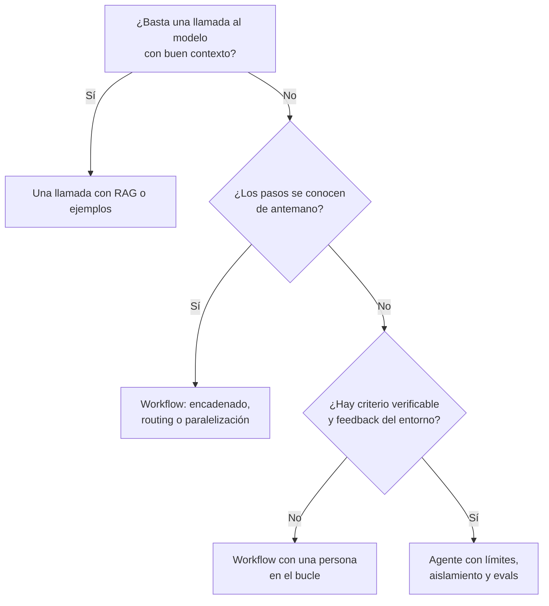
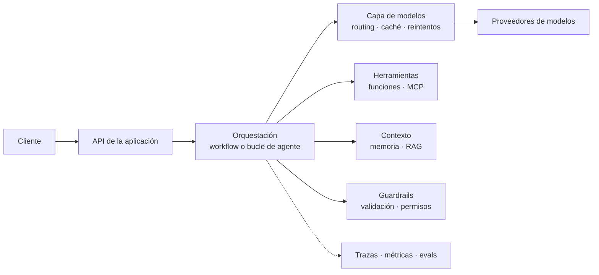

# Arquitectura de aplicaciones con LLM y agentes

Llamar a un modelo es fácil. Lo difícil es todo lo que lo rodea cuando la llamada pasa a ser una
pieza de un sistema que debe ser fiable, barato, seguro y mantenible durante años. Ese trabajo
es arquitectura, no ingeniería de prompts: qué componentes hay, dónde se traza cada frontera,
qué se delega al modelo y qué se deja en código determinista.

Este artículo es la vista de arquitecto de una aplicación con LLM: el espectro entre workflows y
agentes, los componentes que casi siempre aparecen, los trade-offs de latencia y coste, la
seguridad y los errores más comunes. Complementa al artículo sobre el
[harness de Claude Code](/docs/harness-engineering-claude-code), que trata cómo arnesar un
agente de programación concreto; aquí el foco es el sistema que tú construyes.

<Callout tone="info" title="Fecha de corte">
  Los datos son de octubre de 2026. El artículo «Building effective agents» de Anthropic es de
  diciembre de 2024 y su propia página avisa de que parte de las herramientas que describe han
  cambiado; los patrones siguen siendo útiles, pero verifica el estado actual de cada API y
  protocolo antes de decidir.
</Callout>

## Workflows y agentes: el espectro

Anthropic agrupa estos sistemas como «agénticos» y distingue dos tipos:

- **Workflows:** el modelo y las herramientas se orquestan mediante caminos de código
  predefinidos.
- **Agentes:** el modelo dirige dinámicamente su propio proceso y el uso de herramientas, y
  conserva el control sobre cómo cumple la tarea.

La recomendación central del artículo es buscar la solución más simple posible y aumentar la
complejidad solo cuando haga falta. Para muchas aplicaciones, una sola llamada bien optimizada,
con recuperación de información y ejemplos en contexto, ya es suficiente. Los sistemas agénticos
suelen cambiar latencia y coste por mejor rendimiento, y ese intercambio debe ser consciente.

La pieza base es el **LLM aumentado**: un modelo con recuperación, herramientas y memoria, capaz
de generar sus propias consultas, elegir herramientas y decidir qué conservar. Sobre él, el
artículo describe cinco patrones de workflow:

| Patrón                       | Cómo funciona                                                                         | Úsalo cuando                                                    |
| ---------------------------- | ------------------------------------------------------------------------------------- | --------------------------------------------------------------- |
| **Encadenado**               | Cada llamada procesa la salida de la anterior, con comprobaciones entre pasos         | La tarea se divide limpiamente en subtareas fijas               |
| **Enrutado (routing)**       | Se clasifica la entrada y se envía a un prompt o proceso especializado                | Hay categorías distintas que se tratan mejor por separado       |
| **Paralelización**           | Subtareas independientes a la vez (sectioning) o la misma tarea varias veces (voting) | Quieres velocidad o más confianza con varios intentos           |
| **Orquestador-trabajadores** | Un modelo central descompone, delega en trabajadores y sintetiza                      | No puedes predecir de antemano las subtareas necesarias         |
| **Evaluador-optimizador**    | Un modelo genera y otro evalúa y da feedback, en bucle                                | Hay criterios claros de evaluación y iterar mejora el resultado |

Un ejemplo útil de enrutado con efecto directo en el coste: enviar las preguntas fáciles a
modelos pequeños y baratos y las difíciles a modelos más capaces.

Un **agente**, en cambio, es «típicamente solo un modelo usando herramientas según el feedback
del entorno, en un bucle». Necesita «verdad de terreno» (ground truth) en cada paso, como el
resultado de una herramienta o de ejecutar código, para saber si avanza, y debe tener
condiciones de parada, como un número máximo de iteraciones. Sirve para problemas abiertos donde
no se puede fijar de antemano el número de pasos; el coste es mayor y los errores se pueden
acumular, por lo que los autores recomiendan probarlo extensamente en entornos aislados.

Sobre los sistemas con varios agentes, Anthropic publicó en junio de 2025 cifras de su sistema de
investigación: los agentes usan aproximadamente cuatro veces más tokens que un chat y los
sistemas multiagente aproximadamente quince veces más; el uso de tokens por sí solo explicó el
80 % de la varianza en el benchmark BrowseComp. Encajan en tareas muy paralelizables, que
exceden una ventana de contexto y que justifican el coste; encajan mal donde los agentes
comparten mucho contexto o dependen unos de otros, algo habitual en tareas de programación.

## Cuándo no usar un agente

La pregunta de diseño no es «¿podemos usar un agente?», sino «¿qué es lo más simple que cumple
el requisito?». Este mapa ordena la decisión:



Evita el agente cuando:

- **El flujo es conocido y estable.** Un workflow es más barato, más rápido y más fácil de
  depurar. El código determinista gana siempre que sepas escribirlo.
- **No puedes verificar el resultado.** Sin pruebas, contratos o una persona que valide, un
  bucle autónomo solo acumula errores con confianza.
- **El coste de equivocarse es alto e irreversible.** Pagos, borrados o mensajes a clientes
  piden confirmación humana, no autonomía.
- **El valor de la tarea no paga los tokens.** Más agentes y más pasos multiplican el consumo.
- **Las subtareas dependen mucho entre sí.** Repartir contexto compartido entre agentes suele
  empeorar el resultado.

Un último aviso de los autores: los frameworks aceleran el inicio, pero pueden esconder prompts
y respuestas tras capas de abstracción y dificultar la depuración. Empieza llamando directamente
a la API del proveedor y adopta un framework cuando entiendas qué hace por ti.

## Componentes de la arquitectura

Casi todas las aplicaciones con LLM acaban teniendo las mismas piezas, estén o no separadas en
servicios distintos. Nombrarlas ayuda a dibujarlas en un [modelo C4](/docs/c4-model) y a decidir
dónde van las fronteras.



### Capa de modelos

Es la frontera con el proveedor. Centraliza en un solo lugar la selección de modelo, los
reintentos, los tiempos límite, la caché de prompts, el registro de uso de tokens y el cambio de
proveedor. Aplica el principio de inversión de dependencias de [SOLID](/docs/solid): el resto de
la aplicación depende de una interfaz propia (`generar`, `generarEstructurado`), no del SDK de un
proveedor.

Una regla ejecutable lo mantiene así: un test de arquitectura que falle si algún módulo fuera de
esa capa importa el SDK del proveedor (ver [fitness functions](/docs/fitness-functions)). Y
documenta la elección de proveedor y de modelo en un [ADR](/docs/adr): son decisiones que
caducan rápido y conviene poder revisarlas con su contexto.

### Contexto y memoria

El contexto es el recurso escaso de un agente. Decide explícitamente qué entra en cada llamada:
instrucciones, datos recuperados, historial y resultados de herramientas. En los sistemas de
larga duración, Anthropic describe guardar el plan en memoria externa para no perderlo cuando el
contexto se trunca, y reanudar desde puntos de control en lugar de empezar de cero.

Distingue tres memorias: la **de trabajo** (la ventana de la conversación), la **de sesión**
(estado que sobrevive a una conversación, normalmente en tu base de datos) y la **de largo plazo**
(preferencias y hechos aprendidos). Cada una tiene su propia política de caducidad, privacidad y
borrado.

### RAG: decisiones, no receta

La generación aumentada con recuperación (RAG) es una de las formas del «LLM aumentado». Como
arquitecto, las decisiones que importan no son la librería, sino estas preguntas:

- **¿Cuál es la fuente de verdad y cómo se mantiene fresca?** El índice es una copia derivada:
  necesita reindexación y control de versiones, igual que cualquier caché.
- **¿Quién puede ver qué?** La recuperación debe respetar los permisos del usuario que pregunta,
  no los del servicio que consulta el índice.
- **¿Cómo se mide la recuperación?** Evalúa por separado si encontró lo correcto y si el modelo
  lo usó bien; son fallos distintos con arreglos distintos.
- **¿Qué pasa si no hay nada relevante?** El sistema debe poder responder que no lo sabe.

Los fallos de esta capa son un riesgo de seguridad reconocido: la lista de OWASP incluye
«Vector and Embedding Weaknesses» (LLM08) entre sus diez entradas de 2025.

### Herramientas y MCP

Las herramientas son la mano del agente, y su definición es un contrato de API que merece el
mismo cuidado que cualquier otro. Anthropic recomienda construir pocas herramientas bien pensadas
para flujos de alto impacto en lugar de envolver cada endpoint, agruparlas con prefijos por
servicio y recurso, devolver solo información de alta señal (nombres en lenguaje natural mejor
que identificadores técnicos), limitar el tamaño de las respuestas con paginación, filtros y
truncado, y describir cada herramienta como se la explicarías a un compañero nuevo. En Claude Code,
por ejemplo, las respuestas de herramientas se limitan por defecto a 25 000 tokens.

Otro consejo del mismo artículo es diseñar las herramientas para que equivocarse sea difícil
(_poka-yoke_). En su trabajo con SWE-bench, exigir rutas de archivo absolutas eliminó los errores
que el modelo cometía con las relativas.

Un contrato tipado deja eso por escrito. Este esqueleto no es para copiar: muestra qué campos
nombrar y qué debe decir cada uno.

```typescript
import { z } from 'zod';

type Herramienta<I, O> = {
  name: string; // con espacio de nombres: pedidos_buscar, no buscar
  description: string; // qué hace, cuándo usarla y en qué se diferencia de otras
  input: z.ZodType<I>; // esquema que valida cada llamada antes de ejecutarla
  efecto: 'ninguno' | 'reversible' | 'irreversible'; // decide si pide confirmación humana
  run(input: I, ctx: { signal: AbortSignal }): Promise<O>;
};
```

Tres convenciones sostienen el contrato. **Nombres por recurso y verbo**, con el mismo prefijo
para las herramientas de un mismo dominio (`pedidos_buscar`, `pedidos_obtener`). **Parámetros
autoexplicativos**: `customer_id` mejor que `id`, con un ejemplo del formato en la descripción del
campo (por ejemplo `cus_123`). Y un **campo de efecto explícito**, porque es lo que permite al
orquestador decidir cuándo pedir confirmación sin adivinarlo desde el nombre.

**MCP (Model Context Protocol)** es un estándar abierto para conectar aplicaciones de IA con
sistemas externos; su documentación lo compara con un puerto USB-C. Un **host** (la aplicación)
crea un **cliente** por cada **servidor** MCP, y los servidores exponen tres primitivas: _tools_
(funciones ejecutables), _resources_ (datos de contexto) y _prompts_ (plantillas). Hay dos
transportes: stdio para procesos locales y HTTP con streaming para servidores remotos, donde se
recomienda OAuth. Cada herramienta se describe con nombre, título, descripción y un JSON Schema
de entrada.

Desde el punto de vista de arquitectura, MCP es un **contrato de integración**: separa quién
implementa la capacidad de quién la consume. Dos matices de la documentación actual: MCP se
limita al intercambio de contexto y no dicta cómo la aplicación usa el modelo ni gestiona ese
contexto, y la versión de protocolo `2026-07-28` lo describe como sin estado (cada petición
lleva su versión y capacidades) y declara obsoleta la primitiva _sampling_. Si ya integras
muchos servidores, la documentación menciona el descubrimiento progresivo de herramientas para
no cargarlas todas de golpe.

### Orquestación

Es el código que decide el siguiente paso. En un workflow es un grafo explícito; en un agente es
un bucle. En ambos casos conviene que viva fuera del prompt, sea testeable y tenga límites
explícitos. El bucle mínimo es corto; lo que lo hace seguro no es su lógica sino sus límites.
Cada vuelta hace lo mismo:

1. Pide al modelo el siguiente paso con el historial y las herramientas disponibles.
2. Suma el uso de tokens; si supera el presupuesto, termina.
3. Si el modelo no pidió ninguna herramienta, el agente ha terminado.
4. Valida cada llamada contra el esquema de la herramienta; si es inválida, devuelve el error al
   modelo y cuenta un fallo.
5. Si la herramienta es irreversible, pide confirmación a una persona; si la rechaza, se lo dice
   al modelo.
6. Ejecuta con un plazo compartido; un fallo se devuelve como error y también cuenta.
7. Si los fallos superan el máximo, termina.

Agrupa los límites en un solo tipo que el orquestador recibe como parámetro (`maxPasos`,
`maxErrores`, `maxTokens` y `plazoMs`), de modo que se ajusten por tarea sin tocar el bucle. Cada
límite tiene su propia salida:

| Límite      | Qué lo dispara                                      | Estado que devuelve            |
| ----------- | --------------------------------------------------- | ------------------------------ |
| Pasos       | Se agotan las vueltas permitidas                    | `limite_de_pasos`              |
| Tokens      | El uso acumulado supera el presupuesto              | `presupuesto_agotado`          |
| Errores     | Llamadas inválidas o fallidas por encima del máximo | `demasiados_errores`           |
| Plazo       | Vence el tiempo total                               | Se cancela la llamada en curso |
| Fin natural | El modelo no pide más herramientas                  | `hecho`                        |

Fíjate en lo que **no** hace: no confía en que el modelo se detenga solo. Hay cuatro salidas
acotadas (pasos, tokens, errores y plazo) y las acciones irreversibles pasan por una persona.

### Guardrails y salidas estructuradas

Trata la salida del modelo como una entrada no confiable. Pídela en un formato estructurado,
valídala contra un esquema antes de usarla y rechaza o repara lo que no cumpla. OWASP lo recoge
como «Improper Output Handling» (LLM05). Una de las aplicaciones de la paralelización que cita
Anthropic es precisamente poner un modelo aparte a filtrar la entrada del usuario como
guardrail, mientras otro responde.

Un guardrail útil es determinista siempre que se pueda (esquemas, listas de permitidos, límites
numéricos) y se apoya en otro modelo solo para lo que el código no puede juzgar.

### Observabilidad

Un agente que falla sin dejar rastro no se puede mejorar. Registra para cada ejecución los
pasos, las llamadas a herramientas con sus entradas y salidas, los tokens y el tiempo, y
correlaciónalos con un identificador de ejecución. Anthropic cuenta que la traza completa en
producción le permitió diagnosticar fallos, y que monitorizó los patrones de decisión sin leer el
contenido de las conversaciones individuales para proteger la privacidad: decide desde el diseño
qué datos entran en las trazas.

### Evaluaciones (evals)

Las evals son las pruebas del sistema, y el no determinismo hace que no puedas prescindir de
ellas. Dos ideas del equipo de Anthropic, ambas de su experiencia real: empezar pronto con una
muestra pequeña (unas 20 consultas) en lugar de esperar a tener un gran conjunto, y usar un
modelo como juez con una rúbrica explícita (en su caso, un único prompt que devuelve una
puntuación y un veredicto fue lo más consistente), sin renunciar a las pruebas con personas, que
detectaron fallos que la automatización no veía.

Para las herramientas, la guía es construir tareas de evaluación realistas y de varios pasos, con
un resultado verificable, medir llamadas, tiempo, tokens y errores, y reservar un conjunto de
prueba aparte para no sobreajustar.

## Trade-offs: latencia, coste y no determinismo

Cada decisión de arquitectura aquí intercambia algo. Estos son los ejes habituales:

| Eje            | Qué lo empuja hacia arriba                       | Palanca de arquitectura                                                 |
| -------------- | ------------------------------------------------ | ----------------------------------------------------------------------- |
| **Latencia**   | Cadenas largas, bucles, ejecución secuencial     | Paralelizar subtareas, modelos pequeños en los pasos fáciles, streaming |
| **Coste**      | Más agentes, más pasos, contexto grande repetido | Routing por dificultad, caché de prompts, límites de presupuesto        |
| **Calidad**    | Más intentos y más verificación                  | Evaluador-optimizador, voting, evals continuas                          |
| **Fiabilidad** | No determinismo y errores que se acumulan        | Validación de esquemas, reintentos acotados, reanudación                |

### Caché de prompts

Si repites un prefijo largo (instrucciones, herramientas, documentos) en cada llamada, la caché de
prompts de Anthropic reduce latencia y coste de entrada. Según su documentación, el prefijo se
compone en el orden `tools`, luego `system`, luego `messages`; puedes marcar hasta cuatro puntos de
corte o usar el modo automático; la vida por defecto es de 5 minutos, que se renueva sin coste al
usar el contenido, y hay una opción de 1 hora a mayor precio. Una escritura de 5 minutos cuesta
1,25 veces el precio base de entrada, una de 1 hora cuesta 2 veces y una lectura cuesta 0,1 veces
en la mayoría de los modelos (con excepciones más baratas). Hay un mínimo de longitud que depende
del modelo: por debajo se procesa sin caché y sin error.

La consecuencia de diseño es que **el orden del prompt es una decisión de arquitectura**: lo
estable va primero y lo variable al final, y cambiar las definiciones de herramientas invalida
todos los niveles. Comprueba que funciona mirando los campos `cache_creation_input_tokens` y
`cache_read_input_tokens` del uso; si ambos son 0, no se cacheó.

### Elegir el modelo por tarea

No tiene por qué haber un solo modelo. El enrutado envía lo fácil a un modelo pequeño y lo
difícil a uno más capaz, y en un orquestador con trabajadores puedes asignar un modelo distinto
a cada rol. Decide con tus evals, no por intuición, y deja la elección en configuración para
poder cambiarla sin redesplegar.

### Fallos parciales, idempotencia y reintentos

Un agente es un proceso largo con estado y pasos que pueden fallar a medias. Anthropic lo resume
así: los fallos pequeños pueden encadenarse, por lo que añadieron reanudación desde puntos de
control y salvaguardas deterministas como la lógica de reintentos, en lugar de reiniciar. Aplica
las prácticas de sistemas distribuidos de siempre:

- **Haz idempotentes las herramientas con efectos.** Si un reintento repite un pago, el diseño
  está mal; usa claves de idempotencia.
- **Limita los reintentos** y distingue errores transitorios (red, límite de tasa) de errores de
  lógica, que el modelo debe leer y corregir.
- **Guarda el estado** tras cada paso importante para reanudar sin repetir trabajo.
- **Despliega con cuidado:** los agentes en ejecución no deben romperse con una nueva versión;
  Anthropic usó despliegues _rainbow_, que desplazan el tráfico gradualmente entre versiones.

## Seguridad

La lista OWASP Top 10 para aplicaciones con LLM (edición 2025) pone en primer lugar la
**inyección de prompts** (LLM01) y recoge el **exceso de agencia** (LLM06): dar al sistema más
funcionalidad, permisos o autonomía de la necesaria, de modo que sus acciones puedan causar daño
cuando la salida es errónea o está manipulada. También incluye consumo descontrolado (LLM10),
divulgación de información sensible (LLM02) y fuga del prompt de sistema (LLM07).

La causa de fondo de la inyección es estructural: el modelo recibe en un mismo contexto
instrucciones de confianza y contenido no confiable (páginas web, correos, documentos, respuestas
de herramientas), y no distingue con fiabilidad entre ambos. No hay un filtro que lo resuelva del
todo; se mitiga con arquitectura.

- **Privilegios mínimos.** Da a cada agente solo las herramientas que necesita y con el alcance
  más estrecho posible: una herramienta de lectura en lugar de una de lectura y escritura.
- **Aislamiento.** Ejecuta el código y los comandos generados en un entorno aislado, con red y
  sistema de archivos restringidos.
- **Patrón de cuarentena (lector y actor).** Anthropic lo describe para triaje a escala: agentes
  lectores con herramientas de solo lectura procesan el contenido no confiable y emiten
  resúmenes; otro agente con más privilegios actúa solo sobre esos resúmenes, nunca sobre el
  contenido original.
- **Confirmación humana en lo irreversible.** Borrados, pagos, envíos y cambios de permisos pasan
  por una persona. En el bucle de arriba es el campo `efecto` quien lo decide.
- **Credenciales fuera del contexto.** El modelo no debe ver secretos; la herramienta los usa por
  él.
- **Presupuestos.** Los límites de tokens, pasos y tiempo defienden también del consumo
  descontrolado.

Los controles de un agente de programación concreto (permisos, sandbox, hooks) están en el
artículo sobre el [harness de Claude Code](/docs/harness-engineering-claude-code); la lógica es
la misma que aquí, aplicada a una herramienta.

## Errores frecuentes

- **Empezar por un agente.** Una llamada con buen contexto o un workflow suele bastar; sube de
  nivel solo con evidencia de que lo necesitas.
- **Adoptar un framework sin entenderlo.** Si no puedes explicar qué prompt y qué llamadas hace
  por ti, no podrás depurarlo.
- **Un bucle sin límites.** Sin máximo de pasos, tokens, errores y tiempo, un fallo se convierte
  en una factura.
- **Herramientas que son un espejo de la API.** Decenas de endpoints sin curar confunden al
  modelo y llenan el contexto de ruido.
- **Confiar en la salida del modelo.** Sin validación de esquema y de permisos, una alucinación
  llega a tu base de datos.
- **No tener evals.** Sin ellas, cada cambio de prompt, herramienta o modelo es una apuesta.
- **Reintentos que repiten efectos.** Un reintento sin idempotencia duplica pagos o correos.
- **Mezclar contenido no confiable con privilegios.** El agente que lee la web no debería ser el
  que puede borrar archivos.
- **Cambiar de proveedor sin una frontera.** Con el SDK repartido por el código, migrar significa
  reescribir.

## Checklist para tu aplicación con LLM

- [ ] Documentaste en un ADR por qué eliges workflow o agente, y qué alternativa más simple
      descartaste.
- [ ] El acceso al proveedor de modelos está detrás de una única interfaz propia, protegida por
      una regla de arquitectura ejecutable.
- [ ] Cada herramienta tiene nombre con espacio de nombres, descripción clara, entrada validada
      por esquema y un efecto declarado (ninguno, reversible o irreversible).
- [ ] Las respuestas de las herramientas son pequeñas, de alta señal y con un límite de tamaño.
- [ ] El bucle del agente tiene máximo de pasos, tokens, errores y plazo.
- [ ] Las acciones irreversibles requieren confirmación humana.
- [ ] Las herramientas con efectos son idempotentes y los reintentos están acotados.
- [ ] La salida del modelo se valida contra un esquema antes de usarse.
- [ ] El contenido no confiable se procesa con privilegios mínimos y aislado de las acciones
      sensibles.
- [ ] Hay trazas por ejecución y un identificador para correlacionar pasos, herramientas y
      costes.
- [ ] Existe un conjunto de evals, aunque sea pequeño, que se ejecuta en cada cambio relevante.
- [ ] El orden del prompt está pensado para la caché (lo estable primero) y se mide su acierto.

## Fuentes

Consultadas en octubre de 2026; contrasta cada dato con la fuente oficial antes de decidir.

- [Building effective agents (Anthropic Engineering, 19 de diciembre de 2024)](https://www.anthropic.com/engineering/building-effective-agents)
- [How we built our multi-agent research system (Anthropic Engineering, 13 de junio de 2025)](https://www.anthropic.com/engineering/multi-agent-research-system)
- [Writing effective tools for agents, with agents (Anthropic Engineering, 11 de septiembre de 2025)](https://www.anthropic.com/engineering/writing-tools-for-agents)
- [A harness for every task: dynamic workflows in Claude Code (Anthropic, 2 de junio de 2026)](https://claude.com/blog/a-harness-for-every-task-dynamic-workflows-in-claude-code)
- [¿Qué es el Model Context Protocol (MCP)?](https://modelcontextprotocol.io/docs/getting-started/intro)
- [Arquitectura de MCP (versión de protocolo 2026-07-28)](https://modelcontextprotocol.io/docs/2026-07-28/learn/architecture)
- [Prompt caching (documentación de la plataforma de Claude)](https://platform.claude.com/docs/en/build-with-claude/prompt-caching)
- [OWASP Top 10 for LLM Applications 2025](https://genai.owasp.org/llm-top-10/)
