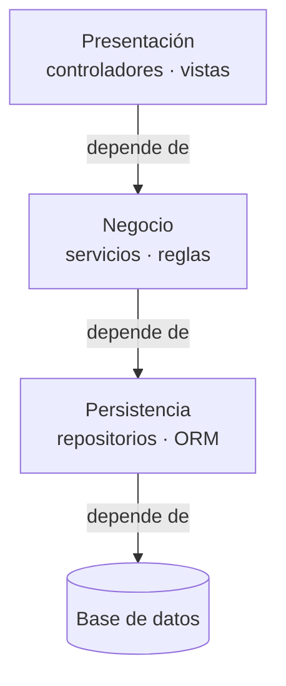
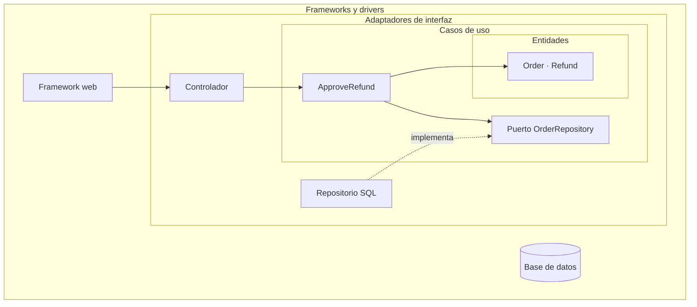
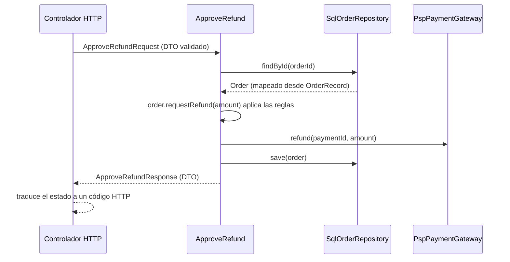
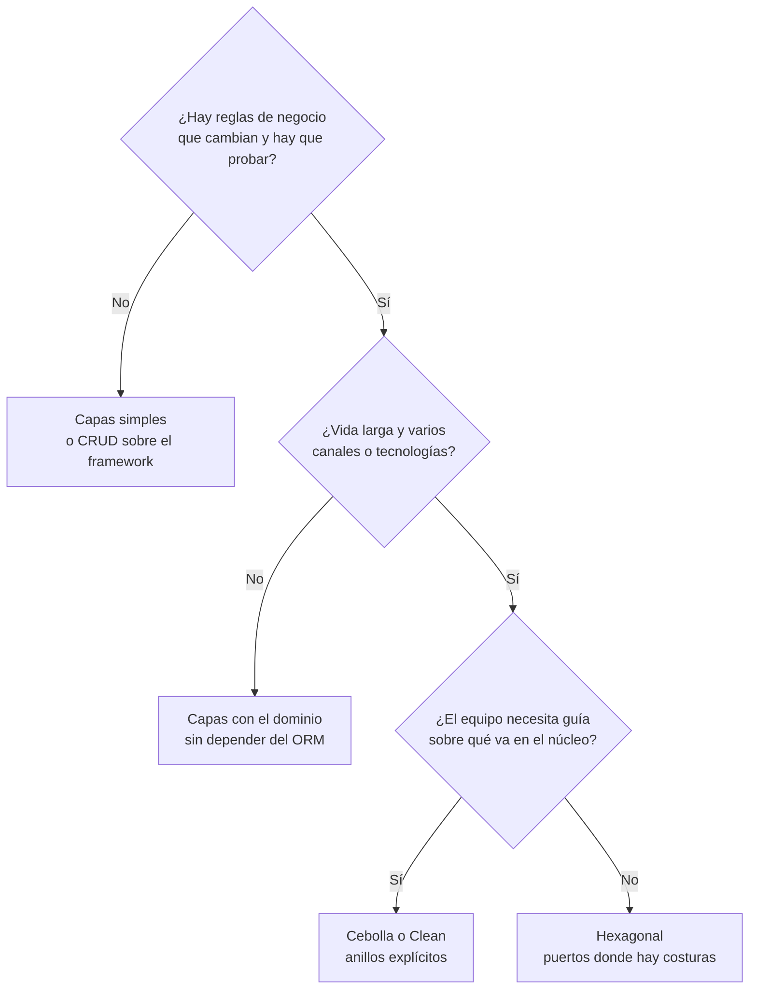

# Capas, cebolla y Clean Architecture: hacia dónde apuntar

Tu equipo quiere añadir una herramienta de línea de comandos que haga lo mismo que un endpoint: aprobar un reembolso. Debería ser una tarde de trabajo. Pero el servicio `RefundService` recibe un objeto de la petición HTTP, devuelve una entidad del ORM con relaciones perezosas y lanza excepciones del framework web. Para reutilizarlo tienes que fingir una petición, abrir una sesión de base de datos y capturar errores que no tienen sentido fuera de HTTP. Nadie diseñó eso a propósito: lo produjo la dirección de las dependencias. Arquitectura en capas, arquitectura cebolla y Clean Architecture son tres respuestas a la misma pregunta, y la diferencia esencial entre ellas cabe en una frase: **lo que separa estos estilos no es cuántas capas dibujan, sino hacia dónde apuntan las dependencias del código fuente; en las capas clásicas bajan hasta la base de datos, en cebolla y limpia convergen en el dominio**.

Este artículo recorre la familia completa: de dónde sale la arquitectura en capas y por qué acopla el negocio a la persistencia, qué propusieron Palermo y Martin, en qué se parecen y en qué se diferencian, cómo es una frontera bien hecha, qué errores convierten cualquiera de ellas en burocracia y cuál elegir según el tipo de sistema. El código solo muestra nombres y formas; el resto va en prosa, tablas y diagramas.

<Callout tone="info" title="Fuentes y fecha de corte">
  Consultado en octubre de 2026. Las fechas y citas de Palermo, Martin y Fowler salen de sus propios
  blogs. El informe de Mark Richards lo leí en una copia en PDF de la edición de 2015, no en la web
  de O'Reilly (respondió 403). La autoría de Simon Brown del capítulo 34 del libro de Martin solo la
  confirmé en fuentes secundarias.
</Callout>

## La arquitectura en capas clásica

Martin Fowler la describe como una de las formas más comunes de modularizar un programa con mucha información: separarlo en tres capas amplias, **presentación**, **lógica de dominio** y **acceso a datos**. Insiste en que son capas lógicas, no niveles físicos: pueden vivir en el mismo proceso. Su versión por defecto es lineal: la presentación depende del dominio y el dominio depende de la fuente de datos.



Las flechas son dependencias de código y también el camino de cada petición. Esa coincidencia es la clave de todo lo que sigue.

### Por qué se convirtió en el estándar

Mark Richards, en su informe _Software Architecture Patterns_ (O'Reilly, 2015), la llama el patrón más común, también conocido como n-tier, y el estándar de facto de la mayoría de las aplicaciones Java EE. Da una razón poco técnica y muy cierta: se parece a la estructura de comunicación y de organización de los departamentos de TI de la mayoría de las empresas. Hay un equipo de interfaz, otro de backend y otro de base de datos, y cada uno tiene su capa.

Richards añade dos conceptos útiles para hablar con precisión:

- **Capas cerradas.** Una petición tiene que pasar por la capa inmediatamente inferior; no puede saltársela. Eso produce **capas de aislamiento**: un cambio en una capa no debería afectar a las demás.
- **Capas abiertas.** Se marcan explícitamente las capas que una petición puede saltarse, por ejemplo una capa de servicios compartidos. Cada capa abierta es una decisión de arquitectura y debería estar documentada.

Su atractivo es real: es fácil de explicar, cualquier persona del equipo la reconoce y los frameworks web la traen de serie. Para muchas aplicaciones sigue siendo una buena elección, y el propio Richards la presenta como un punto de partida sólido cuando no está claro qué patrón conviene.

### De dónde viene el problema de dependencias

El problema está en la última flecha del dominio: **el negocio depende de la persistencia**. Si el servicio importa el repositorio concreto, y el repositorio devuelve entidades del ORM, el negocio queda escrito en términos de tablas, sesiones y anotaciones. Jeffrey Palermo lo resumió en 2008 con una frase que conviene recordar: las dependencias transitivas también son dependencias. La interfaz no importa la base de datos, pero no funciona sin el negocio, y el negocio no funciona sin el acceso a datos; en la práctica, la interfaz está acoplada a la base de datos.

Palermo añadía un argumento económico, que la [arquitectura hexagonal](/docs/arquitectura-hexagonal) desarrolla con más detalle. Fowler, en su artículo de 2015, describe la variante que evita ese acoplamiento: poner un mapeador entre el dominio y la fuente de datos para que el dominio no dependa de ella, y apunta que a esa variante se la suele llamar arquitectura hexagonal. Esa variante es el punto de partida de toda la familia.

| Síntoma                                                        | Causa en una arquitectura en capas clásica                |
| -------------------------------------------------------------- | --------------------------------------------------------- |
| Probar una regla de negocio exige una base de datos            | El servicio depende del repositorio concreto              |
| Cambiar de ORM toca decenas de servicios                       | Las entidades del ORM son el modelo de dominio            |
| Un segundo canal (CLI, cola) duplica la lógica del controlador | Los servicios reciben y devuelven tipos del framework web |
| El esquema de la base de datos dicta los nombres del negocio   | El modelo nace de las tablas, no de las reglas            |
| Las consultas N+1 aparecen en la vista sin que nadie las llame | Objetos perezosos del ORM viajan hasta la presentación    |

## Arquitectura cebolla

Jeffrey Palermo publicó _The Onion Architecture: part 1_ el 29 de julio de 2008 en su blog, y la serie siguió con más entregas; en la tercera, del 4 de agosto de 2008, la comparó con las capas tradicionales y resumió sus principios. La imagen es la de una cebolla: anillos concéntricos alrededor de un **modelo de dominio** que solo depende de sí mismo.

Lo que dice el texto, sin interpretaciones:

- El **modelo de dominio** está en el centro.
- El primer anillo alrededor del dominio contiene normalmente las **interfaces de repositorio**, es decir, el comportamiento de guardar y recuperar objetos expresado desde el negocio.
- El número de capas del núcleo de la aplicación **varía**; lo fijo es que el dominio está en el centro.
- El anillo exterior está **reservado para lo que cambia a menudo**: interfaz de usuario, infraestructura y tests. Las clases que implementan los repositorios viven ahí, porque están acopladas a una técnica concreta de acceso a datos.
- **La base de datos no es el centro: es externa.** En palabras de Palermo, no hay aplicaciones de base de datos, hay aplicaciones que pueden usar una base de datos.

En la tercera parte enumera cuatro principios: la aplicación se construye alrededor de un modelo de objetos independiente; las capas internas definen interfaces y las externas las implementan; el acoplamiento va hacia el centro; y todo el código del núcleo puede compilarse y ejecutarse separado de la infraestructura. Señala además una diferencia con las capas clásicas que suele pasarse por alto: **cualquier capa externa puede llamar directamente a cualquier capa interna**, mientras que en una arquitectura en capas tradicional cada capa solo llama a la inmediatamente inferior.

Palermo también acotó su alcance desde la primera entrega: dijo que no es apropiada para sitios web pequeños y que sí lo es para aplicaciones de negocio de larga vida y para aplicaciones con comportamiento complejo. Es un detalle que se olvida cuando se aplica a cualquier proyecto por defecto.

## Clean Architecture

Robert C. Martin publicó _The Clean Architecture_ en su blog el 13 de agosto de 2012 y lo amplió en el libro _Clean Architecture: A Craftsman's Guide to Software Structure and Design_ (Prentice Hall, 2017). En el artículo cita como antecedentes la arquitectura hexagonal de Alistair Cockburn, la cebolla de Palermo, su propia _Screaming Architecture_, DCI de James Coplien y Trygve Reenskaug, y BCE de Ivar Jacobson, y dice que todas comparten el objetivo de la separación de responsabilidades.

Su dibujo tiene cuatro círculos:

| Círculo                                        | Contiene                                                                                         |
| ---------------------------------------------- | ------------------------------------------------------------------------------------------------ |
| Entidades (_Entities_)                         | Reglas de negocio de toda la empresa, las que existirían aunque no hubiera software              |
| Casos de uso (_Use Cases_)                     | Reglas específicas de la aplicación: orquestan el flujo de datos hacia y desde las entidades     |
| Adaptadores de interfaz (_Interface Adapters_) | Controladores, presentadores y vistas; convierten datos entre el formato del núcleo y el externo |
| Frameworks y drivers                           | Base de datos, framework web, dispositivos: el pegamento con el exterior                         |



La **regla de dependencia** es el centro del artículo: las dependencias del código fuente solo pueden apuntar hacia dentro, y nada de un círculo interior puede saber nada de uno exterior, ni siquiera el nombre de una función, una clase o una variable declarada fuera.

Tres precisiones del propio Martin que evitan malas lecturas:

- **Los círculos son esquemáticos.** Ante la pregunta de si solo hay cuatro, responde que no: puedes necesitar más, siempre que se respete la regla de dependencia.
- **El flujo de control y el de dependencias pueden ir en sentidos opuestos.** El control empieza en el controlador, pasa por el caso de uso y termina en el presentador. Para que el caso de uso no dependa del presentador, llama a una interfaz definida en su propio círculo (un puerto de salida) que el presentador implementa. Es la inversión de dependencias de [SOLID](/docs/solid) aplicada en cada frontera.
- **Lo que cruza una frontera son estructuras de datos aisladas y simples**: estructuras básicas, objetos de transferencia de datos (DTO), argumentos de función. No se deben pasar entidades ni filas de base de datos, y los datos deben llegar en la forma más cómoda para el círculo interior.

El libro incluye además el capítulo 34, _The Missing Chapter_, que varias reseñas atribuyen a Simon Brown (el índice del editor no lo nombra) y que compara cuatro formas de empaquetar el código: por capa, por funcionalidad, con puertos y adaptadores, y por componente. Es una lectura útil para el problema de las carpetas que veremos más abajo.

## Qué comparten y qué cambia

Martin lo dijo en 2012: estas arquitecturas varían en los detalles pero son muy parecidas. La tabla deja claro dónde está la diferencia real y dónde solo hay vocabulario. La hexagonal tiene su [comparación propia](/docs/arquitectura-hexagonal), así que aquí se queda fuera.

| —                                      | Capas clásicas                         | Cebolla (Palermo, 2008)                    | Limpia (Martin, 2012)                                                |
| -------------------------------------- | -------------------------------------- | ------------------------------------------ | -------------------------------------------------------------------- |
| Dirección de dependencias              | Hacia abajo, hasta la base de datos    | Hacia el centro                            | Hacia dentro                                                         |
| Qué hay en el centro                   | Nada: la base de datos está al fondo   | El modelo de dominio                       | Las entidades                                                        |
| Número de anillos                      | Típicamente tres                       | Variable dentro del núcleo                 | Cuatro, «esquemáticos»                                               |
| Dónde vive la interfaz del repositorio | Junto a su implementación, si existe   | En el primer anillo alrededor del dominio  | Dentro, como puerto: lo exige la regla                               |
| Quién puede llamar a quién             | Cada capa a la inmediatamente inferior | Cualquier capa externa a cualquier interna | Hacia dentro, cruzando fronteras con DTO                             |
| Aporte distintivo                      | Separación por rol técnico             | La infraestructura es externa              | La regla escrita explícitamente y el flujo de datos en las fronteras |

**Lo común** es la regla: el negocio no depende de la tecnología, y la tecnología se conecta a interfaces que define el negocio. **Lo que cambia** es el nivel de prescripción: cuántos anillos, cómo se llaman, y si las interfaces se colocan siempre en el anillo interior (cebolla, limpia) o solo donde hay una costura real.

La [arquitectura hexagonal](/docs/arquitectura-hexagonal) es anterior a cebolla y limpia, y la menos prescriptiva de las tres: no habla de anillos interiores, solo de un núcleo y de puertos y adaptadores a su alrededor. Si tu equipo ya piensa en puertos, no ganas nada renombrándolos a «círculos»; si necesitas una guía de qué va dentro del núcleo, cebolla y limpia te dan más estructura. El artículo sobre hexagonal desarrolla la organización de puertos y adaptadores, los tests de contrato y las herramientas; aquí nos quedamos con lo que distingue a la familia de las capas clásicas.

## Anatomía de un caso de uso y de una frontera

Un caso de uso es una operación que el sistema ofrece, con nombre de negocio: aprobar un reembolso, cerrar un periodo contable, reasignar un pedido. Tiene una entrada, una salida y unas dependencias declaradas. Una **frontera** es el punto donde cambia la dirección de la dependencia y donde los datos cambian de forma.

### Qué cruza la frontera y qué no

| Pieza                     | Vive en                   | Forma                                               | Cruza fronteras                     |
| ------------------------- | ------------------------- | --------------------------------------------------- | ----------------------------------- |
| DTO de entrada            | Borde del caso de uso     | Datos planos, ya validados en el adaptador entrante | Sí: es lo que entra                 |
| DTO de salida             | Borde del caso de uso     | Datos planos, sin comportamiento                    | Sí: es lo que sale                  |
| Entidad de dominio        | Centro                    | Datos con comportamiento e invariantes              | No: se queda dentro                 |
| Registro del ORM          | Adaptador de persistencia | Clase o tipo del ORM, con anotaciones o esquema     | No: se mapea antes de llegar dentro |
| Petición y respuesta HTTP | Adaptador entrante        | Tipos del framework web                             | No: el controlador los traduce      |

¿Por qué tanto empeño en no pasar objetos del ORM al núcleo? Porque no son datos: son comportamiento de infraestructura disfrazado.

- **Carga perezosa.** Acceder a una relación puede lanzar una consulta, a veces fuera de la transacción o desde la vista. El núcleo hace E/S sin saberlo.
- **Seguimiento de cambios.** Muchos ORM guardan las modificaciones de un objeto gestionado al cerrar la unidad de trabajo. Una regla que «solo calculaba» acaba escribiendo en la base de datos.
- **Forma del esquema.** El objeto refleja tablas y claves foráneas, no conceptos del negocio. Cada migración se convierte en un cambio del dominio.
- **Pruebas.** Si el núcleo usa tipos del ORM, probarlo exige el ORM. La promesa principal de la familia, probar el negocio sin infraestructura, desaparece.

El coste del mapeo es real, y por eso no conviene inventarlo donde no compra nada: lo veremos en los errores frecuentes.

### Ejemplo trabajado: aprobar un reembolso

Tomemos el problema del principio. Las reglas: no se puede reembolsar más de lo cobrado, el pedido no puede tener más de cierta antigüedad, y por encima de un importe la solicitud queda pendiente de revisión manual. Hay dos canales de entrada (HTTP y CLI), una base de datos y una pasarela de pago.

La estructura organiza primero por dominio y después por anillos dentro del módulo, que es lo que Fowler recomienda cuando las capas crecen: módulos orientados al dominio en el nivel superior, con capas por dentro.

```text
src/refunds/                         # módulo por dominio; anillos por dentro
  domain/                            # Order, Refund, Money y sus invariantes
  application/
    approve-refund.ts                # caso de uso + DTO de entrada y salida
    ports.ts                         # OrderRepository, PaymentGateway
  adapters/
    http/refunds-controller.ts       # HTTP -> DTO -> caso de uso -> estado HTTP
    cli/approve-refund-command.ts    # el segundo canal, sin duplicar lógica
    persistence/order-record.ts      # tipo del ORM: no sale de esta carpeta
    persistence/sql-order-repository.ts
    payments/psp-payment-gateway.ts
  compose.ts                         # raíz de composición del módulo
```

El contrato del caso de uso es lo único que merece verse como código: qué entra, qué sale y qué necesita.

```typescript
// application/approve-refund.ts
export type ApproveRefundRequest = {
  readonly orderId: string;
  readonly amount: number; // en la unidad mínima de la moneda
  readonly requestedBy: string;
};
export type ApproveRefundResponse =
  | { readonly status: 'approved'; readonly refundId: string }
  | { readonly status: 'needs-review' | 'rejected'; readonly reason: string };

export declare function makeApproveRefund(deps: {
  readonly orders: OrderRepository;
  readonly payments: PaymentGateway;
}): (request: ApproveRefundRequest) => Promise<ApproveRefundResponse>;
```

Fíjate en tres decisiones. La respuesta es una unión discriminada, no una excepción: «pendiente de revisión» es un resultado de negocio, no un error. Los puertos se nombran por lo que el negocio necesita (`OrderRepository`, `PaymentGateway`), no por la tecnología. Y el caso de uso no sabe si lo llama HTTP o la CLI. El recorrido de una petición queda así:



Las reglas viven en la entidad `Order`, no en el caso de uso: el caso de uso orquesta (busca, pide a la entidad que decida, cobra, guarda, responde). Si el cuerpo de `makeApproveRefund` empieza a llenarse de condiciones sobre importes y fechas, la regla se está escapando del dominio. Para el canal CLI basta un adaptador nuevo que construya el mismo DTO; ni el dominio ni el caso de uso cambian. Esa es exactamente la tarde de trabajo que el problema inicial convertía en una semana.

## Errores frecuentes

Ninguno de estos estilos falla por la teoría; fallan por cómo se aplican. Estos son los patrones que más se repiten.

### Capas que solo pasan datos

Richards lo llama el antipatrón del **sumidero de arquitectura** (_architecture sinkhole_): peticiones que atraviesan varias capas sin que ninguna haga nada, como un controlador que llama a un servicio que llama a un repositorio que ejecuta una consulta, y los datos suben sin agregarse ni transformarse. Su regla práctica es la 80-20: es normal que en torno al 20 % de las peticiones sean de paso; si la proporción se invierte, la arquitectura no está encajando con el problema.

En cebolla y limpia el síntoma se ve como casos de uso que solo llaman a `repository.save(dto)`. Suele ir acompañado del **modelo de dominio anémico** que Fowler describió en 2003: entidades con datos y sin comportamiento, y toda la lógica en servicios. Si no hay reglas que proteger, el núcleo es una ceremonia. Si las hay pero están en los servicios, el núcleo existe solo en el nombre de las carpetas.

### Una interfaz para todo

La regla de dependencia exige interfaces en las fronteras, no en cada clase. Una cultura de «toda clase tiene su `IAlgo`» multiplica archivos, rompe la navegación del editor y no compra nada: si una interfaz tiene una sola implementación y no hay una frontera que probar por separado, es ruido. Palermo dijo que las capas internas definen interfaces y las externas las implementan; no dijo que dentro de una misma capa todo deba ir detrás de una interfaz. El criterio práctico: interfaz donde cambia la dirección de la dependencia (persistencia, servicios externos, presentación) o donde hay variación real.

### Carpetas por capa que esconden una maraña

Tener `controllers/`, `services/` y `repositories/` en la raíz no garantiza nada. Las carpetas no son fronteras: un servicio puede importar el ORM, un controlador puede llamar a un repositorio saltándose el servicio y dos módulos de negocio pueden depender circularmente uno del otro, todo con la estructura de carpetas «correcta». Además, la organización por capa técnica dispersa cada funcionalidad por todo el árbol y oculta de qué trata el sistema. Fowler recomienda que, cuando las capas crecen, el nivel superior se divida en módulos orientados al dominio con capas por dentro. Si la dirección de dependencias no se comprueba con una herramienta, la arquitectura es solo un dibujo (ver [acoplamiento y cohesión](/docs/acoplamiento-cohesion)).

### Demasiadas capas para un CRUD

Una herramienta interna que guarda y lista formularios no tiene reglas que proteger. Ponerle entidades, casos de uso, puertos, adaptadores, DTO de entrada y de salida y mapeadores en cada dirección significa que añadir un campo toca siete archivos. Ese coste se paga en cada cambio, durante toda la vida del sistema, a cambio de una independencia de la base de datos que nadie va a usar. Es exactamente el caso para el que Palermo dijo que su propuesta no era apropiada.

| Error                          | Señal en el código                                         | Corrección                                                             |
| ------------------------------ | ---------------------------------------------------------- | ---------------------------------------------------------------------- |
| Capas de paso                  | Métodos de una línea que delegan en la capa siguiente      | Abrir la capa explícitamente o eliminarla en ese módulo                |
| Dominio anémico                | Entidades con solo getters; servicios de cientos de líneas | Mover las reglas a las entidades y dejar el caso de uso fino           |
| Interfaz para todo             | `IFoo` con una sola implementación y sin frontera          | Borrar la interfaz; crearla cuando aparezca la segunda razón           |
| Carpetas sin regla             | Imports del ORM desde `services/` o `domain/`              | Regla de dependencias ejecutable en CI                                 |
| Ceremonia en un CRUD           | Añadir un campo toca más de cinco archivos                 | Capas simples en ese módulo; reservar los anillos para el dominio rico |
| Entidades del ORM en el núcleo | El dominio importa anotaciones o tipos del ORM             | Mapear en el adaptador de persistencia                                 |

## Cuándo usar cada estilo

No hay un ganador universal. La elección depende de cuánto negocio hay que proteger, cuánto va a vivir el sistema y cuántos canales o tecnologías van a cambiar. Las decisiones también son por módulo: un mismo sistema puede tener un módulo de facturación en anillos y un panel de administración en capas simples.



| Tipo de sistema                                       | Estilo razonable                                       | Por qué                                                                           |
| ----------------------------------------------------- | ------------------------------------------------------ | --------------------------------------------------------------------------------- |
| Herramienta de administración, CRUD sobre formularios | Capas clásicas, incluso abiertas                       | No hay reglas que aislar; la velocidad de cambio importa más que la independencia |
| Producto con dominio rico (seguros, logística, pagos) | Cebolla o limpia, por módulo de dominio                | Las reglas son el activo; deben probarse sin infraestructura                      |
| Servicio pequeño con una responsabilidad              | Capas simples con un puerto en la dependencia volátil  | Un puerto hacia el proveedor externo da casi todo el beneficio                    |
| Sistema legado en capas que hay que evolucionar       | Invertir primero la dependencia dominio → persistencia | Es la flecha que más cuesta; el resto puede esperar                               |
| Prototipo de pocas semanas                            | Lo que el framework trae por defecto                   | Todavía no sabes qué regla merece protección                                      |

### Cuándo sí conviene una arquitectura concéntrica

- Las reglas de negocio son la razón de ser del sistema y cambian con frecuencia.
- El sistema va a vivir años y va a sobrevivir a varios frameworks o versiones del ORM.
- Hay varios canales de entrada (HTTP, colas, CLI, tareas programadas) que deben compartir la misma lógica.
- Quieres que la mayoría de los tests corran en milisegundos, sin base de datos.
- Usas [DDD](/docs/domain-driven-design) y cada contexto delimitado merece su propio núcleo.

### Cuándo no conviene

- El sistema es mayoritariamente lectura y escritura de formularios sin reglas.
- El equipo es pequeño, el producto está validándose y el coste de cada archivo extra se nota.
- La mayoría de las peticiones serían de paso: el sumidero de Richards ya te avisa.
- No vas a poner una regla automática que la proteja; sin ella, se degradará en carpetas.

Sea cual sea la elección, regístrala en un [ADR](/docs/adr) con el contexto que la justificó, y revísala cuando cambie ese contexto. La [deuda técnica](/docs/deuda-tecnica-evolucion) de una arquitectura mal elegida se paga en cada cambio, en ambas direcciones: por defecto y por exceso.

## Cómo hacer cumplir la regla

Un diagrama de círculos no impide que alguien importe el ORM desde una entidad. Una regla que se ejecuta en cada build, sí: es una [fitness function](/docs/fitness-functions) de arquitectura. Hay tres mecanismos genéricos, que se combinan bien:

| Mecanismo                        | Qué comprueba                                               | Dónde ves el error         |
| -------------------------------- | ----------------------------------------------------------- | -------------------------- |
| Reglas de importación del linter | Que una carpeta no importe de otra, con mensaje explicativo | En el editor, al escribir  |
| Analizador de dependencias       | Grafo completo: direcciones, ciclos, paquetes externos      | En CI, con informe o grafo |
| Tests de arquitectura            | Las mismas reglas expresadas como tests del proyecto        | En la suite de tests       |

Sea cual sea la herramienta, la forma de las reglas es la misma: un origen, lo que no puede importar y por qué.

```typescript
// forma genérica de las reglas; cada herramienta tiene su sintaxis
const dependencyRules = [
  { from: 'src/*/domain', forbid: ['src/*/application', 'src/*/adapters', 'orm'] },
  { from: 'src/*/application', forbid: ['src/*/adapters', 'orm', 'web-framework'] },
  { from: 'src/*/adapters/http', forbid: ['src/*/adapters/persistence'] },
];
```

La primera regla protege el centro, la segunda impide que los casos de uso conozcan la tecnología y la tercera evita que un adaptador use a otro saltándose el núcleo. Prohibir **paquetes externos** (el ORM, el framework web) en el dominio es tan importante como prohibir carpetas: es la forma más frecuente de romper la regla sin darse cuenta.

En un sistema que ya viola la regla cientos de veces, no esperes a limpiarlo para activarla. Congela las violaciones existentes en un fichero de excepciones, bloquea las nuevas y haz que ese fichero solo pueda encoger. El artículo de [arquitectura hexagonal](/docs/arquitectura-hexagonal) muestra herramientas concretas para TypeScript, Java y .NET.

## Checklist

- [ ] Puedes señalar en qué dirección apuntan las dependencias entre dominio y persistencia, y una herramienta lo comprueba en CI.
- [ ] El dominio no importa el ORM, el framework web ni SDK de proveedores.
- [ ] Cada caso de uso tiene un DTO de entrada y uno de salida, sin tipos del framework ni del ORM.
- [ ] Las reglas de negocio viven en las entidades y los casos de uso se limitan a orquestar.
- [ ] Las interfaces existen en las fronteras o donde hay variación real, no por costumbre.
- [ ] La mayoría de las peticiones hacen algo en cada capa; las capas de paso están abiertas o eliminadas.
- [ ] El nivel superior del código se organiza por dominio, con capas o anillos por dentro.
- [ ] La elección de estilo por módulo está registrada en un ADR con su contexto.

## Fuentes

Consultadas en octubre de 2026.

- [The Onion Architecture: part 1 (Jeffrey Palermo, 29 de julio de 2008)](https://jeffreypalermo.com/2008/07/the-onion-architecture-part-1/)
- [The Onion Architecture: part 3 (Jeffrey Palermo, 4 de agosto de 2008)](https://jeffreypalermo.com/2008/08/the-onion-architecture-part-3/)
- [The Clean Architecture (Robert C. Martin, 13 de agosto de 2012)](https://blog.cleancoder.com/uncle-bob/2012/08/13/the-clean-architecture.html)
- [Clean Architecture: A Craftsman's Guide to Software Structure and Design (Robert C. Martin, 2017)](https://www.informit.com/store/clean-architecture-a-craftsmans-guide-to-software-structure-9780134494166): ficha del editor e índice, incluido el capítulo 34
- [Presentation Domain Data Layering (Martin Fowler, 26 de agosto de 2015)](https://martinfowler.com/bliki/PresentationDomainDataLayering.html)
- [Anemic Domain Model (Martin Fowler, 25 de noviembre de 2003)](https://martinfowler.com/bliki/AnemicDomainModel.html)
- [Software Architecture Patterns (Mark Richards, O'Reilly, 2015)](https://www.oreilly.com/library/view/software-architecture-patterns/9781491971437/): capítulo 1, leído en una copia en PDF de la edición de 2015
