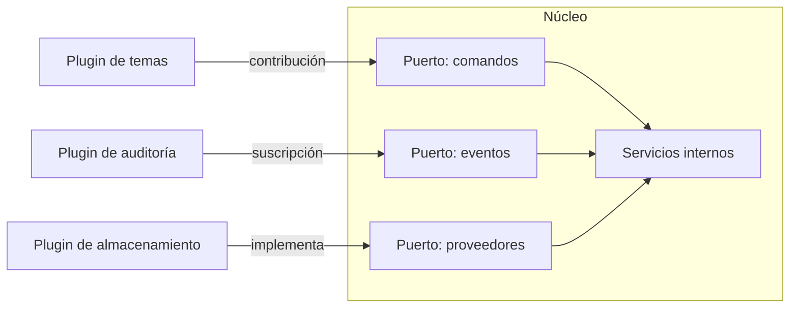

Un sistema extensible permite que alguien añada funciones sin tocar el código del núcleo. Parece una
virtud sin coste, pero la mayoría de los sistemas que se abren a plugins terminan atrapados por la
misma API que quisieron hacer flexible: cada método público es una promesa que alguien, en algún
lugar, ya está usando.

La tesis de este artículo es concreta: **abrir el sistema solo compensa cuando puedes mantener estable
el contrato del núcleo durante años**. El costo real no está en escribir el primer plugin, sino en
versionar la API, aislar a los plugins que fallan y retirar con calma lo que ya no debe usarse. Si no
puedes comprometerte con eso, la extensión sale más cara que una bifurcación interna bien hecha.

## Cuándo abrir el sistema

Hay tres señales que justifican una arquitectura de plugins. La primera es que **hay más comportamientos
variables que equipos para implementarlos**: un editor de código que quiere lenguajes, temas y
depuradores que no escribe el mismo equipo. La segunda es que **los clientes necesitan adaptar el
flujo sin esperar a una entrega**, por ejemplo una pasarela de pago que exige validaciones propias de
cada país. La tercera es que **el núcleo cambia poco y la periferia cambia mucho**, así que separar
ambas cosas reduce el riesgo de cada entrega.

Las señales contrarias son igual de útiles. Si solo hay un cliente, la extensión es una abstracción
prematura: la misma lógica dentro del núcleo con un punto de configuración basta. Si el dominio cambia
cada semana, cualquier contrato se rompe antes de que alguien lo use. Y si no tienes a nadie que
mantenga la API pública, un sistema de plugins se convierte en un archivo de compromisos que nadie
revisa.

<Callout tone="info" title="Regla práctica">
  Antes de publicar un punto de extensión, escribe el primer plugin tú mismo, dentro del equipo, y
  contabiliza cuántas veces tuviste que tocar el núcleo para hacerlo. Si son muchas, el punto está
  mal ubicado y todavía no es una API.
</Callout>

## Puntos de extensión: contratos, no ganchos sueltos

Un punto de extensión es un lugar del núcleo donde un plugin puede participar, con un contrato escrito:
qué recibe, qué puede devolver, qué garantías da el núcleo y qué no. La diferencia entre un gancho
suelto y un punto de extensión es el contrato. Un gancho que pasa el objeto interno completo obliga a
cada plugin a depender de la forma interna del núcleo; un punto de extensión pasa un tipo pequeño,
definido para el propósito, y esconde lo demás.

En la práctica conviene distinguir tres familias. Las **contribuciones declarativas** describen algo
que el núcleo sabe renderizar: un comando, una opción de menú, una columna nueva. Son las más seguras
porque el núcleo controla el dibujado, la validación y el orden. Los **eventos** notifican que algo
ocurrió y no esperan respuesta, así que el plugin no puede bloquear el flujo. Los **proveedores** son
los puntos donde el plugin implementa una interfaz que el núcleo llama para resolver algo: un
almacenamiento, un formato de exportación, un validador. Cada familia tiene un costo de compatibilidad
distinto, y por eso no conviene mezclarlas en una sola API.

Diseña el tipo del contrato como si fuera público desde el primer día, porque lo es. Usa nombres
estables, evita exponer clases internas, y añade campos opcionales en lugar de cambiar el significado de
los existentes. Un contrato que crece por adición es barato de mantener; uno que cambia de forma obliga
a cada plugin a reescribirse.



## Dónde se ejecuta el plugin

La decisión más cara es el modelo de carga. Hay tres modelos habituales, y cada uno cambia la
seguridad, el rendimiento y la experiencia de depuración.

Un plugin **en el mismo proceso** es el más rápido: llamar a una función es barato y no hay
serialización. Pero un error en el plugin puede tumbar todo el núcleo, y el plugin ve la memoria del
núcleo. Es razonable para extensiones de confianza que mantiene el mismo equipo.

Un plugin en **un proceso aparte** es el modelo que usan los editores modernos. VS Code, por ejemplo,
ejecuta sus extensiones en un proceso de host separado, precisamente para que una extensión lenta o
inestable no degrade el arranque ni la capacidad de respuesta del editor. El precio es la
comunicación entre procesos: cada llamada se serializa, y las APIs deben diseñarse para pocas
llamadas grandes en lugar de muchas pequeñas.

Un plugin **remoto**, en otro servicio, aísla por completo y permite escalar y desplegar por separado,
pero añade latencia, fallos de red y un contrato de transporte que también hay que versionar. Solo
compensa cuando el plugin pertenece a otra organización o necesita recursos que el núcleo no tiene.

Como regla general, empieza con el aislamiento más fuerte que tu latencia tolere. Es más fácil relajar
un aislamiento para ganar rendimiento que endurecerlo después de que terceros dependan de un modelo
compartido.

## Permisos y sandbox

Un plugin de terceros es código que no controlas. El sandbox limita lo que puede hacer, y el sistema
de permisos hace visible esa limitación antes de instalarlo. El patrón más sólido es **declarar los
permisos en el manifiesto**, de forma que el núcleo pueda rechazar la instalación o pedir confirmación
sin ejecutar nada del plugin.

Las extensiones de Chrome ilustran bien el enfoque. La documentación oficial recomienda pedir permisos
opcionales siempre que la funcionalidad lo permita, para que el usuario decida el acceso en el momento
en que lo necesita. Además, separa los permisos de API de los permisos de host: un plugin puede tener
acceso a la API de almacenamiento y, aun así, no poder leer el contenido de una página hasta que se le
conceda el host correspondiente.

Un manifiesto de tu plugin puede seguir esa misma lógica:

```yaml
name: exportador-csv
version: 1.4.0
api: '>=2.1 <3.0'
permissions:
  - documentos.leer
optional_permissions:
  - red.salida
```

La clave es que el permiso describa la **capacidad**, no la implementación. `documentos.leer` dice qué
puede tocar el plugin; no dice que use un método concreto. Así puedes cambiar la implementación del
núcleo sin cambiar el significado del permiso, y el usuario entiende lo que concede.

No confundas sandbox con confianza. Un sandbox limita daños por error o malicia; no sustituye la
revisión, la firma de los paquetes ni la política de qué plugins se publican. Si el catálogo acepta
cualquier plugin sin revisión, el permiso declarado es solo una etiqueta.

## Versionado de la API pública

Una API de plugins tiene dos versiones en juego: la del núcleo y la de cada plugin. El contrato entre
ambas debe ser explícito. El plugin declara la versión de API que necesita, en un rango, y el núcleo
decide si lo carga. Esa declaración evita el error más común: un plugin que se carga, se ejecuta y
falla de forma sutil porque cambió algo que daba por hecho.

Para decidir qué es un cambio incompatible, aplica el criterio de [versionado semántico](https://semver.org/).
Un cambio que retira un campo, cambia el tipo de un parámetro o altera el orden de llamadas es mayor;
una adición compatible es menor; una corrección que no altera el contrato es parche. El detalle que
importa aquí es que el criterio se aplica a **la API pública**, no a la implementación. Si un plugin
dependía de un efecto secundario no documentado, el cambio es incompatible aunque el contrato escrito
no haya cambiado. Por eso conviene documentar qué garantías no ofreces.

Mantén dos versiones de la API activas durante una ventana de migración. Así el núcleo puede cargar
plugins de la versión anterior mediante un adaptador que traduce las llamadas. El adaptador tiene coste
de mantenimiento, pero evita el corte brusco que obliga a todos los autores a actualizar el mismo día.

## Deprecación y retiro

Retirar una parte de la API es más difícil que añadirla, porque hay que comunicarlo a quienes no
conoces. Dos normas del IETF dan vocabulario para hacerlo bien. La [RFC 9745](https://www.rfc-editor.org/info/rfc9745),
de marzo de 2025, define una cabecera `Deprecation` que indica que un recurso está o estará obsoleto y
puede apuntar a la documentación. La [RFC 8594](https://www.rfc-editor.org/info/rfc8594), de mayo de 2019,
define `Sunset`, que indica la fecha en que el recurso dejará de responder. Aunque ambas hablan de
HTTP, el principio sirve para cualquier API: anuncia la deprecación con fecha, da un sustituto y
mantén la fecha de retiro aunque nadie la mire.

Un calendario razonable tiene tres fases. Durante la fase de **aviso**, la API sigue igual pero el
núcleo registra qué plugins la usan. Durante la fase de **advertencia**, cada uso emite un mensaje
claro con el reemplazo. Al llegar la fecha de **retiro**, la llamada falla con un error que nombra la
versión y el reemplazo. Registrar el uso es lo que permite decidir con datos: si solo queda un plugin
de un autor que no responde, el retiro tiene un coste distinto al que parece en el papel.

<Callout tone="warning" title="No retires por calendario solamente">
  Una fecha de retiro sin medición fuerza cambios en plugins que nadie mantiene. Antes de retirar
  una parte de la API, comprueba quién la usa y ofrece un adaptador o una ruta de migración escrita.
</Callout>

## Un caso: cambiar el formato de exportación sin romper a nadie

Imagina un editor con un plugin de exportación. La API v1 define `exportar(documento)`, que devuelve el texto
completo en CSV. Llega una necesidad: documentos de cientos de megabytes que no caben en memoria. La API v2 necesita
un flujo de salida, y la firma cambia a `exportar(documento, salida)`.

El mal camino es cambiar la firma y publicar la versión 2.0 el mismo día. Los plugins de la v1 dejan de cargarse, y los
autores que no responden se quedan sin actualizar. El usuario ve un editor con menos funciones y no entiende por qué.

El buen camino tiene tres pasos. Primero, la nueva función se añade sin retirar la antigua: el núcleo declara ambas en el
contrato 2.1, y la antigua queda marcada como deprecada en la documentación y en el registro de uso. Segundo, el núcleo
ofrece un adaptador: si un plugin solo implementa `exportar` con retorno de texto, el núcleo llama a esa función, escribe
el resultado en el flujo y registra la llamada como uso de la API antigua. El coste es que el núcleo mantiene dos caminos
durante la ventana; el beneficio es que ningún plugin deja de cargar. Tercero, se decide con datos. Pasado el periodo que
el equipo fije, el registro dice qué plugins siguen en la vía antigua. Si son cero, se retira. Si quedan plugins de un autor
activo, se le avisa con fecha. Si quedan plugins de un autor que no responde, la decisión deja de ser técnica: se mantiene el
adaptador un año más o se publica una versión del propio núcleo que cubra ese plugin.

El caso enseña dos cosas. La primera es que un cambio que parece técnico, de texto a flujo, es en realidad una decisión sobre
cuánta compatibilidad estás dispuesto a pagar. La segunda es que la fecha de retiro no la fija el calendario, sino el uso que
queda. Por eso el rango de versiones que declara cada plugin, como `api: ">=2.1 <3.0"`, es tan importante: le dice al núcleo
qué puede cargar sin adivinar.

## Fallos aislados y ciclo de vida

Un plugin que falla no debe tumbar el núcleo ni a otros plugins. Eso exige tres mecanismos. El primero
es un **tiempo máximo** en cada llamada, para que un plugin colgado no bloquee la interfaz. El segundo
es un **aislamiento de errores**: la excepción de un plugin se captura, se registra con su
identificador y el núcleo sigue funcionando sin esa contribución. El tercero es un **estado del plugin**
visible (activo, desactivado por fallos, incompatible con la versión de la API) que el usuario puede
consultar.

El ciclo de vida también importa. Instalar, activar, desactivar y desinstalar son operaciones distintas.
Un plugin desactivado no debe ejecutar código al arrancar. Un plugin desinstalado debe liberar sus
recursos. Y el núcleo debe poder arrancar aunque un plugin instalado ya no sea compatible, porque la
alternativa es dejar al usuario sin editor, sin tienda o sin panel por un módulo ajeno.

## Pruebas de contrato con plugins

La forma más barata de detectar roturas es probar el contrato con plugins reales. Mantén un conjunto
de plugins de referencia, uno por familia de puntos de extensión, y ejecútalo en cada cambio del
núcleo. Si un cambio rompe un plugin de referencia, el cambio es incompatible aunque las pruebas
internas pasen. Este patrón es el mismo que aplican las pruebas de contrato entre servicios, con la
diferencia de que aquí el consumidor no se despliega contigo.

Añade también una prueba de degradación: desactiva cada plugin y comprueba que el núcleo sigue
funcionando con las funciones restantes. Muchos sistemas solo prueban el camino feliz con todos los
plugins activos, y descubren la dependencia oculta cuando un usuario desactiva uno en producción.

## Errores frecuentes

El error más común es **exponer el modelo interno como API**. Un plugin que depende de las clases del
núcleo hace imposible refactorizar el núcleo sin romper a terceros. La solución es un tipo de contrato
pequeño, separado de los tipos internos, aunque al principio parezca duplicado.

El segundo error es **un punto de extensión por cada petición concreta**. Cada cliente pide un gancho
distinto y el núcleo acaba con cientos de puntos que nadie entiende. Antes de añadir uno, pregunta si
el caso se resuelve con una configuración o con una contribución declarativa.

El tercero es **no tener política de compatibilidad escrita**. Si nadie sabe qué garantías ofrece la
API, cada cambio se discute desde cero y los plugins dependen de comportamientos accidentales.

El cuarto es **confundir extensibilidad con apertura total**. Hay partes del núcleo que deben seguir
cerradas: la seguridad, la persistencia de datos críticos y los flujos de dinero. Abrirlas por
flexibilidad convierte un error de un plugin en un incidente de datos.

## Herramientas

No hace falta un framework para empezar. Un registro de puntos de extensión con tipos explícitos, un
manifiesto validado al instalar y un script que ejecute los plugins de referencia cubren la mayoría de
los casos. Las herramientas de empaquetado y firma de paquetes son útiles cuando el catálogo es
público, porque permiten verificar el origen antes de instalar. La elección depende del lenguaje y de
si los plugins comparten proceso con el núcleo; lo importante es que la API y el manifiesto sean
versionados en el mismo repositorio que el núcleo.

## Checklist

- [ ] Hay al menos tres casos reales que justifican el punto de extensión, y el primer plugin lo escribió el equipo.
- [ ] Cada punto de extensión tiene un tipo de contrato pequeño y separado de los tipos internos.
- [ ] El manifiesto declara la versión de API y los permisos, y el núcleo los valida antes de ejecutar.
- [ ] Los permisos describen capacidades, no implementaciones.
- [ ] Hay una política de versionado y de deprecación escrita, con fechas y reemplazos.
- [ ] El uso de cada parte deprecada se registra antes de retirarla.
- [ ] Un plugin que falla no tumba el núcleo, y su estado es visible para el usuario.
- [ ] Un conjunto de plugins de referencia corre en el CI en cada cambio del núcleo.

## Fuentes

- [RFC 9745: The Deprecation HTTP Response Header Field](https://www.rfc-editor.org/info/rfc9745), IETF, marzo de 2025.
- [RFC 8594: The Sunset HTTP Header Field](https://www.rfc-editor.org/info/rfc8594), IETF, mayo de 2019.
- [Chrome Developers: Declare permissions](https://developer.chrome.com/docs/extensions/mv3/declare_permissions), documentación de extensiones.
- [Visual Studio Code: documentación de extensiones](https://code.visualstudio.com/api), sobre el proceso de host de extensiones.
- [Semantic Versioning](https://semver.org/), especificación de versionado.
