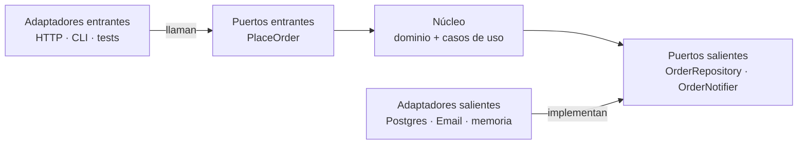
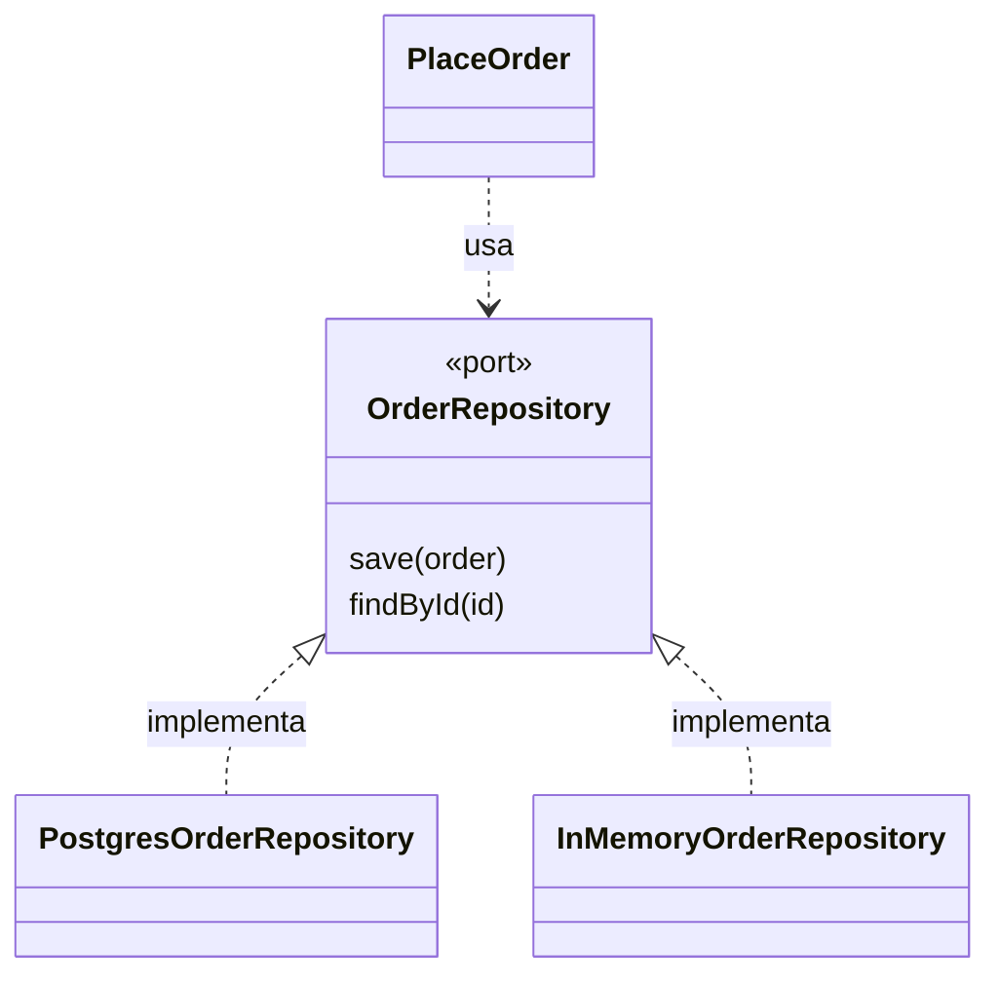

# Arquitectura hexagonal: puertos y adaptadores

Casi todos los sistemas empiezan igual: un controlador que llama a un servicio que llama a un repositorio. Con el tiempo, las reglas de negocio acaban repartidas entre el controlador, las consultas SQL y los hooks del framework. Probar una regla exige levantar una base de datos, y cambiar de framework obliga a tocar el negocio. La arquitectura hexagonal ataca ese problema con una sola idea: **el negocio no conoce el mundo exterior; el mundo exterior se adapta al negocio**.

Este artículo explica el patrón y su regla de dependencia, lo compara con la arquitectura cebolla y la limpia, y lo aterriza en decisiones concretas: cómo organizar las carpetas, cómo nombrar puertos, adaptadores y casos de uso, y dónde vive cada responsabilidad. Después muestra cómo probarlo, cómo protegerlo con reglas ejecutables, cuándo no conviene y cuánto cuesta. El código es solo una guía de nombres y estructura, no una receta para copiar.

<Callout tone="info" title="Fecha de corte">
  Las versiones de herramientas son de octubre de 2026 y salen del registro de npm y de los sitios
  oficiales. No pude abrir el texto original de Cockburn (el servidor respondió 403): lo que se
  cuenta de él viene de fuentes secundarias y está señalado como tal.
</Callout>

## El problema que resuelve

Alistair Cockburn formuló el patrón para evitar dos trampas del diseño orientado a objetos: las dependencias indeseadas entre capas y la lógica de negocio que contamina el código de interfaz (según la entrada de Wikipedia, que cita su artículo del 1 de abril de 2005). Jeffrey Palermo lo describió desde el otro lado: en una arquitectura en capas tradicional cada capa depende de la que tiene debajo, y la interfaz termina acoplada al acceso a datos, porque las dependencias transitivas también cuentan. Como las técnicas de acceso a datos cambian cada pocos años, ese acoplamiento acaba empujando hacia la reescritura.

Los síntomas en un sistema real son reconocibles:

| Síntoma                                                 | Causa habitual                                    |
| ------------------------------------------------------- | ------------------------------------------------- |
| Para probar una regla hay que levantar la base de datos | La regla vive mezclada con consultas o con el ORM |
| Cambiar de framework o de proveedor toca el negocio     | El negocio importa tipos del framework            |
| El mismo cálculo está en el controlador y en un job     | No hay un punto único de entrada a la lógica      |
| Los tests de integración son lentos y frágiles          | Toda prueba atraviesa todas las capas             |

## La idea: puertos y adaptadores

El patrón divide el sistema en un **núcleo** (el dominio y los casos de uso) y un **exterior** (interfaz, base de datos, correo, colas). El núcleo se comunica con el exterior solo a través de **puertos**: interfaces escritas en el lenguaje del negocio. Los **adaptadores** traducen entre un puerto y una tecnología concreta.



Las flechas son **dependencias de código**: fíjate en que ninguna sale del núcleo hacia un adaptador. Dos aclaraciones sobre el nombre:

- **«Hexagonal» es una convención de dibujo**, no una regla: el hexágono deja espacio para dibujar los distintos puertos y no significa que haya seis. Cockburn prefiere el nombre _ports and adapters_ (puertos y adaptadores).
- Los **puertos entrantes** (_driving_, primarios) son la API del núcleo: lo que el exterior le pide. Los **puertos salientes** (_driven_, secundarios) son lo que el núcleo necesita del exterior. Es terminología habitual en la literatura posterior; no la verifiqué en el texto original.

| —                       | Puerto entrante                  | Puerto saliente                      |
| ----------------------- | -------------------------------- | ------------------------------------ |
| Quién inicia la llamada | El exterior (HTTP, CLI, un test) | El núcleo                            |
| Quién implementa        | El caso de uso del núcleo        | Un adaptador de infraestructura      |
| Ejemplo                 | `PlaceOrder`                     | `OrderRepository`, `OrderNotifier`   |
| Adaptadores típicos     | Controlador HTTP, comando CLI    | Postgres, correo, versión en memoria |

Un detalle importante: **el puerto lo define el núcleo**, con el vocabulario del negocio. Se llama `OrderRepository.save(order)`, no `OrdersTable.insertRow(...)`. Si el puerto refleja la tecnología, el acoplamiento solo cambió de sitio.

## La regla de dependencia

Robert Martin la enuncia así en su artículo de 2012: las dependencias del código fuente solo pueden apuntar hacia dentro, y ningún nombre declarado en un círculo exterior puede mencionarse en uno interior. Palermo la había escrito en 2008 con otras palabras: todo el código puede depender de capas más centrales, pero no de capas más externas.

Esto es la **D de [SOLID](/docs/solid)**, la inversión de dependencias, aplicada a toda la arquitectura. En tiempo de ejecución el caso de uso llama al repositorio; en el código fuente es el adaptador el que depende del puerto del núcleo. La flecha de control y la de dependencia van en sentidos opuestos:



Martin añade una consecuencia práctica: lo que cruza una frontera deben ser estructuras de datos simples, no filas de base de datos ni entidades del ORM, porque eso arrastraría la dependencia hacia dentro.

## Hexagonal, cebolla y limpia: qué comparten

Las tres propuestas nacen del mismo problema. Martin lo dice en su artículo: todas tienen el mismo objetivo, la separación de responsabilidades. Cambian el vocabulario y el nivel de prescripción.

| —                 | Hexagonal                                                     | Cebolla                                                             | Limpia                                                          |
| ----------------- | ------------------------------------------------------------- | ------------------------------------------------------------------- | --------------------------------------------------------------- |
| Autor y año       | Alistair Cockburn, 2005                                       | Jeffrey Palermo, 29 de julio de 2008                                | Robert C. Martin, 13 de agosto de 2012                          |
| Metáfora          | Dentro y fuera, con puertos y adaptadores                     | Anillos concéntricos alrededor del modelo de dominio                | Cuatro círculos concéntricos                                    |
| Capas internas    | No las prescribe (según Graça, el original no habla de capas) | Modelo de dominio al centro; interfaces de repositorio en el núcleo | Entities, Use Cases, Interface Adapters, Frameworks and Drivers |
| Aporte distintivo | Simetría entre quien conduce y quien es conducido             | La infraestructura es externa: «la base de datos no es el centro»   | La regla de dependencia explícita y el flujo de datos simples   |

En la práctica puedes elegir el vocabulario que prefiera tu equipo: la regla que hace que funcione es la misma. Esta guía usa «puertos y adaptadores» porque describe mejor las costuras que vas a escribir.

## Cómo se organiza y se nombra

Tomemos un caso pequeño: **realizar un pedido**. Hay un puerto entrante (`PlaceOrder`), dos salientes (guardar el pedido y avisar al cliente), adaptadores reales y de prueba, y un único punto donde todo se conecta. Sin frameworks y sin contenedor de inyección: lo que importa aquí no es el código, sino dónde vive cada cosa y cómo se llama.

### Estructura de carpetas

La carpeta que contiene el núcleo es la frontera. Todo lo que está dentro de `core/` es negocio; todo lo que está fuera es tecnología o composición.

```text
src/
  core/                        # el hexágono: no importa nada de fuera
    domain/                    # entidades, valores y reglas
    ports/driving/             # lo que el exterior le pide al núcleo
    ports/driven/              # lo que el núcleo necesita del exterior
    use-cases/                 # orquestan dominio + puertos salientes
  adapters/
    driving/http/              # traducen una petición en un comando
    driven/postgres/           # implementan un puerto con una tecnología
    driven/memory/             # versión en memoria, para tests y desarrollo
  main.ts                      # raíz de composición: el único que lo conoce todo
```

Separar `driving` de `driven` dentro de `adapters/` hace visible la simetría del patrón y permite escribir una regla de dependencias por cada lado.

### Convenciones de nombres

Un buen nombre te dice a qué lado de la frontera estás sin abrir el archivo.

| Pieza               | Convención                                       | Ejemplo                                              | Por qué                                                     |
| ------------------- | ------------------------------------------------ | ---------------------------------------------------- | ----------------------------------------------------------- |
| Puerto entrante     | Verbo del negocio, igual que el caso de uso      | `PlaceOrder`                                         | Describe la intención, no el canal por el que llega         |
| Comando y resultado | Nombre del puerto más `Command` o `Result`       | `PlaceOrderCommand`, `PlaceOrderResult`              | Datos simples que cruzan la frontera, sin tipos del ORM     |
| Puerto saliente     | Sustantivo del negocio más su rol                | `OrderRepository`, `OrderNotifier`                   | El negocio pide «guardar un pedido», no «insertar una fila» |
| Adaptador saliente  | Tecnología más el puerto que implementa          | `PostgresOrderRepository`, `InMemoryOrderRepository` | Se ve qué sustituye y se puede cambiar por otro igual       |
| Caso de uso         | Fábrica `make` más el nombre del puerto entrante | `makePlaceOrder`                                     | Recibe sus dependencias como argumento                      |
| Adaptador entrante  | Nombre del caso de uso más el canal              | `placeOrderHandler`                                  | Una pieza por canal: HTTP, CLI, cola                        |
| Raíz de composición | Un solo archivo, `main` o `compose`              | `main.ts`                                            | Si hay varios, el grafo de dependencias deja de ser legible |

### Los puertos y el caso de uso: solo las firmas

Lo único que conviene ver como código es la forma de los contratos. Nota que el puerto habla en verbos del negocio (`save`, `findById`) y que el caso de uso declara lo que necesita, sin saber quién se lo da:

```typescript
// core/ports/driven/order-repository.ts
export type OrderRepository = {
  save(order: Order): Promise<void>;
  findById(id: string): Promise<Order | undefined>;
};

// core/ports/driving/place-order.ts
export type PlaceOrder = (command: PlaceOrderCommand) => Promise<PlaceOrderResult>;

// core/use-cases/place-order.ts: las dependencias llegan como argumento
export declare function makePlaceOrder(deps: {
  readonly orders: OrderRepository;
  readonly notifier: OrderNotifier;
}): PlaceOrder;
```

El cuerpo del caso de uso es corto a propósito: crea el pedido con las reglas del dominio, lo guarda, avisa y devuelve un resultado. Si crece, normalmente es señal de que una regla de negocio se está escapando del dominio.

### Dónde vive cada responsabilidad

| Pieza               | Responsable de                                                                                                                  | No debe hacer                                  |
| ------------------- | ------------------------------------------------------------------------------------------------------------------------------- | ---------------------------------------------- |
| Dominio             | Invariantes y reglas: un pedido necesita al menos una línea, cantidades positivas                                               | Conocer HTTP, SQL ni formatos de serialización |
| Caso de uso         | Orquestar: dominio, puertos salientes, orden de las operaciones                                                                 | Decidir códigos de estado ni escribir SQL      |
| Adaptador entrante  | Validar la entrada en la frontera, traducirla a un comando y los errores de dominio a códigos de estado                         | Contener reglas de negocio                     |
| Adaptador saliente  | Traducir el modelo del núcleo a la tecnología y validar lo que lee: los datos de fuera son `unknown` hasta pasar por un esquema | Devolver filas o entidades del ORM al núcleo   |
| Raíz de composición | Elegir qué adaptador se conecta a cada puerto                                                                                   | Tener lógica: solo cablea                      |

Con esta separación, cambiar de Postgres a otra base es escribir otro adaptador y cambiar una línea en la composición. Ni el dominio ni el caso de uso se enteran.

## Cómo se prueba

El beneficio más inmediato es que el núcleo se prueba sin infraestructura. Los dobles son adaptadores pequeños y reales (una versión en memoria, un notificador que registra lo recibido), no _mocks_ configurados llamada a llamada, así que los tests verifican comportamiento y no el orden de las invocaciones.

| Tipo de test         | Qué comprueba                                               | Contra qué corre                                        | Cuántos                 |
| -------------------- | ----------------------------------------------------------- | ------------------------------------------------------- | ----------------------- |
| Del núcleo           | Reglas del dominio y orquestación del caso de uso           | Adaptadores en memoria                                  | Muchos, en milisegundos |
| De contrato          | Que cada adaptador saliente cumple lo que el puerto promete | La misma batería contra la versión en memoria y la real | Una batería por puerto  |
| De extremo a extremo | Que la composición está bien cableada                       | El sistema armado                                       | Pocos                   |

La pregunta que responde el **test de contrato** es: ¿cómo sabes que el adaptador de Postgres se comporta igual que el de memoria? Escribes una sola batería (guardar y recuperar lo guardado, devolver `undefined` si no existe) como función que recibe una fábrica del repositorio, y la ejecutas contra cada implementación; en CI, la real corre contra una base de pruebas. Así el adaptador en memoria deja de ser un invento y pasa a ser una implementación más del contrato. El resultado es una pirámide sana.

## Protégela con reglas ejecutables

Un diagrama no impide que alguien importe `postgres` desde un caso de uso un viernes por la tarde. Una regla que se ejecuta en CI, sí: es una [fitness function](/docs/fitness-functions) de la arquitectura. Hay tres formas de expresar las mismas reglas (el núcleo no conoce los adaptadores y los adaptadores no se conocen entre sí); elige según dónde quieras ver el error.

### dependency-cruiser

Se configura con reglas `forbidden`, cada una con `from` y `to`. Basta una para la regla más importante; las referencias con grupos (`$1`) permiten además prohibir que un adaptador dependa de otro de su misma familia.

```javascript
// .dependency-cruiser.cjs (fragmento)
module.exports = {
  forbidden: [
    {
      name: 'core-sin-adaptadores',
      severity: 'error',
      from: { path: '^src/core' },
      to: { path: '^src/(adapters|main)' },
    },
  ],
};
```

Con severidad `error`, el código de salida de `dependency-cruiser src` es el número de violaciones, así que falla el pipeline. `dependency-cruiser --init` genera una configuración inicial. Una segunda regla útil prohíbe que `core/` importe paquetes npm con `dependencyTypes`: así el núcleo solo conoce tipos propios.

### ESLint con `import-x/no-restricted-paths`

Es lo que usa este mismo repositorio para sus capas de componentes (átomos, moléculas, organismos). Cada zona dice qué carpeta no puede importar de cuál, con un mensaje que verá quien rompa la regla:

```typescript
// eslint.config.ts (fragmento)
const architectureZones = [
  {
    target: './src/core',
    from: ['./src/adapters', './src/main.ts'],
    message: 'El núcleo no depende de adaptadores.',
  },
  // una zona por cada regla de dependencia
];
```

La ventaja frente a una herramienta aparte es que el error aparece en el editor, mientras se escribe, y con el mensaje de por qué.

### ArchUnitTS y ArchUnit

Si prefieres expresar la arquitectura como un test más, **ArchUnitTS** (paquete `archunit`, inspirado en ArchUnit pero sin relación con el proyecto) ofrece una API fluida del estilo `projectFiles().inFolder(...).shouldNot().dependOnFiles()`; con Vitest necesita `globals: true` en su configuración. En Java, **ArchUnit** incluye una comprobación específica, `onionArchitecture()`, que declara dominio, servicios de aplicación y adaptadores, y prohíbe que el núcleo dependa de ellos o que los adaptadores dependan entre sí.

### En un sistema que ya existe

Si el código actual ya viola la regla cientos de veces, no la pospongas: congela lo existente y bloquea lo nuevo. dependency-cruiser lo hace con `dependency-cruiser src --baseline` (crea `.dependency-cruiser-known-violations.json`) y después `--ignore-known`; ArchUnit, con `FreezingArchRule.freeze(...)`. El fichero de excepciones solo debería encogerse.

## Cuándo no usarla y qué cuesta

La arquitectura hexagonal no es gratis. Cada puerto añade una interfaz, un adaptador y, a menudo, un mapeo entre el modelo del núcleo y el de la tecnología. Ese coste se paga en cada cambio, así que debe comprar algo.

| Situación                                                             | Decisión razonable                                           |
| --------------------------------------------------------------------- | ------------------------------------------------------------ |
| CRUD sin reglas: guardar y leer formularios                           | No la uses; un controlador fino sobre el ORM es suficiente   |
| Hay reglas de negocio que cambian y deben probarse a menudo           | Úsala en ese módulo                                          |
| Una dependencia puede cambiar (pasarela de pago, proveedor de correo) | Pon un puerto exactamente ahí                                |
| Un prototipo de pocas semanas                                         | Empieza simple y extrae puertos cuando aparezca la necesidad |

Los costes más comunes y cómo acotarlos:

- **Mapeos.** Evita duplicar modelos por reflejo: si el adaptador puede guardar el tipo del dominio tal cual, no crees un DTO más.
- **Indirección.** No pongas una interfaz por cada clase. Un puerto se justifica cuando hay variación real o una frontera que quieres probar por separado.
- **Más archivos.** Es el precio de la separación. Si el módulo es pequeño, una sola carpeta `core/` y otra `adapters/` bastan.

## Relación con DDD y con agentes de IA

Con [DDD](/docs/domain-driven-design), el núcleo es el modelo de dominio y cada contexto delimitado suele tener su propio hexágono. Una capa anticorrupción que traduce el modelo de otro sistema es, en la práctica, un adaptador. Para decidir dónde están los límites del sistema, el [modelo C4](/docs/c4-model) y el [acoplamiento y cohesión](/docs/acoplamiento-cohesion) son el paso previo.

Para trabajar con agentes de IA tiene una ventaja concreta. Böckeler habla de _harnessability_: los límites de módulo claros y las dependencias comprobables hacen que un código sea más fácil de arnesar. Un agente que debe cambiar un adaptador sabe que no tiene que tocar las reglas de negocio, y una regla de dependencias ejecutable es un sensor computacional: si el agente rompe la frontera, recibe el fallo como retroalimentación y puede corregirlo. Lo desarrollamos en [harness engineering con Claude Code](/docs/harness-engineering-claude-code).

## Herramientas para sostenerla

Versiones según el registro de npm y los sitios oficiales, octubre de 2026.

| Herramienta                     | Qué hace                                                             | Madurez                                                                           | Úsala cuando                                                      | Evítala cuando                                                            |
| ------------------------------- | -------------------------------------------------------------------- | --------------------------------------------------------------------------------- | ----------------------------------------------------------------- | ------------------------------------------------------------------------- |
| dependency-cruiser              | Valida y visualiza dependencias con reglas propias (JS y TS)         | v18.6.0, licencia MIT, Node 22, 24 o 26 en adelante                               | Quieres reglas fuera del linter, grafos (Mermaid, dot) y baseline | Ya cubres todo con reglas de importación en ESLint                        |
| `import-x/no-restricted-paths`  | Prohíbe importaciones entre carpetas, con mensaje                    | Plugin de ESLint ya presente en este repositorio                                  | Quieres el error en el editor y cero herramientas nuevas          | Necesitas grafos, ciclos o excepciones congeladas                         |
| eslint-plugin-boundaries        | Clasifica archivos en elementos y limita cómo se relacionan          | v7.2.0, licencia MIT, ESLint 6 o superior como peer, Node 18.18 o superior        | Muchos tipos de elemento y reglas por tipo                        | Dos o tres carpetas: una zona de `no-restricted-paths` basta              |
| ArchUnitTS (paquete `archunit`) | Reglas de arquitectura como tests de TypeScript                      | v2.5.4, licencia MIT; Jest listo, Vitest con `globals: true`                      | Quieres expresar la arquitectura como test, con tu runner         | Prefieres el flujo del linter y no quieres dependencias de test           |
| ArchUnit (Java)                 | Biblioteca de tests para arquitectura; incluye `onionArchitecture()` | v1.5.0 (noticia del 4 de agosto de 2026)                                          | Backend en JVM                                                    | No usas Java                                                              |
| NetArchTest                     | API fluida para reglas de arquitectura en .NET                       | .NET Standard 2.0, MIT, inspirada en ArchUnit; no verifiqué su actividad reciente | Backend en .NET                                                   | Necesitas una herramienta con mantenimiento confirmado: compruébalo antes |
| Módulos de NestJS               | Encapsulan proveedores: solo lo exportado es API pública             | Documentado en docs.nestjs.com                                                    | Ya usas NestJS y quieres fronteras entre módulos                  | Esperas que impida por sí solo la dependencia núcleo y adaptador          |

Un matiz sobre NestJS: según su documentación, un módulo solo permite inyectar proveedores propios o explícitamente exportados por un módulo importado, y esos exportados son su API pública. Eso ayuda a las fronteras entre módulos, pero el framework no sabe qué es un «núcleo»: la regla núcleo hacia adaptadores sigue necesitando una herramienta de las anteriores.

## Errores frecuentes

- **Puertos que reflejan la tecnología.** Un `SqlOrderTable` en el núcleo no es un puerto: es la base de datos con otro nombre.
- **Un puerto por clase.** Interfaces sin una segunda implementación ni una necesidad de prueba solo añaden ruido.
- **Entidades del ORM en el dominio.** Meten la dependencia de infraestructura por la puerta de atrás.
- **El núcleo importa librerías.** Una excepción lleva a la siguiente; usa una regla que lo prohíba.
- **Varios sitios de composición.** Si cada adaptador se cablea a sí mismo, el grafo de dependencias deja de ser legible.
- **Adaptadores que hablan entre sí.** Si uno necesita al otro, lo que falta es un puerto o un caso de uso.
- **Sin tests de contrato.** El adaptador en memoria y el real divergen sin que nadie lo note.
- **Diagrama sin regla.** Si ninguna herramienta falla cuando se viola, no es una arquitectura: es un deseo.

## Checklist

- [ ] El núcleo no importa nada de fuera: ni frameworks, ni ORM, ni SDK de proveedores.
- [ ] Cada puerto está escrito en el lenguaje del negocio y lo define el núcleo.
- [ ] Hay un único lugar donde se conectan casos de uso y adaptadores.
- [ ] Los datos que cruzan una frontera son estructuras simples, validadas al entrar.
- [ ] El núcleo se prueba sin infraestructura, con adaptadores en memoria.
- [ ] Cada puerto saliente tiene una batería de contrato ejecutada contra cada adaptador.
- [ ] Una regla ejecutable en CI impide que el núcleo dependa de adaptadores.
- [ ] Los puertos existen donde hay variación real, no por costumbre.
- [ ] La decisión de aplicar o no el patrón está registrada en un [ADR](/docs/adr).

## Fuentes

Consultadas en octubre de 2026. El texto original de Cockburn no se pudo abrir (HTTP 403): lo que se cuenta de él viene de Wikipedia, que cita su artículo del 1 de abril de 2005, y de un resumen de terceros (Graça).

- [Hexagonal Architecture (Alistair Cockburn, 2005)](https://alistair.cockburn.us/hexagonal-architecture/): artículo original, sin acceso desde esta consulta
- [Hexagonal architecture en Wikipedia](<https://en.wikipedia.org/wiki/Hexagonal_architecture_(software)>)
- [Ports and Adapters Architecture (Herberto Graça)](https://herbertograca.com/2017/09/14/ports-adapters-architecture/): resumen de terceros, solo desde resultados de búsqueda
- [The Clean Architecture (Robert C. Martin, 13 de agosto de 2012)](https://blog.cleancoder.com/uncle-bob/2012/08/13/the-clean-architecture.html)
- [The Onion Architecture, parte 1 (Jeffrey Palermo, 29 de julio de 2008)](https://jeffreypalermo.com/2008/07/the-onion-architecture-part-1/)
- [dependency-cruiser](https://github.com/sverweij/dependency-cruiser), su [referencia de la CLI](https://github.com/sverweij/dependency-cruiser/blob/main/doc/cli.md) y su [referencia de reglas](https://github.com/sverweij/dependency-cruiser/blob/main/doc/rules-reference.md)
- [ArchUnit](https://www.archunit.org/) y su [guía de usuario](https://www.archunit.org/userguide/html/000_Index.html)
- [ArchUnitTS](https://github.com/LukasNiessen/ArchUnitTS)
- [eslint-plugin-boundaries](https://github.com/javierbrea/eslint-plugin-boundaries)
- [NetArchTest](https://github.com/BenMorris/NetArchTest)
- [Módulos de NestJS](https://docs.nestjs.com/modules)
- Versiones: registro de npm de [dependency-cruiser](https://registry.npmjs.org/dependency-cruiser/latest), [eslint-plugin-boundaries](https://registry.npmjs.org/eslint-plugin-boundaries/latest) y [archunit](https://registry.npmjs.org/archunit/latest)
