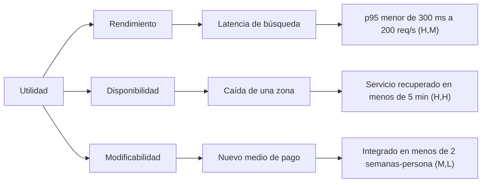
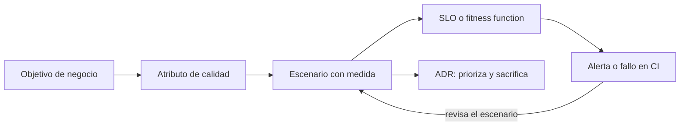

# Atributos de calidad y trade-offs

Dos sistemas pueden hacer exactamente lo mismo y tener arquitecturas opuestas. Uno atiende diez
usuarios con una base de datos y un servidor; el otro atiende diez millones, no puede caerse en
horario laboral y debe poder cambiar de proveedor de pagos en dos semanas. Lo que los separa no
es la funcionalidad, sino los **atributos de calidad**: cuánto, cómo de rápido, con qué
fiabilidad y a qué coste. Por eso son ellos, más que la lista de funciones, los que moldean la
arquitectura.

El problema es que casi nadie los escribe de forma que se puedan comprobar. «Debe ser rápido» y
«debe ser seguro» no deciden nada. Este artículo muestra cómo elegir los pocos atributos que
mandan, convertirlos en escenarios medibles, razonar sobre sus conflictos con una versión ligera
del método ATAM, vigilarlos con SLOs y fitness functions, y dejar constancia de cada
renuncia en un [ADR](/docs/adr).

<Callout tone="info" title="Fecha de corte">
  Datos de octubre de 2026. El modelo de calidad ISO/IEC 25010 es el de la edición de 2023; las
  versiones y la actividad de las herramientas se consultaron en sus repositorios el 12 de octubre
  de 2026. Contrasta ambos antes de fijar una decisión.
</Callout>

## Funcionalidad frente a calidad

Los **requisitos funcionales** dicen _qué_ hace el sistema. Los **atributos de calidad**
(también llamados características arquitectónicas o requisitos no funcionales) dicen _cómo de
bien_ lo hace: con qué latencia, con qué disponibilidad, con qué facilidad de cambio. La
funcionalidad casi siempre admite varias arquitecturas; la calidad es lo que descarta a la
mayoría.

Para no inventar un vocabulario, conviene apoyarse en uno estándar. ISO/IEC 25010 es el modelo
de calidad de producto de la familia SQuaRE; su edición de 2023 define **nueve características**:

| Característica (inglés)                             | Qué pregunta responde                            | Cambio frente a 2011                                             |
| --------------------------------------------------- | ------------------------------------------------ | ---------------------------------------------------------------- |
| Adecuación funcional (_functional suitability_)     | ¿Hace lo que debe, y lo hace bien?               | —                                                                |
| Eficiencia de desempeño (_performance efficiency_)  | ¿Cuánto tarda y cuántos recursos consume?        | —                                                                |
| Compatibilidad (_compatibility_)                    | ¿Convive e intercambia datos con otros sistemas? | —                                                                |
| Capacidad de interacción (_interaction capability_) | ¿Los usuarios logran sus objetivos con él?       | Sustituye a _usability_; añade inclusividad y autodescriptividad |
| Fiabilidad (_reliability_)                          | ¿Sigue funcionando y se recupera de los fallos?  | _Faultlessness_ sustituye a _maturity_                           |
| Seguridad (_security_)                              | ¿Protege datos y resiste ataques?                | Añade _resistance_                                               |
| Mantenibilidad (_maintainability_)                  | ¿Es fácil de cambiar y de probar?                | —                                                                |
| Flexibilidad (_flexibility_)                        | ¿Se adapta a entornos y usos distintos?          | Sustituye a _portability_; añade _scalability_                   |
| Seguridad operacional (_safety_)                    | ¿Evita causar daño a personas o al entorno?      | Característica nueva                                             |

<Callout tone="warning" title="Fuente de la tabla">
  La norma ISO es de pago. La lista de nueve características y los cambios de 2023 salen del resumen
  de [arc42 Quality Model](https://quality.arc42.org/articles/iso-25010-update-2023) y de otros
  resúmenes; las preguntas de la columna central son una paráfrasis nuestra, no el texto normativo.
</Callout>

No necesitas las nueve. Sirven como lista de comprobación para no olvidar una dimensión (¿has
pensado en la _safety_? ¿en la compatibilidad?), no como obligación de optimizar todas.

## Por qué no se puede maximizar todo

Cada atributo se compra con otro. El informe original del SEI sobre ATAM lo ilustra con un
ejemplo mínimo: si subir la velocidad de un canal de comunicación mejora el _throughput_ pero
reduce su fiabilidad, esa velocidad es un **punto de compromiso** (_tradeoff point_): un único
parámetro que empuja dos atributos en direcciones opuestas.

Estas son tensiones habituales (ilustrativas, no un catálogo cerrado):

| Quieres más...     | Suele costar...                | Por qué                                                                       |
| ------------------ | ------------------------------ | ----------------------------------------------------------------------------- |
| Seguridad          | Rendimiento y facilidad de uso | Cifrado, validaciones y autenticación añaden trabajo y fricción               |
| Disponibilidad     | Coste y simplicidad operativa  | Redundancia significa más piezas que desplegar, pagar y vigilar               |
| Disponibilidad     | Consistencia inmediata         | Replicar datos entre nodos obliga a elegir qué ocurre si fallan               |
| Modificabilidad    | Rendimiento                    | Capas e indirecciones facilitan el cambio y añaden trabajo                    |
| Rendimiento        | Modificabilidad                | Optimizar suele acoplar el código al caso medido                              |
| Rapidez de entrega | Mantenibilidad                 | Los atajos de hoy se pagan con intereses (ver [clean code](/docs/clean-code)) |

La consecuencia práctica es incómoda y útil a la vez: **no existe la arquitectura «mejor»,
solo la que mejor encaja con los atributos que importan en tu contexto**. Decidir cuáles son
esos atributos es la primera decisión arquitectónica real.

## Elegir los tres a cinco que mandan

Un sistema con diez atributos prioritarios no tiene ninguno. El método del SEI parte del mismo
punto: el gestor presenta los **impulsores de negocio** (por ejemplo, alta disponibilidad,
tiempo de salida al mercado o alta seguridad) porque de ellos se derivan los impulsores
arquitectónicos. Una forma práctica de hacerlo en un taller de una hora:

1. **Parte del negocio, no de la lista ISO.** ¿Qué haría fracasar el producto? ¿Perder datos,
   pasar una auditoría, no poder cambiar rápido, cobrar de más?
2. **Recorre las nueve características** como comprobación y anota cuáles tienen un riesgo real.
3. **Vota.** Cada participante reparte tres puntos. Se queda lo que más puntos recibe, hasta un
   máximo de cinco.
4. **Fija un listón para el resto.** Lo que no está entre los cinco debe ser «suficientemente
   bueno», no ignorado: decláralo («tolera una hora de caída al mes») para que nadie lo
   optimice sin darse cuenta.

El propio informe del SEI cuenta por qué conviene hacerlo con método: en su ejemplo, los
interesados partieron de seguridad y modificabilidad como atributos clave, y el árbol de
utilidad reveló que el rendimiento y la disponibilidad también importaban. Si lo eliges de
memoria, te llevas sorpresas tarde.

## Escribir escenarios de calidad

Un atributo sin medida no es comprobable. Según Bass, Clements y Kazman (_Software Architecture
in Practice_), un **escenario de calidad** tiene seis partes:

| Parte                  | Pregunta que responde                                          |
| ---------------------- | -------------------------------------------------------------- |
| Fuente del estímulo    | ¿Quién o qué genera el evento?                                 |
| Estímulo               | ¿Qué ocurre exactamente?                                       |
| Entorno                | ¿En qué condiciones: carga normal, sobrecarga, modo degradado? |
| Artefacto              | ¿Qué parte del sistema lo recibe?                              |
| Respuesta              | ¿Qué hace el sistema?                                          |
| Medida de la respuesta | ¿Con qué número se comprueba que la respuesta es la correcta?  |

La última fila es la que convierte un deseo en un requisito. El informe del SEI lo dice sin
rodeos: frases como «la arquitectura debe ser modificable y robusta» son insostenibles porque
**no son refutables**. Un buen escenario puede fallar.

Ejemplo completo, de rendimiento, para una API de pedidos:

| Parte                  | Valor                                                                  |
| ---------------------- | ---------------------------------------------------------------------- |
| Fuente del estímulo    | Cliente autenticado desde la aplicación web                            |
| Estímulo               | Busca sus pedidos por estado                                           |
| Entorno                | Operación normal, 200 peticiones por segundo                           |
| Artefacto              | Servicio de pedidos (endpoint de búsqueda)                             |
| Respuesta              | Devuelve la primera página de resultados                               |
| Medida de la respuesta | Percentil 95 de latencia menor de 300 ms; menos de un 0,1 % de errores |

Para modificabilidad el patrón es idéntico, pero la medida cambia de unidad: «un desarrollador
añade un nuevo medio de pago tocando como máximo un módulo y en menos de dos semanas-persona».
No hace falta rellenar las seis partes cuando alguna es obvia; sí hace falta la medida.

## El árbol de utilidad

Cuando tienes decenas de escenarios, necesitas ordenarlos. El SEI propone el **árbol de
utilidad**: la raíz es la «utilidad» del sistema, bajo ella van los atributos, luego sus
refinamientos y, en las hojas, los escenarios concretos. Cada hoja se prioriza con dos letras
(Alta, Media o Baja): su **importancia** para el éxito del sistema y el **riesgo percibido** de
lograrla, es decir, lo difícil que le parece al equipo de arquitectura. El informe prefiere esa
escala gruesa porque los interesados no distinguen con fiabilidad matices más finos.



Léelo así: la hoja `(H,H)` es muy importante y difícil de lograr, de modo que es donde más vale
la pena invertir tiempo de análisis. La hoja `(M,L)` es poco arriesgada y puede esperar. El
árbol responde a «¿dónde gasto mi tiempo limitado de revisión?».

## ATAM ligero para equipos

ATAM (_Architecture Tradeoff Analysis Method_) es un método del SEI descrito en el informe
CMU/SEI-2000-TR-004 (Kazman, Klein y Clements, agosto de 2000). Evalúa cómo las decisiones de
una arquitectura afectan a los atributos de calidad y cómo se compensan entre sí. Tiene nueve
pasos en dos fases:

| Grupo                    | Pasos                                                                                                   |
| ------------------------ | ------------------------------------------------------------------------------------------------------- |
| Presentación             | 1. Presentar ATAM · 2. Presentar los impulsores de negocio · 3. Presentar la arquitectura               |
| Investigación y análisis | 4. Identificar enfoques arquitectónicos · 5. Generar el árbol de utilidad · 6. Analizar los enfoques    |
| Pruebas                  | 7. Lluvia de ideas y priorización de escenarios · 8. Analizar de nuevo con los escenarios mejor votados |
| Informe                  | 9. Presentar resultados                                                                                 |

Los pasos 1 a 6 forman la fase 1 y los pasos 7 a 9 la fase 2, en la que participa el grupo
ampliado de interesados. El informe cuenta que han ejecutado ATAM en tres
días consecutivos, aunque señala que los más eficaces separan una fase inicial para entender la
arquitectura de una reunión formal posterior.

Un equipo normal rara vez tiene tres días. Esta **adaptación nuestra** (no es el método del SEI,
pero conserva su núcleo) cabe en medio día:

1. **Impulsores de negocio** (15 min): tres frases sobre qué importa y por qué.
2. **Árbol de utilidad** (60 min): de los atributos que mandan salen escenarios con medida, y
   cada hoja recibe su pareja de letras.
3. **Análisis** (90 min): solo para las hojas de importancia alta. Quien diseñó explica qué
   decisión de la arquitectura cubre ese escenario; el resto intenta romperla.
4. **Registro** (30 min): riesgos, no riesgos, puntos de sensibilidad y de compromiso.
5. **Decisiones** (15 min): cada hallazgo termina en un ADR, un escenario comprobado
   automáticamente o una tarea.

### Qué se registra

El informe define cuatro tipos de hallazgo. Conviene usar sus nombres porque son precisos:

| Hallazgo                  | Definición (parafraseada del informe)                                                          |
| ------------------------- | ---------------------------------------------------------------------------------------------- |
| **Riesgo**                | Decisión arquitectónica importante sin tomar, o tomada sin entender del todo sus consecuencias |
| **No riesgo**             | Decisión acertada que descansa en supuestos que suelen quedar implícitos                       |
| **Punto de sensibilidad** | Parámetro al que una respuesta de calidad medible está muy correlacionada                      |
| **Punto de compromiso**   | Parámetro que es punto de sensibilidad de más de un atributo y los afecta de forma distinta    |

Tanto los riesgos como los no riesgos se documentan con tres campos. Úsalos como plantilla de una
línea cada uno:

```markdown
Riesgo R-3: <título corto>

- Decisión: qué no está decidido, o qué se decidió sin entenderlo del todo.
- Respuesta de calidad y consecuencia: qué atributo se ve afectado y cómo.
- Justificación: por qué importa.
```

Un ejemplo ilustrativo: la decisión es no haber fijado la política de reintentos hacia el proveedor
de pagos; la consecuencia, que ante una caída del proveedor los reintentos ilimitados saturarían la
cola y degradarían la disponibilidad del checkout; la justificación, que sin tope ni espera
creciente la carga se multiplica justo cuando el proveedor está peor.

Un no riesgo se escribe igual, pero con una justificación positiva y los supuestos a la vista
(«suponiendo un mensaje por segundo y un procesamiento de menos de 30 ms, un plazo de un
segundo es razonable»). Anotar los supuestos es lo que permite revisarlos cuando cambien.

## Tácticas habituales por atributo

Una táctica es una decisión de diseño que mueve un atributo en una dirección. Esta tabla recoge
ejemplos habituales, no un catálogo completo, y su última columna recuerda que nada es gratis:

| Atributo                 | Tácticas habituales                                                                      | Lo que suelen costar                         |
| ------------------------ | ---------------------------------------------------------------------------------------- | -------------------------------------------- |
| Rendimiento              | Caché, colas acotadas, concurrencia, reducir trabajo por petición                        | Datos obsoletos, complejidad, más memoria    |
| Disponibilidad           | Redundancia, comprobaciones de salud, reintentos con espera creciente, _circuit breaker_ | Coste y más piezas que operar                |
| Modificabilidad          | Encapsular, interfaces estables, bajar el [acoplamiento](/docs/acoplamiento-cohesion)    | Indirección, más código de contrato          |
| Seguridad                | Autenticación y autorización, mínimo privilegio, validar en las fronteras                | Latencia y fricción para el usuario          |
| Capacidad de interacción | Retroalimentación inmediata, prevenir errores del usuario                                | Más lógica de interfaz que mantener          |
| Facilidad de prueba      | Inyectar dependencias, exponer estado observable                                         | Más abstracciones (ver [SOLID](/docs/solid)) |

## Hacerlos medibles: SLI, SLO y presupuesto de error

Los atributos de ejecución (latencia, disponibilidad) se miden mejor con el vocabulario de
fiabilidad de Google SRE. Sus definiciones, citadas del libro:

- **SLI** (indicador de nivel de servicio): «una medida cuantitativa cuidadosamente definida de
  algún aspecto del nivel de servicio que se presta». Por ejemplo, la latencia o la tasa de errores.
- **SLO** (objetivo de nivel de servicio): «un valor objetivo, o un rango de valores, para un
  nivel de servicio medido por un SLI».
- **SLA** (acuerdo de nivel de servicio): un contrato con los usuarios que incluye
  **consecuencias** por cumplir o incumplir los SLO. Un SLO no las tiene.

<Callout tone="warning" title="Medias y percentiles">
  El libro de SRE prefiere los percentiles a la media porque la media esconde la cola de peticiones
  lentas. El percentil 50 refleja el caso típico; uno alto, como el 99, aproxima un peor caso
  plausible. Un escenario que dice «latencia media menor de 200 ms» puede cumplirse mientras una de
  cada veinte peticiones tarda varios segundos.
</Callout>

El libro también da reglas para fijar objetivos que merecen quedar escritas en tu escenario:
no basar el objetivo en el rendimiento actual (puede encerrarte en algo que exige esfuerzos
heroicos), evitar absolutos como «siempre disponible», usar el mínimo de SLO posible y empezar
holgado para apretar con el tiempo.

El _Site Reliability Workbook_ recomienda expresar un SLI como razón entre eventos buenos y
eventos totales, lo que lo deja entre 0 % y 100 %. De ahí sale el **presupuesto de error**:
100 % menos el SLO. Con un SLO de 99,9 % sobre 3 millones de peticiones en cuatro semanas,
el presupuesto son 3.000 errores. Traducido a tiempo, en una ventana de 30 días (cálculo
propio):

| SLO     | Presupuesto de error | Indisponibilidad tolerada en 30 días |
| ------- | -------------------- | ------------------------------------ |
| 99 %    | 1 %                  | 7 h 12 min                           |
| 99,9 %  | 0,1 %                | 43 min 12 s                          |
| 99,99 % | 0,01 %               | 4 min 19 s                           |

Cada decimal extra cuesta mucho más que el anterior, así que el SLO es una decisión de negocio
y no un mínimo técnico. Una política de presupuesto de error describe qué pasa al agotarlo; el
workbook menciona priorizar los errores de fiabilidad, dedicarse solo a fiabilidad hasta volver
a cumplir el SLO o congelar los cambios en producción, y pide nombrar quién actúa y quién
aprueba la política.

No todo atributo es un SLO. La modificabilidad se mide con otros números: el árbol de utilidad
del SEI incluye escenarios como «cambiar la interfaz web en menos de cuatro semanas-persona».
Tampoco todo lo que importa se mide en producción: los escenarios de modificabilidad y
seguridad pueden comprobarse en CI.

## Vigilarlos con fitness functions

Un escenario que nadie comprueba vuelve a ser una opinión. La solución es la misma que explica el
artículo sobre [fitness functions](/docs/fitness-functions): que el escenario viva donde se
ejecuta. Para eso, declara el escenario como un dato con nombres estables y deja la comprobación
en una función pequeña que compara lo observado con el máximo:

```typescript
type QualityScenario = {
  id: string; // P-1, D-2…: se cita desde el ADR, el test y la alerta
  attribute: 'performance' | 'availability' | 'modifiability';
  stimulus: string; // «búsqueda de pedidos con 200 peticiones por segundo»
  measure: { metric: 'p95_ms' | 'error_rate'; max: number };
};
```

El identificador estable es lo que une las piezas: el mismo `P-1` aparece en el escenario, en el
ADR, en el umbral de carga y en la alerta. Y la comprobación debe **fallar cuando no hay datos**:
una medida sin observaciones no pasa. Es el mismo principio que con los hooks de seguridad del
[harness de Claude Code](/docs/harness-engineering-claude-code): un guardián que se cae no debe
abrir la puerta.

En la práctica no escribes tú el percentil: lo hace la herramienta de carga. Con k6, los
umbrales (_thresholds_) son criterios de aprobado o fallo, y si alguno se incumple el proceso
termina con un código distinto de cero, que es justo lo que necesita un pipeline:

```javascript
export const options = {
  thresholds: {
    http_req_failed: ['rate<0.001'], // menos de un 0,1 % de errores
    http_req_duration: ['p(95)<300'], // el 95 % de las peticiones, bajo 300 ms
  },
};
```

Para producción, Sloth genera a partir de un YAML las reglas de Prometheus y las alertas de
varias ventanas y varias velocidades de consumo del presupuesto (_multi-window,
multi-burn-rate_). La especificación completa está en el README del proyecto; esta es solo su
forma, para una disponibilidad de 99,9 %:

```yaml
service: 'orders'
slos:
  - name: 'requests-availability'
    objective: 99.9
    sli:
      events: { error_query: '…', total_query: '…' } # consultas PromQL
    alerting: { name: 'OrdersHighErrorRate' }
```

## Dejar constancia: el trade-off en un ADR

Un escenario y una medida describen el objetivo; el [ADR](/docs/adr) registra lo que has
sacrificado para lograrlo. Un ADR de arquitectura que no nombra qué sacrifica está incompleto
porque **toda decisión significativa prioriza un atributo a costa de otro**. Los campos sobre
atributos son una convención que recomendamos, no parte del formato original de Nygard:

```markdown
# ADR 0012: <decisión en una frase>

## Contexto (el escenario que la motiva, por ejemplo D-2)

## Decisión

## Atributo que prioriza

## Atributo que sacrifica

## Cómo se comprueba
```

Un ejemplo ilustrativo de cómo se rellenaría:

| Campo             | Contenido                                                                            |
| ----------------- | ------------------------------------------------------------------------------------ |
| Contexto          | El escenario D-2 exige recuperar el servicio en menos de 5 minutos si cae una zona   |
| Decisión          | Réplica de lectura en una segunda zona con conmutación manual guiada                 |
| Prioriza          | Disponibilidad (escenario D-2)                                                       |
| Sacrifica         | Coste (una réplica adicional) y consistencia inmediata en las lecturas tras conmutar |
| Cómo se comprueba | Simulacro trimestral y SLO de 99,9 % con alerta de consumo del presupuesto           |

Así, cuando alguien proponga recortar la réplica «porque cuesta», el ADR responde qué escenario
se rompe. Y un ADR que aparece sin escenario que lo justifique suele ser un indicio de
sobreingeniería.



## Herramientas

Estado consultado en los repositorios y la documentación oficial el 12 de octubre de 2026.

| Herramienta       | Qué hace                                                                    | Madurez (dato verificado)                                                                         | Úsala cuando                                                     | Evítala cuando                                                          |
| ----------------- | --------------------------------------------------------------------------- | ------------------------------------------------------------------------------------------------- | ---------------------------------------------------------------- | ----------------------------------------------------------------------- |
| **k6**            | Pruebas de carga con scripts en JavaScript y umbrales que fallan el proceso | Versión 2.3.0 (21 sep. 2026); último cambio el 12 oct. 2026; hoy bajo Grafana                     | Quieres latencia y errores como puerta en CI                     | Necesitas medir el rendimiento percibido en un navegador                |
| **OpenTelemetry** | Estándar neutral para generar y exportar trazas, métricas y logs            | Proyecto de la CNCF; Collector 0.162.0 (28 sep. 2026)                                             | Quieres obtener SLIs sin atarte a un proveedor                   | Esperas que almacene o visualice: no es un backend                      |
| **Prometheus**    | Métricas como series temporales, consultas con PromQL                       | CNCF desde 2016; versión 3.15.0 (25 sep. 2026)                                                    | Calculas SLIs de disponibilidad y latencia                       | Necesitas exactitud total, como facturar por petición                   |
| **Sloth**         | Genera reglas y alertas de SLO para Prometheus desde YAML                   | Versión 0.16.0 (abr. 2026); último cambio el 26 may. 2026; su README dice «activamente mantenido» | Ya usas Prometheus y quieres alertas por consumo del presupuesto | No usas Prometheus                                                      |
| **OpenSLO**       | Especificación abierta en YAML para definir SLO de forma neutral            | El repositorio no publica versiones ni etiquetas; último cambio el 24 sep. 2026                   | Quieres definiciones portables entre herramientas                | Necesitas una especificación con versiones estables y etiquetadas       |
| **Lighthouse CI** | Ejecuta Lighthouse en CI y comprueba presupuestos (por ejemplo, LCP)        | Versión 0.15.1 (26 jun. 2025); último commit ese mismo día                                        | Vigilas el rendimiento web percibido en cada PR                  | Necesitas una herramienta con mantenimiento activo: evalúa alternativas |

Dos matices. Primero, que una herramienta no tenga actividad reciente no la invalida (puede
estar terminada), pero conviene saberlo antes de depender de ella. Segundo, ninguna sustituye el
paso previo: sin escenarios y objetivos acordados, medirás con precisión lo que no importa.

## Errores frecuentes

- **Atributos sin número.** «Escalable» y «seguro» no son refutables. Si el escenario no puede
  fallar, no es un escenario.
- **Querer cumplir diez atributos.** Cuando todo es prioritario, no hay trade-off que decidir y
  se decide por defecto. Quédate con tres a cinco.
- **Medias en lugar de percentiles.** La media oculta la cola de peticiones lentas.
- **SLO por encima de la necesidad real.** Cada decimal de disponibilidad cuesta
  desproporcionadamente más. Un SLO es una decisión de negocio.
- **Confundir SLO con SLA.** El SLA tiene consecuencias contractuales; el SLO es un objetivo
  interno.
- **Fijar el objetivo a partir del rendimiento actual.** Puedes bloquearte en un nivel que exige
  esfuerzos heroicos para mantenerlo.
- **ATAM como ceremonia.** Si el taller no termina en ADR, escenarios comprobables o tareas,
  fue una reunión.
- **Olvidar lo que se sacrifica.** Un ADR que solo describe la ganancia está incompleto.
- **Evaluar una vez y no volver.** Los escenarios caducan con el negocio: revísalos cuando
  cambie un impulsor.

## Checklist para tu próxima decisión

- [ ] Los impulsores de negocio están escritos en tres frases o menos.
- [ ] Hay entre tres y cinco atributos prioritarios, votados, y un listón declarado para el resto.
- [ ] Cada atributo prioritario tiene al menos un escenario con medida.
- [ ] Las latencias se expresan en percentiles, no en medias.
- [ ] Los escenarios están priorizados por importancia y riesgo percibido.
- [ ] Los riesgos, no riesgos, puntos de sensibilidad y de compromiso están registrados.
- [ ] Cada escenario clave tiene una comprobación automática: un umbral, un SLO o una fitness function.
- [ ] Un ADR por decisión importante nombra el atributo que prioriza y el que sacrifica.
- [ ] Hay una política de presupuesto de error con responsables.
- [ ] Alguien revisará los escenarios cuando cambie el negocio.

## Fuentes

Consultadas en octubre de 2026. Las partes marcadas como adaptación o cálculo propio no vienen
de las fuentes.

- [ATAM: Method for Architecture Evaluation (Kazman, Klein, Clements; CMU/SEI-2000-TR-004)](https://www.sei.cmu.edu/library/atam-method-for-architecture-evaluation) y su [informe en PDF](https://resources.sei.cmu.edu/asset_files/TechnicalReport/2000_005_001_13706.pdf)
- [Quality Attribute Scenarios, capítulo de Bass, Clements y Kazman, _Software Architecture in Practice_ (copia alojada en UBC)](https://people.ece.ubc.ca/matei/EECE417/BASS/ch04lev1sec5.html)
- [ISO 25010 update 2023 (arc42 Quality Model)](https://quality.arc42.org/articles/iso-25010-update-2023)
- [Service Level Objectives (Google SRE Book)](https://sre.google/sre-book/service-level-objectives/)
- [Implementing SLOs (Google SRE Workbook)](https://sre.google/workbook/implementing-slos/)
- [Thresholds (documentación de k6)](https://grafana.com/docs/k6/latest/using-k6/thresholds/)
- [OpenTelemetry: qué es](https://opentelemetry.io/docs/what-is-opentelemetry/)
- [Prometheus: visión general](https://prometheus.io/docs/introduction/overview/)
- [Sloth (repositorio)](https://github.com/slok/sloth)
- [OpenSLO (repositorio)](https://github.com/OpenSLO/OpenSLO)
- [Lighthouse CI (repositorio)](https://github.com/GoogleChrome/lighthouse-ci) y su [configuración de aserciones](https://googlechrome.github.io/lighthouse-ci/docs/configuration.html)
