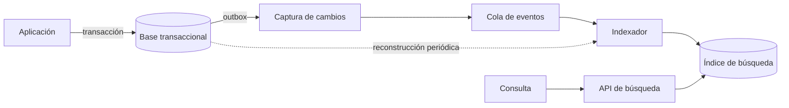

Casi toda aplicación acaba necesitando buscar: un cliente por nombre, un producto por palabra, un
documento por fragmento. La tentación es resolverlo con un `LIKE '%texto%'` sobre la tabla y seguir
adelante. Funciona hasta que la tabla crece, las consultas necesitan ordenar por relevancia, hay que
tolerar erratas o buscar en varios idiomas. Entonces la búsqueda se vuelve lenta, imprecisa y difícil
de explicar.

La tesis de este artículo es que **la búsqueda es una capacidad con su propio modelo de datos**, y que
la pregunta clave no es qué motor usar, sino cuánto de la búsqueda puede responder la base que ya
tienes. Un índice de texto dentro de la base cubre la mayoría de los casos con poca operación. Un índice
invertido dedicado solo compensa cuando los requisitos de relevancia, volumen o tolerancia a errores
ya no caben en la base, y pagarlo implica mantenerlo sincronizado sin perder cambios. Este artículo
trata ambas decisiones y el costo de cada una.

## Qué pide la búsqueda, en concreto

Antes de elegir tecnología, enumera lo que la búsqueda debe hacer. Hay cinco preguntas que separan los
casos. ¿Necesitas **ordenar por relevancia** o basta con filtrar y ordenar por fecha? ¿Toleras
**variantes morfológicas** (singular y plural, conjugaciones) o solo coincidencias exactas? ¿Hace falta
**tolerancia a erratas** y sinónimos? ¿Necesitas **facetas** (contar resultados por categoría mientras
buscas)? ¿Cuál es el **volumen** de documentos y la tasa de cambios?

Si la respuesta a casi todas es «no» o «poco», no necesitas un motor de búsqueda. Un filtro con índice
sobre la columna resuelve la búsqueda por prefijo, y un texto de pocos miles de filas se busca
razonablemente con un índice de texto completo. Si la respuesta es «sí» a varias, la búsqueda deja de
ser un detalle de la base y pasa a ser un componente con su propio ciclo de vida.

<Callout tone="info" title="El caso más frecuente">
  La mayoría de las aplicaciones de negocio buscan en unos cientos de miles de filas, con filtros
  por estado y fecha y un par de campos de texto. Para ese perfil, un índice de texto completo en la
  base suele ser la respuesta correcta durante años.
</Callout>

## El índice de texto dentro de la base

PostgreSQL, por ejemplo, incluye búsqueda de texto completo. Convierte el texto en un `tsvector`, una
lista de lexemas normalizados (sin acentos ni flexiones, según la configuración de idioma), y lo indexa
con un índice GIN. La documentación oficial indica que el índice GIN necesita que la columna sea de tipo
`tsvector`, y que el índice se puede crear sobre una expresión, siempre que la función use un nombre de
configuración explícito.

Esta forma tiene ventajas claras. La búsqueda vive en la misma transacción que los datos, así que un
registro recién insertado aparece en la búsqueda sin retraso. No hay un segundo sistema que operar, ni
que replicar, ni que reindexar por separado. Los filtros normales (estado, cliente, fecha) se combinan
con la búsqueda en la misma consulta, que es lo que el negocio suele pedir.

Tiene también límites. El ranking es básico comparado con un motor dedicado, y la tolerancia a erratas
depende de extensiones adicionales. Cada índice añade costo de escritura, y un índice GIN sobre una
tabla con muchas actualizaciones puede crecer y tardar en mantenerse. Y la búsqueda compite por los mismos
recursos que las transacciones, así que una consulta pesada de texto puede afectar al resto de la
aplicación.

## Cuándo conviene un índice invertido dedicado

Un índice invertido asocia cada término con la lista de documentos que lo contienen. Es la estructura
que usan los motores de búsqueda: Lucene, y los sistemas construidos sobre él, como Elasticsearch y
OpenSearch, o motores más ligeros. Su ventaja no es mágica; es que el modelo de indexación, el ranking
y la distribución están pensados para búsqueda y no para transacciones.

Un motor dedicado se justifica en cuatro casos. El primero es **relevancia rica**: ponderar el título
frente al cuerpo, usar sinónimos, aprender de clics o combinar señales de negocio. El segundo es
**tolerancia y lenguaje**: erratas, morfología de varios idiomas, búsqueda en campos anidados. El tercero
es **facetas y agregados** sobre millones de documentos con latencia baja. El cuarto es **aislar la carga**:
la búsqueda genera tráfico que no debe degradar las escrituras transaccionales.

El precio es real. Ahora hay dos fuentes de verdad para los mismos datos, un proceso de sincronización,
un clúster que operar y una nueva categoría de fallos: el índice que se queda atrás, o que devuelve
resultados de una versión antigua del documento. Antes de elegir el motor, responde si el problema es de
relevancia o de volumen. Muchos equipos instalan un clúster para resolver una consulta lenta que un
índice bien diseñado en la base habría resuelto.

## Modelar el documento de búsqueda

El índice no indexa tablas, indexa **documentos de búsqueda**: una proyección de los datos pensada para
las consultas. Un producto puede tener un documento con el nombre, la descripción, las categorías y los
atributos filtrables, aunque en la base estén repartidos en cinco tablas. Diseñar ese documento es la
decisión más importante, porque determina qué se puede buscar y cuánto cuesta cambiarlo.

Hay tres decisiones que conviene tomar de forma explícita. Primero, **qué campos son buscables, cuáles
solo filtrables y cuáles solo se devuelven** en el resultado. Un campo buscable se analiza y se indexa; un
campo filtrable se guarda como valor exacto; uno devuelto no ocupa índice. Segundo, **los pesos**: el
título suele pesar más que la descripción, y los atributos técnicos quizá no deberían contar para el
ranking. Tercero, **el idioma**: un documento con texto en varios idiomas necesita analizadores distintos,
o un campo por idioma. Mezclar idiomas en un solo campo degrada la relevancia en ambos.

Versiona el esquema del documento desde el primer día. Cuando cambies un analizador o un campo, no
conviene modificar el índice en caliente: se construye uno nuevo con el esquema nuevo, se alimenta y, cuando
está listo, la aplicación cambia de alias. Ese flujo permite revertir sin perder nada.

## Mantener el índice sincronizado

El índice es **dato derivado**: su única fuente de verdad es la base transaccional. Esa frase tiene una
consecuencia práctica: si el índice se pierde o se corrompe, debe poder reconstruirse por completo. Si
algún cambio solo existe en el índice, has creado una segunda fuente de verdad sin querer.

Hay tres formas de alimentarlo, y cada una tiene un fallo característico. La **escritura doble**, en la que
la aplicación escribe en la base y luego en el índice, es la más simple y la más frágil: si la segunda
escritura falla, la base y el índice divergen y nadie lo nota hasta que alguien busca el registro. La
**captura de cambios** lee el registro de la base y publica cada cambio a un flujo; Debezium documenta el
patrón de tabla de salida (outbox), en el que la aplicación escribe el evento en una tabla dentro de la misma
transacción que el cambio, y un conector lo publica después. Así el evento existe si y solo si existe el
cambio. La **reconstrucción periódica** recorre la base y regenera el índice completo; es lenta, pero es la
red de seguridad que siempre conviene tener.

El indexador debe ser **idempotente**. Un mismo evento puede llegar dos veces, y aplicarlo dos veces no
debe cambiar el resultado. Esto se logra indexando por identificador y versión del documento, y
descartando eventos con versión anterior a la que ya está en el índice. Sin esta propiedad, cualquier
reintento corrompe la búsqueda en silencio.

Mide el retraso entre el cambio y su aparición en la búsqueda. Para muchas aplicaciones, unos segundos son
aceptables; para un catálogo que se actualiza al momento, no lo son. Ese número debe figurar en el
contrato de la búsqueda, porque determina la estrategia: escritura síncrona, captura de cambios o
reconstrucción por lotes.

## Un caso: un catálogo que crece

Supongamos una tienda con trescientos mil productos, búsqueda por nombre y categoría, y precios que cambian cada hora. La
primera versión usa `LIKE` sobre el nombre y la descripción. Con el tiempo las consultas se vuelven lentas y, peor, un
usuario que busca «zapatilla» no encuentra los productos llamados «zapatillas». El problema tiene dos partes distintas, y
conviene tratarlas por separado.

El primer paso es un índice de texto completo en la base, con la configuración de idioma español. La morfología resuelve el
plural y la conjugación sin ningún motor adicional. El índice se crea sobre la expresión que genera el vector de búsqueda, con
el nombre de configuración explícito, y el filtro por categoría y disponibilidad se combina en la misma consulta. Antes de
aceptar el cambio se mide con un conjunto de consultas de referencia, y se compara la latencia y los resultados con la versión
anterior. Sin esa comparación, la mejora es una impresión.

El segundo paso llega con un requisito nuevo: «bolso» debe encontrar «bolsos» y «cartera», y los usuarios escriben erratas. La
base sigue sirviendo para la morfología, pero la tolerancia a erratas y los sinónimos empujan hacia un índice dedicado. La
decisión no debe tomarse por intuición. Antes de instalar un clúster, se analiza qué consultas fallan y por qué. Si la mayoría
son sinónimos, un diccionario de sinónimos en la configuración de texto, si el motor lo admite, puede bastar. Si son erratas en
masa, el motor dedicado se justifica, con su coste de sincronización.

El tercer paso aparece cuando el precio forma parte del documento de búsqueda. Cada cambio de precio se convierte en un evento
que el indexador debe procesar, y los eventos pueden llegar desordenados o repetidos. Aquí entran el patrón de tabla de salida y
la idempotencia. Un precio antiguo que llega después del nuevo se descarta porque su versión es menor que la del índice. Sin esa
regla, el buscador mostraría un precio que ya no existe y ningún error aparecería en los registros.

El caso muestra una secuencia útil: primero la base, después la medición, luego el motor dedicado solo si el análisis lo pide, y
siempre con la sincronización diseñada antes de que el índice tenga consumidores.

## Relevancia: medir antes de ajustar

Ajustar la relevancia sin medir es adivinar. Define un conjunto de consultas representativas con los
resultados que se consideran correctos, y mide cuántos aparecen en las primeras posiciones. Esa medida
cambia cuando alteras pesos, analizadores o sinónimos, y permite comparar cambios en lugar de discutir
impresiones.

Además de la calidad, observa el comportamiento. Las consultas sin resultados revelan vocabulario que los
usuarios usan y el índice no conoce. Las consultas que terminan en una búsqueda nueva, sin clic, sugieren
que el ranking falla. Y las búsquedas con muchos resultados revelan facetas o filtros que faltan. Estos
datos son baratos de recoger y suelen ser más útiles que cualquier ajuste teórico.

Conviene que el conjunto de consultas de referencia viva en el repositorio y se ejecute en el pipeline. Así, un cambio de analizador
que empeore las consultas críticas falla antes de llegar a producción, igual que lo haría un test de regresión. Y si el documento de
búsqueda contiene datos personales, el índice hereda las obligaciones de privacidad: retención, borrado y control de acceso. Un borrado
que llega a la base pero no al índice deja datos personales buscables; por eso el evento de borrado debe tratarse con la misma prioridad
que una alta en la sincronización.

## Operación y costos ocultos

Un índice tiene costos que no aparecen en la primera versión. Crece con el volumen y con el número de
campos indexados, así que conviene medir el tamaño y no solo el rendimiento. Cada reindexado consume
recursos y debe planificarse fuera de las horas pico. Y la búsqueda necesita monitoreo propio: latencia
del percentil 95, tasa de errores, retraso de sincronización y tamaño de la cola de eventos son las
señales mínimas.

Hay también un costo organizativo. Alguien debe ser dueño del esquema del documento, de los analizadores
y de la calidad de los resultados. Si la búsqueda no tiene dueño, cada equipo añade un campo sin pensar en
los demás y el índice se vuelve un cajón de sastre.

## Errores frecuentes

El primer error es **llevar la lógica de negocio al índice**. Si los permisos o el estado de un registro
solo se consultan en el índice, cualquier desfase deja ver datos que ya no deberían mostrarse. La búsqueda
puede devolver identificadores que luego la aplicación verifica contra la base, y la verificación es la
que decide.

El segundo es **indexar todo**. Cuanto más campos buscables, más ruido y más costo, y la relevancia empeora
porque los términos se diluyen. Indexa lo que el usuario busca de verdad.

El tercero es **no tener reconstrucción**. Cuando el índice se corrompe, la única salida es un incidente
largo. Probar la reconstrucción de principio a fin, al menos una vez, es lo que hace creíble el plan.

El cuarto es **tratar el ranking como un detalle**. Un usuario que no encuentra lo que busca no distingue
entre un índice lento y uno que ordena mal; abandona la búsqueda y culpa a la aplicación.

El quinto es **no acotar las consultas**. Una búsqueda sin límite de resultados, sin paginación y sin tiempo máximo convierte
cualquier término común, como «camiseta» o «a», en una consulta que consume recursos de todo el clúster. Acota el número de
resultados, define un tiempo máximo y pagina desde el primer día, porque agregar esos límites después obliga a cambiar el contrato
con todos los clientes de la API.

## Herramientas

Para empezar, el motor de texto completo de la base que ya usas. Cuando los requisitos lo justifiquen, un
motor dedicado con soporte de analizadores por idioma, alias de índice y reindexado en línea. Para la
sincronización, la captura de cambios sobre el registro de la base es la opción más robusta cuando la base
lo permite; la escritura doble solo se justifica en sistemas pequeños, y aun así con una reconstrucción
periódica. La elección del motor importa menos que tener claro el documento de búsqueda, la fuente de verdad
y el retraso aceptable.

## Checklist

- [ ] Las preguntas de requisitos (relevancia, morfología, erratas, facetas, volumen) están respondidas por escrito.
- [ ] Se eligió el índice más simple que cubre los requisitos, y el motor dedicado tiene una razón documentada.
- [ ] El documento de búsqueda está definido: campos buscables, filtrables y devueltos, con pesos e idioma.
- [ ] El índice se trata como dato derivado y puede reconstruirse por completo en un procedimiento probado.
- [ ] El indexador es idempotente y descarta eventos con versión antigua.
- [ ] El retraso entre cambio y búsqueda está medido y figura en el contrato.
- [ ] Hay un conjunto de consultas de referencia para medir la relevancia antes de cada ajuste.
- [ ] La búsqueda tiene monitoreo propio y un dueño con nombre.

## Fuentes

- [PostgreSQL: GiST and GIN index types](https://www.postgresql.org/docs/current/textsearch-indexes.html), documentación de búsqueda de texto completo.
- [Debezium: Outbox Event Router](https://debezium.io/documentation/reference/transformations/outbox-event-router), patrón de tabla de salida y captura de cambios.
