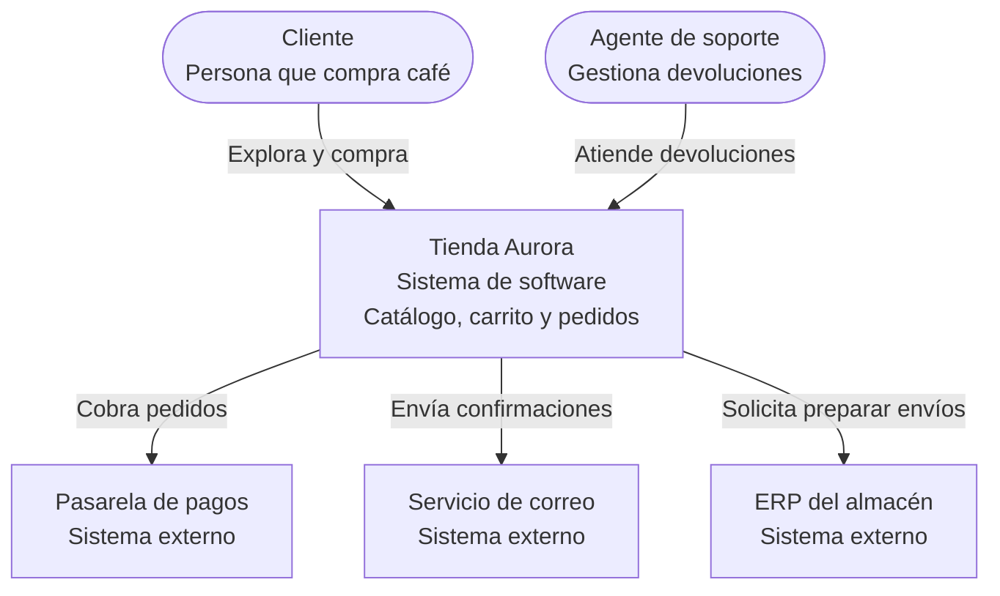
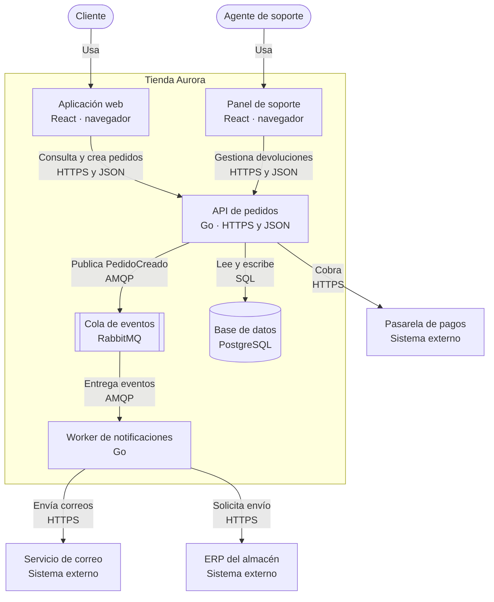
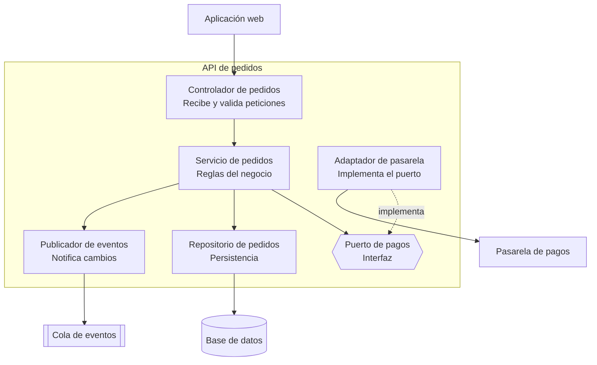
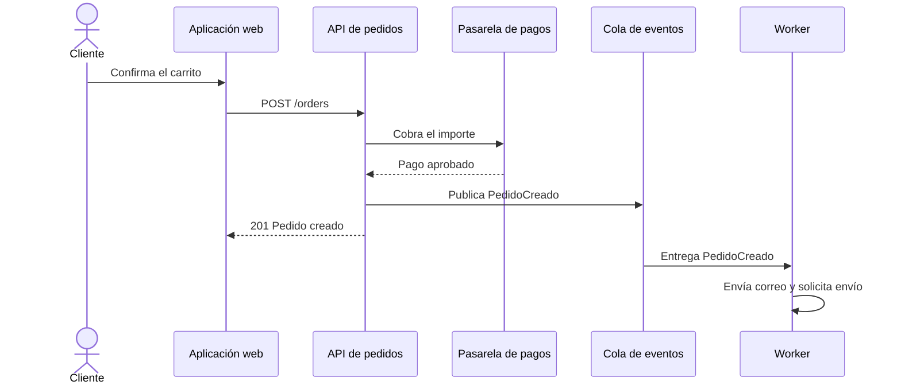

# Modelo C4

La mayoría de los diagramas de arquitectura fallan por la misma razón: son cajas y flechas
que cada persona interpreta a su manera. ¿Esa caja es un servicio, una clase, un equipo o un
servidor? ¿Esa flecha es una llamada HTTP, un evento o «se parece a»? Cuando el diagrama no
responde, la reunión se convierte en una discusión sobre el dibujo y no sobre el sistema.

El **modelo C4**, creado por Simon Brown, ataca ese problema con una idea simple: la
arquitectura se explica a **cuatro niveles de zoom**, como un mapa. Primero ves el país,
luego la ciudad, luego la calle y, solo si hace falta, el edificio. Cada nivel tiene su
propia audiencia, su propio vocabulario y un número pequeño de elementos.

Este artículo te lleva por los cuatro niveles con un único ejemplo de principio a fin, te da
las reglas de notación que evitan la ambigüedad y termina con cómo adoptarlo en un equipo
real sin que se convierta en burocracia.

## Por qué existe el modelo C4

Los diagramas habituales fallan de tres formas:

- **Mezclan niveles.** En la misma imagen conviven usuarios, microservicios, tablas y clases.
  Nadie sabe a qué altura mirar.
- **No tienen vocabulario.** Cada dibujante inventa sus formas y colores, así que cada
  diagrama hay que aprenderlo de nuevo.
- **Envejecen en silencio.** Se dibujan en una pizarra o en una herramienta gráfica, se
  exportan a imagen y nadie los vuelve a tocar.

C4 responde a cada punto: separa los niveles, define cuatro tipos de elemento y funciona
muy bien como **diagramas como código**, versionados junto al sistema que describen.

<Callout tone="info" title="C4 no es una notación, es una forma de abstraer">
  El modelo no impone formas ni colores concretos. Lo que impone es qué significa cada elemento y
  qué nivel de detalle corresponde a cada diagrama. Puedes dibujarlo con Mermaid, Structurizr,
  PlantUML o una pizarra.
</Callout>

## Los cuatro bloques de construcción

Antes de los niveles hay que fijar el vocabulario. Todo diagrama C4 se compone de cuatro
tipos de elemento, uno dentro del otro como muñecas rusas:

| Elemento                | Qué es                                                                      | Ejemplo                                     |
| ----------------------- | --------------------------------------------------------------------------- | ------------------------------------------- |
| **Persona**             | Un usuario o rol humano del sistema.                                        | Cliente, agente de soporte                  |
| **Sistema de software** | Lo que entrega valor a los usuarios; la unidad de más alto nivel.           | Tienda Aurora, pasarela de pagos externa    |
| **Contenedor**          | Una aplicación o almacén de datos que se ejecuta por separado.              | Aplicación web, API, base de datos, cola    |
| **Componente**          | Una agrupación de código con responsabilidad clara dentro de un contenedor. | Servicio de pedidos, repositorio, adaptador |

<Callout tone="warning" title="«Contenedor» no significa Docker">
  En C4, un contenedor es cualquier cosa que debe estar en marcha para que el sistema funcione: una
  aplicación de una sola página en el navegador, una API, un worker, una base de datos o un sistema
  de archivos. Un contenedor Docker puede alojar uno de ellos, pero no es lo mismo. Piensa en
  «unidad desplegable y ejecutable por separado».
</Callout>

## El ejemplo que usaremos: Tienda Aurora

Para que los niveles se entiendan como un solo relato, usaremos un sistema inventado: **Tienda
Aurora**, una tienda en línea de café de especialidad.

- Los **clientes** exploran el catálogo, llenan un carrito y pagan.
- Los **agentes de soporte** gestionan devoluciones y consultas.
- Para cobrar, la tienda usa una **pasarela de pagos** externa.
- Para confirmar pedidos, envía correos mediante un **servicio de correo** externo.
- Para preparar envíos, se integra con el **ERP del almacén**, que ya existe en la empresa.

Verás cómo cada nivel responde una pregunta distinta sobre este mismo sistema.

## Nivel 1: Contexto

**Pregunta que responde:** ¿qué es este sistema, quién lo usa y con qué otros sistemas habla?

El diagrama de contexto muestra tu sistema como **una sola caja** en el centro, rodeada de
las personas que lo usan y de los sistemas externos de los que depende. No hay tecnologías ni
detalles internos: es el diagrama que enseñarías a alguien de negocio, a un nuevo miembro del
equipo o a un auditor.



**Qué incluir**

- El sistema que describes, con una frase sobre su propósito.
- Cada tipo de persona que lo usa.
- Cada sistema externo con el que intercambia información.

**Qué dejar fuera**

- Tecnologías, protocolos y bases de datos.
- Cualquier cosa interna al sistema.

**Audiencia:** todos, también perfiles no técnicos. Si alguien de negocio no entiende este
diagrama en un minuto, está demasiado detallado.

**Para qué sirve en la práctica:** descubrir dependencias externas olvidadas, alinear
expectativas sobre el alcance y detectar quién usa realmente el sistema.

## Nivel 2: Contenedores

**Pregunta que responde:** ¿de qué grandes piezas ejecutables se compone el sistema y cómo
se comunican?

Aquí abres la caja del sistema y muestras sus contenedores: aplicaciones, servicios, almacenes
de datos y colas. **Aparecen las tecnologías**, porque este nivel es donde se toman las
decisiones que más cuestan cambiar. Si estás eligiendo qué lenguaje o plataforma usar en cada
pieza, el artículo sobre [lenguajes en la era de la IA](/docs/lenguajes-era-ia) te ayuda a
fundamentar esas decisiones.



**Qué debe tener cada contenedor**

1. **Nombre** claro y único.
2. **Tipo:** aplicación web, API, base de datos, cola, etc.
3. **Tecnología** principal.
4. **Responsabilidad** en una frase.

**Qué debe tener cada flecha**

- Una **etiqueta con la intención** («Cobra», «Publica PedidoCreado»), no solo «usa».
- El **protocolo o medio** cuando importa (HTTPS y JSON, SQL, AMQP).
- Una dirección: apunta desde quien inicia la comunicación.

**Audiencia:** desarrolladores, operaciones y arquitectos. Es el diagrama que más se
consulta en el día a día y el que mejor sirve para onboarding técnico.

**Para qué sirve en la práctica:** decidir fronteras de despliegue, ver dónde hay puntos
únicos de fallo, discutir qué escala por separado y revisar riesgos de seguridad entre
contenedores.

## Nivel 3: Componentes

**Pregunta que responde:** ¿cómo está organizado por dentro un contenedor concreto?

Este nivel hace zoom en **un contenedor** (no en todo el sistema) y muestra sus componentes:
agrupaciones de código con una responsabilidad clara, como controladores, servicios,
repositorios o adaptadores. Aquí es donde los principios de diseño se vuelven visibles.

Abramos la API de pedidos de Tienda Aurora:



Fíjate en el **puerto de pagos**: el servicio de pedidos depende de una interfaz, no de la
pasarela concreta. Es la inversión de dependencias de los [principios SOLID](/docs/solid)
convertida en una caja del diagrama. Cambiar de proveedor de pagos solo toca el adaptador.

**Audiencia:** el equipo que construye y mantiene ese contenedor.

**Cuándo hacerlo:** no lo dibujes para todos los contenedores. Hazlo solo para los más
complejos o críticos, o cuando el equipo necesita acordar su estructura interna. Un
diagrama de componentes de una API de tres endpoints es ruido.

## Nivel 4: Código

**Pregunta que responde:** ¿cómo se implementa un componente concreto?

El último nivel baja a clases, interfaces y funciones. Es el único nivel donde **no
conviene dibujar a mano**: el código ya es la fuente de verdad, y cualquier diagrama
manual quedará desactualizado en semanas. Si lo necesitas, genéralo desde el repositorio
(diagramas de clases UML, grafos de dependencias, documentación de tipos).

El puerto de pagos del nivel anterior, visto en código:

```ts title="pagos.ts"
export type PaymentResult = {
  status: 'approved' | 'declined';
  reference: string;
};

export type PaymentGateway = {
  charge(orderId: string, amountInCents: number): Promise<PaymentResult>;
};

export class OrderService {
  constructor(private readonly payments: PaymentGateway) {}

  async checkout(orderId: string, amountInCents: number): Promise<PaymentResult> {
    return this.payments.charge(orderId, amountInCents);
  }
}
```

`PaymentGateway` es la caja «Puerto de pagos» del diagrama; cualquier clase que cumpla ese
tipo (`StripeGateway`, `FakeGateway` para tests) puede conectarse sin tocar `OrderService`.
La relación entre diagrama y código es directa, y eso es lo que buscas.

<Callout tone="tip" title="Regla práctica">
  Los niveles 1 y 2 valen para casi todos los sistemas. El 3 es para las piezas que lo merecen. El 4
  casi nunca se dibuja a mano: confía en el código y en las [prácticas de clean
  code](/docs/clean-code).
</Callout>

## Resumen de los cuatro niveles

| Nivel | Diagrama     | Muestra                               | Audiencia                | Cuándo                   |
| ----- | ------------ | ------------------------------------- | ------------------------ | ------------------------ |
| 1     | Contexto     | Sistema, personas y sistemas externos | Todos, incluido negocio  | Siempre                  |
| 2     | Contenedores | Aplicaciones, servicios y almacenes   | Desarrollo y operaciones | Casi siempre             |
| 3     | Componentes  | Piezas internas de un contenedor      | Equipo de ese contenedor | Solo en piezas complejas |
| 4     | Código       | Clases, tipos y funciones             | Quien implementa         | Generado, no a mano      |

## Diagramas complementarios

Los cuatro niveles describen la **estructura estática**. Para lo que no cubren, el modelo
propone tres diagramas adicionales:

- **Paisaje del sistema (system landscape):** un contexto ampliado a toda la organización,
  con todos los sistemas y personas. Útil cuando hay decenas de sistemas.
- **Dinámico:** muestra cómo colaboran los elementos para un caso de uso concreto, en orden.
  Se dibuja como secuencia.
- **Despliegue:** asigna contenedores a infraestructura real: regiones, clústeres, nodos,
  entornos. Responde dónde corre cada cosa.

Un diagrama dinámico del flujo de compra de Tienda Aurora:



## Reglas de notación

Aunque C4 no impone formas, estas reglas evitan casi todos los malentendidos:

1. **Título descriptivo** en cada diagrama: tipo y alcance («Contenedores de Tienda
   Aurora»).
2. **Un solo nivel por diagrama.** Si aparecen personas junto a clases, mezclaste niveles.
3. **Cada elemento lleva nombre, tipo, tecnología (si aplica) y una frase de responsabilidad.**
4. **Cada flecha lleva etiqueta** con intención y, cuando importa, protocolo. Las flechas
   sin etiqueta son decoración.
5. **Una leyenda** si usas colores, formas o líneas con significado.
6. **Consistencia entre diagramas:** el mismo elemento se llama igual en todos los niveles.
7. **Entre 5 y 15 elementos por diagrama.** Con más, divide; con menos, quizá sobra el
   diagrama.
8. **Flechas unidireccionales** que indican quién inicia, no el flujo de datos.

## Diagramas como código

Dibujar en una herramienta gráfica garantiza que el diagrama envejecerá. La alternativa es
tratarlo como código: texto en el repositorio, revisado en pull requests y renderizado
automáticamente.

Los diagramas de este sitio usan **Mermaid**, que se escribe en bloques de código y se
muestra como diagrama interactivo. Otras opciones comunes:

| Herramienta         | Idea principal                                                                |
| ------------------- | ----------------------------------------------------------------------------- |
| **Mermaid**         | Texto en Markdown; soportado por GitHub, GitLab y muchas plataformas de docs. |
| **Structurizr DSL** | Un único modelo del que se generan todas las vistas C4 de forma coherente.    |
| **PlantUML + C4**   | Biblioteca de macros C4 sobre PlantUML.                                       |

La ventaja del enfoque de **modelo único** (Structurizr) es que defines cada elemento una
sola vez y las vistas se derivan, de modo que un cambio de nombre se propaga a todos los
niveles:

```text title="workspace.dsl"
workspace "Tienda Aurora" {
  model {
    cliente = person "Cliente" "Compra café en línea"
    aurora = softwareSystem "Tienda Aurora" {
      web = container "Aplicación web" "Catálogo y carrito" "React"
      api = container "API de pedidos" "Reglas de negocio" "Go"
      db = container "Base de datos" "Pedidos y catálogo" "PostgreSQL"
    }
    cliente -> web "Usa"
    web -> api "Consulta y crea pedidos" "HTTPS y JSON"
    api -> db "Lee y escribe" "SQL"
  }
  views {
    systemContext aurora { include * autolayout lr }
    container aurora { include * autolayout lr }
  }
}
```

<Callout tone="info" title="Diagramas junto al código">
  Guarda los diagramas en el mismo repositorio que el sistema y revísalos en los mismos pull
  requests. Si un cambio altera un contenedor o una dependencia externa, el diagrama debe cambiar en
  el mismo commit.
</Callout>

## Cómo adoptarlo en tu equipo

No hace falta documentarlo todo desde el primer día. Un camino realista:

1. **Empieza por el contexto (30 minutos).** Reúne al equipo frente a una pizarra y dibujen
   el sistema, las personas y los sistemas externos. Descubrirás desacuerdos más rápido que
   en cualquier documento.
2. **Sigue con contenedores.** Hazlo con quien conoce el despliegue real. Compara el
   resultado con lo que realmente corre en producción: las diferencias son hallazgos.
3. **Pásalos a código** (Mermaid o Structurizr) y súbelos al repositorio.
4. **Enlázalos desde el README** y desde los documentos de decisión (ADR). Un diagrama que
   nadie encuentra no existe.
5. **Añade componentes solo donde duela.** Una pieza que genera confusión o conflictos en
   revisiones es candidata.
6. **Revísalos en pull requests.** Si el cambio afecta la estructura, el diagrama forma
   parte del cambio.

C4 combina bien con **ADR** (registros de decisiones de arquitectura): el diagrama muestra
cómo es el sistema; el ADR explica por qué es así.

## Errores frecuentes

| Error                                      | Por qué duele                                      | Cómo evitarlo                                   |
| ------------------------------------------ | -------------------------------------------------- | ----------------------------------------------- |
| Mezclar niveles en un diagrama             | Nadie sabe a qué altura mirar                      | Un nivel por diagrama                           |
| Cajas llamadas «Backend» o «Servicios»     | No dicen qué hacen ni qué tecnología usan          | Nombre concreto, tipo y tecnología              |
| Flechas sin etiqueta                       | Obligan a adivinar qué ocurre                      | Etiqueta con intención y protocolo              |
| Confundir contenedor con Docker            | Se dibujan imágenes en vez de unidades ejecutables | «Unidad desplegable y ejecutable por separado»  |
| Dibujar componentes de todo                | Coste alto, valor bajo, desactualización           | Solo donde haya complejidad real                |
| Diagramas en una herramienta sin versionar | Envejecen y nadie sabe cuál es el vigente          | Diagramas como código en el repositorio         |
| Dibujar el sistema ideal, no el real       | Engaña a quien lo consulta                         | Compara con producción; documenta lo que existe |
| Diagramas gigantes «para verlo todo»       | Ilegibles y sin audiencia                          | Divide por nivel, alcance y propósito           |

## Ejercicio guiado

Dedica una hora a tu propio sistema:

1. **10 minutos:** escribe en una frase qué hace el sistema y lista las personas y los
   sistemas externos. Dibuja el diagrama de contexto.
2. **20 minutos:** lista los contenedores desplegables y cómo se comunican. Anota la
   tecnología y la responsabilidad de cada uno.
3. **10 minutos:** compara tu dibujo con lo que corre de verdad (repositorios, pipelines,
   infraestructura). Anota cada diferencia.
4. **15 minutos:** elige el contenedor con más cambios recientes y dibuja sus componentes.
   ¿Alguno depende directamente de un sistema externo sin una interfaz de por medio?
5. **5 minutos:** súbelo al repositorio como Mermaid y enlázalo desde el README.

## Checklist

- [ ] Cada diagrama tiene título, nivel y alcance claros.
- [ ] Cada elemento tiene nombre, tipo, tecnología (si aplica) y responsabilidad.
- [ ] Cada flecha tiene etiqueta con intención y, cuando importa, protocolo.
- [ ] El diagrama de contexto lo entiende alguien de negocio en un minuto.
- [ ] Los diagramas viven en el repositorio y se revisan en pull requests.
- [ ] Los nombres coinciden entre niveles y con el código.
- [ ] El diagrama refleja lo que corre hoy, no lo que se desea.

## Para llevarte

- C4 son **cuatro niveles de zoom**: contexto, contenedores, componentes y código.
- Un **contenedor** es una unidad ejecutable por separado, no un contenedor Docker.
- Los niveles 1 y 2 son los que casi siempre valen la pena; el 3 se dibuja con criterio y el
  4 se genera.
- Las etiquetas en las flechas y los nombres concretos eliminan la mayor parte de la
  ambigüedad.
- Los diagramas deben vivir como código junto al sistema para no envejecer.

Para llevar la estructura al código, sigue con los [principios SOLID](/docs/solid) y las
prácticas de [clean code](/docs/clean-code).
