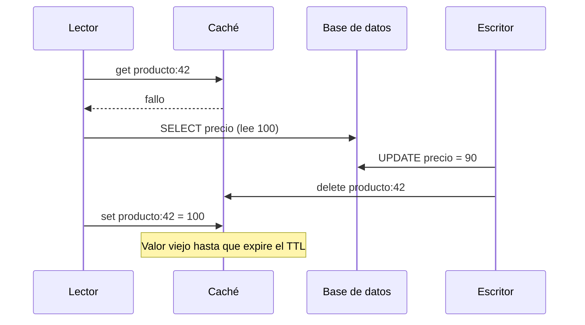
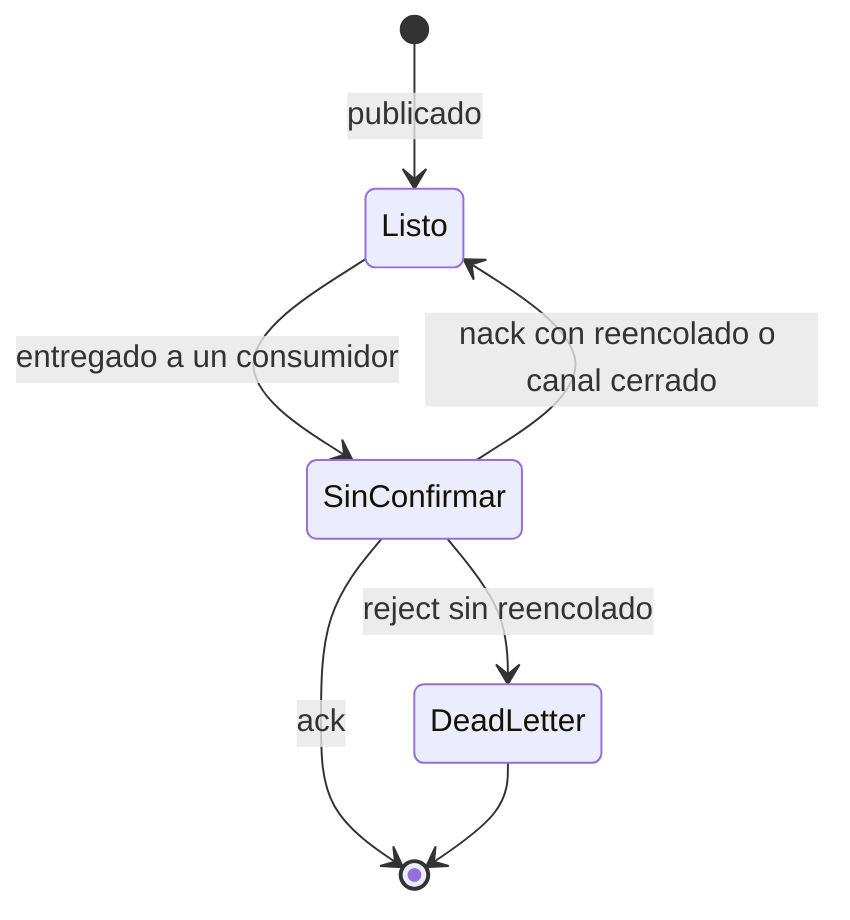
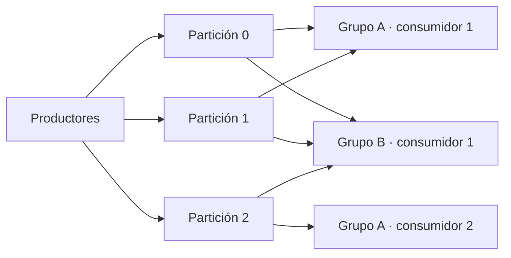

# Caché, colas y streaming

La ficha de producto tarda 900 ms y la base de datos va al 80 % de CPU. Alguien pone una caché delante y el p99 cae a 40 ms. Dos semanas después llegan dos incidencias: un cliente pagó el precio de ayer porque la caché seguía sirviéndolo, y a las 10:00 expiró la clave del producto en oferta y miles de peticiones fueron a la base de datos a la vez. Mientras tanto, el envío de correos se pasó a una cola para no bloquear el pago, y ahora el equipo de analítica quiere esos mismos eventos de pedido… que la cola borró en cuanto se procesaron.

Las tres piezas resuelven problemas distintos y fallan de formas distintas: **una caché es una copia que cambia frescura por velocidad, y una cola o un log es un búfer duradero entre quien produce trabajo y quien lo consume; lo que separa una cola de un log es qué pasa con el mensaje después de leerlo.**

<Callout tone="info" title="Alcance y fecha de corte">
  El modelo de eventos y CQRS está en [arquitectura orientada a eventos y
  CQRS](/docs/event-driven-cqrs-event-sourcing); la idempotencia y el outbox, en [sagas, outbox e
  idempotencia](/docs/sagas-outbox-idempotencia); los reintentos y el circuit breaker, en
  [resiliencia en sistemas distribuidos](/docs/resiliencia-sistemas-distribuidos). Aquí solo se
  enlazan. Los comportamientos de Kafka, RabbitMQ y Redis salen de su documentación oficial,
  consultada en octubre de 2026.
</Callout>

## Caché: comprar latencia con frescura

Una caché funciona cuando muchas lecturas piden lo mismo y ese dato cambia poco o tolera estar algo desactualizado. La guía de Azure sobre cache-aside lo resume así: rinde mejor con datos relativamente estáticos o que se leen con frecuencia. Si la mayoría de las peticiones fallan en la caché, el coste de consultarla y rellenarla puede superar el beneficio.

Antes de elegir patrón, responde tres preguntas: cuánto tiempo puede estar viejo el dato sin causar daño, quién se entera de que cambió y qué pasa si la caché desaparece de golpe.

### Patrones de lectura y escritura

| Patrón                      | Quién carga en un fallo                          | Qué pasa al escribir                                          | Riesgo principal                                                  |
| --------------------------- | ------------------------------------------------ | ------------------------------------------------------------- | ----------------------------------------------------------------- |
| Cache-aside (lazy loading)  | La aplicación: lee la base de datos y rellena    | La aplicación escribe en la base de datos y borra la clave    | Ventana de datos viejos y carreras entre lectura y escritura      |
| Read-through                | La propia caché o su librería, con un cargador   | Se combina con cualquiera de los dos siguientes               | El cargador queda acoplado al esquema de datos                    |
| Write-through               | Normalmente nadie: el dato ya está               | Se actualizan caché y base de datos en la misma operación     | Escrituras más lentas y caché llena de datos que nadie lee        |
| Write-back (o write-behind) | Nadie: la caché es la primera en recibir el dato | Se escribe en la caché y se vuelca a la base de datos después | Si la caché pierde datos antes del volcado, se pierden escrituras |

**Cache-aside** es el más común porque no exige nada especial de la caché. La documentación de ElastiCache enumera sus ventajas: solo se cachea lo que se pide, y si un nodo cae la aplicación sigue funcionando, con más latencia. Su desventaja es la penalización de cada fallo (tres viajes: caché, base de datos y escritura en caché) y los datos viejos.

**Write-through** ataca justo eso: la misma guía señala que la caché no se queda vieja tras una escritura, a cambio de pagar dos escrituras y de llenar memoria con datos que quizá no se lean nunca. Un nodo nuevo empieza vacío, por eso se suele combinar con lazy loading.

**Write-back** da la escritura más rápida, pero convierte la caché en la dueña temporal del dato. Úsalo solo si sabes qué pasa cuando esa memoria se pierde y puedes aceptarlo; en la mayoría de los sistemas de negocio, la base de datos sigue siendo la fuente de verdad.

### TTL: el seguro contra lo que se te olvide invalidar

El TTL (time to live) expira la clave pasado un tiempo. AWS lo explica con precisión: no garantiza que el valor no esté viejo, pero acota cuánto puede llegar a estarlo. Azure añade el equilibrio: un TTL demasiado corto obliga a recargar sin parar, uno demasiado largo deja datos viejos.

Tres decisiones prácticas:

- **Un TTL por tipo de dato, no uno global.** El catálogo puede vivir minutos; un saldo, segundos o nada.
- **Dispersión aleatoria.** Si cargas diez mil claves a la vez con el mismo TTL, expiran a la vez. Sumar un margen aleatorio al TTL es una práctica habitual para repartir esas recargas; la guía de AWS sobre caché con Redis lo recomienda: [validez de la caché](https://docs.aws.amazon.com/whitepapers/latest/database-caching-strategies-using-redis/cache-validity.html).
- **Expiración no es desalojo.** La expiración la decides tú; el desalojo lo decide la caché cuando se queda sin memoria. En Redis lo controlan `maxmemory` y `maxmemory-policy`.

## Invalidación: el problema difícil

Martin Fowler recoge una frase atribuida a Phil Karlton: en informática solo hay dos cosas difíciles, invalidar cachés y poner nombres. Es difícil porque la caché y la base de datos son dos sistemas sin transacción común: cualquier secuencia de escribir en uno y borrar en el otro deja huecos.

### Primero la base de datos, después borrar la clave

La guía de Azure insiste en el orden: actualiza la base de datos **antes** de borrar la clave. Si borras primero, otro lector puede fallar en la caché, leer el valor antiguo de la base de datos y volver a guardarlo antes de que llegue tu escritura.

Facebook describió en 2013 cómo usaba memcache como caché _look-aside_: la escritura va a la base de datos y después se envía un borrado a la caché. Explican que borran en vez de actualizar porque el borrado es idempotente. Aun así, el orden correcto no cierra todas las carreras:



Facebook llamó a esto _stale set_: un servidor guarda en la caché un valor que ya no es el último. Su solución fueron los _leases_: en un fallo, memcached entrega al cliente un token ligado a la clave, y si entre medias llega un borrado de esa clave, el token se invalida y la escritura del valor viejo se rechaza.

### Estrategias según cuánta desactualización toleras

| Estrategia                            | Ventana de datos viejos                          | Coste                                                 |
| ------------------------------------- | ------------------------------------------------ | ----------------------------------------------------- |
| Solo TTL                              | Hasta el TTL completo                            | Mínimo; nadie tiene que avisar de los cambios         |
| Borrar al escribir (cache-aside)      | Pequeña, con carreras posibles como la de arriba | Cada escritura conoce las claves que afecta           |
| Write-through                         | Casi nula tras una escritura con éxito           | Escrituras más lentas y acopladas a la caché          |
| Invalidar por eventos de cambio       | Lo que tarde el evento en llegar                 | Infraestructura de eventos y entrega fiable del aviso |
| Versionar la clave (`producto:42:v7`) | Nula para quien lee la versión nueva             | Las versiones antiguas ocupan memoria hasta expirar   |
| Leases o escrituras condicionales     | Evita guardar valores viejos tras un borrado     | Soporte de la caché o lógica adicional en el cliente  |

Si invalidas desde otro servicio, el aviso tiene que llegar aunque el proceso que escribió se caiga justo después del commit. Publicarlo en la misma transacción que el cambio es el problema que resuelve el outbox: está en [sagas, outbox e idempotencia](/docs/sagas-outbox-idempotencia). Y para saber qué modelo de consistencia estás ofreciendo realmente al lector, mira [CAP, PACELC y consistencia](/docs/cap-pacelc).

## Estampida de caché

Una **estampida** (_cache stampede_ o _thundering herd_) ocurre cuando una clave muy leída desaparece y muchas peticiones fallan a la vez, todas van a la base de datos y todas intentan rellenar la misma clave. La base de datos recibe de golpe la carga que la caché le estaba ahorrando.

El caso de Facebook da la escala: en una semana de fallos sobre claves especialmente propensas, el pico de consultas a la base de datos fue de 17 000 por segundo sin leases y de 1300 con ellos. Su mecanismo limita los tokens a uno cada 10 segundos por clave; el resto de clientes espera un momento y reintenta, y para entonces el dato suele estar ya en la caché.

Las mitigaciones habituales, de menos a más elaboradas:

- **Coalescer peticiones en el proceso.** Si diez hilos del mismo servidor fallan en la misma clave, solo uno va a la base de datos y los demás esperan su resultado.
- **Un candado por clave.** Redis documenta `SET recurso valor NX EX segundos` como forma simple de un candado que se libera solo al expirar, aunque recomienda Redlock por ofrecer mejores garantías. Quien no obtiene el candado espera o sirve lo que tenga.
- **Servir el dato viejo mientras se recalcula.** Es la idea de `stale-while-revalidate` de la RFC 5861 (Mark Nottingham, mayo de 2010) para cachés HTTP, y la misma que usaba Facebook al devolver valores marcados como viejos.
- **Recalcular antes de que expire.** Vattani, Chierichetti y Lowenstein (VLDB 2015) proponen una expiración anticipada probabilística: cada lectura decide al azar si recalcula, con más probabilidad cuanto más cerca está el vencimiento y más cara es la regeneración.
- **Precalentar.** Si sabes que una oferta empieza a las 10:00, carga la clave antes.

## Qué cachear y qué no

| Buen candidato                                                       | Mal candidato                                                                   |
| -------------------------------------------------------------------- | ------------------------------------------------------------------------------- |
| Catálogos, configuración, traducciones: se leen mucho y cambian poco | Saldos, stock en el momento de pagar, cualquier dato que decide una transacción |
| Resultados de cálculos caros con entradas estables                   | Datos sensibles en una caché compartida entre usuarios o aplicaciones           |
| Respuestas de servicios externos lentos con un TTL acordado          | Datos que casi nunca se repiten: la tasa de aciertos no paga el coste           |
| Sesiones o tokens, si la caché es el almacén y no una copia          | Sesiones en caché local con afinidad de servidor en una granja web              |

Dos matices. Primero, la clave debe incluir todo lo que cambia la respuesta: idioma, moneda, inquilino o permisos. Una clave sin el identificador del inquilino filtra datos entre clientes. Segundo, decide qué hacer con los «no existe»: el ejemplo de Azure evita cachear valores nulos; cachearlos con un TTL corto protege la base de datos de búsquedas repetidas de claves inexistentes, a cambio de tardar en ver un alta nueva.

### Redis como ejemplo, no como respuesta

Redis es un almacén clave-valor en memoria muy usado como caché, pero no es la única opción: Memcached, Valkey o una caché local en el proceso resuelven parte del mismo problema. Lo útil es saber qué decisiones te obliga a tomar. La caché local es la más rápida, pero cada instancia tiene su copia y, como advierte Azure, se desincronizan rápido.

```text
# redis.conf (forma, no valores recomendados)
maxmemory 2gb                  # límite de memoria para datos
maxmemory-policy allkeys-lru   # qué desalojar al llegar al límite

# convención de claves: <dominio>:<id>[:<variante>]
producto:42:es-MX
tenant:acme:informe:2026-10
```

Según su documentación, `allkeys-lru` es un buen punto de partida si no tienes motivos para otra política; las políticas `volatile-*` solo desalojan claves con TTL y, si no hay ninguna, se comportan como `noeviction`, que rechaza escrituras nuevas al llenarse.

## Colas y logs: qué pasa con el mensaje después de leerlo

Mover trabajo a un sistema de mensajería desacopla el ritmo de quien produce del de quien consume. Hay dos modelos de fondo y conviene no mezclarlos.

### Cola con consumidores competidores

Cada mensaje lo procesa **un** consumidor. Varios consumidores leen de la misma cola y se reparten el trabajo; para escalar, añades consumidores. Cuando el consumidor confirma el mensaje, desaparece. RabbitMQ documenta el ciclo: con confirmación manual, los mensajes no confirmados vuelven a la cola si el canal se cierra y llegan marcados como reentregados, y un mensaje puede llegar a un consumidor después de haber ido a otro. Con varios consumidores y reentregas, el orden global deja de estar garantizado.



### Log particionado

Jay Kreps, en su artículo «The Log» (LinkedIn, diciembre de 2013), describe el log como quizá la abstracción de almacenamiento más simple: una secuencia de registros solo de añadido, totalmente ordenada en el tiempo. Kafka lleva esa idea a la práctica. Según su documentación, los eventos **no se borran al consumirse**: se retienen el tiempo que configures por tema. Cada lector guarda su posición (el offset), que funciona como un marcapáginas, y puede volver atrás para releer.

Un tema se divide en particiones. Los eventos con la misma clave van a la misma partición, y Kafka garantiza que los consumidores leen cada partición en el orden en que se escribió; entre particiones no hay orden. Dentro de un grupo de consumidores, cada partición la lee exactamente un consumidor en cada momento, así que el paralelismo de un grupo lo limita el número de particiones. Distintos grupos leen el mismo tema de forma independiente.



### Pub/sub: una copia para cada suscriptor

En publicación-suscripción, cada suscriptor recibe su propia copia. La durabilidad depende del producto. Redis Pub/Sub, por ejemplo, documenta entrega como-máximo-una-vez: si el suscriptor falla o está desconectado, el mensaje se pierde para siempre, y la propia documentación remite a Redis Streams cuando necesitas más garantías. En un broker de colas, el equivalente durable es dar a cada suscriptor su propia cola.

| —                         | Cola con consumidores competidores            | Pub/sub                                    | Log particionado                                |
| ------------------------- | --------------------------------------------- | ------------------------------------------ | ----------------------------------------------- |
| Quién recibe cada mensaje | Un consumidor                                 | Todos los suscriptores                     | Un consumidor por grupo; todos los grupos       |
| Tras procesarlo           | Se borra al confirmar                         | Depende: efímero o una cola por suscriptor | Sigue ahí hasta que vence la retención          |
| Orden                     | Sin garantía con varios consumidores          | Depende del producto                       | Por partición, no global                        |
| Releer el pasado          | No; solo lo que siga en cola o en dead letter | Normalmente no                             | Sí, moviendo el offset dentro de la retención   |
| Cómo escala               | Más consumidores                              | Más suscriptores, cada uno con su ritmo    | Más particiones y consumidores hasta ese número |

## Acuse de recibo y semánticas de entrega

El momento en que confirmas decide la semántica. Si confirmas **antes** de procesar y el proceso cae, el mensaje se pierde: como-máximo-una-vez. Si confirmas **después** y caes entre procesar y confirmar, lo recibirás otra vez: al-menos-una-vez, con duplicados. La documentación de Kafka indica que su garantía por defecto es al-menos-una-vez y que la de como-máximo-una-vez exige desactivar los reintentos del productor y confirmar el offset antes de procesar.

| Semántica           | Qué arriesgas                  | Cuándo encaja                                                                |
| ------------------- | ------------------------------ | ---------------------------------------------------------------------------- |
| Como-máximo-una-vez | Pérdida de mensajes            | Métricas de muestreo, notificaciones efímeras, señales de presencia          |
| Al-menos-una-vez    | Duplicados                     | La opción por defecto para trabajo de negocio, con consumidores idempotentes |
| Exactamente-una-vez | Complejidad y alcance limitado | Lectura, proceso y escritura dentro del mismo sistema que lo soporta         |

### El alcance real de «exactamente una vez»

Kafka añadió en la versión 0.11 (según el anuncio del blog de Confluent del 30 de junio de 2017) tres piezas: un productor idempotente que evita duplicados por reintentos dentro de una partición, transacciones que escriben atómicamente en varias particiones y confirman el offset del consumidor en la misma transacción, y la garantía de Kafka Streams que se activa con `processing.guarantee` (hoy `exactly_once_v2`, que requiere brokers 2.5 o superiores). Los consumidores deben leer con aislamiento `read_committed` para no ver datos de transacciones abortadas.

<Callout tone="warning" title="Exactamente una vez dentro de Kafka, no en tu sistema">
  La garantía cubre el ciclo leer de Kafka, procesar y escribir en Kafka. Según el propio anuncio,
  las llamadas RPC a almacenes remotos o los clientes que escriben por su cuenta no quedan
  cubiertos: un correo enviado o un cargo en una pasarela pueden repetirse. Para salidas externas,
  la documentación de Kafka propone guardar el offset en el mismo sitio y en la misma operación que
  el resultado; la alternativa general es un consumidor idempotente.
</Callout>

En la práctica, diseña para al-menos-una-vez y haz que procesar dos veces tenga el mismo efecto que una. Cómo construir esa idempotencia está en [sagas, outbox e idempotencia](/docs/sagas-outbox-idempotencia).

## Orden por clave y particiones

Como el orden solo existe dentro de una partición, la clave de partición es una decisión de diseño, no un detalle:

- **Elige la clave por la entidad cuyo orden importa.** Si los eventos de un pedido deben procesarse en orden, la clave es el identificador del pedido, no el del cliente ni uno aleatorio.
- **Vigila las claves calientes.** Un cliente que genera la mitad del tráfico concentra la mitad de la carga en una partición y en un solo consumidor.
- **Planifica el número de particiones.** La documentación de operaciones de Kafka advierte que añadir particiones no mueve los datos existentes y que, si la asignación es por hash de la clave, una misma clave puede empezar a caer en otra partición. Durante el cambio se rompe el orden por clave.
- **El orden se pierde con reintentos fuera de banda.** Si un consumidor aparta un mensaje fallido para reintentarlo más tarde y sigue con el siguiente de la misma clave, ya no hay orden por clave. Decide si prefieres bloquear la partición o aceptar el desorden.

## Retención y reproceso

En un log, la retención es una política por tema: por tiempo, por tamaño o por compactación, que conserva al menos el último valor de cada clave dentro de una partición. Esa retención permite cosas que una cola no puede:

- **Un consumidor nuevo** (un índice de búsqueda, un modelo de analítica) empieza desde el principio de lo retenido sin pedir nada al productor.
- **Corregir un error y reprocesar.** Despliegas el arreglo, mueves el offset del grupo hacia atrás y vuelves a calcular.
- **Reconstruir estado** a partir de un tema compactado tras una caída.

El precio es que reprocesar repite efectos. Si el consumidor envía correos, reprocesar una semana los reenvía. Separa los consumidores que calculan estado de los que provocan efectos externos, y protege estos últimos con idempotencia. En una cola, lo que ya se confirmó no vuelve; los mensajes que fallan una y otra vez acaban en una cola de _dead letter_ que alguien tiene que revisar.

## Backpressure: cuando el consumidor no da abasto

Si se produce más rápido de lo que se consume, el trabajo se acumula en algún sitio. La pregunta es dónde y con qué límite:

- **Modelo pull.** En Kafka el consumidor pide datos a su ritmo; la documentación destaca que, si se queda atrás, puede ponerse al día. La señal que debes vigilar es el retraso (_lag_) de cada grupo.
- **Límite de mensajes sin confirmar.** En RabbitMQ, el _prefetch_ (`basic.qos`) fija cuántas entregas sin confirmar admite un canal; con confirmación automática no hay límite y un consumidor lento acumula mensajes en memoria. La documentación sugiere que valores entre 100 y 300 suelen dar buen rendimiento.
- **Límite de longitud de la cola.** RabbitMQ permite fijarlo con tres políticas de desbordamiento: `drop-head` (por defecto, descarta los más antiguos), `reject-publish` y `reject-publish-dlx` (rechazan los nuevos y, con confirmaciones de publicación, el productor recibe un `nack`).

Rechazar o frenar al productor es mejor que dejar crecer una cola sin límite. Qué hace el productor con ese rechazo (reintentos con espera, circuit breaker, descartar carga) se trata en [resiliencia en sistemas distribuidos](/docs/resiliencia-sistemas-distribuidos).

## Cómo elegir: cola, pub/sub o log

No hay ganador; hay preguntas que inclinan la balanza:

| Pregunta                                                            | Si la respuesta es sí, mira hacia…                           |
| ------------------------------------------------------------------- | ------------------------------------------------------------ |
| ¿Cada mensaje es una tarea que debe hacer un solo trabajador?       | Cola con consumidores competidores                           |
| ¿Varios sistemas independientes reaccionan al mismo hecho?          | Pub/sub durable o log                                        |
| ¿Necesitas releer el pasado o incorporar consumidores nuevos luego? | Log con retención                                            |
| ¿El orden importa por entidad?                                      | Log particionado por esa entidad                             |
| ¿Hay prioridades, retrasos o enrutado por mensaje?                  | Cola (los brokers de colas suelen ofrecerlo de serie)        |
| ¿Perder un mensaje es aceptable y la latencia es lo primero?        | Pub/sub efímero                                              |
| ¿El equipo no puede operar un clúster más?                          | El servicio gestionado que ya tengas, aunque no sea el ideal |

Si el problema es diseñar qué eventos publicar y cómo se modela el sistema alrededor de ellos, eso es [arquitectura orientada a eventos y CQRS](/docs/event-driven-cqrs-event-sourcing). Registra la elección y sus alternativas en un [ADR](/docs/adr).

## Cuándo sí y cuándo no

**Caché, sí:** lecturas repetidas sobre datos que toleran segundos o minutos de retraso, y un cuello de botella medido en la base de datos o en un servicio lento. **Caché, no:** datos que deciden una transacción, tasas de acierto bajas o un problema que se arregla con un índice.

**Cola o log, sí:** trabajo que no tiene por qué terminar dentro de la petición, picos que la parte lenta no puede absorber, o varios consumidores del mismo hecho. **No:** cuando el usuario necesita la respuesta para continuar y la asincronía solo esconde la latencia detrás de un sondeo, o cuando una llamada directa con un timeout razonable basta.

## Errores frecuentes

- **Cachear sin TTL «porque ya invalidamos».** El día que falle un borrado, el dato viejo vive para siempre.
- **Borrar la clave antes de escribir en la base de datos.** Otro lector la rellena con el valor antiguo.
- **Todas las claves con el mismo TTL.** Expiran juntas y provocan una estampida programada.
- **Claves sin inquilino ni idioma.** Un cliente ve los datos de otro.
- **Confirmar el mensaje antes de procesarlo** y llamarlo al-menos-una-vez.
- **Creer que «exactamente una vez» cubre el correo o el cobro.** Solo cubre lo que se queda dentro de Kafka.
- **Elegir la clave de partición al azar** y descubrir después que el orden por pedido importaba.
- **No vigilar el lag** hasta que la retención borra mensajes que nadie había leído.
- **Usar una cola cuando se necesita releer** o un log cuando se necesitan prioridades por mensaje.

## Ejemplo trabajado: catálogo y pedidos de una tienda

Una tienda tiene 50 lecturas de catálogo por cada escritura, un pico diario a las 10:00 cuando arrancan las ofertas, y tres sistemas que quieren saber de cada pedido: correo, búsqueda y analítica.

1. **Catálogo con cache-aside y TTL de 10 minutos con dispersión aleatoria.** Diez minutos de precio viejo en la ficha son aceptables para negocio; en el pago no, así que el carrito lee el precio de la base de datos.
2. **Invalidación por evento de cambio de producto**, publicado con outbox para que no se pierda. El TTL queda como red de seguridad.
3. **Ofertas de las 10:00 precalentadas a las 9:55** y coalescencia de peticiones en cada instancia para las claves calientes.
4. **Correos de confirmación en una cola** con consumidores competidores, confirmación manual tras enviar y una clave de idempotencia por pedido para no enviar dos veces.
5. **Eventos de pedido en un log particionado por identificador de pedido**, con retención de 7 días. Búsqueda y analítica son grupos distintos; cuando se cambie el índice de búsqueda, su grupo vuelve al principio y lo reconstruye sin tocar a los demás.
6. **Límites explícitos:** prefetch acotado en la cola de correo y alerta sobre el lag de cada grupo del log.

La decisión, con las alternativas descartadas (una sola cola para todo, write-through en el catálogo), queda en un ADR. Si la carga crece hasta otro orden de magnitud, revisa la decisión con los [atributos de calidad](/docs/atributos-de-calidad) que la justificaron.

## Checklist

- [ ] Cada dato cacheado tiene un TTL elegido según cuánto tiempo puede estar viejo.
- [ ] Al escribir, se actualiza primero la base de datos y después se invalida la caché.
- [ ] Las claves calientes tienen protección contra estampidas y los TTL llevan dispersión.
- [ ] Las claves de caché incluyen inquilino, idioma y todo lo que cambie la respuesta.
- [ ] La semántica de entrega está decidida y el consumidor confirma después de procesar.
- [ ] Los consumidores con efectos externos son idempotentes.
- [ ] La clave de partición refleja la entidad cuyo orden importa.
- [ ] Hay límites de backpressure y alertas sobre el lag o la longitud de las colas.

## Fuentes

Consultadas en octubre de 2026. El artículo de Kreps se leyó en copias del texto; el sitio de LinkedIn no respondió desde esta consulta.

- [The Log: What every software engineer should know about real-time data's unifying abstraction (Jay Kreps, 16 de diciembre de 2013)](https://engineering.linkedin.com/distributed-systems/log-what-every-software-engineer-should-know-about-real-time-datas-unifying)
- [Scaling Memcache at Facebook (Nishtala et al., NSDI 2013)](https://www.usenix.org/conference/nsdi13/technical-sessions/presentation/nishtala)
- [Optimal Probabilistic Cache Stampede Prevention (Vattani, Chierichetti y Lowenstein, PVLDB 8, 2015)](https://doi.org/10.14778/2757807.2757813)
- [RFC 5861: HTTP Cache-Control Extensions for Stale Content (Mark Nottingham, mayo de 2010)](https://www.rfc-editor.org/rfc/rfc5861)
- [Cache-Aside pattern (Azure Architecture Center)](https://learn.microsoft.com/en-us/azure/architecture/patterns/cache-aside)
- [Caching strategies (Amazon ElastiCache)](https://docs.aws.amazon.com/AmazonElastiCache/latest/dg/Strategies.html)
- [TwoHardThings (Martin Fowler)](https://martinfowler.com/bliki/TwoHardThings.html)
- Redis: [desalojo de claves](https://redis.io/docs/latest/develop/reference/eviction/), [SET](https://redis.io/docs/latest/commands/set/), [Pub/Sub](https://redis.io/docs/latest/develop/pubsub/) y [Streams](https://redis.io/docs/latest/develop/data-types/streams/)
- Kafka: [introducción](https://kafka.apache.org/intro), [semánticas de entrega](https://docs.confluent.io/kafka/design/delivery-semantics.html), [diseño del consumidor](https://docs.confluent.io/kafka/design/consumer-design.html) y [compactación](https://docs.confluent.io/kafka/design/log_compaction.html)
- [Exactly-once Semantics Are Possible: Here's How Apache Kafka Does It (blog de Confluent, 30 de junio de 2017)](https://www.confluent.io/blog/exactly-once-semantics-are-possible-heres-how-apache-kafka-does-it/)
- RabbitMQ: [confirmaciones de consumidor y prefetch](https://www.rabbitmq.com/docs/confirms) y [límite de longitud de cola](https://www.rabbitmq.com/docs/maxlength)
