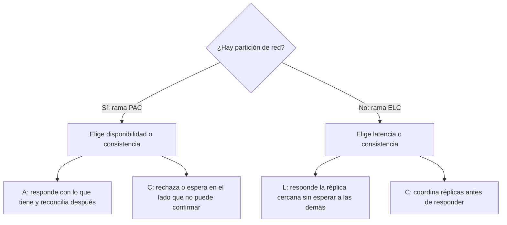
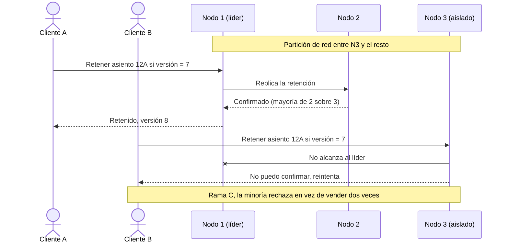

# Teorema CAP, PACELC y consistencia

Tienes la base de datos replicada en dos centros de datos. Un martes se corta el enlace entre ambos durante cuarenta segundos. En ese intervalo, un cliente compra el último asiento del vuelo en un lado y otro cliente compra el mismo asiento en el otro. O al revés: el sistema se niega a vender en ambos lados y el equipo de negocio pregunta por qué la web «estaba caída» si todos los servidores respondían. Las dos salidas son decisiones de diseño, y CAP y PACELC son el vocabulario para tomarlas a propósito: **cuando los datos están replicados, cada operación tiene que elegir qué sacrifica si la red falla (disponibilidad o consistencia) y qué sacrifica cuando la red funciona (latencia o consistencia)**.

Este artículo explica qué dice exactamente el teorema y qué no dice, cómo lo completa PACELC, qué modelos de consistencia hay entre «fuerte» y «eventual», y cómo se aterriza todo en cuatro casos: una transferencia, un carrito, un contador y una reserva de asientos. Después repasa las herramientas que usa un arquitecto (idempotencia, escrituras condicionales, quórums, topologías de replicación) y cómo verificar lo que promete un sistema. El código es solo una guía de nombres y formas, no una receta.

<Callout tone="info" title="Fecha de corte y fuentes">
  Consultado en octubre de 2026. Las definiciones salen de los textos originales de Brewer (las
  diapositivas de 2000), de Gilbert y Lynch (2002) y de Abadi (2012), leídos en copias públicas.
  Cuando cito cómo se comporta un sistema concreto, lo atribuyo a la fuente y al año: las
  configuraciones por defecto cambian, así que no lo tomes como una etiqueta vigente.
</Callout>

## El problema que resuelve

Una sola máquina no tiene este dilema: hay una copia de cada dato y cada lectura ve la última escritura. El problema aparece en cuanto **replicas**, ya sea para sobrevivir a la caída de un nodo, para leer más rápido o para acercar los datos a usuarios de varias regiones. A partir de ahí, dos réplicas pueden no saber la una de la otra durante un tiempo, y el sistema tiene que decidir qué hacer con las peticiones que llegan mientras tanto.

| Síntoma en producción                                          | Decisión que nadie tomó explícitamente                     |
| -------------------------------------------------------------- | ---------------------------------------------------------- |
| Se vende dos veces el mismo asiento o la misma unidad de stock | Aceptar escrituras en ambos lados de una partición         |
| La web «se cae» aunque todos los nodos estén vivos             | Rechazar escrituras en el lado que no alcanza la mayoría   |
| Editas tu perfil, recargas y ves el valor viejo                | Leer de una réplica cualquiera sin garantías de sesión     |
| Un artículo borrado del carrito reaparece                      | Fusionar versiones divergentes sin una regla para borrados |
| Cada lectura «fuerte» tarda lo que tarda la réplica más lejana | Coordinar réplicas entre regiones en cada operación        |

## De la conjetura al teorema

Eric Brewer presentó la idea en su conferencia invitada _Towards Robust Distributed Systems_, en el simposio PODC del 19 de julio de 2000. Su diapositiva dice que, de consistencia, disponibilidad y tolerancia a particiones, «puedes tener como mucho dos» en cualquier sistema de datos compartidos. En la misma charla aparece una idea que suele olvidarse: al comparar ACID con BASE, Brewer escribe que en su opinión es un espectro, no un interruptor.

En 2002, Seth Gilbert y Nancy Lynch (MIT) publicaron en _ACM SIGACT News_ la versión formal y su demostración. La idea de la prueba es corta: divide la red en dos grupos sin comunicación, escribe un valor en uno y lee en el otro. Si el lector debe responder (disponibilidad), no puede conocer la escritura; si debe devolver el último valor (consistencia), no puede responder. El artículo añade un matiz que conviene conocer: en el modelo asíncrono, sin relojes, un nodo no puede distinguir un mensaje perdido de uno lento, así que ni siquiera puede garantizar ambas cosas en las ejecuciones en las que no se pierde ningún mensaje. Con relojes y _timeouts_ (el modelo parcialmente síncrono) sí es posible ser consistente cuando la red funciona y devolver datos viejos solo cuando se pierden mensajes.

### Las tres propiedades, con precisión

| Propiedad                   | Definición en Gilbert y Lynch                                                                                            | Lo que no significa                                                                                         |
| --------------------------- | ------------------------------------------------------------------------------------------------------------------------ | ----------------------------------------------------------------------------------------------------------- |
| C, consistencia             | Consistencia atómica o **linealizable**: existe un orden total de operaciones y cada una parece ocurrir en un instante   | No es la C de ACID ni «los datos cumplen las reglas de negocio»                                             |
| A, disponibilidad           | Toda petición que recibe un nodo que no ha fallado obtiene respuesta                                                     | No es un SLA de 99,9 %: no pone límite de tiempo, y exige respuesta de _todos_ los nodos que no han fallado |
| P, tolerancia a particiones | La red puede perder arbitrariamente muchos mensajes entre nodos; cualquier pérdida se modela como una partición temporal | No es una característica que eliges activar: es una condición del entorno                                   |

Dos detalles de la definición de disponibilidad importan en la práctica. El primero: como no pone límite de tiempo, una respuesta que tarda un minuto sigue contando como disponible. El segundo: exige que respondan también los nodos que quedaron aislados en la minoría. Martin Kleppmann lo subraya en 2015: muchos sistemas que se venden como de «alta disponibilidad» no cumplen esta definición, aunque cumplan su SLA.

### La C de CAP no es la C de ACID

Gilbert y Lynch lo aclaran en una nota al pie: la consistencia de una base ACID se refiere a transacciones, mientras que la consistencia atómica se refiere a una sola secuencia de petición y respuesta, y además engloba lo que en ACID serían la A y la C. Dicho de otra forma: CAP habla de **réplicas que coinciden** sobre un objeto, no de restricciones de integridad. Un sistema puede ser linealizable sobre cada clave y aun así permitir que una transacción de varias claves deje datos que violan una regla del negocio.

## Las malas lecturas más comunes

- **«Elige dos de tres».** El propio Brewer escribió en 2012 que esa formulación «siempre fue engañosa» porque simplifica demasiado las tensiones entre propiedades, y que CAP solo prohíbe una parte pequeña del espacio de diseño.
- **«Mi sistema es CA».** En una red real los mensajes se pierden, así que la P no es opcional. La decisión real es qué hacer _durante_ una partición: responder con datos posiblemente viejos (A) o negarse a responder en el lado que no puede confirmar (C). Un sistema «CA» es, en la práctica, uno de un solo nodo o uno que no ha decidido qué pasa cuando falla la red.
- **«CAP me obliga a renunciar a la consistencia siempre».** Abadi lo llama un razonamiento defectuoso: CAP solo impone límites ante cierto tipo de fallo y no restringe nada durante el funcionamiento normal. Si un sistema es débil cuando la red va bien, la causa es otra (normalmente la latencia).
- **«Consistencia es consistencia».** Ya viste que la C de CAP es linealizabilidad. Hay muchos modelos más débiles, y varios siguen disponibles durante una partición.
- **«Esta base de datos es CP» (o AP).** Kleppmann pidió en 2015 dejar de usar esas etiquetas: un líder único con réplicas asíncronas en las que se lee no es ni CP (las lecturas en réplicas no son linealizables) ni AP (un cliente aislado del líder no puede escribir). Además, el comportamiento depende de la configuración de cada operación.

## PACELC: lo que pasa cuando la red funciona

Daniel Abadi publicó en febrero de 2012, en la revista _Computer_ del IEEE, que el dilema entre consistencia y latencia ha influido más en el diseño de las bases distribuidas que el propio CAP. Su propuesta, PACELC (se pronuncia «pass-elk»), reescribe CAP en dos ramas: **si hay partición (P), ¿cómo reparte el sistema disponibilidad (A) y consistencia (C)? Si no (E, _else_), ¿cómo reparte latencia (L) y consistencia (C)?**



El argumento es sencillo. La alta disponibilidad exige replicar, y en cuanto replicas solo hay tres formas de propagar una escritura: a todas las réplicas a la vez, primero a un nodo maestro acordado, o primero a un nodo cualquiera. Cada variante paga en consistencia o en latencia: la réplica síncrona espera al nodo más lento; la asíncrona responde antes, pero alguien puede leer una versión vieja; enviar todas las lecturas al maestro conserva la consistencia pero obliga a cruzar el mundo aunque haya una réplica al lado. Abadi añade que sobre una red de área amplia no hay forma de evitar este dilema, y que solo aplica a sistemas que replican.

| Combinación | Durante una partición                           | En funcionamiento normal                      | Ejemplos que Abadi dio en 2012 (configuración por defecto)           |
| ----------- | ----------------------------------------------- | --------------------------------------------- | -------------------------------------------------------------------- |
| PA/EL       | Sigue respondiendo y reconcilia después         | Responde rápido aunque pueda dar datos viejos | Dynamo, Cassandra, Riak                                              |
| PC/EC       | Deja de responder donde no puede confirmar      | Paga latencia para coordinar                  | VoltDB/H-Store, Megastore, BigTable/HBase                            |
| PA/EC       | Prioriza responder                              | Lecturas y escrituras consistentes            | MongoDB, con el matiz de que su minoría no cumple la A formal de CAP |
| PC/EL       | No reduce la consistencia por debajo de su base | Prioriza latencia                             | PNUTS (Yahoo)                                                        |

La tabla sirve para entender el razonamiento, no para elegir producto: son configuraciones de hace más de una década, y el propio Abadi recuerda que estos sistemas permiten ajustar el reparto. Lo útil es la pregunta, que puedes hacer para cada operación de tu sistema: _¿qué hace cuando la red falla y qué hace cuando funciona?_

## Un espectro de consistencia

Entre la linealizabilidad y «al final todo coincide» hay modelos intermedios con garantías concretas. La columna de la derecha resume lo que Jepsen documenta sobre cada modelo durante una partición: **total** significa que cualquier nodo sano puede seguir respondiendo; **con afinidad** (_sticky_), que funciona si cada cliente sigue hablando con el mismo servidor.

| Modelo                | Qué garantiza                                                                            | Ejemplo en lenguaje llano                                                         | Durante una partición |
| --------------------- | ---------------------------------------------------------------------------------------- | --------------------------------------------------------------------------------- | --------------------- |
| Linealizable (fuerte) | Cada operación parece ocurrir en un instante, en un orden que respeta el tiempo real     | Tu banco confirma la transferencia, llamas a tu socio y él ya ve el saldo nuevo   | No disponible         |
| Secuencial            | Un orden total común para todos, coherente con el orden de cada cliente, sin tiempo real | Todos ven los mensajes del grupo en el mismo orden, aunque un móvil vaya atrasado | No disponible         |
| Causal                | Las operaciones con relación causa-efecto se ven en ese orden; las demás, en cualquiera  | Nadie ve la respuesta «sí» antes de la pregunta «¿comemos?»                       | Con afinidad          |
| Leer tus escrituras   | Tras escribir, tus lecturas ven tu escritura (no promete nada a otros clientes)          | Cambias tu foto de perfil, recargas y ves la nueva, aunque otro aún vea la vieja  | Con afinidad          |
| Lecturas monotónicas  | Una vez que viste un valor, no vuelves a ver uno anterior                                | Un comentario que ya leíste no desaparece al recargar                             | Total                 |
| Eventual              | Si dejan de llegar escrituras, al final todas las lecturas devuelven el último valor     | El contador de «me gusta» difiere unos segundos entre tu móvil y tu portátil      | Total                 |

Cada modelo tiene su origen. La linealizabilidad la definieron Herlihy y Wing en 1990; la consistencia secuencial, Lamport en 1979. Las garantías de sesión (leer tus escrituras, lecturas monotónicas, escrituras que siguen a lecturas y escrituras monotónicas) las propusieron Terry y sus colegas de Xerox PARC en 1994, pensando en clientes móviles que se conectan a ratos. La definición de consistencia eventual de la tabla es la de Werner Vogels en 2008, que además recomienda combinar lecturas monotónicas y leer tus escrituras como las garantías más deseables en un sistema eventual.

## Cuatro casos trabajados

Los cuatro casos usan el mismo método: identifica la invariante que no puede romperse, mira qué cuesta un error y qué cuesta una negativa, y decide por operación.

### Transferencia entre cuentas

La invariante es que el saldo no baje del límite permitido y que el dinero no se cree ni se destruya. Un error cuesta dinero y confianza; una negativa cuesta un reintento. Por eso el cargo suele ir con consistencia fuerte sobre la cuenta y, si hay partición, el lado que no puede confirmar rechaza la operación. El reintento del cliente debe ser seguro, y eso lo da una clave de idempotencia (más abajo).

Hay una alternativa legítima que Brewer describe en 2012 con el ejemplo del cajero automático: durante una partición, el cajero entra en un modo de suplencia en el que sigue entregando dinero hasta un **límite neto acotado** y deniega por encima de él; el banco corrige después con auditoría y compensaciones (por ejemplo, una comisión por descubierto). Brewer lo resume diciendo que el sistema bancario no depende de la consistencia para ser correcto, sino de la auditoría y la compensación. Es la rama A de CAP con el riesgo medido y un plan de recuperación. Lo que no es legítimo es aceptar escrituras sin límite y sin plan.

### Carrito de compras

El artículo de Dynamo (Amazon, 2007) es el ejemplo clásico: «añadir al carrito» no puede olvidarse ni rechazarse nunca. Si la última versión del carrito no está accesible, el cambio se aplica a una versión anterior y las versiones divergentes se reconcilian después fusionándolas. El propio artículo reconoce el precio: un añadido nunca se pierde, pero **un artículo borrado puede reaparecer**. Es un PA/EL deliberado: perder una venta cuesta más que mostrar un artículo de más, y el cliente lo corrige antes de pagar. Lo que sí necesitas es leer tus escrituras dentro de la sesión, para que el usuario vea lo que acaba de añadir.

### Contador de un feed social

Un contador de «me gusta» tolera estar desfasado: nadie pierde dinero si ve 1.203 en lugar de 1.205. Aquí la consistencia eventual es la respuesta correcta, con dos matices. El primero: el usuario que pulsa «me gusta» debe ver su propio voto (leer tus escrituras), aunque el total tarde en converger. El segundo: el contador debe converger sin perder incrementos concurrentes. Brewer menciona en 2012 los tipos de datos replicados conmutativos (CRDT) como estructuras que convergen de forma demostrable tras una partición. Un contador encaja bien porque la suma es conmutativa: cada réplica cuenta sus propios incrementos y al fusionar se suman. El mismo artículo marca el límite: la suma es conmutativa, pero la suma con una comprobación de límite (un saldo que no puede bajar de cero) no lo es. Por eso el contador puede converger y la transferencia no.

### Reserva de asientos

La invariante es dura: un asiento, un pasajero. Aquí la operación «retener el asiento» necesita una escritura condicional linealizable sobre ese asiento, y durante una partición el lado minoritario debe negarse. El resto del flujo puede ser más débil: el mapa de asientos que ves al elegir puede estar desfasado unos segundos, siempre que la retención final se valide contra la fuente de verdad.



El cliente B ve un error, no una venta duplicada. Si reintenta contra la mayoría, su escritura condicional falla porque la versión ya no es 7: el sistema le dice que el asiento está ocupado. El diagrama ilustra el razonamiento; cómo implementa cada base de datos el líder y la mayoría depende de su documentación.

| Caso                | Invariante                       | Durante una partición                  | En funcionamiento normal     | Garantía mínima para el usuario   |
| ------------------- | -------------------------------- | -------------------------------------- | ---------------------------- | --------------------------------- |
| Transferencia       | Saldo dentro del límite          | Rechazar, o aceptar con límite acotado | Consistencia sobre la cuenta | Reintento idempotente             |
| Carrito             | No perder lo añadido             | Aceptar y fusionar                     | Latencia                     | Leer tus escrituras               |
| Contador del feed   | Converger sin perder incrementos | Aceptar y fusionar                     | Latencia                     | Ver tu propio voto                |
| Reserva de asientos | Un asiento, un pasajero          | Rechazar en la minoría                 | Consistencia en la retención | Error claro en lugar de duplicado |

## Herramientas del arquitecto

### Claves de idempotencia

En una red que pierde mensajes, el cliente no sabe si su petición falló o si falló la respuesta. Una clave de idempotencia convierte el reintento en seguro: el cliente la genera, la reenvía en cada intento y el servidor devuelve el resultado guardado en lugar de ejecutar dos veces. La documentación de Stripe es una buena referencia del contrato: cabecera `Idempotency-Key`, UUID v4 recomendado, respuesta guardada para los reintentos con la misma clave, error si los parámetros no coinciden y claves que pueden purgarse a partir de las 24 horas.

```typescript
// api/transfers: el cliente genera la clave y la reenvía en cada reintento
type TransferCommand = {
  readonly idempotencyKey: string; // UUID v4 generado por el cliente
  readonly fromAccount: string;
  readonly toAccount: string;
  readonly amountCents: number;
};

// Misma clave y mismos parámetros: devuelve la respuesta guardada.
// Misma clave y parámetros distintos: error, nunca una segunda transferencia.
export declare function requestTransfer(command: TransferCommand): Promise<TransferResult>;
```

### Versiones y escrituras condicionales

Una escritura condicional solo se aplica si el dato no cambió desde que lo leíste. Evita la «actualización perdida» y es la base de la reserva de asientos. En HTTP existe de forma estándar: la cabecera `If-Match` con una _entity tag_ condiciona la petición, y si la condición no se cumple el servidor responde `412 Precondition Failed` (RFC 9110). Las bases de datos lo exponen con nombres distintos (comparar y asignar, versiones optimistas); el contrato que debe ver tu dominio es este:

```typescript
type Versioned<T> = { readonly value: T; readonly version: number };

type SeatRepository = {
  get(seatId: string): Promise<Versioned<Seat>>;
  // 'conflict' si otra escritura llegó antes: nunca sobrescribe a ciegas
  holdIfVersion(seatId: string, expected: number, holder: string): Promise<'ok' | 'conflict'>;
};
```

Las versiones también sirven del lado del cliente: Vogels describe cómo un cliente puede obtener leer tus escrituras y lecturas monotónicas descartando las lecturas con una versión anterior a la última que ya vio.

### Lecturas y escrituras por quórum

Con N réplicas, una escritura se confirma cuando la aceptan W réplicas y una lectura consulta R. Si R + W > N, los conjuntos se solapan y cada lectura toca al menos una réplica que recibió la última escritura confirmada; si R + W ≤ N, puedes leer de réplicas que aún no la tienen. Ejemplos con N = 3:

| R   | W   | ¿Se solapan? | Efecto                                                                      |
| --- | --- | ------------ | --------------------------------------------------------------------------- |
| 1   | 1   | No           | Lo más rápido; puedes leer un valor viejo                                   |
| 2   | 2   | Sí           | Tolera una réplica caída para leer y para escribir; paga la latencia de dos |
| 1   | 3   | Sí           | Lecturas rápidas; cualquier réplica caída impide escribir                   |
| 3   | 1   | Sí           | Escrituras rápidas; cualquier réplica caída impide leer                     |

Un matiz que Abadi señala: el solapamiento por sí solo no basta para la consistencia de Gilbert y Lynch; hacen falta añadidos al protocolo. Trata el quórum como una palanca para el dilema latencia-consistencia, no como un sinónimo de linealizable.

### Topologías de replicación

| Topología                                   | Consistencia                                                 | Latencia                                                           |
| ------------------------------------------- | ------------------------------------------------------------ | ------------------------------------------------------------------ |
| Líder único, réplicas síncronas             | Réplicas al día                                              | Cada escritura espera a la réplica más lenta                       |
| Líder único asíncrono, lecturas en el líder | Lecturas al día                                              | La lectura viaja al líder aunque haya una réplica cerca            |
| Líder único asíncrono, lecturas en réplicas | Lecturas posiblemente viejas                                 | Lecturas locales y rápidas                                         |
| Varios nodos aceptan escrituras             | Escrituras concurrentes en conflicto que hay que reconciliar | Escritura local rápida; detectar y resolver conflictos tiene coste |

### Consistencia por operación, no por base de datos

La conclusión práctica de todo lo anterior: no decides «la base de datos es fuerte o eventual», decides **cada operación**. Dentro de un mismo sistema, la retención de un asiento y el contador de visitas merecen respuestas distintas. Escríbelo como una política explícita y revisable, y regístrala en un [ADR](/docs/adr):

```typescript
// consistency-policy.ts: una decisión por operación, revisada como cualquier contrato
type ReadGuarantee = 'linearizable' | 'read-your-writes' | 'eventual';
type OnPartition = 'reject' | 'accept-and-reconcile';

export const consistencyPolicy = {
  'seats.hold': { read: 'linearizable', onPartition: 'reject' },
  'transfers.debit': { read: 'linearizable', onPartition: 'reject' },
  'cart.addItem': { read: 'read-your-writes', onPartition: 'accept-and-reconcile' },
  'feed.likeCount': { read: 'eventual', onPartition: 'accept-and-reconcile' },
} satisfies Record<string, { read: ReadGuarantee; onPartition: OnPartition }>;
```

En [DDD](/docs/domain-driven-design), el agregado ya marca esta frontera: dentro, consistencia síncrona; entre agregados, asíncrona. Si diseñaste bien los agregados, sabes qué operaciones necesitan consistencia fuerte y cuáles pueden converger.

## Cómo verificar lo que promete un sistema

Una afirmación de consistencia que nadie ha probado bajo fallos es una hipótesis. La forma de comprobarla es la **inyección de fallos**: ejecutar operaciones concurrentes mientras se cortan enlaces, se pausan procesos o se desincronizan relojes, registrar el historial de respuestas y comprobar si ese historial es compatible con el modelo prometido.

Jepsen es la referencia pública de este enfoque. Según su sitio, desde 2013 ha analizado más de dos docenas de bases de datos, servicios de coordinación y colas, y ha encontrado divergencia de réplicas, pérdida de datos y lecturas viejas, entre otros problemas. Su método tiene tres rasgos que puedes copiar: prueba binarios reales en clústeres reales (caja opaca), ejercita los modos de fallo propios de los sistemas distribuidos (redes defectuosas, relojes sin sincronizar, fallos parciales) y genera operaciones aleatorias cuyo historial se contrasta con un modelo. Ellos mismos marcan el límite: estas pruebas no demuestran que un sistema sea correcto, solo encuentran errores.

Qué hacer en tu propio sistema:

- **Lee el análisis publicado** de la versión que usas antes de confiar en una garantía, y mira con qué configuración se probó.
- **Prueba tus operaciones críticas**, no solo la base de datos: una base linealizable no salva una aplicación que lee de una caché y escribe sin condición.
- **Convierte la invariante en una comprobación automática** que se ejecute en un entorno con fallos inyectados: es una [fitness function](/docs/fitness-functions) de la arquitectura.
- **Mide la latencia de las operaciones fuertes** en producción y por región: es el coste de la rama EC, y tiene que estar visible.

## Cuándo sí y cuándo no

La consistencia distribuida es cara de diseñar, operar y probar. Merece la pena cuando la replicación compra algo concreto; si no, una sola base de datos es la mejor respuesta. Es la misma lógica que en [monolito frente a microservicios](/docs/monolito-vs-microservicios): repartir datos entre servicios o regiones convierte cada operación entre ellos en un problema de consistencia.

| Situación                                                                         | Decisión razonable                                                                                                           |
| --------------------------------------------------------------------------------- | ---------------------------------------------------------------------------------------------------------------------------- |
| Un solo nodo primario aguanta la carga y el negocio tolera un failover de minutos | Una sola base con respaldo; el dilema queda reducido a qué escrituras puedes perder en el failover                           |
| Usuarios en varias regiones y la latencia de lectura es un requisito de calidad   | Replica, acepta lecturas locales (EL) donde la operación lo tolera y fuerte solo donde hay invariante                        |
| Hay invariantes de unicidad o de saldo                                            | Consistencia fuerte y escritura condicional en esa operación, aunque el resto sea eventual                                   |
| El sistema debe seguir aceptando escrituras con la red cortada (móvil, tiendas)   | Rama A con reconciliación diseñada desde el principio: fusiones, compensaciones, límites                                     |
| Nadie sabe decir qué pasa con una operación si se cae un enlace                   | Antes de elegir tecnología, escribe la política por operación y discútela como un [trade-off](/docs/trade-offs-y-decisiones) |

Si tienes que justificar la decisión ante el negocio, tradúcela a [atributos de calidad](/docs/atributos-de-calidad): disponibilidad, latencia y corrección de los datos compiten entre sí, y CAP y PACELC dicen exactamente dónde.

## Errores frecuentes

- **Etiquetar la base de datos y olvidar la operación.** La misma base puede dar lecturas fuertes o viejas según cómo se configure cada petición.
- **Confundir la C de CAP con la de ACID.** Una cosa es que las réplicas coincidan; otra, que se cumplan las reglas de integridad.
- **Diseñar «CA».** No decidir qué pasa durante una partición no la evita: solo deja la decisión en manos del comportamiento por defecto.
- **Ignorar la rama ELC.** Las particiones son raras; la latencia de coordinar réplicas se paga en cada petición.
- **Reintentar sin idempotencia.** Un _timeout_ no dice si la operación se ejecutó; reintentar a ciegas duplica cargos y pedidos.
- **Fusionar versiones sin pensar en los borrados.** El carrito de Dynamo muestra que fusionar es fácil para añadir y difícil para quitar.
- **Reconciliar sin plan.** Si aceptas escrituras en ambos lados, la fusión y la compensación son parte del diseño, no un script de emergencia.
- **Confiar en la documentación sin pruebas.** Busca el análisis publicado de tu versión y prueba tus invariantes con fallos inyectados.

## Checklist

- [ ] Cada operación que escribe datos replicados tiene declarado qué hace durante una partición: rechazar o aceptar y reconciliar.
- [ ] Cada lectura tiene declarada su garantía mínima (linealizable, leer tus escrituras, eventual) y el motivo.
- [ ] Las invariantes duras (unicidad, saldo, cupo) usan escrituras condicionales con versión.
- [ ] Todas las operaciones que el cliente puede reintentar aceptan una clave de idempotencia.
- [ ] Si se aceptan escrituras divergentes, la regla de fusión, incluidos los borrados, está escrita y probada.
- [ ] La latencia de las operaciones con consistencia fuerte se mide por región.
- [ ] Al menos una prueba automática verifica las invariantes críticas con fallos de red inyectados.
- [ ] La política de consistencia está registrada en un ADR y se revisa cuando cambia la topología.

## Fuentes

Consultadas en octubre de 2026. El PDF de Gilbert y Lynch del sitio del autor devolvió HTTP 403; lo leí en la copia del curso de Princeton. El artículo de Brewer de 2012 lo leí en la versión republicada por InfoQ.

- [Towards Robust Distributed Systems (Eric Brewer, conferencia invitada en PODC, 19 de julio de 2000)](https://sites.cs.ucsb.edu/~rich/class/cs293b-cloud/papers/Brewer_podc_keynote_2000.pdf): diapositivas, copia de un curso de UCSB
- [Brewer's Conjecture and the Feasibility of Consistent, Available, Partition-Tolerant Web Services (Seth Gilbert y Nancy Lynch, ACM SIGACT News, junio de 2002)](https://www.cs.princeton.edu/courses/archive/spring22/cos418/papers/cap.pdf), [DOI 10.1145/564585.564601](https://doi.org/10.1145/564585.564601)
- [Consistency Tradeoffs in Modern Distributed Database System Design (Daniel Abadi, IEEE Computer, febrero de 2012)](https://cs.umd.edu/~abadi/papers/abadi-pacelc.pdf)
- [CAP Twelve Years Later: How the "Rules" Have Changed (Eric Brewer, republicado en InfoQ el 30 de mayo de 2012)](https://www.infoq.com/articles/cap-twelve-years-later-how-the-rules-have-changed/)
- [Please stop calling databases CP or AP (Martin Kleppmann, 11 de mayo de 2015)](https://martin.kleppmann.com/2015/05/11/please-stop-calling-databases-cp-or-ap.html)
- [Eventually Consistent (Werner Vogels, ACM Queue, 2008)](https://www.cs.princeton.edu/courses/archive/fall15/cos518/papers/ec-vogels.pdf)
- [Dynamo: Amazon's Highly Available Key-value Store (DeCandia y otros, SOSP 2007)](https://www.cs.princeton.edu/courses/archive/fall15/cos518/papers/dynamo.pdf)
- [Session Guarantees for Weakly Consistent Replicated Data (Terry y otros, PDIS 1994)](https://pages.cs.wisc.edu/~remzi/Classes/739/Fall2016/Papers/bayou-sessions94.pdf): verificado a partir de resultados de búsqueda
- [Linearizability: A Correctness Condition for Concurrent Objects (Herlihy y Wing, ACM TOPLAS, 1990)](https://www.cs.columbia.edu/~wing/publications/HerlihyWing90.pdf): verificado a partir de resultados de búsqueda y de Jepsen
- Jepsen: [guía de modelos de consistencia](https://jepsen.io/consistency), páginas de [linealizable](https://jepsen.io/consistency/models/linearizable), [secuencial](https://jepsen.io/consistency/models/sequential), [causal](https://jepsen.io/consistency/models/causal) y [leer tus escrituras](https://jepsen.io/consistency/models/read-your-writes), y el [índice de análisis](https://jepsen.io/analyses)
- [Idempotent requests (documentación de la API de Stripe)](https://docs.stripe.com/api/idempotent_requests)
- [RFC 9110, HTTP Semantics (junio de 2022)](https://www.rfc-editor.org/rfc/rfc9110.html): secciones de `If-Match` y `412 Precondition Failed`
