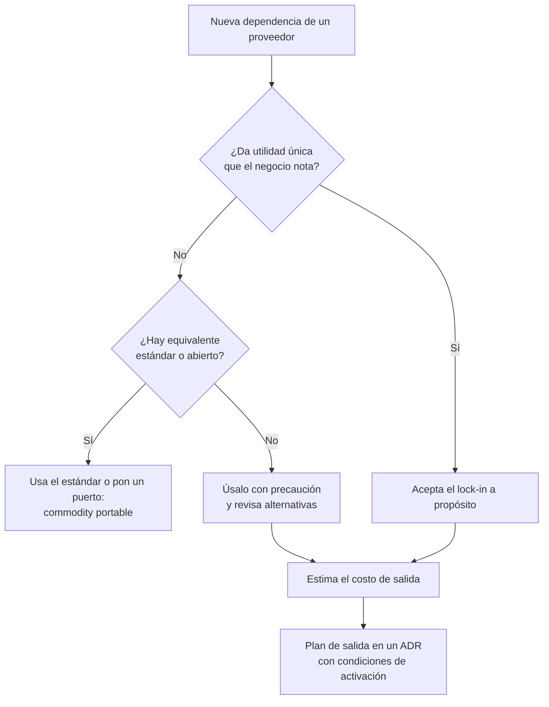
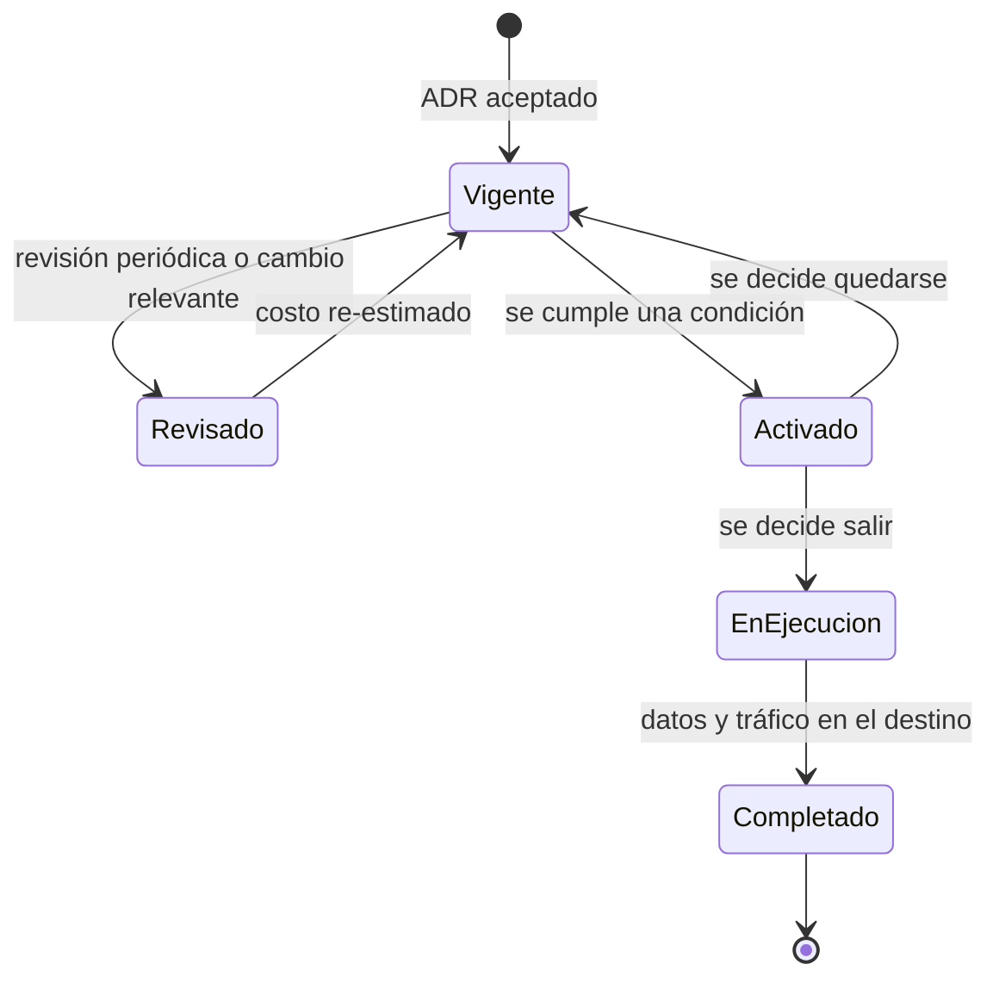

# Casado a un proveedor: lock-in y plan de salida

Hace tres años tu equipo eligió una base de datos gestionada propietaria, funciones _serverless_ disparadas por eventos del proveedor y su servicio de colas. Fue una buena decisión: el equipo salió a producción en semanas y nadie tuvo que operar servidores. Hoy llega un aviso de cambio de precios, o un cliente exige que los datos vivan en otra jurisdicción, o la empresa es adquirida por otra que trabaja con otro proveedor. Alguien pregunta en la reunión «¿cuánto nos costaría irnos?» y nadie sabe responder, porque la respuesta está repartida entre los datos, el código, la operación, el contrato y lo que sabe el equipo.

**El lock-in, o dependencia de un proveedor, es el costo de cambiar: todo lo que tendrías que transferir, reescribir, reaprender y renegociar para dejar de usar un proveedor o un producto.** No es bueno ni malo en sí mismo. Es una variable de decisión, y como cualquier variable conviene medirla, compararla con lo que compra y revisarla con el tiempo.

Esta lección es la cuarta de la serie de nube. Explica los tipos de lock-in, cómo estimar el costo de salida sin depender de las cifras del proveedor, qué significa portabilidad en cada capa, cuánto cuestan las abstracciones que la prometen y cómo convertir todo eso en un plan de salida documentado, con condiciones de activación y probado. La multinube como estrategia tiene su propia lección; aquí solo aparece como una de las formas de reducir el lock-in.

<Callout tone="info" title="Fecha de corte y alcance">
  Consultado en octubre de 2026. No incluye precios ni cuotas de ningún proveedor: cambian con
  frecuencia y dependen del contrato. Los plazos regulatorios citados salen del texto publicado del
  Reglamento de Datos de la UE; resumirlos aquí no es asesoría legal, y hay modificaciones en
  trámite que se señalan donde corresponde.
</Callout>

## El problema que resuelve

El lock-in casi nunca se elige de forma explícita. Se acumula: un servicio gestionado por aquí, un disparador por allá, una política de permisos escrita en el lenguaje del proveedor. Cada paso es razonable; el conjunto, si nadie lo mira, se convierte en una decisión que nadie tomó.

| Síntoma                                                                     | Decisión que nadie tomó explícitamente                          |
| --------------------------------------------------------------------------- | --------------------------------------------------------------- |
| Nadie sabe estimar cuánto costaría migrar, ni siquiera en orden de magnitud | Inventariar las dependencias propietarias                       |
| Una subida de precio solo se puede aceptar, no negociar                     | Mantener una alternativa creíble                                |
| El SDK del proveedor aparece en cientos de archivos de negocio              | Dónde poner la frontera entre el negocio y la tecnología        |
| Exportar los datos exige un proyecto, no un procedimiento                   | En qué formato y con qué frecuencia deben poder salir los datos |
| El plan de salida existe, pero nunca se ha ejecutado                        | Probar el plan y medir cuánto tarda                             |

## Qué es el lock-in, y qué no es

Gregor Hohpe lo plantea en _Don't get locked up into avoiding lock-in_ (martinfowler.com, 9 de septiembre de 2019) con tres ideas que conviene tener presentes. La primera: el lock-in no es todo o nada, sino un espectro. La segunda: evitar un tipo de lock-in suele crear otro; por ejemplo, una capa de abstracción propia te libera del proveedor y te ata a esa capa. La tercera: el código abierto reduce algunas formas de lock-in, pero no todas; un producto libre sigue teniendo API, versiones y habilidades específicas.

De ahí sale el criterio de toda la lección: el objetivo no es llegar a cero lock-in, sino que el costo de cambiar sea **conocido, aceptado a propósito y proporcional a lo que obtienes a cambio**.

Tampoco conviene confundir dos conceptos que la norma ISO/IEC 19941:2017 trata por separado: la **interoperabilidad** (que dos sistemas puedan trabajar juntos) y la **portabilidad** (que datos o aplicaciones puedan moverse de un entorno a otro). Un servicio puede ser interoperable, con una API estándar para consultarlo, y poco portable, si sus datos solo salen en un formato propio.

## Tipos de lock-in

Hohpe distingue ocho variedades en su artículo (de proveedor, de producto, de versión, de arquitectura, de plataforma, de habilidades, legal y mental). Para decidir en la nube, una agrupación práctica es la siguiente:

| Tipo                         | Qué te ata                                                            | Ejemplo típico                                                               | Señal de alerta                                               |
| ---------------------------- | --------------------------------------------------------------------- | ---------------------------------------------------------------------------- | ------------------------------------------------------------- |
| API y modelo de programación | Interfaces y formas de trabajar que solo existen en un proveedor      | Funciones disparadas por eventos de almacenamiento del proveedor             | El SDK aparece en el código de negocio                        |
| Datos                        | Volumen, formato y modelo de los datos guardados                      | Un modelo de tabla única diseñado para una base NoSQL concreta               | No existe una exportación completa automatizada               |
| Operación y herramientas     | Paneles, alarmas, runbooks, IaC y procesos escritos para un entorno   | Alertas definidas en el lenguaje de consultas del servicio de monitorización | El runbook menciona consolas, no procedimientos               |
| Contractual y de licencia    | Compromisos de consumo, descuentos por volumen, cambios de licencia   | Un compromiso plurianual de gasto mínimo                                     | Nadie del equipo técnico ha leído las cláusulas de salida     |
| Talento                      | Lo que sabe el equipo y lo que puedes contratar                       | Todo el equipo certificado en una sola nube                                  | Las estimaciones de migración ignoran la curva de aprendizaje |
| Ecosistema                   | Integraciones, socios y productos de terceros alrededor del proveedor | Un producto comprado en el marketplace del proveedor                         | Dependencias críticas que solo existen en ese ecosistema      |

### API y modelo de programación propietarios

Lo que más ata no suele ser la API en sí, sino el **modelo de programación**. AWS Lambda, Azure Functions y las funciones de Google Cloud Run comparten la idea de ejecutar código en respuesta a eventos, pero difieren en los disparadores disponibles, en la forma de los eventos, en la configuración y en cómo se conceden permisos. Puedes empaquetar tu función en un contenedor portable y aun así depender por completo de que sea el bucket del proveedor quien la invoque con su formato de evento. Lo desarrolla la lección de [serverless y computación gestionada](/docs/serverless-y-computacion-gestionada).

### Datos

Los datos atan por tres vías que se suman: el **volumen** (mover mucho cuesta tiempo y transferencia), el **formato** (un volcado propietario exige convertirlo) y el **modelo** (un esquema diseñado alrededor de las capacidades de una base concreta no se traslada a otra sin rediseño). Además del dato principal, cuenta todo lo derivado: índices, copias de seguridad, histórico de eventos, catálogos de metadatos y permisos sobre cada conjunto.

### Operación y herramientas

Es el lock-in más olvidado porque no está en el código de la aplicación. Paneles, alarmas, procedimientos de guardia, pipelines de despliegue y la infraestructura como código están escritos para un entorno. Hohpe lo ilustra con Terraform: la herramienta funciona con muchos proveedores, pero los scripts siguen conteniendo construcciones específicas de cada uno. La herramienta es portable; tu código de infraestructura, no.

### Contractual y de licencia

Los compromisos de gasto mínimo, los descuentos atados al volumen o los créditos condicionados crean un costo de salida que no tiene nada de técnico. La licencia también cuenta, incluso en herramientas que parecen neutrales: el 10 de agosto de 2023 HashiCorp anunció que sus productos pasaban de la licencia MPL 2.0 a la Business Source License 1.1 en las versiones futuras, y la comunidad respondió con OpenTofu, una bifurcación que la Linux Foundation acogió en septiembre de 2023. Quien dependía de Terraform tuvo que evaluar un cambio que no había previsto.

### Talento y ecosistema

Un equipo que conoce a fondo un proveedor es un activo, y también una dependencia: migrar implica formación, una caída temporal de productividad y, a veces, contratar. El ecosistema añade lo que no controlas: productos de terceros comprados en el marketplace, integraciones de socios y servicios que tus clientes ya usan en esa nube.

## El costo de salida como variable de decisión

El costo de salida tiene cuatro componentes. Estimarlos por separado evita la respuesta «es imposible saberlo» y también la respuesta optimista «solo hay que mover los datos».

| Componente               | Qué incluye                                                                     | Cómo estimarlo sin cifras del proveedor                                                  |
| ------------------------ | ------------------------------------------------------------------------------- | ---------------------------------------------------------------------------------------- |
| Transferir datos         | Exportar, convertir formato y modelo, cargar, validar y reconciliar             | Mide tu volumen real y el tiempo de una exportación de prueba; extrapola desde ahí       |
| Reescribir integraciones | Código que usa API propietarias, disparadores, permisos, IaC, paneles y alertas | Inventario de puntos de uso del SDK, clasificados por si tienen equivalente directo o no |
| Recalificar al equipo    | Formación, caída de productividad, contratación de perfiles nuevos              | Semanas por persona según la experiencia previa del equipo con el destino                |
| Tiempo de migración      | Operar en doble durante la transición y funcionalidades que no se construyen    | Duración estimada por el costo mensual actual de operar, más el costo de oportunidad     |

### Cómo estimarlo con tus propios datos

No necesitas la lista de precios del destino para tener una primera estimación útil. Necesitas datos que ya tienes:

1. **Inventario.** Lista cada servicio del proveedor que usas y cada lugar del código, de la IaC y de la operación que depende de él. Las importaciones del SDK son un buen punto de partida.
2. **Clasificación.** Para cada dependencia: equivalente directo (cambia la configuración), equivalente con cambios (cambia el adaptador) o sin equivalente (cambia el diseño).
3. **Esfuerzo.** Estima cada grupo en semanas-persona con el historial de tu propio equipo, no con promesas de herramientas de migración.
4. **Duración y doble operación.** La factura actual te dice cuánto cuesta un mes de operar en el origen; súmalo durante el periodo de transición.
5. **Rango.** Da un valor optimista y uno pesimista. Si la distancia entre ambos es enorme, lo que falta es inventario, no precisión.

Hohpe propone una forma sencilla de usar el resultado: el costo esperado de salir es, aproximadamente, el costo de cambiar multiplicado por la probabilidad de tener que hacerlo. Minimizar el costo de cambiar no siempre es lo más económico: si la probabilidad es baja, gastar mucho en evitarlo rara vez compensa. Esa es la cuenta del ejemplo trabajado de esta lección. Cómo seguir el costo recurrente de la nube y tratarlo como un requisito más se explica en [FinOps: el costo como atributo](/docs/finops-costo-como-atributo).

### El costo de salida crece con el tiempo

La figura de cabecera resume la dinámica. El costo de salida (la curva _lock-in_) parte bajo y crece con el tiempo de uso, y a menudo se acelera: cada mes acumulas más datos, más integraciones, más automatismos y más conocimiento específico. El costo de quedarse (la línea _status quo_) es lo que pagas o dejas de ganar por seguir con el proveedor actual frente a la mejor alternativa durante tu horizonte de planificación; en la figura se simplifica como constante.

Mientras la curva está por debajo de la línea, salir es la opción barata si la alternativa resulta mejor. En el punto **t\*** se cruzan: a partir de ahí, salir cuesta más que quedarse, y la brecha **Δ** no deja de crecer. Dos consecuencias prácticas: re-estima el costo de salida a intervalos regulares, porque el de hace un año ya no vale, y decide si quieres mantener la opción de salida **antes** de llegar a t\*, no después.

## Portabilidad por capas

La portabilidad no es una propiedad del sistema, sino de cada capa. Que el cómputo sea portable no dice nada de la identidad o de la observabilidad.

| Capa                        | Qué la hace portable                                                                                        | Dónde reaparece el lock-in                                                                     |
| --------------------------- | ----------------------------------------------------------------------------------------------------------- | ---------------------------------------------------------------------------------------------- |
| Datos                       | Formatos abiertos (Apache Parquet, tablas Apache Iceberg), SQL estándar, exportaciones completas periódicas | Funciones exclusivas de la base, modelos diseñados para un motor, catálogo propietario         |
| Cómputo                     | Imágenes de contenedor según la especificación OCI                                                          | Disparadores, permisos y servicios gestionados alrededor del contenedor                        |
| Orquestación                | Kubernetes y sus API estándar                                                                               | Balanceadores, clases de almacenamiento, complementos e integración de identidad del proveedor |
| Identidad                   | OpenID Connect, SAML y SCIM (RFC 7643 y 7644) para usuarios y aprovisionamiento                             | Roles y políticas de permisos de la propia nube: no tienen equivalente directo                 |
| Mensajería y eventos        | Protocolos abiertos (AMQP, protocolo de Kafka) y formato CloudEvents                                        | Semántica de entrega, orden, reintentos, colas de mensajes fallidos y disparadores             |
| Observabilidad              | OpenTelemetry y su protocolo OTLP para instrumentar una vez                                                 | Paneles, alertas y consultas escritas en el lenguaje del backend                               |
| Infraestructura como código | Herramientas multiproveedor (Terraform, OpenTofu, Pulumi)                                                   | Los recursos declarados son específicos de cada proveedor                                      |

Algunas notas sobre la tabla. CloudEvents es una especificación para describir los metadatos de un evento de forma común; la CNCF anunció su graduación el 25 de enero de 2024. OpenTelemetry permite instrumentar una vez y exportar a distintos backends, pero no migra tus paneles ni tus alertas. Apache Iceberg es un formato de tabla que se apoya en archivos como Parquet y permite que varios motores lean las mismas tablas. Ninguna de estas piezas elimina el lock-in de su capa: lo reducen y lo desplazan hacia lo que queda alrededor.

## Abstracciones y su costo

Hay tres formas habituales de poner distancia entre tu sistema y un proveedor: capas propias, puertos y adaptadores, y bibliotecas multinube. Todas compran portabilidad con la misma moneda: **funcionalidad que pierdes y mantenimiento que añades**.

| Estrategia                          | Lo que ganas                                           | Lo que pierdes en funcionalidad                                 | Lo que añades en mantenimiento                           |
| ----------------------------------- | ------------------------------------------------------ | --------------------------------------------------------------- | -------------------------------------------------------- |
| SDK del proveedor en todo el código | Velocidad y acceso a todas las capacidades             | Nada a corto plazo                                              | Nada al principio; un costo de salida alto y repartido   |
| Puerto propio con adaptadores       | El cambio se concentra en un adaptador; tests sin nube | Lo que no expongas en el puerto                                 | El puerto, el adaptador y sus tests de contrato          |
| Biblioteca multinube                | Una sola API para varios proveedores                   | Lo que no comparten todos: tiendes al mínimo común denominador  | Una dependencia más, con sus versiones y su comunidad    |
| Plataforma propia sobre Kubernetes  | Cómputo y despliegue homogéneos entre entornos         | Servicios gestionados de alto nivel que tendrías que reemplazar | Operar la plataforma, que pasa a ser un producto interno |
| Formatos y protocolos abiertos      | Datos y eventos que salen sin conversión               | Optimizaciones propias del formato del proveedor                | Poco, si el proveedor los soporta de forma nativa        |

La opción con mejor relación costo-beneficio suele ser la segunda, aplicada **solo donde hay variación real o riesgo de salida**. La [arquitectura hexagonal](/docs/arquitectura-hexagonal) explica cómo diseñar esos puertos y cómo probar que cada adaptador cumple el mismo contrato; aquí basta con la consecuencia: con un puerto delante del proveedor, la pregunta «¿cuánto cuesta irnos?» se responde contando adaptadores, no archivos.

Hohpe advierte de dos límites. Las abstracciones tienen fugas: tarde o temprano el comportamiento del proveedor se filtra (latencias, límites, semántica de errores). Y los planes multinube elaborados pueden deshacer las principales ventajas de la nube, como la baja fricción y los servicios gestionados. Cuándo compensa de verdad usar varios proveedores es el tema de [multinube: cuándo tiene sentido](/docs/multinube-cuando-tiene-sentido).

## La decisión consciente: diferenciador o commodity

El mismo artículo de Hohpe propone cruzar dos ejes: el **costo de cambiar** y la **utilidad única** que te da el servicio. La combinación sugiere qué hacer con cada dependencia.

| —                     | Utilidad única baja                                                        | Utilidad única alta                                               |
| --------------------- | -------------------------------------------------------------------------- | ----------------------------------------------------------------- |
| Costo de cambiar bajo | Desechable: úsalo sin pensar mucho                                         | Ideal, y poco frecuente: las capacidades únicas tienden a atar    |
| Costo de cambiar alto | Precaución: estás pagando lock-in por algo que podrías tener en otro sitio | Lock-in aceptado: elígelo a propósito y prepara un plan de salida |

La regla práctica que sale de ahí: **evita el lock-in en lo que es commodity y acéptalo en lo que te diferencia**. Máquinas virtuales, almacenamiento de objetos, bases relacionales estándar o colas simples son commodity: mantenerlos portables es barato y no te quita nada. Un motor analítico, una base distribuida globalmente o un servicio de IA que te da una capacidad que no podrías construir es diferenciador: usarlo a fondo puede valer el lock-in.

Hohpe añade una advertencia útil: que una capacidad sea única del proveedor no significa que produzca valor único para tu negocio. La pregunta no es «¿lo tiene solo este proveedor?», sino «¿nos da algo que nuestros clientes notan?». Para graduar cuánto analizar cada caso, la idea de puertas de un sentido y de doble sentido de [trade-offs y decisiones](/docs/trade-offs-y-decisiones) encaja bien: un servicio commodity detrás de un puerto es una puerta de doble sentido; un modelo de datos diseñado para un motor propietario, casi siempre de un sentido.



## El plan de salida como artefacto de arquitectura

Un plan de salida no es un documento de migración completo: es la **respuesta preparada** a «¿qué haríamos si tuviéramos que irnos?». Como afecta a decisiones de largo plazo, su lugar natural es un [ADR](/docs/adr): uno por dependencia aceptada a propósito, o uno por proveedor si el alcance es amplio.

```text
# ADR NNNN: aceptamos <servicio> y su plan de salida
## Contexto        <!-- por qué este servicio, qué alternativa descartamos -->
## Decisión        <!-- qué lock-in aceptamos y dónde está la frontera -->
## Costo de salida <!-- rango por componente y fecha de la estimación -->
## Destino posible <!-- al menos una alternativa evaluada -->
## Activación      <!-- condiciones medibles que abren el plan -->
## Secuencia       <!-- datos, integraciones, corte, retirada -->
## Evidencia       <!-- último simulacro: fecha, duración, hallazgos -->
## Responsable y próxima revisión
```

### Condiciones de activación

Un plan sin disparadores no se ejecuta nunca: siempre parece pronto. Las condiciones deben ser observables y estar escritas en tus términos:

- **Precio:** un cambio de tarifa o de modelo de facturación que supere un umbral que tú defines sobre tu factura actual.
- **Servicio:** un aviso de retirada o un cambio incompatible en un servicio del que dependes.
- **Fiabilidad:** incumplimientos repetidos de los objetivos de servicio que acordaste internamente.
- **Regulación y residencia de datos:** un requisito nuevo que el proveedor no puede cumplir en las regiones que usas.
- **Estrategia:** una adquisición, una fusión o un cambio de proveedor corporativo.

Cumplir una condición no obliga a salir: obliga a **reabrir la decisión** con datos actualizados. El ciclo de vida del plan lo deja claro:



### Probar el plan

Un plan de salida que nadie ha ejecutado es una hipótesis. Hay formas baratas de convertirlo en evidencia:

- **Simulacro de exportación:** exporta un conjunto de datos representativo, cárgalo en un entorno alternativo y mide cuánto tarda y qué se pierde por el camino.
- **Ensayo en mesa:** recorre la secuencia con el equipo y anota cada paso que depende de alguien que ya no está o de una consola.
- **Regla ejecutable:** una [fitness function](/docs/fitness-functions) que cuente importaciones del SDK del proveedor fuera de los adaptadores y falle si crecen sin decisión explícita.
- **Re-estimación periódica:** actualiza el rango del costo de salida y la fecha en el ADR; si la curva se acerca a t\*, es el momento de decidir.

## Negociación y contrato: qué pedir

El contrato es una capa más del lock-in, y la que el equipo técnico suele leer menos. Sin entrar en cifras, esto es lo que conviene pedir o comprobar:

| Área                             | Qué pedir                                                                                                       |
| -------------------------------- | --------------------------------------------------------------------------------------------------------------- |
| Cláusulas de salida              | Asistencia durante la transición, plazo para completarla y continuidad del servicio mientras tanto              |
| Portabilidad de datos            | Lista completa de lo exportable (datos, metadatos, configuración), formato documentado y plazo para recuperarlo |
| Borrado                          | Confirmación del borrado al terminar, con su alcance                                                            |
| Cambios de precio                | Preaviso mínimo de cambios de tarifa o de modelo de facturación                                                 |
| Cambios de servicio              | Preaviso de retiradas y de cambios incompatibles, con una ventana de migración                                  |
| Compromisos de consumo           | Qué ocurre con el compromiso si sales antes de tiempo o si el servicio cambia                                   |
| Costos de transferencia al salir | Si hay exención por salida y con qué condiciones                                                                |

### Lo que ya exige la regulación europea

Si contratas en la Unión Europea, parte de esa lista ya es obligatoria. El Reglamento (UE) 2023/2854, conocido como Reglamento de Datos (_Data Act_), se aplica desde el 12 de septiembre de 2025. Su artículo 25 exige que el contrato de un servicio de tratamiento de datos recoja, entre otros puntos, un plazo de preaviso máximo de dos meses para iniciar el cambio, un periodo de transición máximo de 30 días naturales (ampliable hasta siete meses si el proveedor justifica que es técnicamente inviable), un periodo de al menos 30 días para recuperar los datos y una especificación exhaustiva de los datos y activos exportables. Su artículo 29 limita los cargos por cambio a los costos directamente vinculados al proceso hasta el 12 de enero de 2027 y, desde esa fecha, los prohíbe.

En paralelo, Google Cloud (11 de enero de 2024), AWS (5 de marzo de 2024) y Microsoft Azure (13 de marzo de 2024) anunciaron que no cobrarían la transferencia de datos a internet a los clientes que se van, con condiciones distintas en cada caso: por ejemplo, solicitarlo a soporte y trasladar todos los datos o cancelar las suscripciones. Comprueba las condiciones vigentes antes de contar con ello en tu estimación.

<Callout tone="warning" title="Regulación en movimiento">
  La Comisión Europea propuso en noviembre de 2025 un paquete «Digital Omnibus» que modificaría las
  reglas de cambio de proveedor del Reglamento de Datos para servicios a medida y para pymes. A
  mediados de 2026 seguía en negociación. Consulta el texto vigente y a tu equipo legal antes de
  apoyarte en un plazo concreto.
</Callout>

## Cuándo sí y cuándo no invertir en portabilidad

| Situación                                                               | Decisión razonable                                                               |
| ----------------------------------------------------------------------- | -------------------------------------------------------------------------------- |
| Servicio commodity con estándar disponible (relacional, objetos, colas) | Usa el estándar o un puerto: es barato y no pierdes nada relevante               |
| Servicio diferenciador que el negocio nota                              | Úsalo a fondo; acepta el lock-in en un ADR con plan de salida                    |
| Requisito regulatorio o de residencia de datos que puede cambiar        | Datos en formatos abiertos y exportación completa automatizada desde el día uno  |
| Producto en fase de descubrimiento, sin certeza de que sobreviva        | No inviertas en portabilidad; inventario mínimo y revisa más adelante            |
| Proveedor con historial de cambios bruscos de precio o de servicio      | Sube la probabilidad en tu estimación y prueba el plan con más frecuencia        |
| Toda la plataforma abstraída «por si acaso»                             | No: pagas el costo de la abstracción en todo y el beneficio solo en el caso raro |

## Errores frecuentes

- **Creer que la portabilidad está «por defecto».** Usar contenedores o Kubernetes no hace portable el sistema: la identidad, los datos, la red y la observabilidad siguen siendo del proveedor.
- **Usar un servicio propietario sin saber que lo es.** Una función de base de datos exclusiva, un disparador o un formato de exportación propio entran por una revisión de código sin que nadie lo marque como decisión.
- **Un plan de salida que nadie ha probado.** Sin simulacro, el costo y la duración son una suposición, y los pasos que dependen de personas o consolas no aparecen hasta el día que importa.
- **Abstraerlo todo por miedo.** El mínimo común denominador te quita lo que justificaba ir a la nube y te deja una capa propia que mantener.
- **Confundir herramienta portable con código portable.** Una herramienta de IaC multiproveedor no hace portables los recursos que declaras.
- **Estimar una vez y archivar.** El costo de salida crece con el tiempo de uso; la estimación de hace un año ya no describe el sistema de hoy.
- **Olvidar el contrato.** Un compromiso de consumo o una licencia pueden pesar más que todo el trabajo técnico.

## Ejemplo trabajado: la base de datos de reservas

Un equipo de seis personas construye una plataforma de reservas. Debe elegir dónde guardar las reservas y duda entre dos opciones. Todas las cifras son **supuestas** y se expresan en semanas-persona para no depender de precios.

- **Opción A:** una base NoSQL gestionada y propietaria (del tipo de DynamoDB, Cosmos DB o Firestore), con escalado automático y flujos de cambios integrados.
- **Opción B:** PostgreSQL gestionado (del tipo de Amazon RDS, Azure Database for PostgreSQL o Cloud SQL), más estándar, con algo más de operación.

Primero, el costo de salida estimado de cada opción a dos años vista:

| Componente               | Opción A (semanas-persona) | Opción B (semanas-persona) |
| ------------------------ | -------------------------: | -------------------------: |
| Transferir datos         |                          6 |                          2 |
| Reescribir integraciones |                         14 |                          2 |
| Recalificar al equipo    |                          4 |                          1 |
| Tiempo de migración      |                          6 |                          3 |
| **Total**                |                     **30** |                      **8** |

Después, lo que cuesta evitar el lock-in con la opción B durante esos dos años: media semana-persona más de operación al mes durante 24 meses, es decir, 12 semanas-persona, y 4 semanas-persona para construir el flujo de cambios que A trae de serie. En total, 16 semanas-persona.

El equipo estima en un 15 % la probabilidad de tener que salir en ese horizonte. Con la cuenta de Hohpe:

- **Opción A:** 0 de inversión + 30 × 0,15 = **4,5** semanas-persona esperadas.
- **Opción B:** 16 de inversión + 8 × 0,15 = 16 + 1,2 = **17,2** semanas-persona esperadas.

La opción B solo compensa si la probabilidad de salir supera el punto en que ambas cuentas se igualan: 30 × p = 16 + 8 × p, es decir, p = 16 / 22 ≈ 73 %. Ningún dato del contexto sugiere una probabilidad tan alta, así que el equipo elige **A y acepta el lock-in a propósito**.

La decisión no termina ahí. El equipo registra en un ADR el rango del costo de salida y su fecha, define dos condiciones de activación (un cambio de modelo de facturación que supere el umbral acordado sobre la factura actual y cualquier requisito de residencia de datos que el proveedor no cubra), automatiza una exportación mensual completa a Parquet y programa un simulacro de carga en PostgreSQL cada seis meses. Y deja escrito que, si la probabilidad de salida cambia, la cuenta se rehace.

## Checklist

- [ ] Tienes un inventario de servicios propietarios y de dónde se usan en el código, la IaC y la operación.
- [ ] Cada dependencia está clasificada como commodity o diferenciadora, con la razón escrita.
- [ ] El costo de salida está estimado por componente, con un rango y una fecha.
- [ ] Los datos críticos pueden salir completos, en un formato documentado y abierto, sin un proyecto especial.
- [ ] El lock-in aceptado está registrado en un ADR con condiciones de activación medibles.
- [ ] El plan de salida se ha probado con un simulacro y el resultado está anotado.
- [ ] El contrato recoge salida, portabilidad, borrado y preaviso de cambios de precio y de servicio.
- [ ] La estimación se revisa a intervalos fijos, antes de que salir cueste más que quedarse.

## Siguiente lección

Con el costo de salida medido, la pregunta siguiente es si usar varios proveedores a la vez reduce el riesgo o solo lo multiplica: [multinube: cuándo tiene sentido](/docs/multinube-cuando-tiene-sentido).

## Fuentes

Consultadas en octubre de 2026.

- [Don't get locked up into avoiding lock-in (Gregor Hohpe, martinfowler.com, 9 de septiembre de 2019)](https://martinfowler.com/articles/oss-lockin.html)
- [Reglamento (UE) 2023/2854, Reglamento de Datos, en EUR-Lex](https://eur-lex.europa.eu/eli/reg/2023/2854/oj); artículos 25, 29 y 50 consultados también en [Springlex](https://www.springlex.eu/en/packages/data-act/data-act-regulation/article-25/)
- [ISO/IEC 19941:2017, Cloud computing — Interoperability and portability](https://www.iso.org/standard/66639.html): solo el alcance y el índice públicos
- [Free data transfer out to internet when moving out of AWS (AWS, 5 de marzo de 2024)](https://aws.amazon.com/blogs/aws/free-data-transfer-out-to-internet-when-moving-out-of-aws/)
- [Eliminating data transfer fees when migrating off Google Cloud (Google Cloud, 11 de enero de 2024)](https://cloud.google.com/blog/products/networking/eliminating-data-transfer-fees-when-migrating-off-google-cloud)
- [Free data transfer out to internet when leaving Azure (Azure Updates, 13 de marzo de 2024)](https://azure.microsoft.com/updates/now-available-free-data-transfer-out-to-internet-when-leaving-azure/)
- [HashiCorp adopts the Business Source License (HashiCorp, 10 de agosto de 2023)](https://www.hashicorp.com/en/blog/hashicorp-adopts-business-source-license) y [OpenTofu](https://opentofu.org/)
- [CNCF anuncia la graduación de CloudEvents (25 de enero de 2024)](https://www.cncf.io/announcements/2024/01/25/cloud-native-computing-foundation-announces-the-graduation-of-cloudevents/)
- [OpenTelemetry](https://opentelemetry.io/)
- [RFC 7644, SCIM: Protocol](https://www.rfc-editor.org/rfc/rfc7644) y [RFC 7643, SCIM: Core Schema](https://www.rfc-editor.org/rfc/rfc7643)
- [Apache Iceberg](https://iceberg.apache.org/) y [Apache Parquet](https://parquet.apache.org/)
- Propuesta Digital Omnibus y su estado: [análisis de Greenberg Traurig (julio de 2026)](https://www.gtlaw.com/en/insights/2026/7/eu-digital-omnibus-package-proposes-amendments-to-data-act)
