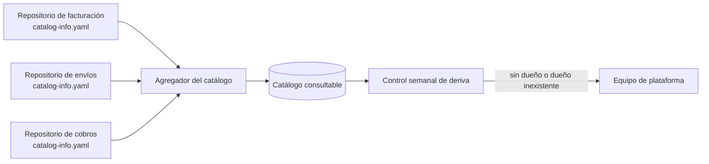

Hay una pregunta que casi nadie sabe responder con rapidez en una organización de tamaño medio: ¿quién es
dueño de este servicio, qué APIs expone y se puede retirar sin romper a alguien? Las respuestas viven en la
cabeza de dos personas, en un documento desactualizado o en el historial de un canal de mensajes. Cuando esas
personas cambian de equipo, la organización descubre que tiene servicios que nadie mantiene y APIs que nadie
se atreve a tocar.

La tesis de este artículo es que **un catálogo de servicios es una herramienta de decisión, no un inventario**.
Su valor está en responder tres preguntas sin reunión: quién decide, en qué estado está y qué contrato ofrece.
El gobierno de APIs sirve para que esas respuestas sean ciertas y para que los cambios incompatibles se
anuncien con fecha. Un catálogo sin dueños verificados es una lista de nombres; un gobierno sin fechas de
retiro es una burocracia que no retira nada.

## Qué resuelve un catálogo

Un catálogo responde preguntas operativas. Cuando hay un incidente, permite encontrar al dueño del servicio
que falla y a los consumidores que dependen de él. Cuando un equipo quiere reutilizar una capacidad, le
permite encontrar si ya existe y qué contrato tiene. Cuando una API va a cambiar, permite localizar quién la
usa antes de anunciar el cambio. Y cuando la organización quiere reducir costo o complejidad, le muestra qué
servicios llevan años sin cambios y sin dueño activo.

Lo que el catálogo no hace es sustituir la documentación de cada servicio ni la arquitectura de conjunto. Su
función es corta y precisa: **ser el índice confiable** que apunta a la documentación, al contrato, al
repositorio, al canal de soporte y al dueño. Si intenta contener toda la documentación, se vuelve pesado y
nadie lo mantiene.

<Callout tone="info" title="Un catálogo mínimo basta">
  Con tres campos verificados por servicio (dueño, estado y contrato) el catálogo ya responde la
  mayoría de las preguntas de un incidente. Los demás campos se añaden cuando una pregunta concreta
  los necesita.
</Callout>

## Qué datos mínimos tiene cada servicio

El dueño debe ser un **equipo**, no una persona. Las personas cambian de puesto; los equipos tienen un canal,
una cola de tareas y una responsabilidad compartida. El dueño debe corresponder a una entidad real del
directorio de la organización, porque un nombre libre no permite avisar a nadie a las tres de la mañana.

El estado describe la madurez y el ciclo de vida: experimental, en producción, deprecado o retirado. Es el
campo más útil para decidir reutilizar o no un servicio. Un servicio experimental puede cambiar sin aviso; un
servicio en producción tiene contrato; uno deprecado no debe recibir consumidores nuevos.

El contrato es la especificación de la API o del evento que el servicio ofrece, con su versión y el enlace al
fichero que lo define. Sin contrato enlazado, el catálogo describe un servicio pero no lo hace utilizable.

Completa con un canal de soporte, la dependencia principal y el nivel de criticidad. Estos cuatro campos cubren
la mayoría de las preguntas de un incidente. Todo lo demás es opcional y debe justificar su coste de
mantenimiento.

```yaml
apiVersion: backstage.io/v1alpha1
kind: Component
metadata:
  name: facturacion
  description: Emite y anula facturas de los clientes
spec:
  type: service
  lifecycle: production
  owner: equipo-cobros
  system: pagos
  providesApis:
    - facturacion-api
```

El ejemplo sigue el formato de descriptor de Backstage, un catálogo de software de código abierto que
usa un fichero `catalog-info.yaml` junto al código. Ese formato es solo una forma concreta; la idea sirve con
cualquier herramienta. Lo importante es que el dueño y el estado vivan **en el mismo repositorio que el
servicio**, porque así cambian en la misma revisión que el código.

## Dónde vive la información

Hay dos lugares posibles para el catálogo: un registro central que se edita a mano, o ficheros en cada
repositorio que un proceso recoge. El registro central es fácil de empezar y se desincroniza con rapidez: el
servicio cambia de dueño en el repositorio y el registro sigue mostrando al equipo anterior. Los ficheros en el
repositorio cuestan más al principio, pero el cambio de dueño se revisa como cualquier otro cambio.

La recomendación práctica es la segunda. El catálogo central agrega y consulta; la verdad sobre cada servicio
vive junto a su código. Y conviene un control periódico que detecte **deriva**: servicios sin dueño, con dueño
inexistente o con estado obsoleto. Una comprobación semanal que liste esos casos basta para mantener el
catálogo honesto.



## Estados y lo que implican

Un estado sirve solo si cambia el comportamiento de quien lo consulta. Por eso conviene que cada estado tenga
una regla explícita.

Un servicio **experimental** puede cambiar sin preaviso y no debe ser dependencia de un flujo crítico. Un
servicio **en producción** mantiene su contrato y cualquier cambio incompatible sigue el ciclo de vida de la
API. Un servicio **deprecado** no acepta consumidores nuevos, tiene una fecha de retiro y un reemplazo indicado.
Un servicio **retirado** ya no existe, y el catálogo conserva la entrada para que las consultas históricas
encuentren el destino.

Esta última parte se olvida con frecuencia. Retirar un servicio sin dejar rastro obliga a investigar, meses
después, por qué una integración falla. Una entrada retirada con su reemplazo cuesta poco y evita mucho tiempo
perdido.

## Gobierno ligero: reglas que se verifican

El gobierno de APIs fracasa cuando consiste en comités que revisan cada cambio. Funciona cuando consiste en un
conjunto corto de reglas que se verifican automáticamente y que la mayoría de los equipos cumple sin pensar.
Algunas reglas útiles son estas: todo servicio en producción tiene dueño y contrato enlazado; ningún endpoint
público se publica sin versión; los cambios incompatibles pasan por un procedimiento de deprecación; y los
nombres de recursos siguen una convención única.

La revisión humana queda para las decisiones que lo merecen: una API nueva que cruza dominios, un contrato que
crea una dependencia fuerte entre equipos o un cambio que afecta a clientes externos. Esa frontera es lo que
mantiene el gobierno ligero. Si cada cambio pasa por la misma revisión, el cuello de botella es el comité, y los
equipos aprenden a esquivarlo.

Una regla que se verifica en el pipeline de integración vale más que diez páginas de políticas. Por ejemplo, un
comprobador de contratos puede rechazar un cambio que elimina un campo sin incrementar la versión mayor. Ese
control es barato y elimina una clase entera de incidentes.

## Ciclo de vida de una API

Una API pasa por cuatro fases: diseño, publicación, uso y retiro. Las tres primeras se gestionan bien con
prácticas habituales; la cuarta es la que casi todas las organizaciones descuidan.

Durante el **diseño**, el contrato se escribe antes que la implementación y se revisa con los consumidores
conocidos. Durante la **publicación**, la API recibe versión, se registra en el catálogo y se documenta con
ejemplos de error. Durante el **uso**, el dueño sabe quién consume qué, porque los consumidores se registran o se
descubren mediante métricas. El **retiro** exige avisos con fechas, un reemplazo claro y una forma de medir el
uso que queda.

Para anunciar esas fechas en el propio protocolo, HTTP tiene dos normas del IETF. La [RFC 9745](https://www.rfc-editor.org/info/rfc9745),
publicada en marzo de 2025, define la cabecera `Deprecation`, que indica que un recurso está o estará
deprecado y puede enlazar a la documentación de la migración. La [RFC 8594](https://www.rfc-editor.org/info/rfc8594),
de mayo de 2019, define `Sunset`, que indica la fecha en que el recurso dejará de responder. Ninguna de las dos
obliga a nada: son vocabulario común. Lo que cambia la situación es que el consumidor las ve en cada respuesta,
sin depender de que lea un correo.

<Callout tone="warning" title="Una fecha de retiro sin medición no protege a nadie">
  Antes de fijar la fecha de retiro, mide cuántos consumidores siguen llamando a la API y quiénes
  son. Si el tráfico lo genera un equipo que no responde, el retiro necesita un plan de migración
  escrito y ayuda del dueño del servicio, no solo una fecha.
</Callout>

## Quién decide qué

El gobierno requiere dueños de dos tipos. Los **dueños de servicio** deciden el contrato y el ritmo de cambio de su
servicio. El **equipo de plataforma o de arquitectura** define las reglas comunes, mantiene el catálogo y resuelve
los conflictos entre equipos. La frontera entre ambos debe quedar escrita: qué puede decidir un equipo sin consultar
y qué requiere una revisión compartida.

Si todo lo decide la plataforma, los equipos pierden velocidad y el catálogo se queda sin información porque nadie
lo mantiene en su ámbito. Si todo lo decide cada equipo, las APIs se contradicen entre sí y cada integración es un
caso especial. La frontera razonable es que cada equipo decide dentro de su contrato y que la plataforma decide
sobre lo que cruza contratos.

## Un caso: retirar la API de facturación

Supongamos que el servicio de facturación expone una `facturas-api` v1 con campos sueltos, y que la v2 añade impuestos por línea.
La decisión de deprecar la v1 está tomada. Lo difícil es retirarla sin que nadie se entere tarde.

El primer paso es el catálogo. La entrada del servicio de facturación no cambia de servicio, pero su contrato pasa a la v2 y la
v1 queda marcada como deprecada, con enlace a la guía de migración. Así quien busque la API antigua en el catálogo ve el
reemplazo antes de escribir código.

El segundo paso son las cabeceras. Cada respuesta de la v1 incluye `Deprecation`, con la fecha en que empezó la deprecación, y
`Sunset`, con la fecha en que dejará de responder. Quien consume la API lo ve en cada llamada, sin depender de que alguien
lea un correo. Son dos cabeceras estándar, no una convención propia.

Un punto que se confunde con frecuencia es la diferencia entre la versión del servicio y la versión de la API. El servicio puede
desplegarse decenas de veces al día sin cambiar su contrato, y la API puede cambiar de versión mayor sin que el servicio cambie de
nombre. Por eso el catálogo registra ambas por separado: la versión del contrato es la que los consumidores deben conocer, y la del
despliegue es la que el equipo de operación necesita para un incidente.

El tercer paso es medir. La puerta de enlace cuenta las llamadas a la v1 por identificador de consumidor. En un caso como este, lo
normal es descubrir tres consumidores: dos equipos internos con backlog propio y un proveedor externo sin contrato firmado. La
medida cambia la conversación. El tiempo que cada equipo interno necesita para migrar se negocia en su planificación; el proveedor
externo recibe contacto directo del dueño de la integración, con una fecha ampliada y un compromiso escrito.

El cuarto paso es el retiro. El día de la fecha de `Sunset`, la v1 responde con un error que nombra la v2 y enlaza la guía. Si alguien
se rompe de todos modos, la incidencia se registra en el catálogo como lección sobre el proceso, no como culpa del consumidor: la
pregunta útil es por qué el aviso no llegó, no quién lo ignoró.

Este caso muestra que el catálogo y el gobierno no son trámites. El catálogo dice quién decide y a quién avisar; las cabeceras dicen
cuándo; la medición dice a quién le duele. Sin las tres piezas, la fecha de retiro es una promesa que nadie puede cumplir.

## Cuándo el catálogo sobra

Un catálogo tiene costo de mantenimiento y no siempre compensa. En una organización pequeña, con pocos servicios y
un equipo que los conoce todos, un documento con seis filas basta, y montar un registro con procesos de
sincronización es sobreingeniería. El punto de inflexión suele llegar cuando hay más servicios que personas que los
recuerdan, cuando los equipos cambian con frecuencia o cuando un incidente tarda más en encontrar al dueño que en
arreglar el problema.

Antes de ese punto, lo útil es la disciplina: un dueño por servicio escrito en el repositorio y una fecha de retiro
para cada deprecación. Esas dos prácticas valen aunque no haya herramienta.

## Errores frecuentes

El primer error es **un dueño que es una persona**. Cuando esa persona cambia de equipo, el catálogo queda
inservible y nadie lo nota hasta el siguiente incidente.

El segundo es **un catálogo que no se mantiene**. Si el estado de los servicios no cambia nunca, el catálogo describe
el pasado. Una revisión periódica con un dueño asignado evita que se vuelva decorativo.

El tercero es **deprecar sin reemplazo**. Anunciar que una API desaparecerá sin decir por qué la sustituye obliga a
cada consumidor a investigar, y la mayoría lo pospone hasta la fecha de retiro.

El cuarto es **gobernar por comité**. Un proceso que exige aprobación para cada cambio pequeño empuja a los equipos a
publicar APIs sin registrar. Conviene que las revisiones se reserven a los cambios que cruzan contratos.

El quinto es **catalogar lo que nadie mantiene**. Una entrada en el catálogo transmite autoridad: quien la lee supone que el estado
y el dueño son verdaderos. Si un servicio lleva dos años sin cambios y su dueño ya no existe, la entrada sigue siendo útil solo si se
marca como sin dueño y se decide su destino: adoptarlo, deprecarlo o retirarlo. Dejarlo en estado de producción es la forma más barata
de engañar a quien decide reutilizarlo.

## Herramientas

Para empezar basta una hoja con las columnas de dueño, estado, contrato y canal, con un responsable que la revise cada
trimestre. Cuando el número de servicios lo justifique, un catálogo de software con descriptores en el repositorio
evita la desincronización; Backstage es una opción de código abierto que lo hace. Para las APIs, un registro de
contratos con versionado y un comprobador de compatibilidad en el pipeline permiten aplicar las reglas sin revisiones
manuales. La herramienta importa menos que la disciplina de los datos; una herramienta cara con dueños falsos no
mejora nada.

## Checklist

- [ ] Cada servicio en producción tiene un equipo como dueño, verificable en el directorio de la organización.
- [ ] El estado (experimental, producción, deprecado, retirado) se actualiza en el mismo cambio que altera el servicio.
- [ ] Cada API en producción enlaza su contrato versionado.
- [ ] Un control periódico detecta servicios sin dueño, con dueño inexistente o con estado obsoleto.
- [ ] Las reglas de gobierno se verifican en el pipeline; la revisión humana se reserva a cambios que cruzan contratos.
- [ ] Toda deprecación tiene reemplazo, fecha de retiro y medición del uso que queda.
- [ ] La frontera entre decisiones de equipo y decisiones de plataforma está escrita.

## Fuentes

- [RFC 9745: The Deprecation HTTP Response Header Field](https://www.rfc-editor.org/info/rfc9745), IETF, marzo de 2025.
- [RFC 8594: The Sunset HTTP Header Field](https://www.rfc-editor.org/info/rfc8594), IETF, mayo de 2019.
- [Backstage: Descriptor format of catalog entities](https://backstage.spotify.com/docs/portal/core-features-and-plugins/catalog/descriptor-format), documentación oficial del formato de descriptor.
