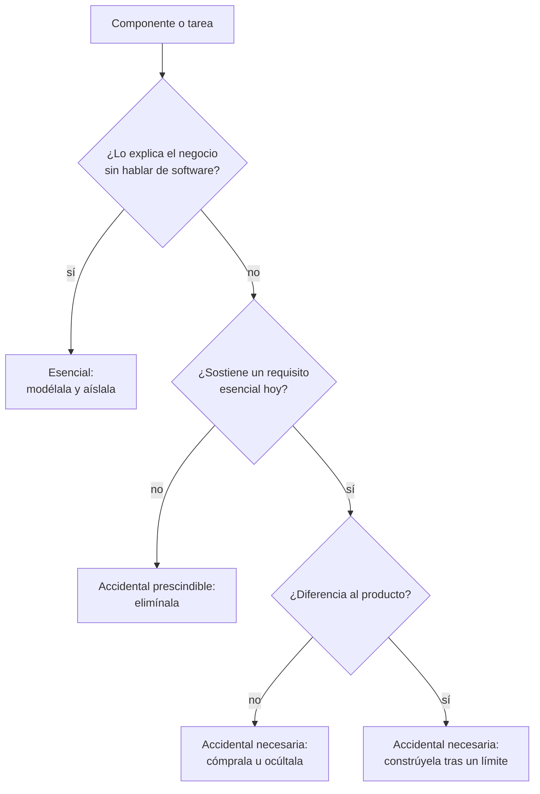
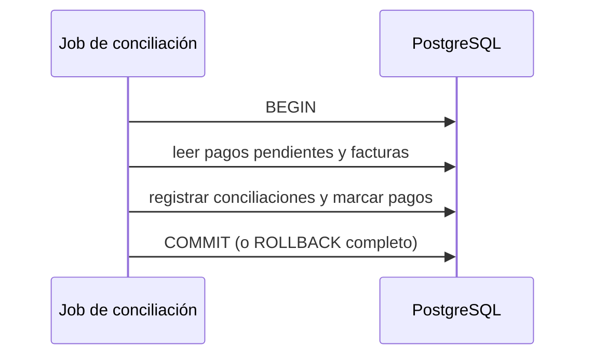

# Complejidad esencial y accidental

Negocio pide algo sencillo: que las facturas muestren el número de pedido del cliente. La regla cabe en una frase. El cambio tarda dos semanas: una migración, el mapeo del ORM, tres DTO, el esquema de un evento, la invalidación de una caché y un despliegue coordinado de dos servicios. Nadie en la reunión de planificación discute la regla; todo el tiempo se va en lo que rodea a la regla. Esa diferencia entre lo que el problema exige y lo que tu solución añade tiene nombre desde hace cuatro décadas.

**La complejidad esencial es la que pertenece al problema que resuelves; la accidental es la que añade la solución que elegiste: herramientas, infraestructura y decisiones propias.**

Este artículo explica de dónde viene la distinción, cómo separar una de otra con preguntas concretas, las dos trampas simétricas en las que se cae al aplicarla y las formas de reducir la accidental. No es un marco de decisión completo (para eso está [trade-offs y toma de decisiones](/docs/trade-offs-y-decisiones)), sino una lente para mirar el coste de un sistema antes de decidir.

<Callout tone="info" title="Fecha de corte y fuentes">
  Consultado en octubre de 2026. El texto de Brooks se leyó en la versión de IEEE Computer de 1987
  reproducida por la UCSF; el de Moseley y Marks, en el PDF original. El ensayo de Dan Luu no se
  pudo abrir desde esta consulta: lo que se cuenta de él viene de resúmenes y está señalado.
</Callout>

## El origen: «No Silver Bullet»

Fred Brooks presentó «No Silver Bullet: Essence and Accidents of Software Engineering» en el congreso mundial de la IFIP de 1986 (publicado en sus actas, _Information Processing 1986_). Un año después lo reimprimió IEEE Computer (vol. 20, n.º 4, abril de 1987, pp. 10–19), y en 1995 entró como capítulo 16 en la edición de aniversario de _The Mythical Man-Month_, seguido de un capítulo 17 en el que Brooks revisa el ensayo a la luz de las críticas.

Brooks toma los términos de Aristóteles. Divide las dificultades del software en **esencia**, las que son inherentes a la naturaleza del software, y **accidentes**, las que hoy acompañan a su producción pero no le son inherentes. «Accidente» aquí no significa percance: significa lo que está presente sin ser necesario.

Para Brooks, la esencia de un sistema es un constructo de conceptos entrelazados: conjuntos de datos, relaciones entre ellos, algoritmos e invocaciones de funciones. Lo difícil, sostiene, es especificar, diseñar y probar ese constructo, no el trabajo de representarlo en un lenguaje ni de comprobar que la representación es fiel.

### Las cuatro propiedades inherentes

Brooks atribuye la dificultad esencial a cuatro propiedades del software:

| Propiedad     | Qué significa en el ensayo                                                          | Cómo la notas hoy                                                        |
| ------------- | ----------------------------------------------------------------------------------- | ------------------------------------------------------------------------ |
| Complejidad   | Ninguna parte se repite igual: crecer es añadir elementos distintos que interactúan | Cada caso nuevo multiplica las combinaciones que hay que probar          |
| Conformidad   | El software debe adaptarse a instituciones y sistemas humanos arbitrarios           | Normativas fiscales, formatos de otros sistemas, excepciones de clientes |
| Cambiabilidad | Está sometido a presión constante de cambio porque es fácil de cambiar              | El negocio pide ajustes que nunca pediría a un edificio                  |
| Invisibilidad | No tiene una representación geométrica natural que lo muestre entero                | Ningún diagrama único cuenta todo el sistema                             |

### La tesis y su argumento

La tesis central es que ningún desarrollo aislado, ni de tecnología ni de gestión, promete por sí solo una mejora de un orden de magnitud en una década en productividad, fiabilidad o simplicidad.

El argumento descansa en la distinción. Brooks repasa los grandes avances anteriores (los lenguajes de alto nivel, el tiempo compartido y los entornos de programación unificados) y concluye que todos atacaron dificultades accidentales. Si, como él cree, las partes conceptuales de la tarea ya ocupan la mayor parte del tiempo, ninguna mejora en la forma de expresar esos conceptos puede dar grandes ganancias. Por eso dedica la última parte del ensayo a ataques contra la esencia: **comprar en vez de construir**, refinar requisitos con prototipos rápidos, hacer crecer el software de forma incremental en lugar de construirlo de una vez y cultivar grandes diseñadores.

## Una reformulación útil: el problema visto por el usuario

En «Out of the Tar Pit» (6 de febrero de 2006), Ben Moseley y Peter Marks adoptan la distinción pero la endurecen. Definen la complejidad esencial como la inherente al problema **tal como lo ven los usuarios**, y la accidental como todo lo demás: la complejidad con la que el equipo no tendría que lidiar en un mundo ideal, por ejemplo la que surge de problemas de rendimiento o de un lenguaje y una infraestructura subóptimos.

Su criterio práctico es útil: si el usuario ni siquiera sabe qué es algo (un pool de hilos, un contador de bucle), no puede ser esencial. Y discrepan de Brooks en un punto central: no aceptan que la mayor parte de la complejidad de los sistemas actuales sea esencial. Para ellos, gran parte es accidental, y examinan sus causas en este orden: primero la gestión del estado, que consideran la principal; después el control explícito del flujo, y por último el volumen de código, al que llaman «en muchos sentidos un efecto secundario» porque buena parte del código existe para gestionar estado o especificar control.

Las dos definiciones no se contradicen tanto como parece. Brooks habla de la esencia del software en general; Moseley y Marks, de la esencia de un problema concreto. Para diagnosticar un sistema, la segunda es más operativa.

### Necesaria no es lo mismo que esencial

En el mundo real no hay infraestructura ideal. Si el usuario necesita que una búsqueda responda en menos de 200 ms, ese requisito es esencial; la caché que lo hace posible es accidental, aunque hoy sea imprescindible. Distinguirlo importa: el requisito no se negocia, la caché sí puede sustituirse por otra solución. Los requisitos de calidad merecen esa misma lectura; los tratamos en [atributos de calidad](/docs/atributos-de-calidad).

## Esencial frente a accidental

| Dimensión           | Complejidad esencial                                     | Complejidad accidental                                   |
| ------------------- | -------------------------------------------------------- | -------------------------------------------------------- |
| Origen              | Reglas, datos y variabilidad del problema                | Herramientas, infraestructura y decisiones del equipo    |
| Quién la reconoce   | Un experto del negocio la explica sin hablar de software | Solo la entiende quien conoce la implementación          |
| ¿Se puede eliminar? | No sin cambiar el problema o el alcance                  | Sí, al menos en principio                                |
| Cómo se gestiona    | Modelarla bien, aislarla, negociar el alcance            | Eliminarla, ocultarla tras un límite, comprarla resuelta |
| Cuándo cambia       | Cuando cambia el negocio o la normativa                  | Cuando cambia la tecnología o la estructura del equipo   |
| Ejemplo             | Un pedido no se factura dos veces; IVA según el país     | Mapear el pedido entre ORM, DTO y evento                 |

## Dónde nace la complejidad accidental

### Herramientas que imponen su modelo

Un ORM que no sabe representar un valor del dominio (un importe con moneda, un intervalo de fechas) obliga a partirlo en columnas sueltas y a reconstruirlo a mano en cada lectura. El código empieza a girar alrededor de lo que el ORM permite, no de lo que el negocio dice. Cada esquiva es pequeña; juntas definen la forma del sistema. Aislar esa herramienta tras un puerto es lo que propone la [arquitectura hexagonal](/docs/arquitectura-hexagonal).

### Infraestructura añadida antes de necesitarla

El caso típico: un sistema de colas para un proceso que cabía en una transacción. La cola trae consigo entrega al menos una vez, consumidores idempotentes, mensajes huérfanos, reintentos, un esquema que versionar y un componente más que vigilar. Si el volumen y los requisitos de desacoplamiento no lo justificaban, todo eso es accidental. Cuando sí se justifica, los patrones para hacerlo bien están en [sagas, outbox e idempotencia](/docs/sagas-outbox-idempotencia).

### Decisiones propias que nadie revisa

Una abstracción genérica para un solo caso, un framework interno, una configuración con cuarenta opciones que nadie toca, una frontera entre servicios trazada por el organigrama y no por el dominio. Son decisiones razonables en su momento que nadie vuelve a evaluar. La división prematura en servicios es la versión más cara; la discutimos en [monolito frente a microservicios](/docs/monolito-vs-microservicios).

### Dependencias que se arrastran

Cuanto más sabe un módulo de otro, más complejidad accidental se propaga con cada cambio. Ese es el terreno de [acoplamiento y cohesión](/docs/acoplamiento-cohesion), que también explica por qué un módulo profundo (mucha funcionalidad tras una interfaz pequeña) es una de las mejores defensas.

### Complejidad que se acumula

La complejidad accidental no aparece de golpe: se deposita con cada atajo. Cuándo conviene asumirla a sabiendas y cómo pagarla está en [deuda técnica y evolución](/docs/deuda-tecnica-evolucion).

## Cómo separarlas: preguntas de diagnóstico

No hay una medición que clasifique cada línea de código. Hay preguntas que, hechas sobre un componente o sobre el trabajo de un cambio, apuntan en una dirección:

| Pregunta                                                           | Si la respuesta es sí, sugiere… |
| ------------------------------------------------------------------ | ------------------------------- |
| ¿Un experto del negocio lo describiría sin mencionar tecnología?   | Esencial                        |
| ¿Existiría si tuvieras herramientas e infraestructura ideales?     | Esencial                        |
| ¿Cambia cuando cambia la tecnología y no cuando cambia el negocio? | Accidental                      |
| ¿Lo resolvería igual cualquier empresa de cualquier sector?        | Accidental y no diferenciador   |
| ¿Puedes quitarlo y el usuario no nota diferencia funcional?        | Accidental                      |
| ¿Nadie recuerda qué requisito lo trajo?                            | Probablemente accidental        |



Las respuestas rara vez son limpias. Un componente puede mezclar ambas: el cálculo de impuestos es esencial, el formato en que se lo pides al proveedor fiscal no lo es. Separarlos dentro del componente ya es un avance.

## Dos trampas simétricas

### Tomar lo accidental por esencial

«El negocio funciona así» es a veces una forma de decir «el sistema antiguo funcionaba así». Un cierre nocturno que nadie pidió, sino que existía porque el sistema anterior procesaba por lotes; un límite de 30 caracteres en un nombre heredado de una columna. Con los años, las limitaciones de la herramienta se convierten en reglas que el negocio repite. Antes de modelar una regla, pregunta qué problema del usuario resuelve. Si la respuesta es una limitación técnica, es accidental aunque lleve diez años en el manual de procesos.

### Tomar lo esencial por accidental

La trampa inversa es más cara. Un módulo de facturación lleno de condiciones parece código sucio, y lo es en parte, pero muchas de esas condiciones codifican regímenes fiscales, devoluciones parciales o acuerdos con clientes concretos. La reescritura que promete «limpiarlo» descubre esas reglas en producción, una por una. El código feo no siempre es complejidad accidental: a veces es complejidad esencial mal expresada. Aquí ayuda modelar el dominio con su lenguaje, como propone [Domain-Driven Design](/docs/domain-driven-design).

<Callout tone="warning" title="Una distinción que se usa como arma">
  «Eso es complejidad accidental» suena a diagnóstico, pero a menudo es una opinión sobre una
  tecnología que no te gusta. Pide que se nombre el requisito que el componente sostiene, o que se
  demuestre que no sostiene ninguno, antes de aceptar la etiqueta.
</Callout>

## ¿Cuánto del coste es accidental?

No hay una cifra universal y conviene desconfiar de quien la dé. Lo que sí hay son posiciones argumentadas:

- **Brooks (1986)** creía que lo accidental ya se había reducido mucho y que lo conceptual dominaba; de ahí su escepticismo ante las balas de plata.
- **Moseley y Marks (2006)** sostienen lo contrario: que buena parte de la complejidad de los grandes sistemas es accidental y que el objetivo de la ingeniería debe ser eliminarla en lo posible.
- **Dan Luu (2020)**, en «Against essential and accidental complexity», cuestiona que se pueda acotar de antemano la proporción esencial, porque abaratar el trabajo cambia qué problemas se intentan resolver. No pudimos abrir el ensayo; esto procede de resúmenes de terceros.

Sin una cifra general, sí hay razones para sospechar que lo accidental tiende a crecer más de lo que parece. Cada pieza añadida interactúa con las anteriores, así que su coste conjunto tiende a crecer más que la suma de las partes. Se paga en cada cambio, no solo al construirla. Y es invisible para el negocio, de modo que nadie fuera del equipo presiona para retirarla. Lo esencial, en cambio, está a la vista y se discute en cada planificación.

No necesitas una cifra global: basta saber qué domina en tu sistema. Busca estas señales:

- El tiempo de un cambio lo consume la coordinación (despliegues, contratos entre servicios, migraciones) más que la regla.
- Los incidentes nacen en la infraestructura y la configuración, no en las reglas de negocio.
- La incorporación de una persona nueva trata sobre herramientas internas, no sobre el dominio.
- Las estimaciones se disparan por «lo de alrededor», no por la lógica.

Si ves lo contrario (los cambios tardan porque el problema es difícil y las discusiones son sobre reglas), probablemente tu coste es esencial y la palanca está en el alcance y en el modelo, no en la tecnología.

## La vigencia de la tesis

Cuatro décadas después, la tesis sigue discutiéndose. Hay argumentos en ambas direcciones:

- **A favor.** Especificar qué debe hacer un sistema sigue siendo difícil, y ninguna herramienta decide por ti qué reglas tiene el negocio ni cómo interactúan.
- **En contra.** El código abierto, los gestores de paquetes y los servicios gestionados han hecho que muchos equipos ya no construyan lo que antes construían. Se puede leer como una confirmación de Brooks, que citaba comprar en vez de construir como ataque a la esencia, o como prueba de que el margen accidental era mayor de lo que él estimaba.
- **Abierto.** Los asistentes de código basados en LLM abaratan sobre todo la expresión, que Brooks consideraba accidental. Si eso acerca o aleja el cuello de botella de la especificación es una pregunta abierta; algunas implicaciones las tratamos en [lenguajes en la era de la IA](/docs/lenguajes-era-ia).

Una lectura prudente: la distinción ha resistido mejor que la predicción. Si llegó o no una mejora de diez veces en una década depende de cómo se mida; que convenga separar el problema de su solución para decidir dónde invertir sigue siendo útil.

## Cómo reducir la complejidad accidental

### Eliminarla

La reducción más eficaz es quitar. Un componente que no sostiene ningún requisito esencial actual se elimina, aunque haya costado construirlo; el coste ya pagado no es argumento. Lo mismo vale para opciones de configuración sin uso, abstracciones con una sola implementación y capas que solo reenvían llamadas.

### Ocultarla tras un límite

Cuando es necesaria, que la pague un solo módulo. Un buen límite concentra la complejidad accidental (el protocolo del proveedor, el ORM, los reintentos) y deja al resto del sistema hablar en términos del dominio. Esto no la elimina, pero evita que se propague con cada cambio.

### Comprarla resuelta

Brooks lo planteaba como la solución más radical: no construir el software en absoluto. Si la complejidad no diferencia tu producto (autenticación, envío de correo, colas, observabilidad), comprar o adoptar algo maduro suele ser más barato que mantenerlo. La misma lógica vale para elegir tecnología conocida frente a la novedad; la desarrollamos en [la herramienta nueva y brillante](/docs/trade-offs-y-decisiones#la-herramienta-nueva-y-brillante).

Comprar no sale gratis: trae integración, dependencia del proveedor y un modelo ajeno. Por eso el componente comprado también va tras un límite.

### Posponerla

Muchas piezas accidentales se añaden por si acaso. Retrasar la decisión hasta que el requisito sea real evita pagar la complejidad mientras no compra nada. El criterio para elegir el momento está en [trade-offs y toma de decisiones](/docs/trade-offs-y-decisiones).

### Un registro mínimo

Una práctica que ayuda: anotar cada pieza accidental relevante con el requisito que la justifica y la condición para retirarla. La forma puede ser tan sencilla como esta:

```yaml
# docs/complexity-register.yaml (forma orientativa)
- component: search-cache
  kind: accidental
  sustains: 'p99 de /search < 200 ms'
  owner: equipo-busqueda
  retire_when: '…'
# …
```

Si una entrada no tiene `sustains`, es candidata a desaparecer. Las decisiones importantes van además a un [ADR](/docs/adr).

## Cuándo sí y cuándo no aplicar este análisis

| Situación                                                         | ¿Merece el análisis?                                        |
| ----------------------------------------------------------------- | ----------------------------------------------------------- |
| Los cambios pequeños tardan semanas y nadie sabe explicar por qué | Sí: empieza por ahí                                         |
| Vas a añadir infraestructura nueva (colas, caché, otro servicio)  | Sí, antes de decidir                                        |
| Planeas reescribir un módulo «porque es un desastre»              | Sí, para no tirar reglas esenciales con el código           |
| Un prototipo que se descartará en semanas                         | No: la complejidad accidental de un prototipo apenas cuesta |
| El problema es nuevo y aún no entiendes el dominio                | Todavía no: primero entiende qué es esencial                |

## Errores frecuentes

- **Confundir simple con fácil.** Rich Hickey separó ambas ideas en «Simple Made Easy» (Strange Loop, 2011): lo fácil es relativo a quien lo usa (lo familiar, lo que tiene a mano); lo simple es una propiedad de la cosa, que no entrelaza partes. Una herramienta familiar puede añadir mucha complejidad accidental.
- **Medir solo el código propio.** La complejidad de la infraestructura, la configuración y las herramientas también la paga el equipo.
- **Etiquetar sin el requisito delante.** Clasificar sin saber qué necesita el usuario convierte el análisis en preferencias.
- **Mover la complejidad en lugar de reducirla.** Partir un módulo en tres servicios deja la complejidad y añade red.
- **Ignorar el coste de quitar.** Eliminar algo también cuesta; a veces lo correcto es aislarlo y dejarlo.
- **Creer que comprar elimina la complejidad.** La desplaza al contrato con el proveedor y a la integración.

## Ejemplo trabajado: la conciliación de pagos

**Contexto.** Un equipo de cobros concilia cada noche los pagos de una pasarela con las facturas emitidas. Son unos miles de pagos al día, todo vive en la misma base de datos PostgreSQL y el proceso actual es un job que a veces falla a medias. La propuesta del equipo: publicar cada pago en un broker de mensajes, crear un servicio consumidor que concilie y usar un outbox para no perder eventos.

**Diagnóstico.** Las preguntas aplicadas a la propuesta:

| Pieza                  | ¿La explica el negocio? | ¿Sostiene un requisito hoy?                     | Clasificación        |
| ---------------------- | ----------------------- | ----------------------------------------------- | -------------------- |
| Casar pago y factura   | Sí                      | Sí                                              | Esencial             |
| Pagos parciales        | Sí                      | Sí                                              | Esencial             |
| Broker y consumidor    | No                      | No: el volumen cabe en una transacción          | Accidental evitable  |
| Outbox                 | No                      | Solo si hay broker                              | Accidental derivada  |
| Fallo a medias del job | No                      | Sí: la conciliación debe ser completa o ninguna | Accidental con causa |

El problema real que motivó la propuesta era el fallo a medias. Eso pide atomicidad, no mensajería.



**Decisión.** Conciliar la noche entera en una sola transacción: unos miles de filas caben de sobra, y si algo falla se deshace todo y el job se relanza sin dejar conciliaciones a medias. Las reglas de conciliación (pagos parciales, tolerancias de redondeo) se aíslan en un módulo propio con su lenguaje. El acceso a la pasarela queda tras un límite para poder cambiarla.

**Condiciones para revisarla.** Se anota en un ADR que la decisión se reconsidera si el volumen deja de caber en la ventana nocturna, si otro sistema necesita reaccionar a cada pago en tiempo real o si la conciliación pasa a hacerse en otra base de datos. Si alguna se cumple, la mensajería deja de ser accidental evitable y pasa a sostener un requisito.

## Checklist

- [ ] Cada componente relevante tiene nombrado el requisito esencial que sostiene.
- [ ] Las reglas de negocio viven separadas de la tecnología que las ejecuta.
- [ ] Antes de añadir infraestructura, se respondió qué requisito actual la exige.
- [ ] Lo que no diferencia al producto se compra o se adopta maduro, tras un límite.
- [ ] Antes de reescribir, se inventariaron las reglas esenciales que codifica el código actual.
- [ ] Las limitaciones heredadas que el negocio repite como reglas se cuestionaron con el usuario.
- [ ] Las piezas accidentales tienen una condición explícita para retirarlas.

## Fuentes

Consultadas en octubre de 2026.

- [No Silver Bullet: Essence and Accidents of Software Engineering (Frederick P. Brooks, Jr., IEEE Computer, vol. 20, n.º 4, abril de 1987)](https://www.cgl.ucsf.edu/Outreach/pc204/NoSilverBullet.html): versión de IEEE Computer; publicado antes en _Information Processing 1986_ (IFIP)
- [No Silver Bullet en Wikipedia](https://en.wikipedia.org/wiki/No_Silver_Bullet): historial de publicación y capítulos 16 y 17 de la edición de 1995
- [Out of the Tar Pit (Ben Moseley y Peter Marks, 6 de febrero de 2006)](https://curtclifton.net/papers/MoseleyMarks06a.pdf)
- [Against essential and accidental complexity (Dan Luu)](https://danluu.com/essential-complexity/): sin acceso desde esta consulta; citado por resúmenes
- [Simple Made Easy (Rich Hickey, Strange Loop, septiembre de 2011)](https://www.infoq.com/presentations/Simple-Made-Easy/): vídeo de la charla publicado por InfoQ
