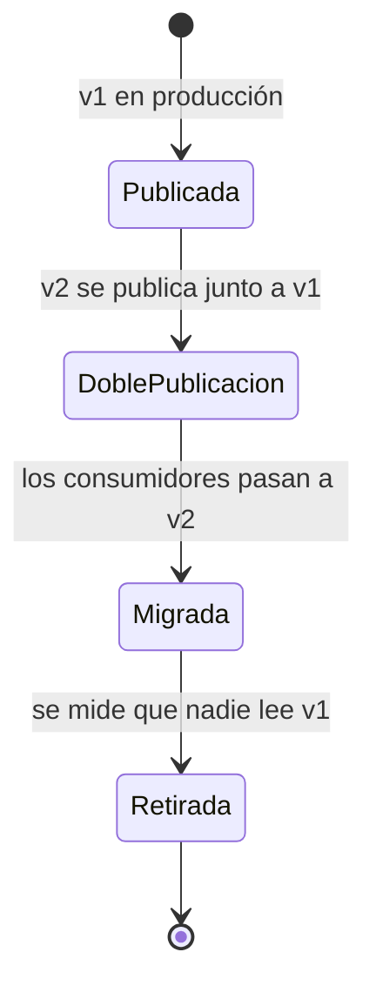

# Contratos de eventos versionados y compatibles

Un evento publicado es una API que nadie ha llamado todavía. El productor lo emite y sigue su
camino; no sabe cuántos consumidores lo leen, ni desde cuándo, ni con qué versión del código.
Cuando el productor cambia la forma del evento, el fallo no aparece en su pipeline: aparece en
un consumidor de otro equipo, a veces días después, a veces como un dato interpretado mal sin
ningún error. Diseñar cómo evoluciona un evento es, por tanto, parte del diseño del evento, no
una tarea para cuando llegue el primer cambio.

Este artículo trata de esa evolución: qué trata el esquema como contrato, qué cambios son
seguros, cómo versionar y cómo retirar una versión vieja sin apagar a nadie a ciegas. Parte del
patrón de eventos de [Event-driven, CQRS y Event Sourcing](/docs/event-driven-cqrs-event-sourcing),
que ya repasa el versionado de eventos guardados; aquí el foco está en los eventos que viajan
entre servicios.

## El evento como contrato

Un evento tiene dos partes que evolucionan a ritmos distintos. El **sobre** lleva los metadatos
(identificador, origen, tipo, fecha) y debería tener la misma forma para todos los eventos de la
organización. El **cuerpo** (el _payload_) lleva el hecho de negocio y es donde ocurren casi todos
los cambios. Un estándar de sobre evita reinventar los metadatos en cada tópico: [CloudEvents v1.0.2](https://github.com/cloudevents/spec/blob/v1.0.2/cloudevents/spec.md)
define como atributos obligatorios `id`, `source`, `specversion` y `type`, y como opcionales
`datacontenttype`, `dataschema`, `subject` o `time`.

El cuerpo necesita un formato de serialización y un esquema que lo describa. La elección
condiciona qué cambios son fáciles, así que no es un detalle:

| Formato     | Qué ofrece para evolucionar                                                                                        | Cuidado típico                                                 |
| ----------- | ------------------------------------------------------------------------------------------------------------------ | -------------------------------------------------------------- |
| Avro        | Resolución entre el esquema que escribió el dato y el que lo lee; valores por defecto y alias en la especificación | Un campo sin valor por defecto no se puede añadir sin romper   |
| Protobuf    | Campos identificados por número; los números y nombres retirados se reservan con `reserved`                        | Reutilizar un número o cambiar un tipo corrompe datos antiguos |
| JSON Schema | Legible y sin formato binario; la compatibilidad depende de qué restricciones use el esquema                       | Es fácil escribir un esquema que acepta cualquier cosa         |

Los tres pueden registrarse en un registro de esquemas. El registro de Confluent, por ejemplo,
admite los tres formatos y aplica reglas de compatibilidad a cada versión nueva antes de
aceptarla. Elegir formato es también elegir cuánta disciplina impone el propio formato: Avro y
Protobuf obligan a pensar en la evolución; JSON Schema la deja en manos del equipo.

## Esquema en un registro y verificado en CI

Un registro de esquemas guarda las versiones de cada _subject_ (en Confluent, normalmente un
subject por tópico) y, para cada una, un **modo de compatibilidad**. Los modos documentados por
Confluent son siete: `BACKWARD`, `BACKWARD_TRANSITIVE`, `FORWARD`, `FORWARD_TRANSITIVE`,
`FULL`, `FULL_TRANSITIVE` y `NONE`. El valor por defecto es `BACKWARD`.

| Modo                     | Qué garantiza                                                             | Orden de despliegue habitual         |
| ------------------------ | ------------------------------------------------------------------------- | ------------------------------------ |
| `BACKWARD` (por defecto) | Un consumidor con el esquema nuevo lee datos escritos con el anterior     | Primero los consumidores             |
| `FORWARD`                | Un consumidor con el último esquema lee datos escritos con el nuevo       | Primero los productores              |
| `FULL`                   | Ambas direcciones contra la última versión                                | Cualquiera                           |
| `*_TRANSITIVE`           | Lo mismo, pero contra todas las versiones registradas y no solo la última | Igual que su variante simple         |
| `NONE`                   | Ninguna comprobación                                                      | Ninguno seguro: un cambio cualquiera |

Confluent documenta `BACKWARD` como valor por defecto. Un motivo práctico, criterio de este artículo
y no de la documentación, es que permite rebobinar un consumidor hasta el inicio del tópico y leer
con el esquema actual lo que se escribió hace meses. Para Protobuf, su guía de evolución indica
`BACKWARD_TRANSITIVE` como mejor práctica, porque añadir tipos de mensaje nuevos no es compatible
hacia adelante. El modo se fija por _subject_ y debería
ser una decisión revisada, no el valor que venga de serie.

Dos capas de verificación completan la idea:

- **En CI**, antes de fusionar un cambio de esquema, se comprueba la compatibilidad contra el
  registro. La referencia de la API de Confluent documenta la llamada
  `POST /compatibility/subjects/{subject}/versions/{version}`, que prueba un esquema contra una
  versión registrada del _subject_.
- **En el broker**, la validación de ID de esquema de Confluent rechaza, por tópico, los mensajes
  cuyo identificador de esquema no está registrado. Valida el identificador, no el contenido del
  mensaje, y los mensajes con valor nulo pasan la comprobación. Es una red de seguridad: evita
  publicar datos con un esquema que nadie ha registrado, pero no sustituye a la comprobación de
  compatibilidad.

## Qué cambios son seguros

La regla operativa es la misma que para una API síncrona: el consumidor debe seguir funcionando
sin que nadie toque su código. La tabla resume los cambios más comunes; los detalles de cada
formato cambian, así que la columna de motivo es lo que conviene retener.

| Cambio                                            | ¿Seguro?               | Motivo                                                                                            |
| ------------------------------------------------- | ---------------------- | ------------------------------------------------------------------------------------------------- |
| Añadir un campo opcional con valor por defecto    | Sí                     | El consumidor nuevo rellena el valor por defecto con datos antiguos; el antiguo ignora el campo   |
| Añadir un campo obligatorio sin valor por defecto | No                     | Los datos antiguos no lo traen, y el consumidor nuevo no puede leerlos                            |
| Quitar un campo que alguien lee                   | No                     | El consumidor que lo usa falla o cae a un valor vacío                                             |
| Quitar un campo en Protobuf que nadie lee         | Sí, si se reserva      | Se reservan su número y su nombre para que nadie los reutilice                                    |
| Renombrar un campo en Avro                        | Sí, con alias          | El alias permite que el lector reconozca el nombre anterior                                       |
| Renombrar un campo en Protobuf                    | Depende del formato    | El número se mantiene, así que el binario sigue funcionando; el JSON que usa el nombre, no        |
| Cambiar el número de un campo en Protobuf         | No                     | Equivale a borrar el campo y crear otro distinto                                                  |
| Cambiar el tipo de un campo                       | No, casi siempre       | Protobuf tolera algunas conversiones entre enteros, pero la guía recomienda casi no cambiar tipos |
| Cambiar el significado sin cambiar la forma       | No                     | El esquema no lo detecta; solo lo notan los consumidores                                          |
| Añadir un valor a un `enum`                       | Depende del consumidor | Rompe a quien trata la lista de valores como cerrada                                              |

Dos reglas de escritura ayudan más que cualquier comprobación. La primera: **no reutilices
nombres ni números retirados**; una reserva es barata y un dato malinterpretado no se corrige
después. La segunda: **un campo nuevo no cambia lo que significan los antiguos**. Un criterio de este
artículo (no una norma): si una versión nueva no se puede obtener a partir de la anterior, en
realidad es otro evento y conviene darle otro tipo. Esa idea sirve para decidir entre evolucionar
un evento y cambiar de tipo.

El consumidor también tiene su parte. Un lector tolerante, que lee solo lo que necesita e ignora
el resto, absorbe los cambios aditivos; un consumidor que valida el evento completo contra una
copia rígida del esquema convierte cada campo nuevo en una rotura. Lo mismo vale para el
[lector tolerante de las APIs](/docs/diseno-de-apis#compatibilidad-y-versionado).

## Versionar el evento o el tópico

Cuando un cambio no es compatible, hay dos sitios donde poner la versión:

- **En el tipo del evento.** El atributo `type` o el nombre del mensaje lleva la versión, por
  ejemplo `pedido.creado.v2`. Productores y consumidores de ambas versiones comparten tópico, y
  el orden entre versiones se conserva. Exige que los consumidores distingan los tipos y que
  convivan los dos formatos durante la migración.
- **En el tópico.** Un tópico nuevo, por ejemplo `pedidos-v2`, aísla las versiones. Cada
  consumidor se suscribe a la que entiende, pero el orden entre ambas se pierde y hay que
  mantener dos flujos mientras dure la migración.

El criterio que suele funcionar es el siguiente (criterio propio, no una norma): los cambios
compatibles no llevan versión nueva; los incompatibles cambian el tipo si el flujo de eventos
debe seguir siendo uno solo, y crean un tópico nuevo si las dos formas no deben convivir en el
mismo canal. Sea cual sea la elección, la versión debe ser visible en el propio mensaje, no
solo en el nombre del tópico o en el nombre del fichero del esquema.

## Deprecación: doble publicación y retirada medida

Una versión vieja es código, pruebas y dependencias de los consumidores. Retirarla exige un
proceso con fases y un criterio de salida que no dependa de la fecha de un calendario:



La **doble publicación** es el periodo en que el productor emite el mismo hecho en las dos
versiones. Tiene coste (dos formatos, dos caminos de serialización, más almacenamiento si el
evento se retiene), así que debería durar lo que tarden los consumidores en migrar, no más. Es la
misma idea que las fases de expansión y contracción de la [migración de bases de datos sin
downtime](/docs/migraciones-bd-sin-downtime): primero se añade lo nuevo, después se mueve la
lectura y al final se quita lo viejo.

La retirada no debería depender de un calendario sino de una medición. El productor necesita
saber qué consumidores leen cada versión: un registro de suscriptores, una métrica por grupo de
consumo o una cabecera con la versión que el consumidor declara. Solo cuando la métrica dice que
nadie lee v1 durante un periodo acordado, se corta la publicación. Para las APIs síncronas, las
cabeceras `Deprecation` y `Sunset` anuncian ese calendario; para eventos no hay un equivalente
estándar, así que el aviso se hace por el canal de la organización y, sobre todo, por la métrica.

## Propiedad del evento

Un evento sin dueño acumula cambios de todos y no tiene a nadie que responda por la
compatibilidad. Conviene fijar tres cosas antes del primer consumidor:

- **Quién lo define.** Lo define el equipo que posee el hecho de negocio (el productor), no el
  consumidor que lo necesita primero. Los consumidores pueden pedir campos, pero el dueño decide
  la forma.
- **Quién puede cambiarlo.** Solo el dueño fusiona cambios en el esquema, y la fusión pasa la
  comprobación de compatibilidad. Un cambio incompatible exige una versión nueva y, si afecta a
  toda la organización, un [ADR](/docs/adr) que lo justifique.
- **Dónde vive.** El esquema vive en un repositorio o en el registro, con su historial, y cada
  consumidor declara de qué versión depende. Sin esa declaración no hay forma de medir la
  deprecación.

## Pruebas de contrato entre productor y consumidor

La compatibilidad de un esquema prueba la forma; no prueba el uso. Un campo puede seguir siendo
válido y dejar de tener el significado que el consumidor esperaba. Las pruebas de contrato
guiadas por el consumidor cubren esa frontera: el consumidor declara qué espera del mensaje y el
productor verifica que lo cumple. [Pact](https://docs.pact.io/getting_started/how_pact_works)
soporta este modelo para mensajes asíncronos (los _message pacts_): el consumidor escribe una
prueba, Pact genera el contrato y el productor lo verifica contra su código, con las dependencias
sustituidas. La abstracción no depende del transporte, así que sirve igual sobre Kafka que sobre
una cola.

[AsyncAPI](https://www.asyncapi.com/docs/reference/specification/v3.1.0) describe el lado de
documentación: canales, operaciones y mensajes, con esquemas en JSON Schema o, para Avro y
Protobuf, con un objeto de esquema multiformato que indica el formato. Esa especificación
funciona como inventario de eventos de la organización. Las pruebas de contrato y la estrategia
general de pruebas se tratan en [Estrategia de pruebas: pirámide y contratos](/docs/estrategia-de-pruebas-contratos).

## Ejemplo trabajado: un pedido que gana un canal

Un evento `PedidoCreado` pasa de la versión 1, que tenía un campo `precio` en decimal, a la
versión 2, que sustituye el importe por céntimos enteros y añade el canal de venta. La
descripción en Protobuf muestra las decisiones, no el contenido completo:

```proto
// Forma del mensaje tras el cambio; los campos de v1 se reservan, no se reutilizan.
message PedidoCreado {
  string pedido_id = 1;
  string cliente_id = 2;
  reserved 4;              // antes: precio (decimal), retirado en v2
  reserved "precio";       // el nombre también, para que el JSON no lo reutilice
  int64 importe_centimos = 5;
  string canal = 6;        // campo nuevo: los consumidores de v1 lo ignoran
}
```

Lo que importa de este ejemplo no es la sintaxis, sino el orden de las decisiones. El cambio de
tipo de importe no se hace sobre el campo `precio`: se crea un campo nuevo con un número nuevo y
el antiguo se reserva. Después, el productor publica ambas versiones durante la doble
publicación, los consumidores migran uno a uno y, cuando la métrica muestra que nadie lee la
versión 1, se deja de publicar. El canal se añade sin tocar a nadie porque es aditivo.

## Cuándo sí y cuándo no

Conviene formalizar el contrato cuando el evento cruza fronteras de equipo, cuando se retiene
para reproducirlo más tarde o cuando lo consumen lenguajes y despliegues distintos. Son los casos
en los que un cambio no coordinado rompe a alguien que no puedes ver.

No merece la pena el proceso completo cuando el evento es interno a un módulo, con un único
consumidor desplegado junto al productor y sin retención. Ahí una prueba de integración y un
cambio coordinado en el mismo pull request son más baratos que un registro y un calendario de
deprecación.

## Errores frecuentes

- **«Solo añadimos campos»** sin reglas de lectura. Añadir un campo obligatorio, o uno que cambia
  el significado de otro, rompe igual que quitar uno.
- **Reutilizar números o nombres** retirados, sobre todo en Protobuf, donde el binario no
  distingue el campo viejo del nuevo.
- **Versionar sin medir.** Publicar v2 y retirar v1 por fecha, sin saber quién lee v1, es la forma
  más habitual de romper a un consumidor olvidado.
- **Validar solo en el productor.** Un productor con su propia validación no protege al consumidor
  de un despliegue en otro entorno; la compatibilidad se verifica en el registro y en CI.
- **Modo `NONE` en producción.** Desactiva la comprobación que justifica usar un registro.
- **Esquema sin dueño.** Cuando todos pueden cambiarlo, nadie responde por la compatibilidad.

## Checklist

- [ ] Cada evento tiene un dueño, un esquema versionado y un formato de serialización elegido.
- [ ] El registro tiene un modo de compatibilidad explícito por _subject_; `NONE` no aparece en
      producción.
- [ ] CI comprueba la compatibilidad antes de fusionar un cambio de esquema.
- [ ] Los campos retirados se reservan (número y nombre en Protobuf); nada reutiliza un número.
- [ ] Un cambio incompatible crea una versión nueva, con el criterio de tipo o de tópico documentado.
- [ ] La deprecación tiene fases, doble publicación limitada y una métrica que decide la retirada.
- [ ] Hay pruebas de contrato entre el productor y cada consumidor, no solo pruebas de esquema.
- [ ] Los consumidores son lectores tolerantes y son idempotentes; ver
      [Sagas, outbox e idempotencia](/docs/sagas-outbox-idempotencia#inbox-deduplicar-en-el-consumidor).

## Fuentes

Consultadas en octubre de 2026.

- [Schema Evolution and Compatibility for Schema Registry on Confluent Platform](https://docs.confluent.io/platform/current/schema-registry/fundamentals/schema-evolution.html) y su [versión para Confluent Cloud](https://docs.confluent.io/cloud/current/sr/fundamentals/schema-evolution.html)
- [Validate Broker-side Schema IDs in Confluent Platform](https://docs.confluent.io/platform/current/schema-registry/schema-validation.html)
- [Schema Registry API Reference (Confluent)](https://docs.confluent.io/platform/current/schema-registry/develop/api.md)
- [Apache Avro Specification 1.11.1](https://avro.apache.org/docs/1.11.1/specification/)
- [Language Guide (proto3), Protocol Buffers](https://protobuf.dev/programming-guides/proto3/)
- [Proto Best Practices (Protocol Buffers)](https://protobuf.dev/best-practices/dos-donts/)
- [AsyncAPI Specification 3.1.0](https://www.asyncapi.com/docs/reference/specification/v3.1.0)
- [CloudEvents v1.0.2, especificación (repositorio cloudevents/spec)](https://github.com/cloudevents/spec/blob/v1.0.2/cloudevents/spec.md)
- [How Pact works (Pact Docs)](https://docs.pact.io/getting_started/how_pact_works) y [guía de sistemas dirigidos por eventos en JavaScript (Pact Docs)](https://docs.pact.io/implementation_guides/javascript/docs/messages)
