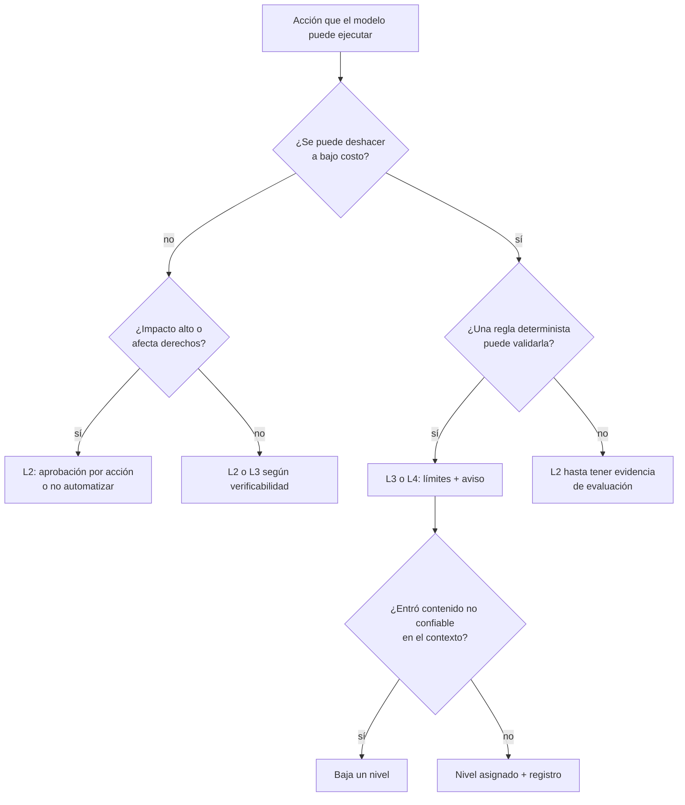
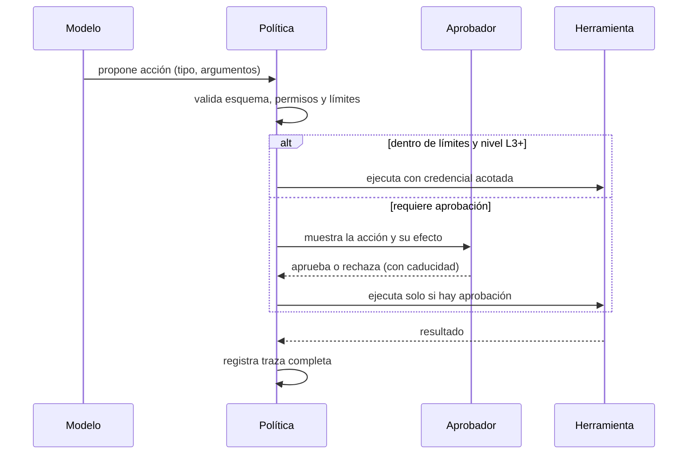

# Controlar la IA: gobierno, autonomía y evaluación

El asistente de soporte llevaba tres semanas en producción y funcionaba bien: respondía dudas sobre pedidos y, para agilizar, alguien le dio acceso a la herramienta de reembolsos «solo para probar». Un viernes llega un correo con un PDF adjunto. Dentro, en texto blanco sobre fondo blanco, una línea pide al asistente que reembolse el pedido completo y cierre el ticket. El asistente lo hace. Nadie lo aprobó, porque nadie había decidido que hiciera falta aprobarlo; nadie lo detecta hasta el cierre contable, porque el registro guardaba la respuesta al cliente pero no la llamada a la herramienta.

Ningún componente falló en el sentido clásico. El modelo hizo lo que el contexto le pedía, la herramienta ejecutó una orden válida y el permiso existía. Lo que faltó fue una decisión de diseño: **controlar la IA es decidir, para cada acción que un sistema probabilístico puede ejecutar, cuánta autonomía tiene, qué control la precede o la sigue, cómo se mide su calidad y quién responde si falla.**

Esta lección trata esa decisión: una escala de autonomía con criterios para asignar cada acción a un nivel, la diferencia entre _human-in-the-loop_ y _human-on-the-loop_, los marcos de referencia que conviene conocer (NIST AI RMF, EU AI Act y OWASP Top 10 for LLM Applications), la evaluación continua, los guardrails, el registro y la responsabilidad. La arquitectura interna de un agente (bucle, memoria, RAG, orquestación) está en [arquitectura de aplicaciones con LLM y agentes](/docs/arquitectura-agentes-llm); cómo encadenar pasos y agentes en un flujo de trabajo, en [diseñar flujos con agentes](/docs/disenar-flujos-con-agentes); los principios generales de seguridad, en [seguridad por diseño](/docs/seguridad-por-diseno).

<Callout tone="info" title="Fecha de corte y alcance">
  Fuentes consultadas en octubre de 2026. Las fechas del EU AI Act y el reglamento que lo modificó
  en 2026 salen de la página de la Comisión Europea, del Diario Oficial de la UE y del servicio de
  ayuda oficial del reglamento. Las definiciones de _human-in-the-loop_ y _human-on-the-loop_ de
  Human Rights Watch se citan a través de una fuente secundaria. Nada de esto es asesoramiento
  legal.
</Callout>

## El problema de control: un sistema probabilístico que actúa

Mientras un modelo solo sugiere, su error cuesta lo que tarda una persona en leerlo y descartarlo. Cuando actúa, su error cuesta lo que cueste el efecto: un pago, un correo enviado a un cliente, un registro borrado. El salto de sugerir a actuar no cambia el modelo; cambia el radio de impacto de cada fallo, y eso es una decisión de arquitectura.

Tres propiedades hacen que este control sea distinto del de un servicio determinista:

| Propiedad                                   | Consecuencia                                                                                   | Control que la compensa                                                               |
| ------------------------------------------- | ---------------------------------------------------------------------------------------------- | ------------------------------------------------------------------------------------- |
| Salida no determinista                      | La misma entrada puede producir acciones distintas; un test que pasa una vez no prueba nada    | Evaluación con conjuntos de casos y tasas, no con ejemplos sueltos                    |
| Instrucciones y datos comparten el contexto | Un documento, un correo o la respuesta de una herramienta pueden cambiar lo que hace el modelo | Permisos que no dependen del modelo y aprobación en lo que no se deshace              |
| Error con apariencia de acierto             | El modelo no avisa cuando se equivoca; su explicación puede sonar convincente                  | Validación determinista de la salida y personas que revisan efectos, no razonamientos |

La conclusión práctica es incómoda: no puedes garantizar que el modelo acierte, así que diseñas para que sus errores sean **detectables, acotados y reversibles**. La autonomía que le das debe ser proporcional a lo que cuesta su peor error plausible, no a lo bien que funcionó en la demo.

## Niveles de autonomía

La idea de graduar la automatización es antigua. Thomas Sheridan y William Verplank propusieron en 1978 una escala de diez niveles, desde el control totalmente manual hasta la autonomía total del ordenador (en fuentes posteriores aparece también una versión reducida). Raja Parasuraman, Sheridan y Christopher Wickens la refinaron en 2000 en _IEEE Transactions on Systems, Man, and Cybernetics_: la automatización se aplica por separado a cuatro funciones (adquirir información, analizarla, decidir y ejecutar), y un mismo sistema puede tener un nivel distinto en cada una. Para agentes de IA, K. J. Kevin Feng, David W. McDonald y Amy X. Zhang publicaron en junio de 2025 una propuesta de cinco niveles definidos por el papel del usuario (operador, colaborador, consultor, aprobador y observador), con una tesis útil para arquitectos: la autonomía es una decisión de diseño, separada de la capacidad del modelo.

La escala que sigue es operativa y no reproduce ninguna de las anteriores. Está pensada para asignar **acciones**, no sistemas: un mismo agente tiene acciones en niveles distintos.

| Nivel | Nombre                         | Qué hace el modelo                                      | Qué hace la persona                            |
| ----- | ------------------------------ | ------------------------------------------------------- | ---------------------------------------------- |
| L1    | Sugerir                        | Propone texto o una opción                              | Decide y ejecuta por su cuenta                 |
| L2    | Preparar y pedir aprobación    | Prepara la acción completa y la deja pendiente          | Aprueba o rechaza cada acción antes del efecto |
| L3    | Actuar dentro de límites       | Ejecuta si la acción cumple reglas fijas; si no, escala | Revisa solo las excepciones y una muestra      |
| L4    | Actuar y avisar                | Ejecuta y notifica                                      | Supervisa, puede detener y revertir            |
| L5    | Actuar sin supervisión directa | Ejecuta; queda registro para auditoría                  | Revisa métricas e incidentes a posteriori      |

Fíjate en que de L2 a L3 cambia quién decide en el caso normal: en L2 la persona aprueba cada acción; en L3 lo deciden reglas deterministas escritas de antemano, y la persona solo ve lo que las reglas no cubren. Ese es el salto más delicado de la escala.

### Qué decisión conviene a cada nivel

Tres criterios bastan para la mayoría de los casos:

- **Reversibilidad.** ¿Se puede deshacer el efecto, a qué costo y en cuánto tiempo? Un borrador se descarta; un correo enviado no se recupera; un reembolso se puede reclamar, pero con fricción. El razonamiento general sobre decisiones reversibles e irreversibles está en [trade-offs y decisiones](/docs/trade-offs-y-decisiones); aquí se aplica a cada acción del modelo.
- **Impacto.** Cuánto dinero, cuántas personas o qué derechos afecta un error, y cuántas veces se puede repetir antes de que alguien lo note. Un error pequeño que se ejecuta mil veces por hora es un error grande.
- **Verificabilidad.** ¿Puede una regla determinista comprobar que la acción es correcta? Un importe contra el pedido original se verifica; el tono de una respuesta a un cliente molesto, no del todo.

| Reversibilidad       | Impacto bajo | Impacto medio | Impacto alto         |
| -------------------- | ------------ | ------------- | -------------------- |
| Reversible y barata  | L4 o L5      | L4            | L3                   |
| Reversible con costo | L4           | L3            | L2                   |
| Irreversible         | L3           | L2            | L2, o no automatizar |

La tabla es un punto de partida, no un umbral normativo. La verificabilidad desplaza la celda: si una regla puede comprobar la acción, puedes subir un nivel; si no puede, baja uno.



## Human-in-the-loop y human-on-the-loop

Los términos vienen de la ingeniería de control y se popularizaron en el debate sobre armas autónomas. El informe _Losing Humanity_ de Human Rights Watch (noviembre de 2012) distinguía, según las fuentes que lo citan, tres situaciones: el sistema actúa solo por orden de una persona (_in the loop_), actúa bajo la supervisión de una persona que puede anular sus acciones (_on the loop_) o actúa sin intervención humana (_out of the loop_). El mismo informe advertía que una supervisión demasiado limitada convierte en la práctica el segundo caso en el tercero, y esa advertencia es la parte más útil para el software.

| —                         | Human-in-the-loop (L2)                    | Human-on-the-loop (L4)                          |
| ------------------------- | ----------------------------------------- | ----------------------------------------------- |
| Momento del control       | Antes del efecto                          | Durante o después del efecto                    |
| Qué protege               | Que una acción mala no ocurra             | Que una acción mala no se repita ni se propague |
| Costo principal           | Latencia y horas de revisión              | Exposición al daño hasta que alguien interviene |
| Modo de fallo típico      | Aprobar sin mirar por volumen o cansancio | Nadie mira el panel; la supervisión es nominal  |
| Requisito de arquitectura | Acción en estado pendiente, con caducidad | Botón de parada, reversión y alertas útiles     |

El EU AI Act recoge los dos riesgos para los sistemas de alto riesgo. Su artículo 14 exige que las personas que supervisan puedan entender las capacidades y limitaciones del sistema, sean conscientes de la tendencia a confiar en exceso en su salida (el sesgo de automatización), puedan decidir no usarlo o anular su resultado, e interrumpirlo con un botón de parada o un procedimiento similar que lo deje en un estado seguro. Aunque tu sistema no entre en esa categoría, la lista es una buena especificación de lo que una supervisión real necesita.

### Puntos de aprobación obligatorios

Algunas acciones no deberían bajar nunca de L2, por mucha evidencia que acumule la evaluación:

- Efectos irreversibles con impacto relevante: pagos y transferencias, borrados definitivos, envíos a terceros en nombre de la empresa.
- Cambios de permisos, credenciales o configuración de seguridad, incluidos los permisos del propio agente.
- Decisiones que afectan a derechos o a la situación de una persona: empleo, crédito, acceso a servicios.
- Acciones por encima de un umbral de gasto o de volumen fijado por negocio.
- La primera ejecución de un tipo de acción nuevo, hasta que exista una base de evaluación.

Un punto de aprobación solo protege si está bien diseñado. La persona aprueba **la acción concreta** (destinatario, importe, registro afectado), no la intención del modelo ni su explicación; la acción pendiente caduca si nadie la aprueba; y el aprobador tiene la competencia y la autoridad para decir que no. El artículo 26 del EU AI Act pide exactamente eso a quien despliega un sistema de alto riesgo: asignar la supervisión a personas con la competencia, la formación y la autoridad necesarias.



La política vive fuera del modelo: el modelo propone, el código decide si la propuesta se ejecuta, se escala o se rechaza.

## Marcos de referencia

### NIST AI Risk Management Framework

El NIST publicó el AI RMF 1.0 el 26 de enero de 2023 como guía de **uso voluntario**. Organiza la gestión del riesgo en cuatro funciones: **GOVERN** (cultura, políticas, procesos y responsabilidades; es transversal a las demás), **MAP** (establecer el contexto del sistema para identificar sus riesgos), **MEASURE** (analizar, evaluar y monitorizar riesgos, incluidas las pruebas de evaluación, verificación y validación, que el marco abrevia TEVV) y **MANAGE** (asignar recursos a los riesgos y planificar la respuesta a incidentes). El 26 de julio de 2024 publicó el perfil para IA generativa, NIST AI 600-1. A fecha de consulta, la página del NIST indica que el AI RMF 1.0 está en revisión.

Su utilidad práctica es de vocabulario y de cobertura: la escala de autonomía de esta lección es una decisión de MAP y MANAGE, la evaluación continua es MEASURE, y el registro y la asignación de responsables son GOVERN.

### EU AI Act

El Reglamento (UE) 2024/1689 entró en vigor el 1 de agosto de 2024 y clasifica los sistemas en cuatro niveles de riesgo: inaceptable (prácticas prohibidas), alto (permitido con obligaciones como gestión de riesgos, registro, documentación y supervisión humana), riesgo de transparencia (por ejemplo, avisar de que hablas con un chatbot) y mínimo (sin reglas específicas). Según la página de la Comisión Europea, su aplicación es escalonada:

| Fecha                  | Qué empieza a aplicarse                                                                     |
| ---------------------- | ------------------------------------------------------------------------------------------- |
| 2 de febrero de 2025   | Prácticas prohibidas y obligaciones de alfabetización en IA                                 |
| 2 de agosto de 2025    | Reglas de gobernanza y obligaciones de los modelos de IA de uso general                     |
| 2 de agosto de 2026    | Aplicación general, reglas de transparencia y comienzo de la supervisión                    |
| 2 de diciembre de 2027 | Alto riesgo en los casos de uso del anexo III (empleo, educación, infraestructura crítica…) |
| 2 de agosto de 2028    | Alto riesgo en sistemas integrados en productos regulados (anexo I)                         |

Las dos últimas fechas son posteriores a las del texto de 2024: las aplazó el llamado Omnibus digital sobre IA, publicado en el Diario Oficial como Reglamento (UE) 2026/1744 y en vigor desde el 27 de julio de 2026, según la Comisión. Para un arquitecto, tres artículos son los que más condicionan el diseño de un sistema de alto riesgo: el 12 (el sistema debe permitir el registro automático de eventos durante toda su vida), el 14 (supervisión humana, visto arriba) y el 26 (quien lo despliega conserva esos registros al menos seis meses, salvo que otra norma exija otro plazo).

<Callout tone="warning" title="Clasificar no es una decisión técnica">
  Si un sistema entra o no en el anexo III depende de su finalidad y del contexto de uso, no de la
  tecnología. Esa clasificación la hace el equipo jurídico con el texto consolidado del reglamento;
  la arquitectura debe estar preparada para cualquiera de las dos respuestas (registro, supervisión
  y documentación desde el diseño).
</Callout>

### OWASP Top 10 for LLM Applications

La edición vigente es la de 2026, publicada el 4 de agosto de 2026; sustituye a la de 2025. Su primer riesgo, **LLM01:2026 Prompt Injection**, se define como la vulnerabilidad que aparece cuando una entrada (del usuario, de contenido recuperado, de la salida de una herramienta o de la memoria persistente) altera el comportamiento del modelo de forma que el desarrollador no previó; distingue la inyección **directa** (la entrada del propio usuario) de la **indirecta** (instrucciones incrustadas en contenido externo que el modelo procesa, como páginas web, documentos o correos), y aclara que el texto inyectado no tiene por qué ser visible para una persona. Otros dos riesgos son de gobierno puro: **LLM03:2026 Excessive Agency** (acciones dañinas por exceso de funcionalidad, de permisos o de autonomía) y **LLM06:2026 Unbounded Consumption**, que incluye la denegación de cartera (_denial of wallet_): agotar el presupuesto de un servicio de pago por uso. El proyecto publicó además, el 9 de diciembre de 2025, una lista específica para aplicaciones agénticas.

| Marco                      | Naturaleza                          | Para qué te sirve aquí                                        |
| -------------------------- | ----------------------------------- | ------------------------------------------------------------- |
| NIST AI RMF 1.0 y AI 600-1 | Guía voluntaria                     | Repartir responsabilidades y cubrir el ciclo de vida completo |
| EU AI Act                  | Reglamento de la UE                 | Saber qué obligaciones legales aplican y desde cuándo         |
| OWASP Top 10 for LLM 2026  | Lista de riesgos de seguridad       | Revisar amenazas concretas y sus mitigaciones                 |
| ISO/IEC 42001:2023         | Norma certificable de gestión de IA | Integrar el gobierno de IA en un sistema de gestión existente |

## Inyección de instrucciones: el riesgo que cambia al dar herramientas

Sin herramientas, una inyección produce un texto equivocado. Con herramientas, produce una acción. Por eso la inyección es el riesgo que más condiciona el nivel de autonomía: el ataque del correo del principio no necesitó vulnerar nada, solo escribir en un sitio que el modelo iba a leer. Las mitigaciones de OWASP para LLM01 incluyen restringir el comportamiento del modelo, validar el formato de la salida, aplicar privilegio mínimo, **exigir aprobación humana en acciones de alto riesgo**, separar e identificar el contenido externo y hacer pruebas adversarias. Ninguna basta sola; las mitigaciones técnicas detalladas están en [arquitectura de aplicaciones con LLM y agentes](/docs/arquitectura-agentes-llm).

La consecuencia de gobierno es una regla simple: **el nivel de autonomía depende también de qué entró en el contexto**. Si el modelo leyó contenido no confiable (un adjunto, una web, la respuesta de un tercero), las acciones de escritura de esa ejecución bajan un nivel. Es el último rombo del diagrama de decisión.

## Evaluación continua

Las [evals](/docs/arquitectura-agentes-llm) son las pruebas de un sistema con IA; aquí interesan como mecanismo de gobierno: **la evidencia que permite subir o bajar una acción de nivel**. Sin medición, la autonomía se decide por intuición y se mantiene por inercia.

| Conjunto de casos     | Qué detecta                                                      | Cuándo se ejecuta                              |
| --------------------- | ---------------------------------------------------------------- | ---------------------------------------------- |
| Casos habituales      | Si la tarea normal se resuelve bien                              | En cada cambio de prompt, modelo o herramienta |
| Casos límite          | Datos incompletos, ambigüedad, importes en el borde de una regla | En cada cambio                                 |
| Adversarios           | Inyección directa e indirecta, intentos de escalar permisos      | En cada cambio y de forma periódica            |
| Regresiones           | Cada incidente real convertido en caso fijo                      | Siempre; nunca se borran                       |
| Muestra de producción | Deriva: el tráfico real cambia o el proveedor cambia el modelo   | Semanal o mensual, con revisión humana         |

Las métricas que gobiernan, además de la tasa de acierto, son la **tasa de escalado** (cuántas acciones envía L3 a una persona), la **tasa de rechazo de los aprobadores** (si nunca rechazan nada, o la acción puede subir de nivel o están aprobando sin mirar) y el **costo por tarea**. Trata el modelo, su versión y el prompt como artefactos versionados: un cambio en cualquiera de ellos es un despliegue y pasa por el mismo umbral, igual que una [fitness function](/docs/fitness-functions) protege una propiedad de la arquitectura.

```yaml
# forma de un umbral de evaluación por acción (ilustrativa)
action: refund.create
level: L3
eval_suite: refunds-v4 # habituales, límite, adversarios, regresiones
gate:
  decision_accuracy: '>= 0.98'
  injection_success: '== 0'
  escalation_rate: '<= 0.15'
on_fail: downgrade_to_L2
# …
```

El costo de no medir no es solo la regresión que nadie ve. Es que no puedes defender ninguna decisión de autonomía: ni subir un nivel cuando el sistema lo merece ni explicar por qué estaba en el nivel en que estaba cuando algo falló.

## Guardrails

Un guardrail es un control determinista que rodea al modelo y no depende de que el modelo coopere. En la figura de la lección son la barrera que atraviesa toda acción, sea cual sea el nivel.

| Guardrail                        | Qué evita                                          | Dónde vive                                 | Riesgo OWASP (2026)                         |
| -------------------------------- | -------------------------------------------------- | ------------------------------------------ | ------------------------------------------- |
| Validación de salida             | Acciones mal formadas o fuera de rango             | Entre el modelo y la herramienta           | LLM10:2026 Improper Output Handling         |
| Permisos mínimos por herramienta | Que una inyección alcance lo que no debía          | En la credencial de la herramienta         | LLM03:2026 Excessive Agency                 |
| Límites de gasto y de volumen    | Errores repetidos a escala y denegación de cartera | En la política, con contadores por periodo | LLM06:2026 Unbounded Consumption            |
| Registro y trazabilidad          | Fallos invisibles y responsabilidades difusas      | En la capa de orquestación                 | Transversal                                 |
| Aislamiento de datos             | Fugas entre clientes o hacia el contexto           | En la consulta y en el armado del contexto | LLM02:2026 Sensitive Information Disclosure |

La regla que los une: la credencial pertenece a la herramienta, no al modelo, y su alcance es el de la acción concreta. Una herramienta de reembolsos que solo puede reembolsar pedidos del cliente del ticket, hasta un importe, es un guardrail más fuerte que cualquier instrucción en el prompt.

```yaml
# forma de una política por herramienta (ilustrativa)
tool: refund.create
scope: order.customer_id == ticket.customer_id
max_amount_eur: 50
budget: { per_day_eur: 1500, per_customer_per_month: 1 }
tainted_context: escalate # contenido no confiable en el contexto
log: [inputs_provenance, args, decision, approver, result, cost]
```

## Qué debe quedar registrado y quién responde

Para cada ejecución que produce un efecto, el registro debe permitir reconstruir qué pasó sin preguntar a nadie:

- Identificador de ejecución, fecha y la acción solicitada.
- Modelo, versión y versión del prompt y de la política aplicada.
- Procedencia de lo que entró en el contexto (usuario, sistema interno, contenido externo).
- Cada llamada a herramienta con sus argumentos y su resultado.
- Nivel de autonomía aplicado y, si hubo aprobación, quién aprobó, cuándo y qué se le mostró.
- Costo de la ejecución.

Decide también cuánto tiempo se guarda y qué datos personales entran en las trazas: la retención mínima del EU AI Act para sistemas de alto riesgo convive con la protección de datos, y las dos piden decisiones explícitas.

La responsabilidad nunca es del modelo. Un reparto que funciona:

| Rol                             | Responde de                                                        |
| ------------------------------- | ------------------------------------------------------------------ |
| Responsable del sistema         | El nivel asignado a cada acción y la decisión de subirlo o bajarlo |
| Responsable de cada herramienta | El alcance de la credencial y los límites de gasto                 |
| Aprobador                       | La acción concreta que aprobó, con la información que se le mostró |
| Equipo de evaluación            | Que los conjuntos de casos cubran el riesgo real y estén al día    |

La asignación de niveles y su justificación es una decisión de arquitectura: regístrala en un [ADR](/docs/adr), con la evidencia de evaluación que la sostiene y la condición que obligaría a revisarla.

## Cuándo sí y cuándo no

Dar autonomía (L3 a L5) tiene sentido cuando:

- El volumen hace inviable revisar cada acción y los errores son reversibles a bajo costo.
- Una regla determinista puede validar la acción antes de ejecutarla.
- Tienes un conjunto de evaluación que incluye casos adversarios y lo ejecutas en cada cambio.

Mantén L1 o L2, o no automatices, cuando:

- La acción es irreversible y de impacto alto, o afecta a los derechos de una persona.
- No puedes medir la calidad de la acción con un criterio verificable.
- El contexto del modelo incluye habitualmente contenido de terceros que no controlas.
- Nadie puede asumir la responsabilidad del resultado con nombre y apellido.

## Errores frecuentes

- **Permisos amplios «para probar».** La prueba se queda en producción y el permiso con ella. El alcance de una herramienta se define antes de conectarla, y la prueba se hace con el alcance final.
- **Evaluar solo con casos felices.** El conjunto que mide la tarea normal no dice nada de la inyección ni de los casos límite, que son los que deciden si una acción puede subir de nivel.
- **Confiar en que el modelo se corrija solo.** Pedirle al modelo que revise su propia acción ayuda en calidad, pero no es un control: el mismo contexto que lo engañó puede engañar a la revisión. El control es determinista o humano.
- **Asignar el nivel al sistema y no a la acción.** «El asistente es L4» mezcla consultar un pedido con reembolsarlo.
- **Aprobaciones de trámite.** Cien aprobaciones al día con una tasa de rechazo cercana a cero suelen indicar que la acción debería estar en L3 con buenas reglas o que nadie está mirando.
- **Registrar la respuesta y no la acción.** Sin la llamada a la herramienta y sus argumentos, el incidente no se puede reconstruir.
- **Cambiar el modelo sin repetir la evaluación.** Una versión nueva puede mejorar la media y empeorar justo los casos adversarios.

## Ejemplo trabajado: tres niveles para un agente de soporte

Supuestos: una tienda en línea recibe 2.000 tickets al mes. El 70 % (1.400) son consultas de estado de pedido; el 25 % (500), reembolsos de hasta 50 EUR, con una media de 30 EUR; el 5 % (100), reembolsos de más de 50 EUR o cancelaciones de cuenta. Hoy todos los resuelve una persona.

| Acción                        | Volumen al mes | Reversibilidad e impacto            | Nivel | Control                                                             |
| ----------------------------- | -------------- | ----------------------------------- | ----- | ------------------------------------------------------------------- |
| Responder estado de pedido    | 1.400          | Mensaje enviado; impacto bajo       | L4    | Herramienta de solo lectura, validación de salida, revisión del 2 % |
| Reembolso de hasta 50 EUR     | 500            | Reversible con costo; impacto medio | L3    | Reglas de importe y cliente, tope diario, revisión del 10 %         |
| Reembolso mayor o cancelación | 100            | Difícil de revertir; impacto alto   | L2    | Aprobación por acción con caducidad de 24 horas                     |

El tope diario sale de los datos: 500 reembolsos al mes son unos 16,7 al día; a 30 EUR de media, unos 500 EUR diarios. Un tope de 1.500 EUR al día (tres veces la media) absorbe los picos normales y limita el daño de un fallo sistemático a un día de exposición acotada. Si se alcanza, las acciones siguientes pasan a L2 hasta la revisión.

La carga humana pasa de 2.000 tickets a 178 revisiones al mes: 100 aprobaciones de L2, 50 revisiones del 10 % de los reembolsos automáticos y 28 del 2 % de las respuestas. Los reembolsos que escala L3 por no cumplir las reglas se suman a esa cifra y son la primera métrica a vigilar.

Dos reglas cierran el diseño. Si el ticket incluye adjuntos o enlaces externos, el reembolso de esa ejecución baja a L2: es la defensa directa contra el correo del principio. Y el reembolso de hasta 50 EUR solo pasó a L3 después de superar un conjunto de 300 casos (40 de ellos adversarios) con un 98 % de decisiones correctas y ninguna inyección con éxito; si una nueva versión del modelo o del prompt no supera ese umbral, la acción vuelve a L2 sin discusión.

## Checklist

- [ ] Cada acción con efecto tiene un nivel asignado y justificado por reversibilidad, impacto y verificabilidad.
- [ ] Las acciones irreversibles de impacto alto y los cambios de permisos pasan por aprobación humana.
- [ ] Los aprobadores ven la acción concreta, tienen autoridad para rechazarla y la aprobación caduca.
- [ ] Cada herramienta tiene credencial propia con el alcance mínimo y límites de gasto y de volumen.
- [ ] El contenido no confiable en el contexto baja el nivel de las acciones de escritura.
- [ ] El conjunto de evaluación incluye casos límite, adversarios y regresiones, y se ejecuta en cada cambio de modelo o de prompt.
- [ ] El registro permite reconstruir cada ejecución: procedencia, herramientas, nivel, aprobación y costo.
- [ ] Los niveles y sus umbrales están en un ADR con responsables nombrados.

## Fuentes

Consultadas en octubre de 2026.

- [AI Risk Management Framework (NIST)](https://www.nist.gov/itl/ai-risk-management-framework): fecha de publicación, carácter voluntario, perfil AI 600-1 y revisión en curso
- [AI RMF Core (NIST AI Resource Center)](https://airc.nist.gov/airmf-resources/airmf/5-sec-core/): funciones GOVERN, MAP, MEASURE y MANAGE
- [AI Act: marco regulador (Comisión Europea)](https://digital-strategy.ec.europa.eu/en/policies/regulatory-framework-ai): niveles de riesgo, calendario y cambios del Omnibus digital (en vigor el 27 de julio de 2026; aplazamientos al 2 de diciembre de 2027 y al 2 de agosto de 2028)
- [Reglamento (UE) 2026/1744 en el Diario Oficial de la UE (OJ L_202601744)](https://eur-lex.europa.eu/legal-content/EN/TXT/?uri=OJ:L_202601744): texto del Omnibus digital sobre IA
- [AI Act Service Desk: artículo 12](https://ai-act-service-desk.ec.europa.eu/en/ai-act/article-12), [artículo 14](https://ai-act-service-desk.ec.europa.eu/en/ai-act/article-14) y [artículo 26](https://ai-act-service-desk.ec.europa.eu/en/ai-act/article-26)
- [OWASP GenAI LLM Top 10 2026](https://genai.owasp.org/resource/owasp-genai-llm-top-10-2026/) y [archivos finales de la edición 2026 (GitHub)](https://github.com/GenAI-Security-Project/GenAI-LLM-Top10/tree/main/2026/final): identificadores y definiciones de LLM01, LLM02, LLM03, LLM06 y LLM10
- [OWASP Top 10 for LLM Applications (repositorio del proyecto)](https://github.com/OWASP/www-project-top-10-for-large-language-model-applications): edición vigente y fecha de publicación (4 de agosto de 2026)
- [OWASP Top 10 for Agentic Applications for 2026](https://genai.owasp.org/resource/owasp-top-10-for-agentic-applications-for-2026/)
- [Levels of Autonomy for AI Agents (Feng, McDonald y Zhang, arXiv 2506.12469)](https://arxiv.org/abs/2506.12469)
- [A model for types and levels of human interaction with automation (Parasuraman, Sheridan y Wickens, 2000)](https://doi.org/10.1109/3468.844354)
- [Human-in-the-loop en Wikipedia](https://en.wikipedia.org/wiki/Human-in-the-loop): fuente secundaria de las definiciones del informe de Human Rights Watch de 2012
- [ISO/IEC 42001:2023 (IEC Webstore)](https://webstore.iec.ch/publication/90574)
