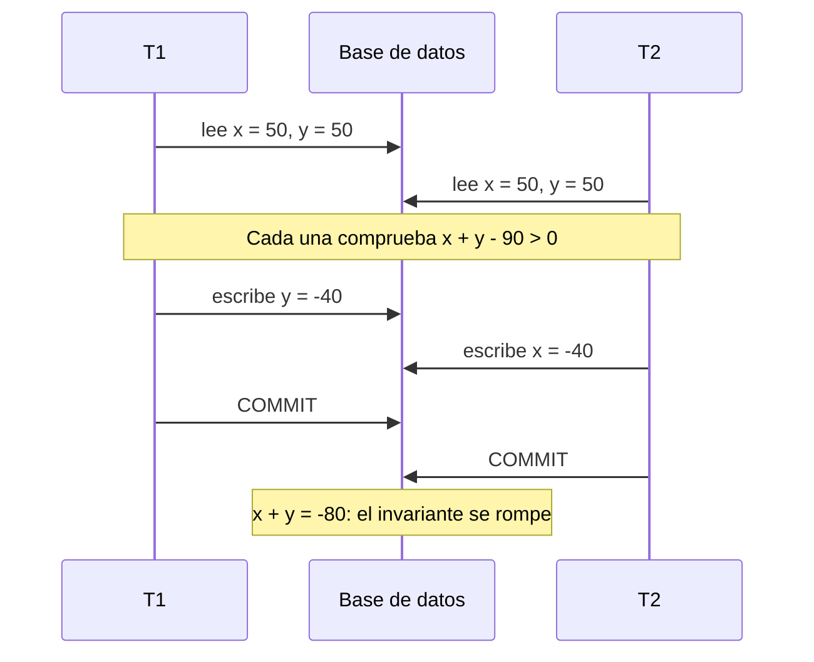
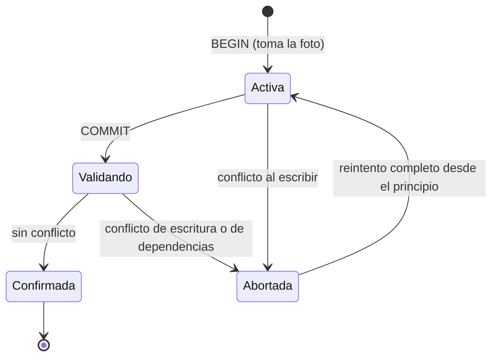
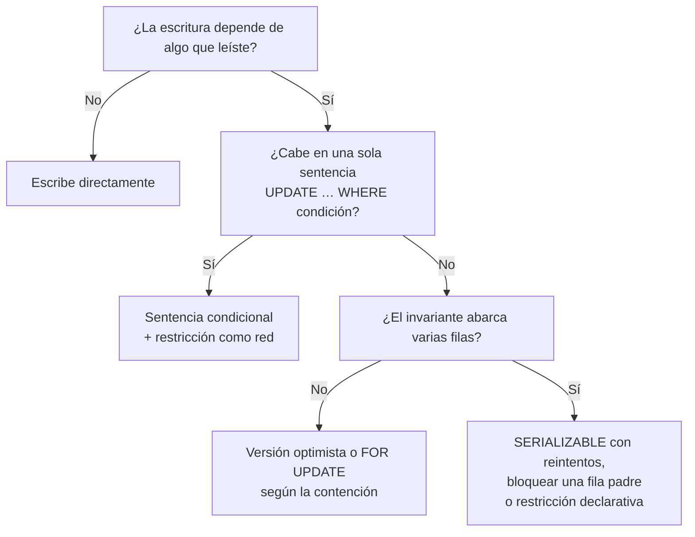

# Datos, ACID y niveles de aislamiento

Una cuenta tiene 100 de saldo. Dos peticiones llegan casi a la vez: una retira 10 y otra retira 20. Cada una lee el saldo, resta en memoria y guarda el resultado. Las dos leyeron 100, así que una escribe 80 y la otra 90. El saldo final es 90 cuando debería ser 70. No hubo excepción, no hubo un registro de error, cada transacción hizo `COMMIT` y los tests unitarios pasan. El sistema simplemente perdió una escritura.

Este artículo trata de por qué pasa eso y de cómo decidir qué protección necesitas. La idea central cabe en una frase: **una transacción es una unidad de trabajo que la base de datos ejecuta como indivisible, y el nivel de aislamiento decide cuánto la protege de las demás transacciones que corren a la vez**. El «cuánto» casi nunca es «del todo» por defecto, y saberlo es parte del trabajo de quien diseña el sistema.

El recorrido empieza antes de las tablas, con el modelo de datos, porque de él salen las reglas que una transacción debe preservar. Después vienen ACID, las anomalías de concurrencia, los niveles de aislamiento del estándar y su crítica, MVCC, los bloqueos y los índices. Lo que queda fuera tiene su propio artículo: la consistencia entre réplicas en [CAP, PACELC y consistencia](/docs/cap-pacelc), las operaciones que cruzan varios servicios en [sagas, outbox e idempotencia](/docs/sagas-outbox-idempotencia) y las cachés en [caché, colas y streaming](/docs/caching-colas-streaming).

<Callout tone="info" title="Fecha de corte y alcance">
  Fuentes consultadas en octubre de 2026. El comportamiento de PostgreSQL sale de su documentación
  18; el de MySQL, del manual 8.4 de InnoDB; el de SQL Server, de Microsoft Learn. De otros motores
  no afirmo nada: consulta su documentación antes de suponer que se comportan igual.
</Callout>

## Modelar datos antes que tablas

Un esquema es la última decisión del modelado, no la primera. Antes de escribir `CREATE TABLE` conviene tener claro qué cosas existen en el dominio, cómo se identifican, cómo se relacionan y qué reglas deben cumplirse siempre. Esas reglas, los **invariantes**, son las que más adelante decidirán dónde empieza y termina una transacción y qué nivel de aislamiento necesitas.

Dos trabajos fundaron este vocabulario. Edgar F. Codd publicó en 1970 «A Relational Model of Data for Large Shared Data Banks», donde propuso el modelo relacional e introdujo una forma normal para las relaciones. Peter Chen presentó en 1976, en _ACM Transactions on Database Systems_, el modelo entidad-relación y su técnica de diagramas para diseñar bases de datos.

### Entidades, claves y cardinalidad

- **Entidad.** Algo con identidad propia que el negocio necesita recordar: un cliente, un pedido, una cuenta. Si dos registros con los mismos atributos deben distinguirse, tienes una entidad.
- **Clave.** Lo que identifica una entidad sin ambigüedad. Una clave natural sale del dominio (un número de documento); una clave sustituta la genera el sistema. La natural expresa una regla de negocio, pero cambia cuando el negocio cambia; la sustituta es estable, pero no impide duplicados por sí sola. Lo habitual es usar una sustituta como identificador y declarar la natural como `UNIQUE`.
- **Cardinalidad.** Cuántas instancias de un lado se relacionan con cuántas del otro: uno a uno, uno a muchos, muchos a muchos. Una relación de muchos a muchos casi siempre esconde una entidad propia (una inscripción, una línea de pedido) con atributos que nadie había nombrado.

El paso que más se omite es escribir los invariantes en lenguaje del negocio: «el saldo no puede ser negativo», «un correo pertenece a un solo usuario», «un pedido tiene al menos una línea». Para cada uno, pregunta si la base de datos puede hacerlo cumplir con una restricción declarativa o si depende de la lógica de varias filas. La respuesta cambia todo lo que viene después.

### Normalizar o desnormalizar

Normalizar es guardar cada hecho en un solo lugar. Desnormalizar es copiar un hecho en varios sitios para que una lectura concreta no tenga que reunirlo. No es una cuestión de pureza, sino de **dónde quieres pagar**: al escribir o al leer.

| Criterio                      | Modelo normalizado                    | Modelo desnormalizado                        |
| ----------------------------- | ------------------------------------- | -------------------------------------------- |
| Coste de una escritura        | Una fila por hecho                    | Varias copias que actualizar                 |
| Coste de una lectura          | Reúne datos con `JOIN`                | Lee una fila o un documento                  |
| Riesgo de inconsistencia      | Bajo: el hecho existe una vez         | Alto si las copias no se actualizan juntas   |
| Quién protege los invariantes | Restricciones de la base de datos     | La aplicación o un proceso de sincronización |
| Encaja cuando                 | Las escrituras y la integridad mandan | Una lectura medida es crítica y estable      |

Desnormaliza a partir de una consulta concreta que mediste, no por anticipación. Y decide en el mismo momento cómo se mantendrá la copia: en la misma transacción, con un proceso asíncrono o con una vista materializada. Si la copia vive fuera de la base de datos, el problema pasa a ser de caché o de eventos, y lo tratan [caché, colas y streaming](/docs/caching-colas-streaming) y [event-driven, CQRS y event sourcing](/docs/event-driven-cqrs-event-sourcing).

## Transacciones y ACID

El acrónimo ACID aparece en «Principles of Transaction-Oriented Database Recovery», de Theo Haerder y Andreas Reuter, publicado en _ACM Computing Surveys_ en diciembre de 1983. El artículo enumera cuatro propiedades que debe tener una transacción para comportarse como una unidad indivisible (atomicidad, consistencia, aislamiento y durabilidad), las agrupa bajo las siglas y propone usar el soporte de transacciones como la «prueba ácida» de la calidad de un sistema. El concepto de transacción es anterior; lo que el artículo fija es el nombre.

| Propiedad    | Qué promete                                                                      | Qué no promete                                                           |
| ------------ | -------------------------------------------------------------------------------- | ------------------------------------------------------------------------ |
| Atomicidad   | Todo o nada: si la transacción aborta, sus efectos se deshacen                   | Que la lógica de la transacción sea correcta                             |
| Consistencia | Una transacción que termina bien deja la base en un estado que cumple las reglas | Que la base conozca tus reglas: solo hace cumplir las que declaraste     |
| Aislamiento  | Lo que hace una transacción queda oculto a las concurrentes                      | Aislamiento total: depende del nivel configurado, y el habitual no lo es |
| Durabilidad  | Lo confirmado sobrevive a fallos posteriores                                     | Que una réplica asíncrona ya lo tenga                                    |

Dos matices que conviene interiorizar:

- **La C es de la aplicación.** Haerder y Reuter la definen así: una transacción que llega a su fin normal solo confirma resultados legales. La base de datos ayuda con restricciones (`NOT NULL`, `UNIQUE`, `CHECK`, claves foráneas), pero un invariante que no declaraste solo se cumple si cada transacción lo respeta.
- **La I es la que más se negocia.** Las otras tres se suelen tratar como garantías fijas, aunque la durabilidad también se ajusta: en PostgreSQL, `synchronous_commit = off` confirma antes de escribir el registro en disco y una caída puede perder las últimas transacciones confirmadas, sin dejar la base inconsistente. El aislamiento, en cambio, viene en grados explícitos, y el grado por defecto de la mayoría de los motores permite anomalías. Tampoco es la C de CAP: esa diferencia la explica [CAP, PACELC y consistencia](/docs/cap-pacelc).

## Anomalías de concurrencia

Una anomalía es un resultado que no podría producirse si las transacciones se hubieran ejecutado una detrás de otra. La notación de Berenson y sus coautores (1995) las describe como historias: `r1[x]` es «la transacción 1 lee x», `w2[x]` es «la transacción 2 escribe x», y `c1` y `a1` son su confirmación y su aborto.

| Anomalía                   | Historia típica                         | Qué ves                                                     |
| -------------------------- | --------------------------------------- | ----------------------------------------------------------- |
| Lectura sucia (P1)         | `w1[x] … r2[x] … (a1 o c1)`             | Lees un valor que quizá nunca se confirme                   |
| Lectura no repetible (A2)  | `r1[x] … w2[x] … c2 … r1[x] … c1`       | La misma fila cambia entre dos lecturas                     |
| Fantasma (A3)              | `r1[P] … w2[y en P] … c2 … r1[P] … c1`  | La misma consulta devuelve otro conjunto de filas           |
| Actualización perdida (P4) | `r1[x] … w2[x] … w1[x] … c1`            | Una escritura pisa otra hecha a partir de una lectura vieja |
| Write skew (A5B)           | `r1[x] … r2[y] … w1[y] … w2[x] … c1 c2` | Cada transacción es correcta y juntas rompen un invariante  |

A2 y A3 son las interpretaciones estrictas del artículo: describen la anomalía ya consumada, con la segunda lectura. Sus formas amplias, P2 y P3, terminan en `((c1 o a1) y (c2 o a2) en cualquier orden)`: basta que otra transacción escriba lo que T1 leyó antes de que T1 termine.

### Lectura sucia

Una transacción lee lo que otra escribió y aún no confirmó. Si la segunda aborta, la primera tomó una decisión con un dato que nunca existió. Es la anomalía más obvia y la que casi ningún motor permite en su nivel por defecto.

### Lectura no repetible y fantasma

En la lectura no repetible, una fila que ya leíste cambia porque otra transacción la modificó y confirmó. En el fantasma no cambia una fila concreta, sino el **conjunto** que cumple una condición: otra transacción inserta o borra filas y tu `SELECT … WHERE` devuelve algo distinto la segunda vez. La diferencia importa porque bloquear las filas que leíste no impide que aparezcan filas nuevas.

### Actualización perdida

Es el caso del saldo de la introducción y el de la figura de este artículo: dos transacciones leen el mismo valor, calculan en memoria y escriben; la última escritura borra la otra. El patrón que la provoca es tan común que tiene nombre propio: **leer, modificar y escribir** sin que la base de datos sepa que la escritura depende de la lectura.

### Write skew

Es la anomalía más sutil porque ninguna transacción pisa a la otra: escriben filas distintas. Berenson y sus coautores la ilustran con dos datos, x e y, sujetos a la restricción de que x + y debe seguir siendo positivo, como dos cuentas cuya suma no puede caer por debajo de cero:



Ninguna comprobación individual falló. El invariante abarca varias filas y cada transacción lo validó sobre una foto que la otra estaba a punto de invalidar.

## Niveles de aislamiento: el estándar y su crítica

El estándar SQL de 1992 define cuatro niveles (`READ UNCOMMITTED`, `READ COMMITTED`, `REPEATABLE READ` y `SERIALIZABLE`) según qué fenómenos impiden de los tres que nombra: lectura sucia, lectura no repetible y fantasma. En el texto del borrador de julio de 1992 el nivel por defecto es `SERIALIZABLE`, y una ejecución serializable se define como la que produce el mismo efecto que alguna ejecución en serie de esas transacciones.

| Nivel (SQL-92)     | Lectura sucia | No repetible | Fantasma   |
| ------------------ | ------------- | ------------ | ---------- |
| `READ UNCOMMITTED` | Posible       | Posible      | Posible    |
| `READ COMMITTED`   | No posible    | Posible      | Posible    |
| `REPEATABLE READ`  | No posible    | No posible   | Posible    |
| `SERIALIZABLE`     | No posible    | No posible   | No posible |

En 1995, Hal Berenson, Phil Bernstein, Jim Gray, Jim Melton, Elizabeth O'Neil y Patrick O'Neil publicaron en SIGMOD «A Critique of ANSI SQL Isolation Levels». Su tesis: los tres fenómenos son ambiguos e, incluso en su interpretación más amplia, no excluyen comportamientos anómalos; además, no caracterizan bien los niveles basados en bloqueos que implementan los motores comerciales. Proponen definiciones más estrictas, añaden fenómenos nuevos (escritura sucia, actualización perdida, read skew, write skew) y definen formalmente el **snapshot isolation**. Un detalle revelador: el texto de 1992 afirma que ningún nivel pierde actualizaciones, pero no define esa anomalía; el artículo la formaliza como P4 y muestra que `READ COMMITTED` implementado con bloqueos la permite.

Su tabla resumen, reducida a las columnas que más importan al diseñar:

| Nivel (Berenson et al.) | Lectura sucia | Act. perdida | No repetible | Fantasma | Write skew |
| ----------------------- | ------------- | ------------ | ------------ | -------- | ---------- |
| `READ UNCOMMITTED`      | Posible       | Posible      | Posible      | Posible  | Posible    |
| `READ COMMITTED`        | No            | Posible      | Posible      | Posible  | Posible    |
| `REPEATABLE READ`       | No            | No           | No           | Posible  | No         |
| Snapshot isolation      | No            | No           | No           | A veces  | Posible    |
| `SERIALIZABLE`          | No            | No           | No           | No       | No         |

Observa las dos filas centrales: `REPEATABLE READ` (con bloqueos) y snapshot isolation no se pueden ordenar. Cada una impide algo que la otra permite. Por eso preguntar «¿qué nivel es más fuerte?» no basta; hay que preguntar **qué anomalía rompe tu invariante** y qué nivel concreto, en tu motor, la impide.

## Snapshot isolation y MVCC

Los motores con **MVCC** (control de concurrencia multiversión) guardan varias versiones de cada fila. Cada sentencia o cada transacción lee una foto coherente de los datos, aunque otras estén escribiendo. La documentación de PostgreSQL resume la ventaja así: leer nunca bloquea a escribir y escribir nunca bloquea a leer.

Snapshot isolation es el nivel que se obtiene cuando la foto se toma al inicio de la transacción y se añade una regla para las escrituras: si dos transacciones concurrentes modifican el mismo dato, solo puede confirmar la primera (Berenson et al. lo llaman _first-committer-wins_). Esa regla impide la actualización perdida. Lo que no impide es el write skew, porque las dos transacciones del ejemplo anterior escriben filas distintas y ninguna regla de escritura las ve en conflicto.

Para cerrar ese hueco existe el **serializable snapshot isolation** (SSI), descrito por Michael Cahill, Uwe Röhm y Alan Fekete en SIGMOD 2008: el motor sigue leyendo fotos, pero vigila las dependencias entre lecturas y escrituras de transacciones concurrentes y aborta una cuando detecta un patrón que podría producir una anomalía. PostgreSQL lo usa para `SERIALIZABLE` desde la versión 9.1, cuyas notas anuncian un nivel serializable «verdadero» y dejan el comportamiento anterior, la foto única, en `REPEATABLE READ`. Solo protege a las transacciones que corren en `SERIALIZABLE`. El precio es que **algunas transacciones fallan y deben reintentarse completas**.



## Qué hace tu motor por defecto

El estándar dice `SERIALIZABLE` por defecto; los motores más usados no lo hacen. Y el mismo nombre de nivel no garantiza lo mismo en todos ellos.

| Motor              | Nivel por defecto                                     | Lo que conviene saber                                                                                                                       |
| ------------------ | ----------------------------------------------------- | ------------------------------------------------------------------------------------------------------------------------------------------- |
| PostgreSQL 18      | `READ COMMITTED`                                      | `READ UNCOMMITTED` se comporta como `READ COMMITTED`; `REPEATABLE READ` es snapshot isolation y no permite fantasmas; `SERIALIZABLE` es SSI |
| MySQL 8.4 (InnoDB) | `REPEATABLE READ`                                     | Las lecturas sin bloqueo usan la foto de la primera lectura; las lecturas con bloqueo ven otro estado                                       |
| SQL Server         | `READ COMMITTED` con bloqueos compartidos             | Con `READ_COMMITTED_SNAPSHOT` activo usa versiones de fila; `SNAPSHOT` exige `ALLOW_SNAPSHOT_ISOLATION`                                     |
| Azure SQL Database | `READ COMMITTED` con `READ_COMMITTED_SNAPSHOT` activo | Mismo nombre que en SQL Server, comportamiento de lectura distinto                                                                          |

Dos comportamientos de PostgreSQL en `READ COMMITTED` explican muchos incidentes. Primero, un `UPDATE` que encuentra la fila modificada por otra transacción en curso espera a que termine y vuelve a evaluar su `WHERE` sobre la versión nueva; por eso `UPDATE cuenta SET saldo = saldo - 10` en una sola sentencia no pierde actualizaciones, y leer el saldo en la aplicación para escribirlo después sí. Segundo, en `REPEATABLE READ` y `SERIALIZABLE` las transacciones pueden fallar por serialización (SQLSTATE `40001`) y la documentación pide que la aplicación las reintente desde el principio.

<Callout tone="warning" title="El nombre del nivel no es el contrato">
  `REPEATABLE READ` es snapshot isolation en PostgreSQL y otra cosa en InnoDB; `READ COMMITTED`
  bloquea lecturas en SQL Server y no en Azure SQL Database. Si migras de motor o de servicio,
  vuelve a comprobar qué anomalías permite el nivel que usas.
</Callout>

## Bloqueo pesimista frente a optimista

Cuando una operación lee y luego escribe en función de lo leído, tienes dos estrategias para no perder la escritura ajena.

El **bloqueo pesimista** asume que habrá conflicto y lo evita por adelantado. En PostgreSQL, `SELECT … FOR UPDATE` bloquea las filas leídas frente a modificaciones, borrados y otros bloqueos hasta que termina la transacción. Quien llega después espera. El riesgo es el interbloqueo: PostgreSQL lo detecta y aborta una de las transacciones, y su documentación recomienda adquirir los bloqueos siempre en el mismo orden.

El **control optimista** asume que el conflicto será raro y lo detecta al final. H. T. Kung y John T. Robinson lo formalizaron en 1981 (_ACM Transactions on Database Systems_): las transacciones no bloquean y, si al validar descubren un conflicto, se deshacen y se repiten. En una aplicación suele tomar la forma de una columna de versión y una escritura condicional. La versión HTTP de esa idea (`If-Match`, `412`) ya está en [CAP, PACELC y consistencia](/docs/cap-pacelc); aquí basta la forma en la base de datos:

```sql
-- forma de la escritura condicional, no una receta
UPDATE cuenta
   SET saldo = :saldo_nuevo, version = version + 1
 WHERE id = :id
   AND version = :version_leida;
-- 0 filas afectadas: otra transacción escribió antes → releer y decidir
```

| Criterio             | Pesimista (`FOR UPDATE`)                        | Optimista (versión)                                |
| -------------------- | ----------------------------------------------- | -------------------------------------------------- |
| Cuándo actúa         | Antes de escribir: bloquea al leer              | Al escribir: comprueba que nada cambió             |
| Coste sin contención | Bloqueos que nadie necesitaba                   | Casi nulo                                          |
| Coste con contención | Esperas e interbloqueos                         | Reintentos, quizá muchos                           |
| Abarca               | Una transacción de base de datos                | Puede abarcar varias peticiones (un formulario)    |
| Encaja cuando        | El conflicto es probable y el reintento es caro | El conflicto es raro o el usuario puede resolverlo |

Antes de elegir una de las dos, pregunta si hace falta leer primero. Muchas operaciones caben en **una sola sentencia condicional** que la base de datos ejecuta de forma atómica, sin bloqueos explícitos ni versiones:



## Índices: lectura rápida a cambio de escritura

Un índice es una decisión de rendimiento con coste explícito. La documentación de PostgreSQL lo dice sin rodeos: una vez creado, el sistema debe mantenerlo sincronizado con la tabla, lo que añade trabajo a cada operación de modificación, y los índices que casi no se usan deberían eliminarse. El planificador decide si usarlo según sus estadísticas, que `ANALYZE` mantiene al día.

- **Indexa consultas, no columnas.** Parte de las consultas reales y de su plan (`EXPLAIN`), no de la intuición sobre qué columna «se busca mucho».
- **Las claves foráneas no se indexan solas en PostgreSQL.** Su documentación aconseja indexar las columnas que referencian, porque borrar o actualizar la fila referenciada obliga a buscar en la tabla que la referencia.
- **Un índice único también es integridad.** En PostgreSQL, una restricción `UNIQUE` crea un índice B-tree único: además de acelerar búsquedas, es la forma correcta de garantizar que no haya duplicados bajo concurrencia.
- **Cada índice se paga en cada escritura.** En tablas con muchas inserciones, mide el efecto antes de añadir el quinto índice.

## Cuándo sí y cuándo no

Sube el nivel de aislamiento o usa bloqueos explícitos cuando:

- Un invariante abarca varias filas o tablas y no puedes expresarlo como restricción.
- La operación lee y luego escribe en función de lo leído y no cabe en una sentencia.
- El coste de una anomalía (dinero, stock, permisos) supera con claridad el de los reintentos.

No lo hagas cuando:

- Una restricción declarativa (`UNIQUE`, `CHECK`, clave foránea) ya hace cumplir la regla.
- La operación es una sola sentencia condicional que la base ejecuta de forma atómica.
- Son lecturas para informes que toleran una foto ligeramente antigua.
- La regla cruza servicios: ahí ninguna transacción local alcanza y necesitas [sagas, outbox e idempotencia](/docs/sagas-outbox-idempotencia).

## Errores frecuentes

- **Suponer serializabilidad por defecto.** El estándar la pone por defecto; PostgreSQL y SQL Server usan `READ COMMITTED` e InnoDB `REPEATABLE READ`. Si tu código asume que las transacciones se ejecutan como si fueran en serie, probablemente se equivoca.
- **Leer, modificar y escribir sin bloqueo.** Leer un valor, calcular en la aplicación y escribirlo es la receta de la actualización perdida. Usa una sentencia atómica, una versión o `FOR UPDATE`.
- **Validar solo en la aplicación.** Comprobar «no existe ese correo» y luego insertar deja una ventana en la que otra petición inserta el mismo. Una restricción `UNIQUE` cierra la ventana; la validación en la aplicación sirve para dar un buen mensaje, no para garantizar la regla.
- **Subir a `SERIALIZABLE` sin reintentos.** El nivel cumple su promesa abortando transacciones. Sin un mecanismo que reintente las que fallan con `40001`, solo cambias anomalías silenciosas por errores visibles.
- **Transacciones largas.** Mantener una transacción abierta mientras llamas a otro servicio alarga los bloqueos y las fotos; PostgreSQL incluso ofrece `idle_in_transaction_session_timeout` para cortar sesiones olvidadas.
- **Confiar en el nombre del nivel al cambiar de motor.** Ver el aviso de la sección anterior.
- **Índices «por si acaso».** Cada uno encarece las escrituras y ocupa espacio; si no aparece en ningún plan, sobra.

## Ejemplo trabajado: stock y límite de pedidos

Una tienda tiene dos reglas: el stock de un producto nunca es negativo y un cliente no puede tener más de tres pedidos pendientes. La base de datos es PostgreSQL con su nivel por defecto.

**Stock.** La regla vive en una sola fila. La decisión es una sentencia condicional que descuenta solo si queda suficiente, más una restricción `CHECK` como red de seguridad. No hace falta subir el aislamiento: si la sentencia afecta cero filas, no había stock y se informa al cliente.

**Límite de pedidos.** La regla abarca varias filas: contar los pendientes y, si hay menos de tres, insertar otro. Dos peticiones concurrentes cuentan dos, insertan una cada una y el cliente acaba con cuatro. Es un write skew con inserciones: un fantasma que rompe un invariante. Las opciones:

| Opción                                                      | Ventaja                                   | Coste                                                     |
| ----------------------------------------------------------- | ----------------------------------------- | --------------------------------------------------------- |
| `SERIALIZABLE` en todas las transacciones que crean pedidos | El motor detecta el conflicto             | Reintentos ante `40001`; hay que construirlos y probarlos |
| `FOR UPDATE` sobre la fila del cliente antes de contar      | Serializa solo los pedidos de ese cliente | Un bloqueo más; orden de bloqueo consistente              |
| Contador en la fila del cliente con `CHECK`                 | La regla pasa a ser de una fila           | Mantener el contador en cada alta y cada cierre           |

El equipo elige bloquear la fila del cliente: la contención por cliente es baja, el cambio es local y no obliga a reintentos en toda la aplicación. Lo registra en un [ADR](/docs/adr) junto con la alternativa de `SERIALIZABLE`, por si más reglas de varias filas aparecen y conviene generalizar.

## Checklist

- [ ] Los invariantes del dominio están escritos y cada uno sabe si lo protege una restricción o una transacción.
- [ ] Las reglas que pueden ser restricciones (`UNIQUE`, `CHECK`, claves foráneas) lo son.
- [ ] Sabes qué nivel de aislamiento usa por defecto tu motor y qué anomalías permite.
- [ ] Ninguna operación lee, calcula y escribe sin sentencia atómica, versión o bloqueo.
- [ ] Las transacciones en `REPEATABLE READ` o `SERIALIZABLE` tienen reintento ante `40001`.
- [ ] Las transacciones no incluyen llamadas de red ni esperas de usuario.
- [ ] Cada índice responde a una consulta medida y las claves foráneas que lo necesitan están indexadas.
- [ ] La desnormalización tiene un mecanismo explícito para mantener las copias.

## Fuentes

Consultadas en octubre de 2026.

- [Principles of Transaction-Oriented Database Recovery (Haerder y Reuter, _ACM Computing Surveys_ 15(4), diciembre de 1983)](https://doi.org/10.1145/289.291): origen del acrónimo ACID, leído en el texto completo
- [A Critique of ANSI SQL Isolation Levels (Berenson et al., SIGMOD 1995)](https://arxiv.org/abs/cs/0701157): fenómenos P0–P4, A5A, A5B, snapshot isolation y tabla 4
- [Borrador del estándar SQL-92 (julio de 1992)](https://www.contrib.andrew.cmu.edu/~shadow/sql/sql1992.txt): niveles, fenómenos P1–P3 y nivel por defecto
- [A Relational Model of Data for Large Shared Data Banks (Codd, 1970)](https://courses.cs.washington.edu/courses/cse544/02sp/papers/codd70.pdf)
- [The Entity-Relationship Model: Toward a Unified View of Data (Chen, 1976)](https://www.comp.nus.edu.sg/~lingtw/papers/tods76.chen.pdf)
- [On Optimistic Methods for Concurrency Control (Kung y Robinson, 1981)](https://www.eecs.harvard.edu/~htk/publication/1981-tods-kung-robinson.pdf)
- [Serializable Isolation for Snapshot Databases (Cahill, Röhm y Fekete, SIGMOD 2008)](https://courses.cs.washington.edu/courses/csep544/09sp/resources/fekete-sigmod2008.pdf) y [SSI en el wiki de PostgreSQL](https://wiki.postgresql.org/wiki/Serializable)
- [Notas de la versión 9.1.0 de PostgreSQL (2011)](https://www.postgresql.org/docs/release/9.1.0/): nivel serializable «verdadero» desde 9.1; la documentación actual de aislamiento lo identifica como Serializable Snapshot Isolation
- PostgreSQL 18: [aislamiento de transacciones](https://www.postgresql.org/docs/current/transaction-iso.html), [`synchronous_commit`](https://www.postgresql.org/docs/current/runtime-config-wal.html), [introducción a MVCC](https://www.postgresql.org/docs/current/mvcc-intro.html), [bloqueos explícitos](https://www.postgresql.org/docs/current/explicit-locking.html), [índices](https://www.postgresql.org/docs/current/indexes-intro.html) y [restricciones](https://www.postgresql.org/docs/current/ddl-constraints.html)
- [Niveles de aislamiento de InnoDB (MySQL 8.4)](https://dev.mysql.com/doc/refman/8.4/en/innodb-transaction-isolation-levels.html)
- [SET TRANSACTION ISOLATION LEVEL (Microsoft Learn)](https://learn.microsoft.com/en-us/sql/t-sql/statements/set-transaction-isolation-level-transact-sql)
