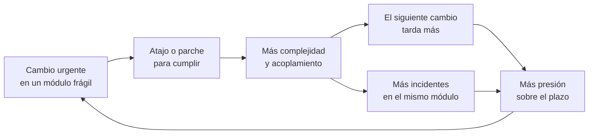
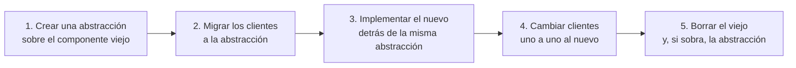
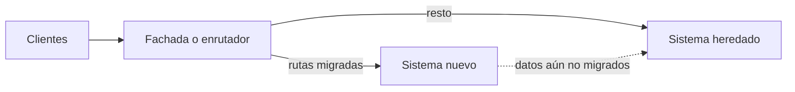
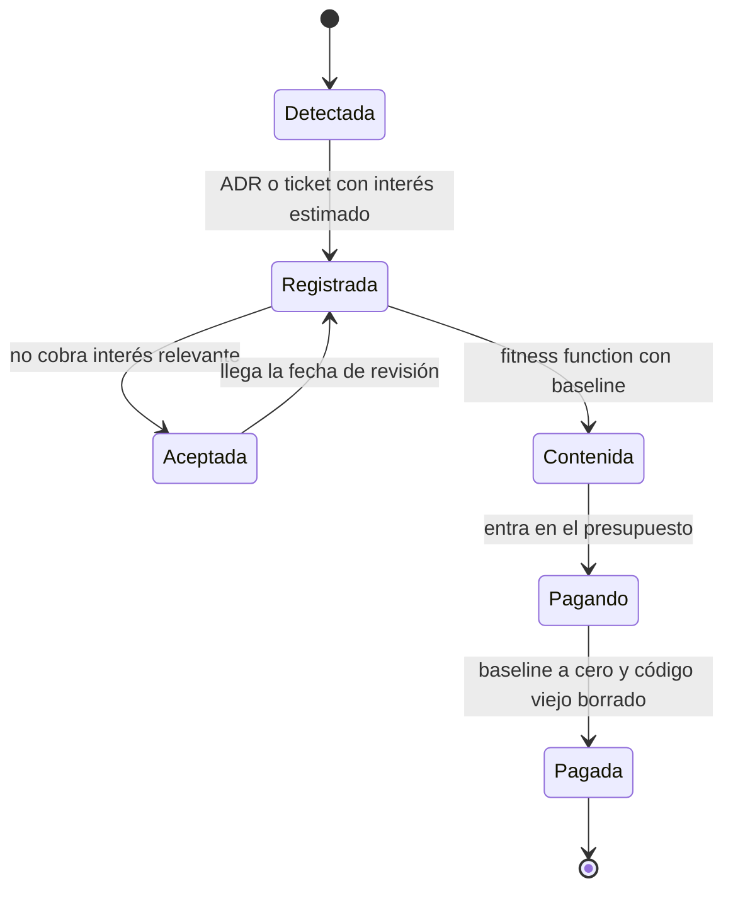

# Deuda técnica y evolución arquitectónica

Lo reconoces enseguida: un cambio que hace un año tomaba dos días ahora toma dos semanas, y nadie sabe explicar en qué se va el tiempo. Cada estimación lleva un «depende de cómo esté facturación». Los incidentes se repiten en los mismos tres módulos. Alguien propone reescribirlo todo, otro alguien dice que no hay tiempo, y el backlog de «deuda técnica» crece sin que nadie lo abra. La deuda técnica es la forma de nombrar ese problema con precisión: **es la distancia entre el diseño que tiene el sistema y el que necesitaría para los cambios que vienen, y se paga como esfuerzo extra cada vez que tocas el código afectado**.

Este artículo recorre el origen de la metáfora y lo que de verdad quería decir, la clasifica con el cuadrante de Fowler y la separa en principal e interés. Después muestra cómo medirla sin métricas de vanidad, por qué la deuda de arquitectura es la cara, y cómo evolucionar el sistema con cambios incrementales y guiados: regla del boy scout, presupuesto de capacidad, _branch by abstraction_, _strangler fig_ y feature flags. Cierra con cómo registrar una deuda deliberada en un ADR, un ejemplo trabajado y los errores más comunes.

<Callout tone="info" title="Qué está verificado y qué no">
  Fechas y citas salen de las fuentes primarias enlazadas al final. Dos excepciones: lo que se
  cuenta del video de Ward Cunningham de 2009 viene de transcripciones de terceros, y las etiquetas
  de cada celda del cuadrante de Fowler solo aparecen en una imagen de su artículo, así que aquí se
  parafrasean a partir del texto.
</Callout>

## De dónde viene la metáfora

Ward Cunningham la usó en un _experience report_ para OOPSLA 1992 titulado «The WyCash Portfolio Management System». La frase que se cita siempre es esta: «Shipping first time code is like going into debt» (entregar código por primera vez es como endeudarse). El resto del pasaje explica las condiciones: un poco de deuda acelera el desarrollo si se devuelve pronto reescribiendo, y el peligro aparece cuando no se devuelve, porque cada minuto que se dedica a código que no está del todo bien cuenta como interés.

El matiz importante es **qué** se pedía prestado. Cunningham no hablaba de escribir código descuidado para ir más rápido, sino de entregar código que reflejaba lo que el equipo entendía del problema en ese momento, sabiendo que esa comprensión iba a mejorar. La deuda es el desfase entre lo que el código expresa y lo que ahora sabes. Se paga incorporando ese aprendizaje al diseño.

Según varias transcripciones de un video que Cunningham publicó en 2009, él mismo tuvo que aclararlo: muchos habían confundido la metáfora con la idea de escribir mal el código con la intención de arreglarlo después, y dijo que nunca estuvo a favor de escribir código mal. Martin Fowler recogió la metáfora en su bliki en 2003 y la reescribió a fondo en 2019; en esa versión la define a partir del _cruft_, las deficiencias de calidad interna que hacen el software más difícil de modificar.

La consecuencia práctica es que **no toda deuda es un error**. Un diseño que fue correcto con lo que sabías y hoy se queda corto es deuda legítima, la que Cunningham tenía en mente. El código escrito sin cuidado es otro caso, y ahí hay debate: algunos sostienen que un desastre no es deuda, mientras que Fowler responde que la metáfora sirve igual, porque ese desastre también cobra interés, y que la distinción útil no es «deuda o no deuda» sino «prudente o imprudente». Esa distinción es la que ordena la siguiente sección.

## El cuadrante de Fowler

En 2009 Fowler propuso clasificar la deuda con dos ejes: **deliberada o inadvertida** (¿sabías que te endeudabas?) y **prudente o imprudente** (¿la decisión era razonable con lo que sabías?). El resultado es una matriz de dos por dos que sirve para conversar sin culpas y para decidir qué hacer con cada caso.

| —               | Imprudente                                                                                                                 | Prudente                                                                                                                                        |
| --------------- | -------------------------------------------------------------------------------------------------------------------------- | ----------------------------------------------------------------------------------------------------------------------------------------------- |
| **Deliberada**  | El equipo conoce las buenas prácticas pero decide ir «rápido y sucio» porque cree que no puede permitirse el código limpio | El equipo sabe que se endeuda, lo decide a propósito para cumplir un hito y tiene un plan para pagar                                            |
| Ejemplo         | Saltarse los tests de un flujo de pagos «porque hay prisa» y no volver nunca                                               | Lanzar una integración con un proveedor usando un adaptador síncrono, sabiendo que habrá que pasarlo a una cola cuando el volumen lo justifique |
| **Inadvertida** | El equipo no conoce las prácticas de diseño y no sabe que se está endeudando                                               | Al terminar el proyecto el equipo entiende cómo debería haber sido el diseño y descubre que tiene una deuda que no eligió                       |
| Ejemplo         | Lógica de negocio en los controladores y SQL concatenado por todo el código, sin que nadie lo vea como problema            | Tras un año, el equipo entiende que «cliente» y «cuenta» eran conceptos distintos que el modelo mezcló desde el principio                       |

Fowler señala algo incómodo sobre la celda prudente e inadvertida: no solo es común, sino inevitable en los equipos que diseñan bien, porque diseñar es aprender. No es un fallo de disciplina, es el precio de entender el dominio mientras construyes. Lo que distingue a un buen equipo es que **la reconoce y la paga** en lugar de convivir con ella.

Para qué sirve el cuadrante en la práctica:

- **Deliberada y prudente**: se registra, se le pone condición de salida y dueño. Es la única que deberías crear a propósito.
- **Inadvertida y prudente**: se convierte en refactoring en cuanto se detecta, priorizado por dónde duele.
- **Deliberada e imprudente**: es un problema de incentivos o de presión, no técnico. Se resuelve con la conversación de producto, no con más tickets.
- **Inadvertida e imprudente**: se resuelve con formación, revisión de código y reglas ejecutables, no con un sprint de limpieza.

## Principal e interés

La metáfora financiera tiene dos partes y conviene no mezclarlas:

- **Principal**: lo que cuesta arreglar el diseño. Una cantidad acotada de trabajo, aunque a veces grande.
- **Interés**: el esfuerzo extra recurrente que pagas en cada cambio mientras el diseño sigue así. Más tiempo de lectura, más pruebas manuales, más incidentes, más coordinación.

Fowler lo ilustra con números sencillos: una funcionalidad que con un código limpio llevaría cuatro días lleva seis con _cruft_, así que los dos días de diferencia son el interés. Quitar el _cruft_ primero cuesta cinco días. Para una sola funcionalidad no compensa (nueve días en lugar de seis), pero si vienen dos más parecidas, sí. La conclusión que saca es la clave de todo el artículo: **el interés solo se paga cuando trabajas en la zona afectada**. Las zonas con _cruft_ pero estables pueden dejarse como están; las que se cambian mucho necesitan tolerancia cero.

Por eso el interés se acumula justo donde más cambias. El ciclo típico se alimenta solo:



| Zona del código                         | Interés que genera    | Qué hacer con su principal                             |
| --------------------------------------- | --------------------- | ------------------------------------------------------ |
| Mal diseñada y casi nunca se toca       | Bajo                  | Dejarla; documentar el riesgo si es crítica            |
| Mal diseñada y se cambia cada semana    | Alto y creciente      | Pagar primero, en pasos pequeños ligados a cada cambio |
| Bien diseñada pero con un hueco puntual | Bajo                  | Arreglar cuando se pase por ahí                        |
| Frontera entre módulos que nadie posee  | Alto y difícil de ver | Asignar dueño antes de intentar pagar                  |

## Deuda de código frente a deuda de arquitectura

No toda la deuda vive al mismo nivel. La de código está dentro de un archivo o un módulo; la de arquitectura está en las relaciones entre módulos, en los límites y en las decisiones transversales.

| —                     | Deuda de código                                       | Deuda de arquitectura                                                                             |
| --------------------- | ----------------------------------------------------- | ------------------------------------------------------------------------------------------------- |
| Dónde vive            | Dentro de una función, clase o módulo                 | Entre módulos, en límites, datos compartidos y decisiones transversales                           |
| Ejemplos              | Funciones largas, nombres confusos, duplicación local | Base de datos compartida entre servicios, dependencias cíclicas, un dominio partido en dos sitios |
| Quién la nota         | Quien edita ese archivo                               | Todos, en forma de coordinación, despliegues conjuntos e incidentes en cascada                    |
| Cómo se paga          | Refactoring en el mismo cambio                        | Migración por etapas que dura semanas o meses                                                     |
| Riesgo de pagarla     | Bajo si hay tests                                     | Alto: toca contratos, datos y a varios equipos                                                    |
| Herramienta principal | [Código limpio](/docs/clean-code) y revisión          | Fitness functions, ADR y tácticas de migración incremental                                        |

La deuda de arquitectura es la cara por tres razones. Primero, **multiplica el interés**: un mal límite hace que cada cambio en un módulo arrastre cambios en otros, que es exactamente lo que miden el [acoplamiento y la cohesión](/docs/acoplamiento-cohesion). Segundo, **no se paga en un solo cambio**: necesita una migración con estados intermedios que tienen que funcionar en producción. Tercero, **degrada los [atributos de calidad](/docs/atributos-de-calidad)** que el negocio sí ve (disponibilidad, rendimiento, tiempo de entrega) y no solo la comodidad de quien programa.

## Cómo medirla sin métricas de vanidad

Medir la deuda no consiste en ponerle un número total, sino en encontrar **dónde se está pagando interés** y si ese interés crece o baja. Cuatro señales funcionan bien juntas; ninguna basta sola.

### Tiempo de entrega de los cambios

DORA define el _change lead time_ como el tiempo que tarda un cambio desde que entra en el control de versiones hasta que está desplegado en producción. Si lo segmentas por módulo o por servicio, la deuda aparece como zonas donde los cambios tardan sistemáticamente más que la media del sistema. Lo que interesa es la tendencia y la comparación entre zonas, no el valor absoluto.

### Hotspots: frecuencia de cambio por complejidad

Adam Tornhill propuso en 2013, en el artículo que dio origen a su libro _Your Code as a Crime Scene_ (Pragmatic Bookshelf, 2015), cruzar dos fuentes: la historia del control de versiones (cuántas veces cambia un archivo y cuántas personas lo tocan) y una medida de complejidad (líneas o complejidad ciclomática). Un **hotspot** es donde se solapan mucha actividad y mucha complejidad. El razonamiento encaja con el de Fowler: el código complejo que nadie toca no cobra interés; el complejo que se toca cada semana, sí.

Lo que sale de este análisis es una lista corta y ordenada, no un informe de mil archivos. Tornhill insiste en que son heurísticas: un hotspot es una pregunta para el equipo, no un veredicto.

### Incidentes que tocan el mismo módulo

Etiqueta cada incidente y cada _postmortem_ con los módulos implicados en la causa o en la corrección. Cuando el mismo módulo aparece una y otra vez, es una señal más fuerte que cualquier métrica estática, porque mide interés pagado en producción, con clientes afectados.

### Fricción que reporta el equipo

Una encuesta breve y periódica (por ejemplo, al cerrar cada iteración) con una sola pregunta por módulo tocado: ¿cuánto te frenó el diseño existente? Es subjetiva, pero detecta pronto lo que las métricas tardan meses en mostrar, y es la única que captura el coste cognitivo. Úsala para elegir dónde mirar, y las otras tres para confirmar.

### Lo que no conviene medir

| Métrica tentadora                          | Por qué engaña                                                                                                 |
| ------------------------------------------ | -------------------------------------------------------------------------------------------------------------- |
| Líneas de código totales                   | Un sistema grande y sano tiene muchas líneas; borrar código no siempre reduce deuda                            |
| Un único «índice de deuda» o puntuación    | Mezcla problemas que cuestan muy distinto y oculta dónde está el interés; se optimiza el número, no el sistema |
| Número de avisos del analizador estático   | Cuenta igual un nombre mejorable en código muerto que un ciclo entre dominios en el núcleo                     |
| Horas de «deuda» estimadas por herramienta | Estima el principal con reglas genéricas y no dice nada del interés, que es lo que importa                     |
| Cobertura de tests como objetivo           | Se infla con tests que no verifican comportamiento                                                             |

Ninguna de estas métricas es inútil como dato de contexto. El problema aparece cuando se convierten en el objetivo.

## Arquitectura evolutiva: cambio guiado e incremental

Neal Ford, Rebecca Parsons y Patrick Kua publicaron _Building Evolutionary Architectures_ (O'Reilly, 2017); la segunda edición, de noviembre de 2022, añade a Pramod Sadalage como autor. Su definición es corta: una arquitectura evolutiva **soporta cambio guiado e incremental en múltiples dimensiones**.

Las dos palabras importan por separado:

- **Incremental**: el sistema cambia en pasos pequeños que se despliegan, se observan y se pueden revertir. Es lo contrario de una reescritura que solo produce valor el día que termina.
- **Guiado**: cada paso está protegido por comprobaciones automáticas de las características que no deben degradarse. Esas comprobaciones son las [fitness functions](/docs/fitness-functions): reglas de dependencias, presupuestos de latencia, límites de tamaño o contratos que fallan en CI cuando la arquitectura se aleja de lo decidido.

Aplicado a la deuda, esto cambia la pregunta. Ya no es «¿cuándo paramos para pagarla?», sino «¿qué fitness function impide que crezca mientras la pagamos poco a poco?». Una regla que congela las violaciones actuales y bloquea las nuevas detiene el interés compuesto desde el primer día, aunque el principal tarde meses en bajar. Solo hace falta nombrarla bien:

```typescript
// fitness/billing-boundary.fitness.ts
export declare function noNewImportsOfLegacyBillingRepo(
  graph: DependencyGraph,
  baseline: KnownViolations,
): FitnessResult; // falla si aparece una dependencia que no está en el baseline
```

## Tácticas para evolucionar sin reescribir

Las tácticas se diferencian por su alcance: unas trabajan sobre lo que ya tocas, otras sustituyen piezas enteras. Se combinan; rara vez basta una.

### Regla del boy scout

Robert C. Martin la formuló en _97 Things Every Programmer Should Know_ adaptando la regla de los scouts: entrega siempre un módulo un poco más limpio de lo que lo encontraste. Funciona porque aplica el principio de Fowler sin esfuerzo de planificación: la limpieza ocurre exactamente donde se trabaja, que es donde se paga interés. Su límite también es claro: **no paga deuda de arquitectura**, porque nadie mueve un límite entre módulos de paso mientras arregla un bug.

### Presupuesto de capacidad dedicado

Reservar una parte fija de la capacidad del equipo para deuda evita que cada caso compita con funcionalidades en cada planificación. **No hay un porcentaje estándar**: es una decisión de política que depende de cuánto interés estás pagando y de la presión del negocio. Lo que hace que funcione no es la cifra, sino tres reglas: el presupuesto se gasta en los hotspots y no en lo que le apetece a cada uno, se revisa con datos (¿bajó el tiempo de entrega en esa zona?) y se ajusta, al alza o a la baja, de forma explícita.

### Branch by abstraction

Fowler la documentó en 2014; el nombre lo popularizó Paul Hammant, que atribuye la técnica a Stacy Curl. Sirve para sustituir un componente del que dependen muchas partes del sistema sin abrir una rama de larga duración: todo ocurre en la rama principal y el sistema se puede desplegar en cada paso.



Es la versión a nivel de código de lo que en [arquitectura hexagonal](/docs/arquitectura-hexagonal) es un puerto: una costura con dos implementaciones durante un tiempo.

### Strangler fig

Fowler describió el patrón el 29 de junio de 2004 con el nombre de _Strangler Application_, inspirado en las higueras estranguladoras que vio en la selva de Queensland, y el 29 de abril de 2019 lo renombró _Strangler Fig_. La idea: en lugar de reemplazar un sistema de golpe, construyes el nuevo alrededor del viejo y vas desviando comportamiento hacia él, pieza a pieza, hasta que el viejo se puede apagar.



El punto delicado casi nunca es el enrutador, sino los datos: durante la migración, los dos sistemas conviven y alguien tiene que ser la fuente de verdad de cada dato. Decídelo por adelantado y regístralo.

### Feature flags durante la migración

Pete Hodgson distingue varios tipos de toggles; los relevantes aquí son los **de lanzamiento** (_release toggles_), que permiten desplegar código incompleto o alternativo sin activarlo. En una migración sirven para cambiar de implementación por porcentaje de tráfico o por cliente y volver atrás sin desplegar. Hodgson advierte que estos toggles son transitorios y no deberían durar mucho más de una o dos semanas, y que cada toggle es inventario con coste: lógica condicional y combinaciones que probar. Un flag que se queda es deuda nueva.

### Cuál usar

| Táctica               | Alcance                                       | Duración típica         | Riesgo principal                            | Úsala cuando                                           |
| --------------------- | --------------------------------------------- | ----------------------- | ------------------------------------------- | ------------------------------------------------------ |
| Regla del boy scout   | Lo que tocas en el cambio actual              | Continua                | Cambios mezclados que complican la revisión | La deuda es de código y está en zonas activas          |
| Presupuesto dedicado  | Hotspots priorizados                          | Continua, revisada      | Gastarlo en lo que no cobra interés         | Hay deuda que no cabe en cambios de funcionalidad      |
| Branch by abstraction | Un componente usado por muchos                | Semanas                 | Abstracción que nunca se retira             | Sustituyes una librería, un ORM o un proveedor         |
| Strangler fig         | Un subsistema o sistema completo              | Meses                   | Dos sistemas a medias indefinidamente       | Reemplazas una parte grande con usuarios en producción |
| Feature flags         | La activación de cualquiera de las anteriores | Días o semanas por flag | Flags olvidados y combinaciones sin probar  | Necesitas cambiar y revertir sin desplegar             |

## Registrar la deuda deliberada en un ADR

La deuda deliberada y prudente es una decisión de arquitectura, así que merece un [ADR](/docs/adr). Lo que distingue a un ADR de deuda de uno normal son cuatro campos que convierten «ya lo arreglaremos» en un compromiso verificable:

```markdown
# ADR-0042: Integración síncrona con el proveedor de envíos

## Contexto

## Decisión

## Deuda asumida

- Interés esperado: <qué cuesta cada mes y dónde se nota>
- Condición de salida: <hecho medible que obliga a pagarla>
- Responsable: <equipo o persona, no «todos»>
- Fecha de revisión: <AAAA-MM-DD>

## Consecuencias
```

La **condición de salida** es lo más importante y lo que más se omite. Debe ser un hecho observable, no una intención: «cuando superemos cierto volumen de pedidos por minuto en hora punta», «antes de abrir el segundo país», «cuando el tiempo de entrega del módulo supere el doble de la media». Sin ella, la revisión se convierte en un trámite y la deuda en permanente. Si en la fecha de revisión la condición no se ha cumplido, el ADR se renueva con una fecha nueva; si se cumplió, el pago entra en la planificación con prioridad.

## Ejemplo trabajado: el módulo de facturación

Un SaaS de gestión de pedidos tiene un monolito con un módulo de facturación que calcula impuestos, genera el PDF y escribe directamente en las tablas de pedidos. Seis módulos más leen esas tablas. El equipo se queja de que «todo cambio en facturación rompe algo».

**1. Medir.** Cruzan seis meses de historia de git con la complejidad por archivo. Los valores de esta tabla son ilustrativos, pero el patrón es el habitual:

| Archivo                     | Cambios en 6 meses | Complejidad relativa | Incidentes asociados |
| --------------------------- | ------------------ | -------------------- | -------------------- |
| `billing/tax-calculator`    | Muy alto           | Alta                 | Varios               |
| `billing/invoice-pdf`       | Bajo               | Alta                 | Ninguno              |
| `billing/orders-repository` | Alto               | Media                | Varios               |
| `reports/legacy-export`     | Casi nulo          | Muy alta             | Ninguno              |

`legacy-export` es el código más feo del sistema y no se toca: no cobra interés y queda fuera. `invoice-pdf` es complejo pero estable: se documenta y se deja. El interés está en el cálculo de impuestos y en el acceso compartido a los pedidos.

**2. Clasificar.** El cálculo de impuestos es deuda prudente e inadvertida: se diseñó para un solo país y ya hay tres. El acceso compartido a tablas es deuda de arquitectura: seis módulos acoplados por datos.

**3. Detener el interés compuesto.** Antes de pagar nada, añaden una fitness function con baseline: ningún módulo nuevo puede leer las tablas de pedidos directamente. Las seis violaciones existentes quedan congeladas.

**4. Pagar por etapas.** Para impuestos usan _branch by abstraction_: un puerto `TaxPolicy`, la implementación actual detrás, una nueva por país y un release toggle por país para cambiar y revertir. Para el acceso a pedidos, estrangulan: un módulo de pedidos con API propia y los seis consumidores migrando uno a uno, cada migración reduce el baseline en uno.

**5. Registrar.** Un ADR recoge la decisión de mantener el acceso compartido durante la migración, con interés esperado (coordinación en cada cambio de esquema), condición de salida (baseline a cero), responsable (el equipo de pedidos) y fecha de revisión trimestral.

La estructura intermedia, con nombres que dicen en qué etapa está cada pieza:

```text
src/
  billing/
    tax/
      tax-policy.ts             # la abstracción: puerto
      legacy-tax-policy.ts      # implementación actual, se borrará
      per-country-tax-policy.ts # implementación nueva, tras un toggle
  orders/
    orders-api.ts               # el sustituto que estrangula el acceso directo
fitness/
  orders-tables-access.fitness.ts
  orders-tables-access.baseline.json  # solo puede encoger
```

Cada elemento de deuda recorre el mismo ciclo de vida, y vale la pena que el equipo lo vea así:



## Cuándo endeudarse y cuándo es una alarma

### Cuándo la deuda es una buena decisión

- **Validar antes de invertir.** Si no sabes si una funcionalidad va a usarse, un diseño mínimo es prudente. El aprendizaje vale más que el diseño perfecto de algo que quizá se borre.
- **Hay una fecha externa real** (regulatoria, contractual, de mercado) y el coste de no llegar supera el interés previsto. Con ADR y condición de salida.
- **El código va a vivir poco**: un script de migración, una prueba de concepto con fecha de borrado.
- **La zona no va a cambiar**: un diseño mejorable en un módulo estable apenas cobra interés.

### Cuándo es una señal de alarma

- **Nadie la eligió.** Si la deuda solo se descubre en los incidentes, el problema es de prácticas, no de prioridades.
- **El interés ya supera al trabajo útil** en una zona: casi todo el tiempo de los cambios se va en entender y sortear el diseño.
- **La deuda deliberada no tiene condición de salida ni dueño.** No es deuda, es una decisión permanente sin documentar.
- **Bloquea un atributo de calidad que el negocio necesita**: no puedes escalar, desplegar por separado o cumplir un requisito de seguridad sin pagarla.
- **El equipo evita ciertos módulos** o solo una persona se atreve a tocarlos.

## Errores frecuentes

- **Reescribir como solución.** La reescritura completa congela el valor hasta el final, tiene que alcanzar a un sistema que sigue cambiando y suele reproducir la deuda que no entendió. Fowler propuso el _strangler fig_ precisamente como alternativa.
- **Un backlog de deuda que nadie prioriza.** Una lista larga de tickets sin interés estimado ni dueño no se paga nunca. Mejor diez elementos con datos que doscientos con buenas intenciones.
- **Tratar toda la deuda como igual.** El código feo que nadie toca no merece el mismo esfuerzo que un hotspot que provoca incidentes. Prioriza por interés, no por fealdad.
- **Perseguir una puntuación.** Bajar un índice de deuda global es fácil arreglando lo que no importa.
- **Pagar sin detener la entrada.** Si no hay una regla que impida que la deuda crezca, el pago se come con lo nuevo.
- **Abstracciones y flags que no se retiran.** _Branch by abstraction_ y los release toggles son andamios; si no se quitan, son la siguiente deuda.
- **Llamar deuda a todo.** Si cada desacuerdo de estilo es «deuda técnica», la palabra deja de servir para negociar con producto.

## Checklist

- [ ] Cada elemento de deuda tiene interés estimado, dueño y, si es deliberada, condición de salida.
- [ ] Sabes cuáles son tus hotspots, cruzando historia de cambios y complejidad, y los revisas periódicamente.
- [ ] El tiempo de entrega y los incidentes se pueden ver por módulo, no solo para el sistema entero.
- [ ] Las deudas deliberadas importantes están registradas en un ADR con fecha de revisión.
- [ ] Una fitness function con baseline impide que la deuda de arquitectura conocida crezca.
- [ ] La capacidad para pagar deuda es una política explícita que se revisa con datos.
- [ ] Las migraciones grandes avanzan por _branch by abstraction_ o _strangler fig_, desplegables en cada paso.
- [ ] Cada release toggle y cada abstracción temporal tiene fecha de retirada.

## Fuentes

Consultadas en octubre de 2026.

- [The WyCash Portfolio Management System (Ward Cunningham, OOPSLA 1992)](https://c2.com/doc/oopsla92.html)
- [Technical Debt (Martin Fowler, 2003, reescrito en 2019)](https://martinfowler.com/bliki/TechnicalDebt.html)
- [Technical Debt Quadrant (Martin Fowler, 14 de octubre de 2009)](https://martinfowler.com/bliki/TechnicalDebtQuadrant.html)
- [Ward Cunningham on technical debt (rc3.org, 2009)](https://rc3.org/2009/03/02/ward-cunningham-on-technical-debt/): resumen de terceros del video de 2009; la página respondió HTTP 403, así que lo que se cuenta del video viene de resultados de búsqueda
- [DORA metrics guide](https://dora.dev/guides/dora-metrics/)
- [Code as a Crime Scene (Adam Tornhill, 2013)](https://adamtornhill.com/articles/crimescene/codeascrimescene.htm) y [la reseña de InfoQ sobre su charla y libro (2015)](https://www.infoq.com/news/2015/03/code-as-a-crime-scene)
- [Building Evolutionary Architectures en Thoughtworks](https://www.thoughtworks.com/insights/books/building-evolutionary-architectures) y [la segunda edición en O'Reilly](https://oreilly.com/library/view/building-evolutionary-architectures/9781492097532)
- [The Boy Scout Rule (Robert C. Martin, en 97 Things Every Programmer Should Know)](https://www.oreilly.com/library/view/97-things-every/9780596809515/ch08.html)
- [Branch By Abstraction (Martin Fowler, 7 de enero de 2014)](https://martinfowler.com/bliki/BranchByAbstraction.html)
- [Original Strangler Fig Application (Martin Fowler, 29 de junio de 2004)](https://martinfowler.com/bliki/OriginalStranglerFigApplication.html) y [Strangler Fig (Martin Fowler, revisado el 22 de agosto de 2024)](https://martinfowler.com/bliki/StranglerFigApplication.html)
- [Feature Toggles (Pete Hodgson, 2017)](https://martinfowler.com/articles/feature-toggles.html)
