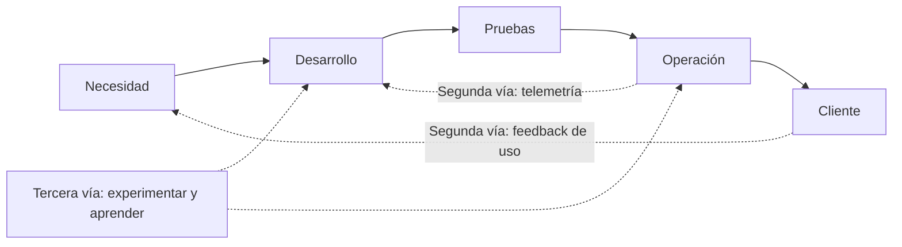
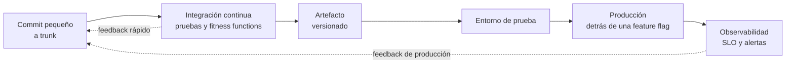

# DevOps y su cultura: la base de la entrega

Durante años, el desarrollo y la operación tuvieron objetivos opuestos. Quien desarrolla es evaluado por cambiar el sistema; quien opera, por que no se caiga. Entre ambos se levantó un muro, y por encima de él se lanzaban versiones grandes, raras y dolorosas. **DevOps** es el conjunto de ideas que derriba ese muro: compartir la responsabilidad de entregar y de operar, entregar en lotes pequeños y aprender rápido de lo que ocurre en producción.

Este artículo es la base cultural, no un tutorial de herramientas. Explica de dónde viene DevOps, qué es y qué no es, los marcos con los que se entiende (CALMS y las Tres Vías), la evidencia de la investigación DORA y la tipología de cultura de Westrum, cómo se conecta con la arquitectura y con los agentes de IA, y un orden de adopción realista. Las herramientas llegan al final, porque son consecuencia de la cultura y no su punto de partida.

<Callout tone="info" title="Fecha de corte">
  Los datos son de octubre de 2026. Las métricas DORA se leyeron en la guía oficial de dora.dev y
  las versiones de las herramientas se consultaron el 12 de octubre de 2026 en sus repositorios.
  Contrasta con la fuente oficial antes de decidir: este terreno cambia cada año.
</Callout>

## El problema que resuelve DevOps

En la organización tradicional, cada equipo optimiza lo suyo. Desarrollo entrega cuanto más rápido puede y operación frena para proteger la estabilidad. El resultado conocido: se acumulan cambios durante semanas, se despliegan juntos, y cuando algo falla nadie sabe cuál de los cientos de cambios fue la causa. Como el despliegue duele, se hace menos veces, y como se hace menos veces, cada uno es más grande y más arriesgado.

La charla «10+ Deploys Per Day: Dev and Ops Cooperation at Flickr», de John Allspaw y Paul Hammond en Velocity 2009, planteó la salida. Sus diapositivas encuadran el conflicto clásico (operación como el equipo que dice «no» al cambio) y argumentan que el negocio necesita cambiar, así que la respuesta es **reducir el riesgo del cambio** con herramientas y cultura, no desalentarlo. Su meta declarada era que la gente de operación piense más como desarrollo y la de desarrollo más como operación.

## De dónde viene

| Año  | Hito                                                                                                                             |
| ---- | -------------------------------------------------------------------------------------------------------------------------------- |
| 2006 | En una entrevista de ACM Queue, Werner Vogels (Amazon) resume su modelo: «You build it, you run it»                              |
| 2009 | Allspaw y Hammond presentan los despliegues diarios de Flickr en Velocity                                                        |
| 2009 | Patrick Debois organiza el primer devopsdays en Gante, Bélgica; de ahí sale el nombre                                            |
| 2012 | Gene Kim publica el ensayo «The Three Ways»                                                                                      |
| 2013 | Se publica _The Phoenix Project_ (Kim, Behr y Spafford), una novela sobre un proyecto de TI en crisis                            |
| 2016 | _The DevOps Handbook_ (segunda edición en 2021, con Kim, Humble, Debois, Willis y Forsgren)                                      |
| 2018 | _Accelerate_ (Forsgren, Humble y Kim) presenta cuatro años de investigación estadística sobre qué determina el rendimiento de TI |

Debois acuñó la palabra en 2009 al organizar el primer evento, según la página de IT Revolution; otras fuentes cuentan que el nombre fue más bien un accidente. Lo que importa es la secuencia: primero la práctica (Flickr), luego la comunidad, después la investigación que la midió.

## Qué es y qué no es DevOps

| No es                                                      | Es                                                                                       |
| ---------------------------------------------------------- | ---------------------------------------------------------------------------------------- |
| Un cargo («ingeniero DevOps») que hace de puente           | Una forma de trabajar en la que desarrollo y operación comparten metas y responsabilidad |
| Un equipo aparte que se encarga del despliegue             | Que el equipo que construye también entrega, observa y responde                          |
| Un conjunto de herramientas (CI, contenedores, Kubernetes) | Prácticas y cultura que las herramientas hacen posibles                                  |
| Automatizar todo desde el primer día                       | Eliminar primero el trabajo que no aporta, y después automatizar lo que queda            |
| Velocidad a costa de estabilidad                           | La evidencia muestra que ambas mejoran juntas (ver DORA más abajo)                       |

El antipatrón más extendido es crear un «equipo DevOps» que se interpone entre desarrollo y operación. No derribó el muro: puso un tercer silo en medio, con su propia cola de tickets. Un equipo así solo tiene sentido si ofrece capacidades que otros equipos consumen por su cuenta, no si ejecuta los despliegues por ellos.

## Dos marcos para entenderlo

### CALMS

CALMS (Culture, Automation, Lean, Measurement, Sharing) resume los pilares de DevOps: cultura, automatización, lean, medición y compartir. Sobre su origen las fuentes no coinciden. Según el libro de O'Reilly sobre SAFe y DevOps, John Willis y Damon Edwards propusieron CAMS en 2010 y Jez Humble añadió la L; otros lo atribuyen directamente a Humble. Trátalo como un resumen útil y no como un estándar.

| Pilar          | Pregunta que obliga a responder                                                     |
| -------------- | ----------------------------------------------------------------------------------- |
| Cultura        | ¿Desarrollo y operación comparten responsabilidad y aprenden de los fallos?         |
| Automatización | ¿Lo repetitivo y propenso a error lo hace una máquina?                              |
| Lean           | ¿Trabajamos en lotes pequeños y eliminamos esperas y desperdicio?                   |
| Medición       | ¿Decidimos con datos de entrega y de producción?                                    |
| Compartir      | ¿El conocimiento circula entre equipos, o vive en la cabeza de unas pocas personas? |

### Las Tres Vías

Gene Kim las describió en su ensayo de 2012 y después las usó en el _DevOps Handbook_. Son principios, no prácticas concretas:

1. **Flujo (sistemas):** mirar el rendimiento de todo el sistema y no el de un silo. Nunca pasar un defecto conocido aguas abajo, nunca dejar que una optimización local degrade el conjunto.
2. **Amplificar los bucles de feedback:** crear canales de retorno de derecha a izquierda para poder corregir. Acortar y reforzar cada bucle, y poner el conocimiento donde se necesita.
3. **Cultura de experimentación y aprendizaje continuos:** fomentar la toma de riesgos y el aprendizaje del fallo, reservar tiempo para mejorar el trabajo diario e incluso introducir fallos a propósito para ganar resiliencia.



La primera vía es la línea continua de izquierda a derecha; la segunda, las flechas punteadas de retorno; la tercera, la capacidad de la organización para mejorar el sistema entero.

## La cultura es la base

### La tipología de Westrum

El sociólogo Ron Westrum propuso en 2004 (en la revista que entonces se llamaba Quality and Safety in Health Care, hoy BMJ Quality and Safety) una tipología de culturas organizacionales según cómo fluye la información. DORA la adopta y la resume así:

| Característica        | Patológica                   | Burocrática                 | Generativa                |
| --------------------- | ---------------------------- | --------------------------- | ------------------------- |
| Orientación           | Al poder                     | A las reglas                | Al desempeño              |
| Cooperación           | Baja                         | Moderada                    | Alta                      |
| Mensajeros            | Se castiga a quien avisa     | Se desatiende a quien avisa | Se forma a quien avisa    |
| Responsabilidad       | Se esquiva                   | Estrecha                    | Los riesgos se comparten  |
| Puentes entre equipos | Se desaconsejan              | Se toleran                  | Se fomentan               |
| Ante un fallo         | Se busca un chivo expiatorio | Se busca justicia           | Se abre una investigación |
| Novedad               | Se aplasta                   | Crea problemas              | Se implementa             |

DORA afirma que una cultura generativa y de alta confianza predice el rendimiento de entrega de software y de la organización, y que la seguridad psicológica también predice el rendimiento de entrega. Son hallazgos predictivos de investigación, no una prueba de causalidad directa. La idea práctica: si quien detecta un problema es castigado o ignorado, ninguna herramienta compensará esa falta de información.

### Posmortems sin culpa

El libro de SRE de Google dedica un capítulo a la cultura de posmortems. Un posmortem sin culpa debe centrarse en las causas que contribuyeron al incidente «sin señalar a ninguna persona ni equipo», y parte de que todos los involucrados tenían buenas intenciones y actuaron con la información que tenían. Su frase más citada: no se puede «arreglar» a las personas, pero sí se pueden arreglar los sistemas y los procesos. Cuando prima el señalamiento, la gente deja de reportar problemas por miedo al castigo.

John Allspaw defendió el mismo enfoque en Etsy en 2012 y aclaró un malentendido frecuente: sin culpa no significa sin responsabilidad. Habla de una cultura justa que equilibra seguridad y responsabilidad, y que investiga los factores de la situación y las decisiones de quienes estaban más cerca del fallo.

### «You build it, you run it»

En una entrevista de ACM Queue de 2006, Vogels resumió el modelo de Amazon así: «You build it, you run it». El blog de AWS que reseñó la entrevista (16 de mayo de 2006) afirma que dar a los desarrolladores responsabilidades operativas «ha mejorado enormemente la calidad de los servicios». La razón es de incentivos: quien despierta de madrugada por un fallo deja de tratar la operabilidad como asunto ajeno. Es la forma más directa de propiedad compartida.

## Medir: la investigación DORA

DORA (DevOps Research and Assessment) lleva años midiendo qué prácticas se asocian con mejores resultados. Su guía oficial define hoy **cinco métricas** de rendimiento de entrega, agrupadas en dos familias:

| Familia       | Métrica (nombre en DORA)        | Qué mide                                                                             |
| ------------- | ------------------------------- | ------------------------------------------------------------------------------------ |
| Rendimiento   | Change lead time                | Tiempo desde que un cambio se confirma en el control de versiones hasta producción   |
| Rendimiento   | Deployment frequency            | Cuántos despliegues hay en un periodo, o el tiempo entre ellos                       |
| Rendimiento   | Failed deployment recovery time | Tiempo para recuperarse de un despliegue fallido que requiere intervención inmediata |
| Inestabilidad | Change fail rate                | Proporción de despliegues que requieren intervención inmediata                       |
| Inestabilidad | Deployment rework rate          | Proporción de despliegues no planificados que surgen de un incidente en producción   |

DORA indica que en 2025 evolucionó las cuatro métricas clásicas a cinco; según los resúmenes del informe, la novedad es la tasa de retrabajo. Su conclusión central se mantiene: la velocidad y la estabilidad **no son un trade-off**. Las métricas están correlacionadas en la mayoría de los equipos; los mejores van bien en las cinco y los peores, mal en las cinco. Esto desmonta el argumento que sostenía el muro: no hace falta frenar para ser estable.

Para usar las métricas con cabeza:

- **Mide el sistema, no a las personas.** Una métrica convertida en objetivo individual deja de medir y empieza a manipularse.
- **Compáralas contigo mismo en el tiempo**, no con otras empresas.
- **Son indicadores, no metas.** Dicen dónde mirar, no qué cambiar.

## Las prácticas y su razón cultural

Cada práctica técnica de DevOps existe por una razón humana. Conocer la razón evita aplicarla como ritual.

| Práctica                           | Para qué existe (razón cultural)                                                                                                         |
| ---------------------------------- | ---------------------------------------------------------------------------------------------------------------------------------------- |
| Integración continua y trunk-based | Que nadie trabaje aislado: DORA cita como máximo tres ramas activas, integrar al menos una vez al día y no tener congelaciones de código |
| Entrega continua                   | Que el software siempre esté en condición de liberarse, y la decisión de hacerlo sea de negocio                                          |
| Despliegue continuo                | Que cada cambio que pasa el pipeline llegue solo a producción: el siguiente paso, no un requisito                                        |
| Feature flags                      | Separar desplegar de liberar; Flickr ya los usaba como palancas para operación                                                           |
| Infraestructura como código        | Que el entorno sea revisable y reproducible como cualquier cambio, no una tradición oral                                                 |
| GitOps                             | Que Git sea la fuente de verdad del estado deseado y los cambios se revisen como código                                                  |
| Observabilidad                     | Que desarrollo y operación miren los mismos datos, como en los paneles compartidos de Flickr                                             |
| Posmortems sin culpa               | Convertir cada incidente en aprendizaje compartido                                                                                       |

Martin Fowler distingue dos prácticas que se confunden: la **entrega continua** significa poder desplegar con frecuencia, pero se puede elegir no hacerlo; el **despliegue continuo** significa que cada cambio pasa por el pipeline y se pone en producción automáticamente. Para hacer despliegue continuo hay que hacer antes entrega continua. Sobre las ramas, trunkbaseddevelopment.com las define como un modelo con una sola rama («trunk») y ramas de vida corta de una sola persona, con feature flags para decidir el orden de las liberaciones.



La forma de organizar el pipeline también comunica intención. Una convención simple y legible, que separa verificar, construir y promover:

```text
.github/workflows/
  ci.yml        # en cada cambio propuesto: verificar
  release.yml   # al integrar en main: construir y publicar el artefacto
  deploy.yml    # promover un artefacto ya construido a un entorno
```

## DevOps y arquitectura

La arquitectura decide cuánta cultura DevOps es posible. La **ley de Conway** (1968) lo enuncia: las organizaciones que diseñan sistemas están restringidas a producir diseños que son copias de sus estructuras de comunicación. Un muro entre equipos acaba dibujado en el sistema.

DORA llega a la misma conclusión desde los datos: las estructuras organizativas y técnicas efectivas predicen la entrega continua; con una arquitectura acoplada, un cambio pequeño puede provocar fallos en cascada, y a medida que los servicios se desacoplan la frecuencia de despliegue debería subir. Para equilibrar a Conway recomienda la _Inverse Conway Maneuver_: dar forma a los equipos para que respalden la arquitectura que se quiere.

Esto conecta con el resto de la biblioteca:

- La **desplegabilidad** es un [atributo de calidad](/docs/atributos-de-calidad) que se decide y se mide, no un accidente.
- El [acoplamiento](/docs/acoplamiento-cohesion) es lo que frena la entrega: dos servicios que deben desplegarse juntos son, en la práctica, uno.
- Las [fitness functions](/docs/fitness-functions) son el pipeline de la arquitectura: reglas ejecutables que corren en integración continua.
- Cada decisión que cambie la forma de entregar merece su [ADR](/docs/adr).
- Un diseño [hexagonal](/docs/arquitectura-hexagonal) facilita probar el núcleo sin infraestructura, lo que acorta el feedback.
- El [modelo C4](/docs/c4-model) ayuda a ver qué contenedores se despliegan por separado y quién es dueño de cada uno.

## SRE y platform engineering

Dos ideas vecinas que a menudo se confunden con DevOps. Según el _Site Reliability Workbook_ de Google, **SRE** es una implementación concreta de DevOps: «class SRE implements interface DevOps», una analogía de programación. DevOps es la filosofía amplia y poco prescriptiva sobre cómo operar; SRE es un rol con responsabilidades de servicio y un marco más opinado, con la misma creencia en la medición y en aceptar que el cambio es necesario para mejorar.

**Platform engineering** va por otro lado: en lugar de que cada equipo reinvente su pipeline, un equipo ofrece capacidades internas que los demás consumen por su cuenta. Funciona cuando se trata como un producto con usuarios, y degenera en el antipatrón del «equipo DevOps» cuando se convierte en un cuello de botella con tickets.

## DevOps y agentes de IA

Un agente de código escribe cambios más rápido que una persona, y eso aumenta justo lo que DevOps tiene que sostener: la frecuencia y el volumen de cambios. El informe de DORA de 2025 resume el efecto: la IA mejora el rendimiento, «pero a menudo a costa de la estabilidad si tu base no es sólida». Un agente solo es tan seguro como la entrega que lo rodea.

Por eso el pipeline y las pruebas son los **sensores** del [harness](/docs/harness-engineering-claude-code): integración continua, fitness functions, despliegues pequeños y observabilidad detectan el error del agente antes que una persona. Y quien construye [aplicaciones con agentes](/docs/arquitectura-agentes-llm) hereda la misma regla: observabilidad, evaluaciones y límites explícitos son la versión de DevOps para sistemas no deterministas.

## Un mapa de adopción por etapas

No se adopta DevOps de golpe. Cada etapa se apoya en la anterior, y **medir antes de optimizar** evita automatizar lo equivocado.

| Etapa | Foco                 | Qué hacer                                                                                         | Señal de que está lista                             |
| ----- | -------------------- | ------------------------------------------------------------------------------------------------- | --------------------------------------------------- |
| 1     | Entender y medir     | Dibujar el camino de un cambio hasta producción y medir las cinco métricas de DORA tal como están | Sabes cuánto tarda hoy un cambio y por qué          |
| 2     | Lotes pequeños       | Integración continua, trunk-based, pruebas automáticas en cada cambio                             | Se integra a diario y la rama principal no se rompe |
| 3     | Entrega automatizada | Un solo camino automatizado a producción, infraestructura como código, feature flags              | Desplegar es aburrido                               |
| 4     | Observar y aprender  | Observabilidad compartida, SLO, posmortems sin culpa                                              | Los incidentes producen mejoras, no culpables       |
| 5     | Escalar              | Plataforma interna, propiedad clara por servicio, arquitectura que desacopla equipos              | Los equipos entregan sin pedir permiso a otros      |

## Herramientas modernas por función

Las herramientas habilitan las prácticas; no las sustituyen. Versiones consultadas el 12 de octubre de 2026 en los repositorios oficiales.

| Función         | Herramienta       | Qué hace                                                                                                            | Madurez (valoración propia)               | Cuándo usarla                                                                  | Cuándo no                                                                      |
| --------------- | ----------------- | ------------------------------------------------------------------------------------------------------------------- | ----------------------------------------- | ------------------------------------------------------------------------------ | ------------------------------------------------------------------------------ |
| CI/CD           | GitHub Actions    | Plataforma de CI/CD que ejecuta flujos disparados por eventos del repositorio                                       | Muy alta                                  | Tu código ya vive en GitHub                                                    | Necesitas ejecutar todo en tu propia infraestructura sin dependencias externas |
| CI/CD           | GitLab CI/CD      | Pipelines definidos en un archivo `.gitlab-ci.yml` en la raíz del proyecto                                          | Muy alta                                  | Quieres repositorio y pipeline en una sola plataforma                          | Tu equipo ya está estandarizado en otro ecosistema                             |
| Infraestructura | OpenTofu 1.13.1   | Infraestructura como código, bajo el patrocinio de la Linux Foundation, alternativa a Terraform                     | Alta                                      | Quieres una licencia abierta y compatibilidad con configuraciones de Terraform | Dependes de funciones propietarias de un proveedor                             |
| Infraestructura | Terraform 1.16.5  | Infraestructura como código de HashiCorp, con licencia Business Source License 1.1                                  | Muy alta                                  | Ya lo usas y la licencia encaja con tu caso                                    | Ofreces un producto que compite con HashiCorp, donde la BSL lo restringe       |
| Contenedores    | Docker            | Empaqueta aplicaciones y sus dependencias en contenedores                                                           | Muy alta (Engine 29.9.0)                  | Quieres entornos reproducibles                                                 | Una función sencilla en una plataforma gestionada no lo necesita               |
| Orquestación    | Kubernetes 1.37.1 | Plataforma de código abierto para gestionar cargas de trabajo en contenedores, con configuración declarativa        | Muy alta                                  | Tienes muchos servicios y equipos que justifican el coste operativo            | Tienes pocos servicios: el coste supera el beneficio                           |
| GitOps          | Argo CD 3.5.5     | Entrega continua declarativa basada en GitOps para Kubernetes                                                       | Alta                                      | Ya despliegas en Kubernetes y quieres Git como fuente de verdad                | No usas Kubernetes                                                             |
| GitOps          | Flux 2.9.6        | Soluciones de entrega continua y progresiva para Kubernetes; proyecto graduado de la CNCF                           | Alta                                      | Quieres un enfoque modular y extensible sobre Kubernetes                       | No usas Kubernetes                                                             |
| Observabilidad  | OpenTelemetry     | Marco y herramientas para generar, exportar y recopilar trazas, métricas y registros, neutral respecto al proveedor | Alta (Collector 0.162.0)                  | Quieres instrumentar una vez y elegir backend después                          | Necesitas un almacenamiento o paneles: no los incluye                          |
| Observabilidad  | Grafana 13.2.3    | Paneles y visualización de métricas, registros y trazas                                                             | Muy alta                                  | Quieres un panel común para desarrollo y operación                             | Buscas un servicio de almacenamiento de datos                                  |
| Feature flags   | OpenFeature       | Especificación abierta y neutral de la API de feature flags; proyecto incubando en la CNCF                          | Media (especificación 0.9.0, aún sin 1.0) | Quieres evitar el bloqueo con un proveedor de flags                            | Solo necesitas un par de interruptores simples                                 |

## Errores frecuentes

- **Empezar por las herramientas.** Comprar una plataforma de CI no cambia cómo colaboran las personas. Empieza por el camino del cambio y por la cultura.
- **Convertir DevOps en un cargo o en un equipo aparte.** Crea un silo nuevo con su propia cola de tickets.
- **Usar las métricas como arma contra las personas.** Se manipulan y destruyen la confianza que las hacía útiles.
- **Culpar a individuos.** Si un posmortem termina en un nombre, la próxima vez nadie avisará.
- **Automatizar un proceso roto.** Se obtiene el mismo desperdicio, más rápido. Elimina el paso antes de automatizarlo.
- **Perseguir el despliegue continuo sin entrega continua.** Sin pruebas confiables, desplegar más a menudo solo multiplica los incidentes.
- **Ignorar la arquitectura.** Los servicios acoplados obligan a desplegar juntos; ninguna cultura compensa eso.
- **Dar a la IA más velocidad sin más sensores.** El volumen de cambios sube y la estabilidad baja si la base no es sólida.

## Checklist para empezar

- [ ] Cada persona del equipo sabe cuánto tarda un cambio desde el commit hasta producción.
- [ ] Se miden las cinco métricas de DORA a nivel de equipo, no de persona.
- [ ] Se integra en la rama principal al menos una vez al día, con ramas de vida corta.
- [ ] Hay un solo camino automatizado a producción, que cualquiera del equipo puede ejecutar.
- [ ] Quien construye el servicio también lo observa y responde cuando falla.
- [ ] Los incidentes terminan en un posmortem sin culpa con acciones concretas.
- [ ] Las decisiones que cambian la entrega quedan registradas en un ADR.
- [ ] Las reglas de arquitectura se verifican en el pipeline como fitness functions.
- [ ] Antes de dar más autonomía a un agente de IA, el pipeline lo frena cuando se equivoca.

## Fuentes

Consultadas en octubre de 2026; contrasta cada dato con la fuente oficial antes de decidir.

- [Métricas DORA (guía oficial)](https://dora.dev/guides/dora-metrics/)
- [DORA 2025: Year in review](https://dora.dev/insights/dora-2025-year-in-review/)
- [DORA: cultura organizacional generativa](https://dora.dev/capabilities/generative-organizational-culture/)
- [DORA: equipos débilmente acoplados](https://dora.dev/capabilities/loosely-coupled-teams/)
- [DORA: trunk-based development](https://dora.dev/capabilities/trunk-based-development/)
- [Westrum, «A typology of organisational cultures» (BMJ Quality and Safety, 2004)](https://qualitysafety.bmj.com/content/13/suppl_2/ii22)
- [Allspaw y Hammond, «10+ Deploys Per Day» (diapositivas, Velocity 2009)](https://paulhammond.org/2009/06/velocity/10deploys.pdf)
- [Pivotal: resumen de la charla de Flickr](https://content.pivotal.io/blog/flickr-10-deploys-per-day-velocity-2009)
- [Los orígenes de DevOps: qué hay en un nombre](https://devops.com/the-origins-of-devops-whats-in-a-name/)
- [Gene Kim, «The Three Ways»](https://itrevolution.com/the-three-ways-principles-underpinning-devops/)
- [_The Phoenix Project_](https://itrevolution.com/product/the-phoenix-project/)
- [_The DevOps Handbook_, segunda edición](https://itrevolution.com/product/the-devops-handbook-second-edition/)
- [_Accelerate_](https://itrevolution.com/product/accelerate/)
- [AWS News Blog sobre la entrevista de Vogels (2006)](https://aws.amazon.com/blogs/aws/acm_queue_inter)
- [Google SRE: cultura de posmortems](https://sre.google/sre-book/postmortem-culture/)
- [Google SRE Workbook: cómo se relaciona SRE con DevOps](https://sre.google/workbook/how-sre-relates/)
- [Etsy Code as Craft: posmortems sin culpa](https://www.etsy.com/codeascraft/blameless-postmortems)
- [Conway, «How Do Committees Invent?» (1968)](https://www.melconway.com/Home/Committees_Paper.html)
- [Martin Fowler: entrega continua](https://martinfowler.com/bliki/ContinuousDelivery.html)
- [Trunk-based development](https://trunkbaseddevelopment.com/)
- [CALMS en _SAFe for DevOps_ (O'Reilly)](https://oreilly.com/library/view/safe-for-devops/9781803231426/B18756_Part1.xhtml)
- [OpenTofu](https://opentofu.org/), [HashiCorp BSL](https://www.hashicorp.com/en/bsl), [OpenFeature](https://openfeature.dev/), [Flux](https://fluxcd.io/), [Argo CD](https://argo-cd.readthedocs.io/en/stable/), [OpenTelemetry](https://opentelemetry.io/docs/what-is-opentelemetry/), [Kubernetes](https://kubernetes.io/docs/concepts/overview/), [GitHub Actions](https://docs.github.com/en/actions/about-github-actions/understanding-github-actions), [GitLab CI/CD](https://docs.gitlab.com/ci/)
