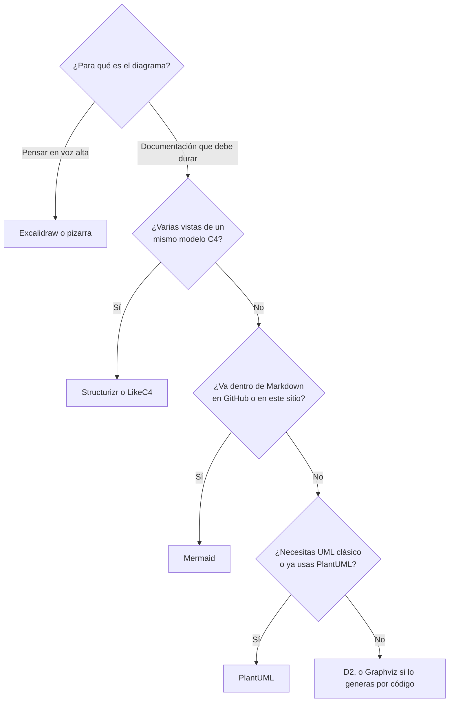
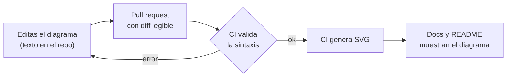

# Diagramas como código: documenta con versiones

Un diagrama exportado como imagen empieza a envejecer el día que se guarda. El archivo no tiene
un historial útil: nadie ve qué cambió entre la versión de marzo y la de octubre, nadie lo revisa
en un pull request y nadie sabe si todavía describe el sistema real. Cuando por fin alguien nota
que miente, el original editable ya no existe.

Este artículo explica por qué conviene escribir los diagramas como texto, qué principios los
hacen útiles y cómo se comparan **Mermaid, Structurizr, D2, PlantUML y Graphviz** dibujando el
mismo sistema pequeño; LikeC4 y Excalidraw aparecen en la tabla comparativa. Después cubre cómo
validarlos y publicarlos desde CI, cómo mantenerlos vivos y qué cambia cuando un agente de IA
también los edita. Los fragmentos de código son guías de forma y de nombres, no plantillas para
copiar.

<Callout tone="info" title="Fecha de corte y cómo se probó">
  Datos de octubre de 2026. Cada fragmento de este artículo se validó con la herramienta real:
  Mermaid 12.1.0 (la que usa este sitio), D2 0.9.0 (publicada el 7 de septiembre de 2026), PlantUML
  1.2026.8, Graphviz 14.0.1 y la imagen Docker oficial `structurizr/structurizr`. Los productos de
  Structurizr cambian: revisa su documentación antes de elegir.
</Callout>

## Por qué escribir diagramas como texto

Un diagrama en texto vive en el repositorio, junto al código que describe, y hereda todo lo que
git ya sabe hacer.

| Qué importa            | Imagen exportada                                   | Diagrama como texto                                     |
| ---------------------- | -------------------------------------------------- | ------------------------------------------------------- |
| **Historial**          | No se puede comparar entre versiones               | `git diff` muestra qué flecha o qué caja cambió         |
| **Revisión**           | Se adjunta una imagen al PR, si alguien se acuerda | Se revisa línea a línea, junto con el cambio de código  |
| **Validación**         | Ninguna                                            | Un analizador sintáctico rechaza un diagrama roto en CI |
| **Quién puede editar** | Quien tiene la herramienta y el archivo fuente     | Cualquiera con un editor de texto, o un agente de IA    |
| **Reutilización**      | Copiar y pegar                                     | Con un modelo, varias vistas salen de la misma fuente   |

Hay un precio. Un diagrama en texto delega la **disposición** a un motor automático, así que
pierdes el control fino de dónde cae cada caja. Para un boceto de pizarra eso es un mal trato; para
documentación que debe durar, casi siempre compensa.

<Callout tone="warning" title="Un diagrama sin audiencia es decoración">
  Pasar un diagrama a código no lo vuelve útil. Evita el «mapa de todo» que nadie puede leer, el
  diagrama que no responde ninguna pregunta concreta y el que nadie mantiene. Si no sabes quién lo
  consultará ni qué decisión ayuda a tomar, no lo escribas.
</Callout>

## Principios de un buen diagrama

Estas reglas valen con cualquier herramienta. Las más importantes vienen del
[modelo C4](/docs/c4-model).

1. **Una pregunta y una audiencia por diagrama.** Ponle de título la pregunta que responde: «¿Qué
   contenedores forman la tienda y con quién hablan?» es mejor que «Arquitectura».
2. **Un solo nivel de abstracción.** No mezcles usuarios, servicios, tablas y clases en la misma
   imagen. C4 lo resuelve con cuatro niveles: contexto, contenedores, componentes y código.
3. **Cada elemento con nombre, tipo y tecnología.** «API · Node.js» dice más que «Backend».
4. **Cada flecha con un verbo** (y el protocolo si importa): «Solicita cobros · HTTPS», no una
   flecha muda.
5. **Título y leyenda siempre.** Si usas una forma o un color con significado, explícalo.
6. **Los nombres del diagrama son los nombres del código.** Si el servicio se llama `orders` en el
   repositorio, no lo llames «Gestor de pedidos» en el diagrama.

Los límites que dibujas importan tanto como las cajas: un contexto delimitado de
[DDD](/docs/domain-driven-design) o un puerto de la [arquitectura hexagonal](/docs/arquitectura-hexagonal)
son buenos candidatos a fronteras visibles.

## Dibujar el diagrama o describir el modelo

Hay dos familias de herramientas, y la diferencia importa más que la sintaxis. El sitio del modelo
C4 las distingue: las herramientas de **diagramación** trabajan con cajas y líneas, lo que limita la
validación y la consulta y suele dar formatos difíciles de comparar; las de **modelado** guardan un
único modelo no visual y generan las vistas a partir de él, y su lista la marca como
«Modelling (recommended)».

| —                     | Diagrama como código                      | Modelo como código                                  |
| --------------------- | ----------------------------------------- | --------------------------------------------------- |
| **Ejemplos**          | Mermaid, D2, PlantUML, Graphviz           | Structurizr, LikeC4                                 |
| **Qué escribes**      | Un diagrama concreto                      | Elementos y relaciones una vez, y las vistas aparte |
| **Si renombras algo** | Lo cambias en cada diagrama donde aparece | Lo cambias en un sitio                              |
| **Curva de entrada**  | Baja: empiezas en minutos                 | Mayor: aprendes un lenguaje de modelado             |
| **Mejor cuando**      | Necesitas uno o pocos diagramas           | Mantienes varias vistas del mismo sistema           |

## El mismo sistema en cinco herramientas

Para compararlas de verdad, todas dibujan el mismo sistema, el de la tienda del
[artículo de C4](/docs/c4-model): un cliente, una aplicación web, una API y una base de datos, con
tres relaciones. Los fragmentos son parciales a propósito (sin la pasarela de pagos ni estilos):
sirven para ver **cómo declara cada herramienta un elemento, una relación y una agrupación**.

Fíjate en lo que no cambia: los identificadores (`cliente`, `web`, `api`, `db`) son cortos, en
minúscula e iguales a los del código; la etiqueta legible va aparte, como texto. Así, un cambio de
nombre en el repositorio se refleja con una búsqueda simple en los diagramas.

### Mermaid

Mermaid convierte texto en diagramas dentro del navegador y es el único de la lista que este sitio
renderiza directamente. Soporta decenas de tipos (flujo, secuencia, clases, estados, ER, Gantt, C4
y `architecture`, entre otros). El tipo C4 está marcado como **experimental**: la documentación
avisa de que la sintaxis puede cambiar, de que la disposición sigue el orden de las sentencias y de
que la leyenda, los sprites y las etiquetas personalizadas aún no están soportados.

```text
C4Container
  title Contenedores de Tienda Aurora
  Person(cliente, "Cliente", "Compra desde el navegador")
  System_Boundary(tienda, "Tienda Aurora") {
    Container(web, "Aplicación web", "React", "Catálogo y carrito")
    Container(api, "API", "Node.js", "Reglas de negocio")
    ContainerDb(db, "Base de datos", "PostgreSQL", "Pedidos y catálogo")
  }
  Rel(cliente, web, "Compra", "HTTPS")
  Rel(web, api, "Llama a", "JSON/HTTPS")
  Rel(api, db, "Lee y escribe", "SQL")
```

Si pegas ese texto en un bloque `mermaid`, este sitio lo dibuja. La forma es la de una función por
elemento: tipo, identificador, nombre, tecnología y descripción, en ese orden.

En los demás tipos de Mermaid, como `flowchart` o `sequenceDiagram`, la disposición es automática.
Según la página de layouts de la documentación vigente, ELK es el algoritmo por defecto en
flowchart, estados, clases y ER (viene incluido desde la versión 12.0.0), y puedes volver a dagre con
`layout: dagre` en la configuración del diagrama. La documentación publicada puede ir por delante
de la versión que fijes: comprueba la tuya.

### Structurizr DSL

Structurizr es la implementación de referencia de C4 y el ejemplo claro de **modelo como código**:
declaras personas, sistemas y contenedores una sola vez, y las vistas seleccionan qué mostrar.

```text
workspace "Tienda Aurora" {
  model {
    cliente = person "Cliente"
    tienda = softwareSystem "Tienda Aurora" {
      web = container "Aplicación web" "Catálogo y carrito" "React"
      api = container "API" "Reglas de negocio" "Node.js"
      db = container "Base de datos" "Pedidos y catálogo" "PostgreSQL"
    }
    cliente -> web "Compra" "HTTPS"
    web -> api "Llama a" "JSON/HTTPS"
    api -> db "Lee y escribe" "SQL"
  }
  views {
    container tienda "Contenedores" {
      include *
    }
  }
}
```

Dos bloques cuentan la historia: `model` (qué existe y cómo se relaciona) y `views` (qué se muestra),
más los estilos, que aquí se omiten. Con `!identifiers hierarchical` los identificadores se escriben
con ruta (`tienda.web`), lo que evita choques cuando el modelo crece; aquí se omite para mantenerlo
corto. La imagen Docker oficial ofrece `validate` y `export`; este último admite entre otros los
formatos `mermaid`, `plantuml`, `static`, `png` y `svg`, y exige que el directorio de salida exista
y sea escribible.

<Callout tone="warning" title="El estado de los productos de Structurizr cambió">
  La documentación actual lista Structurizr Lite, la instalación on-premises, el servicio en la nube
  y el CLI antiguo en una sección «End of life». `structurizr local` se presenta como el equivalente
  de Lite y `structurizr server` como el de on-premises; el comando `server` requiere licencia si
  usas los binarios precompilados, y el resto de comandos son gratuitos. Para probar sin instalar
  nada existe el playground en línea.
</Callout>

### D2

D2 es un lenguaje declarativo de diagramas con temas, modo boceto y una CLI local que funciona sin
conexión. Es de código abierto (MPL-2.0).

```text
direction: right

cliente: Cliente {shape: person}

tienda: Tienda Aurora {
  web: Aplicación web
  api: API
  db: Base de datos {shape: cylinder}
}

cliente -> tienda.web: Compra
tienda.web -> tienda.api: Llama a (JSON/HTTPS)
tienda.api -> tienda.db: Lee y escribe
```

La agrupación es un bloque anidado y el acceso es con punto (`tienda.web`). En la versión 0.9.0,
`d2 layout` muestra tres motores incluidos: dagre, ELK y TALA, este último descrito como el motor
de D2 para diagramas de arquitectura de software. D2 no entiende C4 por sí mismo: dibujas cajas y
contenedores, y la disciplina de niveles la pones tú.

### PlantUML con C4-PlantUML

PlantUML cubre el UML clásico (secuencia, casos de uso, clases, componentes, despliegue, estados)
y muchos otros tipos de diagrama. La biblioteca C4-PlantUML (MIT) añade macros de C4 y se incluye
desde la biblioteca estándar, sin red:

```text
@startuml
!include <C4/C4_Container>

Person(cliente, "Cliente", "Compra desde el navegador")
System_Boundary(tienda, "Tienda Aurora") {
  Container(web, "Aplicación web", "React", "Catálogo y carrito")
  Container(api, "API", "Node.js", "Reglas de negocio")
  ContainerDb(db, "Base de datos", "PostgreSQL", "Pedidos y catálogo")
}

Rel(cliente, web, "Compra", "HTTPS")
Rel(web, api, "Llama a", "JSON/HTTPS")
Rel(api, db, "Lee y escribe", "SQL")
@enduml
```

Con las macros de C4-PlantUML el cuerpo es casi idéntico al de Mermaid: la diferencia está en el
envoltorio (`@startuml`, `!include`) y en el ecosistema. PlantUML se distribuye principalmente bajo
GPL (hay variantes LGPL, Apache, EPL y MIT con menos funciones) y usa Graphviz como motor de
disposición por defecto.

### Graphviz (DOT)

Graphviz es el motor de disposición que PlantUML usa por defecto, y el dagre de D2 se basa en su
algoritmo DOT. El lenguaje DOT no sabe nada de C4: son nodos y aristas. Su valor está en **generar
grafos desde código**.

```text
digraph tienda {
  rankdir=LR;
  cliente [shape=ellipse];

  subgraph cluster_tienda {
    label="Tienda Aurora";
    web; api; db [shape=cylinder];
  }

  cliente -> web [label="Compra"];
  web -> api [label="Llama a"];
  api -> db [label="Lee y escribe"];
}
```

Es el más austero de los cinco: sin tipos de elemento ni tecnología, solo nombres y flechas. Por eso
funciona bien como salida de un programa y mal como documentación escrita a mano.

## Comparativa honesta

| Herramienta     | Enfoque  | Estado en octubre de 2026                                                                                         | Úsala cuando                                                          | Evítala cuando                                                                             |
| --------------- | -------- | ----------------------------------------------------------------------------------------------------------------- | --------------------------------------------------------------------- | ------------------------------------------------------------------------------------------ |
| **Mermaid**     | Diagrama | Muy extendida; GitHub la renderiza; el tipo C4 es experimental                                                    | El diagrama vive en Markdown (README, PR, este sitio)                 | Necesitas control fino de la disposición o leyendas de C4                                  |
| **Structurizr** | Modelo   | DSL activo (binarios v2026.09.19); Lite, on-premises, cloud y CLI antiguo en «End of life»; `server` con licencia | Mantienes varias vistas C4 del mismo sistema                          | Quieres un único diagrama suelto o evitar Docker                                           |
| **D2**          | Diagrama | v0.9.0 (7 sep. 2026); MPL-2.0; dagre, ELK y TALA incluidos                                                        | Quieres buen aspecto, temas y una CLI local que funcione sin conexión | Tu equipo necesita UML clásico o C4 con semántica                                          |
| **PlantUML**    | Diagrama | 1.2026.8; GPL con variantes; amplio catálogo de tipos de diagrama                                                 | Ya lo usas, o necesitas UML clásico (secuencia, clases, componentes)  | Empiezas de cero y no quieres Java ni Graphviz                                             |
| **Graphviz**    | Diagrama | 14.0.1; Eclipse Public License 2.0                                                                                | Generas el grafo desde código (dependencias, módulos)                 | Lo escribes a mano para documentación narrativa                                            |
| **LikeC4**      | Modelo   | MIT; lenguaje de modelado con vista previa en vivo (`npx likec4 start`) y extensión de VS Code                    | Quieres «arquitectura como código» con vistas interactivas            | Necesitas una ruta de exportación documentada a muchos formatos (su README no la describe) |
| **Excalidraw**  | Pizarra  | MIT; formato JSON abierto; exporta a PNG y SVG                                                                    | Bocetas con el equipo, ideas en caliente                              | El diagrama debe revisarse en un PR y mantenerse como documentación                        |

Un matiz sobre LikeC4: no incluyo un ejemplo suyo porque no pude validarlo con su CLI; los datos de
la tabla salen de su sitio y su README.

## Cómo elegir



Si dudas, empieza por Mermaid: GitHub lo renderiza sin instalar nada y se revisa en cualquier PR.
Pasa a un modelo (Structurizr o LikeC4) cuando notes que copias los mismos nombres y relaciones en
varios diagramas.

## Intégralos en tu flujo

### Junto al código y a los ADR

Guarda los diagramas en el repositorio, cerca de lo que describen. Una organización posible, solo
como guía de ubicación y de nombres:

```text
docs/arquitectura/
  workspace.dsl            modelo único (si usas Structurizr)
  contenedores.mmd         vista suelta en Mermaid
  adr/0007-pagos.md        enlaza a la vista que muestra el cambio
```

Cuando una decisión cambia la estructura, el [ADR](/docs/adr) enlaza a la vista que muestra el antes
y el después, y el cambio de código y el del diagrama viajan en el mismo pull request. Nombra los
archivos por **la pregunta que responden** (`contenedores`, `despliegue`), no por la herramienta ni
por la fecha.

### Renderizar y publicar

GitHub renderiza bloques `mermaid` en issues, discusiones, pull requests, wikis y archivos
Markdown; si dudas de la versión, escribe `info` dentro del bloque. Las demás herramientas generan
SVG en CI con la columna «Renderizar» de la tabla de la sección siguiente. Publica el SVG junto a
la documentación.

### Validar en CI

Un diagrama roto debe romper el build, igual que un test. Comandos comprobados con las versiones
de la nota de corte:

| Herramienta | Validar                             | Renderizar                                        | Si hay un error de sintaxis      |
| ----------- | ----------------------------------- | ------------------------------------------------- | -------------------------------- |
| Mermaid     | `mermaid.parse()` (necesita un DOM) | `mmdc -i diagrama.mmd -o diagrama.svg`            | Lanza una excepción con la línea |
| Structurizr | `validate -workspace workspace.dsl` | `export -workspace workspace.dsl -format mermaid` | Código 1 y el motivo             |
| D2          | `d2 validate archivo.d2`            | `d2 archivo.d2 archivo.svg`                       | Código 1 y la línea del error    |
| PlantUML    | `plantuml -checkonly archivo.puml`  | `plantuml -tsvg archivo.puml`                     | Código 100 o 200 en las pruebas  |
| Graphviz    | `dot -Tsvg archivo.dot > /dev/null` | `dot -Tsvg archivo.dot -o archivo.svg`            | Código 1 y la línea del error    |

Los comandos de Structurizr corresponden a la imagen Docker oficial, y la salida de su `export` a
Mermaid o PlantUML se renderiza después con esas herramientas.

Para Mermaid dentro de MDX, como en este sitio, basta con extraer los bloques y pasarlos por
`mermaid.parse`. Necesita un DOM aunque solo valide, porque Mermaid sanea el texto con DOMPurify:
sin él, la llamada falla con «DOMPurify.addHook is not a function». Una solución habitual es
levantar uno con `jsdom` antes de importar Mermaid. Esta comprobación se ejecutó sobre todos los
bloques `mermaid` de los documentos del sitio sin encontrar errores.

El flujo completo, desde la edición hasta el diagrama publicado:



La validación solo garantiza que el diagrama **compila**, no que sea **verdad**. Eso sigue
dependiendo de la revisión humana.

## Mantenlos vivos

- **Cambio de código, cambio de diagrama.** Añade al checklist del pull request: «¿este cambio
  altera algún contenedor, componente o relación dibujados?».
- **Genéralos cuando puedas.** Un diagrama generado desde el código no puede quedar desfasado.
  `dependency-cruiser` emite grafos de dependencias en `dot`, `mermaid` y `d2` mediante su opción
  `--output-type`, y con `dot` puedes pasarlos a SVG. Es la misma idea de las
  [fitness functions](/docs/fitness-functions): lo que se comprueba solo se mantiene.
- **Modela una vez.** Si el mismo sistema aparece en cuatro diagramas, un modelo (Structurizr o
  LikeC4) evita renombrar cuatro veces.
- **Un responsable por diagrama,** y una fecha de última revisión visible en el título o en la
  leyenda.
- **Borra lo que ya no responde nada.** Un diagrama obsoleto es peor que ninguno.

## Diagramas y agentes de IA

Como son texto, un agente puede leerlos y editarlos con las mismas herramientas con que edita
código. Eso abre dos usos útiles:

- **Actualizar el diagrama junto con el cambio.** En el prompt o en el archivo de instrucciones del
  proyecto, pide que, si el cambio toca un contenedor o una relación, edite también el diagrama
  que lo muestra.
- **Proponer un primer borrador** desde el código existente, que una persona corrige.

Aplica el mismo criterio que en el [harness de un agente](/docs/harness-engineering-claude-code):
la validación de sintaxis es un **sensor computacional** barato (los comandos de la tabla anterior),
y la revisión de que el diagrama dice la verdad es un sensor **inferencial** o humano. Una regla
escrita en el archivo de instrucciones es una sugerencia; el chequeo en CI es lo que se cumple
siempre.

## Errores frecuentes

- **El diagrama que lo muestra todo.** Si no cabe en una pantalla ni responde una pregunta, divídelo
  en vistas.
- **Mezclar niveles de abstracción.** Servicios, tablas y clases en la misma imagen confunden más
  de lo que aclaran.
- **Flechas sin verbo ni protocolo.** Una flecha muda obliga a adivinar.
- **No validar en CI.** Un diagrama roto se descubre cuando alguien lo necesita.
- **Confiar en que «está en el repo» significa «está al día».** Sin revisión en el PR, también se
  pudre.
- **Depender de una vista C4 experimental para algo crítico.** Fija la versión de Mermaid y vuelve a
  validar al actualizar.

## Checklist para tus diagramas

- [ ] Cada diagrama responde una pregunta concreta para una audiencia concreta.
- [ ] Tiene título, leyenda, nombres iguales a los del código y flechas con verbo.
- [ ] Vive en el repositorio, junto al código o la documentación que describe.
- [ ] CI valida la sintaxis y falla si el diagrama no compila.
- [ ] CI genera y publica el SVG, o el Markdown lo renderiza directamente.
- [ ] El checklist del pull request pregunta si el cambio altera algún diagrama.
- [ ] Cada diagrama tiene un responsable y una fecha de revisión.
- [ ] Los grafos que se pueden generar desde el código se generan.
- [ ] Los ADR enlazan a las vistas que explican la decisión.
- [ ] Un agente de IA puede actualizarlos, y una persona revisa que sigan siendo ciertos.

## Fuentes

Consultadas en octubre de 2026; la documentación de estas herramientas cambia con frecuencia, así
que contrasta cada dato con la fuente oficial.

- [Mermaid: introducción y tipos de diagrama](https://mermaid.js.org/intro/)
- [Mermaid: diagramas C4 (experimental)](https://mermaid.js.org/syntax/c4.html)
- [Mermaid: algoritmos de disposición](https://mermaid.js.org/config/layouts.html)
- [Mermaid: diagramas de arquitectura](https://mermaid.js.org/syntax/architecture.html)
- [mermaid-cli](https://github.com/mermaid-js/mermaid-cli)
- [GitHub Docs: crear diagramas en Markdown](https://docs.github.com/en/get-started/writing-on-github/working-with-advanced-formatting/creating-diagrams)
- [Structurizr: documentación](https://docs.structurizr.com/)
- [Structurizr: referencia del lenguaje DSL](https://docs.structurizr.com/dsl/language)
- [Structurizr: tutorial del DSL](https://docs.structurizr.com/dsl/tutorial)
- [Structurizr: comandos](https://docs.structurizr.com/commands)
- [Structurizr: exportar](https://docs.structurizr.com/export)
- [Structurizr local: guía rápida](https://docs.structurizr.com/local/quickstart)
- [Modelo C4: herramientas](https://c4model.com/tooling)
- [D2](https://d2lang.com/)
- [D2: motores de disposición](https://d2lang.com/tour/layouts/)
- [D2 en GitHub](https://github.com/terrastruct/d2)
- [PlantUML](https://plantuml.com/)
- [PlantUML: línea de comandos](https://plantuml.com/command-line)
- [PlantUML: preguntas frecuentes (licencia)](https://plantuml.com/faq)
- [C4-PlantUML](https://github.com/plantuml-stdlib/C4-PlantUML)
- [Graphviz](https://graphviz.org/)
- [Graphviz: licencia](https://graphviz.org/license/)
- [LikeC4](https://likec4.dev/) y [su repositorio](https://github.com/likec4/likec4)
- [Excalidraw](https://github.com/excalidraw/excalidraw)
- [dependency-cruiser: CLI](https://github.com/sverweij/dependency-cruiser/blob/main/doc/cli.md)
