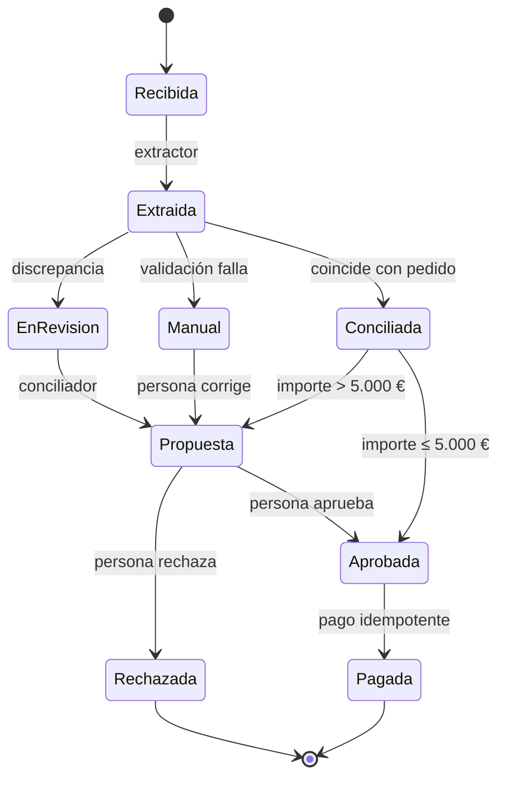
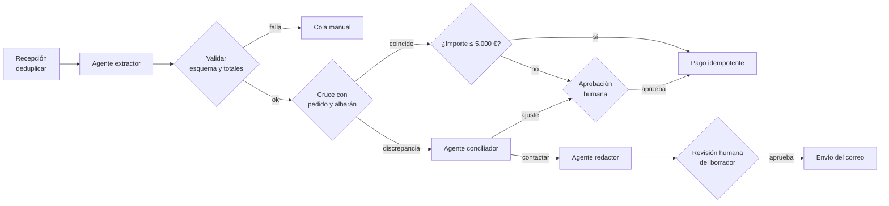

# Diseñar flujos con agentes de IA

Imagina un equipo de finanzas que conecta un agente al buzón de facturas. En la demo, el agente
lee el PDF, encuentra el pedido, concilia importes y programa el pago. A las tres semanas en
producción aparece el primer pago duplicado: el agente reintentó tras un tiempo de espera y nadie
sabía que la herramienta de pago no era idempotente. Cuando alguien pregunta por qué se aprobó una
factura con un precio distinto al del pedido, no hay forma de saberlo: solo quedó el resultado.

El problema no era el modelo. Era el flujo: un único agente con todas las herramientas, sin puntos
de control, sin estado propio y sin trazas. **Diseñar un flujo con agentes es decidir, paso a paso,
qué hace código determinista y qué hace un modelo, y dónde el sistema valida, pide aprobación o se
detiene.**

Esta lección se queda en el nivel del flujo de negocio. La arquitectura interna de un agente está
en [arquitectura de aplicaciones con LLM y agentes](/docs/arquitectura-agentes-llm); cuánta
autonomía conceder, en [controlar la IA](/docs/controlar-la-ia-gobierno-y-autonomia); y dónde se
atasca el trabajo, en [flujo de valor y cuellos de botella](/docs/flujo-de-valor-y-cuellos-de-botella).

<Callout tone="info" title="Fecha de corte">
  Datos consultados en octubre de 2026. Los nombres de los patrones vienen de «Building effective
  agents» (Erik Schluntz y Barry Zhang, Anthropic, 19 de diciembre de 2024); la propia página avisa
  de que parte de las herramientas que describe han cambiado. Las cifras del ejemplo trabajado son
  supuestos, no precios de ningún proveedor.
</Callout>

## Determinista o agente: la decisión es por paso

El error de partida es decidir «usamos un agente» para todo el proceso. La unidad de decisión es
el paso. Un mismo flujo puede tener pasos que son una consulta SQL, pasos que son una sola llamada
a un modelo y un paso, quizá uno solo, donde un agente con herramientas aporta algo que el código
no puede.

Anthropic distingue los _workflows_ (caminos de código predefinidos) de los agentes (el modelo
dirige su propio proceso). Según sus autores, los primeros dan previsibilidad y consistencia en
tareas bien definidas, los segundos encajan cuando hace falta flexibilidad, y conviene empezar por
la solución más simple.

En el flujo, la regla práctica es empezar con todo en código, mover al modelo solo lo que el
código no sabe hacer y dejar al agente la parte más estrecha posible: si un paso «con agente» se
puede describir como una lista fija de llamadas, es un _workflow_ y será más barato y más fácil de
depurar. Los criterios para elegir entre una llamada al modelo, un _workflow_ y un agente, y
cuándo no usar un agente, están en
[arquitectura de aplicaciones con LLM y agentes](/docs/arquitectura-agentes-llm).

## Patrones de flujo y dónde controlarlos

Anthropic describe cinco patrones de _workflow_: encadenamiento de pasos (_prompt chaining_),
enrutamiento (_routing_), paralelización (_parallelization_, con variantes por secciones y por
votación), orquestador con trabajadores (_orchestrator-workers_) y evaluador-optimizador
(_evaluator-optimizer_), además del agente autónomo. Sus definiciones y casos de uso están en
[arquitectura de aplicaciones con LLM y agentes](/docs/arquitectura-agentes-llm). Aquí interesa
otra pregunta: qué control pide cada uno.

| Patrón                       | Punto de control natural                                      | Qué medir                          | Riesgo de diseño                             |
| ---------------------------- | ------------------------------------------------------------- | ---------------------------------- | -------------------------------------------- |
| Encadenamiento               | Una comprobación entre pasos antes de pasar la salida         | En qué paso se corta la cadena     | Un error temprano se propaga a todos         |
| Enrutamiento                 | Confianza de la clasificación; ruta por defecto a una persona | Reparto de casos por ruta          | Un caso difícil acaba en la ruta barata      |
| Paralelización               | La agregación: umbral de acuerdo entre ramas                  | Desacuerdo entre ramas             | Costo multiplicado por el número de ramas    |
| Orquestador con trabajadores | Validar el plan antes de delegar; tope de subtareas           | Subtareas generadas por ejecución  | Explosión de subtareas y de costo            |
| Evaluador-optimizador        | Criterio de parada: umbral de calidad o máximo de rondas      | Rondas hasta converger             | Un bucle que no converge nunca               |
| Agente autónomo              | Condiciones de parada y aprobación de acciones de impacto     | Pasos y herramientas por ejecución | Errores que se acumulan sin que nadie lo vea |

El artículo llama _gates_ a las comprobaciones programáticas entre pasos de una cadena, que sirven
para confirmar que el proceso sigue en buen camino. Para los agentes, menciona dos mecanismos de
control: pausas para recibir feedback humano en puntos de control o al encontrar un bloqueo, y
condiciones de parada como un número máximo de iteraciones.

Los patrones se combinan: el ejemplo trabajado es una cadena con enrutamiento por reglas y un
solo paso de agente.

## Puntos de control: validar, aprobar, parar

Un punto de control es un lugar del flujo donde el sistema deja de confiar en la salida del paso
anterior y decide si continúa. Hay tres tipos, con dueños distintos:

| Tipo    | Quién decide             | Cuándo ponerlo                                     | Ejemplo                                        |
| ------- | ------------------------ | -------------------------------------------------- | ---------------------------------------------- |
| Validar | Código determinista      | Después de cada paso con modelo                    | Esquema, totales que cuadran, el pedido existe |
| Aprobar | Una persona con contexto | Antes de una acción irreversible o de alto impacto | Revisar un ajuste de precio antes de pagar     |
| Parar   | Límites del orquestador  | Siempre, como red de seguridad                     | Presupuesto agotado, máximo de pasos, plazo    |

### Validar

La salida de un modelo es una entrada no confiable. Valídala con lo que el código sí sabe
comprobar: un esquema, sumas que deben cuadrar, identificadores que deben existir en el sistema de
origen, valores dentro de un rango. Lo que no pasa no sigue: vuelve al paso o va a una persona.

### Aprobar

En el flujo, los puntos de aprobación van justo antes de los pasos que no se pueden deshacer, que
es donde el costo de un error supera el de la revisión; cuánta autonomía dar a cada acción y cómo
diseñar la aprobación están en [controlar la IA](/docs/controlar-la-ia-gobierno-y-autonomia). El
OWASP LLM Top 10, edición 2025 (sustituida en agosto de 2026 por la de 2026), recoge el riesgo como
_Excessive Agency_ (LLM06): funcionalidad, permisos o autonomía excesivos.

### Parar

Toda ejecución necesita salidas acotadas: máximo de pasos, presupuesto de tokens o de costo,
plazo total y número de fallos. El detalle de esos límites dentro del bucle del agente está en
[arquitectura de aplicaciones con LLM y agentes](/docs/arquitectura-agentes-llm). A nivel de flujo
añade una regla más: parar no es fallar en silencio. Un caso parado va a una cola con su estado y
su traza, y alguien lo atiende.

## Reversibilidad y compensaciones

Clasifica cada paso por lo que cuesta deshacerlo. Esa clasificación decide dónde va la aprobación.

| Clase        | Qué significa                               | Ejemplo en facturas                | Control mínimo            |
| ------------ | ------------------------------------------- | ---------------------------------- | ------------------------- |
| Lectura      | No cambia nada                              | Consultar pedidos y albaranes      | Permiso de solo lectura   |
| Reversible   | Se deshace sin efecto externo               | Guardar un borrador de correo      | Validación                |
| Compensable  | Se anula con otra acción, con algún costo   | Marcar la factura como aprobada    | Validación y registro     |
| Irreversible | No hay vuelta atrás, o la vuelta es externa | Ejecutar el pago, enviar el correo | Aprobación e idempotencia |

Es la misma lógica de las sagas: pasos compensables primero, un pivote y después pasos que se
pueden reintentar. Los detalles (compensar no es deshacer, falta de aislamiento) están en
[sagas, outbox e idempotencia](/docs/sagas-outbox-idempotencia). Aplicada a agentes, deja dos
reglas:

- **El agente propone; el código ejecuta.** Las acciones irreversibles no son herramientas del
  agente. El agente produce una propuesta estructurada y un paso determinista la ejecuta después
  del punto de control.
- **La aprobación va justo antes del pivote.** Si hay pasos con efecto externo después de la
  aprobación, deben ser reintentables e idempotentes.

## Estado, memoria e idempotencia

El estado del flujo vive fuera del modelo. El contexto del agente es memoria de trabajo para una
ejecución; la fuente de verdad es un registro persistente por caso y por paso. Así puedes reanudar
tras un fallo sin repetir lo hecho, auditar una decisión meses después y cambiar de modelo sin
perder el historial.



Cada transición se guarda con su entrada, su salida y quién la decidió (regla, modelo o persona).
La forma de ese registro puede ser tan simple como esta:

```ts
type StepRecord = {
  flowId: string; // un caso: una factura
  step: 'extract' | 'validate' | 'reconcile' | 'approve' | 'pay';
  actor: 'rule' | 'model' | 'agent' | 'human';
  inputHash: string; // detecta reprocesos con la misma entrada
  output: unknown; // propuesta estructurada, validada
  decision: string; // motivo legible: regla aplicada o resumen del agente
  idempotencyKey?: string; // solo en pasos con efecto externo
  costEur: number;
  durationMs: number;
  // …
};
```

La **idempotencia** es lo que hace seguros los reintentos. Un agente reintenta por diseño: tras un
tiempo de espera, tras un error de herramienta o porque el orquestador reanuda desde el último
paso. Cada acción con efecto externo necesita una clave estable derivada del caso, no del intento
(por ejemplo, proveedor más número de factura), y el sistema de destino debe rechazar o devolver
el resultado anterior si la clave se repite. Las claves de idempotencia, el outbox y la
deduplicación en el consumidor se explican en
[sagas, outbox e idempotencia](/docs/sagas-outbox-idempotencia).

## Observabilidad: trazas, costo y decisiones

Un flujo sin trazas no se puede depurar ni mejorar. Necesitas tres señales por paso:

| Señal                   | Qué responde                                 | Ejemplo                                       |
| ----------------------- | -------------------------------------------- | --------------------------------------------- |
| Traza por paso          | Qué pasó en este caso y en qué orden         | Un span por paso y por llamada a herramienta  |
| Costo y tiempo por paso | Dónde se va el dinero y dónde espera el caso | Tokens, costo estimado y duración por paso    |
| Registro de decisiones  | Por qué el agente propuso lo que propuso     | Herramientas usadas, evidencia citada, motivo |

OpenTelemetry mantiene convenciones semánticas para IA generativa en el repositorio
`semantic-conventions-genai`. Incluyen spans para invocar un agente (`invoke_agent`), ejecutar
una herramienta (`execute_tool`) e invocar un _workflow_ (`invoke_workflow`), y atributos de uso
como `gen_ai.usage.input_tokens`. A octubre de 2026 figuran con estado _Development_: pueden
cambiar, así que fija la versión que uses.

Dos decisiones de diseño que conviene tomar pronto:

- **Qué contenido entra en la traza.** Prompts y documentos pueden contener datos personales o
  financieros. Registra identificadores, métricas y la decisión estructurada; guarda el contenido
  completo solo donde tengas base para hacerlo y con retención acotada.
- **El costo por caso como métrica de producto.** Si el costo medio por caso se multiplica, quieres
  verlo en un panel antes que en la factura del proveedor ([FinOps](/docs/finops-costo-como-atributo)).

## Ejemplo trabajado: revisión de facturas con tres agentes

Un caso hipotético con supuestos explícitos. Una empresa recibe **2.000 facturas al mes** y hoy
las revisa a mano a unos 6 minutos por factura: 12.000 minutos, unas 200 horas al mes. Quiere
automatizar sin arriesgar pagos indebidos.

**Decisión 1: tres agentes con herramientas mínimas y ninguno con permiso de pago.**

| Agente      | Tarea                                             | Herramientas                        | Lo que no puede hacer           |
| ----------- | ------------------------------------------------- | ----------------------------------- | ------------------------------- |
| Extractor   | Leer el PDF y devolver campos estructurados       | Leer el documento                   | Consultar ni escribir en el ERP |
| Conciliador | Explicar una discrepancia y proponer una solución | Leer pedidos, albaranes e historial | Aprobar, pagar o escribir       |
| Redactor    | Redactar el correo al proveedor                   | Crear un borrador                   | Enviar el correo                |

El extractor podría ser una sola llamada al modelo; el conciliador es el único que necesita ser un
agente, porque no sabe de antemano qué documentos tendrá que consultar.

**Decisión 2: el flujo.** Recepción, deduplicación, validación, cruce y enrutamiento por importe
son código. Una persona aprueba cualquier pago fuera de la ruta automática y cualquier correo.



**Supuestos de volumen** (deben sumar):

| Paso                       | Entran | Salen por cada rama                                |
| -------------------------- | -----: | -------------------------------------------------- |
| Recepción y deduplicación  |  2.000 | 40 duplicadas descartadas (2 %); 1.960 siguen      |
| Extractor y validación     |  1.960 | 60 a cola manual (3 %); 1.900 siguen               |
| Cruce con pedido y albarán |  1.900 | 1.520 coinciden (80 %); 380 con discrepancia       |
| Enrutamiento por importe   |  1.520 | 1.440 pago automático; 80 a aprobación (> 5.000 €) |
| Conciliador                |    380 | 228 propuestas de ajuste (60 %); 152 a contactar   |
| Redactor                   |    152 | 152 borradores a revisión                          |

**Carga humana:** 60 casos manuales a 6 minutos (360), 80 aprobaciones por importe a 2 minutos
(160), 228 ajustes a 3 minutos (684) y 152 borradores a 2 minutos (304). Total: 1.508 minutos,
unas 25 horas al mes frente a las 200 de partida.

**Costo de modelo (supuestos por caso, no precios de proveedor):** extractor 0,02 € × 1.960 =
39,20 €; conciliador 0,15 € × 380 = 57,00 €; redactor 0,05 € × 152 = 7,60 €. Total: 103,80 € al
mes, unos 0,05 € por factura. Los tiempos por paso (supuestos: 8 s, 40 s y 10 s) van a la misma
traza, para ver si el cuello de botella es el modelo o la cola de aprobación.

**Decisión 3: idempotencia y trazas.** El pago usa como clave el identificador fiscal del
proveedor más el número de factura; un reintento devuelve el pago existente. Cada caso tiene un
`flowId` que une los spans de los tres agentes, las validaciones y la aprobación.

**Consecuencias aceptadas:** 25 horas de revisión al mes, concentradas antes del pago; pago
automático solo si la factura coincide con pedido y albarán y no supera 5.000 €; y ese umbral se
revisa cada trimestre con los errores detectados en aprobación, según un [ADR](/docs/adr).

## Cuándo sí y cuándo no

A nivel de flujo, un paso con agente se justifica cuando su salida se puede validar antes del
paso siguiente, sus acciones irreversibles quedan fuera de sus herramientas, el costo por caso
cabe en el margen del proceso y el equipo puede atender la cola de aprobaciones que el diseño
genera; si las reglas se pueden escribir, un paso determinista será más barato y depurable. Los
criterios generales sobre cuándo no usar un agente están en
[arquitectura de aplicaciones con LLM y agentes](/docs/arquitectura-agentes-llm).

<Callout tone="warning" title="La aprobación también se satura">
  Si el flujo manda a revisión más casos de los que el equipo puede atender, la aprobación se vuelve
  un trámite o un cuello de botella. Dimensiona la cola de aprobaciones como cualquier otra
  capacidad del sistema.
</Callout>

## Errores frecuentes

- **Un agente único para todo.** Con todas las herramientas y todo el proceso en un prompt, no hay
  dónde validar ni qué medir, y un fallo en un paso contamina el resto.
- **Agentes sin límites de herramientas.** Un agente con permiso de pago o de envío convierte un
  error de razonamiento en un efecto externo. Es la _Excessive Agency_ de OWASP.
- **Flujos sin trazas.** Sin un span por paso y un registro de decisiones no sabes por qué se
  aprobó un caso ni dónde se va el costo.
- **Confiar en la salida de un paso sin validarla.** Una extracción con el total mal leído pasa
  como verdad a todos los pasos siguientes.
- **Aprobaciones sin contexto.** La persona ve «¿Aprobar?» sin la evidencia y aprueba por inercia.
- **Reintentos sin idempotencia.** El reintento de un paso con efecto externo duplica el efecto.
- **Parar sin destino.** Un caso que supera el presupuesto y desaparece es peor que uno que falla
  con estado y traza.

## Checklist

- [ ] Cada paso está clasificado como código, una llamada al modelo o agente, con el motivo.
- [ ] Cada paso con modelo tiene detrás una validación determinista de su salida.
- [ ] Las acciones irreversibles no son herramientas de ningún agente y van tras una aprobación.
- [ ] Cada agente tiene la lista mínima de herramientas y permisos de solo lectura donde basta.
- [ ] El flujo tiene límites de pasos, costo y plazo, y una cola para los casos parados.
- [ ] El estado de cada caso vive en un registro persistente por paso, fuera del contexto del modelo.
- [ ] Cada acción con efecto externo usa una clave de idempotencia derivada del caso.
- [ ] Hay trazas por paso con costo, duración y motivo de la decisión.

## Fuentes

Consultadas en octubre de 2026.

- [Building effective agents (Erik Schluntz y Barry Zhang, Anthropic, 19 de diciembre de 2024)](https://www.anthropic.com/engineering/building-effective-agents)
- [LLM06:2025 Excessive Agency (OWASP Top 10 for LLM Applications 2025, sustituida en agosto de 2026 por la edición 2026)](https://genai.owasp.org/llmrisk/llm062025-excessive-agency/)
- [Semantic Conventions for GenAI agent and framework spans (OpenTelemetry)](https://github.com/open-telemetry/semantic-conventions-genai/blob/main/docs/gen-ai/gen-ai-agent-spans.md)
- [OpenTelemetry semantic-conventions-genai](https://github.com/open-telemetry/semantic-conventions-genai)
