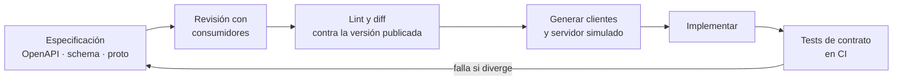
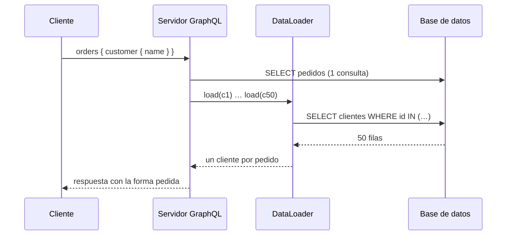
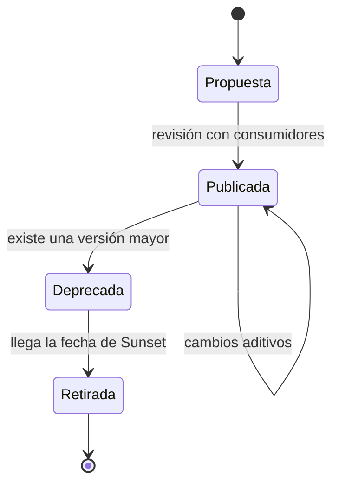
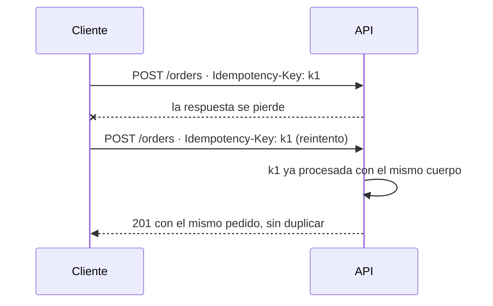

# Diseño de APIs: contratos que duran

Renombras un campo de `status` a `state` porque el nombre nuevo es más claro. Las pruebas pasan, el despliegue sale limpio y, a la mañana siguiente, la versión de la app móvil que instalaron miles de usuarios hace un año deja de mostrar pedidos. No puedes obligarles a actualizar, y el socio que integró tu API por lotes tampoco tiene a nadie disponible esta semana. El código del servidor era tuyo; el contrato ya no lo era del todo.

**Una API es un contrato publicado: la promesa de que ciertas peticiones producen ciertas respuestas, de la que dependen consumidores que no controlas y que no puedes retirar cuando te convenga.**

Este artículo trata ese contrato como el producto que es. Compara REST, GraphQL y gRPC por cómo expresan y evolucionan el contrato, explica qué cambios rompen y cuáles no, y baja a las decisiones que más se repiten: paginación, formato de errores, reintentos seguros con `POST` y límites de tasa. El código solo muestra formas de contrato, no implementaciones.

<Callout tone="info" title="Fecha de corte">
  Especificaciones consultadas en octubre de 2026. Las cabeceras `RateLimit` y `RateLimit-Policy`
  siguen siendo un borrador del IETF (versión 11, mayo de 2026) y el borrador de `Idempotency-Key`
  figura como expirado; ninguno es todavía un RFC.
</Callout>

## El contrato como producto

Un contrato incluye más de lo que escribes en la especificación. Hyrum Wright, entonces ingeniero en Google, lo resumió en la observación que Titus Winters bautizó como ley de Hyrum: con suficientes usuarios de una API, no importa lo que prometas en el contrato; alguien dependerá de cada comportamiento observable de tu sistema. El orden de una lista, el texto de un mensaje de error o el tiempo de respuesta pasan a formar parte del contrato de hecho, lo hayas documentado o no.

La consecuencia práctica es que diseñar una API es sobre todo decidir **qué prometes y qué te reservas**. Lo que no prometes de forma explícita (orden, formato de identificadores, campos internos) conviene que no sea observable o que esté documentado como no garantizado.

### Contrato primero o código primero

Hay dos maneras de llegar al contrato. En **contrato primero** (_contract-first_), el equipo escribe la especificación (OpenAPI, un esquema GraphQL o un `.proto`), la revisa con los consumidores y genera a partir de ella clientes, servidores de prueba y validaciones. En **código primero** (_code-first_), la especificación se deriva de anotaciones o tipos del código.

| —                         | Contrato primero                                   | Código primero                                        |
| ------------------------- | -------------------------------------------------- | ----------------------------------------------------- |
| Dónde vive la verdad      | En la especificación, versionada en el repositorio | En el código; la especificación es un subproducto     |
| Revisión con consumidores | Antes de implementar, sobre un documento legible   | Después, cuando el endpoint ya existe                 |
| Riesgo principal          | Especificación y código divergen si nada lo valida | Detalles de implementación se filtran al contrato     |
| Encaja cuando             | Hay consumidores externos o varios equipos         | API interna, un solo consumidor, iteración muy rápida |

Contrato primero no exige burocracia: exige que el contrato sea un artefacto revisable y que una comprobación automática impida que el código se desvíe de él.



## REST: recursos sobre HTTP

REST lo describió Roy Fielding en el capítulo 5 de su tesis doctoral, _Architectural Styles and the Design of Network-based Software Architectures_ (Universidad de California en Irvine, 2000). Lo define como un estilo arquitectónico con restricciones: cliente-servidor, sin estado, cacheable, interfaz uniforme, sistema en capas y, como opcional, código bajo demanda. La interfaz uniforme se compone a su vez de cuatro restricciones: identificación de recursos, manipulación mediante representaciones, mensajes autodescriptivos e hipermedia como motor del estado de la aplicación.

Muchas APIs que se llaman REST cumplen las primeras restricciones y omiten la hipermedia. No es un pecado, pero conviene ser preciso al hablar: lo que suele construirse es una API HTTP orientada a recursos, y la mayor parte de su valor está en usar bien la semántica que HTTP ya define.

### Métodos y su semántica

RFC 9110 (junio de 2022) define la semántica de HTTP. Distingue métodos **seguros**, cuya semántica es esencialmente de solo lectura, e **idempotentes**, aquellos en los que el efecto previsto de varias peticiones idénticas es el mismo que el de una sola. `PATCH` no está en RFC 9110: lo define RFC 5789 (marzo de 2010), que lo declara ni seguro ni idempotente.

| Método   | Seguro | Idempotente | Uso típico                                       |
| -------- | ------ | ----------- | ------------------------------------------------ |
| `GET`    | Sí     | Sí          | Leer un recurso o una colección                  |
| `HEAD`   | Sí     | Sí          | Metadatos sin cuerpo                             |
| `PUT`    | No     | Sí          | Reemplazar el estado completo de un recurso      |
| `DELETE` | No     | Sí          | Eliminar un recurso                              |
| `POST`   | No     | No          | Crear en una colección o lanzar un procesamiento |
| `PATCH`  | No     | No          | Modificar parte de un recurso                    |

La idempotencia importa porque decide qué puede reintentar un cliente sin miedo cuando una respuesta no llega. Con `POST` hace falta un mecanismo adicional, que se ve más abajo.

### Recursos y códigos de estado

Modela sustantivos del negocio (`/orders`, `/orders/{id}/lines`), no verbos de implementación. Evita anidar más de un nivel: si un recurso tiene identidad propia, dale su propia ruta. Y usa los códigos de estado por lo que significan en RFC 9110, no por costumbre:

| Código | Cuándo usarlo                                                                                       |
| ------ | --------------------------------------------------------------------------------------------------- |
| `201`  | Se creó un recurso; la cabecera `Location` indica dónde está                                        |
| `400`  | La petición está mal formada                                                                        |
| `401`  | Faltan credenciales válidas; va acompañado de `WWW-Authenticate`                                    |
| `403`  | El servidor entiende la petición y la rechaza; repetir con las mismas credenciales no ayudará       |
| `404`  | El recurso no existe, o prefieres no revelar que existe                                             |
| `409`  | Conflicto con el estado actual del recurso, por ejemplo una transición de estado no permitida       |
| `412`  | Una precondición de la petición, como `If-Match`, resultó falsa                                     |
| `422`  | Sintaxis válida, pero el servidor no puede procesar lo que pide (una regla de negocio no se cumple) |
| `429`  | Demasiadas peticiones en un periodo (RFC 6585)                                                      |

`If-Match` con la `ETag` de la última lectura es la forma estándar de evitar la actualización perdida: si otro cliente cambió el recurso entre tu lectura y tu escritura, la precondición falla con `412` y no se pisa nada.

## GraphQL: el cliente elige la forma

GraphQL es un lenguaje de consulta con un esquema tipado. Su especificación la mantiene la GraphQL Foundation; la edición de septiembre de 2025 es la primera desde octubre de 2021. El servidor publica tipos y campos, y cada consulta pide exactamente los campos que necesita, normalmente a través de un único endpoint.

Ese desplazamiento del poder al cliente tiene ventajas claras cuando hay muchos consumidores con necesidades distintas (pantallas móviles, web, integraciones) y un grafo de datos rico. También tiene costes que conviene asumir de forma consciente:

- **El problema N+1.** Cada campo lo resuelve una función independiente. Una lista de 50 pedidos que pide el cliente de cada uno dispara, sin más cuidado, una consulta para la lista y otra por pedido. La solución habitual es **DataLoader**: agrupa las llamadas a `load(key)` hechas en el mismo ciclo del bucle de eventos en una sola llamada por lotes y memoriza los resultados durante la petición. Según su documentación, es un puerto del API _Loader_ desarrollado en Facebook en 2010.
- **Coste de consulta variable.** Un cliente puede pedir un árbol muy profundo. Es práctica común limitar la profundidad o asignar un coste a cada consulta.
- **Caché HTTP menos útil.** Si todo viaja por `POST` a un único endpoint, la caché por URL de HTTP deja de servir y la caché se mueve al cliente o a una capa propia.



GraphQL evoluciona sin versiones explícitas: se añaden campos y los viejos se marcan con la directiva `@deprecated`, definida en la especificación, que la introspección expone para que las herramientas avisen a quien todavía los usa.

## gRPC y Protocol Buffers

gRPC describe el servicio y sus mensajes con Protocol Buffers por defecto. Admite cuatro tipos de llamada (unaria, _streaming_ del servidor, del cliente y bidireccional) y permite al cliente fijar un plazo: si se agota, la llamada termina con `DEADLINE_EXCEEDED`. Encaja bien entre servicios internos con contratos estrictos y mucho tráfico.

En Protocol Buffers el contrato en el cable lo definen los **números de campo**, no los nombres. De ahí salen reglas de evolución muy concretas, según la guía oficial de proto3:

- El número de un campo no puede cambiar una vez que el mensaje está en uso; renumerar equivale a borrar un campo y crear otro.
- Los números no se reutilizan nunca. Al borrar un campo, reserva su número y también su nombre, para que las codificaciones JSON y de texto sigan funcionando.
- Añadir campos, borrar campos sin reutilizar su número y añadir valores a un enum son cambios seguros en el cable. Aun así, un valor nuevo de enum puede romper un `switch` exhaustivo del consumidor.
- Los campos desconocidos se conservan al leer y reescribir en binario, pero pueden perderse al convertir a JSON.
- Renombrar un campo no cambia el binario, pero rompe a quien use la codificación JSON.

```protobuf
message Order {
  reserved 4;              // antes: string legacy_code
  reserved "legacy_code";
  string id = 1;
  OrderStatus status = 2;
  int64 total_cents = 3;
  optional string delivery_window = 5;  // añadido en la v2
}
```

Los números 1 a 15 ocupan un byte en el cable, así que conviene reservarlos para los campos más frecuentes. En proto3, un escalar sin `optional` no distingue entre «no enviado» y «enviado con el valor por defecto»; si esa diferencia importa, decláralo `optional`.

## REST, GraphQL y gRPC frente a frente

| —                  | REST sobre HTTP                                 | GraphQL                                      | gRPC                                     |
| ------------------ | ----------------------------------------------- | -------------------------------------------- | ---------------------------------------- |
| Contrato           | OpenAPI (opcional, pero recomendable)           | Esquema tipado, obligatorio                  | Archivo `.proto`, obligatorio            |
| Quién decide forma | El servidor                                     | El cliente, dentro del esquema               | El servidor                              |
| Evolución habitual | Cambios aditivos y versión mayor si hay ruptura | Campos nuevos y `@deprecated`, sin versiones | Números de campo estables y `reserved`   |
| Caché              | Caché HTTP estándar en `GET`                    | Sobre todo en el cliente                     | Propia de la aplicación                  |
| Punto débil típico | Exceso o falta de datos por endpoint            | N+1 y coste de consulta variable             | Menos cómodo desde el navegador          |
| Encaja mejor       | APIs públicas y de socios                       | Muchos clientes con necesidades distintas    | Servicio a servicio, contratos estrictos |

No son excluyentes: es frecuente exponer REST a socios, GraphQL como capa para las propias interfaces y gRPC entre servicios internos.

## OpenAPI como contrato verificable

OpenAPI es la especificación que describe APIs HTTP en un documento legible por máquinas. La mantiene la OpenAPI Initiative, bajo la Linux Foundation; la versión 3.2.0 se publicó en septiembre de 2025. Su valor no está en la documentación bonita, sino en que convierte el contrato en algo que se puede **comprobar**:

- **Lint** de la especificación con las reglas de estilo del equipo (nombres, paginación, errores).
- **Diff** entre la especificación propuesta y la publicada para detectar cambios que rompen antes de fusionar.
- **Validación** de peticiones y respuestas reales contra el esquema en los tests.
- **Generación** de clientes y servidores simulados para que los consumidores trabajen antes de que exista la implementación.

Los **contratos guiados por el consumidor**, descritos por Ian Robinson en 2006, dan la vuelta a la pregunta: cada consumidor declara qué partes del contrato usa y el proveedor ejecuta esas expectativas en su CI. Así sabe qué puede cambiar sin romper a nadie. Cualquiera de estas comprobaciones es una [fitness function](/docs/fitness-functions) de la API.

```yaml
# openapi.yaml (forma, no contenido completo)
openapi: 3.2.0
paths:
  /orders:
    post:
      operationId: createOrder
      # requestBody, responses 201 / 409 / 422 …
components:
  schemas:
    Order: # …
    Problem: # application/problem+json
```

## Compatibilidad y versionado

### Qué rompe y qué no

Un cambio rompe cuando un consumidor que funcionaba deja de funcionar sin haber tocado su código. La sustitución de tipos que hay detrás de esta idea se explica en [SOLID](/docs/solid); aquí basta con la regla operativa: **puedes aceptar más y devolver más, pero no exigir más ni devolver menos**.

| Cambio                                                  | ¿Rompe?        | Por qué                                                 |
| ------------------------------------------------------- | -------------- | ------------------------------------------------------- |
| Añadir un endpoint o una operación                      | No             | Nadie dependía de él                                    |
| Añadir un campo opcional a la respuesta                 | No, en general | Un lector tolerante lo ignora                           |
| Añadir un campo obligatorio a la petición               | Sí             | Los clientes existentes no lo envían                    |
| Quitar o renombrar un campo de la respuesta             | Sí             | Alguien lo lee                                          |
| Cambiar el tipo o el formato de un campo                | Sí             | Rompe el parseo o la lógica del consumidor              |
| Endurecer una validación de entrada                     | Sí             | Peticiones que antes eran válidas ahora fallan          |
| Añadir un valor a un enum de la respuesta               | Depende        | Rompe a quien trata la lista como cerrada               |
| Cambiar el significado de un campo sin cambiar su forma | Sí             | El esquema no lo detecta, pero el consumidor sí lo nota |

La última fila es la más peligrosa: ningún diff de especificación la detecta. Solo la descubren los tests de contrato de los consumidores o, peor, los propios consumidores.

### El lector tolerante

Martin Fowler describió en 2011 el patrón del **lector tolerante**: el consumidor lee solo lo que necesita e ignora el resto, de modo que el proveedor pueda añadir campos sin romperlo. Lo relaciona con la ley de Postel: sé conservador en lo que haces y liberal en lo que aceptas de los demás. Como proveedor no controlas cómo leen tus consumidores, pero puedes documentar que los campos nuevos y los valores de enum nuevos son cambios compatibles, y escribir tus propios SDK como lectores tolerantes.

### Versionar sin multiplicar el mantenimiento

Cuando no queda más remedio que romper, la versión mayor (en la ruta como `/v2`, en una cabecera o en el tipo de medio) permite que la versión anterior y la nueva convivan. Cada versión viva es código, pruebas y soporte, así que la meta es tener pocas y retirarlas con un calendario conocido. HTTP ofrece dos cabeceras para comunicarlo: `Deprecation` (RFC 9745, marzo de 2025) indica que el recurso está o estará obsoleto, y `Sunset` (RFC 8594, mayo de 2019) anuncia cuándo dejará de responder, sin que pueda ser anterior a la fecha de obsolescencia.



La decisión de qué estrategia de versionado usa tu organización merece un [ADR](/docs/adr): se toma una vez y afecta a todas las APIs.

## Paginación: desplazamiento o cursor

| —                         | Desplazamiento (`offset` y `limit`)           | Cursor (`after` opaco)                            |
| ------------------------- | --------------------------------------------- | ------------------------------------------------- |
| Saltar a la página 37     | Sí                                            | No: solo siguiente y anterior                     |
| Inserciones entre páginas | Desplazan los resultados: duplicados o huecos | Estable: el cursor marca una posición             |
| Coste en tablas grandes   | Suele crecer con el desplazamiento            | Estable si el orden usa un índice                 |
| Libertad del servidor     | El cliente conoce el mecanismo                | El cursor opaco permite cambiar la implementación |
| Encaja con                | Tablas administrativas pequeñas               | Feeds, sincronización, colecciones grandes        |

La guía de GraphQL recomienda cursores opacos (por ejemplo, codificados en base64) precisamente para que el cliente no dependa de su formato, y el patrón _connection_ (con `edges`, `node`, `cursor` y `pageInfo.hasNextPage`) se ha convertido en la forma habitual de exponerlos. La misma idea funciona en REST: devuelve un `next` opaco y documenta que el cliente no debe interpretarlo.

## Un modelo de errores único

RFC 9457 (julio de 2023), de Mark Nottingham, Erik Wilde y Sanjay Dalal, sustituye a RFC 7807 y define _problem details_: un formato común para describir errores en APIs HTTP, con el tipo de medio `application/problem+json`.

| Miembro    | Qué contiene                                                              |
| ---------- | ------------------------------------------------------------------------- |
| `type`     | URI que identifica el tipo de problema; si falta, vale `about:blank`      |
| `title`    | Resumen breve y legible del tipo de problema                              |
| `status`   | El código HTTP de esta respuesta, como dato informativo                   |
| `detail`   | Explicación de esta ocurrencia concreta, pensada para ayudar a corregirla |
| `instance` | URI que identifica esta ocurrencia concreta                               |

Puedes añadir miembros de extensión (por ejemplo, la lista de campos inválidos) y el RFC obliga a los clientes a ignorar los que no reconozcan, lo que hace del formato un buen ejemplo de lector tolerante. Lo importante es la disciplina: **un solo formato de error para toda la API**, tipos de problema estables y documentados, y nunca trazas internas en `detail`.

## Idempotencia en `POST`

El cliente envía `POST /orders`, la red corta antes de la respuesta y no sabe si el pedido se creó. Reintentar puede duplicarlo; no reintentar puede perderlo. Como `POST` no es idempotente, el contrato tiene que añadir la garantía.

El patrón habitual es una **clave de idempotencia**: el cliente genera un identificador único por operación lógica y lo envía en cada intento. El borrador del IETF `Idempotency-Key` propone `400` si falta la clave en una operación que la exige, `422` si se reutiliza con un cuerpo distinto y `409` si el primer intento aún se está procesando. Es un borrador expirado, así que tómalo como referencia de diseño, no como estándar.



Dónde se guarda la clave, cuánto tiempo y cómo se combina con la escritura del recurso se trata en [sagas, outbox e idempotencia](/docs/sagas-outbox-idempotencia).

## Límites de tasa

El código `429 Too Many Requests` lo define RFC 6585 (abril de 2012), y puede ir acompañado de `Retry-After` para indicar cuánto esperar. Para anunciar la cuota antes de agotarla, el borrador `draft-ietf-httpapi-ratelimit-headers` define `RateLimit-Policy` (la política de cuota) y `RateLimit` (la cuota disponible ahora); si ambas aparecen junto a `Retry-After`, prevalece esta última. Mientras no sea un RFC encontrarás cabeceras propias de cada proveedor, así que documenta las tuyas como parte del contrato.

Del lado del cliente, un `429` debe tratarse como una señal de espera, no como un error para reintentar al instante. Los reintentos con espera creciente y los cortacircuitos se explican en [resiliencia en sistemas distribuidos](/docs/resiliencia-sistemas-distribuidos).

## Cuándo sí y cuándo no

| Situación                                                    | Decisión razonable                                                |
| ------------------------------------------------------------ | ----------------------------------------------------------------- |
| API pública o para socios, con consumidores que no controlas | REST con OpenAPI, contrato primero y diff en CI                   |
| Muchas pantallas que combinan datos de varios dominios       | GraphQL como capa de agregación, con DataLoader y límite de coste |
| Comunicación interna entre servicios con mucho tráfico       | gRPC con reglas de evolución de Protocol Buffers                  |
| Un único consumidor, del mismo equipo, desplegado a la vez   | Código primero; el contrato formal puede esperar                  |
| Un cambio de significado inevitable                          | Versión mayor, `Deprecation` y `Sunset` con fechas reales         |
| Una API interna con dos consumidores                         | Evita versiones: coordina un cambio aditivo y una migración       |

## Errores frecuentes

- **Exponer el modelo de la base de datos.** El contrato hereda cada cambio de esquema; publica un modelo pensado para el consumidor.
- **Confiar en que nadie usa un campo.** La ley de Hyrum dice lo contrario; mide el uso antes de retirarlo.
- **Versionar por cada cambio.** Cada versión viva cuesta; agota primero los cambios aditivos.
- **Errores con formato distinto en cada endpoint.** Obligas a cada consumidor a escribir un parser por caso.
- **`200` con un error en el cuerpo.** Rompe la caché, los reintentos y la observabilidad, que confían en el código de estado.
- **Paginación por desplazamiento en colecciones que crecen.** Produce duplicados y huecos cuando hay inserciones.
- **`POST` sin clave de idempotencia en operaciones con dinero o stock.** Un reintento razonable se convierte en un cargo doble.
- **Reutilizar un número de campo en Protocol Buffers.** Los clientes antiguos leerán datos nuevos con el significado viejo.

## Ejemplo trabajado: la API de pedidos

Un equipo expone pedidos a su web, a una app móvil con versiones antiguas en circulación y a tres socios que integran por lotes. Hay que añadir la ventana de entrega y sustituir el estado `SHIPPED` por dos estados más finos.

1. **Contrato.** Los socios no se pueden coordinar: REST con OpenAPI, contrato primero y diff contra la versión publicada en cada pull request.
2. **Ventana de entrega.** Es un campo nuevo y opcional en la respuesta: cambio aditivo, sin versión nueva. Se documenta que los clientes deben ignorar campos desconocidos.
3. **Estados nuevos.** Sustituir `SHIPPED` rompe a quien filtra por ese valor y añadir valores rompe a quien trata el enum como cerrado. El equipo mantiene `SHIPPED` en la v1 y publica los estados finos en `/v2/orders`.
4. **Retirada.** La v1 responde con `Deprecation` desde el día de lanzamiento de la v2 y con `Sunset` a nueve meses. Un panel mide qué consumidores siguen llamando a la v1.
5. **Listado.** El listado para socios pasa a cursor opaco, porque sincronizan colecciones que cambian mientras paginan.
6. **Creación.** `POST /orders` exige clave de idempotencia; los errores usan `application/problem+json` con tipos documentados.
7. **Registro.** Las decisiones de versionado y retirada quedan en un ADR para que la siguiente API no las vuelva a discutir.

## Checklist

- [ ] El contrato es un artefacto versionado y revisado antes de implementar.
- [ ] Un diff automático en CI bloquea los cambios que rompen sin una versión mayor.
- [ ] Los consumidores conocidos tienen tests de contrato que el proveedor ejecuta.
- [ ] Todos los errores usan un único formato, preferiblemente RFC 9457.
- [ ] Las colecciones que crecen se paginan con cursores opacos.
- [ ] Las operaciones `POST` con efectos importantes aceptan una clave de idempotencia.
- [ ] Los límites de tasa responden `429`, indican cuándo reintentar y están documentados.
- [ ] Cada versión deprecada tiene fecha de retirada anunciada con `Deprecation` y `Sunset`.

## Fuentes

Consultadas en octubre de 2026.

- [Architectural Styles and the Design of Network-based Software Architectures, capítulo 5 (Roy T. Fielding, 2000)](https://ics.uci.edu/~fielding/pubs/dissertation/rest_arch_style.htm)
- [RFC 9110: HTTP Semantics (junio de 2022)](https://www.rfc-editor.org/rfc/rfc9110.html)
- [RFC 5789: PATCH Method for HTTP (marzo de 2010)](https://www.rfc-editor.org/rfc/rfc5789.html)
- [RFC 6585: Additional HTTP Status Codes (abril de 2012)](https://www.rfc-editor.org/rfc/rfc6585.html)
- [RFC 9457: Problem Details for HTTP APIs (julio de 2023)](https://www.rfc-editor.org/rfc/rfc9457.html)
- [RFC 9745: The Deprecation HTTP Response Header Field (marzo de 2025)](https://www.rfc-editor.org/rfc/rfc9745.html) y [RFC 8594: The Sunset HTTP Header Field (mayo de 2019)](https://www.rfc-editor.org/rfc/rfc8594.html)
- [Borrador RateLimit header fields for HTTP, versión 11](https://datatracker.ietf.org/doc/html/draft-ietf-httpapi-ratelimit-headers-11)
- [Borrador The Idempotency-Key HTTP Header Field](https://datatracker.ietf.org/doc/draft-ietf-httpapi-idempotency-key-header/)
- [Anuncio de la edición de septiembre de 2025 de la especificación GraphQL](https://graphql.org/blog/2025-09-08-september-edition/) y [guía de paginación de GraphQL](https://graphql.org/learn/pagination/)
- [DataLoader](https://github.com/graphql/dataloader)
- [Language Guide (proto3)](https://protobuf.dev/programming-guides/proto3/) y [conceptos básicos de gRPC](https://grpc.io/docs/what-is-grpc/core-concepts/)
- [OpenAPI Specification v3.2.0](https://spec.openapis.org/oas/v3.2)
- [Consumer-Driven Contracts (Ian Robinson, 2006)](https://martinfowler.com/articles/consumerDrivenContracts.html)
- [TolerantReader (Martin Fowler, 2011)](https://martinfowler.com/bliki/TolerantReader.html)
- [Hyrum's Law](https://www.hyrumslaw.com/)
