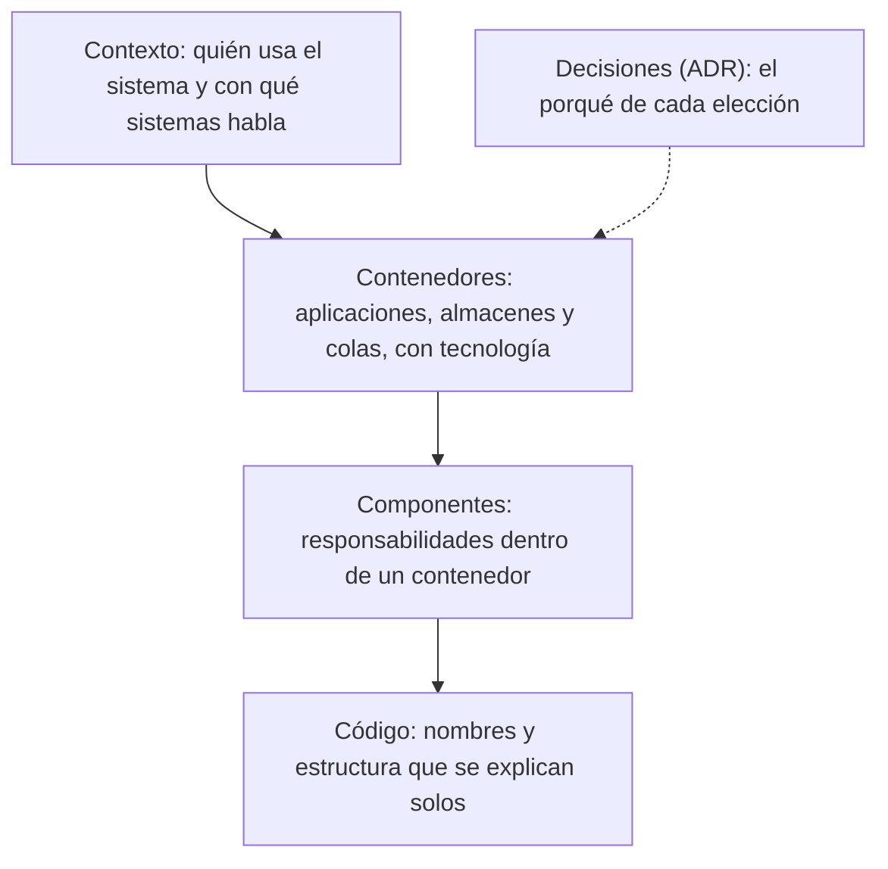

Casi todos los equipos tienen documentación de arquitectura, y casi nadie la lee. Suele ser un diagrama de hace
dos años con cuatro cajas que ya no existen, un documento de cincuenta páginas que nadie terminó y un wiki con
decisiones sin contexto. El problema no es la falta de documentos, sino que la mayoría no responde a ninguna
pregunta concreta que alguien tenga que resolver.

La tesis de este artículo es que **la documentación de arquitectura se justifica por las preguntas que responde**,
no por el hecho de existir. Si no sabes qué pregunta responde un documento, ni quién lo va a consultar, ni cuándo,
probablemente no debería existir. Un documento útil es corto, tiene dueño, vive junto al código y se revisa cuando
el sistema cambia. Lo demás es ruido con buena intención.

## Qué preguntas debe responder

Hay cuatro preguntas que la documentación de arquitectura debe contestar bien. La primera es de **orientación**:
¿qué hace este sistema, qué partes tiene y cómo se relacionan? Quien llega nuevo al equipo necesita un mapa, no
el detalle de cada clase. La segunda es de **decisión**: ¿por qué el sistema es así? Sin el porqué, cada persona
que lo toca lo cuestiona de nuevo, y cada cambio de equipo borra la memoria.

La tercera es de **operación**: ¿qué componentes hay que vigilar, qué depende de qué, qué pasa si uno se cae?
Esta pregunta es la que más se olvida y la que más se paga en un incidente. La cuarta es de **cambio**: si
necesito modificar esta parte, ¿qué más se ve afectado y qué restricciones tengo? Cada pregunta pide un tipo de
documento distinto, y mezclarlas en uno solo da un documento que responde mal a todas.

<Callout tone="info" title="Prueba de la pregunta">
  Escribe la pregunta que un documento debe responder antes de escribir una línea. Si no puedes
  formularla en una frase, el documento todavía no tiene función y es mejor no escribirlo.
</Callout>

## Niveles de detalle: de lo general a lo particular

La documentación útil se organiza por niveles, y cada nivel tiene un público. El nivel más alto muestra el sistema
en su contexto: qué personas y qué otros sistemas lo usan. Ese diagrama lo entiende cualquiera de la organización.
El siguiente nivel muestra los contenedores, las aplicaciones y almacenes que componen el sistema, con sus
tecnologías y responsabilidades. Es el nivel para los equipos que lo construyen y operan. El tercer nivel descompone
un contenedor en componentes, y solo tiene sentido para quien va a cambiar esa parte. El cuarto nivel, el código, lo
documenta el propio código con nombres claros.

El modelo C4 propone exactamente esta separación, y su mayor aporte es el límite que impone: no dibujar más detalle
del que el nivel necesita. Un diagrama de contexto con clases internas ya no sirve a nadie; uno de componentes sin
contexto no explica por qué existe. Cada nivel debe poder leerse de forma independiente.

Hay una regla práctica para elegir el nivel: documenta hasta donde cambian las decisiones. Si una parte se reescribe
cada año, no le pongas diagramas de componentes; si es estable durante una década, quizá merece uno detallado. La
frecuencia de cambio es mejor guía que la sensación de importancia.

## Decisiones: el registro que sobrevive al equipo

La documentación de decisiones es la que más valor aporta al cabo de unos años. Michael Nygard propuso en 2011 una
forma ligera para registrar decisiones de arquitectura importantes, con cinco secciones: título, contexto, decisión,
estado y consecuencias. La idea central es que el registro explique las fuerzas que llevaron a la elección, no solo
el resultado. Quien lee una decisión dentro de tres años necesita saber qué restricciones existían entonces para juzgar
si siguen vigentes.

Las consecuencias merecen atención especial. Un registro que solo lista ventajas no sirve para revisar la decisión,
porque la mitad de su valor está en los costos aceptados: qué se pierde, qué se vuelve más difícil, qué deuda queda.
Si las consecuencias negativas no aparecen, es probable que el registro se escribiera para justificar, no para decidir.

El formato importa menos que la costumbre. Un registro por decisión, numerado, en el repositorio, con un estado que
cambia (propuesta, aceptada, reemplazada) es suficiente. El ciclo de vida de esos registros tiene su propio artículo
en [ADR: ciclo de vida de una decisión](/docs/adr-ciclo-de-vida); aquí basta con recordar que una decisión reemplazada
debe apuntar a su sustituta, para que nadie siga una vieja por error.

<Callout tone="tip" title="Decide por escrito, no después">
  Escribir el registro antes de implementar obliga a formular las alternativas descartadas. Si el
  registro se escribe al final, suele reconstruir la decisión que ya se tomó y omite las que no se
  consideraron.
</Callout>

## Junto al código, no en otro lugar

La documentación que vive fuera del código se desactualiza. El repositorio es el lugar donde el cambio pasa por revisión,
y ahí conviene poner lo que cambia con el código: los diagramas de contenedores, los registros de decisiones y la
descripción de cada servicio. Cuando un cambio altera la arquitectura, la revisión debe incluir la actualización del
documento, igual que incluye los tests.

Los diagramas como código facilitan esto. Un diagrama escrito como texto se versiona, se revisa en un _pull request_ y
se regenera sin esfuerzo, mientras que un diagrama dibujado a mano en una herramienta externa se queda con la versión
de su autor. El coste de aprender la sintaxis es bajo, y el beneficio es que el diagrama deja de ser un artefacto aparte.
Si el diagrama no se actualiza en el mismo cambio que el código que representa, la práctica no está funcionando, sin
importar la herramienta.

## Qué quitar, y cómo saber que caducó

Un documento de arquitectura caduca de forma silenciosa. Nadie lo borra, nadie lo corrige y, con el tiempo, contiene más
falsedades que información. La defensa es que cada documento tenga **fecha de última revisión y un dueño con nombre**, y que
esa revisión sea parte del cambio que altera lo documentado. Un control sencillo es listar los documentos cuya fecha es
anterior al último cambio de la parte que describen.

Quitar también es documentar. Un documento que describe un sistema retirado debe marcarse como histórico o archivarse con un
enlace a su reemplazo. Dejarlo sin marca es peor que no tenerlo, porque quien lo encuentre lo tomará por cierto.

## Documento de entrada: la ruta de lectura

Para alguien nuevo, lo más útil no es un índice de documentos sino una **ruta de lectura**: qué leer primero, qué saltar y por
qué. Una página de entrada de media hoja puede decir: lee el contexto del sistema, después el diagrama de contenedores, después
los tres registros de decisión que explican por qué el sistema es así, y luego el servicio de tu primera tarea. Esa ruta
reduce la cantidad de documentos que la persona debe abrir, que es el verdadero límite de la lectura.

El documento de entrada también debe decir qué no está documentado a propósito. Una frase como «la capa de facturación no tiene
diagrama porque se va a reemplazar en 2027» evita que el lector busque algo que no existe y pregunte por qué.

## Medir si alguien la usa

La documentación se justifica por su uso, y el uso se puede medir con poco esfuerzo. Tres indicadores bastan. El primero es el
**tiempo hasta el primer cambio** de una persona nueva: si la documentación funciona, ese tiempo baja. El segundo son las
**preguntas repetidas** en el canal del equipo: si la misma pregunta aparece cada mes, la respuesta debería estar en un documento
y todavía no lo está, o existe y nadie la encuentra. El tercero es la **frecuencia de cambios** en cada documento: un documento
que nadie toca en un año, o que se edita cada semana, merece una revisión de su utilidad.

Pregunta también, de vez en cuando, a quien tomó una decisión reciente si encontró el registro que la explica. Esa pregunta
revela más que cualquier métrica sobre el estado real de la documentación.

## Un caso: el primer día de una persona nueva

Pensemos en alguien que llega a un equipo de envíos, que no conoce el sistema y tiene que hacer su primer cambio en la semana.
La documentación no le da el sistema entero, pero debe darle el camino para entenderlo sin interrumpir a todo el equipo.

En la primera media hora, la página de entrada le indica la ruta: el contexto del sistema, el diagrama de contenedores y tres registros
de decisión. El diagrama de contexto le dice que su servicio recibe pedidos del catálogo y emite etiquetas de envío. El de contenedores le
muestra que la cola de eventos es la frontera con el almacén, y que los dos lados no comparten base de datos. Con eso, la persona sabe
qué preguntas hacer y a quién.

El segundo día, nota que los reintentos hacia el almacén tardan. Busca en los registros y encuentra una decisión titulada como reintentos
con retroceso exponencial y variación aleatoria. Sus consecuencias dicen que se aceptan entregas tardías durante los picos, a cambio de no
saturar al almacén. La persona entiende que no es un fallo, sino un compromiso escrito. Esa pregunta, que en otro equipo habría costado una
conversación de media hora, queda resuelta en diez minutos.

Pero la documentación también falla, y el caso sirve para verlo. El diagrama de componentes del almacén es de hace dos años y muestra una
herramienta que ya no existe. La persona lo pregunta en el canal del equipo, alguien responde con la realidad, y el equipo marca el
documento como caducado con fecha y enlace a su sustituto. Ese paso cuesta cinco minutos y evita que la siguiente persona pierda una tarde.

El tercer día, su primer cambio añade un consumidor a la cola. La revisión pide actualizar el diagrama de contenedores, y la persona lo hace en
el mismo cambio. Ese es el punto del caso: la documentación se mantuvo viva porque la revisión la trató como parte del código.

Lo que el caso deja como criterio es que el documento útil responde a un camino real de trabajo, no a una lista de todo lo que existe. Y que
la señal de salud no es que el documento esté completo, sino que su lector sepa cuándo no fiarse de él.

## Qué no documentar

No todo merece documento. Lo que el código dice por sí mismo, como la lógica de una función o el nombre de una variable, no
necesita un texto aparte. Tampoco los detalles que cambian cada sprint, como el número de réplicas de un servicio o la versión
exacta de una librería, que deben vivir en la configuración y no en un documento que se desactualizará en una semana. La regla
es documentar lo que cuesta descubrir y lo que cambia poco: el porqué, el mapa y las restricciones.

## Errores frecuentes

El primer error es **documentar para el archivo**: escribir mucho para guardar en un repositorio que nadie consulta. Un documento
que no responde una pregunta concreta de alguien no justifica su coste de mantenimiento.

El segundo es **mezclar niveles** en un solo diagrama. Un dibujo que muestra el contexto, los contenedores y las clases a la vez
no sirve a nadie, porque cada lector busca un nivel distinto.

El tercero es **escribir decisiones sin alternativas ni consecuencias**. Un registro que solo describe lo elegido no permite
revisar la decisión cuando cambian las condiciones.

El cuarto es **dejar la documentación fuera del flujo de cambio**. Si actualizarla no forma parte de la revisión, siempre habrá
una excusa para posponerla, y la brecha entre el documento y el sistema crece sin que nadie la vea.

Un criterio útil para decidir cuándo escribir un registro de decisión es la reversibilidad. Si la decisión se puede revertir en una tarde,
como el nombre de una carpeta o la versión de una librería menor, no merece registro. Si revertirla exige migrar datos, cambiar contratos
o reescribir varios servicios, el registro es obligatorio, porque dentro de un año nadie recordará por qué se eligió ese camino. Entre ambos
extremos, la pregunta práctica es si alguien que llegue dentro de dos años podría querer deshacerla y no sabría por qué no conviene.

## Herramientas

Basta un repositorio con archivos de texto para los registros de decisiones, un formato de diagramas como código para los niveles
de contexto y de contenedores, y una plantilla con fecha, dueño y estado para cada documento. Un sitio generado a partir de esos
archivos facilita la lectura, pero no es imprescindible. Las herramientas de wiki sirven para documentos de proceso, no para la
arquitectura, porque su historial no se revisa con el código y su estado no se controla con las mismas reglas.

Una práctica que da buenos resultados es abrir cada documento de arquitectura con una sección breve de «preguntas que este documento
responde». Si una pregunta de esa lista ya no tiene respuesta en el texto, el documento está incompleto; si ninguna pregunta de la lista
la hace alguien, el documento sobra. Esa sección sirve también como criterio de revisión: quien modifica el sistema se pregunta si alguna
de las respuestas ha cambiado. Es una comprobación de dos minutos que mantiene el documento alineado con la pregunta que justifica su
existencia, sin necesidad de releerlo entero en cada cambio.

Un límite práctico es el tamaño. Un documento que no se puede leer en unos quince minutos suele estar mezclando preguntas distintas.
Cuando eso ocurre, conviene separarlo en dos documentos enlazados entre sí, cada uno con su propia pregunta y su propio dueño, en lugar
de añadir secciones hasta que nadie llegue al final.

## Checklist

- [ ] Cada documento responde una pregunta concreta de orientación, decisión, operación o cambio, escrita en una frase.
- [ ] Los diagramas están organizados por niveles, y cada nivel se entiende por separado.
- [ ] Cada decisión importante tiene un registro con contexto, decisión, estado y consecuencias, incluidas las negativas.
- [ ] Los diagramas y registros viven en el repositorio y se actualizan en el mismo cambio que altera el sistema.
- [ ] Cada documento tiene fecha de revisión y un dueño con nombre.
- [ ] Hay una ruta de lectura para quien llega nuevo, con una nota sobre lo que no está documentado a propósito.
- [ ] Lo retirado se marca como histórico y enlaza a su reemplazo.
- [ ] Se mide, al menos cada trimestre, si alguien usa la documentación.

## Fuentes

- Michael Nygard, [Documenting Architecture Decisions](https://thinkrelevance.com/blog/2011/11/15/documenting-architecture-decisions), publicado el 15 de noviembre de 2011. Su contenido está confirmado por resúmenes secundarios; el texto original no se ha revisado directamente.
