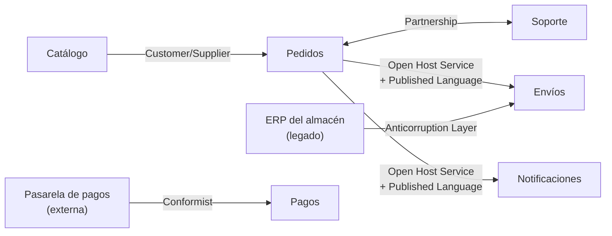
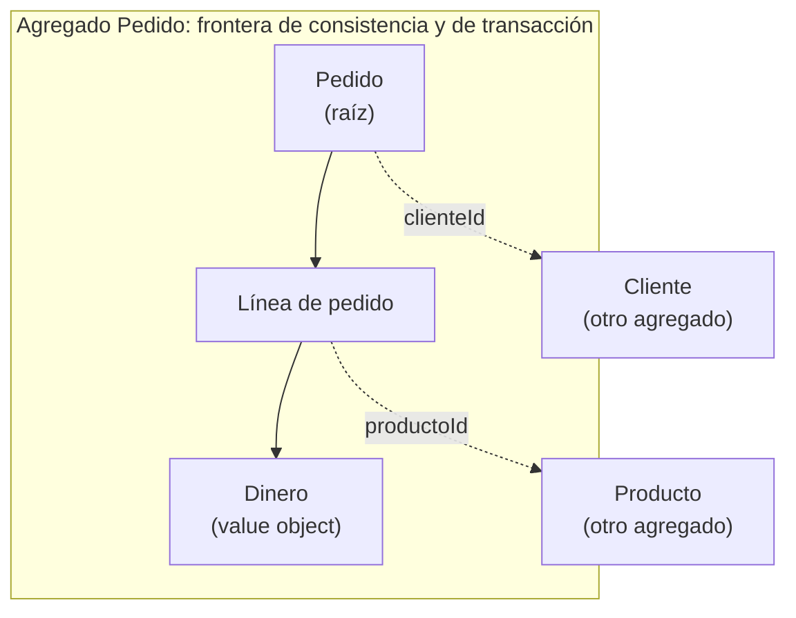

# Domain-Driven Design: diseña desde el dominio

La mayor parte de la complejidad de un sistema de negocio no está en la tecnología sino en el
dominio: reglas que cambian, palabras que significan cosas distintas según quién las diga y
modelos que se mezclan hasta que nadie sabe dónde vive cada decisión. **Domain-Driven Design**
(DDD) es un conjunto de ideas y patrones, formulado por Eric Evans, para que el código exprese
el dominio en lugar de esconderlo.

Este artículo recorre el diseño **estratégico** (subdominios, lenguaje ubicuo, bounded contexts y
mapas de contexto), el diseño **táctico** (entidades, value objects, agregados, repositorios y
eventos), cómo descubrir el dominio con Event Storming, cómo traducir los contextos a módulos y
contenedores [C4](/docs/c4-model), y qué herramientas ayudan a sostener las fronteras. Los
ejemplos usan la **Tienda Aurora** del artículo de C4, un sistema inventado.

<Callout tone="info" title="Fecha de corte">
  El estado de las herramientas es el de octubre de 2026. Las definiciones de DDD salen del _DDD
  Reference_ de Evans (2015) y de los ensayos de Vaughn Vernon sobre agregados, que se leyeron
  directamente; lo que viene de resúmenes de terceros se indica en el texto.
</Callout>

## Qué problema resuelve y cuándo no usarlo

Evans resume DDD en tres ideas: concentrarse en el **dominio núcleo**, explorar modelos en
colaboración creativa entre quienes conocen el dominio y quienes escriben software, y hablar un
**lenguaje ubicuo** dentro de un **contexto explícitamente delimitado**. No es una arquitectura
ni un framework: es una forma de decidir dónde invertir el esfuerzo de modelado.

Esa inversión no siempre compensa. Úsala como guía:

| Señal                                                                  | Qué sugiere                                                 |
| ---------------------------------------------------------------------- | ----------------------------------------------------------- |
| Reglas de negocio ricas, cambiantes y discutidas a diario              | DDD completo: estratégico y táctico                         |
| La misma palabra significa cosas distintas según el área               | Al menos el estratégico: bounded contexts y lenguaje ubicuo |
| Pantallas que guardan y listan datos con validaciones triviales (CRUD) | No lo necesitas: un modelo de datos y validaciones bastan   |
| Un subdominio que todas las empresas resuelven igual (pagos, correo)   | Compra o integra una solución; no lo modeles a mano         |

<Callout tone="warning" title="DDD tiene un costo">
  Exige conversaciones sostenidas con los expertos del negocio, refactorización continua del modelo
  y disciplina con el lenguaje. Evans lo dice sin rodeos: no todas las partes del diseño van a
  quedar igual de refinadas, así que hay que fijar prioridades y justificar cualquier otra inversión
  por cómo apoya al núcleo.
</Callout>

## Diseño estratégico

### Dominio y subdominios

El **dominio** es el área de negocio que el software atiende. Se divide en subdominios y no todos
valen lo mismo. Evans define dos: el **dominio núcleo**, lo más valioso y específico del negocio,
al que hay que dedicar a los mejores desarrolladores, y los **subdominios genéricos**, que
añaden complejidad sin capturar conocimiento especializado y para los que conviene considerar
soluciones ya hechas. La tercera categoría, el subdominio **de soporte**, la popularizan autores
posteriores como Vlad Khononov (según resúmenes de _Learning Domain-Driven Design_): necesario
para el negocio, sin ventaja competitiva y de lógica simple.

| Tipo       | Qué es                   | En Tienda Aurora (ilustrativo) | Cómo tratarlo                     |
| ---------- | ------------------------ | ------------------------------ | --------------------------------- |
| Núcleo     | Lo que te diferencia     | Selección y frescura del café  | Modelo profundo, equipo mejor     |
| De soporte | Necesario, no diferencia | Pedidos y devoluciones         | Sencillo; propio o externalizable |
| Genérico   | Todos lo hacen igual     | Pagos, correo, autenticación   | Comprar o integrar                |

La clasificación no es eterna: según esos mismos resúmenes, un subdominio puede cambiar de tipo
con el tiempo, y un núcleo puede acabar siendo genérico.

### Lenguaje ubicuo

Evans pide usar el modelo como columna vertebral de un lenguaje común: el mismo en las
conversaciones, los diagramas y, sobre todo, el código. Y añade la consecuencia que más se pasa
por alto: **un cambio en el lenguaje es un cambio en el modelo**, así que se refactoriza el
código para que los nombres sigan el nuevo lenguaje.

Un ejemplo de Tienda Aurora (inventado): para Ventas, un _pedido_ es una compra confirmada por
el cliente; para el almacén, un _pedido_ es la lista de productos que hay que sacar de la
bodega. Una palabra, dos modelos. No se resuelve con un modelo «unificado» que sirva a ambos
mal, sino reconociendo que son dos contextos.

### Bounded context

Evans lo define así: se delimita explícitamente el contexto en el que un modelo aplica, en
términos de organización de equipos, uso en partes concretas de la aplicación y manifestaciones
físicas como bases de código y esquemas de base de datos. Dentro del contexto, el lenguaje es
estricto; fuera, el mismo término puede significar otra cosa.

Conviene no confundirlo con el subdominio. El subdominio describe el **problema** del negocio;
el bounded context es una **decisión de diseño** sobre dónde vale un modelo. Lo ideal es que
coincidan, pero con un sistema heredado a menudo no es así. Y nótese que la definición habla de
bases de código y esquemas, no de procesos: un bounded context es una frontera de modelo, no
necesariamente de despliegue.

### Mapa de contextos

Un contexto aislado deja un problema abierto: cómo se relaciona con los demás. El **mapa de
contextos** identifica cada modelo en juego, lo nombra y describe los puntos de contacto, con
traducción explícita donde la haya. Evans insiste en que primero se mapea el terreno **tal como
es** y las transformaciones vienen después.



La flecha va del contexto **upstream** (el que condiciona) al **downstream**. Los nombres de las
relaciones son los del _DDD Reference_:

| Patrón               | Idea                                                                                                              | Úsalo cuando                                                                 |
| -------------------- | ----------------------------------------------------------------------------------------------------------------- | ---------------------------------------------------------------------------- |
| Partnership          | Dos equipos que triunfan o fracasan juntos planifican y gestionan la integración en conjunto                      | La entrega de uno depende del otro                                           |
| Shared Kernel        | Un subconjunto pequeño del modelo y del código que ambos equipos comparten; no se cambia sin consultar            | La integración continua entre contextos es viable y el núcleo común, pequeño |
| Customer/Supplier    | Las prioridades del downstream entran en la planificación del upstream; pruebas de aceptación conjuntas           | El upstream puede atender al downstream                                      |
| Conformist           | El downstream adopta el modelo del upstream tal cual, sin traducir                                                | El upstream no tiene motivación para adaptarse y su modelo es aceptable      |
| Anticorruption Layer | Una capa aislante traduce el modelo ajeno al propio                                                               | Integras sistemas heredados o de modelo débil                                |
| Open Host Service    | Un protocolo abierto, expuesto como un conjunto de servicios, para quien deba integrarse                          | Muchos clientes necesitan integrarse con tu contexto                         |
| Published Language   | Un lenguaje común bien documentado (a menudo un estándar de intercambio); se suele combinar con Open Host Service | El modelo interno no debe congelarse como formato de intercambio             |
| Separate Ways        | Sin integración: cada contexto resuelve lo suyo                                                                   | El beneficio de integrar no compensa su costo                                |
| Big Ball of Mud      | Se dibuja un límite alrededor del lío y no se aplica modelado sofisticado dentro                                  | Describes un sistema sin fronteras claras                                    |

Partnership, Big Ball of Mud y los eventos de dominio son términos que Evans añadió al
_Reference_ después del libro de 2004.

La capa anticorrupción es el patrón que más se agradece en la práctica. Su valor está en que la
traducción vive en **un solo lugar**: una pequeña unidad, por ejemplo un adaptador dentro de
`envios/infraestructura/`, que convierte el vocabulario del ERP (códigos de estado, nombres de
columna) al del contexto, de modo que el modelo ajeno no se filtra por el resto del sistema. Dos
convenciones lo mantienen limpio: el adaptador lleva el nombre del sistema ajeno y sus tipos de
entrada no se exportan; hacia dentro solo salen tipos del lenguaje ubicuo, como `EstadoDeEnvio`
(pendiente, enviado, cancelado). La alternativa, **Conformist**, cuesta menos al principio, pero
cada cambio del ERP se convierte en un cambio de tu modelo.

## Diseño táctico

Los bloques de construcción tácticos mantienen el código alineado con el modelo. Antes de
usarlos, Evans pide aislar la lógica del dominio de la interfaz, la base de datos y la
infraestructura (arquitectura por capas) y aclara que patrones como la
[arquitectura hexagonal](/docs/arquitectura-hexagonal) sirven igual o mejor, siempre que el
dominio no dependa de nada técnico.

- **Entidad:** un objeto definido por su **identidad**, no por sus atributos. Tiene ciclo de
  vida y el modelo debe definir qué significa «ser la misma cosa».
- **Value object:** describe algo por sus atributos y **no tiene identidad**. Se trata como
  inmutable, con operaciones sin efectos laterales.
- **Evento de dominio:** algo que ocurrió y que interesa a los expertos. Se modela como objeto,
  normalmente inmutable, con la marca de tiempo y las identidades involucradas.
- **Servicio de dominio:** una operación significativa que no es responsabilidad natural de una
  entidad o value object. Se nombra en el lenguaje ubicuo.
- **Fábrica:** encapsula la creación de objetos o agregados complejos, que nacen completos y con
  sus invariantes cumplidas.
- **Repositorio:** da la ilusión de una colección en memoria de las raíces de agregado, con
  consultas expresadas en términos del dominio. Solo existe para las raíces que lo necesitan.
- **Módulo:** parte del modelo, con nombres que forman parte del lenguaje ubicuo. La
  [cohesión y el acoplamiento](/docs/acoplamiento-cohesion) se juzgan por conceptos que se
  entienden de forma independiente, no solo por métricas.

### Agregados: la pieza que más se hace mal

Un **agregado** agrupa entidades y value objects bajo una **raíz** y una frontera. Según Evans,
los objetos externos solo pueden guardar referencias a la raíz; la raíz (o un mecanismo
designado) hace cumplir las **invariantes** del conjunto; y la misma frontera gobierna las
transacciones: dentro, la consistencia es síncrona; entre agregados, asíncrona.

Vernon destila cuatro reglas en sus ensayos _Effective Aggregate Design_:

1. **Modela invariantes verdaderas en fronteras de consistencia.** Una invariante es una regla de
   negocio que siempre debe cumplirse de forma transaccional; solo con ellas se decide qué
   objetos van en el mismo agregado.
2. **Diseña agregados pequeños.** Raíz más el mínimo de atributos necesario; uno grande no escala
   ni rinde y nace de «invariantes falsas» y de comodidad al componer objetos.
3. **Referencia otros agregados por identidad**, no por objeto.
4. **Usa consistencia eventual fuera de la frontera.** Una regla que cruza agregados no tiene que
   estar al día siempre; se resuelve con eventos u otros mecanismos. Vernon desconfía de los
   casos que parecen exigir modificar varios agregados en una sola transacción.



### Cómo se nombra cada bloque

En DDD **el lenguaje ubicuo es el del equipo**: los ejemplos están en español porque así hablaría
el equipo de Aurora. Lo que importa es la convención, no el idioma:

| Bloque            | Cómo se nombra                                                    | Ejemplos de Tienda Aurora (ilustrativos)   |
| ----------------- | ----------------------------------------------------------------- | ------------------------------------------ |
| Entidad / raíz    | Sustantivo del negocio, en singular y sin sufijos técnicos        | `Pedido`, `Cliente` (no `PedidoEntity`)    |
| Value object      | Por su significado en el negocio, inmutable                       | `Dinero`, `Cantidad`, `DireccionDeEnvio`   |
| Evento de dominio | Participio en pasado: algo que ya ocurrió                         | `PedidoConfirmado`, `PagoAutorizado`       |
| Caso de uso       | Verbo en infinitivo o imperativo más el objeto                    | `confirmarPedido`                          |
| Repositorio       | «Repositorio de» más el plural del agregado; métodos de colección | `RepositorioDePedidos`: `porId`, `guardar` |
| Fábrica           | Método estático con un verbo del negocio                          | `Pedido.iniciar`                           |

### El agregado Pedido de un vistazo

No hace falta ver la implementación: lo importante es qué expone la raíz y cómo se llama.

```typescript
// Raíz del agregado: toda modificación pasa por sus métodos.
export declare class Pedido {
  readonly id: PedidoId;
  readonly clienteId: ClienteId; // otro agregado: se referencia por identidad

  static iniciar(id: PedidoId, clienteId: ClienteId, moneda: Moneda): Pedido; // nace válido
  agregarLinea(productoId: ProductoId, cantidad: number, precio: Dinero): void;
  // invariantes: solo en borrador, cantidad entera ≥ 1, misma moneda, máximo 50 líneas
  confirmar(ahora: Date): void; // invariante: no vacío; registra PedidoConfirmado
  total(): Dinero;
  extraerEventos(): readonly PedidoConfirmado[];
}
```

Las decisiones que sostiene este diseño:

- **Estado privado, métodos con verbos del negocio.** Las invariantes (no confirmar un pedido
  vacío, no modificar uno confirmado, una sola moneda, un máximo de líneas) no se pueden saltar
  porque no hay otra puerta. La alternativa, campos públicos con un validador aparte, es justo
  el modelo anémico. El límite de 50 líneas es un valor ilustrativo.
- **Identificadores con tipo propio.** `PedidoId` y `ClienteId` son tipos distintos (la técnica
  de _tipos con marca_), así que el compilador impide pasar uno donde se espera el otro. A
  cambio, hay algo de ceremonia en las fronteras.
- **Otros agregados por identidad.** `clienteId` es una referencia por identidad, no un objeto
  `Cliente` embebido.
- **La fábrica evita estados a medias.** Un pedido nunca existe sin cliente ni moneda.
- **El reloj entra como parámetro** (`ahora`): el dominio es determinista y fácil de probar.
- **El agregado acumula sus eventos, no los publica.** Publicar es trabajo de la capa de
  aplicación. `Dinero` completa el cuadro: un value object inmutable, validado al construirse y
  comparado por su importe y moneda.

### El servicio de aplicación y la transacción

El caso de uso `confirmarPedido` vive fuera del dominio, en `aplicacion/`, y sigue siempre el
mismo guion. Marca la frontera transaccional: **una transacción, un agregado**.

1. **Cargar** la raíz por identidad desde el `RepositorioDePedidos`.
2. **Pedirle el cambio** (`pedido.confirmar`): las reglas viven en el dominio, no en este servicio.
3. **Guardar** el agregado en una sola transacción.
4. **Publicar** los eventos que la raíz acumuló.

El repositorio, el publicador de eventos y el reloj entran como dependencias: son los _puertos_
de la [arquitectura hexagonal](/docs/arquitectura-hexagonal), y por eso el caso de uso se prueba
sin infraestructura.

<Callout tone="warning" title="Guardar y publicar no son atómicos">
  Si el proceso cae entre guardar y publicar, el evento se pierde. El patrón _transactional outbox_
  lo resuelve: el mensaje se guarda en la misma transacción local que cambia las entidades y un
  componente aparte lo publica. A cambio, puede haber duplicados, así que los consumidores deben ser
  idempotentes.
</Callout>

## Descubrir el dominio con Event Storming

El modelo no se deduce de las tablas, se descubre hablando con quien conoce el negocio.
**EventStorming**, de Alberto Brandolini, es un taller para explorar dominios complejos en
colaboración: se cuenta el proceso como una línea de tiempo de **eventos de dominio** en notas
adhesivas sobre una pared larga. Según Wikipedia nació durante el IDDD Tour de Vernon.

Brandolini describe tres formatos, de lo amplio a lo concreto:

| Formato           | Alcance                            | Resultado                                                   |
| ----------------- | ---------------------------------- | ----------------------------------------------------------- |
| Big Picture       | Todo un negocio o línea de negocio | Forma del paisaje, cuellos de botella y desacuerdos         |
| Process Modelling | Un proceso concreto                | Comandos, actores, políticas y modelos de lectura           |
| Software Design   | Una pieza de software              | Agregados, transacciones y fronteras candidatas de contexto |

La página oficial del libro _Introducing EventStorming_ la llama _Process Design_ y avisa de que el libro
está sin terminar: la mecánica de Big Picture está bastante cubierta; Process y Software Design
siguen incompletos. Por eso, las descripciones de esos dos formatos vienen de relatos de
practicantes y no del libro.

Una convención muy extendida usa notas **naranjas** para eventos, **azules** para comandos y
**amarillas** para agregados (así lo describe Wikipedia). El glosario de la comunidad DDD Crew
usa otra paleta para algunos elementos (políticas lilas, sistemas externos rosas, modelos de
lectura verdes) y marca los puntos de desacuerdo como _hot spots_ rosa neón. Trata la paleta como
una convención del equipo, no como un estándar. Para Tienda Aurora, un tramo de la pared sería:

| Comando (azul)   | Agregado (amarillo) | Evento (naranja) |
| ---------------- | ------------------- | ---------------- |
| Iniciar carrito  | Carrito             | CarritoIniciado  |
| Confirmar pedido | Pedido              | PedidoConfirmado |
| Autorizar pago   | Pago                | PagoAutorizado   |
| Preparar envío   | Envío               | EnvíoPreparado   |

Dos señales para leer la pared: cuando dos áreas usan la misma palabra con significados
distintos, probablemente hay dos modelos y por tanto dos contextos (el caso del «pedido» de
antes); y cada hot spot es una pregunta sin responder que conviene llevar a los expertos.
**Domain Storytelling** es una técnica alternativa, centrada en contar historias entre expertos y
equipo de desarrollo, con la herramienta abierta Egon.io.

## De los bounded contexts a módulos y contenedores C4

Un bounded context es una frontera de **modelo**; cuántos procesos lo ejecutan es otra decisión.
Un punto de partida razonable, y lo habitual al empezar, es un **monolito modular**: un
despliegue, un módulo por contexto y fronteras que se vigilan. Se extrae un contexto a su propio
contenedor cuando hay una razón concreta, como un ritmo de cambio, una escala o un equipo
distintos. Documenta esa decisión en un [ADR](/docs/adr) y refleja el resultado en el nivel de
contenedores del [modelo C4](/docs/c4-model).

| Contexto de Aurora | Arranque razonable                      | Señal para extraerlo                              |
| ------------------ | --------------------------------------- | ------------------------------------------------- |
| Pedidos            | Módulo del monolito                     | Escala o cadencia de cambio muy distintas         |
| Envíos             | Módulo con capa anticorrupción al ERP   | El ERP condiciona el despliegue y los fallos      |
| Notificaciones     | Módulo o _worker_ (subdominio genérico) | Picos de carga o proveedor externo intercambiable |

Una frontera que no se comprueba se erosiona. Una estructura por contexto, con una API pública
por módulo, permite hacerla cumplir con una herramienta:

```text
src/
  pedidos/
    dominio/            Pedido, Dinero, PedidoConfirmado
    aplicacion/         confirmarPedido
    infraestructura/    RepositorioDePedidos (adaptador), publicador
    index.ts            API pública del contexto
  envios/
    ...
```

Con dependency-cruiser, la regla prohíbe importar el interior de otro contexto y solo admite su
`index.ts`. El `$1` de `pathNot` repite el nombre del contexto capturado en `from`. Si tienes un
Shared Kernel explícito, exclúyelo aquí también. Para TypeScript, la configuración debe apuntar a
tu `tsconfig.json` (`options.tsConfig`):

```javascript
{
  name: 'solo-por-la-api-publica-de-otro-contexto',
  severity: 'error',
  from: { path: '^src/([^/]+)/' },
  to: { path: '^src/([^/]+)/', pathNot: '^src/($1/|[^/]+/index\\.ts$)' },
}
```

La regla se probó con dependency-cruiser 18.6.0 sobre un proyecto mínimo: marca la importación al
interior de otro contexto y deja pasar el `index.ts` y las importaciones del propio contexto. Es
una [fitness function](/docs/fitness-functions): una regla de arquitectura ejecutable en CI.

## DDD y agentes de IA

Un agente de código empieza cada sesión sin conocer tu dominio y tiende a inventar nombres. El
lenguaje ubicuo es justo el contexto que le falta. Un glosario corto en `CLAUDE.md` o
`AGENTS.md`, por contexto, evita que mezcle «pedido» y «orden de surtido»:

```markdown
## Lenguaje ubicuo

- **Pedido** (contexto Pedidos): compra confirmada por el cliente. No uses «orden» ni «compra».
- **Orden de surtido** (contexto Envíos): lista de preparación del almacén. Nunca la llames «pedido».
- Un agregado se modifica solo por los métodos de su raíz; nunca asignes campos desde fuera.
- Un módulo solo importa de otro a través de su `index.ts`.
```

Las dos últimas reglas son «sugerencias» para el agente. La regla de dependency-cruiser de arriba
es el **sensor** que las hace cumplir: si el agente la rompe, el fallo vuelve como
retroalimentación. Esa es la idea del [harness de Claude Code](/docs/harness-engineering-claude-code).
Y, como siempre con las instrucciones, sé conciso y verifica que no se contradicen.

## Herramientas

| Herramienta        | Qué hace                                                                                          | Estado verificado (oct. 2026)                                                                                                                                        | Úsala cuando                                           | Evítala cuando                       |
| ------------------ | ------------------------------------------------------------------------------------------------- | -------------------------------------------------------------------------------------------------------------------------------------------------------------------- | ------------------------------------------------------ | ------------------------------------ |
| EventStorming      | Taller de descubrimiento con notas sobre una pared (física o digital)                             | Técnica, no software; el libro de Brandolini sigue sin terminar                                                                                                      | Empiezas a explorar un dominio                         | Ya conoces el dominio a fondo        |
| Context Mapper     | DSL (CML) para mapas de contexto; genera Graphviz, PlantUML y contratos MDSL                      | Última versión 6.12.0 (30 ago. 2024) según su página de releases; VS Code, Eclipse, librería Java                                                                    | Quieres el mapa como código versionado                 | No necesitas generar nada del modelo |
| Structurizr        | Modelos C4 como código con su DSL; diagramas desde un único modelo                                | Binarios v2026.09.19; su documentación marca Lite, on-premises, cloud y CLI como _End of life_; el comando `server` requiere licencia con los binarios precompilados | Documentas contenedores y componentes de cada contexto | Un diagrama puntual en Mermaid basta |
| EventCatalog       | Catálogo docs-as-code de dominios, servicios y eventos; generadores para OpenAPI, AsyncAPI, Kafka | Código abierto y autoalojado; la página no indica la licencia                                                                                                        | Hay muchos eventos y equipos que deben descubrirlos    | Sistema pequeño con pocos eventos    |
| ArchUnit           | Reglas de arquitectura de Java como pruebas unitarias (paquetes, capas, ciclos)                   | Versión 1.5.x (agosto de 2026)                                                                                                                                       | Tu código es Java y quieres proteger los límites       | Tu código no es Java                 |
| dependency-cruiser | Valida y visualiza dependencias en JavaScript y TypeScript; informa también en Mermaid            | Licencia MIT; probado con la v18.6.0. Su aviso indica que aún no soporta TypeScript 7 (pide una versión menor que 7.0.0)                                             | Tu código es JS o TS y quieres proteger los límites    | Solo necesitas un grafo puntual      |
| Egon.io            | Herramienta web abierta para Domain Storytelling                                                  | Enlazada desde domainstorytelling.org                                                                                                                                | Cuentas historias con expertos sin tecnología          | Ya tienes el modelo de eventos       |

Para los diagramas como código en general, mira [diagramas como código](/docs/diagramas-como-codigo).

## Errores frecuentes

- **Modelo anémico.** Entidades que son bolsas de datos con la lógica fuera. Evans lo describe
  como efecto de consultas sin restricciones y de lógica que se escapa a la capa de aplicación.
  Síntoma: cualquiera puede escribir `pedido.estado = 'confirmado'` sin comprobar nada.
- **Agregados gigantes.** Todo cuelga de «Cliente» o «Producto» por comodidad al navegar
  objetos. Es el _large-cluster aggregate_ de Vernon: no escala y provoca fallos de transacción.
- **Un bounded context por tabla o por capa técnica.** Los contextos se delimitan por modelo y
  lenguaje, no por tablas ni por «frontend y backend».
- **Lenguaje ubicuo que nadie usa.** Si el código dice `Order` y el negocio dice «solicitud», hay
  un modelo implícito en cada cabeza. Renombra el código.
- **Solo táctico.** Repositorios y fábricas sin haber identificado el núcleo ni los contextos:
  ceremonia sin valor.
- **Modelar los subdominios genéricos a mano.** Un sistema de pagos propio rara vez es ventaja.
- **Referencias de objeto entre agregados y transacciones que tocan varios.** Referencia por
  identidad y usa eventos.
- **Publicar eventos sin outbox**, en sistemas donde perderlos importa.

## Checklist para tu próximo modelo

- [ ] Identificaste el dominio núcleo y lo distingues de los subdominios de soporte y genéricos.
- [ ] Hay un glosario del lenguaje ubicuo por contexto, y el código lo usa.
- [ ] Cada bounded context tiene nombre, equipo responsable y frontera de código.
- [ ] Existe un mapa de contextos con el tipo de relación entre cada par.
- [ ] Las integraciones con sistemas heredados pasan por una capa anticorrupción.
- [ ] Cada agregado protege invariantes reales, es pequeño y se referencia por identidad.
- [ ] Una transacción modifica un solo agregado; lo demás va por eventos.
- [ ] Las fronteras entre módulos se comprueban automáticamente en CI.
- [ ] La decisión monolito modular o contenedores separados está en un ADR.

## Fuentes

Consultadas en octubre de 2026. Los PDF de Evans y Vernon se leyeron en su texto original; lo demás,
salvo lo indicado, se verificó en la página oficial de cada proyecto.

- [DDD Reference (Eric Evans, 2015, PDF)](https://www.domainlanguage.com/wp-content/uploads/2016/05/DDD_Reference_2015-03.pdf) y su [página](https://www.domainlanguage.com/ddd/reference/)
- Vaughn Vernon, _Effective Aggregate Design_: [parte I](https://dddcommunity.org/wp-content/uploads/files/pdf_articles/Vernon_2011_1.pdf) y [parte II](https://dddcommunity.org/wp-content/uploads/files/pdf_articles/Vernon_2011_2.pdf)
- [EventStorming](https://www.eventstorming.com/) y [su libro](https://www.eventstorming.com/book/)
- [Event storming (Wikipedia)](https://en.wikipedia.org/wiki/Event_storming)
- [EventStorming glossary cheat sheet (DDD Crew)](https://github.com/ddd-crew/eventstorming-glossary-cheat-sheet)
- Subdominios de soporte y tipos según Khononov: resúmenes obtenidos por búsqueda, por ejemplo [el cierre de _Learning Domain-Driven Design_ en O'Reilly](https://www.oreilly.com/library/view/learning-domain-driven-design/9781098100124/afterword01.html); no se abrió el libro
- [Domain Storytelling](https://domainstorytelling.org/)
- [Context Mapper](https://contextmapper.org/) y sus [versiones](https://github.com/ContextMapper/context-mapper-dsl/releases)
- [Structurizr](https://docs.structurizr.com/)
- [EventCatalog](https://www.eventcatalog.dev/)
- [ArchUnit](https://www.archunit.org/)
- [dependency-cruiser](https://github.com/sverweij/dependency-cruiser) y su [referencia de reglas](https://github.com/sverweij/dependency-cruiser/blob/main/doc/rules-reference.md)
- [Transactional outbox (microservices.io)](https://microservices.io/patterns/data/transactional-outbox.html)
