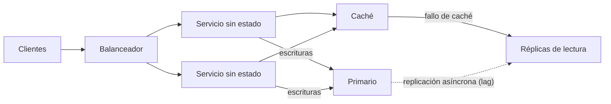
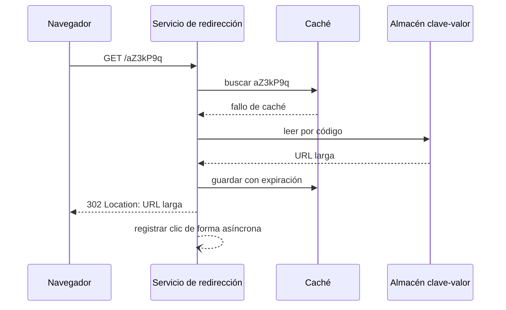
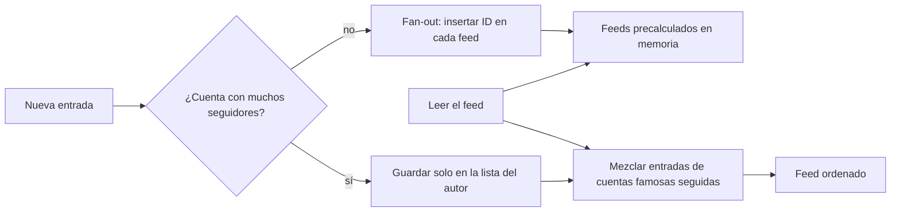

# Escalabilidad y casos clásicos de diseño

Alguien abre una reunión con «tiene que escalar» y diez minutos después la pizarra ya tiene Kafka, tres bases de datos y una caché distribuida. Nadie ha dicho cuántas peticiones por segundo llegan, cuánto ocupa un registro ni qué operación es la que no puede fallar. El resultado suele ser un sistema caro que escala justo en la dimensión que no hacía falta. Este artículo defiende lo contrario: **escalar es estimar primero la carga que importa y después elegir la técnica más simple que la absorbe, sabiendo qué cuello de botella aparecerá a continuación**.

Primero va el método (requisitos, estimación de orden de magnitud y las cuatro técnicas que más se repiten) y después tres casos completos: un acortador de URLs, un limitador de tasa y un feed de noticias. Cada caso sigue el mismo guion: requisitos, estimación, diseño de alto nivel y trade-offs.

<Callout tone="info" title="Cifras de ejemplo">
  Todas las cifras marcadas como **supuesto** son ilustrativas: sirven para practicar el cálculo, no
  describen ningún sistema real. Las cifras de Twitter, Stripe, Cloudflare o AWS que aparecen salen
  de sus fuentes, citadas al final, y llevan la fecha de esas fuentes.
</Callout>

## El método antes que la solución

Un diseño escalable empieza por una lista de lo que el sistema debe hacer y de lo que debe aguantar. Sin esa lista no hay forma de saber si una caché, una réplica o una partición resuelven algo.

### Requisitos funcionales y no funcionales

Los **requisitos funcionales** dicen qué operaciones existen: acortar una URL, redirigir, consultar estadísticas. Los **no funcionales** dicen con qué calidad: latencia objetivo, disponibilidad, durabilidad, consistencia, coste. Son los [atributos de calidad](/docs/atributos-de-calidad) de siempre, pero aquí hay que darles número.

| Pregunta                                         | Por qué importa                                                      |
| ------------------------------------------------ | -------------------------------------------------------------------- |
| ¿Cuáles son las dos o tres operaciones críticas? | El diseño se optimiza para ellas; el resto puede ir por otro camino  |
| ¿Proporción entre lecturas y escrituras?         | Decide si ganas más con caché y réplicas o con particionar           |
| ¿Latencia objetivo y en qué percentil?           | Un p99 de 50 ms descarta viajes extra que un p50 de 500 ms tolera    |
| ¿Cuánto tiempo se guardan los datos?             | Multiplica el almacenamiento y fija el tamaño de los identificadores |
| ¿Qué pasa si se pierde o se retrasa un dato?     | Separa lo que necesita consistencia fuerte de lo que puede esperar   |

### Estimación de orden de magnitud

No buscas precisión, buscas la potencia de diez. Si el cálculo da 2.000 o 3.000 peticiones por segundo, la decisión es la misma; si da 200 o 200.000, no. Bastan unas pocas equivalencias y redondear sin miedo.

| Potencia de dos | Valor aproximado | Unidad (binaria)  | Lectura rápida      |
| --------------- | ---------------- | ----------------- | ------------------- |
| 2^10            | 10^3             | KB (en rigor KiB) | Mil                 |
| 2^20            | 10^6             | MB                | Un millón           |
| 2^30            | 10^9             | GB                | Mil millones        |
| 2^40            | 10^12            | TB                | Un billón (español) |
| 2^50            | 10^15            | PB                | Mil billones        |

Tres constantes cubren casi todos los cálculos: un día tiene 86.400 segundos (redondea a 10^5 y recuerda que así subestimas un 14 %), un año tiene unos 3,15 × 10^7 segundos y un millón de eventos al día son unos 12 por segundo.

### Un cálculo completo, paso a paso

Supuesto: una aplicación con 10 millones de usuarios activos al día; cada uno hace 20 lecturas y 2 escrituras diarias; cada escritura guarda 1 KB y cada lectura devuelve 10 KB; el pico es el triple de la media.

| Magnitud                     | Cálculo                     | Resultado                |
| ---------------------------- | --------------------------- | ------------------------ |
| Lecturas por segundo (media) | 10^7 × 20 / 86.400          | ≈ 2.300/s                |
| Lecturas por segundo (pico)  | 2.300 × 3                   | ≈ 7.000/s                |
| Escrituras por segundo       | 10^7 × 2 / 86.400           | ≈ 230/s (pico ≈ 700/s)   |
| Almacenamiento por día       | 2 × 10^7 escrituras × 1 KB  | 20 GB                    |
| Almacenamiento por año       | 20 GB × 365, por 3 réplicas | ≈ 7,3 TB, ≈ 22 TB        |
| Ancho de banda de salida     | 2.300/s × 10 KB             | ≈ 23 MB/s (≈ 185 Mbit/s) |

Lo que se lee en la tabla no es «necesitamos N servidores»: es que las lecturas dominan diez a uno, que el conjunto de datos crece varios terabytes al año y que el ancho de banda no es el problema. Eso ya orienta: caché y réplicas de lectura antes que particionar, y una política de retención antes de que el almacenamiento mande.

## Las cuatro técnicas que más se repiten

### Escalado vertical frente a horizontal

| Criterio            | Vertical (máquina más grande)                    | Horizontal (más máquinas)                        |
| ------------------- | ------------------------------------------------ | ------------------------------------------------ |
| Cambio en el código | Ninguno                                          | Exige servicios sin estado o datos repartidos    |
| Límite              | El catálogo del proveedor y el precio            | La coordinación entre nodos                      |
| Fallo               | Un nodo grande es un punto único de fallo        | Un nodo caído reduce capacidad, no la anula      |
| Cuándo encaja       | Bases de datos con una sola escritura, al inicio | Capas sin estado, cargas que no caben en un nodo |

Escalar en vertical no es una mala práctica: es la opción más barata en complejidad mientras quepa. Deja de bastar cuando la estimación supera la máquina más grande razonable o cuando un solo nodo ya no cumple la disponibilidad pedida.

### Servicios sin estado

Un servicio **sin estado** no guarda en su memoria nada que la siguiente petición necesite: la sesión, el carrito o el progreso viven en un almacén compartido. La metodología Twelve-Factor App lo formula como su sexto factor: los procesos son sin estado y no comparten nada, y lo que deba persistir va a un servicio de respaldo, normalmente una base de datos. Considera las sesiones pegajosas (_sticky sessions_) una violación del método.

La ganancia es que el balanceador puede mandar cualquier petición a cualquier réplica, y añadir o retirar réplicas deja de ser un evento. El estado no desaparece: se muda a la capa de datos, que es donde aparece el siguiente cuello de botella.

### Particionado y claves calientes

Cuando los datos o las escrituras no caben en un nodo, se reparten por una **clave de partición**. Las estrategias básicas:

| Estrategia       | Cómo reparte                              | A favor                                                    | En contra                                           |
| ---------------- | ----------------------------------------- | ---------------------------------------------------------- | --------------------------------------------------- |
| Por hash         | `hash(clave)` decide la partición         | Reparto uniforme si la clave lo es                         | Las consultas por rango tocan todas las particiones |
| Por rango        | Intervalos contiguos de la clave          | Consultas por rango baratas                                | Claves crecientes (fechas) concentran escrituras    |
| Hash consistente | Claves y nodos en un mismo anillo de hash | Al añadir un nodo se mueve solo una fracción de las claves | Necesita nodos virtuales para equilibrar            |

El hash consistente viene del artículo de Karger y coautores en STOC 1997, pensado precisamente para aliviar puntos calientes en cachés web.

El reparto uniforme de claves no garantiza un reparto uniforme de **carga**. Una **clave caliente** (_hot key_) es una sola clave que recibe una fracción desproporcionada del tráfico: el enlace viral, la cuenta famosa, el producto en oferta. Como una clave vive en una sola partición, ninguna cantidad de particiones extra la ayuda. DynamoDB lo hace explícito: cada partición admite como máximo 3.000 unidades de lectura y 1.000 de escritura por segundo, con independencia de la capacidad total de la tabla.

Las defensas habituales son una caché delante de la partición (para lecturas calientes), un sufijo aleatorio en la clave que reparte las escrituras entre N subclaves (a costa de agregarlas al leer), réplicas de lectura de esa partición y, para unas pocas claves conocidas, un camino de código propio. La mecánica de las cachés (patrones, invalidación, estampidas) está en [caché, colas y streaming](/docs/caching-colas-streaming); aquí basta con saber que es la primera defensa contra las lecturas calientes.

### Réplicas de lectura y su lag

Una réplica de lectura recibe los cambios del primario y atiende consultas, así que multiplica la capacidad de lectura sin tocar las escrituras. El precio es el **lag**: la documentación de PostgreSQL indica que la replicación en streaming es asíncrona por defecto, con un pequeño retraso entre el commit en el primario y su visibilidad en la réplica, normalmente por debajo de un segundo si la réplica da abasto. Si el primario cae, las transacciones no replicadas se pueden perder.

El síntoma clásico es el usuario que guarda un cambio, recarga y no lo ve porque la lectura fue a una réplica atrasada. Las salidas (leer del primario tras escribir, fijar la sesión a una réplica, versiones mínimas) son decisiones de consistencia y están desarrolladas en [CAP, PACELC y consistencia](/docs/cap-pacelc).

## Caso 1: acortador de URLs

### Requisitos y estimación del acortador

Funcionales: crear un código corto para una URL larga y redirigir el código a su destino; opcionalmente, contar clics. No funcionales: la redirección debe ser rápida y muy disponible, los códigos no deben chocar y los enlaces viven años. Supuesto: 10 millones de URLs nuevas al día, 100 redirecciones por cada URL creada, 500 bytes por registro y una retención de 10 años.

| Magnitud                       | Cálculo              | Resultado                           |
| ------------------------------ | -------------------- | ----------------------------------- |
| Creaciones por segundo         | 10^7 / 86.400        | ≈ 116/s (pico ≈ 350/s)              |
| Redirecciones por segundo      | 10^9 / 86.400        | ≈ 11.600/s (pico ≈ 35.000/s)        |
| Registros en 10 años           | 10^7 × 3.650         | 3,65 × 10^10                        |
| Almacenamiento en 10 años      | 3,65 × 10^10 × 500 B | ≈ 18 TB, sin réplicas               |
| Códigos de 6 caracteres base62 | 62^6                 | ≈ 5,7 × 10^10 (margen de 1,5×)      |
| Códigos de 7 caracteres base62 | 62^7                 | ≈ 3,5 × 10^12 (margen de unas 100×) |

Conclusión: es un sistema de lectura, con un conjunto de datos modesto y un ancho de banda pequeño (unos 6 MB/s de redirecciones). El cuello de botella es la lectura por código, y en particular los enlaces virales.

### Generación de identificadores

| Estrategia                          | Cómo funciona                                         | A favor                                  | En contra                                                                |
| ----------------------------------- | ----------------------------------------------------- | ---------------------------------------- | ------------------------------------------------------------------------ |
| Hash truncado de la URL             | Hash de la URL larga, primeros 7 caracteres en base62 | La misma URL produce el mismo código     | Colisiones: hay que comprobar y reintentar con otra semilla              |
| Contador más base62                 | Un contador global codificado en base62               | Códigos cortos y sin colisiones          | Códigos predecibles y un contador central; se mitiga con rangos por nodo |
| Identificador tipo Snowflake        | 41 bits de tiempo, 10 de máquina y 12 de secuencia    | Sin coordinación por petición, ordenable | Un entero de 64 bits ocupa hasta 11 caracteres en base62                 |
| Aleatorio con inserción condicional | Código aleatorio, insertar solo si no existe          | Imposible de enumerar                    | Al llenarse el espacio crecen los reintentos                             |

El formato de Snowflake sale de la versión que Twitter publicó en 2010: 41 bits de milisegundos con época propia, 10 bits de máquina (hasta 1.024) y 12 de secuencia por milisegundo. Con códigos aleatorios de 7 caracteres, al final del horizonte de 10 años cada código nuevo tendría alrededor de un 1 % de probabilidad de chocar (3,65 × 10^10 ocupados entre 3,5 × 10^12 posibles): por eso la inserción tiene que ser condicional, nunca «generar y confiar».

### 301 frente a 302

La elección del código de redirección no es estética: decide qué ve tu analítica. Según RFC 9110, una respuesta 301 (_Moved Permanently_) es cacheable de forma heurística, es decir, el navegador o un proxy pueden guardarla sin cabeceras explícitas; una 302 (_Found_) indica que el destino es temporal y que el cliente debe seguir usando la URL original.

| Código    | Semántica           | Caché por defecto             | Efecto en el acortador                                                                |
| --------- | ------------------- | ----------------------------- | ------------------------------------------------------------------------------------- |
| 301       | Cambio permanente   | Cacheable heurísticamente     | Menos carga, pero los clics repetidos pueden no llegar y la analítica cuenta de menos |
| 302       | Destino temporal    | Solo con cabeceras explícitas | Cada clic pasa por el servicio: analítica fiable y destino editable                   |
| 308 y 307 | Igual que 301 y 302 | Igual que 301 y 302           | Obligan a conservar el método; con redirecciones GET no cambian nada                  |

Si contar clics o poder cambiar el destino es un requisito, 302 es la opción coherente y la carga extra se absorbe con caché en el servidor. Si el acortador solo existe para ahorrar caracteres, 301 descarga trabajo en los clientes. En ambos casos puedes fijar `Cache-Control` explícitamente para no depender de la heurística de cada navegador.

### Diseño de alto nivel y trade-offs

Las decisiones que sostienen el diseño: servicios de redirección sin estado detrás de un balanceador; un almacén clave-valor particionado por hash del código (el acceso es siempre por clave exacta); una caché delante para los enlaces calientes; y el registro de clics fuera del camino crítico, en una cola, para que la analítica nunca frene una redirección. El trade-off principal es 301 contra 302; el segundo, cuánto aceptas perder en el recuento de clics si la cola se satura.

## Caso 2: limitador de tasa

### Requisitos y estimación del limitador

Funcionales: limitar cuántas peticiones hace cada cliente (clave de API, usuario o IP) por unidad de tiempo, permitir ráfagas razonables y responder de forma que el cliente sepa cuándo volver. RFC 6585 define para eso el código 429 (_Too Many Requests_), que puede incluir `Retry-After`. No funcionales: el limitador añade latencia a **todas** las peticiones, así que debe ser barato, y debe funcionar igual con uno o con cincuenta nodos de entrada. Supuesto: 50.000 peticiones por segundo repartidas entre varios nodos de pasarela, un millón de claves activas y un límite de 100 peticiones por segundo por clave con ráfagas de hasta 500.

| Magnitud                        | Cálculo                | Resultado                              |
| ------------------------------- | ---------------------- | -------------------------------------- |
| Estado por clave (token bucket) | 2 números más la clave | ≈ 100 B (supuesto, con sobrecoste)     |
| Estado total                    | 10^6 × 100 B           | ≈ 100 MB: cabe en memoria de un nodo   |
| Operaciones contra el almacén   | 1 por petición         | 50.000/s, cada una con su viaje de red |

El estado es pequeño; lo caro es la **coordinación**: una operación atómica remota por petición. Eso es lo que hay que diseñar.

### Algoritmos

| Algoritmo                      | Estado por clave        | Ráfagas                                                       | Precisión y coste                 |
| ------------------------------ | ----------------------- | ------------------------------------------------------------- | --------------------------------- |
| Ventana fija                   | Un contador             | En el borde entre dos ventanas pasa hasta el doble del límite | Barato, impreciso en los bordes   |
| Registro deslizante            | Una marca por petición  | Exacto                                                        | Memoria proporcional al tráfico   |
| Contador de ventana deslizante | Dos contadores          | Suaviza el borde                                              | Aproximado, muy barato            |
| Token bucket                   | Tokens y última recarga | Permite ráfagas hasta la capacidad del cubo                   | Dos parámetros: ritmo y capacidad |
| Leaky bucket                   | Nivel y última salida   | Deja salir a ritmo constante; el exceso espera o se rechaza   | Suaviza la salida, añade espera   |

El **token bucket** recarga fichas a un ritmo fijo hasta una capacidad máxima; cada petición gasta una y, sin fichas, se rechaza. Es el algoritmo que Stripe describe para su limitador por usuario. El **leaky bucket** es su pariente cercano: las peticiones llenan un cubo que se vacía a ritmo constante; es el método que documenta el módulo `limit_req` de NGINX. La **ventana deslizante** aproximada es la que Cloudflare explicó en 2017: con un límite de 50 por minuto, si en el minuto anterior hubo 42 peticiones y en el actual, que empezó hace 15 segundos, van 18, la tasa estimada es 42 × (45/60) + 18 = 49,5. En su análisis sobre 400 millones de peticiones, solo el 0,003 % se permitieron o limitaron por error.

### Contadores distribuidos

Con varios nodos de pasarela, cada uno ve una parte del tráfico de cada clave. Hay tres salidas:

| Enfoque                               | Cómo                                                         | A favor                        | En contra                                                   |
| ------------------------------------- | ------------------------------------------------------------ | ------------------------------ | ----------------------------------------------------------- |
| Almacén central con operación atómica | Un script que lee, decide y escribe en un solo paso          | Exacto                         | Un viaje de red por petición; el almacén es crítico         |
| Contadores locales sincronizados      | Cada nodo cuenta y comparte el total cada pocos milisegundos | Sin viaje en el camino crítico | Durante la ventana de sincronización se cuela tráfico extra |
| Enrutado por clave                    | La misma clave llega siempre al mismo nodo                   | Contador local exacto          | Una clave caliente satura su nodo; rebalancear cuesta       |

La trampa habitual es leer el contador, decidir en la aplicación y escribir después: entre ambos pasos otra petición lee el mismo valor y las dos pasan. Stripe evita la carrera ejecutando la lógica del token bucket como script de Redis, que se ejecuta de forma atómica. Cloudflare, limitado a operaciones `GET`, `SET` e `INCR` de memcached, eligió la ventana deslizante justamente porque cada incremento es un único `INCR`.

### Más de un limitador y qué hacer si falla

La entrada de ingeniería de Stripe de 2017, de Paul Tarjan, describe cuatro mecanismos en capas: un limitador de peticiones por usuario (token bucket), un limitador de peticiones concurrentes, un deslastre de carga por uso de la flota que reserva capacidad para el tráfico crítico (cobros frente a informes) y un deslastre por utilización de los workers como último recurso. Los dos primeros responden 429; los de deslastre, 503 en su código de ejemplo. Su consejo para el deslastre es actuar despacio: no descartar tráfico hasta que el problema dure un rato y no devolverlo de golpe.

Dos decisiones que el código de ejemplo de Stripe deja explícitas y que conviene registrar en un [ADR](/docs/adr):

- **Fallar abierto o cerrado.** Si el almacén del limitador no responde, Stripe deja pasar la petición, para no convertir el limitador en una dependencia dura. Fallar cerrado protege más el backend pero tumba la API entera con el almacén.
- **Qué hace el cliente con el 429.** Reintentar sin esperar empeora la saturación. Los reintentos con espera exponencial y _jitter_ están en [resiliencia en sistemas distribuidos](/docs/resiliencia-sistemas-distribuidos).

## Caso 3: feed de noticias

### Requisitos y estimación del feed

Funcionales: publicar una entrada y ver un feed con las entradas recientes de las cuentas que sigues, en orden. No funcionales: abrir el feed tiene que ser muy rápido, una entrada puede tardar unos segundos en aparecer y el grafo de seguidores es muy desigual. Supuesto: 50 millones de usuarios activos al día, 10 millones de entradas diarias, 200 seguidores de media, 10 aperturas del feed por usuario y día, y una cuenta famosa con 30 millones de seguidores.

| Magnitud                           | Cálculo                  | Resultado                                |
| ---------------------------------- | ------------------------ | ---------------------------------------- |
| Publicaciones por segundo          | 10^7 / 86.400            | ≈ 116/s                                  |
| Lecturas del feed por segundo      | 5 × 10^8 / 86.400        | ≈ 5.800/s (pico ≈ 17.000/s)              |
| Inserciones de fan-out por segundo | 10^7 × 200 / 86.400      | ≈ 23.000/s                               |
| Fan-out de una sola entrada famosa | 3 × 10^7 inserciones     | ≈ 22 minutos de toda esa capacidad media |
| Feeds precalculados en memoria     | 5 × 10^7 × 800 IDs × 8 B | ≈ 320 GB, solo identificadores           |

Los números reales de Twitter apuntan en la misma dirección. Según el resumen de High Scalability (2013) de la charla _Timelines at Scale_ de Raffi Krikorian en QCon San Francisco 2012, Twitter atendía unas 300.000 consultas por segundo de lectura de timelines frente a unas 6.000 escrituras por segundo, guardaba cada timeline de inicio en un clúster de Redis con un máximo de 800 entradas y apuntaba a entregar una entrada en menos de 5 segundos, objetivo que fallaba con cuentas de decenas de millones de seguidores.

### Fan-out en escritura frente a fan-out en lectura

| Criterio               | Fan-out en escritura (_push_)                | Fan-out en lectura (_pull_)                                 |
| ---------------------- | -------------------------------------------- | ----------------------------------------------------------- |
| Qué ocurre al publicar | Se inserta el ID en el feed de cada seguidor | Solo se guarda la entrada del autor                         |
| Qué ocurre al leer     | Leer una lista ya hecha                      | Reunir y ordenar las entradas de todas las cuentas seguidas |
| Coste de publicar      | Proporcional a los seguidores                | Constante                                                   |
| Coste de leer          | Constante y bajo                             | Proporcional a las cuentas seguidas                         |
| Punto débil            | Las cuentas muy seguidas                     | Los usuarios que siguen a muchas cuentas                    |
| Encaja cuando          | Se lee mucho más de lo que se publica        | Se publica mucho o casi nadie lee                           |

### El problema de las cuentas muy seguidas

Con fan-out en escritura, una sola entrada de una cuenta con 30 millones de seguidores son 30 millones de inserciones. En el supuesto anterior equivale a unos 22 minutos de toda la capacidad media de fan-out, y mientras tanto unos seguidores ven la entrada y otros no. El resumen de la charla de Krikorian recoge el mismo síntoma: respuestas que llegaban antes que la entrada original.

La salida que Twitter estaba adoptando entonces es **híbrida**: fan-out en escritura para la mayoría de las cuentas y, para las cuentas con muchísimos seguidores, nada de fan-out; sus entradas se mezclan con el feed precalculado en el momento de leer. El artículo _Feeding Frenzy_ (Silberstein y coautores, SIGMOD 2010) llegó a una regla general: decidir _push_ o _pull_ por cada par productor-consumidor según la relación entre el ritmo de publicación del productor y el ritmo de lectura del consumidor.

El trade-off de fondo: el modo híbrido abarata las publicaciones famosas, pero cada lectura hace más trabajo y el sistema tiene dos caminos que mantener coherentes. El umbral de «cuenta famosa» es un parámetro a medir, no un número universal.

## Los tres casos, comparados

| Caso              | Carga dominante            | Cuello de botella              | Decisión clave                       | Trade-off principal                          |
| ----------------- | -------------------------- | ------------------------------ | ------------------------------------ | -------------------------------------------- |
| Acortador de URLs | Lecturas por clave exacta  | Enlaces virales                | Generación de IDs y código 301 o 302 | Analítica fiable contra carga en el servicio |
| Limitador de tasa | Una operación por petición | Coordinación entre nodos       | Algoritmo y dónde vive el contador   | Exactitud contra latencia añadida            |
| Feed de noticias  | Lecturas del feed          | Fan-out de las cuentas famosas | Push, pull o híbrido                 | Coste de publicar contra coste de leer       |

## Cuándo sí y cuándo no

| Situación                                         | Decisión razonable                                                  |
| ------------------------------------------------- | ------------------------------------------------------------------- |
| La estimación cabe holgada en un nodo con réplica | Escala en vertical y dedica el esfuerzo a otra cosa                 |
| Las lecturas dominan diez a uno o más             | Caché y réplicas de lectura antes que particionar                   |
| Las escrituras o los datos no caben en un nodo    | Particiona, y elige la clave pensando en las consultas              |
| Hay una clave que concentra el tráfico            | Trátala aparte: caché, sufijos o un camino especial                 |
| El servicio guarda sesión en memoria              | Sácala a un almacén compartido antes de añadir réplicas             |
| No sabes las cifras                               | Estima con supuestos explícitos y revísalos con datos de producción |

Particionar o pasar a microservicios porque «algún día» hará falta compra complejidad a crédito. La relación entre esa decisión y la estructura del sistema está en [monolito frente a microservicios](/docs/monolito-vs-microservicios).

## Errores frecuentes

- **Diseñar sin estimar.** Sin cifras, cualquier componente parece necesario y ninguno se puede descartar.
- **Estimar la media y olvidar el pico.** El sistema se cae en el pico, no en la media.
- **Servicios «sin estado» con estado escondido.** Cachés locales, ficheros temporales o sesiones en memoria rompen el escalado horizontal en silencio.
- **Ignorar el lag de las réplicas.** El fallo aparece como «a veces no veo lo que acabo de guardar».
- **Limitador con lectura y escritura separadas.** La carrera deja pasar ráfagas justo cuando más importa.
- **Elegir 301 sin pensar en la analítica.** Descubrir meses después que los clics repetidos no se cuentan.
- **Fan-out en escritura para todas las cuentas.** Funciona hasta la primera celebridad.

## Ejemplo trabajado: ¿particionar el acortador desde el primer día?

Un equipo debe decidir si el almacén del acortador nace particionado. Con los supuestos del caso 1:

1. **Escrituras:** unas 350 por segundo en pico. Es una carga que muchas bases de datos de un solo primario pueden atender; conviene confirmarlo con una prueba de carga propia, no con el folleto.
2. **Lecturas:** unas 35.000 por segundo en pico, por clave exacta. Una caché delante absorbe la mayoría si el tráfico se concentra en pocos enlaces; las réplicas cubren el resto.
3. **Datos:** unos 1,8 TB por año. El primer año cabe en un nodo; a los pocos años, no.
4. **Coste de cambiar después:** el acceso es siempre por código exacto, así que repartir por `hash(código)` más adelante es una migración acotada, sin consultas por rango que rehacer.

Decisión: empezar con un primario, réplicas de lectura y caché; elegir desde el principio un esquema que permita particionar por hash del código; y fijar un disparador medible (por ejemplo, el almacenamiento al 60 % o el p99 de escritura por encima del objetivo) para ejecutar la partición. Se registra en un [ADR](/docs/adr) y el disparador se vigila con una [fitness function](/docs/fitness-functions). Para pesar opciones así, ver [trade-offs y decisiones](/docs/trade-offs-y-decisiones).

## Checklist

- [ ] Las operaciones críticas y sus objetivos de latencia y disponibilidad están escritos con número.
- [ ] Hay una estimación de tráfico medio y pico, almacenamiento y ancho de banda, con los supuestos explícitos.
- [ ] Los servicios de la capa de aplicación no guardan estado en memoria entre peticiones.
- [ ] La clave de partición se eligió pensando en las consultas y en las claves calientes previsibles.
- [ ] Las lecturas que no toleran lag saben a qué nodo ir.
- [ ] El limitador de tasa es atómico, responde 429 con `Retry-After` y tiene decidido si falla abierto o cerrado.
- [ ] Cada trade-off importante (301 o 302, push o pull) está registrado con su porqué.
- [ ] Los supuestos se contrastan con métricas reales en cuanto hay producción.

## Fuentes

Consultadas en octubre de 2026. El artículo de Stripe no se pudo abrir directamente (la conexión se cortó); su contenido se verificó en el gist de código que acompaña a la entrada, publicado por su autor el 29 de marzo de 2017, y en un resumen de terceros (Arpit Bhayani).

- [RFC 9110, HTTP Semantics](https://www.rfc-editor.org/rfc/rfc9110): secciones 15.4.2 (301), 15.4.3 (302) y 10.2.3 (Retry-After)
- [RFC 6585, Additional HTTP Status Codes (abril de 2012)](https://www.rfc-editor.org/rfc/rfc6585): código 429
- [Scaling your API with rate limiters (Paul Tarjan, Stripe, 2017)](https://stripe.com/blog/rate-limiters) y su [gist de ejemplos](https://gist.github.com/ptarjan/e38f45f2dfe601419ca3af937fff574d)
- [How we built rate limiting capable of scaling to millions of domains (Cloudflare, 7 de junio de 2017)](https://blog.cloudflare.com/counting-things-a-lot-of-different-things/)
- [Módulo ngx_http_limit_req_module de NGINX](https://nginx.org/en/docs/http/ngx_http_limit_req_module.html)
- [The Architecture Twitter Uses to Deal with 150M Active Users (High Scalability, 8 de julio de 2013)](https://highscalability.com/the-architecture-twitter-uses-to-deal-with-150m-active-users/), resumen de la charla _Timelines at Scale_ (QCon SF 2012)
- [Feeding Frenzy: Selectively Materializing Users' Event Feeds (Silberstein y otros, SIGMOD 2010)](https://sns.cs.princeton.edu/assets/papers/2010-sigmod-silberstein.pdf)
- [Snowflake, versión de 2010 (Twitter)](https://github.com/twitter-archive/snowflake/tree/snowflake-2010)
- [The Twelve-Factor App: VI. Processes](https://12factor.net/processes)
- [PostgreSQL: log-shipping standby servers y replicación en streaming](https://www.postgresql.org/docs/current/warm-standby.html)
- [DynamoDB burst and adaptive capacity (AWS)](https://docs.aws.amazon.com/amazondynamodb/latest/developerguide/burst-adaptive-capacity.html)
- [Consistent hashing and random trees (Karger y otros, STOC 1997)](https://cs.brown.edu/courses/csci2950-u/f09/papers/chash97stoc.pdf)
