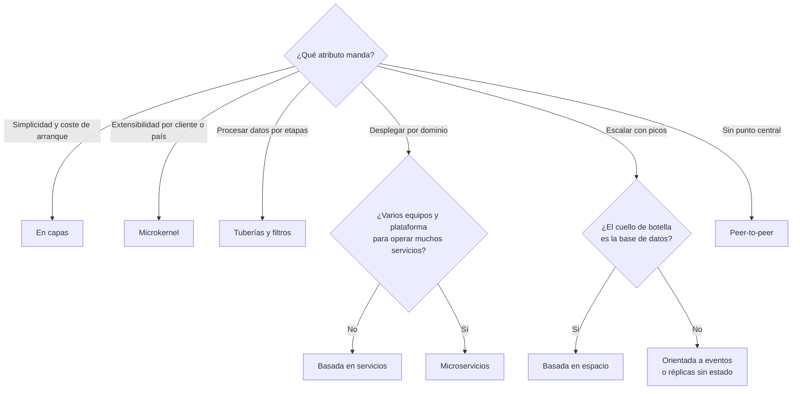

# Estilos arquitectónicos

En la primera reunión de diseño de un sistema nuevo alguien dice «hagamos microservicios», otra persona propone «usemos Kafka» y una tercera pide «arquitectura hexagonal». Las tres frases suenan a la misma clase de decisión, pero no lo son: la primera elige una forma global para el sistema, la segunda elige un producto y la tercera organiza el código dentro de una unidad desplegable. Mientras no se separen, la discusión gira en círculos y la decisión final la toma quien hable más alto.

Un **estilo arquitectónico es una forma reconocible de organizar un sistema: qué tipos de componentes tiene, con qué conectores interactúan y qué restricciones gobiernan esas interacciones**. Este artículo explica de dónde viene esa definición, la separa de los patrones y de las tecnologías, recorre nueve estilos con su promesa, su coste y su caso típico, y propone una forma de elegir que parte de los atributos de calidad y no de la moda.

<Callout tone="info" title="Fuentes y fecha de corte">
  Consultado en octubre de 2026. El artículo de Garlan y Shaw se leyó en su versión original de
  Carnegie Mellon. El informe de Mark Richards de 2015 se leyó en una copia en PDF; su segunda
  edición (2022) no se leyó, y lo que se dice de ella sale de la ficha del editor. El libro de
  Richards y Ford no se pudo abrir (la web de O'Reilly respondió 403): lo que se cuenta de él sale
  de su índice, vistas previas y apuntes universitarios que lo citan, y se señala como tal. La tabla
  de ejes y la comparativa son clasificaciones propias, no reproducen las de Richards.
</Callout>

## Qué es un estilo

La definición que sigue usándose hoy viene de David Garlan y Mary Shaw, en _An Introduction to Software Architecture_ (publicado en 1993 en un volumen de World Scientific y como informe técnico de Carnegie Mellon, CMU-CS-94-166, en enero de 1994). Su marco es sencillo: la arquitectura de un sistema concreto es un conjunto de **componentes** (las piezas que calculan) y de **conectores** (las interacciones entre ellas), que se puede dibujar como un grafo. Los conectores pueden ser cosas tan distintas como una llamada a procedimiento, la difusión de un evento, una consulta a una base de datos o una tubería.

Sobre ese marco, un estilo define una familia de sistemas con un mismo patrón de organización. En palabras de los autores, parafraseadas: el estilo fija el vocabulario de componentes y conectores que se pueden usar y un conjunto de restricciones sobre cómo combinarlos. Algunas son topológicas (por ejemplo, que no haya ciclos) y otras tienen que ver con la semántica de ejecución.

Garlan y Shaw proponen además seis preguntas para entender cualquier estilo, y siguen siendo una buena plantilla para evaluar uno:

1. ¿Cuál es el patrón estructural: componentes, conectores y restricciones?
2. ¿Cuál es el modelo de cómputo subyacente?
3. ¿Qué invariantes esenciales tiene?
4. ¿Qué ejemplos de uso son habituales?
5. ¿Qué ventajas e inconvenientes tiene?
6. ¿Qué especializaciones comunes existen?

Los propios autores advierten en una nota que las fronteras entre estilos pueden solaparse, y que eso no debe impedir identificar sus rasgos principales a partir de sus ejemplos centrales. Es un aviso útil: los estilos son prototipos, no categorías con bordes nítidos.

### Estilo, patrón y tecnología

Las tres palabras se usan de forma intercambiable en conversaciones y en libros, así que conviene fijar el nivel de cada una antes de discutir.

| Nivel      | Qué decide                                                         | Ejemplos                                          | Pregunta que responde                             |
| ---------- | ------------------------------------------------------------------ | ------------------------------------------------- | ------------------------------------------------- |
| Estilo     | La forma global: tipos de piezas, conectores y reglas de relación  | Orientado a eventos, tuberías y filtros, en capas | ¿Cómo está organizado el sistema en su conjunto?  |
| Patrón     | Una solución probada a un problema recurrente en un contexto local | Outbox, saga, repositorio, disyuntor              | ¿Cómo resuelvo este problema dentro de esa forma? |
| Tecnología | El producto que implementa componentes o conectores                | Kafka, gRPC, PostgreSQL, Kubernetes               | ¿Con qué herramienta lo construyo y lo opero?     |

El vocabulario no está unificado. El informe de Mark Richards _Software Architecture Patterns_ (O'Reilly, 2015) llama «patrones» a lo que aquí llamamos estilos; según la ficha del editor, su segunda edición (2022) los presenta ya como estilos y añade una sección sobre la diferencia entre ambos términos. Antes, _Pattern-Oriented Software Architecture_ (Buschmann y otros, 1996) catalogaba Layers, Pipes and Filters y Broker como «patrones arquitectónicos». Lo importante no es la etiqueta sino el alcance: un estilo condiciona todo el sistema; un patrón resuelve un problema dentro de él. Los patrones de diseño de código tienen su propio artículo en [patrones de diseño](/docs/patrones-de-diseno).

Un caso frontera: la arquitectura hexagonal, la cebolla y la limpia organizan el código **dentro** de una unidad desplegable alrededor del dominio. Se tratan en [arquitectura hexagonal](/docs/arquitectura-hexagonal) y en [capas, Clean y Onion](/docs/arquitectura-en-capas-clean-onion); aquí solo aparece la arquitectura en capas como estilo de sistema.

### Dos ejes que ordenan el catálogo

Dos preguntas separan casi todos los estilos antes de entrar en detalles. La segunda edición del informe de Richards las trata como temas propios, según la descripción del editor; la tabla que cruza cada estilo con los dos ejes es, en cambio, una clasificación propia de este artículo, no la de Richards:

- **¿Monolítico o distribuido?** Si el sistema se despliega como una unidad o como varias que se comunican por red. Todo lo distribuido paga latencia, fallos parciales y observabilidad más cara.
- **¿Partición técnica o por dominio?** Si las piezas principales se separan por función técnica (presentación, negocio, datos) o por área de negocio (pedidos, pagos, catálogo). Esto decide cuántas piezas toca un cambio de negocio típico.

**Clasificación propia por ejes** (valoración de este artículo, no tomada de Richards):

| Estilo              | Despliegue habitual   | Partición principal            |
| ------------------- | --------------------- | ------------------------------ |
| En capas            | Monolítico            | Técnica                        |
| Tuberías y filtros  | Cualquiera de los dos | Técnica (por etapa)            |
| Microkernel         | Monolítico            | Núcleo técnico y plug-ins      |
| Basada en servicios | Distribuido           | Dominio                        |
| Orientada a eventos | Distribuido           | Técnica o dominio              |
| Basada en espacio   | Distribuido           | Técnica (unidad de proceso)    |
| Microservicios      | Distribuido           | Dominio                        |
| Cliente-servidor    | Distribuido           | Rol (quien sirve y quien pide) |
| Peer-to-peer        | Distribuido           | Rol simétrico                  |

## Catálogo: nueve estilos

Cada estilo se resume con las preguntas de Garlan y Shaw reducidas a tres: qué promete, qué cuesta y dónde encaja de forma natural. Donde otro artículo ya lo trata a fondo, se enlaza en lugar de repetirlo.

### Monolito en capas

Componentes organizados en capas horizontales (presentación, negocio, persistencia) dentro de una sola unidad desplegable. Garlan y Shaw lo describen como un sistema jerárquico en el que cada capa da servicio a la de arriba y es cliente de la de abajo, con la restricción topológica de que las interacciones se limiten a capas adyacentes; su ejemplo más conocido son los protocolos de comunicación por capas.

- **Promesa:** separación de responsabilidades técnicas, una estructura que casi todos los equipos conocen y un arranque barato.
- **Coste:** la partición es técnica, así que un cambio de negocio suele atravesar todas las capas; se despliega y se escala como un todo.
- **Caso típico:** aplicaciones de negocio de tamaño pequeño o medio con un solo equipo.

La regla de dependencia, el sumidero de capas y sus variantes concéntricas están en [capas, Clean y Onion](/docs/arquitectura-en-capas-clean-onion).

### Tuberías y filtros

Los componentes son **filtros** que leen flujos de datos en sus entradas y producen flujos en sus salidas, de forma incremental; los conectores son **tuberías** que llevan la salida de uno a la entrada de otro. Garlan y Shaw fijan dos invariantes: los filtros no comparten estado y no conocen la identidad de los filtros que tienen antes o después. Sus ejemplos clásicos son las tuberías del shell de Unix y los compiladores vistos como una secuencia de fases.

- **Promesa:** el comportamiento total es la composición de los filtros; se reutilizan, se sustituyen y pueden ejecutarse en paralelo.
- **Coste:** según los mismos autores, tiende a organizar el trabajo por lotes, encaja mal con aplicaciones interactivas y puede forzar un formato de datos común que obliga a cada filtro a convertir su entrada y su salida.
- **Caso típico:** ETL, procesamiento de medios, compiladores, pipelines de integración continua.

### Microkernel (plug-in)

Un **núcleo** mínimo con la funcionalidad imprescindible y **plug-ins** que añaden capacidades a través de un contrato estable y un registro. Richards lo llama también patrón de plug-ins y en su informe de 2015 lo presenta como un encaje natural para aplicaciones de producto que se venden con variantes. Antes, _Pattern-Oriented Software Architecture_ ya lo catalogaba, junto a Reflection, entre los patrones para sistemas adaptables (_Adaptable Systems_).

- **Promesa:** extensibilidad y aislamiento de las funciones opcionales; puedes añadir o retirar un plug-in sin tocar el núcleo.
- **Coste:** el contrato del núcleo se vuelve muy difícil de cambiar; versionar plug-ins y probar sus combinaciones lleva trabajo; suele desplegarse como un todo, lo que limita el escalado.
- **Caso típico:** editores e IDE con extensiones, productos con reglas distintas por cliente o por país.

### Arquitectura basada en servicios

Una interfaz de usuario, **pocos servicios de dominio de grano grueso** desplegados por separado y, a menudo, una base de datos compartida. Richards y Ford la presentan en _Fundamentals of Software Architecture_ (O'Reilly, 2020) como un híbrido pragmático de los microservicios. Según la vista previa del capítulo, como los servicios suelen compartir una única base de datos, una aplicación tiene por lo general entre 4 y 12 servicios, con una media de unos 7; es una orientación, no un límite fijo.

- **Promesa:** partición por dominio y despliegues independientes sin pagar toda la complejidad operativa de los microservicios; cada servicio puede mantener transacciones locales sobre su parte de los datos.
- **Coste:** la base compartida acopla los datos: si un servicio cambia una tabla compartida, los demás que la usan deben cambiar a la vez, y la prueba de cada cambio se amplía. Los mismos apuntes proponen particionar la base de forma lógica por servicio para acotarlo.
- **Caso típico:** sistemas de negocio a medida de tamaño medio, con uno o dos equipos.

### Orientada a eventos

Los componentes **anuncian eventos** y otros se registran para reaccionar a ellos. Garlan y Shaw la describen como invocación implícita, y su invariante principal es que quien anuncia un evento no sabe qué componentes se verán afectados. Richards distingue en su informe dos topologías: con **mediador**, cuando un evento requiere orquestar varios pasos desde un punto central, y con **broker**, cuando los eventos se encadenan sin coordinador.

- **Promesa:** productores y consumidores evolucionan por separado; añadir una reacción nueva no obliga a cambiar a quien publica.
- **Coste:** el flujo completo ya no se lee en un solo sitio, el orden de procesamiento no está garantizado, y los errores y la consistencia eventual exigen diseño explícito.
- **Caso típico:** un hecho de negocio que interesa a muchos consumidores distintos (un pedido confirmado que dispara facturación, stock y notificaciones).

Los tipos de evento, CQRS y Event Sourcing están en [eventos, CQRS y Event Sourcing](/docs/event-driven-cqrs-event-sourcing); la entrega fiable, en [sagas, outbox e idempotencia](/docs/sagas-outbox-idempotencia).

### Basada en espacio

El nombre viene del espacio de tuplas de Linda, el modelo de coordinación que David Gelernter publicó en 1985 en _ACM Transactions on Programming Languages and Systems_. En el estilo, varias **unidades de proceso** mantienen los datos en memoria, replicados entre ellas, y un **middleware virtualizado** las coordina. La base de datos central deja de estar en la ruta de cada petición: los datos se procesan en memoria y llegan a la base por canales aparte (el índice del capítulo de Richards y Ford los llama _data pumps_).

- **Promesa:** elasticidad frente a picos de carga altos y difíciles de prever, porque el cuello de botella de la base central desaparece de la ruta crítica.
- **Coste:** es de los estilos más complejos de construir y de probar a escala; las colisiones entre réplicas y el volumen de datos que cabe en memoria son límites reales.
- **Caso típico:** venta de entradas y subastas en línea, que son precisamente los ejemplos del capítulo de Richards y Ford según su índice.

### Microservicios

James Lewis y Martin Fowler describieron el estilo el 25 de marzo de 2014 como una forma de construir una sola aplicación como un conjunto de servicios pequeños, cada uno en su propio proceso, comunicados por mecanismos ligeros, organizados alrededor de capacidades de negocio y desplegables de forma independiente. El propio artículo reconoce que no hay una definición precisa y la sustituye por características comunes, entre ellas el control descentralizado de los datos.

- **Promesa:** despliegue y escalado por servicio, y autonomía de equipos cuando las fronteras están bien trazadas.
- **Coste:** todo lo que trae la red (latencia, fallos parciales, consistencia eventual) más una plataforma operativa que alguien tiene que mantener.
- **Caso típico:** organizaciones con varios equipos que necesitan ritmos de despliegue distintos.

La comparación con el monolito y el monolito modular, con sus costes línea a línea, está en [monolito o microservicios](/docs/monolito-vs-microservicios).

### Cliente-servidor

Garlan y Shaw lo citan como una forma común de arquitectura distribuida: un servidor ofrece servicios a otros procesos, normalmente sin conocer de antemano cuántos clientes ni cuáles lo usarán; los clientes sí conocen al servidor (o lo descubren) y le hacen llamadas remotas.

- **Promesa:** datos y control centralizados, un modelo de seguridad sencillo de razonar y clientes ligeros.
- **Coste:** el servidor concentra la carga y es un punto único de fallo hasta que se replica, y replicarlo trae los problemas de cualquier sistema distribuido.
- **Caso típico:** casi cualquier aplicación web o móvil vista desde fuera, y el acceso a una base de datos.

Rara vez aparece solo: una aplicación web es cliente-servidor hacia fuera y, a menudo, en capas por dentro.

### Peer-to-peer

Cada participante comparte parte de sus recursos (cómputo, almacenamiento, red) y actúa a la vez como proveedor y como consumidor, sin el reparto fijo de papeles del cliente-servidor. Napster, lanzado en junio de 1999, lo popularizó para compartir archivos.

- **Promesa:** sin punto central de fallo, y la capacidad total crece con los participantes.
- **Coste:** descubrir pares, decidir en quién confiar, mantener datos coherentes y observar el sistema son problemas abiertos en cada diseño.
- **Caso típico:** distribución de archivos y sincronización entre dispositivos sin un servidor que lo controle todo.

## Comparativa cualitativa

Richards acompaña cada estilo de una tarjeta de puntuación por atributos de calidad. La tabla siguiente sigue la misma idea, pero con una valoración propia y con los criterios que más pesan al elegir. Léela por filas para entender un estilo y por columnas para ver qué cedes al priorizar un atributo. Las valoraciones describen el estilo bien aplicado; una mala implementación cambia cualquier celda.

| Estilo              | Despliegue por partes | Escalabilidad | Complejidad | Testabilidad                        | Acoplamiento de datos      |
| ------------------- | --------------------- | ------------- | ----------- | ----------------------------------- | -------------------------- |
| En capas            | Bajo                  | Baja          | Baja        | Media                               | Alto: una base             |
| Tuberías y filtros  | Medio                 | Media         | Baja        | Alta por filtro                     | Medio: formato común       |
| Microkernel         | Medio: plug-ins       | Baja          | Media       | Alta por plug-in                    | Medio                      |
| Basada en servicios | Alto                  | Media         | Media       | Media                               | Alto si comparte base      |
| Orientada a eventos | Alto                  | Alta          | Alta        | Baja en el flujo completo           | Bajo: contrato del evento  |
| Basada en espacio   | Medio                 | Muy alta      | Muy alta    | Baja                                | Medio: réplicas en memoria |
| Microservicios      | Alto                  | Alta          | Alta        | Alta por servicio, baja en conjunto | Bajo: datos por servicio   |
| Cliente-servidor    | Medio                 | Media         | Baja        | Media                               | Alto en el servidor        |
| Peer-to-peer        | Alto                  | Alta          | Alta        | Baja                                | Bajo: protocolo común      |

Ninguna fila gana en todas las columnas, y no es un accidente: los estilos que reparten el sistema en más piezas compran despliegue y escalado con complejidad. Por qué no se pueden maximizar todos los atributos a la vez se explica en [atributos de calidad](/docs/atributos-de-calidad).

## Cómo elegir un estilo

El estilo se elige al final, no al principio. El orden que funciona es el mismo que en cualquier decisión de arquitectura con [trade-offs](/docs/trade-offs-y-decisiones):

1. **Prioriza de tres a cinco atributos de calidad** y escríbelos como escenarios medibles. Si todo es prioritario, no hay criterio para elegir.
2. **Anota las restricciones**: tamaño y número de equipos, plataforma que ya operáis, requisitos de datos (transacciones, residencia, volumen).
3. **Preselecciona dos o tres estilos** cuya promesa coincida con el atributo dominante y cuyo coste podáis pagar con esas restricciones.
4. **Evalúalos contra los escenarios**, no contra su caso feliz: ¿qué pasa con un pico de carga, con un cambio de regla de negocio, con la caída de una pieza?
5. **Registra la decisión** en un [ADR](/docs/adr) con su condición de revisión, y protégela con [fitness functions](/docs/fitness-functions).

El diagrama resume las primeras ramas de esa conversación. Es un punto de partida para preseleccionar, no un veredicto:

### Combinar estilos con frontera

Garlan y Shaw ya observaban que la mayoría de los sistemas combinan varios estilos, y describían tres formas de hacerlo; la más clara es la jerarquía: un componente organizado según un estilo puede tener por dentro una estructura de otro estilo distinto. Esa es la manera sana de mezclar: cada estilo vive dentro de una frontera explícita (un servicio, un módulo, una etapa) y el estilo de fuera no se filtra hacia dentro. Un servicio de facturación puede ser un microkernel con un plug-in por pasarela de pago, aunque el sistema completo sea basado en servicios.

## Cuándo sí y cuándo no

Nombrar y decidir un estilo de forma explícita es una herramienta, no un ritual.

**Cuándo sí:**

- Al arrancar un sistema que va a vivir años o a crecer en equipos.
- Cuando cambia el atributo dominante: de llegar al mercado rápido a sostener picos de carga, por ejemplo.
- Antes de partir un monolito o de juntar servicios, para que la dirección del cambio tenga un destino.
- Cuando varios equipos tienen que compartir un vocabulario para hablar de la forma del sistema.

**Cuándo no:**

- En un script, un prototipo de pocas semanas o una herramienta interna pequeña: lo que trae el framework basta.
- Para resolver un problema local: un módulo lento se arregla en ese módulo, no cambiando el estilo de todo el sistema.
- Para resolver un problema de organización o de proceso: un estilo distribuido no arregla equipos que no se coordinan.

## Errores frecuentes

- **Elegir por moda.** El estilo que usa una empresa conocida resolvía sus restricciones, no las tuyas. Si nadie puede nombrar el atributo de calidad que compra el estilo, la elección es de currículum.
- **Mezclar estilos sin frontera.** Eventos para unas cosas, llamadas síncronas para otras y una base compartida por todos, sin regla que diga dónde vale cada cosa. El resultado no es un estilo híbrido, es la ausencia de estilo.
- **Confundir estilo con despliegue.** Meter un monolito en contenedores no lo convierte en microservicios, y repartir un sistema en servicios que comparten tablas y se despliegan juntos es un monolito distribuido. El estilo lo definen los componentes, los conectores y sus restricciones, no la herramienta que los ejecuta.
- **Confundir estilo con tecnología.** Usar un broker de mensajes no hace orientado a eventos a un sistema que lo usa como cola de órdenes síncronas disfrazadas.
- **Decidir por omisión.** El informe de Richards dedica un apartado al antipatrón _architecture by implication_: no elegir ningún estilo y acabar con el que salga. Casi siempre es un monolito sin fronteras.
- **Evaluar con el caso feliz.** Todos los estilos funcionan en la demo; la diferencia aparece con el pico de carga, el fallo parcial o el cambio que cruza tres módulos.

## Ejemplo trabajado: reservas para una red de clínicas

**Contexto.** Una red de veinte clínicas quiere un sistema propio de citas, historia administrativa del paciente, facturación y avisos. Lo construye un solo equipo de seis personas, que podría crecer a dos en un año. La facturación cambia con frecuencia porque cada país tiene su pasarela de pago y sus reglas fiscales.

**Atributos priorizados.** Facilidad de despliegue del módulo de facturación (cambios semanales sin parar las citas); disponibilidad de la agenda en horario de consulta; modificabilidad de las reglas por país. La escalabilidad importa poco: el volumen es moderado y previsible.

**Opciones preseleccionadas.**

| Criterio                          | En capas                 | Basada en servicios                    | Microservicios                      |
| --------------------------------- | ------------------------ | -------------------------------------- | ----------------------------------- |
| Desplegar facturación sola        | No                       | Sí                                     | Sí                                  |
| Coste operativo con un equipo     | Bajo                     | Medio                                  | Alto                                |
| Reglas por país                   | Condicionales repartidos | Aisladas en el servicio de facturación | Aisladas, con más piezas que operar |
| Transacciones entre agenda y pago | Locales                  | Locales dentro de cada servicio        | Sagas entre servicios               |

**Decisión.** Arquitectura basada en servicios con cuatro servicios gruesos (agenda, pacientes, facturación y avisos) y una base compartida particionada de forma lógica: cada servicio es dueño de sus tablas y solo un pequeño conjunto de datos de referencia es común. Dentro de facturación, un microkernel: el núcleo calcula la factura y cada país aporta un plug-in con su pasarela y sus reglas. La mezcla tiene frontera: el microkernel no sale del servicio de facturación.

La base compartida aquí no contradice el error que describe [monolito o microservicios](/docs/monolito-vs-microservicios): el estilo basado en servicios la acepta porque son pocos servicios, de un mismo dominio y en manos del mismo equipo, que cambia el esquema y despliega sin coordinar a nadie más; con tablas con dueño, ese acoplamiento es un coste conocido y acotado.

**Consecuencias y revisión.** Se acepta el acoplamiento de datos de la base compartida a cambio de no operar una plataforma de microservicios con seis personas. El ADR fija dos condiciones para revisar la decisión: que aparezca un segundo equipo con un ritmo de despliegue propio, o que la agenda necesite escalar por separado. Una regla en CI impide que un servicio lea tablas de otro.

## Checklist

- [ ] El equipo distingue estilo, patrón y tecnología en la propuesta.
- [ ] Hay de tres a cinco atributos de calidad priorizados y escritos como escenarios.
- [ ] Las restricciones de equipo, plataforma y datos están anotadas antes de elegir.
- [ ] Se compararon al menos dos estilos contra los escenarios, no contra su caso feliz.
- [ ] Cada mezcla de estilos tiene una frontera explícita y documentada.
- [ ] El estilo elegido está registrado en un ADR con su condición de revisión.
- [ ] Una regla ejecutable protege las restricciones principales del estilo.

## Fuentes

Consultadas en octubre de 2026. El texto de Garlan y Shaw se leyó completo; el de Lewis y Fowler, en su página original. El informe de Richards de 2015 se leyó en una copia en PDF; su segunda edición (2022) y el libro de Richards y Ford no se pudieron abrir: lo que se cita de ellos viene de la ficha del editor, el índice, vistas previas indexadas por buscadores y los apuntes de la Universidad de Queensland. La ubicación del microkernel en POSA 1 se comprobó en resúmenes del índice del libro, no en el libro.

- [An Introduction to Software Architecture (David Garlan y Mary Shaw, 1993; informe CMU-CS-94-166, 1994)](https://www.cs.cmu.edu/~able/publications/intro_softarch/)
- [Software Architecture Patterns (Mark Richards, O'Reilly, 2015)](https://www.oreilly.com/library/view/software-architecture-patterns/9781491971437/) leído en una copia en PDF, y su [segunda edición (2022)](https://www.oreilly.com/library/view/software-architecture-patterns/9781098134280/), consultada solo a través de la ficha del editor
- [Fundamentals of Software Architecture (Mark Richards y Neal Ford, O'Reilly, 2020)](https://www.oreilly.com/library/view/fundamentals-of-software/9781492043447/): índice y vistas previas, incluido el capítulo 13 sobre la arquitectura basada en servicios
- [Service-Based Architecture (Richard Thomas, apuntes del curso de arquitectura de software de la Universidad de Queensland)](https://csse6400.uqcloud.net/handouts/service-based.pdf)
- [Microservices (James Lewis y Martin Fowler, 25 de marzo de 2014)](https://martinfowler.com/articles/microservices.html)
- [Generative Communication in Linda (David Gelernter, ACM TOPLAS 7(1), 1985)](https://dl.acm.org/doi/10.1145/2363.2433)
- Pattern-Oriented Software Architecture, volumen 1 (Frank Buschmann y otros, Wiley, 1996), con su clasificación resumida en [Buschmann et al. (1996): Architectural Patterns (Universidad de Calgary)](https://ksi.cpsc.ucalgary.ca/courses/451-97/patterns/BuschmannArch.html)
- [Peer-to-peer en Wikipedia](https://en.wikipedia.org/wiki/Peer-to-peer)
